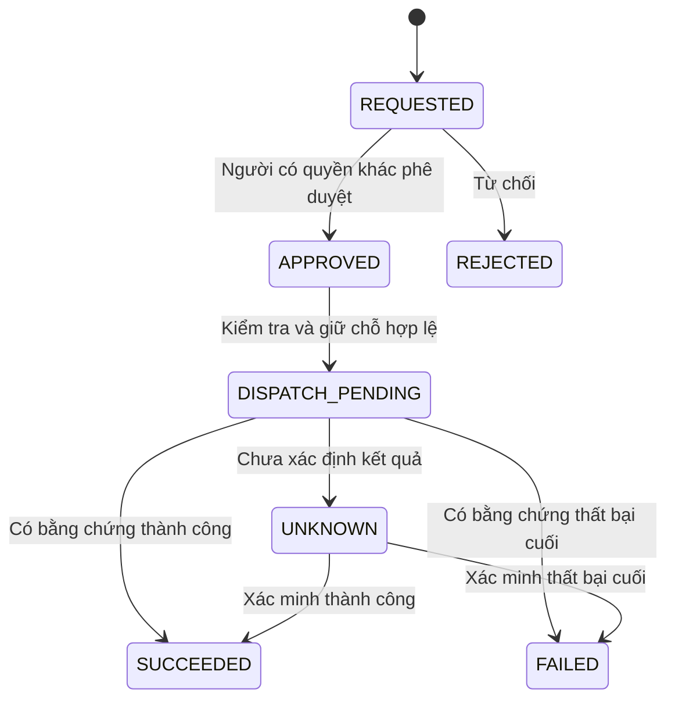

# Administrator actor — Chủ thể quản trị trong mô hình bảo mật nghiệp vụ

## 1. Quyền quản trị phải có phạm vi và ý nghĩa

Trong chương **Actor Model** của module **Business Logic Security** (`SECURITY_APPLICATION_SECURITY_BUSINESS_LOGIC_SECURITY`), **administrator actor** là chủ thể được giao một số năng lực quản trị: quản lý thành viên, cấp quyền, cấu hình chính sách, hỗ trợ khách hàng hoặc xử lý ngoại lệ.

“Administrator” không nên được hiểu là một danh tính đứng ngoài mọi quy tắc nghiệp vụ.

Một nhân viên có thể cần quyền khóa tài khoản, nhưng không cần quyền sửa giá đơn đã duyệt. Người quản trị tenant có thể quản lý thành viên của tổ chức mình, nhưng không được xem đơn của tenant khác. Nhân viên hỗ trợ có thể cần xem tiến trình thanh toán, nhưng không được tự tạo bằng chứng thanh toán thành công.

Các thao tác quản trị thường có tác động lớn vì chúng có thể thay đổi:

- Ai được phép hành động.
- Chính sách nào được áp dụng.
- Dữ liệu nào được coi là đúng.
- Trạng thái nào được dùng để tạo tác động tiếp theo.
- Bằng chứng nào còn tồn tại để điều tra.

Vì vậy, mô hình hóa quản trị viên là một phần trực tiếp của bảo vệ business invariants. Nếu API thông thường giữ đúng quy tắc nhưng API quản trị cho phép gán tùy ý `status`, `approvedBy` hoặc `price`, bảo đảm của toàn hệ thống vẫn bị phá vỡ.

Mục tiêu của bài là xác định administrator có thể làm gì, trên đối tượng nào, dưới điều kiện nào và bằng chứng nào giải thích quyết định đó.

## 2. Nhận diện các loại quản trị theo trách nhiệm thực tế

Không nên gom mọi công việc vào một vai trò `ADMIN` duy nhất. Có thể bắt đầu bằng việc phân loại trách nhiệm như sau:

| Loại chủ thể minh họa | Năng lực có thể cần | Ranh giới cần giữ |
| --- | --- | --- |
| Quản trị tenant | Quản lý thành viên, nhóm và cấu hình trong tổ chức | Không tự có quyền trên tenant khác hoặc mọi nghiệp vụ tài chính |
| Quản trị nền tảng | Quản lý vòng đời tenant, cấu hình nền tảng | Quyền điều khiển nền tảng không mặc nhiên là quyền thao tác mọi đơn hàng |
| Nhân viên hỗ trợ | Tra cứu sự cố, hỗ trợ một trường hợp cụ thể | Quyền xem khác quyền sửa; cần scope hỗ trợ |
| Người duyệt ngoại lệ | Duyệt hoàn tiền hoặc điều chỉnh theo hạn mức | Không tự duyệt yêu cầu mình tạo; duyệt đúng nội dung |
| Nhân sự vận hành | Chạy tác vụ phục hồi hoặc sửa lỗi dữ liệu được kiểm soát | Không sửa trực tiếp để bỏ qua invariant hoặc mất dấu vết |
| Chủ thể dịch vụ quản trị | Thực hiện command đã được hệ thống chấp nhận | Dùng danh tính dịch vụ riêng, không giả thành người dùng chung |

Đây là các vai trò nghiệp vụ minh họa, không phải một hệ phân cấp bắt buộc. Trong một tổ chức, cùng người có thể được giao nhiều trách nhiệm, nhưng hệ thống vẫn cần kiểm tra các điều kiện tách vai trò của từng thao tác.

Đặc biệt, **actor model trong bài là mô hình các chủ thể và năng lực bảo mật**, không phải mô hình lập trình đồng thời dùng actor và mailbox.

### 2.1. Chức danh không quyết định quyền

Các nhãn “trưởng nhóm”, “super admin” hoặc “nhân viên vận hành” chỉ hữu ích khi được ánh xạ tới các năng lực cụ thể.

Thay vì:

```text
isAdmin(actor) → cho phép mọi thao tác
```

hãy mô tả:

```text
can(
    actor,
    action,
    resource,
    tenant,
    currentState,
    context
)
```

Ví dụ, khả năng `member.invite` không hàm ý `refund.approve`; khả năng `refund.request` không hàm ý `refund.execute`.

### 2.2. Quyền kỹ thuật và quyền nghiệp vụ là hai phạm vi khác nhau

Một tài khoản cơ sở dữ liệu có thể chạy `UPDATE` không có nghĩa nhân sự sử dụng nó được phép đổi trạng thái nghiệp vụ theo mọi cách.

Tương tự, một tài khoản quản lý hạ tầng không tự có thẩm quyền phê duyệt một giao dịch thay khách hàng.

Khi có đường ghi kỹ thuật vượt qua ứng dụng, cần đưa nó vào mô hình đe dọa và kiểm soát vận hành. Nếu không, các ràng buộc trong domain chỉ bảo vệ một phần đường đi.

## 3. Administrator có thể ảnh hưởng đến những tài sản nào?

| Tài sản | Thao tác quản trị hợp lệ có thể có | Cách lạm dụng logic tương ứng |
| --- | --- | --- |
| Danh tính và thành viên | Mời người dùng, khóa phiên, thay nhóm | Thêm tài khoản kiểm soát được vào nhóm có quyền cao |
| Phân quyền | Cấp hoặc thu hồi một permission trong phạm vi | Tự cấp quyền rồi dùng nó để tự phê duyệt |
| Chính sách giá và giảm giá | Cấu hình chương trình theo quy trình | Tạo mức giá ngoại lệ cho đối tượng không đủ điều kiện |
| Phê duyệt | Duyệt yêu cầu cụ thể | Sửa số tiền hoặc người nhận sau duyệt |
| Hoàn tiền | Yêu cầu hoặc duyệt phần được hoàn | Bỏ qua hạn mức hoặc hoàn nhiều lần |
| Trạng thái đối tượng | Khóa, hủy hoặc phục hồi theo command | Gán trạng thái cuối để bỏ các bước bắt buộc |
| Dữ liệu phục hồi | Chạy một sửa chữa có kế hoạch | Xóa hoặc sửa bằng chứng làm che mất tác động |
| Log và lịch sử quyết định | Tra cứu điều tra | Xóa dấu vết hoặc ghi một actor giả |
| Tích hợp | Quản lý cấu hình kết nối | Đổi tài khoản đích hoặc ánh xạ sai tenant |

Mỗi khả năng cần được phân tích bằng một câu hỏi:

> Nếu người có năng lực này hành động sai, bị chiếm tài khoản hoặc dùng nhầm đối tượng, invariant nào có thể bị phá?

Cách đặt câu hỏi này giúp đánh giá quyền theo tác động thực tế, thay vì chỉ theo số endpoint được truy cập.

## 4. Bốn ranh giới phải tách rõ

### 4.1. Xác thực danh tính

Hệ thống cần biết principal nào đang gọi. Danh tính phải đến từ cơ chế xác thực tin cậy, không phải một trường `adminId` hoặc header tùy ý do client tự khai.

Xác thực mạnh hơn có thể là điều kiện bổ sung cho một thao tác nhạy cảm, nhưng không tự mở rộng quyền trên đối tượng.

### 4.2. Quyền thực hiện hành động

Hệ thống kiểm tra actor có năng lực tương ứng hay không, ví dụ `refund.approve`, trong phạm vi tenant, tài nguyên và thời gian được cấp.

Một phiên đã xác thực tốt nhưng không có permission phù hợp vẫn phải bị từ chối.

### 4.3. Điều kiện nghiệp vụ

Ngay cả khi actor có permission, command vẫn phải giữ đúng quy tắc:

```text
Không tự duyệt.
Không duyệt nội dung đã thay đổi.
Không hoàn vượt mức còn được phép.
Không dùng lại quyết định hết hiệu lực.
Không tạo tác động trùng.
```

Một câu `if (isAdmin) return true` ở đầu policy dễ làm biến mất toàn bộ lớp này.

### 4.4. Khả năng tác động lên hạ tầng và dữ liệu

Công cụ hỗ trợ, script sửa dữ liệu, job nền và tài khoản database đều có thể tạo kết quả tương tự API quản trị.

Mọi đường tác động cần được biết đến. Đường sửa chữa đặc biệt có thể cần một kế hoạch và cơ chế kiểm tra riêng, nhưng không được mặc nhiên bỏ qua tính đúng của dữ liệu chỉ vì người chạy có quyền kỹ thuật.

## 5. Ví dụ xuyên suốt: quản trị viên xử lý hoàn tiền thủ công

### 5.1. Chính sách minh họa

Giả sử một hệ thống có luồng hoàn tiền ngoại lệ:

1. Người có quyền tạo yêu cầu hoàn cho một đơn cụ thể.
2. Một người đủ quyền khác xét duyệt đúng số tiền, tiền tệ, đơn và lý do.
3. Hệ thống kiểm tra hạn mức còn lại và giữ chỗ trước khi thực hiện.
4. Worker dùng danh tính dịch vụ để gửi lệnh hoàn.
5. Kết quả được xác nhận hoặc được giữ ở trạng thái chưa xác định để đối soát.

Các trạng thái có thể được mô hình hóa như sau:



Sơ đồ không phải toàn bộ bảo đảm. Mỗi cạnh cần quyền, guard và cơ chế cạnh tranh phù hợp.

### 5.2. Bất biến cần giữ

```text
I1 — Scope:
Mọi quyết định áp dụng cho đúng tenant, đơn và yêu cầu hoàn.

I2 — Tách người tạo và người duyệt:
Người chịu trách nhiệm cho yêu cầu không đồng thời tự phê duyệt yêu cầu đó,
theo mô hình danh tính đáng tin cậy mà hệ thống quản lý.

I3 — Đúng nội dung:
Phê duyệt gắn với đúng requestRevision, amount, currency và đối tượng.

I4 — Không vượt hạn mức:
refundConfirmed + refundReserved <= refundableLimit.

I5 — Không tác động trùng:
Retry của cùng command không tạo thêm một lần hoàn.

I6 — Có bằng chứng:
SUCCEEDED chỉ được thiết lập từ bằng chứng thích hợp,
không từ một cờ thành công tùy ý do quản trị viên nhập.
```

I2 cần định nghĩa rõ “cùng người”. Chỉ so sánh hai accountId không phát hiện được một người dùng hai tài khoản nếu nền tảng không có liên kết danh tính đáng tin cậy. Với nhân sự nội bộ, có thể sử dụng định danh nhân sự hoặc chủ thể chịu trách nhiệm do hệ thống quản lý.

Một quy tắc trên các danh tính đã biết cũng không tự ngăn được hai người thông đồng. Đó là giới hạn cần được xử lý thêm bằng kiểm soát quyền, xem xét và dữ liệu điều tra.

### 5.3. Tránh API sửa trực tiếp kết quả

Một API như:

```text
PATCH /admin/refunds/{id}
{
    "status": "SUCCEEDED",
    "approvedBy": "someone",
    "amount": 1000000
}
```

trộn lẫn yêu cầu, quyết định và kết quả thực tế.

Nên biểu diễn các ý định riêng:

```text
POST /admin/tenants/{tenantId}/refund-requests
POST /admin/tenants/{tenantId}/refund-requests/{id}/approve
POST /admin/tenants/{tenantId}/refund-requests/{id}/reject
```

Máy chủ xác định actor từ phiên, tải đối tượng trong scope, kiểm tra quyền và ghi quyết định. Thành công của lệnh approve không đồng nghĩa tiền đã được hoàn.

## 6. Thiết kế quyền quản trị theo năng lực và phạm vi

### 6.1. Mô tả một quyền đủ cụ thể

Một quyền có thể cần các thành phần:

```text
principal
action
tenantScope
resourceScope
điều kiện hoặc hạn mức
thời điểm có hiệu lực và hết hiệu lực
nguồn cấp quyền hoặc chuỗi ủy quyền
```

Ví dụ:

```text
Nhân sự A:
    action = refund.approve
    tenant = T1
    resourceScope = các đơn thuộc chi nhánh B
    hạn mức = mức được phép trong tiền tệ xác định
    hiệu lực = khoảng thời gian được cấp
```

Một chuỗi permission đúng tên nhưng không có scope có thể tạo quyền rộng ngoài dự kiến.

Scope phải được kiểm tra trên dữ liệu có thẩm quyền của đối tượng. Tham số tenant trong URL hoặc một `branchId` do client gửi không tự chứng minh đối tượng thuộc phạm vi đó.

### 6.2. Tách quyền yêu cầu, duyệt và thực hiện

Các hành động liên quan cùng một nghiệp vụ không nhất thiết thuộc cùng người:

| Năng lực | Ý nghĩa | Không tự kéo theo |
| --- | --- | --- |
| `refund.request` | Tạo đề nghị hoàn | Duyệt hoặc thực hiện đề nghị |
| `refund.approve` | Chấp thuận nội dung đủ điều kiện | Thay nội dung sau duyệt hoặc báo thành công thay hệ thống ngoài |
| `refund.dispatch` | Gửi command đã đủ điều kiện | Tự chọn số tiền mới |
| `refund.reconcile` | Xác minh và áp dụng kết quả theo bằng chứng | Chỉnh số dư tùy ý để bỏ chênh lệch |
| `role.assign` | Cấp một tập quyền được phép ủy quyền | Cấp mọi permission hiện có trong nền tảng |

Tách năng lực giúp giảm tác động của một tài khoản bị lạm dụng. Nó vẫn cần guard trên từng đối tượng và tính nhất quán khi thực thi.

### 6.3. Kiểm soát việc cấp quyền để tránh leo thang gián tiếp

Một người có quyền gán role không nên được phép gán mọi role mà hệ thống biết.

Quy tắc có thể là:

```text
quyền định cấp nằm trong tập được phép ủy quyền
∧ scope định cấp không vượt scope được phép
∧ thời hạn không vượt giới hạn được phép
∧ các điều kiện tách vai trò vẫn được giữ
```

Không nhất thiết người có một quyền được quyền cấp nó cho người khác. **Quyền sử dụng** và **quyền ủy quyền** là hai năng lực riêng.

Cũng không nên chỉ so sánh một số `roleLevel`. Hai role có thể có những năng lực khác nhau mà không xếp thành một thứ tự cao thấp đơn giản.

Một đường leo thang cần thử là:

```text
Quản trị viên tạo yêu cầu hoàn.
→ tự cấp role approver cho tài khoản khác mình kiểm soát.
→ dùng tài khoản đó duyệt yêu cầu.
```

Ngăn đường này đòi hỏi kiểm soát cấp quyền, liên kết danh tính chịu trách nhiệm và quy tắc không tự duyệt. Một cờ role tại thời điểm gọi API chưa giải quyết được toàn bộ chuỗi.

### 6.4. Thu hồi quyền và quyền đã được sử dụng

Cần định nghĩa điều gì xảy ra khi một quyền bị thu hồi:

- Các command chưa thực thi có phải kiểm tra lại không?
- Quyết định đã phê duyệt có tiếp tục được dùng không?
- Phiên hoặc token đã phát hành còn được chấp nhận trong bao lâu?
- Có những hành động nào cần trạng thái quyền hiện hành thay vì snapshot cũ?

Không có một câu trả lời phù hợp mọi nghiệp vụ. Với command qua queue, việc kiểm tra ở API rồi không xét lại có thể vô tình làm quyền cũ sống lâu hơn chính sách cho phép.

Nếu yêu cầu thu hồi có hiệu lực ngay tại điểm quyết định, cơ chế cache, version quyền hoặc phối hợp với nguồn quyền phải đáp ứng điều đó.

## 7. Đưa ngữ cảnh quản trị đáng tin cậy vào code

### 7.1. Request không được tự xác định danh tính quản trị

Body có thể chứa `expectedRequestRevision` và lý do duyệt. Actor, permission, tenant được phép và thời hạn quyền phải được xác định ở máy chủ.

Đoạn Java sau minh họa một phần kiểm tra nền cho lệnh duyệt: permission có scope tenant, thời hạn nâng mức xác thực, trạng thái, revision và tách người yêu cầu với người duyệt.

```java
import java.time.Instant;
import java.util.Objects;
import java.util.Set;

final class AdministratorApprovalChecks {
    enum RequestState {
        REQUESTED, APPROVED, REJECTED, DISPATCH_PENDING,
        SUCCEEDED, FAILED, UNKNOWN
    }

    record ScopedPermission(
            String tenantId,
            String action,
            Instant expiresAt) {
        ScopedPermission {
            Objects.requireNonNull(tenantId);
            Objects.requireNonNull(action);
            Objects.requireNonNull(expiresAt);
        }
    }

    // Được tạo từ xác thực và nguồn phân quyền ở máy chủ.
    record AuthenticatedAdmin(
            String principalId,
            String accountableSubjectId,
            Set<ScopedPermission> permissions,
            Instant elevatedUntil) {
        AuthenticatedAdmin {
            Objects.requireNonNull(principalId);
            Objects.requireNonNull(accountableSubjectId);
            permissions = Set.copyOf(permissions);
            Objects.requireNonNull(elevatedUntil);
        }
    }

    record ApprovalTarget(
            String tenantId,
            String requestId,
            String requesterSubjectId,
            long requestRevision,
            RequestState state) {
        ApprovalTarget {
            Objects.requireNonNull(tenantId);
            Objects.requireNonNull(requestId);
            Objects.requireNonNull(requesterSubjectId);
            Objects.requireNonNull(state);
            if (requestRevision <= 0) {
                throw new IllegalArgumentException("INVALID_REVISION");
            }
        }
    }

    static void requireBaseApprovalConditions(
            AuthenticatedAdmin actor,
            ApprovalTarget target,
            long expectedRequestRevision,
            Instant decisionTime) {
        Objects.requireNonNull(actor);
        Objects.requireNonNull(target);
        Objects.requireNonNull(decisionTime);

        boolean hasScopedPermission = actor.permissions().stream()
                .anyMatch(permission ->
                        permission.tenantId().equals(target.tenantId())
                        && permission.action().equals("refund.approve")
                        && decisionTime.isBefore(permission.expiresAt()));

        if (!hasScopedPermission) {
            throw new IllegalStateException("APPROVAL_NOT_AUTHORIZED");
        }
        if (!decisionTime.isBefore(actor.elevatedUntil())) {
            throw new IllegalStateException("FRESH_AUTHENTICATION_REQUIRED");
        }
        if (actor.accountableSubjectId()
                .equals(target.requesterSubjectId())) {
            throw new IllegalStateException("SELF_APPROVAL_FORBIDDEN");
        }
        if (target.state() != RequestState.REQUESTED) {
            throw new IllegalStateException("INVALID_SOURCE_STATE");
        }
        if (expectedRequestRevision != target.requestRevision()) {
            throw new IllegalStateException("REQUEST_CHANGED");
        }
    }
}
```

Trong chính sách minh họa, tại đúng thời điểm hết hiệu lực thì điều kiện không còn đạt. `decisionTime` phải do máy chủ tin cậy cung cấp theo ranh giới thời gian đã định, không lấy tùy ý từ client.

### 7.2. Những bảo đảm đoạn code chưa cung cấp

Đoạn code là một phần của luồng, không phải policy hoàn chỉnh:

- Scope chi nhánh hoặc từng đối tượng và hạn mức theo tiền tệ chưa được biểu diễn.
- Nội dung yêu cầu phải được tải từ nguồn có thẩm quyền, không tạo `ApprovalTarget` trực tiếp từ body.
- `accountableSubjectId` phải đến từ liên kết danh tính đáng tin cậy; client không được tự chọn.
- Permission trong context là một snapshot. Chính sách thu hồi quyết định snapshot đó có còn được sử dụng hay phải đánh giá lại.
- Trạng thái quyền và yêu cầu có thể đổi đồng thời. Cần cơ chế bảo vệ tại điểm quyết định.
- Các phép tính và giới hạn hoàn tiền vẫn cần domain và transaction tương ứng.

Tên kiểu `AuthenticatedAdmin` không tự tạo ranh giới bảo mật. Chỉ thành phần tin cậy được tạo ngữ cảnh này từ bằng chứng đã xác thực; việc bind nó từ request sẽ phá giả định của ví dụ.

### 7.3. Nâng mức xác thực không thay thế authorization

Một thao tác có thể yêu cầu xác thực mới hoặc một phiên được nâng mức trong thời gian giới hạn. Điều đó hỗ trợ xác nhận người đang thao tác, nhưng không chứng minh:

```text
đúng tenant
đúng đối tượng
đủ hạn mức
không tự duyệt
nội dung chưa đổi
```

Các điều kiện trên vẫn phải được kiểm tra riêng.

## 8. Thực thi command quản trị trong ranh giới nhất quán

### 8.1. Luồng phê duyệt minh họa

```text
1. Xác thực principal và xây dựng ngữ cảnh tin cậy.

2. Bắt đầu transaction.

3. Tải yêu cầu theo tenant và requestId.
   Khóa hoặc sử dụng version theo cơ chế đã chọn.

4. Đánh giá quyền trên yêu cầu hiện hành:
   scope, hạn mức, hiệu lực và các điều kiện quản trị.

5. Kiểm tra:
   trạng thái nguồn,
   người yêu cầu khác người duyệt,
   expectedRevision khớp revision hiện hành.

6. Ghi quyết định gắn với nội dung được duyệt.
   Lưu bằng chứng và audit/outbox cục bộ cần thiết.

7. Commit.
```

Không được đọc nội dung, kiểm tra tất cả rồi mới mở transaction chỉ để gán `APPROVED`. Một người khác có thể sửa yêu cầu giữa hai bước.

Khóa bản ghi yêu cầu chỉ đủ cho dữ liệu thuộc giao thức phối hợp đó. Nếu hạn mức, quyền hoặc thông tin liên quan có thể đổi độc lập, cần mở rộng lập luận nhất quán cho chúng.

### 8.2. Duyệt không đồng nghĩa giữ chỗ hoặc thực hiện

Bước approve có thể cho biết người có thẩm quyền chấp thuận. Nếu hạn mức tài chính chỉ được giữ chỗ sau đó, bước thực hiện vẫn phải kiểm tra khả năng giữ chỗ theo chính sách.

Không được dùng quyết định phê duyệt để bỏ qua điều kiện `refundConfirmed + refundReserved <= refundableLimit`.

Nếu quy trình yêu cầu giữ chỗ ngay khi duyệt, hãy đặt việc giữ chỗ và quyết định vào cùng ranh giới nhất quán phù hợp. Hai cách có ý nghĩa khác nhau và cần được mô tả rõ.

### 8.3. Idempotency cho thao tác quản trị

Quản trị viên cũng có thể nhấn hai lần hoặc retry sau khi mất phản hồi. Cần nhận diện cùng command và trả kết quả theo hợp đồng mà không tạo thêm tác động.

Khóa idempotency cần được ràng buộc với scope và nội dung command. Cùng khóa nhưng khác yêu cầu hoặc revision không phải replay hợp lệ.

Nếu dùng khóa khác, state machine và tính duy nhất nghiệp vụ vẫn phải chặn duyệt hoặc thực hiện lặp ngoài chính sách. Quyền quản trị không làm mất nhu cầu bảo vệ trước retry.

Khi xung đột revision, không tự thay expected revision sang nội dung mới để lệnh thành công. Một quyết định của con người không tự chuyển sang một số tiền hoặc đối tượng khác.

## 9. Thao tác thay người dùng phải giữ được danh tính gốc

### 9.1. Phân biệt người thực hiện và chủ thể được đại diện

Một nhân viên hỗ trợ có thể cần thao tác trong ngữ cảnh khách hàng. Khi đó, chỉ lưu `userId = customer` sẽ làm mất sự thật rằng người thực hiện là nhân viên.

Nên phân biệt:

```text
initiatingPrincipal: danh tính khởi tạo
effectiveSubject: chủ thể nghiệp vụ đang được đại diện
accountableSubject: chủ thể chịu trách nhiệm cho thao tác
delegation: phạm vi và bằng chứng ủy quyền hoặc phiên hỗ trợ
executingService: dịch vụ thực thi, nếu có
```

Ví dụ:

```text
initiatingPrincipal = support-agent-17
effectiveSubject = customer-42
accountableSubject = employee-17
delegation = phiên hỗ trợ cho tenant T1, case C9
```

Đơn hàng vẫn thuộc khách hàng. Audit phải cho biết nhân viên nào đã thao tác. Không được đổi actor gốc thành khách hàng chỉ để các API cũ hoạt động.

### 9.2. Tránh hợp nhất quyền thành một tập rộng hơn

Trong chế độ thao tác như người dùng, cần giới hạn theo những hành động được phép của phiên hỗ trợ và phạm vi nghiệp vụ tương ứng.

Nếu lấy hợp của mọi quyền nhân viên và mọi quyền khách hàng, hệ thống có thể tạo một chủ thể có năng lực mà không bên nào được phép sử dụng trong ngữ cảnh đó.

Một chính sách hỗ trợ có thể:

- Chỉ cho phép xem hoặc một tập command được định nghĩa.
- Ràng buộc tenant, đối tượng và thời hạn.
- Yêu cầu case hoặc lý do hỗ trợ.
- Không cho dùng chế độ này để tự phê duyệt hoặc thay đổi thông tin xác thực ngoài quy trình riêng.
- Giữ actor gốc trong mọi command và sự kiện liên quan.

Case ID và lý do hỗ trợ là ngữ cảnh để kiểm tra và điều tra, không tự tạo quyền truy cập.

### 9.3. Tách vai trò phải dùng đúng danh tính chịu trách nhiệm

Nếu nhân viên A tạo refund thay khách hàng rồi chuyển sang chế độ quản trị để duyệt, việc so sánh approverId với customerId có thể bỏ lọt tự duyệt.

Yêu cầu hoàn cần lưu ai thực sự tạo và chịu trách nhiệm, bên cạnh khách hàng hưởng hoặc liên quan tới nghiệp vụ. Guard phải áp dụng chính sách tách vai trò trên danh tính thích hợp.

Không được cho client thay `initiatingPrincipal`, `accountableSubject` hoặc chuỗi ủy quyền để đổi kết quả kiểm tra.

## 10. Quyền khẩn cấp và ngoại lệ phải được mô hình hóa

### 10.1. Quyền khẩn cấp là một cấp quyền có vòng đời

Một cơ chế khẩn cấp, thường gọi là **break-glass**, có thể cho phép năng lực rộng hơn trong một sự cố. Nó vẫn cần xác định:

| Thành phần | Nội dung cần biết |
| --- | --- |
| Chủ thể | Ai được kích hoạt và ai chịu trách nhiệm? |
| Lý do | Sự cố hoặc nhu cầu nào được phép sử dụng? |
| Scope | Tenant, tài nguyên và hành động nào được mở? |
| Thời hạn | Khi nào bắt đầu, hết hiệu lực và bị thu hồi? |
| Điều kiện kích hoạt | Có cần xác thực mới hoặc phê duyệt theo quy trình không? |
| Bằng chứng | Ghi nhận gì để theo dõi và xem xét sau thao tác? |
| Giới hạn | Những điều kiện nào vẫn bắt buộc? |

Một cờ `emergency = true` trong request không phải cơ chế khẩn cấp. Máy chủ phải xác minh một cấp quyền hoặc phiên đặc biệt có thẩm quyền, đúng scope và còn hiệu lực.

Hết phiên khẩn cấp phải làm mất các năng lực tạm thời theo chính sách. Không nên để một token hoặc bản sao permission cũ tiếp tục có quyền vô thời hạn.

### 10.2. Ngoại lệ hợp lệ khác với dữ liệu sai

Nghiệp vụ có thể cho phép hoàn sau thời hạn thông thường nếu người có thẩm quyền chấp thuận ngoại lệ. Khi đó có thể có command và bằng chứng riêng cho ngoại lệ thời hạn.

Điều này không đồng nghĩa được:

- Hoàn vượt số tiền có thể hoàn trong mô hình đó.
- Tự tạo bằng chứng giao dịch thành công.
- Ghi một người duyệt không thực sự đưa ra quyết định.
- Xóa lịch sử để làm ngoại lệ trông giống quy trình bình thường.

Nếu doanh nghiệp muốn chi thêm một khoản hỗ trợ ngoài số tiền gốc, cần mô hình hóa đúng loại nghiệp vụ thay vì ghi nó thành một khoản refund khiến các bất biến hoàn tiền không còn đúng.

Một mô hình tốt nói rõ quy tắc nào được phép có ngoại lệ, ai quyết định, dữ liệu nào bị ảnh hưởng và quy tắc nào vẫn phải giữ.

### 10.3. Khẩn cấp không loại bỏ ranh giới lỗi

Quyền rộng hơn không khiến một lần gọi dịch vụ ngoài trở nên nguyên tử với database.

Nếu lệnh hoàn bị timeout, quản trị viên không nên được phép đánh dấu “chưa thực hiện” chỉ để thử một lệnh mới. Cần trạng thái chưa xác định, định danh ổn định và quy trình xác minh phù hợp.

Tương tự, bấm “thử lại ngay” vẫn phải giữ idempotency và kiểm tra tác động đã xảy ra. Quyền khẩn cấp không thay đổi sự thật rằng kết quả liên lạc có thể không phản ánh đầy đủ kết quả nghiệp vụ.

## 11. Cấu hình và sửa chữa dữ liệu cũng là hành động nghiệp vụ

### 11.1. Thay cấu hình có thể thay kết quả của hàng nghìn command

Một người không có quyền duyệt trực tiếp vẫn có thể gây tác động lớn nếu được sửa:

```text
hạn mức phê duyệt
ngưỡng được tự động chấp thuận
danh sách người có quyền duyệt
quy tắc giảm giá
tenant mapping của tích hợp
tài khoản hoặc định danh người nhận
chính sách bỏ qua một bước kiểm tra
```

Do đó, cần phân tích cả chuỗi:

```text
Sửa policy
→ thay tập command được phép
→ tạo tác động nghiệp vụ
```

Việc cấp quyền sửa policy có thể cần scope, review hoặc tách người thay đổi và người chấp thuận theo mức tác động. Không nên chỉ kiểm tra “có quyền sửa bảng cấu hình”.

### 11.2. Phiên bản chính sách và thời điểm áp dụng

Khi policy thay đổi, cần xác định:

- Yêu cầu đã tạo nhưng chưa duyệt dùng policy nào?
- Phê duyệt đã có còn hiệu lực không?
- Command đang ở queue phải được đánh giá lại theo quy tắc nào?
- Việc thu hồi một quyền có ảnh hưởng tới các quyết định chưa thực thi không?

Có thể lưu phiên bản policy trong quyết định để tái dựng. Tuy nhiên, một phiên bản cũ được lưu không tự cho phép bỏ qua quy tắc thu hồi hiện hành nếu chính sách yêu cầu xét lại.

Thời điểm áp dụng là một phần của hợp đồng, không nên phụ thuộc ngẫu nhiên vào cache nào vừa được đọc.

### 11.3. Sửa chữa dữ liệu không phải sửa cột tùy ý

Trong sự cố, có thể cần sửa một trạng thái sai hoặc tái dựng một projection. Tác vụ sửa chữa nên có:

```text
tập đối tượng mục tiêu được xác định
trạng thái trước mong đợi
thay đổi dự kiến
bất biến cần giữ
định danh lần sửa chữa
người yêu cầu và người thực hiện
bằng chứng hoặc lý do
cách xác minh sau áp dụng
cách xử lý chạy lại và lỗi một phần
```

Một câu lệnh cập nhật có điều kiện hoặc command phục hồi theo nghiệp vụ thường giúp phát hiện dữ liệu đã đổi so với kế hoạch.

Nếu trực tiếp cập nhật database là một phần của quy trình được phép, phải tính cả constraint, transaction, dữ liệu liên quan và dấu vết. Chỉ sửa một cột status có thể làm số dư, outbox hoặc quyết định phê duyệt không còn nhất quán.

Với sổ cái hoặc dữ liệu cần giữ lịch sử, có thể cần tác động đảo hoặc điều chỉnh có liên kết thay vì ghi đè sự kiện gốc. Không nên xóa chênh lệch để che mất vấn đề cần đối soát.

## 12. Danh tính dịch vụ và audit phải giữ được chuỗi trách nhiệm

### 12.1. Worker không nên dùng tài khoản người quản trị chung

Khi một command đã được chấp nhận được thực thi bất đồng bộ:

```text
Người yêu cầu
→ người phê duyệt
→ application service
→ worker
→ hệ thống bên ngoài
```

Worker cần danh tính dịch vụ riêng và permission tối thiểu cho phần thực thi. Message cần liên kết tới command, đối tượng, revision và quyết định có thẩm quyền.

Không gửi token người dùng dài hạn vào queue chỉ để worker giả làm người đó. Cơ chế ủy quyền hoặc ngữ cảnh cần thiết phải được thiết kế có scope, thời hạn và điều kiện thực thi rõ ràng.

Nếu quyền phải còn hiệu lực khi thực thi, worker cần kiểm tra lại theo chính sách. Nếu việc chấp nhận tạo ra một ủy quyền có hiệu lực riêng, ủy quyền đó phải là đối tượng được kiểm soát, không phải một boolean trong message.

### 12.2. Audit cần ghi điều gì?

Theo nhu cầu tái dựng quyết định và phạm vi dữ liệu được phép lưu, có thể ghi:

| Nhóm | Dữ liệu hữu ích |
| --- | --- |
| Danh tính | Principal gốc, chủ thể chịu trách nhiệm, chủ thể được đại diện |
| Hành động | Command, loại quyết định, đối tượng và tenant |
| Nội dung | Revision, các tham chiếu hoặc snapshot cần thiết cho quyết định |
| Quyền | Scope, grant hoặc phiên hỗ trợ/khẩn cấp được dùng; policy version nếu cần |
| Lý do | Mã lý do, case hoặc thông tin chấp thuận tương ứng |
| Kết quả | Được chấp nhận, bị từ chối, đã commit hoặc còn chưa xác định |
| Liên kết | Command ID, correlation ID, idempotency reference và sự kiện liên quan |
| Thời gian | Các mốc máy chủ cần thiết để hiểu diễn biến |

Không ghi token, mật khẩu, khóa bí mật hoặc toàn bộ thông tin nhạy cảm chỉ vì thao tác do admin thực hiện.

Lý do trong một ô nhập là lời khai của người thao tác, không phải bằng chứng rằng thao tác đã được phép.

### 12.3. Audit thành công và lần thử bị từ chối có ranh giới khác nhau

Đối với thay đổi thành công, có thể lưu bản ghi audit cục bộ hoặc outbox trong cùng transaction để không có kết quả commit thiếu bằng chứng mà thiết kế yêu cầu.

Đối với lần thử bị từ chối hoặc transaction rollback, log nằm trong chính transaction bị rollback sẽ không còn tồn tại. Nếu cần giữ lần thử đó, phải dùng đường ghi phù hợp với ranh giới này.

Cần phân biệt:

```text
attempted: có lần thử
accepted: command được chấp nhận
committed: thay đổi cục bộ đã commit
externalSucceeded: có bằng chứng tác động bên ngoài thành công
```

Không ghi `SUCCEEDED` trước commit hoặc trước bằng chứng chỉ để mọi bước có cùng một nhãn log.

Nếu bằng chứng bền vững là điều kiện bắt buộc để chấp nhận hành động rủi ro cao, hệ thống phải thực thi yêu cầu đó khi đường audit bị lỗi, thay vì âm thầm bỏ qua.

### 12.4. Người có quyền tác động không nên tùy ý xóa dấu vết của mình

Kiểm soát quyền đọc, ghi và lưu giữ audit giúp giảm khả năng xóa hoặc sửa lịch sử để che hành động.

Một tài khoản có quyền chỉnh dữ liệu nghiệp vụ không nhất thiết cần quyền xóa audit. Việc tra cứu dữ liệu nhạy cảm trong audit cũng cần scope riêng.

Những cơ chế này hỗ trợ phát hiện và điều tra. Chúng không thay thế guard trước khi commit một hành động sai.

## 13. Kiểm thử chủ thể quản trị theo chuỗi hành động

### 13.1. Ma trận tình huống cần thử

| Tình huống | Bảo đảm cần quan sát |
| --- | --- |
| Quản trị tenant A gửi ID của tenant B | Không đọc hoặc sửa đối tượng ngoài scope |
| Có role admin nhưng thiếu refund.approve | Không duyệt chỉ vì nhãn role |
| Có quyền xem nhưng gọi endpoint sửa | Quyền xem không bị mở rộng ngầm |
| Client gửi adminId, approvedBy hoặc isAdmin | Máy chủ không lấy chúng làm danh tính hoặc thẩm quyền |
| Người tạo tự duyệt cùng tài khoản | Bị chặn bởi tách vai trò |
| Người tạo dùng tài khoản khác có cùng danh tính chịu trách nhiệm đã liên kết | Chính sách tách vai trò vẫn được áp dụng |
| Nhân viên tạo thay khách hàng rồi tự duyệt trong chế độ khác | Không mất actor chịu trách nhiệm ban đầu |
| Người có role.assign tự cấp quyền ngoài tập được ủy quyền | Không leo thang permission hoặc scope |
| Tăng hạn mức policy rồi dùng để tạo tác động ngoài thẩm quyền | Đường thay policy cũng được kiểm soát |
| Duyệt revision cũ sau khi số tiền hoặc người nhận đổi | Không áp dụng quyết định cũ cho nội dung mới |
| Hai lần duyệt hoặc thực hiện chạy đồng thời | Không tạo hai quyết định hoặc hai tác động ngoài chính sách |
| Mất phản hồi rồi retry cùng command | Trả kết quả theo hợp đồng, không hoàn thêm |
| Đổi idempotency key để chạy lại | State machine và tính duy nhất nghiệp vụ vẫn giữ |
| Quyền hết hạn hoặc bị thu hồi khi command đang chờ | Hành vi đúng chính sách hiệu lực đã định |
| Phiên nâng mức xác thực hết hạn | Không dùng quyền thao tác nhạy cảm dựa trên ngữ cảnh đã hết hiệu lực |
| Phiên hỗ trợ sai tenant, tài nguyên hoặc quá hạn | Không mở rộng phạm vi bằng impersonation |
| Gửi emergency=true mà không có cấp quyền hợp lệ | Không kích hoạt quyền khẩn cấp từ một cờ request |
| Dùng break-glass để báo thành công khi kết quả ngoài chưa biết | Không tạo bằng chứng giả hoặc bỏ quản lý trạng thái unknown |
| Gây lỗi sau một phần ghi nhưng trước commit | Không để lại quyết định, giữ chỗ hoặc outbox dở dang |
| Rollback một lần thử bị từ chối | Dữ liệu lần thử cần lưu vẫn tồn tại ở đúng đường audit đã thiết kế |
| Chạy lại tác vụ sửa chữa | Không áp dụng trùng hoặc ghi đè dữ liệu ngoài tập dự kiến |

Kiểm thử tách vai trò cần xác định rõ phạm vi danh tính mà hệ thống thực sự biết. Không nên báo rằng đã ngăn mọi trường hợp “một người dùng nhiều tài khoản” nếu chỉ kiểm tra accountId.

### 13.2. Kiểm thử ở các lớp khác nhau

**Unit test policy và domain** kiểm tra scope, trạng thái nguồn, revision, tách vai trò và hiệu lực thời gian.

**Integration test** kiểm tra constraint, transaction, khóa, kiểm soát phiên bản, idempotency và đường ghi audit/outbox.

**Kiểm thử API** kiểm tra rằng ngữ cảnh danh tính đến từ nguồn tin cậy, các trường nhạy cảm không bị mass assignment và tenant được kiểm tra đúng.

**Kiểm thử luồng quản trị** kiểm tra chuỗi cấp quyền, thay policy, thao tác hỗ trợ, khẩn cấp và thực thi qua queue. Một endpoint riêng lẻ đúng chưa chứng minh cả chuỗi không thể bị lạm dụng.

Với cạnh tranh, cần điều khiển lịch thực thi bằng cơ chế đồng bộ và đọc lại dữ liệu đã commit. Không chỉ dựa vào mã phản hồi hoặc việc nút bấm bị ẩn.

### 13.3. Đọc lại những gì để kết luận?

Tùy tình huống, cần quan sát:

```text
trạng thái và revision yêu cầu
người thực sự yêu cầu và phê duyệt
scope và hiệu lực quyền
bằng chứng quyết định
số tiền giữ chỗ và đã hoàn
số tác động hoặc lệnh gửi ra ngoài
bản ghi idempotency
audit, outbox và liên kết dịch vụ thực thi
```

Một API trả lỗi có thể đã commit trước khi phản hồi bị mất. Một log ghi “admin approved” cũng chưa chứng minh đúng người, đúng nội dung hoặc đúng tenant.

## 14. Hồ sơ actor cho một trách nhiệm quản trị

Khi thêm một vai trò hoặc màn hình quản trị, hãy mô tả actor bằng một hồ sơ có thể kiểm chứng:

| Thành phần | Câu hỏi cần trả lời |
| --- | --- |
| Danh tính | Principal nào được dùng và ai chịu trách nhiệm thực tế? |
| Trách nhiệm | Actor cần thực hiện nghiệp vụ gì? |
| Năng lực | Những action cụ thể nào được phép? |
| Scope | Tenant, chi nhánh, đối tượng và hạn mức nào? |
| Nguồn quyền | Ai cấp, có được ủy quyền tiếp không và trong thời gian nào? |
| Điều kiện bổ sung | Có cần xác thực mới, phê duyệt hoặc phiên hỗ trợ không? |
| Bất biến | Những quy tắc nào vẫn bắt buộc với actor này? |
| Tách vai trò | Ai không được tạo, duyệt và thực hiện cùng một yêu cầu? |
| Ngữ cảnh thay mặt | Actor gốc và effective subject được giữ thế nào? |
| Cạnh tranh và retry | Cơ chế nào bảo vệ quyết định khi dữ liệu đổi hoặc request lặp? |
| Ngoại lệ | Ngoại lệ nào hợp lệ, do ai cấp và không vượt qua những giới hạn nào? |
| Bằng chứng | Cần giữ gì để tái dựng quyết định và tác động? |
| Thu hồi và phục hồi | Quyền hết hiệu lực ra sao, command đang chờ và dữ liệu sai được xử lý thế nào? |

Administrator actor được mô hình hóa tốt là một chủ thể có năng lực rõ ràng và trách nhiệm truy vết được. Khi các ranh giới này có trong policy, domain và transaction, các đường quản trị mới giữ được cùng những bảo đảm nghiệp vụ mà hệ thống cung cấp cho các đường sử dụng thông thường.
