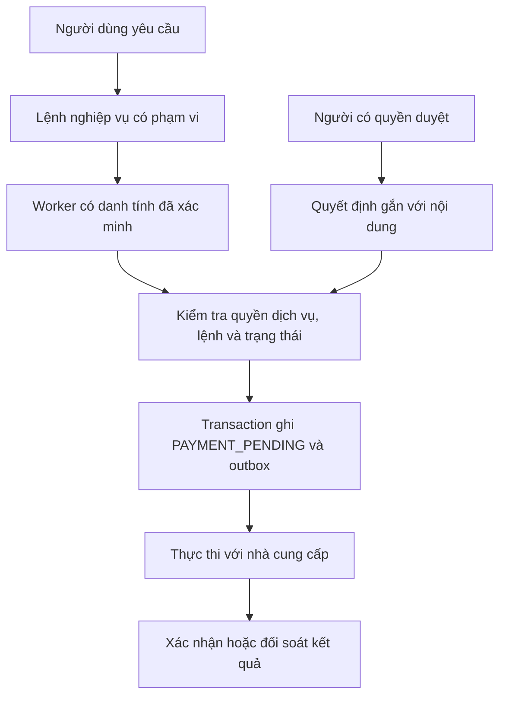

# Service account actor — Tác nhân tài khoản dịch vụ

Một worker chạy nền có thể đọc nhiều đơn hàng, gọi nhà cung cấp thanh toán và xử lý công việc khi không có người dùng trực tiếp thao tác. Nếu hệ thống coi “được gọi bởi dịch vụ nội bộ” là đủ để thực hiện mọi hành động, một yêu cầu do người dùng tạo có thể được worker thực hiện bằng quyền rộng hơn nhiều so với quyền người đó có.

**Service account actor** là tác nhân được nhận diện bằng tài khoản hoặc danh tính dành cho phần mềm. Trong chương **Actor Model**, mục tiêu là mô hình hóa tác nhân này trong các quyết định nghiệp vụ: dịch vụ được làm gì, trên đối tượng nào, thay mặt ai và với điều kiện nào.

Bài học đặt tài khoản dịch vụ trong bối cảnh bảo vệ phê duyệt, giá, quyền trên đối tượng, transaction và idempotency. “Actor” ở đây là chủ thể tham gia nghiệp vụ và quyết định bảo mật; không phải mô hình lập trình đồng thời bằng actor.

## 1. Tài khoản dịch vụ đại diện cho điều gì?

Tài khoản dịch vụ có thể đại diện cho một ứng dụng tích hợp, worker, tác vụ định kỳ hoặc một thành phần xử lý tự động. Nó giúp hệ thống nhận diện phần mềm đang yêu cầu hành động, thay vì dùng tài khoản cá nhân của một nhân viên.

Ví dụ:

| Tác nhân dịch vụ | Công việc có thể được giao | Quyền không tự phát sinh từ công việc đó |
| --- | --- | --- |
| `payment-worker` | Thực thi nghĩa vụ thanh toán đã đủ điều kiện | Tự phê duyệt đơn, sửa giá hoặc đổi người nhận tiền |
| `export-worker` | Tạo file trong phạm vi yêu cầu đã được cho phép | Xuất toàn bộ dữ liệu vì có thể đọc toàn bộ cơ sở dữ liệu |
| `notification-service` | Gửi thông báo tới người nhận hợp lệ | Tự chọn người nhận hoặc tiết lộ mọi trường nội bộ |
| `inventory-sync` | Đồng bộ dữ liệu tồn kho theo hợp đồng tích hợp | Thay giá bán hoặc cấp quyền người dùng |
| `scheduled-billing` | Khởi tạo công việc theo lịch và chính sách được cấu hình | Bỏ qua giới hạn tổ chức hoặc thu lại nghĩa vụ đã hoàn tất |

Tên dịch vụ không phải một chính sách đầy đủ. Hai hệ thống cùng có `payment-worker` có thể giao cho nó các quyền khác nhau. Cần mô tả năng lực cụ thể thay vì suy luận từ tên.

Cũng cần tách các lớp danh tính:

- **Danh tính nghiệp vụ của dịch vụ:** chủ thể dùng trong quyết định phân quyền và audit.
- **Danh tính instance hoặc workload:** tiến trình hay phiên chạy cụ thể đang thực thi.
- **Thông tin xác thực:** token, chứng chỉ hoặc cơ chế khác dùng để chứng minh danh tính.
- **Tài khoản hạ tầng:** tài khoản truy cập cơ sở dữ liệu, broker hoặc kho tệp.

Một tài khoản cơ sở dữ liệu có quyền đọc nhiều bảng không có nghĩa API được phép tiết lộ những bảng đó cho mọi người gọi. Quyền kỹ thuật phục vụ thực thi và quyền nghiệp vụ phải được liên kết có chủ đích.

## 2. Phân biệt người khởi xướng, người duyệt và dịch vụ thực thi

Giả sử người mua tạo yêu cầu thanh toán; một người khác duyệt đơn; sau đó worker thực hiện gọi nhà cung cấp.

Ba vai trò cần được giữ riêng:

| Vai trò | Ví dụ | Ý nghĩa |
| --- | --- | --- |
| Người khởi xướng | `user-17` | Đưa ra yêu cầu hoặc tạo quy trình ban đầu |
| Người ra quyết định phê duyệt | `user-42` | Chấp thuận nội dung cụ thể theo quyền và chính sách |
| Tác nhân thực thi | `payment-worker` | Thực hiện công việc đã được cấp trong phạm vi cho phép |

Nếu audit chỉ ghi `payment-worker`, hệ thống mất dấu người khởi xướng. Nếu ghi worker thành người duyệt, hệ thống diễn giải sai một bước thực thi thành quyết định nghiệp vụ.

Trong chính sách cấm người tạo tự phê duyệt, không được coi một worker chạy thay người tạo là một người độc lập đủ điều kiện duyệt. Ngược lại, nếu sản phẩm có cơ chế phê duyệt tự động thật sự, cần định nghĩa riêng quyền, điều kiện và loại quyết định tự động. Không nên trá hình việc thực thi bằng một tài khoản kỹ thuật thành sự phê duyệt độc lập của con người.

Một ngữ cảnh có thể giữ:

```json
{
  "initiator": {
    "type": "USER",
    "id": "user-17"
  },
  "executor": {
    "type": "SERVICE",
    "id": "payment-worker"
  },
  "tenantId": "organization-a",
  "workflowId": "workflow-909",
  "approvalId": "approval-325",
  "operationId": "payment-operation-771"
}
```

Đây là mô hình dữ liệu minh họa. Các trường phải được máy chủ tạo, kiểm tra hoặc lấy từ nguồn tin cậy phù hợp. Một JSON có đủ các trường không tự chứng minh ngữ cảnh đó hợp lệ.

## 3. Hai chế độ quyền: tự chủ và thực hiện theo ủy quyền

### 3.1. Dịch vụ thực hiện công việc tự chủ

Một tác vụ theo lịch có thể không có người dùng hiện diện ở thời điểm chạy. Ví dụ, dịch vụ tạo hóa đơn định kỳ dựa trên hợp đồng đã có hiệu lực.

Quyền của nó đến từ một chính sách hệ thống hoặc cấu hình nghiệp vụ được cho phép:

```text
Dịch vụ được phép
  tạo hóa đơn cho hợp đồng đủ điều kiện,
  trong phạm vi tổ chức được quản lý,
  theo kỳ tính hợp lệ,
  với số tiền do quy tắc máy chủ xác định,
  khi chưa tạo nghĩa vụ tương ứng trước đó.
```

Không cần bịa một người dùng giả làm người khởi xướng. Có thể ghi rõ nguồn là tác vụ định kỳ và tham chiếu lịch, hợp đồng hoặc chính sách đã cấp thẩm quyền.

“Tự chủ” không có nghĩa được làm mọi việc. Dịch vụ vẫn có giới hạn theo hành động, đối tượng, thời điểm, trạng thái và ngân sách.

### 3.2. Dịch vụ thực hiện công việc theo người dùng hoặc workflow

Một người dùng yêu cầu export và worker chạy sau. Quyền kỹ thuật rộng của worker không được tự mở rộng tập bản ghi mà người dùng được phép xuất.

Một cách tư duy cho chế độ này là:

```text
Hành động được phép
= năng lực đã cấp cho dịch vụ
  và phạm vi của lệnh hoặc ủy quyền hợp lệ
  và các điều kiện nghiệp vụ trên đối tượng.
```

Phạm vi ủy quyền có thể được quyết định từ quyền hiện tại của người yêu cầu hoặc một quyền thực hiện công việc đã được cấp trước đó theo chính sách. Phải chọn rõ hợp đồng, đặc biệt khi quyền người dùng thay đổi trong lúc job chờ chạy.

Không nên dùng công thức “quyền dịch vụ cộng quyền người dùng” để cho phép tất cả những gì một trong hai bên làm được. Worker có quyền rộng ở hạ tầng không phải lý do để yêu cầu hạn chế của người dùng trở thành một thao tác toàn quyền.

### 3.3. Không trộn hai chế độ khi thiếu dữ liệu

Nếu một job theo ủy quyền bị mất thông tin người khởi xướng hoặc phạm vi, không được mặc định chuyển nó thành công việc hệ thống để tiếp tục chạy bằng quyền rộng.

Tương tự, một tác vụ tự chủ có chính sách riêng không nên phụ thuộc vào một tài khoản nhân viên tình cờ tạo lịch rồi mất quyền. Cần xác định thẩm quyền bền vững của lịch và điều kiện thu hồi hoặc thay đổi nó.

## 4. Xác thực dịch vụ chưa phải phân quyền nghiệp vụ

Xác thực trả lời: “Phần mềm nào đang gọi?” Phân quyền còn phải trả lời: “Phần mềm đó có được làm hành động này trên đối tượng này trong ngữ cảnh hiện tại không?”

Một quyết định có thể cần các lớp sau:

| Lớp kiểm tra | Ví dụ |
| --- | --- |
| Danh tính được công nhận | Workload thuộc dịch vụ đã đăng ký và còn hiệu lực |
| Đúng bên nhận và môi trường | Thông tin xác thực dành cho API và môi trường đang xử lý |
| Đúng năng lực | Được yêu cầu thực thi thanh toán, không có quyền phê duyệt |
| Đúng tổ chức và đối tượng | Job được ràng buộc với đơn của tổ chức A |
| Đúng nguồn công việc | Lệnh đến từ producer hoặc workflow được cho phép |
| Đúng trạng thái và nội dung | Đơn đã duyệt và nội dung không đổi |
| Đúng giới hạn tác động | Số tiền, người nhận, thời hạn và ngân sách còn hợp lệ |
| Chưa thực hiện tác động tương ứng | Retry không tạo khoản thu mới |

Một token hợp lệ, kết nối mTLS hoặc kênh mạng nội bộ có thể góp phần xác thực ở ranh giới tương ứng. Chúng không tự kiểm tra toàn bộ các điều kiện nghiệp vụ còn lại.

Các trường như `X-Service-Name`, `isInternal=true` hoặc `role=SYSTEM` do bên không đáng tin có thể tự gửi không được dùng làm chứng cứ danh tính. Nếu một gateway gắn thông tin danh tính, cần bảo đảm chỉ gateway hoặc kênh đã xác minh mới tạo được ngữ cảnh có thẩm quyền đó.

Danh tính và quyền phải có phạm vi môi trường rõ ràng. Một workload thử nghiệm không được nhận quyền môi trường thật chỉ vì dùng cùng tên dịch vụ.

## 5. Lỗi confused deputy: dùng dịch vụ như người thực thi có đặc quyền

**Confused deputy** xảy ra khi một thành phần có quyền bị dẫn dắt sử dụng quyền đó cho một yêu cầu không có thẩm quyền tương ứng.

Ví dụ, API cho phép người dùng tạo export bằng payload:

```json
{
  "tenantId": "organization-b",
  "requestedBy": "admin",
  "includeInternalFields": true,
  "filter": {
    "status": "ALL"
  }
}
```

Worker đọc hàng đợi bằng tài khoản có quyền rộng rồi tin các trường trên. Người dùng của tổ chức A có thể khiến worker xuất dữ liệu tổ chức B hoặc thêm trường nội bộ.

Lỗi không nằm ở việc worker có khả năng kỹ thuật đọc dữ liệu. Lỗi nằm ở chỗ khả năng đó được dùng mà không ràng buộc với quyền của yêu cầu nghiệp vụ.

Một thiết kế cần:

1. Xác định chủ thể và tổ chức ở ranh giới đã xác thực.
2. Kiểm tra người yêu cầu có quyền tạo loại công việc đó trên tập dữ liệu nào.
3. Lưu lệnh hoặc grant có phạm vi ở nguồn tin cậy.
4. Để worker kiểm tra lệnh, nguồn và chính sách hiệu lực trước khi thực thi.
5. Truy vấn trong đúng phạm vi và chỉ tạo dữ liệu đầu ra được phép.
6. Bảo vệ cả nơi lưu kết quả và bước tải xuống.

Một hàng đợi “nội bộ” không tự làm mọi message trở nên hợp lệ. Cần biết ai có quyền publish, nội dung nào được producer bảo đảm và consumer còn phải xác minh điều gì.

## 6. Viết invariant cho service account actor

| Mã | Invariant | Ví dụ vi phạm |
| --- | --- | --- |
| S1 | Hành động được gắn với danh tính dịch vụ đã được xác minh | Tin tên dịch vụ do client gửi |
| S2 | Quyền dịch vụ được giới hạn theo năng lực và phạm vi đối tượng | Worker thanh toán có thể gọi luôn API tự duyệt |
| S3 | Chế độ tự chủ hoặc theo ủy quyền được xác định rõ | Job thiếu người yêu cầu tự động được nâng thành tác vụ hệ thống |
| S4 | Tổ chức, đối tượng và tham số tác động được ràng buộc với lệnh hợp lệ | Đổi `orderId` trong job để thanh toán đơn khác |
| S5 | Dịch vụ không được bỏ qua invariant của đối tượng | Thực thi thanh toán khi phê duyệt đã lỗi thời |
| S6 | Người khởi xướng, người duyệt và người thực thi không bị đánh đồng | Worker được coi là người duyệt độc lập chỉ vì có tài khoản khác |
| S7 | Retry hoặc chạy đồng thời không nhân đôi tác động | Hai worker cùng thu tiền cho một nghĩa vụ |
| S8 | Thu hồi, hết hạn và thay đổi quyền có ngữ nghĩa thực thi rõ ràng | Một grant đã thu hồi vẫn được dùng qua đường chạy lại job |
| S9 | Có thể truy vết quyết định và tác động mà không ghi lộ thông tin xác thực | Log chứa token nhưng không biết đơn hoặc thao tác tương ứng |

Các invariant này áp dụng cho mọi đường gọi liên quan: API, message, lịch chạy và công cụ vận hành. Thêm một service account mới không được tự tạo một đường ghi bỏ qua guard đã tồn tại ở luồng người dùng.

## 7. Ví dụ: worker chỉ thực thi thanh toán đã đủ điều kiện

Giả sử đơn có trạng thái:

```text
DRAFT → PENDING_APPROVAL → APPROVED → PAYMENT_PENDING → PAID
```

Tổ chức quy định người tạo không được tự duyệt. Phê duyệt gắn với phiên bản nội dung, số tiền và tiền tệ. Worker chỉ có năng lực bắt đầu thực thi nghĩa vụ đã được duyệt; nó không có quyền sửa giá hay tạo quyết định duyệt.

Một luồng có thể được tổ chức như sau:



Các điều kiện ở bước bắt đầu bao gồm:

- Dịch vụ đang hoạt động và được phép thực hiện loại hành động.
- Lệnh thuộc nguồn được chấp nhận, đúng tổ chức và đúng đơn.
- Cơ sở ủy quyền hoặc chính sách hệ thống còn đủ hiệu lực theo hợp đồng.
- Đơn đang ở trạng thái phù hợp, với nội dung hiện tại khớp nội dung đã duyệt.
- Số tiền, tiền tệ và người nhận được lấy từ nguồn có thẩm quyền.
- Nghĩa vụ chưa được hoàn tất hoặc đang được nhận diện là cùng một lần xử lý.
- Các hạn mức và điều kiện tài chính liên quan vẫn được giữ.

Không nhận `amount` hoặc `beneficiary` trong message như nguồn quyết định duy nhất nếu chúng chỉ là dữ liệu client có thể ảnh hưởng. Có thể dùng các giá trị đó để đối chiếu, nhưng quyết định phải dựa trên bản nội dung, hợp đồng và dữ liệu mà hệ thống có thẩm quyền quản lý.

### 7.1. Minh họa service Java

Đoạn sau minh họa ranh giới giữa danh tính dịch vụ, lệnh đã được xác minh và trạng thái nghiệp vụ. Các kiểu và repository cần được cài đặt theo ứng dụng; đây không phải một bộ xử lý thanh toán hoàn chỉnh.

`VerifiedWorkloadActor` đến từ tầng xác thực dịch vụ. `VerifiedJobContext` được tạo sau khi kiểm tra nguồn, phạm vi và nội dung lệnh; không phải request body được đổi tên.

```java
@Transactional
public PaymentStartResult startPayment(
        VerifiedWorkloadActor workload,
        VerifiedJobContext job) {

    policy.requirePaymentExecutor(workload);
    policy.requireValidExecutionAuthority(workload, job);

    Order order = orders.findForUpdate(job.tenantId(), job.orderId())
            .orElseThrow(OrderNotVisibleException::new);

    policy.requireMayExecuteOn(workload, job, order);

    var existing = paymentOperations.findInScope(
            job.tenantId(), job.operationId());

    if (existing.isPresent()) {
        return replayPolicy.authorizedResult(
                workload, job, order, existing.get());
    }

    order.requireApprovedContent(job.expectedContentRevision());
    policy.requirePaymentLimits(order, job);

    PaymentOperation operation = paymentOperations.createFor(
            order.approvedPaymentTerms(),
            job.operationId(),
            job.initiator(),
            workload.principalId());

    order.markPaymentPending(operation.id());
    orders.save(order);
    outbox.append(PaymentRequested.from(operation));

    return PaymentStartResult.from(operation);
}
```

Những hợp đồng quan trọng phía sau mã:

- Truy vấn và các bản ghi liên quan phải giữ đúng phạm vi tổ chức.
- Kết quả replay chỉ được trả khi đúng thao tác, đúng nội dung có ý nghĩa và chính sách truy cập cho phép. Không được dùng một khóa để lấy kết quả của thao tác khác.
- Guard phê duyệt kiểm tra cả trạng thái và nội dung có hiệu lực, không chỉ một cờ boolean từng được đặt trong quá khứ.
- Việc tạo operation, chuyển trạng thái và ghi outbox cần cùng transaction phù hợp.
- Cần ràng buộc định danh và điều kiện trạng thái chống tranh chấp; khóa đơn chỉ có hiệu lực khi các đường cập nhật phối hợp tương thích.
- Nếu kiểm tra hạn mức dựa trên tài nguyên dùng chung ngoài đơn, cần phối hợp cả dữ liệu đó.
- Các lỗi phải rollback theo cấu hình transaction của ứng dụng.

Trong ví dụ, lời gọi nhà cung cấp được thực hiện từ luồng xử lý thông điệp sau commit. Transaction cục bộ không tự rollback một khoản tiền đã thu ở hệ thống ngoài.

### 7.2. Không xem timeout là bằng chứng chưa thực hiện

Nếu nhà cung cấp đã thu tiền nhưng worker mất response, retry không được tạo một lần thu độc lập chỉ vì service account vẫn có quyền.

Cần liên kết nghĩa vụ, lần thực thi và định danh chống trùng theo hợp đồng với nhà cung cấp nếu có. Kết quả chưa rõ cần được truy vấn hoặc đối soát. Danh tính dịch vụ hợp lệ không làm biến mất sự bất định của tác động bên ngoài.

## 8. Lệnh bất đồng bộ, ủy quyền và thay đổi quyền

Một job có thể chạy sau vài phút hoặc vài giờ. Trong khoảng đó, người dùng mất quyền, đơn đổi nội dung hoặc grant bị thu hồi.

Có hai kiểu chính sách thường cần phân biệt:

| Chính sách | Ý nghĩa |
| --- | --- |
| Kiểm tra quyền hiện tại | Job chỉ chạy nếu chủ thể và quan hệ quyền cần thiết vẫn hợp lệ tại thời điểm quyết định thực thi |
| Quyền thực hiện đã được cấp có phạm vi | Một quyết định được lưu cho phép thực hiện công việc xác định theo điều kiện và thời hạn riêng |

Không có lựa chọn đúng cho mọi quy trình. Một báo cáo dữ liệu nhạy cảm có thể yêu cầu kiểm tra lại quyền khi chạy và khi tải. Một nghĩa vụ theo hợp đồng có thể tiếp tục được xử lý theo thẩm quyền hệ thống dù nhân viên tạo yêu cầu đã nghỉ việc.

Nếu dùng grant, cần xác định tối thiểu:

- Ai có quyền cấp và cấp theo chính sách nào.
- Dịch vụ hoặc nhóm tác nhân nào được sử dụng.
- Tổ chức, đối tượng và hành động cụ thể.
- Các giới hạn như số tiền, trường dữ liệu, số lần dùng hoặc phiên bản nội dung.
- Thời hạn và cơ chế thu hồi.
- Cách chống việc dùng lại cho đối tượng hoặc tác động khác.

Một grant hợp lệ không phải quyền chung để bỏ qua state machine. Nội dung đã đổi hoặc nghĩa vụ đã hoàn tất vẫn có thể làm công việc không còn thực hiện được.

Không nên giữ một token người dùng dài hạn trong payload chỉ để worker có thể chạy sau. Có thể lưu tham chiếu lệnh hoặc quyền thực thi có phạm vi và để worker dùng danh tính riêng, đồng thời bảo vệ dữ liệu tham chiếu theo thiết kế.

## 9. Vòng đời tài khoản dịch vụ và thông tin xác thực

### 9.1. Quyền cần gắn với chức năng rõ ràng

Dùng một tài khoản `system-admin` cho mọi worker khiến khó giới hạn quyền và khó biết dịch vụ nào thật sự gây tác động. Có thể tách theo chức năng và môi trường khi các thành phần có mức thẩm quyền khác nhau.

Cần quản lý cả nơi phát hành danh tính, ánh xạ sang principal của ứng dụng và nơi quyết định quyền. Một chuỗi tên trong token hoặc chứng chỉ chỉ có ý nghĩa sau khi nguồn, hiệu lực và phạm vi tương ứng đã được xác minh.

Không để thiếu cấu hình tổ chức trở thành mặc định “được truy cập mọi tổ chức”. Nếu có dịch vụ đa tổ chức, phạm vi rộng đó phải là quyền được cấp rõ ràng, kèm kiểm tra đúng đối tượng cho từng công việc.

### 9.2. Xoay vòng credential không được tạo quyền lợi mới

Thay token hoặc chứng chỉ có thể làm thay đổi thông tin xác thực mà không làm thay đổi danh tính nghiệp vụ ổn định của dịch vụ.

Các giới hạn theo chủ thể như quota hoặc phạm vi idempotency không nên vô tình reset mỗi lần đổi credential hoặc khởi động instance mới. Cần phân biệt principal ổn định, instance thực thi và phiên xác thực.

Ngược lại, nếu một dịch vụ mới có quyền khác, không nên hợp nhất nó với dịch vụ cũ chỉ vì tên hiển thị giống nhau.

### 9.3. Thu hồi cần có ranh giới hiệu lực

Vô hiệu hóa tài khoản, thu hồi grant hoặc xoay khóa có thể ảnh hưởng khác nhau tới request mới, token còn hiệu lực, cache quyết định quyền và job đang chạy.

Cần xác định điều hệ thống cam kết: chặn lần nhận việc mới, kiểm tra trước mỗi tác động, hay dừng công việc đang thực thi khi có cơ chế phù hợp. Chỉ đặt trạng thái `disabled` trong một bảng chưa bảo đảm mọi consumer đã ngừng chấp nhận tác nhân đó.

Thông tin xác thực phải được cung cấp và lưu theo cơ chế bảo vệ phù hợp. Không ghi nguyên token, khóa hoặc chuỗi kết nối vào audit, tracing hay payload được nhiều người có thể đọc.

## 10. Truy vết hành động của service account

Một sự kiện nghiệp vụ nên liên kết được:

```text
Tổ chức và đối tượng.
Hành động và phiên bản nội dung.
Người hoặc nguồn khởi xướng.
Dịch vụ thực thi và instance nếu cần.
Lệnh, grant hoặc chính sách tạo thẩm quyền.
Quyết định phê duyệt liên quan.
Thao tác logic, lần thử và nguyên nhân trực tiếp.
Kết quả thực tế: đã commit, bị từ chối hoặc chưa xác nhận.
```

Ví dụ, “payment-worker gọi API thành công” không cho biết đơn nào được thanh toán, khoản thu nào liên quan hoặc số tiền có đúng nội dung đã duyệt hay không.

Audit cần phân biệt hành động tự chủ với hành động theo ủy quyền. Nếu dịch vụ thực thi thay người dùng, không nên xóa dấu dịch vụ khỏi lịch sử rồi chỉ ghi người dùng như thể họ trực tiếp gọi nhà cung cấp.

Dữ liệu audit cũng cần quyền truy cập phù hợp. Người xem lịch sử không được đọc thông tin tổ chức khác hoặc nhận bí mật xác thực chỉ vì có quyền hỗ trợ vận hành.

Đối với thay đổi bắt buộc có dấu vết, thiết kế cần gắn audit với trạng thái đã commit, thay vì gửi một dòng “thành công” trước khi transaction kết thúc.

## 11. Kiểm thử dưới góc nhìn tác nhân dịch vụ

| Tình huống | Cách tạo điều kiện | Thuộc tính cần xác minh |
| --- | --- | --- |
| Dịch vụ đúng chức năng | Workload hợp lệ thực thi job đủ điều kiện | Tác động đúng phạm vi và có dấu vết nguồn |
| Danh tính giả | Client gửi tên hoặc header dịch vụ | Không được nhận quyền chỉ từ dữ liệu tự khai |
| Đúng danh tính, sai hành động | Worker thanh toán gọi duyệt hoặc sửa giá | Bị từ chối dù xác thực thành công |
| Sai môi trường hoặc bên nhận | Dùng thông tin xác thực ngoài phạm vi | Không chấp nhận như credential dành cho API hiện tại |
| Sai tổ chức | Sửa tổ chức trong job hoặc lệnh | Không thao tác ngoài phạm vi được cấp |
| Sai đối tượng | Dùng grant của đơn A cho đơn B | Phát hiện ràng buộc không khớp |
| Thiếu nguồn thẩm quyền | Job theo ủy quyền mất initiator hoặc grant | Không chuyển ngầm sang tác vụ hệ thống toàn quyền |
| Tự phê duyệt qua worker | Người tạo kích hoạt dịch vụ để duyệt thay mình | Chính sách tách người tạo và người duyệt không bị bỏ qua |
| Nội dung thay đổi | Job tham chiếu revision cũ | Không thực thi theo phê duyệt lỗi thời |
| Sửa tác động | Đổi số tiền hoặc người nhận trong message | Không dùng giá trị không có thẩm quyền |
| Người dùng mất quyền | Quyền đổi khi job chờ chạy | Kết quả đúng chính sách hiện tại hoặc grant đã được định nghĩa |
| Grant hết hạn hoặc thu hồi | Chạy lại job với grant không còn dùng được | Không chấp nhận qua đường retry hoặc consumer khác |
| Retry và cạnh tranh | Hai worker nhận cùng thao tác | Không nhân đôi tác động; replay đúng ngữ nghĩa |
| Timeout hệ thống ngoài | Tác động đã xảy ra nhưng mất phản hồi | Không tạo lần thực hiện mới trái phép |
| Xoay credential | Dịch vụ nhận thông tin xác thực mới | Không reset quota hoặc tách cùng thao tác thành lần mới |
| Đường vận hành | Chạy lại từ công cụ quản trị hoặc hàng lỗi | Vẫn giữ phạm vi quyền, trạng thái và dấu vết |

Unit test phù hợp với quyết định quyền và cách xây dựng phạm vi. Integration test cần kiểm tra xác thực ở ranh giới, ánh xạ principal, transaction và điều kiện cạnh tranh. Luồng bất đồng bộ cần kiểm tra producer, consumer, dữ liệu lệnh, retry và tác động bên ngoài.

Không chỉ kiểm tra mã HTTP. Cần xác minh đối tượng có bị thay đổi không, có tạo operation hoặc file ngoài quyền không, số tác động thực sự là bao nhiêu và audit có ghi đúng các chủ thể hay không.

## 12. Cách mô hình hóa một service account actor

Với một dịch vụ mới, có thể mô tả hợp đồng theo trình tự:

1. **Nhận diện:** danh tính nào đại diện dịch vụ, cơ chế nào xác minh nó và môi trường nào được chấp nhận?
2. **Năng lực:** những hành động nghiệp vụ nào được phép; hành động nào thuộc tác nhân khác?
3. **Phạm vi:** tổ chức, đối tượng và giới hạn tác động nào áp dụng cho từng công việc?
4. **Nguồn thẩm quyền:** dịch vụ tự chủ theo chính sách hay thực hiện lệnh hoặc grant của một quy trình?
5. **Guard:** trạng thái, nội dung được duyệt, quyền theo đối tượng và hạn mức nào phải kiểm tra trước tác động?
6. **Lặp và lỗi:** cùng thao tác được nhận diện thế nào; timeout và cạnh tranh được xử lý ra sao?
7. **Vòng đời:** thay credential, thu hồi quyền và job đang chờ có ngữ nghĩa gì?
8. **Bằng chứng:** audit có nối được người khởi xướng, người duyệt, dịch vụ thực thi và kết quả không?

Một hợp đồng cụ thể có thể là:

> Payment worker chỉ được bắt đầu thực thi nghĩa vụ thanh toán được cấp trong phạm vi tổ chức và đơn đã xác minh. Số tiền và người nhận đến từ dữ liệu có thẩm quyền; nội dung hiện tại phải khớp quyết định duyệt. Dịch vụ không có quyền tự phê duyệt hoặc sửa giá. Retry giữ nguyên định danh thao tác và không tạo thêm khoản thu.

Tài khoản dịch vụ là một tác nhân có trách nhiệm và giới hạn cụ thể. Mô hình hóa đúng danh tính, phạm vi và nguồn thẩm quyền giúp giữ nguyên quy tắc nghiệp vụ khi công việc đi từ người dùng sang API, hàng đợi, worker và hệ thống bên ngoài.
