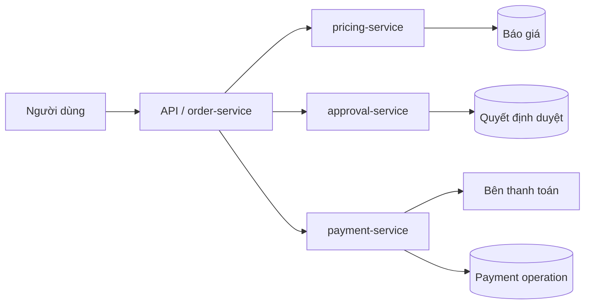

# Ranh giới giữa các service — Service to service boundary

## 1. Một request nội bộ vẫn cần căn cứ nghiệp vụ

Một hệ thống có nhiều service thường dùng kết nối bảo mật, danh tính workload hoặc token để kiểm chứng caller. Những cơ chế đó giúp biết service nào đang gọi. Chúng chưa trả lời đầy đủ service đó có được yêu cầu hành động này trên đơn hàng này hay không.

Ví dụ, `order-service` có thể được phép yêu cầu tạo thanh toán. Điều đó không có nghĩa nó được tự chọn bất kỳ tenant, số tiền hoặc kết quả phê duyệt nào rồi yêu cầu `payment-service` chấp nhận.

Ranh giới service–service là nơi một thành phần nhận yêu cầu hoặc khẳng định từ thành phần khác và quyết định có dùng nó làm căn cứ hay không.

> Quyền gọi một API và thẩm quyền khẳng định một sự thật nghiệp vụ là hai điều cần được xác định riêng.

Bài này thuộc chương **Trust Boundaries**, tập trung vào việc giữ business invariants khi dữ liệu và quyền đi qua các lời gọi đồng bộ, message, retry và những service có vai trò khác nhau.

Các mục tiêu học tập:

- Phân biệt danh tính service với danh tính người khởi tạo.
- Xác định service nào có thẩm quyền với dữ kiện nào.
- Gắn quyền, phê duyệt và báo giá với đúng đối tượng/phiên bản.
- Thiết kế kiểm tra tại service sở hữu tác động.
- Giữ bất biến khi có timeout, trùng message và thay đổi đồng thời.

## 2. Ví dụ xuyên suốt: đơn hàng cần duyệt trước khi thanh toán

Một nền tảng mua hàng doanh nghiệp có:

| Service | Dữ kiện hoặc trạng thái có thẩm quyền |
| --- | --- |
| `order-service` | Đơn hàng, tenant sở hữu, nội dung và phiên bản nghiệp vụ. |
| `pricing-service` | Báo giá được chấp nhận và điều kiện hiệu lực của báo giá. |
| `approval-service` | Quyết định phê duyệt cho một nội dung, người duyệt và chính sách cụ thể. |
| `payment-service` | Thao tác thanh toán, mã tương tác với bên ngoài và kết quả đã đối chiếu. |
| Service quản lý quyền/tổ chức | Membership, grant hoặc dữ kiện tổ chức trong phạm vi được giao. |

API phục vụ người dùng có thể điều phối các lời gọi, nhưng không vì vậy trở thành nguồn có thẩm quyền cho mọi loại dữ kiện.



Một chính sách minh họa:

1. Giá thanh toán phải thuộc báo giá được chấp nhận cho đúng nội dung.
2. Đơn phải có phê duyệt còn được chấp nhận cho đúng phiên bản.
3. Actor phải có quyền yêu cầu thanh toán trong tenant tương ứng.
4. Mỗi nghĩa vụ thanh toán chỉ tạo một operation đang có hiệu lực theo mô hình.
5. Sự kiện xác nhận thanh toán phải xuất phát từ nguồn và giao dịch phù hợp.
6. Retry không tạo thêm nghĩa vụ thu tiền.

Các service có thể được tổ chức khác trong sản phẩm thật. Điều cần giữ là trách nhiệm và hợp đồng thẩm quyền phải rõ.

## 3. Bốn lớp kiểm tra tại một lời gọi

| Lớp | Câu hỏi | Ví dụ |
| --- | --- | --- |
| Bảo vệ kênh truyền | Dữ liệu trao đổi được bảo vệ thế nào? | Kết nối đáp ứng cơ chế bảo mật của hạ tầng. |
| Xác thực caller | Service nào đang gọi, trong môi trường nào? | Principal production của `order-service`. |
| Phân quyền | Caller được thực hiện action nào, cho đối tượng/tenant nào? | Được yêu cầu thanh toán các đơn trong phạm vi hợp lệ. |
| Hợp lệ nghiệp vụ | Yêu cầu có đúng trạng thái, phiên bản, bằng chứng và hạn mức không? | Báo giá và phê duyệt khớp phiên bản đơn. |

Một lớp không thay thế các lớp còn lại:

- Kênh bảo mật không tự quyết định quyền trên đơn.
- Token hợp lệ không làm mọi field trong body có thẩm quyền.
- Scope `payment.initiate` không chứng minh đã được duyệt.
- Phê duyệt đúng nội dung không thay quyền của người yêu cầu.

“Mạng nội bộ” cũng không phải một vai trò nghiệp vụ. Lỗi ở một service, credential bị lộ hoặc một đường gọi bị cấu hình rộng vẫn có thể tạo request nội bộ hợp lệ về mặt vận chuyển nhưng trái quy tắc.

## 4. Ai đang gọi và đang hành động cho ai?

### 4.1. Service principal

Service principal là danh tính kỹ thuật của thành phần gọi. Nó cần được nhận diện qua cơ chế xác thực đã được kiểm chứng, không từ một header như `X-Service-Name` mà mọi caller có thể tự đặt.

Các thông tin thường liên quan:

```text
callerServiceIdentity
environment / trust domain
allowedAudience
allowedActions
credentialReference
```

Credential có thể được xoay mà danh tính nghiệp vụ của service không đổi. Không dùng secret hoặc token thô làm định danh trong audit hoặc khóa idempotency.

### 4.2. Người khởi tạo và quyền ủy quyền

Một lời gọi có thể mang ý nghĩa:

- Service tự thực hiện nhiệm vụ được giao, như job gia hạn theo chính sách.
- Service hành động thay một người dùng đã xác thực.
- Service tiếp tục xử lý một lệnh đã được chấp nhận trước đó.
- Service nhận và chuyển tiếp một báo cáo từ đối tác.

Cần xác định mô hình nào đang áp dụng. Nếu request bắt nguồn từ người dùng, `order-service` không nên biến quyền của mình thành quyền quản trị cho người dùng đó.

```text
Người dùng U
    → order-service
    → payment-service

Cần giữ:
  service gọi = order-service
  người khởi tạo = U, nếu đã được kiểm chứng
  tenant và phạm vi được ủy quyền
  hành động được phép
```

Một field `userId` hoặc `onBehalfOf` tự khai trong body chưa đủ chứng minh quyền ủy quyền. Cần cơ chế truyền/kiểm chứng context phù hợp hoặc quyết định phân quyền từ nguồn được chấp nhận.

### 4.3. Hạn chế quyền theo đường đi

Khi hành động dựa trên ủy quyền người dùng, quyền thực tế cần nằm trong phạm vi mà cả caller và sự ủy quyền cho phép, rồi tiếp tục chịu chính sách của service nhận.

Một service có quyền gọi kỹ thuật rộng không được dùng quyền đó để vượt giới hạn người khởi tạo.

Với tác vụ tự động không gắn người dùng, dùng quyền service dành cho nhiệm vụ đó và căn cứ nghiệp vụ tương ứng. Không giả mạo một user quản trị để làm cho mọi job vượt qua cùng một kiểm tra.

### 4.4. Header và token cần đúng ngữ cảnh

Nếu hệ thống dùng header danh tính từ gateway hoặc proxy, các đường vào không đáng tin phải được xử lý để caller không tự đặt header đó. Service nhận cần biết nguồn nào được phép xác lập context, kể cả khi tồn tại đường gọi trực tiếp.

Nếu dùng token, cần kiểm chứng các thuộc tính theo cơ chế đã chọn, như nguồn phát hành, đích sử dụng, hiệu lực và phạm vi. Một token dùng cho service A không tự được dùng cho service B chỉ vì cùng một hệ thống.

Correlation ID giúp truy vết, không phải danh tính hoặc bằng chứng phân quyền.

## 5. Nguồn có thẩm quyền và quyền khẳng định dữ kiện

Một hợp đồng trust nên chỉ rõ từng dữ kiện:

| Khẳng định nhận được | Căn cứ có thể chấp nhận | Điều không đủ |
| --- | --- | --- |
| Đơn thuộc tenant T | Snapshot/bản ghi từ service sở hữu đơn, đúng định danh và phiên bản. | `tenantId` trong body của bất kỳ caller nào. |
| Tổng tiền là X, loại tiền C | Báo giá hoặc phép tính được chính sách chấp nhận. | Tổng do client hoặc service không có thẩm quyền tự tính. |
| Đơn đã duyệt | Quyết định đúng đối tượng, nội dung và chính sách từ nguồn phê duyệt. | `approved=true` do service điều phối gửi. |
| Caller được hành động thay U | Context/ủy quyền được kiểm chứng trong đúng phạm vi. | Một mã user được chuyển tiếp nguyên trạng. |
| Thanh toán đã thành công | Kết quả từ service sở hữu thanh toán, đã đối chiếu giao dịch. | Sự kiện cùng tên do producer không có thẩm quyền phát. |

Có nhiều cách truyền căn cứ:

- Service nhận tự đọc từ API nguồn có thẩm quyền.
- Caller gửi tham chiếu để service nhận xác minh.
- Caller chuyển snapshot hoặc bằng chứng được nguồn phù hợp bảo vệ.
- Service nhận duy trì projection từ luồng sự kiện được kiểm soát.

Mỗi cách có giới hạn về độ mới, hiệu lực và thu hồi. Chọn cách nào thì phải công bố rõ hợp đồng đó.

### 5.1. Bằng chứng có chữ ký vẫn cần kiểm tra nội dung

Một bằng chứng được bảo vệ toàn vẹn vẫn cần khớp:

```text
nguồn phát hành được chấp nhận
đích/hành động được phép
tenant
orderId và businessVersion
quoteId / approvalId
amount và currency, nếu thuộc phạm vi quyết định
thời hạn hiệu lực
trạng thái thu hồi theo chính sách
```

Chữ ký không chứng minh một giá trị đúng với thế giới thực nếu chính nguồn có thẩm quyền đã bị lạm dụng hoặc cung cấp sai. Thiết kế cần nêu giả định tin cậy và dùng phân tách nhiệm vụ/đối soát ở những nơi nghiệp vụ yêu cầu.

### 5.2. Dữ liệu đúng nguồn nhưng sai phiên bản vẫn nguy hiểm

Giả sử:

1. Báo giá Q dành cho đơn phiên bản 7.
2. Quyết định duyệt A cũng dành cho phiên bản 7.
3. Đơn được sửa thành phiên bản 8.
4. Caller gửi Q, A và mã đơn hiện tại để thanh toán.

Tất cả tham chiếu có thể tồn tại và đúng nguồn, nhưng tổ hợp không hợp lệ.

Service tạo tác động cần kiểm tra liên kết:

```text
quote.orderId == order.id
approval.orderId == order.id

quote.businessVersion == order.businessVersion
approval.businessVersion == order.businessVersion

quote.tenantId == order.tenantId
approval.tenantId == order.tenantId
```

Ngoài ra còn cần điều kiện hiệu lực và chính sách. So sánh các mã/phiên bản chưa chứng minh bản duyệt chưa bị thu hồi.

### 5.3. Đúng nguồn không luôn có nghĩa lấy giá mới nhất

Một báo giá đã chốt có thể là căn cứ đúng cho đơn, dù danh mục hiện tại đã đổi. Tự lấy giá mới nhất ở service thanh toán có thể khiến khách bị thu số tiền chưa được đồng ý.

Cần định nghĩa quyền “khóa giá” của báo giá, thời hạn và quy tắc duyệt lại. Tính đúng phụ thuộc phiên bản được thỏa thuận, không chỉ độ mới của bản ghi.

## 6. Hợp đồng gọi service cần mang ý định có phạm vi

Một command có thể chỉ chứa tham chiếu và phiên bản người gọi dự kiến:

```java
record InitiatePaymentCommand(
    UUID orderId,
    long expectedBusinessVersion,
    UUID quoteId,
    UUID approvalId,
    String businessOperationId
) {}
```

Context caller được tạo riêng từ cơ chế xác thực/ủy quyền. Command không được tự khai danh tính service hoặc trạng thái đã trả tiền.

Ví dụ HTTP minh họa:

```http
POST /internal/payment-operations
Content-Type: application/json

{
  "orderId": "order-821",
  "expectedBusinessVersion": 7,
  "quoteId": "quote-116",
  "approvalId": "approval-390",
  "businessOperationId": "pay-order-821-v7"
}
```

Trong ví dụ, service thanh toán xác lập số tiền từ căn cứ được chấp nhận. Nếu API cho caller gửi số tiền để đối chiếu, giá trị đó vẫn cần được so với nguồn có thẩm quyền.

Mỗi tham chiếu cần được kiểm tra quyền và liên kết. Chuyển từ gửi một boolean sang gửi một ID không tự tạo bảo đảm.

Một hợp đồng đầy đủ còn xác định:

- Trạng thái nguồn cho phép gọi.
- Chính sách phiên bản và hiệu lực bằng chứng.
- Phạm vi operation ID/idempotency key.
- Response là “đã tiếp nhận” hay “đã hoàn tất”.
- Lỗi nào có thể retry và retry giữ nguyên định danh nào.
- Hành vi khi kết quả chưa rõ hoặc nguồn xác minh không sẵn sàng.

## 7. Kiểm tra tại service sở hữu tác động

Một gateway hoặc service điều phối có thể kiểm tra sớm để cải thiện trải nghiệm. Service tạo ra tác động vẫn cần thực thi hợp đồng quyền và nghiệp vụ của mình.

Ví dụ, `payment-service` không nên chấp nhận mọi request chỉ vì chúng đi từ `order-service`. Nó cần xác định:

1. Caller được phép yêu cầu loại thanh toán này.
2. Ngữ cảnh người khởi tạo hoặc quyền service phù hợp.
3. Đơn và tenant thuộc phạm vi được phép.
4. Phiên bản, báo giá và phê duyệt khớp nhau.
5. Có căn cứ còn hiệu lực cho tác động sắp tạo.
6. Chưa có operation trái với bất biến.
7. Trạng thái kết quả được ghi và phát đi nhất quán.

Không nhất thiết lặp toàn bộ tính toán ở mọi service. Có thể chấp nhận quyết định từ một nguồn được giao thẩm quyền, nhưng service nhận phải kiểm tra nguồn, phạm vi và liên kết của quyết định đó.

### 7.1. Đừng truyền một cờ “đã kiểm tra” qua cả chuỗi

Một payload như:

```json
{
  "orderId": "order-821",
  "validated": true,
  "approved": true,
  "tenantId": "tenant-a",
  "amountMinor": 1000000
}
```

không cho biết ai đã kiểm tra, kiểm tra gì, dựa trên phiên bản nào và còn hiệu lực không.

Nếu mọi service tin cờ này, một lỗi ở đầu chuỗi có thể biến thành quyền tạo tác động ở cuối chuỗi. Thay vào đó cần tham chiếu/bằng chứng có nguồn và scope đủ rõ hoặc xác minh lại tại nguồn phù hợp.

### 7.2. Quyền của service nhận không được bị caller chiếm dụng

Một service có thể giữ credential tới database, kho dữ liệu hoặc bên thanh toán với quyền rộng. Khi nhận request, nó phải giới hạn tác động theo caller và command.

Đây là cách ngăn confused deputy: thành phần có quyền bị dùng làm công cụ thực hiện yêu cầu vượt quyền của bên gọi.

Không cho caller tự chọn tùy ý tài khoản đích, tenant, hành động hoặc nguồn dữ liệu chỉ vì service nhận có khả năng truy cập chúng.

## 8. TOCTOU qua nhiều service: đọc đúng vẫn có thể dùng sai

Một lần kiểm tra từ xa có thể đúng tại thời điểm trả response, nhưng trạng thái thay đổi trước khi service khác tạo tác động.

```text
T1: payment-service đọc approval còn hiệu lực.
T2: approval-service thu hồi approval.
T3: payment-service bắt đầu thanh toán theo dữ liệu T1.
```

Một transaction trong database của payment-service không tự ngăn T2 ở database khác.

### 8.1. Phải chọn ngữ nghĩa của quyết định

Các thiết kế có thể chọn những hợp đồng khác nhau:

| Hợp đồng | Ý nghĩa | Điều cần bảo vệ |
| --- | --- | --- |
| Snapshot có hiệu lực cho thao tác đã chấp nhận | Sau một mốc xác lập, quyết định được phép hoàn tất theo điều kiện đã chốt. | Mốc chấp nhận, phiên bản và phạm vi không bị thay đổi tùy ý. |
| Quyền có thời hạn | Quyết định được dùng trong một khoảng và điều kiện đã định. | Thời hạn, ràng buộc đối tượng, replay và chính sách thu hồi. |
| Xác nhận/tiêu thụ quyền tại nguồn | Nguồn có thẩm quyền ghi nhận quyền được dùng cho operation cụ thể. | Cấp/tiêu thụ nguyên tử và liên kết ổn định với operation. |
| Một bên sở hữu bất biến cuối cùng | Thành phần có thẩm quyền quyết định và giữ trạng thái để ngăn xung đột. | Mọi đường tạo tác động phải đi qua bảo đảm đó. |

Các lựa chọn không có cùng bảo đảm về thu hồi. Không thể hứa “thu hồi có hiệu lực ngay ở mọi nơi” rồi chỉ dựa vào một snapshot hoặc cache chưa hết hạn.

### 8.2. Quyền một lần cần trạng thái hoặc cơ chế tiêu thụ phù hợp

Một bằng chứng có chữ ký gắn với một operation không tự bảo đảm chỉ được dùng một lần. Bên nhận hoặc nguồn cấp cần ghi nhận việc sử dụng, có khóa nghiệp vụ hoặc cơ chế tương đương.

Nếu một quyết định chỉ cho phép thu một số tiền cho đơn phiên bản 7, phải giữ ràng buộc đó khi tạo operation, retry và nhận kết quả. Không cho dùng lại để thu cho phiên bản 8 hoặc tenant khác.

### 8.3. Thời hạn có thể hết trong khi request đang chờ

Cần xác định thời điểm đánh giá hiệu lực: khi nhận request, khi chấp nhận operation hay khi tạo tác động cuối cùng. Một request đến trước hạn nhưng chờ lâu chưa chắc được phép thực thi sau hạn.

Chính sách cần phân biệt quyền được chốt cho một thao tác đã chấp nhận với yêu cầu phải còn hiệu lực tại thời điểm sử dụng. Tránh để hành vi này phụ thuộc ngẫu nhiên vào thời gian chờ thread hoặc transaction.

## 9. Retry, timeout và một thao tác nghiệp vụ ổn định

### 9.1. Một lời gọi có thể đã thành công trước khi timeout

```text
order-service gửi yêu cầu.
payment-service tạo operation và commit.
Response bị mất.
order-service retry.
```

Nếu retry tạo operation mới, client có thể bị thu hai lần.

Phạm vi idempotency cần được định nghĩa, ví dụ:

```text
(callerIntegration, tenantId, action, idempotencyKey)
```

Cùng key và cùng nội dung nghiệp vụ phải gắn với cùng operation theo hợp đồng. Cùng key nhưng khác nội dung phải bị phát hiện.

Ngoài ra cần khóa nghiệp vụ, chẳng hạn nghĩa vụ thanh toán cho đúng đơn/phiên bản, vì caller có thể đổi key. Khóa phải phù hợp trường hợp trả nhiều đợt hoặc nhiều lần thử thanh toán nếu sản phẩm hỗ trợ.

### 9.2. Phân biệt operation và attempt

- **Business operation:** nghĩa vụ hoặc thao tác nghiệp vụ ổn định.
- **Attempt:** một lần gửi/giao tiếp để thực hiện hoặc tìm kết quả của operation đó.
- **Correlation ID:** giúp truy vết chuỗi xử lý.
- **Message ID:** nhận diện thông điệp theo hợp đồng giao nhận.

Retry có thể có attempt/correlation ID khác mà vẫn thuộc cùng operation. Đổi tất cả định danh mỗi lần retry làm mất khả năng nhận ra tác động trùng.

### 9.3. Khử trùng và tạo operation cần được phối hợp

Trong service sở hữu tác động:

```text
Bắt đầu transaction cục bộ.
Kiểm tra/claim định danh yêu cầu với nội dung tương ứng.
Xác định hoặc tạo operation theo khóa nghiệp vụ.
Ghi trạng thái chấp nhận và căn cứ được dùng.
Ghi outbox nếu cần gọi tiếp.
Lưu kết quả idempotency.
Commit.
```

Nếu đánh dấu “đã xử lý” trước khi lưu operation ở bước không được bảo vệ, một lỗi giữa hai bước có thể làm mất tác động hợp lệ. Nếu chỉ ghi chống trùng sau khi gọi bên ngoài, lỗi giữa chừng có thể tạo tác động lặp.

Trước khi trả kết quả đã lưu, cần kiểm tra quyền phù hợp. Biết một operation ID hoặc idempotency key không cấp quyền đọc giao dịch của tenant khác.

### 9.4. Không dùng retry để bỏ qua thất bại nghiệp vụ

Timeout hoặc lỗi tạm thời có thể cần retry theo chính sách. Lỗi không có quyền, sai phiên bản hoặc phê duyệt không khớp cần được xử lý theo ý nghĩa nghiệp vụ, không gửi lại vô hạn với hy vọng lọt qua.

Giới hạn retry và lưu lượng giúp bảo vệ năng lực. Chúng không thay thế quyền, trạng thái và khóa chống trùng.

## 10. Ranh giới qua message broker và sự kiện

Message broker tạo thêm một điểm trung chuyển. Xác thực được kết nối tới broker chưa chứng minh producer được phát mọi loại sự kiện nghiệp vụ.

Ví dụ, chỉ nguồn phê duyệt được chấp nhận mới có thẩm quyền khẳng định một quyết định `OrderApproved`. Một service gửi email không được tự phát sự kiện đó để mở bước thanh toán.

Cần định nghĩa:

- Producer nào được gửi lệnh/sự kiện nào.
- Consumer nào được đọc dữ liệu đó.
- Nguồn và danh tính trong envelope được kiểm chứng bằng cách nào.
- Schema, tenant, aggregate, phiên bản và phạm vi của message.
- Hành vi khi trùng, chậm, sai thứ tự hoặc thiếu bước.

Một field `source="approval-service"` do mọi producer tự sửa chưa đủ chứng minh nguồn. Cơ chế vận chuyển, quyền phát hoặc bảo vệ thông điệp cần làm cho khẳng định nguồn có căn cứ.

### 10.1. Command khác event

**Command** yêu cầu thực hiện một hành động và có thể bị từ chối.

**Event** mô tả điều đã xảy ra theo thẩm quyền của nguồn phát.

Đổi tên command thành một event có vẻ đã hoàn tất không cho phép bỏ kiểm tra. Consumer phải biết nguồn đó có quyền khẳng định sự thật hay chỉ đang báo một yêu cầu.

### 10.2. Outbox không tạo exactly-once toàn hệ thống

Outbox giúp ghi ý định phát message cùng transaction với dữ liệu cục bộ. Message vẫn có thể được gửi lại. Consumer cần idempotency và bất biến của chính nó.

Một event ID duy nhất cũng không ngăn hai event khác nhau cùng yêu cầu một tác động không được lặp. Bảo đảm cần đi tới định danh nghiệp vụ ở nơi tác động được tạo.

### 10.3. Sự kiện cũ và trạng thái mới

Một message thanh toán thành công có thể đến sau message khác do chậm trễ. Không nên chỉ gán trạng thái theo thứ tự nhận.

Cần đối chiếu operation, phiên bản/cycle và mô hình trạng thái. Có thể ghi sự thật lịch sử mà không ghi lùi trạng thái hiện tại hoặc kích hoạt lại một tác động đã kết thúc.

Timestamp của producer không tự tạo thứ tự toàn phần giữa mọi service. Dùng phiên bản/sequence theo phạm vi có bảo đảm hoặc đối soát nguồn khi cần.

## 11. Tác vụ nền và quyền thay đổi theo thời gian

Một job có thể được nhận khi người dùng còn quyền nhưng chạy sau khi membership hoặc thuê bao đã thay đổi.

Hệ thống cần quyết định:

- Quyền lúc chấp nhận có cho phép hoàn tất không?
- Có phải kiểm tra lại trước tác động nhạy cảm không?
- Ai được lấy kết quả sau khi job hoàn thành?
- Quyền bị thu hồi ảnh hưởng tới retry thế nào?

Lưu ngữ cảnh người khởi tạo và căn cứ chấp nhận giúp truy vết. Không nhất thiết phải giữ token người dùng gốc để dùng vô hạn; context tiếp tục xử lý cần có phạm vi và chính sách rõ.

Worker vẫn có danh tính service riêng. Nó không được biến mọi job đã vào queue thành lệnh của một superuser.

Nếu quyền hết hiệu lực trong thời gian chờ, có thể từ chối, đưa vào xem xét hoặc hoàn tất theo quyền đã chốt tùy nghiệp vụ. Hành vi phải là quyết định có chủ đích.

## 12. Lỗi phân tán, bù trừ và đối soát

Một quy trình có thể thành công ở service A nhưng chưa hoàn tất ở service B.

Ví dụ:

```text
Đã giữ ngân sách.
Đã yêu cầu thanh toán.
Chưa biết bên thanh toán đã thu tiền hay chưa.
Tiến trình điều phối bị dừng.
```

Không được mặc định giải phóng mọi nguồn lực rồi tạo lại từ đầu nếu tác động ngoài có thể đã xảy ra.

### 12.1. Rollback không đi xuyên qua các service một cách tự động

Rollback database của một service không hủy transaction đã commit ở service khác hoặc khoản tiền đã thu ở bên ngoài.

Bù trừ là một hành động nghiệp vụ mới, như giải phóng giữ chỗ hoặc yêu cầu hoàn tiền. Nó có điều kiện, quyền và khả năng thất bại riêng.

Một quy trình nhiều bước có thể cần phối hợp giao dịch cục bộ và bù trừ theo mô hình saga. Mô hình này không tự làm mọi bước có tính nguyên tử toàn cục.

### 12.2. Đối soát theo operation và nguồn có thẩm quyền

Đối soát cần giúp xác định:

- Operation nào đã được chấp nhận.
- Tác động nào đã xảy ra.
- Sự kiện hoặc projection nào còn thiếu.
- Có tác động trùng hoặc không có căn cứ không.
- Hành động phục hồi nào an toàn theo trạng thái hiện tại.

Không tạo operation mới chỉ vì operation cũ đang chưa rõ. Giữ tham chiếu để truy vấn kết quả và xử lý chênh lệch.

### 12.3. Thiếu căn cứ không phải giấy phép mở quyền

Nếu service phân quyền hoặc nguồn xác minh không sẵn sàng, không tự coi `approved=true` để giữ luồng chạy.

Có thể dùng căn cứ đã kiểm chứng còn hiệu lực trong phạm vi chính sách, đưa yêu cầu vào chờ hoặc từ chối hành động chưa đủ căn cứ. Lựa chọn phụ thuộc mức rủi ro và hợp đồng hiệu lực đã thiết kế.

Phân biệt “chưa được phép bắt đầu tác động mới” với “chưa biết kết quả tác động đã gửi”. Hai tình huống đòi hỏi hành vi khác nhau.

## 13. Audit và dữ liệu đi qua ranh giới

Một quyết định tạo tác động cần nối được các thông tin:

```text
callerServiceIdentity
verifiedInitiator / delegationReference, nếu có
tenantId, orderId, businessVersion
quoteId, approvalId, policyVersion
businessOperationId, attemptId, messageId
decision, reasonCode, serverTimestamp, correlationId
```

Không phải mọi request đều cần ghi mọi field. Chọn dữ kiện đủ để giải thích quyết định và đối soát theo mức nhạy cảm.

Cần phân biệt field đã được kiểm chứng với field caller khai. Nếu lưu một user ID chỉ để truy vết nguồn báo cáo, không trình bày nó như danh tính đã được xác thực.

Tránh ghi token, secret hoặc payload chứa dữ liệu nhạy cảm không cần thiết. Một correlation ID có thể giúp nối log mà không sao chép toàn bộ request giữa các service.

Phạm vi đọc cũng cần được bảo vệ. Service được phép tạo operation không tự có quyền đọc mọi hóa đơn, dữ liệu người dùng hoặc kết quả của tenant khác.

API danh sách, tìm kiếm, export và tải kết quả phải chịu cùng chính sách dữ liệu phù hợp. Bảo vệ endpoint tạo nhưng mở endpoint tra cứu vẫn để lộ tài sản nghiệp vụ.

## 14. Ma trận kiểm thử ranh giới service–service

| Tình huống | Kết quả cần chứng minh |
| --- | --- |
| Caller không được phép gọi chức năng | Không tạo operation hoặc phát lệnh tiếp theo. |
| Token dành cho service/môi trường khác | Không được chấp nhận ngoài ngữ cảnh đã cấp. |
| Giả service hoặc user bằng header/body | Không trở thành danh tính có quyền. |
| Service có quyền nhưng user khởi tạo không đủ quyền | Không dùng quyền service để vượt phạm vi ủy quyền. |
| Job tự động có scope riêng | Chỉ thực hiện đúng nhiệm vụ được cấp, không giả admin. |
| Đơn tenant A kết hợp phê duyệt tenant B | Từ chối, không tạo tác động. |
| Đơn phiên bản 8 dùng báo giá/phê duyệt phiên bản 7 | Không dùng căn cứ sai nội dung. |
| Bằng chứng đúng nguồn nhưng sai đích/hết hiệu lực | Không chấp nhận chỉ vì kiểm chứng được nguồn. |
| Giá hiện tại khác báo giá đã chốt | Thực hiện đúng chính sách giá và yêu cầu chấp thuận. |
| Thu hồi giữa lúc đọc và tạo tác động | Hành vi khớp hợp đồng chốt quyền/thu hồi đã công bố. |
| Hai request cùng key chạy đồng thời | Cùng operation theo hợp đồng, không có tác động lặp. |
| Cùng key khác payload | Phát hiện xung đột, không ghi đè ý nghĩa cũ. |
| Khác key nhưng cùng nghĩa vụ bị cấm lặp | Khóa nghiệp vụ và trạng thái vẫn ngăn nhân tác động. |
| Commit thành công nhưng mất response | Retry truy lại cùng operation. |
| Producer không có thẩm quyền phát event phê duyệt | Không được tạo sự thật nghiệp vụ ngoài quyền. |
| Message trùng hoặc sai thứ tự | Không nhân tác động hoặc ghi lùi trạng thái sai quy tắc. |
| Worker chạy sau thay đổi membership/grant | Tuân theo chính sách thời điểm xét quyền. |
| Tác động ngoài thành công nhưng response bị mất | Giữ cùng operation và có đường đối soát. |
| Nguồn xác minh tạm lỗi | Không tự nâng quyền hoặc bỏ bằng chứng bắt buộc. |
| Tra cứu operation của tenant khác | Không lộ kết quả dù caller biết ID. |

### 14.1. Kiểm tra cả hợp đồng và bất biến

Contract test có thể giúp phát hiện thay đổi schema, trường bắt buộc và ý nghĩa response. Nó không tự chứng minh phân quyền hoặc tính đúng khi có cạnh tranh.

Kiểm thử tích hợp cần quan sát operation, outbox, inbox và tác động bên ngoài mô phỏng. Response `403` hoặc `409` chưa đủ nếu một message thanh toán đã được gửi trước khi hệ thống trả lỗi.

### 14.2. Tạo lỗi tại những điểm có ý nghĩa

Mô phỏng:

1. Nguồn phê duyệt trả kết quả rồi quyền bị thu hồi.
2. Service tạo operation commit nhưng response bị mất.
3. Producer dừng sau commit nhưng trước khi gửi outbox.
4. Consumer dừng sau áp dụng nhưng trước khi xác nhận message.
5. Bên ngoài thực hiện thành công nhưng phản hồi timeout.
6. Worker cũ tiếp tục chạy sau khi cấu hình/quyền đã thay đổi.

Mỗi trường hợp cần một kết quả mong đợi theo hợp đồng. “Cuối cùng có retry” chưa đủ nếu retry có thể tạo thêm nghĩa vụ nghiệp vụ.

### 14.3. Không chỉ kiểm thử từng service riêng lẻ

Unit test có thể xác nhận một hàm policy trả đúng. Lỗi ranh giới thường nằm ở việc service A hiểu một field theo nghĩa khác service B, hoặc một giả định hiệu lực không được giữ qua bước kế tiếp.

Cần kiểm tra luồng đại diện qua các ranh giới quan trọng, cùng các trường hợp từ chối và phục hồi. Những bất biến cục bộ liên quan tới database vẫn cần kiểm tra khóa, constraint và transaction ở mức thích hợp.

## 15. Bài tập áp dụng

Một hệ thống có luồng:

```text
API người dùng
    → order-service
    → payment-service
    → bên thanh toán
```

`payment-service` chỉ chấp nhận request từ mạng nội bộ, nhận `userId`, `tenantId`, `amount` và `approved=true` trong body. Khi timeout, `order-service` tạo một mã request mới rồi gửi lại. Message thanh toán thành công có thể được mọi producer nội bộ phát vào cùng một topic.

Hãy thiết kế lại:

1. Xác định danh tính service gọi, người khởi tạo và nguồn quyền của từng bên.
2. Liệt kê service nào có thẩm quyền với đơn, báo giá, phê duyệt và kết quả thanh toán.
3. Thay các cờ tự khai bằng tham chiếu/bằng chứng có phạm vi rõ.
4. Gắn tenant, phiên bản, số tiền và loại tiền vào cùng một quyết định được chấp nhận.
5. Định nghĩa operation ổn định qua retry và khóa nghiệp vụ chống tác động lặp.
6. Chọn hợp đồng cho trường hợp phê duyệt bị thu hồi trước khi thanh toán được chấp nhận.
7. Giới hạn thẩm quyền producer và kiểm tra message tại consumer.
8. Viết một kiểm thử sai tenant, một kiểm thử sai phiên bản và một kiểm thử mất response sau commit.

Gợi ý tự đánh giá:

- Không có bước nào coi “nội bộ” là toàn quyền.
- Service identity và user/delegation context có nguồn kiểm chứng riêng.
- Service sở hữu tác động biết vì sao yêu cầu được phép.
- Đúng nguồn nhưng sai đối tượng/phiên bản vẫn bị từ chối.
- Retry và message trùng không tạo thêm tác động.
- Kết quả chưa rõ có đường tra cứu/đối soát, không bị che bằng operation mới.
- Yêu cầu về độ mới và thu hồi có cơ chế đáp ứng cụ thể.

## 16. Những điểm cần ghi nhớ

Ranh giới service–service cần một hợp đồng về **danh tính, quyền, thẩm quyền dữ liệu, đối tượng, phiên bản và thời hạn**. Service nhận chỉ nên dựa vào những khẳng định mà nguồn gửi được phép cung cấp trong phạm vi đó.

Bảo vệ kênh và xác thực service là nền tảng. Phân quyền theo đối tượng, bằng chứng ràng buộc nội dung, state machine, operation ổn định và transaction cục bộ giữ cho ý nghĩa nghiệp vụ không bị mất qua nhiều bước.

Khi xử lý phân tán, cần diễn đạt chính xác điều đã biết: đã tiếp nhận, đã chấp nhận hay đã có tác động ngoài. Các hợp đồng retry, thu hồi, bù trừ và đối soát phải bảo toàn bất biến ngay cả khi từng lời gọi không hoàn tất theo thứ tự mong đợi.
