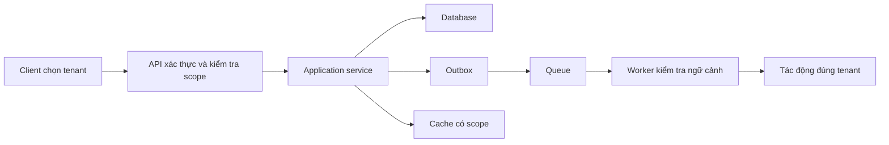

# Tenant to tenant boundary — Ranh giới tin cậy giữa các tenant

## 1. Một request hợp lệ vẫn có thể đi sai tổ chức

Trong chương **Trust Boundaries** của module **Business Logic Security** (`SECURITY_APPLICATION_SECURITY_BUSINESS_LOGIC_SECURITY`), ranh giới giữa các tenant xác định dữ liệu, quyền và tác động nghiệp vụ của tổ chức nào được phép liên quan tới một request.

**Tenant** là một phạm vi nghiệp vụ mà hệ thống quản lý tách biệt, chẳng hạn một công ty, cửa hàng hoặc tổ chức khách hàng. Một người dùng có thể là thành viên của nhiều tenant; một tenant có thể có nhiều người dùng và dịch vụ thực hiện công việc.

Giả sử người dùng thuộc tenant A gọi:

```text
POST /orders/order-of-tenant-B/approve
```

Request có thể có token hợp lệ, JSON đúng cấu trúc và người dùng có vai trò approver ở tenant A. Nếu ứng dụng tải đơn chỉ bằng `orderId` rồi kiểm tra một role chung, người đó có thể duyệt đơn tenant B.

Không cần khai thác cú pháp SQL hoặc đánh cắp tài khoản tenant B. Lỗi nằm ở việc một quyền hợp lệ trong phạm vi A bị sử dụng trong phạm vi B.

Mục tiêu cần bảo vệ là:

> Mỗi thao tác phải sử dụng danh tính, quyền, dữ liệu và tài nguyên thuộc đúng tenant đã được phép; mọi sự liên kết giữa các đối tượng phải giữ đúng phạm vi, trừ những luồng chia sẻ hoặc quản trị liên tenant được định nghĩa riêng.

Ranh giới này áp dụng cho cả **đọc**, **ghi**, **tính toán**, **trả kết quả** và **tác động bên ngoài**.

## 2. Ranh giới tenant là một bảo đảm nghiệp vụ

### 2.1. Không đồng nhất tenant với tài khoản người dùng

Một người có thể có:

```text
Tại tenant A:
    role = APPROVER
    scope = chi nhánh X

Tại tenant B:
    role = VIEWER
    scope = bộ phận Y
```

Việc người đó được phép chọn tenant B không làm quyền approver của tenant A đi theo.

Cần phân biệt:

| Thành phần | Ý nghĩa |
| --- | --- |
| Principal | Danh tính đã được xác thực |
| Membership | Quan hệ thành viên với một tenant |
| Active tenant | Tenant mà request hoặc command đang hoạt động trong phạm vi |
| Permission trong tenant | Hành động được phép trong phạm vi đó |
| Quyền trên đối tượng | Khả năng thực hiện hành động trên tài nguyên cụ thể |
| Chủ sở hữu tenant của tài nguyên | Phạm vi nghiệp vụ thực sự của dữ liệu |

Một token hoặc phiên đăng nhập có thể chứng minh danh tính. Quyền chọn tenant và quyền trên tài nguyên vẫn cần được kiểm tra theo hợp đồng phân quyền.

### 2.2. Dùng chung hạ tầng không đồng nghĩa dùng chung quyền

Nhiều tenant có thể dùng chung ứng dụng, database, cache, hàng đợi hoặc kho đối tượng. Tách dữ liệu logic cần được duy trì ở mọi đường truy cập liên quan.

Ngược lại, dùng database riêng cho mỗi tenant cũng chưa giải quyết toàn bộ vấn đề. Một bộ định tuyến chọn nhầm database, một connection dùng lại sai ngữ cảnh hoặc một job gửi kết quả sai người vẫn có thể vượt ranh giới.

Cách bố trí vật lý ảnh hưởng cơ chế thực thi, nhưng không thay thế mô hình quyền và ánh xạ tài nguyên.

### 2.3. Phạm vi cần được bảo vệ bao gồm gì?

| Loại tài sản | Ví dụ vượt ranh giới |
| --- | --- |
| Dữ liệu đọc | Hiển thị đơn, số dư hoặc hồ sơ tenant khác |
| Trạng thái nghiệp vụ | Duyệt, hủy hoặc xác nhận đơn ngoài quyền |
| Quyền và thành viên | Gán role hoặc mời người vào tenant khác |
| Giá và chính sách | Áp dụng bảng giá hoặc hạn mức của tenant khác |
| Tài nguyên tệp | Tải file đính kèm, báo cáo hoặc hóa đơn tenant khác |
| Dữ liệu suy ra | Tổng doanh thu, số lượng đơn, gợi ý tìm kiếm chứa dữ liệu chéo |
| Tác động ngoài hệ thống | Gửi email, webhook, hoàn tiền hoặc giữ chỗ theo cấu hình sai tenant |
| Bằng chứng | Gắn phê duyệt hoặc kết quả thanh toán tenant A vào đối tượng tenant B |

Ngay cả khi response không trả dữ liệu nhạy cảm, một tác động sai phạm vi vẫn là vi phạm.

## 3. Phát biểu các bất biến về tenant

Gọi `T` là tenant hoạt động đã được kiểm tra quyền cho một command.

### 3.1. Bất biến về danh tính và quyền

```text
Command được chấp nhận
⇒ principal được phép hoạt động trong T
   ∧ permission được đánh giá trong T
   ∧ principal được phép thực hiện action trên resource cụ thể
```

Có membership là điều kiện cần trong nhiều mô hình, nhưng không đủ cho mọi hành động.

### 3.2. Bất biến về đối tượng gốc

```text
resource.tenantId = T
```

Cần kiểm tra trên đối tượng từ nguồn có thẩm quyền. Một `tenantId` trong body không thể tự xác nhận rằng đối tượng thuộc tenant đó.

### 3.3. Bất biến về các đối tượng liên kết

Với một luồng không cho phép liên kết chéo tenant:

```text
order.tenantId
= orderLine.tenantId
= approval.tenantId
= paymentIntent.tenantId
= T
```

Chỉ kiểm tra tenant của đơn rồi lấy payment hoặc file bằng ID không có scope vẫn có thể để lộ một cửa khác.

Không phải mọi dữ liệu trong hệ thống đều thuộc tenant. Một danh mục công khai dùng chung có thể là dữ liệu toàn cục. Cần phân loại rõ dữ liệu toàn cục và dữ liệu của tenant, tránh dùng lý do “dữ liệu dùng chung” để bỏ qua scope một cách tùy tiện.

### 3.4. Bất biến về kết quả và tác động

```text
Kết quả trả về, cache, file xuất,
message, notification và webhook
phải gắn với đúng T và người nhận được phép.
```

Một truy vấn đúng có thể bị làm sai ở bước cuối nếu kết quả được cache hoặc gửi theo một khóa không chứa tenant.

### 3.5. Bất biến về các luồng có chia sẻ

Nếu nghiệp vụ thật sự cho phép hai tenant trao đổi dữ liệu, cần một quan hệ chia sẻ hoặc ủy quyền rõ ràng:

```text
sourceTenant
targetTenant
resource hoặc tập dữ liệu được chia sẻ
action được phép
điều kiện và thời hạn
nguồn thẩm quyền
```

“Có thể dùng ID của nhau” không phải một mô hình chia sẻ. Ngoại lệ cần có điều kiện riêng và không làm các endpoint thông thường mất ranh giới.

## 4. Xác định tenant từ nguồn nào?

### 4.1. Phân biệt lựa chọn phạm vi và bằng chứng được phép

Tenant có thể xuất hiện trong URL, subdomain, header hoặc một lựa chọn trên giao diện. Các giá trị đó có thể chỉ là **yêu cầu chọn phạm vi**.

Một luồng minh họa:

```text
1. Xác thực principal.
2. Đọc tenant mà request muốn chọn.
3. Kiểm tra principal được phép hoạt động trong tenant đó.
4. Xây dựng ngữ cảnh tenant tin cậy.
5. Tải đối tượng và kiểm tra quyền hành động trong ngữ cảnh này.
```

Không bỏ bước 3 chỉ vì header tên là `X-Tenant-Id`, hoặc vì giao diện chỉ hiển thị một danh sách tenant hợp lệ.

### 4.2. Claim trong token cũng cần đúng ngữ nghĩa

Nếu tenant là claim trong một token được chấp nhận, hệ thống vẫn cần biết claim đó khẳng định điều gì:

- Token có bị ràng buộc vào một tenant duy nhất không?
- Claim thể hiện tenant hiện hành hay chỉ một danh sách membership?
- Token dành cho dịch vụ nhận nào?
- Quyền đã thay đổi hoặc bị thu hồi được phản ánh theo chính sách nào?

Một token hợp lệ cho dịch vụ khác hoặc một claim không được thiết kế để cấp quyền không nên bị diễn giải thành quyền toàn bộ trên tenant.

### 4.3. Nếu có nhiều nguồn tenant, phải kiểm tra sự nhất quán

Ví dụ:

```text
URL chọn tenant A.
Token hoặc context chỉ cho tenant A.
Body lại gửi tenantId = B.
```

Máy chủ không được tùy tiện dùng URL để authorization nhưng dùng body để ghi dữ liệu.

Có thể không nhận tenant trong body của một số command, hoặc yêu cầu nó khớp ngữ cảnh nếu hợp đồng cần trường đó. Trong mọi trường hợp, phải có một nguồn có thẩm quyền và một quy tắc xử lý mâu thuẫn.

Không tự chuyển sang tenant mặc định khi thiếu scope trong một thao tác cần tenant. Một mặc định thuận tiện có thể biến lỗi ngữ cảnh thành thao tác trên nhầm tổ chức.

### 4.4. Gateway không làm header bên ngoài trở thành đáng tin một cách tự động

Nếu một tầng trung gian tạo header nội bộ, cần bảo đảm đường vào và cơ chế xác thực nội bộ ngăn client tự giả header đó hoặc đi vòng tới backend.

Dịch vụ nhận vẫn cần xác thực nguồn ngữ cảnh và diễn giải đúng scope. Chỉ đặt tên header là “internal” không tạo ra ranh giới tin cậy.

## 5. Phân quyền trong tenant phải đi cùng quyền trên đối tượng

Ví dụ sau chưa đủ:

```text
actor có role APPROVER
→ loadOrder(orderId)
→ approve()
```

Một luồng rõ hơn:

```text
context = authenticateAndAuthorizeTenantSelection(request)

order = repository.load(context.tenantId, orderId)

policy.require(
    actor = context.principal,
    tenant = context.tenantId,
    action = APPROVE_ORDER,
    resource = order
)

order.approve(expectedContentRevision)
saveWithinConsistencyBoundary(order)
```

Điều kiện còn có thể gồm chi nhánh, người tạo, hạn mức, trạng thái và phiên bản nội dung.

Khi tạo mới, tenant của bản ghi phải đến từ ngữ cảnh đã được kiểm tra hoặc từ một quy trình đặc biệt có thẩm quyền. Người gọi không được chỉ định tenant khác để “nhờ” backend ghi hộ.

Với thao tác theo lô, cần xác định toàn bộ ID có nằm trong scope không. Chính sách có thể từ chối cả lô hoặc xử lý từng phần được cho phép, nhưng kết quả không được tiết lộ thông tin về các đối tượng ngoài quyền.

Đối với cập nhật và xóa, điều kiện tenant phải nằm trong câu lệnh tác động hoặc cơ chế bảo vệ tương đương, không chỉ ở một lần đọc không được bảo vệ trước đó.

## 6. Mô hình dữ liệu phải giữ được phạm vi liên kết

### 6.1. Khóa có tenant giúp biểu đạt danh tính đầy đủ

Giả sử mã đơn chỉ duy nhất trong từng tenant. Cùng `order-100` có thể tồn tại ở A và B.

Khi đó, danh tính đầy đủ là:

```text
(tenantId, orderId)
```

Ngay cả khi dùng ID duy nhất toàn cục, nó vẫn không thay thế authorization. Một ID khó đoán giảm khả năng đoán ngẫu nhiên, nhưng người dùng có thể biết ID qua log, liên kết, tài liệu hoặc các luồng được phép khác.

### 6.2. Dùng khóa ngoại ghép để bảo vệ quan hệ cùng tenant

Ví dụ dưới dùng ba bảng đều chứa dữ liệu thuộc tenant:

```sql
CREATE TABLE tenant_product (
    tenant_id   VARCHAR(64) NOT NULL,
    product_id  VARCHAR(64) NOT NULL,
    name        VARCHAR(255) NOT NULL,
    PRIMARY KEY (tenant_id, product_id)
);

CREATE TABLE purchase_order (
    tenant_id         VARCHAR(64) NOT NULL,
    order_id          VARCHAR(64) NOT NULL,
    status            VARCHAR(32) NOT NULL,
    content_revision  BIGINT NOT NULL,
    row_version       BIGINT NOT NULL,
    PRIMARY KEY (tenant_id, order_id)
);

CREATE TABLE order_line (
    tenant_id   VARCHAR(64) NOT NULL,
    line_id     VARCHAR(64) NOT NULL,
    order_id    VARCHAR(64) NOT NULL,
    product_id  VARCHAR(64) NOT NULL,
    quantity    INTEGER NOT NULL CHECK (quantity > 0),

    PRIMARY KEY (tenant_id, line_id),

    FOREIGN KEY (tenant_id, order_id)
        REFERENCES purchase_order (tenant_id, order_id),

    FOREIGN KEY (tenant_id, product_id)
        REFERENCES tenant_product (tenant_id, product_id)
);
```

Khóa ngoại ghép ngăn một dòng thuộc tenant A tham chiếu tới một đơn hoặc sản phẩm chỉ tồn tại ở tenant B.

Tuy nhiên, constraint không xác định người gọi có quyền thao tác trên tenant nào. Nếu ứng dụng gán sai tenant cho toàn bộ bản ghi, dữ liệu vẫn có thể thỏa khóa ngoại mà request lại trái quyền. Authorization ở tầng ứng dụng vẫn cần thiết.

### 6.3. JOIN phải giữ tenant ở từng quan hệ

Một truy vấn dễ gây trộn:

```sql
SELECT o.order_id, l.line_id, l.quantity
FROM purchase_order o
JOIN order_line l
  ON l.order_id = o.order_id
WHERE o.tenant_id = :tenant_id
  AND o.order_id = :order_id;
```

Nếu A và B cùng có `order-100`, điều kiện JOIN không phân biệt dòng hàng của hai tenant. Các bản ghi có thể hoàn toàn hợp lệ theo constraint của từng tenant, nhưng truy vấn vẫn ghép sai.

Cần giữ cả phạm vi trong quan hệ:

```sql
SELECT o.order_id, l.line_id, l.quantity, p.name
FROM purchase_order o
JOIN order_line l
  ON l.tenant_id = o.tenant_id
 AND l.order_id = o.order_id
JOIN tenant_product p
  ON p.tenant_id = l.tenant_id
 AND p.product_id = l.product_id
WHERE o.tenant_id = :tenant_id
  AND o.order_id = :order_id;
```

Nguyên tắc này áp dụng cho JOIN, subquery, kiểm tra tồn tại, truy vấn tổng hợp và điều kiện cập nhật.

### 6.4. Ghi dữ liệu cũng cần scope

Một phần lệnh xác nhận có thể là:

```sql
UPDATE purchase_order
SET status = 'CONFIRMED',
    row_version = row_version + 1
WHERE tenant_id = :tenant_id
  AND order_id = :order_id
  AND row_version = :expected_row_version
  AND status = 'APPROVED';
```

Ứng dụng phải kiểm tra số dòng bị tác động và bổ sung các điều kiện nghiệp vụ cần thiết, chẳng hạn phê duyệt đúng contentRevision. Mẫu SQL chỉ minh họa scope, trạng thái nguồn và version.

Không được bỏ tenant khỏi update chỉ vì một truy vấn trước đó đã đọc đúng đơn. Cơ chế cần giữ đúng quan hệ từ authorization tới dữ liệu thực sự bị tác động.

### 6.5. Phòng vệ ở cơ sở dữ liệu

Tùy hệ quản trị và cách triển khai, có thể có:

- Quyền theo schema hoặc database.
- Chính sách ở cấp hàng, thường gọi là row-level security.
- Role thực thi bị giới hạn.
- Constraint và khóa ngoại có scope tenant.

Những cơ chế này bổ sung cho ứng dụng, nhưng phải kiểm tra đúng role thực tế mà ứng dụng sử dụng. Một role có quyền bỏ qua chính sách hoặc tài khoản quản trị rộng có thể làm kiểm thử bằng một role hạn chế trở nên không đại diện.

Ngữ cảnh tenant mà database sử dụng cũng phải đến từ một nguồn đã được kiểm tra quyền. Một chính sách đọc biến phiên không tự ngăn ứng dụng đặt biến phiên thành tenant bất kỳ.

## 7. Thiết kế repository Java buộc người gọi mang scope

Một API repository như `findOrder(orderId)` dễ được tái sử dụng ở nơi quên tenant. Có thể biểu đạt khóa đầy đủ bằng kiểu dữ liệu riêng.

```java
import java.sql.Connection;
import java.sql.PreparedStatement;
import java.sql.ResultSet;
import java.sql.SQLException;
import java.util.Objects;
import java.util.Optional;

record ScopedOrderKey(String tenantId, String orderId) {
    ScopedOrderKey {
        Objects.requireNonNull(tenantId);
        Objects.requireNonNull(orderId);
        if (tenantId.isBlank() || orderId.isBlank()) {
            throw new IllegalArgumentException("MISSING_ORDER_SCOPE");
        }
    }
}

record OrderSnapshot(
        String tenantId,
        String orderId,
        String status,
        long contentRevision,
        long rowVersion) {}

final class OrderQueries {
    static Optional<OrderSnapshot> find(
            Connection connection,
            ScopedOrderKey key) throws SQLException {
        String sql = """
                SELECT tenant_id, order_id, status,
                       content_revision, row_version
                FROM purchase_order
                WHERE tenant_id = ?
                  AND order_id = ?
                """;

        try (PreparedStatement statement =
                     connection.prepareStatement(sql)) {
            statement.setString(1, key.tenantId());
            statement.setString(2, key.orderId());

            try (ResultSet result = statement.executeQuery()) {
                if (!result.next()) {
                    return Optional.empty();
                }
                return Optional.of(new OrderSnapshot(
                        result.getString("tenant_id"),
                        result.getString("order_id"),
                        result.getString("status"),
                        result.getLong("content_revision"),
                        result.getLong("row_version")));
            }
        }
    }
}
```

Cách sử dụng ở tầng ứng dụng:

```text
trustedContext = kiểm tra danh tính và quyền chọn tenant
key = ScopedOrderKey(trustedContext.tenantId, request.orderId)
order = OrderQueries.find(connection, key)
đánh giá quyền hành động trên order
thực hiện command trong transaction thích hợp
```

Các giới hạn phải hiểu đúng:

- `ScopedOrderKey` buộc truyền tenant, nhưng không chứng minh tenant đó đã được phép. Tầng ứng dụng phải tạo nó từ ngữ cảnh tin cậy.
- Prepared statement ngăn dữ liệu tham số bị diễn giải thành cú pháp SQL; nó không thay thế authorization.
- Truy vấn này chỉ đọc snapshot. Nó không tự cung cấp khóa, chống TOCTOU hoặc bảo vệ chuyển trạng thái.
- Một repository có scope đúng không sửa được cache, message hoặc file xuất thiếu scope ở các tầng sau.

Có thể thêm kiểm tra nhất quán ở domain hoặc service như một lớp phòng vệ, nhưng không dùng nó để bỏ điều kiện tenant trong truy vấn.

## 8. Ngữ cảnh tenant không được rò giữa request, luồng hoặc connection

### 8.1. Tránh một biến tenant toàn cục có thể thay đổi

Một biến dùng chung như `currentTenant` có thể bị request B thay đổi trong lúc request A đang chạy.

Với phiên giao diện có nhiều tab, một tab chuyển tenant cũng không nên làm request đang xử lý ở tab khác bị đổi phạm vi ngầm.

Mỗi command cần có ngữ cảnh scope rõ ràng, bất biến trong thời gian thực thi và được kiểm tra quyền. Nếu cần đổi tenant, đó là một lựa chọn mới được xác thực, không phải sửa một biến mà mọi công việc đang đọc.

### 8.2. Thread-local không tự lan truyền đúng sang tác vụ bất đồng bộ

Nếu dùng ngữ cảnh gắn với luồng:

- Phải đặt và xóa theo vòng đời request, kể cả khi có exception.
- Không giả định thread pool sẽ chỉ chạy một tenant.
- Không giả định thread mới hoặc callback tự nhận đúng ngữ cảnh.
- Không lấy giá trị còn sót làm tenant mặc định.

Truyền một context bất biến rõ ràng tới phần công việc cần nó thường giúp thấy được nguồn scope. Nếu framework có cơ chế lan truyền ngữ cảnh, vẫn cần kiểm thử với cách thực thi bất đồng bộ thực tế.

### 8.3. Connection pool có vòng đời khác request

Nếu quyền hoặc chính sách database phụ thuộc vào biến phiên, một connection được tái sử dụng có thể mang ngữ cảnh tenant cũ.

Cần bảo đảm việc thiết lập, sử dụng và dọn ngữ cảnh theo đúng transaction hoặc phạm vi được thiết kế. Những cơ chế chỉ có hiệu lực cục bộ trong transaction, nếu hệ quản trị hỗ trợ, có thể giúp giới hạn vòng đời; vẫn cần kiểm tra rollback và đường trả connection về pool.

Mọi đường truy cập qua ORM, JDBC trực tiếp, migration hoặc job phải được xét. Một cấu hình lọc tenant trên một loại truy vấn không tự áp dụng cho mọi câu SQL khác.

## 9. Cache, tìm kiếm và dữ liệu tổng hợp cũng là các cửa truy cập

### 9.1. Cache key cần biểu đạt đúng phạm vi

Khóa dễ sai:

```text
order:{orderId}
price:{productId}
permissions:{principalId}
```

Các khóa đó có thể trộn dữ liệu hoặc quyền giữa tenant nếu ID hoặc permission có scope tenant.

Một thiết kế có thể bắt đầu bằng:

```text
tenant:{tenantId}:order:{orderId}
tenant:{tenantId}:product:{productId}:pricing:{pricingVersion}
tenant:{tenantId}:principal:{principalId}:permissions:{permissionVersion}
```

Tenant thường là điều kiện cần, chưa chắc đủ. Nếu response còn phụ thuộc vào người xem, quyền trường dữ liệu, tiền tệ hoặc chính sách, cache phải phản ánh các chiều liên quan hoặc tiếp tục kiểm tra quyền trước khi trả dữ liệu.

Không đưa bí mật hoặc token vào khóa chỉ để làm nó “đủ khác biệt”.

### 9.2. Cache hit vẫn cần đúng quyền

Dữ liệu đã cache không trở thành công khai. Một người có membership trong tenant nhưng không được xem một đơn cụ thể vẫn cần bị từ chối.

Negative cache cũng cần scope. Kết quả “không tìm thấy” ở A không nên làm che mất đối tượng hợp lệ ở B có cùng mã.

Invalidation phải nhắm đúng tenant và đối tượng. Xóa hoặc cập nhật nhầm khóa có thể vừa gây lỗi tính đúng vừa làm lộ dữ liệu của một bản sao cũ.

### 9.3. Tìm kiếm và thống kê không được chỉ lọc màn hình chi tiết

Một API chi tiết có thể được bảo vệ tốt nhưng các đường sau vẫn rò:

```text
gợi ý tìm kiếm
số lượng kết quả
facet hoặc nhóm phân loại
tổng doanh thu
danh sách gần đây
endpoint kiểm tra mã đã tồn tại
```

Bộ lọc tenant và quyền cần được áp dụng khi tạo tập dữ liệu có thể quan sát, không chỉ sau khi đã tính một tổng trên toàn hệ thống.

Với chỉ mục tìm kiếm hoặc projection, document cần giữ tenant và dữ liệu quyền cần thiết theo thiết kế. Kiểm tra cả truy vấn, cập nhật và xóa khỏi chỉ mục.

Một kết quả không trả tên khách hàng nhưng cho biết chính xác doanh thu tenant khác vẫn là dữ liệu vượt ranh giới.

## 10. Giữ scope khi đi qua dịch vụ và hàng đợi

### 10.1. Không làm mất tenant sau API đầu tiên

Một luồng có thể đi qua nhiều thành phần:



Mỗi bước cần giữ được quan hệ giữa command, tenant và tài nguyên. Không được dựa vào giả định “đã vào mạng nội bộ thì mọi message đều đúng”.

### 10.2. Message cần có ngữ cảnh và nguồn có thẩm quyền

Tùy luồng, một message có thể mang:

```text
commandId hoặc eventId
producer
tenantId
resourceId
resourceRevision
loại hành động hoặc sự kiện
actor khởi tạo và tham chiếu thẩm quyền nếu cần
correlationId
payload nghiệp vụ có phiên bản
```

Sự hiện diện của `tenantId` không chứng minh nguồn phát có quyền tạo command cho tenant đó.

Dịch vụ nhận cần xác thực producer, loại message, scope được phép phát và ánh xạ tới tài nguyên. Một nhà tích hợp của tenant A không được tự chọn tenant B chỉ bằng cách sửa payload.

Nếu dùng chữ ký hoặc token nội bộ, cần kiểm tra đúng nguồn, bên nhận và ý nghĩa quyền của bằng chứng theo giao thức đã chọn. Kênh truyền xác thực nguồn không tự thay thế quyền nghiệp vụ của command.

### 10.3. Phân biệt danh tính dịch vụ và actor nghiệp vụ

Worker có thể có quyền kỹ thuật truy cập nhiều tenant để phục vụ công việc. Điều đó không làm mọi message trở thành quyền sử dụng toàn bộ năng lực của worker.

Ví dụ một dịch vụ xuất báo cáo có thể đọc nhiều tenant. Nếu nó nhận `tenantId = B` từ một request của A mà không kiểm tra thẩm quyền, nó trở thành **confused deputy**: thành phần có quyền rộng bị sử dụng để làm việc ngoài quyền của người khởi tạo.

Cần giới hạn mỗi lần thực thi bằng scope đã được xác minh của command. Actor gốc, tenant và bằng chứng quyết định phải được giữ riêng với danh tính worker.

### 10.4. Thiết lập context mới cho từng message

Không sử dụng tenant còn sót từ message trước. Message thiếu hoặc mâu thuẫn scope phải được xử lý như lỗi, không tự chuyển sang tenant mặc định.

Nếu worker xử lý một danh sách tenant theo một nhiệm vụ quản trị hợp lệ, mỗi phần việc cần có scope và kết quả riêng. Một lỗi ở tenant trước không được làm ngữ cảnh rò sang tenant sau.

Với command chờ lâu, cần tuân theo chính sách kiểm tra quyền tại thời điểm tiếp nhận hay tại thời điểm thực thi. Một boolean `authorized` trong message không giải thích được quyền nào, cho ai và còn hiệu lực đến khi nào.

### 10.5. Dedupe và idempotency cũng có scope

Ví dụ phạm vi idempotency:

```text
(tenantId, actorId, operation, idempotencyKey)
```

Dấu vân tay command cần có tài nguyên và nội dung quan trọng. Cùng chuỗi khóa ở hai tenant không được làm tenant B nhận response đã lưu của A.

Định danh event cũng cần có một hợp đồng duy nhất rõ ràng. Nếu eventId chỉ duy nhất trong từng tenant hoặc producer, khóa khử trùng phải bao gồm scope tương ứng. Nếu eventId duy nhất toàn cục, vẫn cần đối chiếu tenant và đối tượng trước khi áp dụng.

Không cho một event đã xác thực của A cập nhật đối tượng B chỉ vì resourceId trùng hoặc vì handler tải đối tượng không có tenant.

## 11. File, báo cáo và thông báo phải đi đúng người nhận

### 11.1. Kho đối tượng có prefix không tự cung cấp authorization

Một đường dẫn như:

```text
tenants/A/orders/100/invoice.pdf
```

giúp tổ chức dữ liệu, nhưng không đủ để ngăn người dùng yêu cầu đường dẫn của B.

Trước khi trả file hoặc tạo quyền tải, máy chủ cần kiểm tra:

```text
file thuộc tenant nào
gắn với tài nguyên nghiệp vụ nào
người gọi có quyền xem tài nguyên hoặc file đó không
phạm vi và thời hạn tải là gì
```

Không nhận một object key bất kỳ rồi tạo URL tải bằng credential dịch vụ có quyền rộng.

Nếu dùng URL có quyền truy cập được ký, cần xem nó như một năng lực có phạm vi và thời hạn; người giữ URL có thể sử dụng trong điều kiện của cơ chế đó. Việc cấp URL ban đầu phải đi qua kiểm tra quyền, và vòng đời phải phù hợp với chính sách truy cập.

### 11.2. Báo cáo bất đồng bộ có ít nhất ba điểm kiểm tra

Một luồng export thường gồm:

```text
Tạo yêu cầu
→ worker đọc dữ liệu
→ tạo file
→ người dùng tải file
```

Cần bảo vệ:

1. **Khi tạo yêu cầu:** actor được phép xuất loại dữ liệu và scope đã chọn.
2. **Khi thực thi:** worker dùng đúng tenant và chính sách thẩm quyền cho command đang chờ.
3. **Khi tải:** người nhận được phép lấy đúng file theo chính sách hiện hành hoặc cơ chế cấp quyền đã được định nghĩa.

Export job cần lưu scope bất biến của nó. Không lấy tenant mới đang được người dùng chọn trên giao diện để xử lý một job cũ.

File kết quả phải liên kết với job, tenant và quyền truy cập phù hợp. Một endpoint tải chỉ cần `exportId` nhưng không kiểm tra scope có thể làm hỏng toàn bộ luồng truy vấn đúng trước đó.

### 11.3. Email và webhook là tác động có tenant

Người nhận hoặc endpoint đích cần được lấy từ cấu hình và dữ liệu có thẩm quyền trong tenant tương ứng.

Ví dụ sai:

```text
Đọc đúng hóa đơn tenant A.
Lấy cấu hình email bằng customerId không có scope.
Gửi hóa đơn tới người nhận của tenant B.
```

Tương tự, dùng nhầm credential, webhook endpoint hoặc tài khoản thanh toán của một tenant khác có thể gây rò dữ liệu hoặc tác động tài chính sai.

Cần kiểm tra cả ánh xạ cấu hình tích hợp với tenant, không chỉ tenant của đối tượng nghiệp vụ.

### 11.4. Log và công cụ tra cứu cũng là nơi trả dữ liệu

Lưu tenant trong log giúp điều tra, nhưng công cụ xem log hoặc audit cần giới hạn quyền đọc tương ứng. Có trường tenant không đồng nghĩa đã có cơ chế lọc truy cập.

Không để response lỗi, thông báo tác vụ hoặc đường dẫn log vô tình trả chi tiết tài nguyên của tenant khác. Dữ liệu chẩn đoán có thể cần cho người vận hành có thẩm quyền, nhưng không phải mọi người dùng đều có quyền xem.

## 12. Các ngoại lệ liên tenant phải có hợp đồng riêng

### 12.1. Chia sẻ nghiệp vụ có chủ đích

Một mô hình nhà cung cấp và khách hàng có thể cần chia sẻ đơn, hóa đơn hoặc tiến độ. Khi đó cần xác định:

| Thành phần | Ví dụ câu hỏi |
| --- | --- |
| Bên sở hữu | Tenant nào sở hữu bản ghi nguồn? |
| Bên được chia sẻ | Tenant hoặc đối tác nào được xem? |
| Dữ liệu được phép | Toàn bộ đơn hay chỉ một phần thông tin? |
| Hành động | Chỉ xem, phản hồi, xác nhận hay được thay đổi? |
| Hiệu lực | Khi nào bắt đầu, hết hạn hoặc bị thu hồi? |
| Bằng chứng | Ai hoặc quy trình nào tạo quan hệ chia sẻ? |
| Bản sao | Dữ liệu đã xuất hoặc cache được xử lý thế nào khi thu hồi? |

Có thể dùng một view hoặc đối tượng trao đổi riêng với các trường được cho phép. Không nên biến quyền xem tiến độ thành quyền truy cập trực tiếp mọi bảng nguồn của bên kia.

Quan hệ “là đối tác” không phải quyền toàn bộ. Một luồng chuyển giao còn cần chính sách cho phép ở phía nguồn và chấp nhận ở phía đích theo mô hình nghiệp vụ.

### 12.2. Quản trị nền tảng và hỗ trợ

Quản trị tenant A không tự có quyền với B. Một nhân viên nền tảng có thể được cấp scope hỗ trợ nhiều tenant, nhưng đây phải là một năng lực riêng được kiểm soát.

Một phiên hỗ trợ có thể ràng buộc:

```text
principal nhân viên
targetTenant
resourceScope
allowedActions
lý do hoặc case
thời hạn
nguồn cấp quyền
```

Không dùng `isAdmin = true` để bỏ điều kiện tenant ở mọi repository.

Ngay cả khi actor được phép hoạt động trên nhiều tenant, mỗi command vẫn cần xác định đang tác động lên tenant nào. Audit phải giữ danh tính gốc và tenant đích; không giả thành một người dùng của tenant để làm mất dấu thao tác hỗ trợ.

### 12.3. Tác vụ toàn hệ thống

Một job đối soát hoặc quản trị có thể cần duyệt nhiều tenant. Nên có API hoặc đường thực thi được nhận diện rõ cho công việc đó, với permission và output phù hợp.

Không mở một tham số `ignoreTenantFilter=true` cho mọi caller chỉ để tiện dùng lại repository.

Kết quả tổng hợp toàn hệ thống cũng là dữ liệu có phạm vi truy cập riêng. Nó không nên được trả về qua endpoint của một tenant thông thường.

### 12.4. Di chuyển dữ liệu giữa tenant

Chuyển một đơn hoặc hồ sơ từ A sang B không nên được hiểu là cập nhật duy nhất cột `tenant_id`.

Cần xét các quan hệ liên quan:

```text
chủ sở hữu và quyền
dòng hàng, thanh toán và bằng chứng phê duyệt
file
message và tác vụ đang chờ
cache và chỉ mục tìm kiếm
lịch sử và dữ liệu đối soát
cấu hình tích hợp
```

Nếu nghiệp vụ không hỗ trợ chuyển quyền sở hữu, hãy giữ invariant đó thay vì cho phép một thao tác quản trị chung. Nếu có hỗ trợ, cần một quy trình với trạng thái, điều kiện và dữ liệu được chuyển rõ ràng.

## 13. Kiểm thử ranh giới tenant bằng dữ liệu đối xứng

### 13.1. Bộ dữ liệu nên cố ý có ID trùng theo scope

Chuẩn bị hai tenant A và B, mỗi bên có:

```text
orderId = order-100
productId = product-10
customerId = customer-20
```

Nội dung cụ thể khác nhau để dễ nhận ra nếu bị trộn. Cách này giúp phát hiện truy vấn hoặc cache bỏ tenant mà bộ dữ liệu dùng ID duy nhất toàn cục có thể không làm lộ.

Thêm một người:

```text
Có quyền approve ở A.
Chỉ có quyền view ở B.
```

Và một người khác chỉ thuộc B. Như vậy có thể kiểm tra cả membership lẫn sự rò quyền giữa hai membership.

### 13.2. Ma trận tình huống

| Tình huống | Kết quả cần chứng minh |
| --- | --- |
| Actor A gửi orderId chỉ thuộc B | Không đọc hoặc tác động đối tượng ngoài scope |
| URL chọn A nhưng body gửi B | Không dùng hai nguồn tenant cho authorization và ghi dữ liệu khác nhau |
| Header chọn B nhưng actor không có quyền chọn B | Không tạo context tin cậy từ header |
| Actor là approver ở A, viewer ở B | Không duyệt B bằng role của A |
| Cùng ID đơn ở A và B | Trả đúng đối tượng và không ghép dòng hàng chéo |
| Gắn payment, file hoặc approval của B vào đơn A | Quan hệ bị từ chối ở lớp phù hợp |
| Batch trộn ID trong và ngoài scope | Hành vi đúng hợp đồng, không lộ hoặc sửa đối tượng ngoài quyền |
| List đã lọc tenant nhưng count hoặc facet chưa lọc | Kết quả tổng hợp không chứa dữ liệu B |
| Cache được nạp bởi A rồi B gọi cùng ID | Không nhận response hoặc permission của A |
| Negative cache từ A rồi B truy vấn | Không che đối tượng hợp lệ của B |
| Hai request tenant khác nhau chạy đồng thời | Không dùng chung context có thể thay đổi |
| Request A lỗi rồi connection hoặc thread được tái sử dụng cho B | Không còn ngữ cảnh hoặc chính sách của A |
| Message thiếu tenant hoặc tenant mâu thuẫn tài nguyên | Không dùng default hoặc context của message trước |
| Producer chỉ được phép cho A gửi payload chọn B | Dịch vụ không dùng quyền rộng để thực hiện hộ |
| Hai tenant dùng cùng idempotencyKey hoặc eventId trong scope cục bộ | Không trộn kết quả hoặc bỏ nhầm tác động hợp lệ |
| Export tạo ở A rồi người dùng chuyển giao diện sang B | Job và file vẫn giữ scope được phép của A |
| Người ngoài scope đoán exportId hoặc object key | Không được cấp nội dung hoặc quyền tải |
| Cấu hình thông báo có ID trùng giữa tenant | Email, webhook và credential đi đúng tenant |
| Phiên hỗ trợ hết hạn hoặc sai tenant đích | Không vượt quyền bằng cờ quản trị |
| Thu hồi quan hệ chia sẻ | Đường đọc và bản sao xử lý đúng chính sách hiệu lực |
| Một tác vụ sửa chữa hoặc đối soát chạy nhiều tenant | Không trộn đối tượng, tổng hợp hoặc tác động giữa các phần việc |

### 13.3. Kiểm tra sau commit và ở đầu ra cuối

Không chỉ kiểm tra response của endpoint. Với một lệnh ghi, cần đọc lại dữ liệu của cả A và B, cùng outbox, audit và tác động liên quan.

Với export hoặc thông báo, cần kiểm tra file thật và người nhận thật trong môi trường kiểm thử. Một truy vấn đúng không chứng minh kết quả cuối được gửi đúng.

Các trường hợp cạnh tranh và tái sử dụng connection cần được chạy trên cơ chế thực tế hoặc một môi trường tích hợp đại diện. Mock repository không phát hiện được một biến phiên database còn sót.

Đối với hành vi ngoài quyền, phản hồi cần theo chính sách tránh tiết lộ tài nguyên có tồn tại hay không. Không nên trả chi tiết trạng thái tenant B chỉ để giải thích vì sao actor A bị từ chối.

### 13.4. Dùng kiểm thử biến đổi scope

Một kỹ thuật hữu ích là giữ nguyên command hợp lệ rồi thay từng thành phần:

```text
giữ tenant A, thay resourceId sang B
giữ resourceId A, thay childId sang B
giữ actor, đổi active tenant
giữ key, đổi tenant
giữ tenant, đổi role scope
giữ message, đổi producer hoặc resource mapping
```

Sau mỗi thay đổi, kiểm tra không chỉ việc từ chối mà cả việc không tạo tác động trên tenant ngoài quyền.

Đối với dữ liệu dùng chung hoặc chia sẻ hợp lệ, tạo các trường hợp riêng để chứng minh chính sách ngoại lệ hoạt động đúng, tránh sửa lỗi bằng cách chặn mọi tương tác mà nghiệp vụ thật sự cần.

## 14. Hồ sơ ranh giới tenant cho một luồng nghiệp vụ

Với mỗi luồng như xác nhận đơn, hoàn tiền hoặc xuất báo cáo, hãy ghi rõ:

| Thành phần | Câu hỏi cần trả lời |
| --- | --- |
| Điểm vào | Tenant được đề nghị ở đâu và nguồn nào có thẩm quyền? |
| Danh tính | Ai khởi tạo và ai thực thi? |
| Quyền chọn tenant | Membership hoặc ủy quyền nào cho phép chọn scope? |
| Quyền hành động | Actor có quyền gì trên đối tượng trong scope đó? |
| Dữ liệu | Bảng, quan hệ, file và projection nào thuộc tenant? |
| Ràng buộc | Khóa, khóa ngoại, policy dữ liệu và guard nào giữ phạm vi? |
| Lan truyền | Context đi qua service, queue và worker như thế nào? |
| Bản sao | Cache và chỉ mục dùng key, bộ lọc và invalidation nào? |
| Tác động | Credential, người nhận và endpoint ngoài được chọn theo tenant nào? |
| Ngoại lệ | Chia sẻ, hỗ trợ hoặc job toàn hệ thống được cấp quyền thế nào? |
| Vòng đời | Thu hồi quyền, chuyển scope và dữ liệu đang chờ được xử lý ra sao? |
| Bằng chứng | Kiểm thử và audit nào cho thấy hai tenant không bị trộn? |

Ranh giới tenant được giữ khi mọi bước đều duy trì cùng một ý nghĩa về phạm vi. Một điều kiện `tenant_id` ở đầu request có giá trị khi quyền, quan hệ dữ liệu, bản sao và tác động cuối cùng tiếp tục tôn trọng phạm vi đó.
