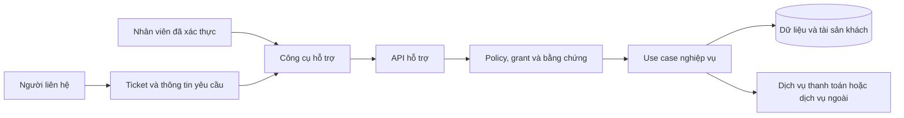
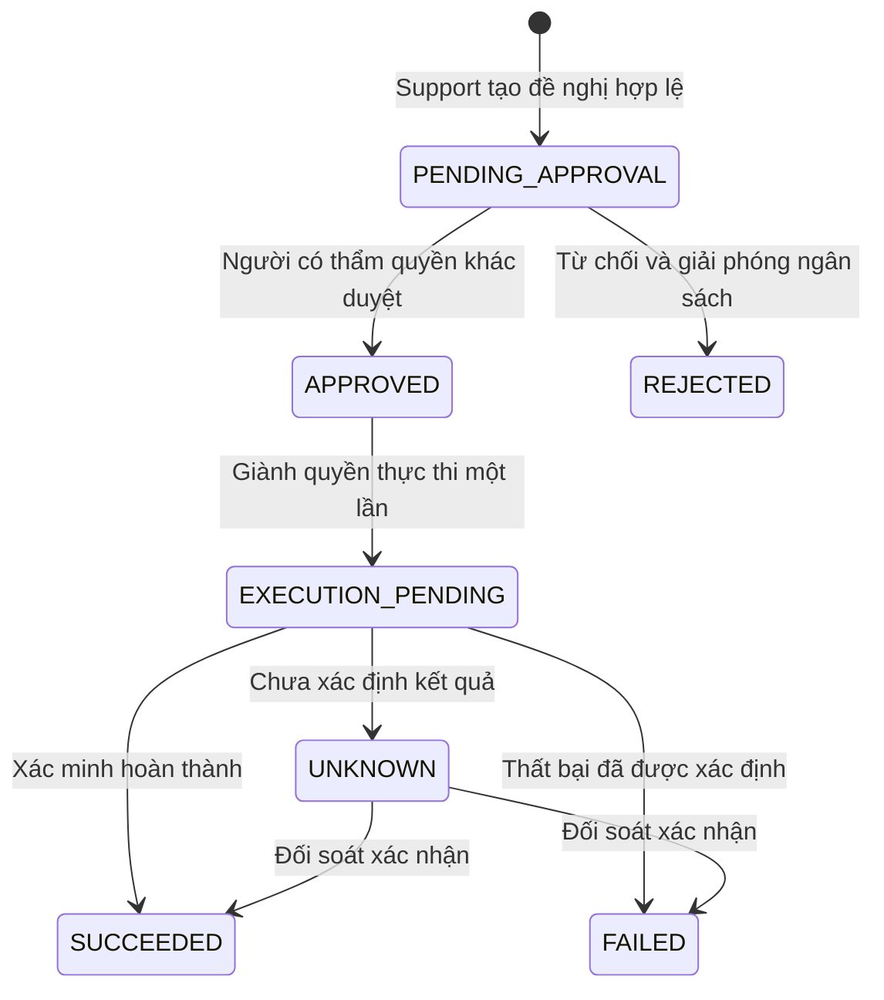

# Ranh giới tin cậy giữa bộ phận hỗ trợ và khách hàng

## 1. Ranh giới này bảo vệ điều gì?

**Support to customer boundary** là ranh giới giữa quyền của nhân viên hoặc công cụ hỗ trợ với dữ liệu, tài sản và quyết định thuộc phạm vi khách hàng. Ranh giới này quy định nhân viên nào được làm việc gì, trên đối tượng nào, dựa trên căn cứ nào và trong thời gian nào.

Nhân viên hỗ trợ có thể cần xem tình trạng đơn, tạo yêu cầu hoàn tiền hoặc hướng dẫn khôi phục tài khoản. Những nhu cầu đó không tự tạo ra quyền đọc mọi dữ liệu, thay đổi mọi thông tin hoặc hành động như chính khách hàng.

Các tình huống vi phạm điển hình gồm:

- Nhân viên được xem đơn nhưng gọi trực tiếp API để sửa giá hoặc hoàn tiền.
- Một phiếu hỗ trợ của khách A bị dùng để mở dữ liệu của khách B.
- Công cụ “xem như khách hàng” cấp luôn quyền đổi email, tắt MFA hoặc rút tiền.
- Tài khoản hỗ trợ bị chiếm đoạt và được dùng để vượt kiểm tra nghiệp vụ.
- Hệ thống ghi thao tác của nhân viên như thể chính khách đã yêu cầu hoặc thực hiện.
- Hai lần nhấn hoặc hai job cùng thực hiện một quyết định hoàn tiền.

Một hệ thống an toàn cần cho phép hỗ trợ khách hàng hiệu quả, đồng thời duy trì quyền theo đối tượng, quy trình phê duyệt, bất biến tài chính và khả năng truy trách nhiệm.

Bài học thuộc chương **Trust Boundaries** của module **SECURITY_APPLICATION_SECURITY_BUSINESS_LOGIC_SECURITY**. Sau bài học, bạn có thể:

- Xác định căn cứ và phạm vi quyền khi nhân viên làm việc trên tài nguyên khách.
- Phân biệt thao tác hỗ trợ, ủy quyền và việc làm mất danh tính người thực hiện.
- Thiết kế grant có giới hạn theo khách, tổ chức, đối tượng, hành động và thời gian.
- Giữ bất biến qua hoàn tiền, đổi thông tin và khôi phục truy cập.
- Kiểm thử vượt quyền, bỏ bước, thao tác trùng và xử lý thu hồi quyền.

## 2. Những chủ thể và căn cứ phải phân biệt

### 2.1. Có nhiều chủ thể trong một yêu cầu

| Chủ thể hoặc vai trò | Ví dụ | Ý nghĩa |
|---|---|---|
| Người liên hệ | Người gửi email hoặc mở ticket | Có thể chưa được xác minh là chủ tài khoản |
| Khách bị tác động | Tài khoản sở hữu đơn | Là chủ thể liên quan đến tài sản hoặc dữ liệu |
| Nhân viên thực hiện | Support agent đã đăng nhập | Người thực sự bấm nút hoặc gửi lệnh |
| Người phê duyệt | Nhân sự có thẩm quyền khác | Chấp thuận nội dung khi chính sách yêu cầu |
| Dịch vụ thực thi | Refund worker | Thành phần thực hiện tác dụng phụ |
| Bên cấp quyền | Dịch vụ policy hoặc quy trình được chấp nhận | Xác định phạm vi hỗ trợ hợp lệ |

Một người có thể đảm nhiệm một số vai trò, nhưng không được xóa bỏ sự khác nhau giữa chúng trong mô hình dữ liệu hoặc audit.

“Tài khoản khách bị tác động” không nhất thiết là danh tính dùng để xác thực request. Nhân viên vẫn phải được nhận diện bằng danh tính nhân viên.

### 2.2. Ba căn cứ thường gặp

**Quyền phục vụ theo chính sách tổ chức:** nhân viên được xem một phần thông tin hoặc thực hiện một số tác vụ trong phạm vi được phân công. Không nhất thiết mỗi lần xem trạng thái đơn đều phải có một xác nhận mới từ khách, nếu chính sách đã cho phép.

**Ủy quyền cho một yêu cầu cụ thể:** khách hoặc bên có thẩm quyền chấp thuận một nội dung xác định, chẳng hạn sửa địa chỉ cho một đơn chưa xuất. Bằng chứng phải gắn với nội dung và quy trình được hệ thống chấp nhận.

**Quyền ngoại lệ:** một quy trình riêng cấp quyền giới hạn cho tình huống đặc biệt. Quyền này cần căn cứ, hạn dùng và kiểm tra riêng.

Không được lấy căn cứ của loại này để suy ra quyền của loại khác. Ví dụ, quyền xem thông tin nhằm xử lý ticket không tự cho phép thay đổi yếu tố xác thực.

### 2.3. Những thứ không tự chứng minh thẩm quyền

- Có tài khoản nhân viên hoặc đang dùng mạng nội bộ.
- Biết customer ID, order ID, số điện thoại hoặc địa chỉ.
- Có một ticket đang mở nhưng chưa kiểm tra quan hệ với khách và nhân viên.
- Nội dung chat nói “khách đã đồng ý”.
- Có role tên chung như `SUPPORT`.
- Người gọi gửi `customerConfirmed=true` hoặc `skipApproval=true`.
- Giao diện đã ẩn nút không phù hợp.
- Một dịch vụ nội bộ đã xác thực kết nối.

Đăng nhập xác nhận danh tính theo cơ chế của hệ thống. Phân quyền vẫn phải xét hành động và tài nguyên cụ thể. Nguyên tắc này được trình bày trong [OWASP Authorization Cheat Sheet](https://cheatsheetseries.owasp.org/cheatsheets/Authorization_Cheat_Sheet.html).

## 3. Hai ranh giới cùng xuất hiện trong quy trình hỗ trợ



Ranh giới thứ nhất nằm giữa người liên hệ và quy trình xác minh yêu cầu. Người tự nhận là khách có thể cung cấp thông tin đúng nhưng chưa đủ để chứng minh quyền thay đổi tài khoản.

Ranh giới thứ hai nằm giữa quyền của nhân viên và quyền tác động lên tài nguyên khách. Kể cả khi người liên hệ đã được xác minh, nhân viên vẫn chỉ được làm trong phạm vi được cấp.

Công cụ hỗ trợ là một client có thể gửi dữ liệu sai hoặc bị can thiệp. Backend phải kiểm tra độc lập với các nút, ô chọn và trạng thái hiển thị.

Một mẫu sai là:

```text
Người gọi có role SUPPORT
→ cho phép nạp bất kỳ customerId
→ chạy các API khách hàng với customerId đó.
```

Mẫu này có thể biến dịch vụ nhiều quyền thành bên thực hiện hộ một yêu cầu không được phép. Cần kiểm tra quan hệ giữa nhân viên, grant, khách, tổ chức và đối tượng trước khi dùng quyền của dịch vụ.

## 4. Biểu diễn quyền hỗ trợ có phạm vi

### 4.1. Support grant là gì?

Trong bài, **support grant** là một bản ghi hoặc bằng chứng được hệ thống chấp nhận, mô tả một phạm vi hỗ trợ. Nó có thể xuất phát từ chính sách tổ chức, phân công xử lý hoặc một quy trình chấp thuận cụ thể.

Grant không nhất thiết là JWT, cũng không mặc nhiên đồng nghĩa khách đã ký một giấy ủy quyền. Ý nghĩa của nó phụ thuộc bên cấp và căn cứ cấp.

Một grant thường cần:

| Nhóm | Dữ liệu minh họa |
|---|---|
| Định danh | Grant ID, bên cấp, phiên bản |
| Người được dùng | Nhân viên hoặc nhóm được xác định rõ |
| Phạm vi khách | Customer ID và tenant của tài nguyên |
| Phạm vi đối tượng | Đơn, ticket, hồ sơ hoặc tập đối tượng được cho phép |
| Hành động | Xem trạng thái, tạo yêu cầu hoàn, sửa địa chỉ cụ thể |
| Giới hạn nội dung | Hạn mức tiền, tiền tệ, trường được sửa hoặc đích được chấp nhận |
| Căn cứ | Chính sách phục vụ, phân công, tham chiếu xác minh/chấp thuận |
| Vòng đời | Thời điểm bắt đầu, hết hạn, trạng thái thu hồi |
| Truy vết | Người cấp, lý do và thông tin liên hệ nghiệp vụ |

Grant ID trong request chỉ có thể là đầu mối tra cứu. Backend còn phải kiểm tra người gọi thực sự được dùng grant đó.

### 4.2. Tổ chức của nhân viên khác phạm vi khách được hỗ trợ

Nhân viên có thể thuộc tổ chức vận hành nền tảng, còn dữ liệu nằm trong tenant của khách hàng. Không thể chỉ so sánh “tenant của nhân viên bằng tenant của khách” rồi dùng kết quả đó làm mô hình quyền đầy đủ.

Cần xác định **tenant đích mà grant cho phép tác động**, sau đó kiểm tra tài nguyên thực sự thuộc tenant đó. Nhân viên có thể được hỗ trợ nhiều tenant theo phân công, nhưng không được tự chọn mọi tenant bằng header.

Phạm vi này cần đi theo truy vấn, cache, file export và công việc bất đồng bộ. Xem [OWASP Multi-Tenant Application Security Cheat Sheet](https://cheatsheetseries.owasp.org/cheatsheets/Multi_Tenant_Security_Cheat_Sheet.html).

### 4.3. Ticket là quan hệ nghiệp vụ cần xác minh

Một ticket hữu ích khi hệ thống kiểm tra được:

- Nó thực sự liên quan đến khách và tài nguyên nào.
- Nhân viên có được giao xử lý hoặc có quyền trong nhóm tương ứng không.
- Loại yêu cầu đã qua bước xác minh/chấp thuận nào.
- Trạng thái ticket có cho phép bắt đầu hành động mới không.
- Quyền cấp theo ticket có bị thu hồi hoặc thay đổi không.

Chuỗi văn bản do người liên hệ nhập trong ticket không tự cấp quyền. Nhân viên cũng không nên tự thay customer ID của ticket rồi dùng chính thay đổi đó làm bằng chứng mở quyền.

Nếu cho phép chuyển người xử lý hoặc chuyển ticket sang khách khác, phải xác định ảnh hưởng đến grant cũ. Không mặc định quyền đã cấp sẽ tự thay đổi chính xác chỉ vì giao diện hiển thị thông tin mới.

## 5. Phân biệt các mức thao tác hỗ trợ

| Mức thao tác | Ví dụ | Hàng rào phù hợp |
|---|---|---|
| Đọc thông tin hạn chế | Trạng thái giao hàng | Scope theo khách/đơn và projection được phép |
| Hiện thêm thông tin nhạy cảm | Mở một trường đã che | Quyền riêng, lý do và ghi nhận truy cập |
| Tạo đề nghị thay đổi | Tạo yêu cầu hoàn | Grant theo đối tượng và giới hạn nội dung |
| Phê duyệt | Duyệt khoản hoàn | Thẩm quyền riêng và tách trách nhiệm khi yêu cầu |
| Thực thi | Gửi lệnh hoàn tiền | Nội dung đã duyệt, trạng thái và chống lặp |
| Khôi phục truy cập | Đổi yếu tố xác thực | Quy trình xác minh riêng theo mức rủi ro |
| Ngoại lệ | Can thiệp khẩn cấp có kiểm soát | Quyền ngoại lệ được cấp, giới hạn và hậu kiểm |

Quyền của support không nhất thiết là bản sao quyền tự phục vụ của khách. Chẳng hạn, một nghiệp vụ nội bộ có thể cho nhân viên tạo đề nghị hoàn nhưng không cho cả nhân viên lẫn khách tự phê duyệt khoản đó.

Vì vậy, quyết định phải dựa trên chính sách cho hành động hỗ trợ, căn cứ cấp quyền và quy tắc miền nghiệp vụ, thay vì chỉ “mượn toàn bộ quyền khách”.

## 6. Thao tác thay và danh tính người thực hiện

### 6.1. Giữ được cả người tác động và khách bị tác động

Nếu hệ thống chỉ đổi principal sang customer ID, tầng dưới có thể không còn biết người thực hiện là nhân viên. Điều này làm yếu kiểm soát chức năng, dấu vết và khả năng phân biệt thao tác tự phục vụ với thao tác hỗ trợ.

Một ngữ cảnh rõ ràng có thể giữ:

```text
actualActor       = support-agent-42
affectedCustomer  = customer-17
targetTenant      = tenant-08
supportGrant      = grant-91
action            = REQUEST_REFUND
executor          = support-api
```

Các giá trị có thẩm quyền phải do server xác định hoặc kiểm chứng. Không nhận toàn bộ ngữ cảnh này trực tiếp từ body rồi sử dụng như dữ liệu đã xác thực.

### 6.2. Delegation và impersonation

Trong mô hình ủy quyền, bên thực hiện vẫn giữ danh tính riêng khi hành động thay. Trong mô hình mạo danh theo ngữ cảnh quyền, bên nhận có thể chỉ thấy chủ thể được mạo danh.

Sự phân biệt này được mô tả trong [RFC 8693, mục 1.1: Delegation vs. Impersonation Semantics](https://datatracker.ietf.org/doc/html/rfc8693#section-1.1). Nếu dùng token có ngữ nghĩa delegation, claim `act` có thể mô tả bên đang thực hiện; việc cấp và chấp nhận token vẫn phụ thuộc chính sách tin cậy.

Chỉ thêm một trường `act` vào JSON không tạo ra ủy quyền. Bên nhận phải kiểm tra issuer, đối tượng nhận token, hiệu lực và quyền tương ứng; không dùng lịch sử actor như một cách tự cộng thêm quyền.

### 6.3. Công cụ “xem như khách hàng”

Nếu sản phẩm có chức năng này, cần xác định rõ:

- Chỉ xem hay có thể sửa, và dữ liệu nào được xem.
- Nhân viên nào được mở phiên cho khách nào.
- Phiên có thời hạn và được thu hồi ra sao.
- Cách nhận diện ngữ cảnh hỗ trợ tại API và audit.
- Hành động nào luôn yêu cầu quy trình riêng.

Nhãn “chỉ xem” trên UI không ngăn nhân viên gọi trực tiếp API ghi. Backend phải thực thi giới hạn đó.

Không lấy mật khẩu, cookie hoặc access token thật của khách để tiện xử lý. Ngữ cảnh hỗ trợ phải dùng cơ chế quyền của hệ thống và giữ được nguồn gốc nhân viên.

## 7. Ví dụ xuyên suốt: tạo yêu cầu hoàn tiền thay khách

### 7.1. Giả định nghiệp vụ

Hệ thống minh họa có các chính sách:

- Nhân viên hỗ trợ được **tạo đề nghị hoàn**, không tự phê duyệt và thu hồi tiền.
- Grant chỉ áp dụng cho một khách, một tenant và một đơn.
- Đơn dùng VND; mỗi grant có hạn mức cho từng đề nghị.
- Khoản hoàn trở về giao dịch thanh toán gốc theo tham chiếu server quản lý.
- Một người có thẩm quyền khác phải phê duyệt nội dung trước khi thực thi.
- Ngân sách hoàn được giữ khi đề nghị được chấp nhận, và được giải phóng theo trạng thái kết thúc phù hợp.
- Tổng tiền hoàn thành công và ngân sách đang giữ không vượt phần tiền được phép hoàn.

Ví dụ này không bao gồm quy đổi tiền tệ hoặc mọi ngoại lệ của hệ thống thanh toán. Các điều kiện về đổi trả, tranh chấp hoặc thời gian được hoàn cần được bổ sung theo nghiệp vụ thực tế.

### 7.2. Hợp đồng đầu vào chỉ nêu ý định

Một API hỗ trợ có thể nhận:

```http
POST /support/grants/grant-91/orders/order-73/refund-requests
Content-Type: application/json
Idempotency-Key: support-refund-operation-27

{
  "amountVnd": 1000000,
  "reasonCode": "ACCEPTED_RETURN"
}
```

Backend lấy nhân viên từ ngữ cảnh xác thực, nạp grant và đơn, sau đó kiểm tra phạm vi. Tên route `/support` không tạo ra quyền; mọi client vẫn phải qua chính sách.

Không nhận các trường sau làm căn cứ có thẩm quyền:

```json
{
  "actorId": "another-agent",
  "customerConfirmed": true,
  "approvalRequired": false,
  "approvedBy": "finance-manager",
  "refundDestination": "arbitrary-new-account"
}
```

Lý do và ticket ID cũng không thay thế kiểm tra điều kiện. Chúng là dữ liệu được đối chiếu và lưu dấu vết.

### 7.3. Trạng thái đề nghị hoàn



Đây là luồng minh họa, chưa liệt kê mọi nhánh hủy hoặc hết hiệu lực. Mỗi chuyển tiếp cần quyền, điều kiện trạng thái và cập nhật nhất quán.

Grant tạo đề nghị không được dùng để gọi trực tiếp chuyển tiếp `APPROVED` hoặc `SUCCEEDED`. Thao tác phê duyệt phải gắn với số tiền, tiền tệ, đơn, giao dịch gốc và phiên bản nội dung.

Nếu sửa nội dung quan trọng, phê duyệt cũ phải mất hiệu lực theo chính sách. Nguyên tắc kiểm soát trình tự và bảo vệ dữ liệu đã được chấp thuận được trình bày trong [OWASP Transaction Authorization Cheat Sheet](https://cheatsheetseries.owasp.org/cheatsheets/Transaction_Authorization_Cheat_Sheet.html).

## 8. Minh họa Java: kiểm tra grant và đối tượng đích

Đoạn mã Java sau minh họa một phần policy. `Agent` được tạo từ danh tính nhân viên đã kiểm chứng; grant được nạp từ nguồn có thẩm quyền, không lấy trạng thái hiệu lực trực tiếp từ body. Snapshot đơn có nguồn tương tự.

Ví dụ giả định các trường bắt buộc không null và dùng `Clock` phía server. Nó kiểm tra phạm vi và hạn mức trên snapshot; các điều kiện đổi trả, trạng thái đơn và transaction được xử lý ở use case.

```java
import java.time.Clock;
import java.time.Instant;
import java.util.Set;
import java.util.UUID;

public final class SupportRefundPolicy {
    private SupportRefundPolicy() {
    }

    public enum Action {
        VIEW_ORDER, REQUEST_REFUND
    }

    public enum GrantState {
        ACTIVE, REVOKED
    }

    public record Agent(
            UUID agentId,
            Set<Action> permissions) {

        public Agent {
            permissions = Set.copyOf(permissions);
        }
    }

    public record SupportGrant(
            UUID grantId,
            UUID agentId,
            UUID targetTenantId,
            UUID customerId,
            UUID orderId,
            Set<Action> actions,
            long maxRequestVnd,
            Instant validFrom,
            Instant expiresAt,
            GrantState state) {

        public SupportGrant {
            actions = Set.copyOf(actions);
        }
    }

    public record OrderSnapshot(
            UUID orderId,
            UUID tenantId,
            UUID customerId,
            long availableForRefundVnd,
            long version) {
    }

    public static void checkCanRequestRefund(
            Agent agent,
            SupportGrant grant,
            OrderSnapshot order,
            long amountVnd,
            Clock serverClock) {

        Instant now = serverClock.instant();

        if (!agent.permissions().contains(Action.REQUEST_REFUND)) {
            throw new SecurityException("AGENT_ACTION_NOT_ALLOWED");
        }

        if (!agent.agentId().equals(grant.agentId())) {
            throw new SecurityException("GRANT_ACTOR_MISMATCH");
        }

        if (grant.state() != GrantState.ACTIVE
                || now.isBefore(grant.validFrom())
                || !now.isBefore(grant.expiresAt())) {
            throw new SecurityException("GRANT_NOT_ACTIVE");
        }

        if (!grant.actions().contains(Action.REQUEST_REFUND)) {
            throw new SecurityException("GRANT_ACTION_NOT_ALLOWED");
        }

        if (!grant.targetTenantId().equals(order.tenantId())
                || !grant.customerId().equals(order.customerId())
                || !grant.orderId().equals(order.orderId())) {
            throw new SecurityException("TARGET_OUTSIDE_GRANT");
        }

        if (amountVnd <= 0
                || amountVnd > grant.maxRequestVnd()
                || amountVnd > order.availableForRefundVnd()) {
            throw new IllegalArgumentException(
                    "REFUND_AMOUNT_OUTSIDE_POLICY");
        }
    }
}
```

`maxRequestVnd` là hạn mức **mỗi đề nghị** trong ví dụ. Nếu chính sách còn giới hạn tổng tiền qua nhiều đề nghị, cần bộ đếm hoặc cơ chế ngân sách riêng; nhiều request dưới hạn mức từng lần vẫn có thể vượt tổng.

`availableForRefundVnd` phải phản ánh cả khoản đã hoàn và ngân sách còn bị giữ. Client không tự gửi giá trị đó làm căn cứ.

Tập quyền nhân viên và tập hành động grant đều phải cho phép thao tác. Grant có scope đúng không bù cho việc nhân viên đã bị rút quyền chức năng.

Hàm không thực hiện tiền hoàn, không tạo phê duyệt và không chứng minh khách đã chấp thuận. Những căn cứ đó được quy trình cấp grant và use case kiểm tra riêng.

### Khoảng cách từ kiểm tra đến ghi dữ liệu

Nếu hai request cùng đọc còn 1.000.000 VND được hoàn, cả hai có thể vượt hàm trên. Phần giữ ngân sách phải có cập nhật nguyên tử hoặc cơ chế đồng thời tương ứng.

Tương tự, grant có thể bị thu hồi sau khi policy đọc. Nếu yêu cầu thu hồi phải có hiệu lực ngay đối với quyết định mới, việc thu hồi và việc chấp nhận lệnh phải được điều phối tại một điểm nhất quán, bằng khóa, phiên bản hoặc cơ chế phù hợp.

Phiên bản đơn không tự bảo vệ phiên bản grant hay thay đổi phân công ticket. Cần bảo vệ đúng dữ liệu mà quyết định phụ thuộc.

## 9. Transaction, idempotency và công việc bất đồng bộ

### 9.1. Chấp nhận một đề nghị một cách nhất quán

Một transaction cục bộ có thể bao gồm:

1. Xác định nhân viên và quyền chức năng đang được chấp nhận.
2. Nạp grant, quan hệ ticket và đối tượng trong phạm vi phù hợp.
3. Giành quyền xử lý idempotency cho thao tác.
4. Kiểm tra trạng thái đơn, nội dung, hạn mức và điều kiện grant tại điểm quyết định.
5. Giữ ngân sách hoàn bằng cơ chế cạnh tranh phù hợp.
6. Tạo đề nghị `PENDING_APPROVAL` với actual actor và phiên bản nội dung.
7. Lưu audit bắt buộc, kết quả idempotency và outbox nếu có.
8. Commit hoặc rollback toàn bộ phần dữ liệu cục bộ.

Không commit phần giữ ngân sách rồi bỏ qua lỗi tạo đề nghị. Nếu đề nghị bị từ chối về sau, việc giải phóng cũng cần chuyển trạng thái một lần để tránh cộng khả dụng nhiều lần.

Nếu chính sách yêu cầu bản ghi audit bền vững cho quyết định, lỗi ghi audit đó phải được xử lý cùng tính hợp lệ của quyết định. Không đánh đồng nó với một log chẩn đoán tùy chọn.

### 9.2. Phạm vi khóa phải ngăn lẫn khách và lẫn hành động

Khóa idempotency cần gắn với phạm vi như nhân viên, hành động, grant và đối tượng/ngữ cảnh tương ứng. Nội dung được chuẩn hóa phải được so sánh để phát hiện dùng cùng khóa nhưng đổi khách, đơn hoặc số tiền.

Đọc lại kết quả cũ vẫn phải kiểm tra quyền truy xuất; biết khóa không phải quyền xem hồ sơ khách.

Khóa mới hoặc grant mới không cho phép chạy lại cùng một quyết định đã duyệt. Mỗi quyết định thực thi cần có định danh nghiệp vụ ổn định và ràng buộc chống lặp riêng.

Không nên đặt quy tắc “mỗi đơn chỉ có một khoản hoàn” nếu doanh nghiệp cho phép hoàn từng phần. Cần phân biệt cùng một lần thực thi bị lặp với nhiều đề nghị được phép, đồng thời giữ giới hạn tổng tiền.

### 9.3. Quyền tạo đề nghị khác quyền thực thi về sau

Trong ví dụ, grant hỗ trợ được dùng để chấp nhận đề nghị tại thời điểm tạo. Khi được duyệt, dịch vụ thực thi dựa trên quyết định phê duyệt còn hiệu lực và các điều kiện thực thi.

Grant hết hạn không tự động có nghĩa mọi đề nghị đã nhận đều bị xóa hoặc đảo ngược. Nếu chính sách yêu cầu thu hồi grant phải hủy cả đề nghị đang chờ, cần định nghĩa chuyển trạng thái và giải phóng ngân sách tương ứng.

Ngược lại, một worker không được coi `grantValid=true` trong message cũ là quyền vô hạn. Nó phải biết căn cứ hiện tại của tác vụ: grant còn hiệu lực, một quyết định được duyệt, hay một lệnh đã được chấp nhận theo chính sách nào.

Cần ghi rõ điều kiện nào kiểm tra lúc tạo, lúc duyệt và ngay trước tác dụng phụ. Nếu các điều kiện thay đổi, phải có cách dừng hoặc xử lý ngoại lệ phù hợp.

### 9.4. Giữ nguồn gốc qua hàng đợi

Worker phải được xác thực bằng danh tính dịch vụ, đồng thời giữ tham chiếu actual actor, khách bị tác động, tenant, grant, đề nghị và quyết định phê duyệt.

Dịch vụ có quyền gọi cổng thanh toán không được dùng quyền đó để thực thi mọi nội dung nhận qua hàng đợi. Cần kiểm tra nguồn message, hồ sơ nghiệp vụ, số tiền, đích và trạng thái.

Thông điệp có thể lặp hoặc đến sai thứ tự. Consumer phải thực thi theo định danh và trạng thái chứ không chỉ tên sự kiện.

### 9.5. Timeout không tạo ra quyền hoàn thêm

Nếu nhà cung cấp đã thực hiện nhưng response bị mất, không được tạo khoản hoàn mới với định danh khác để thử lại. Giữ trạng thái chưa rõ, tra cứu hoặc retry theo cơ chế chống trùng được chấp nhận, rồi đối soát.

Transaction database không tự rollback khoản tiền ở hệ thống ngoài. Khi đã có tác dụng phụ, phục hồi phải dựa trên bằng chứng và trạng thái thực tế.

## 10. Các thao tác dễ làm thủng ranh giới

### 10.1. Đổi email hoặc số điện thoại

Nếu support được vừa đổi kênh khôi phục vừa dùng kênh mới để xác minh ngay, một người liên hệ giả mạo có thể tạo ra chuỗi “xác minh” do chính mình kiểm soát.

Cần kiểm tra căn cứ thay đổi bằng quy trình độc lập phù hợp, xem xét rủi ro, quyền của nhân viên và tác động đến các phương thức khôi phục. Khi có thông báo, phải dùng kênh mà chính sách còn coi là đáng tin cho mục đích đó.

Không dùng thông tin support vừa đọc được từ hồ sơ làm bằng chứng duy nhất rằng người liên hệ là chủ tài khoản.

### 10.2. Reset MFA và khôi phục truy cập

Quy trình hỗ trợ phải giúp khách hợp lệ lấy lại quyền truy cập mà không trở thành đường vòng bỏ MFA cho người tấn công.

Không nên có một nút chung “khách yêu cầu” để tắt MFA mà thiếu kiểm tra riêng. Bằng chứng xác minh, quyền thực hiện, bước phê duyệt khi cần và tác động thu hồi phiên phải được quy định.

Nhân viên không cần biết mật khẩu, seed MFA hoặc OTP để thực hiện chức năng hỗ trợ được thiết kế đúng. Nếu quy trình dùng challenge, khách thực hiện nó qua giao diện và kênh được chấp nhận; kết quả được server kiểm tra theo phạm vi.

OWASP nhấn mạnh rằng cơ chế reset MFA phải được đánh giá theo bối cảnh và không được trở thành cách chiếm tài khoản. Xem [OWASP Multifactor Authentication Cheat Sheet, phần Resetting MFA](https://cheatsheetseries.owasp.org/cheatsheets/Multifactor_Authentication_Cheat_Sheet.html#resetting-mfa).

### 10.3. Đổi địa chỉ giao hàng, giá và đích tiền

Sửa địa chỉ có thể không còn hợp lệ sau khi đơn đã xuất. Sửa giá có thể cần cấp duyệt riêng. Đổi đích hoàn tiền có thể làm thay đổi bản chất giao dịch đã được chấp nhận.

Một quyền chung `EDIT_CUSTOMER` không nên bao trùm tất cả các hành động này. Tách theo nghiệp vụ và trường dữ liệu quan trọng giúp kiểm tra được điều kiện tương ứng.

Trong ví dụ hoàn tiền của bài, đích được lấy từ tham chiếu thanh toán gốc. Nếu hệ thống cho phép đích khác, đó phải là một chính sách và workflow riêng, không phải một trường tự do trong API hỗ trợ.

## 11. Vòng đời quyền, dữ liệu hiển thị và ngoại lệ

### 11.1. Quyền phải kết thúc theo điều kiện đã định

Các sự kiện có thể ảnh hưởng quyền gồm nhân viên chuyển nhóm, bị khóa tài khoản, ticket đổi người xử lý, khách rút chấp thuận hoặc grant hết hạn.

Cần quy định sự kiện nào:

- Chặn hành động mới.
- Thu hồi phiên hỗ trợ đang mở.
- Hủy đề nghị chưa được duyệt.
- Yêu cầu xét lại quyết định đã duyệt.
- Chỉ tạo dấu vết mà không hồi tố tác vụ đã hoàn tất.

Token còn chữ ký hợp lệ có thể chứa trạng thái quyền cũ. Nếu hệ thống cần thu hồi sớm hơn thời gian hết hạn token, phải có cơ chế tra cứu, phiên bản hoặc sự kiện thu hồi phù hợp, với cam kết nhất quán rõ ràng.

Một cờ `revoked=false` trong payload cũ không chứng minh grant hiện chưa bị thu hồi. Cache quyền cũng phải có phạm vi và chính sách làm mới phù hợp.

### 11.2. Quyền đọc có thể khác nhau theo trường và hành động

Một nhân viên xem tình trạng đơn chưa chắc được đọc đầy đủ địa chỉ, tải hóa đơn hoặc export lịch sử giao dịch.

Nếu chỉ được xem dữ liệu đã che, backend phải trả projection tương ứng. Gửi đầy đủ số điện thoại rồi dùng CSS ẩn một phần vẫn làm lộ dữ liệu cho người có thể đọc response.

Quyền mở thông tin đầy đủ, tải tệp và tạo export cần được kiểm tra riêng theo phạm vi. File tạo bởi job nền không được trở thành một URL công khai có thể dùng cho khách khác.

Việc xem dữ liệu cần thiết để hỗ trợ cũng không tự cho phép sửa hoặc tiết lộ dữ liệu đó ra một kênh khác.

### 11.3. Quyền ngoại lệ cần một workflow riêng

Một cơ chế *break-glass* có thể phục vụ tình huống khẩn cấp, nhưng không nên là tham số tự do như:

```http
X-Skip-Authorization: true
```

Thiết kế cần xác định người được kích hoạt, căn cứ, phạm vi khách và hành động, thời hạn, cơ chế phê duyệt hoặc kích hoạt khẩn cấp theo chính sách, thông báo và hậu kiểm.

Không dùng một role ngoại lệ để tắt vô điều kiện kiểm tra đối tượng, nguồn gốc và số tiền. Nếu cho phép một ngoại lệ nghiệp vụ, chính ngoại lệ đó phải có điều kiện và bằng chứng rõ.

Quyền tạm thời phải kết thúc thật ở backend. Ẩn nút sau khi hết hạn không thu hồi một token hoặc job còn quyền thực thi.

## 12. Audit phải giữ được trách nhiệm và nội dung

### 12.1. Ghi người thực hiện đúng với thực tế

Một sự kiện có thể có cấu trúc:

```json
{
  "eventType": "SUPPORT_REFUND_REQUEST_ACCEPTED",
  "actualActor": {
    "type": "SUPPORT_AGENT",
    "id": "support-agent-42"
  },
  "affectedCustomerId": "customer-17",
  "targetTenantId": "tenant-08",
  "resource": {
    "type": "ORDER",
    "id": "order-73"
  },
  "supportGrantId": "grant-91",
  "supportCaseId": "case-56",
  "authorityBasis": "ASSIGNED_CASE_POLICY",
  "action": "REQUEST_REFUND",
  "amountVnd": "1000000",
  "reasonCode": "ACCEPTED_RETURN",
  "operationId": "support-refund-operation-27",
  "requestId": "request-814",
  "outcome": "PENDING_APPROVAL",
  "recordedAt": "2026-11-21T04:20:00Z"
}
```

Đây là ví dụ định dạng, không phải token quyền. Sự kiện chỉ nói một đề nghị được chấp nhận và đang chờ duyệt; nó không nói tiền đã hoàn hoặc khách đã tự thực hiện.

Nếu căn cứ là chấp thuận của khách, lưu tham chiếu bằng chứng phù hợp và nội dung được chấp thuận. Không gán `actualActor = customer` chỉ để log trông giống luồng tự phục vụ.

Nếu tác vụ chạy qua worker, lưu cả nguồn đề nghị và executor thực tế. Mỗi sự kiện phải phản ánh đúng giai đoạn yêu cầu, phê duyệt, gửi lệnh hoặc kết quả.

### 12.2. Bảo vệ audit và giới hạn dữ liệu

Nên ghi thay đổi quan trọng, quyết định cho phép/từ chối và hành vi mở thông tin nhạy cảm theo chính sách. Dữ liệu audit cần được bảo vệ khỏi sửa/xóa ngoài thẩm quyền, có quyền đọc và thời hạn lưu phù hợp.

Không ghi mật khẩu, raw access token, OTP, cookie phiên hoặc nội dung xác minh nhạy cảm không cần thiết. Nội dung ticket tự do cần được xử lý như dữ liệu không tin cậy khi đưa vào log hoặc bản xuất.

Các nguyên tắc thiết kế và bảo vệ nhật ký được trình bày trong [OWASP Logging Cheat Sheet](https://cheatsheetseries.owasp.org/cheatsheets/Logging_Cheat_Sheet.html).

Một chữ ký của dịch vụ audit, nếu có, chứng thực hồ sơ theo bên ký; nó không tự biến thao tác của support thành chữ ký hay ý chí của khách.

### 12.3. Các dấu hiệu cần quan sát

- Nhân viên truy cập nhiều khách không liên quan đến phân công.
- Nhiều lần thử đổi tenant, customer hoặc order ID ngoài grant.
- Cố gọi API ghi trong một phiên chỉ xem.
- Chuỗi đổi email, reset MFA rồi thực hiện giao dịch nhạy cảm.
- Nhiều đề nghị sát hạn mức hoặc chia nhỏ để né ngưỡng tổng.
- Tăng đột biến mở thông tin đã che hoặc xuất dữ liệu.
- Lệnh bị từ chối nhưng vẫn có thay đổi tài chính hoặc tài khoản.
- Sử dụng grant hoặc phiên sau khi sự kiện thu hồi đã có hiệu lực.
- Đề nghị chờ, ngân sách bị giữ hoặc kết quả thanh toán chưa được đối soát.

Cảnh báo hỗ trợ phát hiện và điều tra. Nó không thay thế hàng rào ngăn thao tác sai trước tác dụng phụ.

## 13. Ma trận kiểm thử ranh giới support–khách hàng

| Kịch bản | Kỳ vọng nghiệp vụ |
|---|---|
| Nhân viên đúng quyền, grant, khách, tenant và đơn | Chỉ thực hiện hành động trong phạm vi được cấp |
| Có role hỗ trợ nhưng không có căn cứ cho đối tượng | Không được truy cập hoặc tác động ngoài chính sách |
| Grant của nhân viên A được nhân viên B sử dụng | Bị từ chối nếu grant không cho phép quan hệ đó |
| Grant chỉ xem được dùng để tạo đề nghị hoàn | Không có đề nghị hoặc ngân sách bị giữ |
| Đổi customer ID trong cùng tenant | Không mở rộng phạm vi |
| Đổi order ID của cùng một khách | Bị chặn với grant chỉ cho một đơn |
| Đổi tenant bằng header hoặc tham số | Không vượt phạm vi grant và tài nguyên |
| Request tại đúng `expiresAt` hoặc trước `validFrom` | Không được chấp nhận theo khoảng hiệu lực của ví dụ |
| Grant hoặc quyền nhân viên bị thu hồi | Đúng cam kết thu hồi tại điểm quyết định; không chỉ tin payload cũ |
| Ticket chuyển người xử lý hoặc đóng | Quyền mới và tác vụ đang chờ được xử lý đúng chính sách vòng đời |
| Support cố chuyển thẳng sang APPROVED/SUCCEEDED | Không bỏ bước phê duyệt hoặc xác minh kết quả |
| Người tạo tự phê duyệt khi chính sách cấm | Bị chặn dù có nhiều role |
| Số tiền âm, 0 hoặc vượt hạn mức | Không tạo đề nghị và không thay đổi ngân sách |
| Hai đề nghị đồng thời vượt phần tiền còn được hoàn | Chỉ chấp nhận phần phù hợp, không giữ vượt ngân sách |
| Hai request cùng khóa idempotency | Không tạo hai đề nghị hoặc hai phần giữ |
| Cùng khóa nhưng đổi khách, đơn hoặc số tiền | Phát hiện xung đột, không trả dữ liệu riêng sai phạm vi |
| Đổi grant để thực thi lại quyết định cũ | Ràng buộc theo quyết định/execution vẫn chặn thực thi lặp |
| Sửa nội dung sau phê duyệt | Không dùng phê duyệt cũ cho nội dung mới |
| Worker nhận message trùng hoặc sai thứ tự | Không lặp khoản hoàn hoặc giải phóng ngân sách hai lần |
| Provider xử lý xong nhưng response mất | Giữ kết quả chưa rõ và đối soát, không tự hoàn thêm |
| UI chỉ xem nhưng gửi API ghi trực tiếp | Backend vẫn chặn |
| Quyền chỉ xem dữ liệu che | Response không chứa phần dữ liệu bị cấm |
| Dùng cờ hoặc header “bỏ kiểm tra” | Không tạo quyền ngoại lệ |
| Kiểm tra hồ sơ sau một thao tác hỗ trợ | Còn actual actor, khách bị tác động, căn cứ và nội dung đúng |

Các kiểm thử cần quan sát trạng thái đối tượng, số đề nghị, ngân sách, lệnh ra ngoài và audit. Một response lỗi không chứng minh an toàn nếu tác dụng phụ đã xảy ra.

Unit test phù hợp với policy phạm vi, thời gian và hạn mức. Integration test cần kiểm tra đường tạo ngữ cảnh, nguồn grant, transaction và cập nhật có điều kiện. Kiểm thử luồng cần bao gồm phiên hỗ trợ, worker, thông điệp lặp và thay đổi quyền trong lúc xử lý.

Cần kiểm thử cả trường hợp đúng được phép thực hiện. Một cơ chế chặn mọi truy cập không chứng minh chức năng hỗ trợ đã đáp ứng mục tiêu nghiệp vụ.

## 14. Mẫu đặc tả một hành động hỗ trợ

Trước khi thêm nút vào công cụ hỗ trợ, hãy trả lời:

1. **Hành động chính xác:** xem, hiện thêm dữ liệu, tạo đề nghị, duyệt hay thực thi?
2. **Người thực hiện:** danh tính nhân viên đến từ đâu, quyền chức năng nào cần có?
3. **Phạm vi đích:** khách, tenant, đơn, trường dữ liệu và số lượng tài nguyên nào?
4. **Căn cứ:** chính sách phục vụ, phân công, chấp thuận cụ thể hay quyền ngoại lệ?
5. **Giới hạn:** thời hạn, trạng thái, số tiền, tổng ngân sách và điều kiện không tự duyệt.
6. **Nguồn dữ liệu:** trường nào từ client, trường nào phải lấy từ hệ thống có thẩm quyền?
7. **Tính nguyên tử:** dữ liệu nào phải cùng commit và tranh chấp nào cần ngăn?
8. **Xử lý lặp:** request, quyết định và tác dụng phụ có định danh ổn định nào?
9. **Thu hồi và bất đồng bộ:** kiểm tra quyền tại giai đoạn nào, tác vụ đã nhận được xử lý ra sao?
10. **Bằng chứng:** ai làm, ảnh hưởng khách nào, nội dung nào đã được chấp thuận và kết quả gì?

Ví dụ đặc tả rút gọn:

```text
Hành động:
- Support tạo đề nghị hoàn tiền cho một đơn được cấp trong grant.

Được phép khi:
- Nhân viên có quyền chức năng và được dùng grant.
- Grant đang có hiệu lực cho đúng khách, tenant và đơn.
- Đơn đủ điều kiện, số tiền trong hạn mức và còn ngân sách.

Kết quả:
- Một đề nghị PENDING_APPROVAL.
- Ngân sách được giữ và audit được lưu cùng transaction cục bộ.
- Actual actor là nhân viên, không phải khách.

Không tự suy ra:
- Quyền phê duyệt, thực thi hoặc đổi đích nhận tiền.
- Khách đã tự thao tác hoặc đã chấp thuận mọi nội dung.

Gọi lại:
- Cùng nghiệp vụ không tạo thêm đề nghị hoặc tác dụng phụ.
- Quyết định thực thi đã dùng không được chạy lại bằng grant khác.
```

Từ đặc tả mới lựa chọn cách tổ chức API, Java policy, grant store và workflow. Tên role, vị trí mạng hoặc nhãn trên giao diện không thay thế các quan hệ quyền đó.

## 15. Tài liệu tham khảo

- [OWASP Authorization Cheat Sheet](https://cheatsheetseries.owasp.org/cheatsheets/Authorization_Cheat_Sheet.html) — xác thực, phân quyền và kiểm tra quyền theo request/tài nguyên.
- [OWASP Multi-Tenant Application Security Cheat Sheet](https://cheatsheetseries.owasp.org/cheatsheets/Multi_Tenant_Security_Cheat_Sheet.html) — phạm vi tenant trong truy vấn, cache và tác vụ.
- [RFC 8693: OAuth 2.0 Token Exchange](https://datatracker.ietf.org/doc/html/rfc8693) — phân biệt delegation và impersonation, cùng ngữ nghĩa actor.
- [OWASP Transaction Authorization Cheat Sheet](https://cheatsheetseries.owasp.org/cheatsheets/Transaction_Authorization_Cheat_Sheet.html) — trình tự chấp thuận và ràng buộc dữ liệu giao dịch.
- [OWASP Multifactor Authentication Cheat Sheet](https://cheatsheetseries.owasp.org/cheatsheets/Multifactor_Authentication_Cheat_Sheet.html) — bảo vệ quy trình reset và thay đổi yếu tố xác thực.
- [OWASP Logging Cheat Sheet](https://cheatsheetseries.owasp.org/cheatsheets/Logging_Cheat_Sheet.html) — dữ liệu sự kiện, bảo vệ log và giới hạn thông tin nhạy cảm.

Các grant, trạng thái, lớp Java và quy tắc hoàn tiền trong bài là minh họa. Khi áp dụng, cần thay bằng phạm vi hỗ trợ, căn cứ cấp quyền và chính sách nghiệp vụ đã xác định của hệ thống cụ thể.
