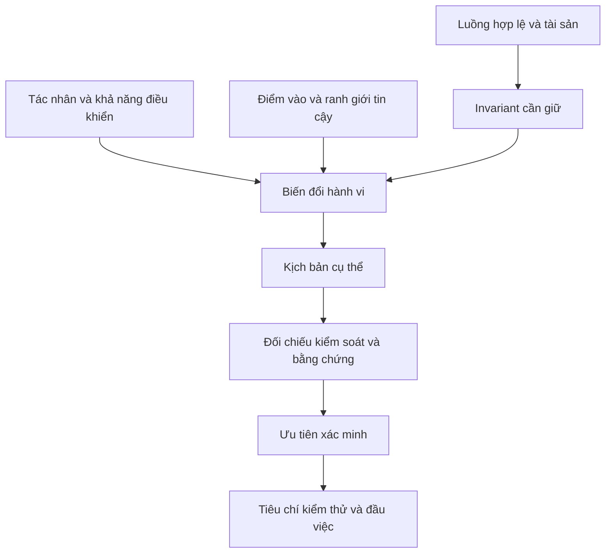

# Misuse case identification — Nhận diện kịch bản sử dụng sai và lạm dụng nghiệp vụ

Một chức năng đặt hàng có thể tính đúng tổng tiền, một API phê duyệt có thể cập nhật đúng trạng thái và một worker thanh toán có thể gọi đúng nhà cung cấp. Nhưng khi người dùng gọi các chức năng theo thứ tự khác, sửa tham số hoặc gửi đồng thời, toàn bộ quy trình vẫn có thể tạo kết quả trái quy tắc.

**Misuse case identification** là hoạt động tìm ra những kịch bản trong đó chức năng bị sử dụng theo cách dẫn tới kết quả không được phép hoặc gây thiệt hại. Đầu ra hữu ích là một mô tả cụ thể về tác nhân, điều kiện, chuỗi hành động, invariant bị đe dọa và bằng chứng cần kiểm tra.

Trong chương **Abuse Cases**, bài học này tập trung vào việc nhận diện các kịch bản lạm dụng logic như bỏ qua phê duyệt, sửa giá, thao tác sai quyền, gửi yêu cầu trùng và tranh chấp tài nguyên. Các ví dụ là tình huống thiết kế để học, không phải kết luận rằng một hệ thống cụ thể đang có lỗ hổng.

## 1. Từ use case hợp lệ đến misuse case

**Use case** mô tả cách một chủ thể đạt mục tiêu hợp lệ. Ví dụ: người mua tạo đơn, người có quyền khác duyệt nội dung, rồi đơn được thanh toán.

Một misuse case bắt đầu từ khả năng sử dụng hoặc kết hợp chức năng đó để tạo kết quả không mong muốn. Ví dụ: người mua sửa số lượng sau khi được duyệt, rồi thanh toán mà không cần quyết định mới.

Trong bài này:

- **Misuse case** được dùng cho kịch bản sử dụng sai hoặc lệch khỏi mục đích, có thể do chủ động hoặc nhầm lẫn.
- **Abuse case** nhấn mạnh hành vi chủ động khai thác để đạt lợi ích hoặc gây thiệt hại.
- Khi đánh giá bảo mật, trọng tâm là khả năng một tác nhân chủ động chọn dữ liệu, thứ tự và thời điểm để phá vỡ quy tắc.

Cách dùng hai thuật ngữ có thể khác giữa các nhóm. Điều quan trọng là mô tả rõ hành vi và tác động, thay vì tranh luận nhãn gọi trong khi chưa biết điều gì có thể xảy ra.

### 1.1. Không dừng ở một ý tưởng quá rộng

| Mô tả ban đầu | Vấn đề | Mô tả có thể tiếp tục phân tích |
| --- | --- | --- |
| “Người dùng gian lận” | Chưa biết gian lận chức năng nào | Người tạo đơn thử gọi lệnh duyệt trên chính đơn mình |
| “Có thể sửa request” | Đây chỉ là khả năng điều khiển dữ liệu | Người mua sửa `unitPrice` rồi kiểm tra nguồn giá mà máy chủ sử dụng |
| “API có IDOR” | Đã gọi tên lỗi khi chưa có bằng chứng | Người A thay mã đơn bằng mã ngoài phạm vi và kiểm tra dữ liệu hoặc thay đổi nhận được |
| “Có race condition” | Chưa nêu invariant và tài nguyên chung | Hai yêu cầu hoàn tiền cùng tranh số tiền còn có thể hoàn |
| “Replay được” | Chưa rõ replay tạo thiệt hại gì | Gửi lại cùng nghĩa vụ thanh toán có thể tạo khoản thu thứ hai |

Một misuse case tốt có thể được chuyển thành ca kiểm thử hoặc câu hỏi xác minh thiết kế. Nếu người đọc vẫn phải đoán tài sản, hành động và kết quả sai, mô tả còn thiếu.

### 1.2. Phân biệt kịch bản, lỗ hổng và rủi ro

- **Kịch bản:** chuỗi hành động có thể được thử trong những điều kiện xác định.
- **Lỗ hổng:** điểm yếu cho phép kịch bản tạo tác động trái chính sách.
- **Rủi ro:** đánh giá khả năng xảy ra và hậu quả trong bối cảnh thực tế.
- **Kiểm soát:** điều kiện hoặc cơ chế hạn chế, chặn hay phát hiện hành vi liên quan.

Việc nghĩ ra một kịch bản chưa chứng minh có lỗ hổng. Ngược lại, chưa tái hiện được trong một lần thử cũng chưa chứng minh mọi biến thể đã được kiểm soát.

## 2. Bắt đầu từ tài sản và quy tắc, không chỉ từ danh sách endpoint

Lỗi logic có ý nghĩa vì một tài sản hoặc quyết định nghiệp vụ bị ảnh hưởng. Trước khi tìm cách đi lệch quy trình, cần biết hệ thống đang bảo vệ điều gì.

| Tài sản hoặc quyết định | Câu phát biểu cần làm rõ | Hướng tìm misuse case |
| --- | --- | --- |
| Tiền và nghĩa vụ thanh toán | Ai quyết định số tiền, thu vào lúc nào, một nghĩa vụ được thực hiện mấy lần? | Sửa giá, thu trùng, thanh toán khi chưa đủ điều kiện |
| Quyết định phê duyệt | Ai duyệt, duyệt bản nội dung nào, hiệu lực đến khi nào? | Tự duyệt, dùng quyết định cũ, bỏ bước |
| Dữ liệu nghiệp vụ | Ai được đọc bản ghi và trường nào? | Đổi mã đối tượng, lấy thêm trường, xuất ngoài phạm vi |
| Quyền lợi và ưu đãi | Điều kiện nào tạo quyền hưởng, giới hạn thuộc chủ thể nào? | Tạo nhiều tài khoản, chia giao dịch, dùng lại quyền lợi |
| Hạn mức và tồn khả dụng | Tổng cam kết không được vượt bao nhiêu? | Tranh chấp đồng thời, giữ chỗ rồi không trả |
| Năng lực vận hành | Ai được tạo bao nhiêu công việc, mỗi việc lớn đến đâu? | Tạo job nặng, hủy lặp, chiếm hàng đợi |
| Lịch sử và bằng chứng | Thay đổi nào phải truy vết được? | Thực hiện qua đường không ghi audit hoặc giả danh người thao tác |

Một endpoint có thể tham gia nhiều invariant. Một invariant cũng có thể cần được giữ qua API, worker, batch và công cụ quản trị. Chỉ kiểm kê endpoint mà không nối với quy tắc sẽ dễ bỏ sót đường lạm dụng xuyên chức năng.

Quy tắc cần đủ cụ thể. “Không được thanh toán sai” nên được tách thành các điều kiện về chủ thể, trạng thái, bản nội dung, số tiền, người nhận và tính duy nhất của tác động.

## 3. Ví dụ xuyên suốt: đơn hàng cần duyệt trước thanh toán

Giả sử hệ thống có quy trình:

```text
DRAFT
→ PENDING_APPROVAL
→ APPROVED
→ PAYMENT_PENDING
→ PAID
```

Các quy tắc minh họa:

1. Người mua chỉ thao tác trên các đơn thuộc phạm vi được phép trong tổ chức.
2. Giá bán và tổng tiền có thẩm quyền do máy chủ xác định theo chính sách giá áp dụng.
3. Người tạo không được tự duyệt đơn của mình.
4. Người duyệt chỉ được duyệt hồ sơ trong phạm vi và hạn mức của mình.
5. Quyết định duyệt gắn với phiên bản nội dung, gồm những trường ảnh hưởng tác động nghiệp vụ.
6. Sửa nội dung quan trọng phải làm mất hiệu lực phê duyệt cũ hoặc bị từ chối.
7. Chỉ nghĩa vụ đủ điều kiện mới được thực thi thanh toán.
8. Retry không được tạo thêm khoản thu cho cùng nghĩa vụ.
9. Công việc nền phải giữ phạm vi thẩm quyền của lệnh và chính sách tương ứng.

“Giá có thẩm quyền” có thể là giá hiện hành hoặc giá đã khóa theo một báo giá còn hiệu lực. Không được mặc định mọi chênh lệch với giá mới nhất là gian lận nếu hợp đồng cho phép giữ giá cũ.

Để có luồng tham chiếu, hãy ghi một trường hợp hợp lệ:

```text
Người mua A tạo đơn trong tổ chức X.
Máy chủ xác định tổng 1.000.000 VND.
Người B có quyền trong tổ chức X duyệt nội dung revision 7.
Người có quyền yêu cầu thanh toán đúng nội dung revision 7.
Hệ thống ghi nhận nghĩa vụ và thực thi theo cơ chế chống xử lý trùng.
```

Luồng này cho biết tác nhân, dữ liệu có thẩm quyền và các quyết định cần được bảo vệ. Từ đó mới có cơ sở tạo biến thể đối kháng.

## 4. Vẽ ranh giới tin cậy và khả năng điều khiển của tác nhân

Một tác nhân có thể điều khiển những gì quyết định những kịch bản cần xét.

Với người dùng đã đăng nhập, thường cần xem xét khả năng:

- Gọi API trực tiếp mà không đi qua giao diện.
- Thay mã đối tượng, trường dữ liệu, tham số lọc và tùy chọn mở rộng.
- Bỏ bước, gọi lại bước cũ hoặc kết hợp các chức năng.
- Gửi lại, đổi khóa idempotency hoặc dùng nhiều phiên.
- Gửi nhiều yêu cầu đồng thời.
- Tạo dữ liệu đầu vào khiến worker hoặc dịch vụ khác thực hiện công việc.
- Ngắt kết nối sau khi gửi để tạo tình huống không biết kết quả.

Những khả năng này không tự bao gồm quyền giả mạo chữ ký, sửa cơ sở dữ liệu hoặc điều khiển runtime máy chủ. Nếu muốn xét các mức đó, cần thêm giả định riêng.

### 4.1. Nhận diện dữ liệu không có thẩm quyền

| Dữ liệu đi vào | Điều cần xác minh |
| --- | --- |
| `tenantId`, `ownerId` | Có khớp phạm vi mà danh tính đã xác thực được phép đại diện không? |
| `unitPrice`, `discount`, `total` | Ai có quyền quyết định giá trị và nguồn nào được dùng khi có khác biệt? |
| `approvedBy`, `role` | Có đang bị nhầm thành bằng chứng danh tính hoặc phân quyền không? |
| `status` | Có được phép ghi trực tiếp, hay phải đi qua lệnh và guard chuyển trạng thái? |
| `expectedRevision` | Có được đối chiếu với nội dung có thẩm quyền hay chỉ được tin theo client? |
| Idempotency key | Có đúng phạm vi chủ thể, thao tác và nội dung không? |
| Message công việc | Ai có quyền tạo, tham số nào đã kiểm tra và consumer phải kiểm tra thêm gì? |
| Callback bên ngoài | Nguồn, nội dung và quan hệ với nghĩa vụ đã được xác minh như thế nào? |

Kênh truyền được bảo vệ không làm mọi giá trị bên trong tự trở thành quyết định nghiệp vụ hợp lệ. Tương tự, message đến từ một broker nội bộ vẫn cần nguồn và phạm vi rõ ràng.

### 4.2. Không chỉ xét tác nhân chưa đăng nhập

Người dùng có quyền thấp, người duyệt bị chiếm tài khoản, đối tác tích hợp hoặc dịch vụ có quyền rộng đều có thể tạo các kịch bản khác nhau.

Với mỗi tác nhân, hãy ghi khả năng cụ thể và những ranh giới còn được tin cậy. Một kịch bản dùng quyền quản trị toàn hệ thống không được đánh giá như thể người mua thông thường có thể thực hiện nó.

## 5. Dùng các chiều biến đổi để tìm kịch bản

Thay vì chờ một ý tưởng ngẫu nhiên, có thể lấy một luồng hợp lệ rồi thay đổi từng chiều. Các chiều dưới đây là công cụ tìm kiếm; không phải bằng chứng rằng mọi biến thể đều có lỗi.

| Chiều biến đổi | Điều cần thử suy nghĩ | Ví dụ trong đơn hàng |
| --- | --- | --- |
| Chủ thể | Người khác, vai trò khác hoặc tài khoản bị chiếm có làm được không? | Người tạo gọi duyệt |
| Đối tượng | Thay mã, tổ chức, bộ phận hoặc quan hệ sở hữu thì sao? | Duyệt đơn ngoài phân công |
| Trường dữ liệu | Thêm, bỏ hoặc đổi một trường ảnh hưởng quyết định | Gửi giá dương nhưng thấp hơn giá có thẩm quyền |
| Nguồn dữ liệu | Dữ liệu do ai quyết định, có bản cũ hoặc nguồn phụ không? | Dùng giá hiển thị ở client làm giá thu tiền |
| Thứ tự | Bỏ bước, đảo bước hoặc quay lại bước cũ | Thanh toán khi đang chờ duyệt |
| Trạng thái | Hành động ở nháp, hết hạn, đã hủy hoặc đã hoàn tất | Dùng lại phê duyệt sau sửa nội dung |
| Thời gian | Qua thời điểm hết hiệu lực hoặc ranh giới kỳ thì sao? | Job dùng grant đã hết hạn khi bắt đầu |
| Số lần | Lặp cùng request hoặc đổi định danh lần gọi | Thu lại cùng nghĩa vụ với khóa mới |
| Đồng thời | Hai hành động cùng tranh một điều kiện | Hai lần hoàn cùng dùng một số dư có thể hoàn |
| Quy mô | Chia nhỏ, gộp batch hoặc tăng kích thước | Tách nhiều giao dịch để tránh giới hạn mỗi giao dịch |
| Kênh thực thi | API cũ, export, worker hoặc công cụ quản trị có khác không? | Gửi job nội bộ để bỏ guard của API |
| Lỗi từng phần | Timeout, rollback hoặc callback lặp làm thay đổi điều gì? | Trả quota dù worker đã thực hiện công việc |
| Đầu ra | Dữ liệu có đi qua cache, file, thông báo hoặc báo cáo không? | Export chứa giá vốn bị ẩn ở màn hình |

Kết hợp hai chiều thường tạo tình huống đáng chú ý. Ví dụ, đổi đối tượng trong batch rồi dùng worker quyền rộng là tổ hợp của phạm vi đối tượng, kênh thực thi và nguồn thẩm quyền.

Không cần tạo mọi tổ hợp một cách cơ học. Hãy ưu tiên những điểm chạm tài sản quan trọng, dữ liệu có thể bị sửa sau kiểm tra và tác động khó đảo ngược.

## 6. Quy trình nhận diện từ luồng hợp lệ đến kịch bản có thể xác minh

Có thể tổ chức hoạt động theo sơ đồ:



### 6.1. Bước 1: thu thập quy tắc có thẩm quyền

Cần biết chính sách thật của chức năng: ai được làm gì, lúc nào và trên phạm vi nào. Phân biệt quy tắc đã thống nhất với điều nhóm phát triển đang suy đoán.

Nếu chưa rõ sửa số lượng sau duyệt có được phép không, hãy ghi thành câu hỏi chính sách. Có thể tiếp tục tìm kịch bản, nhưng chưa kết luận hành vi đó là lỗ hổng.

### 6.2. Bước 2: ghi luồng và các điểm ra quyết định

Liệt kê nơi tính giá, xác định quyền, phê duyệt, giữ hạn mức, tạo job và thực hiện tác động ngoài. Bao gồm dữ liệu được giữ ở đâu và quyết định tham chiếu phiên bản nào.

Một sơ đồ giao diện không đủ nếu worker hoặc callback thay đổi cùng trạng thái. Cần biết toàn bộ đường dẫn có thể tạo tác động quan trọng.

### 6.3. Bước 3: nêu mục tiêu đối kháng

Mục tiêu nên gắn với kết quả: trả ít tiền hơn, nhận quyền lợi nhiều lần, đọc thông tin ngoài phạm vi, chuyển tiền khi chưa được duyệt hoặc chiếm năng lực.

Sau đó chọn tác nhân có khả năng thử mục tiêu đó. “Người mua muốn trả thấp hơn giá hợp lệ” tạo định hướng rõ hơn “kẻ tấn công gửi request xấu”.

### 6.4. Bước 4: viết chuỗi thao tác và điều kiện

Chuỗi nên đủ cụ thể để người khác dựng lại: trạng thái ban đầu, phiên bản nội dung, hành động thứ nhất, thay đổi ở giữa và tác động cuối.

Nếu cần race condition, phải chỉ ra hai hành động tranh tài nguyên nào. Nếu cần quyền dịch vụ, phải nêu bên tấn công điều khiển credential hay chỉ điều khiển tham số một job.

### 6.5. Bước 5: đối chiếu guard và phân loại bằng chứng

Một kịch bản có thể đã được chặn bởi kiểm tra quyền, điều kiện trạng thái, transaction hoặc ràng buộc dữ liệu. Cần xác minh điều đó trên đường thực thi liên quan.

Phát biểu “đã có transaction” chưa đủ để đóng một kịch bản tranh hạn mức. Phải biết kiểm tra và cập nhật nào nằm cùng transaction, mức phối hợp nào giữ invariant và liệu đường khác có bỏ qua hay không.

### 6.6. Bước 6: tạo đầu ra có người xử lý và tiêu chí hoàn tất

Với mỗi kịch bản cần tiếp tục, ghi đầu việc xác minh hoặc sửa, quy tắc cần làm rõ và tiêu chí kiểm thử. Hoạt động nhận diện chỉ có giá trị vận hành khi dẫn tới quyết định cụ thể.

## 7. Mẫu mô tả một misuse case

Một mẫu gọn nhưng đủ dùng có thể gồm:

| Trường | Nội dung nên ghi |
| --- | --- |
| Mã và tên | Kết quả đối kháng cụ thể, ví dụ “Dùng phê duyệt cũ cho nội dung mới” |
| Use case liên quan | Luồng hợp lệ mà kịch bản tận dụng |
| Tài sản và invariant | Tiền, dữ liệu, hạn mức hoặc quyết định nào cần bảo vệ |
| Tác nhân và khả năng | Vai trò, mức chiếm quyền và dữ liệu có thể điều khiển |
| Điều kiện trước | Trạng thái, quan hệ quyền, dữ liệu và thời điểm cần có |
| Điểm vào | API, message, job, callback hoặc công cụ liên quan |
| Chuỗi hành động | Các bước và thay đổi có ý nghĩa |
| Kết quả trái phép giả định | Điều không được xảy ra theo chính sách |
| Hành vi an toàn | Từ chối, tính lại, hủy hiệu lực hoặc phản hồi theo hợp đồng |
| Bằng chứng cần kiểm tra | Response, trạng thái, phiên bản, bản ghi và tác động ngoài |
| Kiểm soát đã xác minh | Guard hoặc cơ chế đã có bằng chứng; tách khỏi suy đoán |
| Trạng thái và bước tiếp | Giả thuyết, cần làm rõ, đã kiểm soát hoặc đã tái hiện; đầu việc tương ứng |

Đừng biến trường “hành vi an toàn” thành một mã HTTP duy nhất. Có trường hợp máy chủ bỏ qua giá client và tính lại; có trường hợp yêu cầu xác nhận giá mới. Cả hai có thể đúng nếu hợp đồng nhất quán và không tạo tác động trái phép.

Một tên như “bypass validation” không mô tả đủ mục tiêu. Nên gọi theo kết quả nghiệp vụ để nhóm sản phẩm, vận hành và kỹ thuật cùng hiểu.

## 8. Ví dụ đầy đủ: dùng phê duyệt cũ cho nội dung mới

### MC-01 — Thanh toán nội dung chưa được duyệt

**Use case liên quan:** phê duyệt và thanh toán đơn hàng.

**Tài sản:** tiền và độ tin cậy của quyết định phê duyệt.

**Invariant:** nội dung dùng để thực thi thanh toán phải khớp nội dung được phê duyệt còn hiệu lực theo chính sách.

**Tác nhân:** người mua có phiên hợp lệ, được sửa đơn trong những trạng thái chính sách cho phép. Người này không có quyền duyệt. Máy chủ và tài khoản người duyệt độc lập được giả định còn đáng tin.

**Điều kiện trước:**

- Đơn đang có quyết định duyệt cho revision 7, tổng 1.000.000 VND.
- Có một đường yêu cầu sửa nội dung sau thời điểm duyệt.
- Chính sách yêu cầu sửa nội dung quan trọng phải hủy hiệu lực duyệt hoặc chặn sửa.
- Chưa xác minh đường thanh toán có kiểm tra đúng mối liên hệ đó hay không.

**Chuỗi hành động giả định:**

```text
1. Người mua có đơn đã được duyệt ở revision 7.
2. Người mua yêu cầu thay số lượng, tạo nội dung revision 8.
3. Người mua gọi thanh toán, không qua một quyết định duyệt mới.
4. Hệ thống có thể chỉ kiểm tra cờ approved từng được đặt.
5. Nếu nội dung revision 8 được thực thi bằng quyết định revision 7,
   invariant đã bị vi phạm.
```

**Kết quả trái phép giả định:** nội dung chưa được duyệt tạo tác động thanh toán.

**Hành vi an toàn có thể là:**

- Không cho sửa nội dung trong trạng thái đó; hoặc
- Chấp nhận sửa nhưng tạo revision mới, hủy hiệu lực duyệt và đưa đơn về luồng cần duyệt lại.

Sau đó, thanh toán phải từ chối khi không có quyết định phù hợp. Lựa chọn cụ thể phụ thuộc sản phẩm; yêu cầu chung là không dùng nhầm thẩm quyền.

**Bằng chứng cần kiểm tra:**

- Revision nội dung trước và sau sửa.
- Quyết định duyệt tham chiếu nội dung nào.
- Trạng thái thực sự đã commit.
- Có tạo nghĩa vụ, outbox hoặc lệnh thanh toán không.
- Có lời gọi nhà cung cấp hoặc khoản thu thực tế không.
- Audit nối được người sửa, người duyệt và lần thực thi hay không.

**Trạng thái ban đầu:** giả thuyết cần xác minh, chưa phải lỗ hổng được xác nhận.

### 8.1. Chuyển thành tiêu chí kiểm thử

```text
Given:
  Đơn có phê duyệt còn hiệu lực cho revision 7.
  Chính sách cho sửa nội dung bằng cách tạo revision mới và hủy hiệu lực duyệt.

When:
  Người mua đổi nội dung thành revision 8.
  Người mua yêu cầu thanh toán trước khi có phê duyệt mới.

Then:
  Không có tác động thanh toán cho revision 8.
  Phê duyệt revision 7 không được coi là phê duyệt revision 8.
  Trạng thái và lịch sử phản ánh đúng việc cần duyệt lại.
```

Cần thêm biến thể sửa đồng thời với thời điểm bắt đầu thanh toán. Kiểm thử tuần tự trên chỉ bao phủ một thứ tự, chưa chứng minh không có khoảng trống giữa kiểm tra và cập nhật.

Nếu hệ thống khóa sửa đơn sau duyệt, phải kiểm thử theo hợp đồng đó: yêu cầu sửa bị từ chối, nội dung không đổi và không thể đi qua đường cập nhật khác để tạo revision ngoài quy trình.

## 9. Mở rộng danh sách mà không lặp cùng một lỗi

Sau một kịch bản đầy đủ, có thể tóm tắt các kịch bản khác trong bảng. Mỗi dòng nên đe dọa một điều kiện hoặc cơ chế khác đủ rõ.

| Mã | Kịch bản giả định | Invariant trọng tâm | Bằng chứng để xác minh |
| --- | --- | --- | --- |
| MC-02 | Người mua gửi đơn giá thấp hơn qua request | Giá có thẩm quyền do máy chủ quyết định | Giá dùng để lưu nghĩa vụ và thu tiền |
| MC-03 | Người tạo gọi trực tiếp lệnh duyệt hoặc nhờ worker duyệt thay | Tách người tạo và người duyệt theo chính sách | Chủ thể có thẩm quyền và nguồn quyết định |
| MC-04 | Người có vai trò phù hợp đổi mã sang đơn ngoài tổ chức hoặc ngoài phân công | Quyền theo đối tượng | Dữ liệu trả về và thay đổi trên đúng đối tượng |
| MC-05 | Gửi lại hoặc đổi khóa cho nghĩa vụ đã thanh toán | Không tạo thêm khoản thu cho cùng nghĩa vụ | Operation, trạng thái và số tác động thực tế |
| MC-06 | Hai yêu cầu hoàn tiền cùng dùng phần tiền có thể hoàn | Tổng cam kết và tiền hoàn không vượt quyền hoàn | Số tiền giữ chỗ, đã hoàn và transaction liên quan |
| MC-07 | Người mua yêu cầu export qua worker có quyền rộng | Không mở rộng phạm vi dữ liệu qua tác vụ nền | Truy vấn, trường trong file và quyền tải |
| MC-08 | Hủy job sau khi đã tiêu tài nguyên để nhận lại toàn bộ quota rồi tạo tiếp | Không hoàn phần quyền lợi hoặc chi phí trái chính sách | Sổ giữ chỗ, mức đã dùng và trạng thái worker |

MC-06 là phần mở rộng sau thanh toán. Trong ví dụ hoàn tiền đơn giản, giả sử có một khoản thu 1.000.000 VND và quyền hoàn tối đa tương ứng, không xét các điều chỉnh khác. Hai yêu cầu mỗi lần 600.000 VND đều không được cùng cam kết thành công.

Trong sản phẩm thực tế, “có thể hoàn” cần được xác định theo các khoản đã hoàn, đang cam kết và các quy tắc điều chỉnh liên quan. Không nên chỉ kiểm tra từng lần hoàn nhỏ hơn khoản thu ban đầu.

Các dòng MC-01 đến MC-08 là danh sách nhận diện để xác minh. Không được trình bày cả bảng như danh sách lỗ hổng đã tồn tại.

## 10. Tránh nhầm hành vi hợp lệ với lạm dụng

### 10.1. Retry hợp lệ vẫn cần được xử lý an toàn

Client mất response có thể gửi lại một yêu cầu mà không có ý đồ xấu. Kịch bản bảo mật nằm ở việc hệ thống có tạo thêm tác động không, chứ không phải mặc định mọi lần gửi lại là tấn công.

Tương tự, callback lặp hoặc message được giao lại có thể là hành vi bình thường của tích hợp. Cần kiểm tra ngữ nghĩa xử lý và tác động cuối.

### 10.2. Quy tắc chưa rõ thì ghi câu hỏi chính sách

Một mã giảm giá có được dùng nhiều lần không? Đơn có được giữ giá của báo giá cũ không? Ai được sửa người nhận sau duyệt? Nếu chính sách chưa trả lời, chưa thể kết luận một hành vi là sai chỉ từ cảm giác.

Đầu ra có thể là “cần xác định giới hạn theo người, tài khoản hay tổ chức”. Đây là một phát hiện thiết kế có giá trị, nhưng khác với bằng chứng khai thác được.

### 10.3. Guard có thật cần được xác minh đúng phạm vi

Một kiểm tra ở giao diện không tương đương guard ở máy chủ. Một guard ở API chính không chứng minh batch hoặc worker cũng được bảo vệ.

Ngược lại, không nên kết luận có race condition chỉ vì thấy hai request có thể chạy cùng lúc. Một cập nhật có điều kiện hoặc ràng buộc lưu trữ đúng có thể giữ invariant. Cần kiểm tra cơ chế thực tế.

### 10.4. Tác động hợp lệ nhưng bất lợi có thể phản ánh chính sách cần đổi

Người dùng tạo nhiều giao dịch trong giới hạn hiện hành có thể đang sử dụng đúng sản phẩm. Nếu tổng tác động vượt mức doanh nghiệp chấp nhận nhưng không có giới hạn tổng hợp nào được định nghĩa, cần làm rõ hoặc thay đổi chính sách.

Việc gọi đó là hành vi đáng ngờ không tự bổ sung một invariant còn thiếu. Hợp đồng sản phẩm và kiểm soát phải được điều chỉnh có chủ đích.

## 11. Ưu tiên xác minh theo tác động và điều kiện khai thác

Không phải mọi kịch bản đều cần cùng độ khẩn cấp. Có thể xem xét:

| Chiều đánh giá | Điều cần ghi |
| --- | --- |
| Tác động | Tiền, dữ liệu, quyền lợi, trạng thái hoặc năng lực bị ảnh hưởng |
| Phạm vi | Một đối tượng, nhiều người dùng, một tổ chức hay nhiều tổ chức |
| Điều kiện | Cần đăng nhập, vai trò đặc biệt, nhiều tài khoản hay quyền runtime? |
| Khả năng lặp | Có tự động hóa, mở rộng hoặc phối hợp đồng thời được không? |
| Khả năng phục hồi | Tác động có thể dừng hoặc bù, dữ liệu đã lộ có thu hồi được không? |
| Kiểm soát đã xác minh | Có guard độc lập và có bằng chứng thực thi ở đâu? |
| Độ chắc chắn | Mới là giả thuyết, có dấu hiệu thiết kế hay đã tái hiện bằng test? |

Không nên biến các nhận xét định tính thành một con số có vẻ chính xác nếu chưa có mô hình chấm phù hợp. Có thể ưu tiên xác minh sớm kịch bản ảnh hưởng tiền hoặc nhiều tổ chức dù hiện mới là giả thuyết, đồng thời giữ nhãn bằng chứng đúng thực tế.

Phát hiện bằng log có thể giúp phản ứng nhanh nhưng không tương đương với ngăn tác động. Ngược lại, một guard chủ động đã được kiểm chứng có thể làm thay đổi đáng kể khả năng kịch bản thành công.

Các giả định như cần chiếm người duyệt hoặc cần hai chủ thể thông đồng phải được nêu rõ. Không được mô tả chúng như một người dùng thông thường có thể thực hiện ngay.

## 12. Tổ chức buổi nhận diện có đầu ra thực dụng

Một buổi làm việc có thể có người hiểu nghiệp vụ, người triển khai, kiểm thử và vận hành. Mỗi vai trò cung cấp góc nhìn khác nhau: quy tắc thật, đường thực thi thật, cách dựng tình huống và các trạng thái lỗi thường gặp.

Trình tự có thể là:

1. Chọn một luồng nhạy cảm và phạm vi đủ nhỏ để mô tả trọn vẹn.
2. Thống nhất tài sản, tác nhân, luồng hợp lệ và invariant.
3. Đánh dấu dữ liệu do client kiểm soát và các bước bất đồng bộ.
4. Dùng các chiều biến đổi để tạo kịch bản.
5. Viết cụ thể các kịch bản ưu tiên, tách điều đã biết khỏi điều cần hỏi.
6. Đối chiếu guard hiện có và chỉ rõ bằng chứng còn thiếu.
7. Giao việc xác minh, làm rõ chính sách hoặc bổ sung kiểm soát.
8. Chọn tiêu chí kiểm thử và thời điểm xem lại khi luồng thay đổi.

Đầu ra tối thiểu có thể gồm:

- Danh sách invariant và những câu hỏi chính sách chưa giải quyết.
- Danh sách misuse case có mã, tác nhân, điều kiện và tác động.
- Trạng thái bằng chứng và kiểm soát đã được xác minh.
- Các tiêu chí kiểm thử cùng đầu việc cụ thể.
- Những giả định cần cập nhật khi thêm kênh hoặc thay đổi quy trình.

Cần xem lại khi thay đổi phân quyền, thêm batch, đưa xử lý sang worker, thay chính sách giá, hỗ trợ thanh toán một phần hoặc đổi cơ chế retry. Một luồng đã được kiểm tra trước đây có thể có đường mới làm thay đổi ranh giới.

## 13. Từ nhận diện sang kiểm thử và thiết kế kiểm soát

Các biện pháp thường được liên kết với loại invariant như sau:

| Invariant bị đe dọa | Hướng kiểm soát cần xem xét | Mức kiểm thử hữu ích |
| --- | --- | --- |
| Quyền trên đối tượng | Scope truy vấn và quyết định quyền ở máy chủ | API và tích hợp dữ liệu |
| Thứ tự nghiệp vụ | State machine và guard hành động | Unit cho quy tắc, API cho đường gọi trực tiếp |
| Nội dung được duyệt | Revision, snapshot và làm mất hiệu lực đúng lúc | Luồng tuần tự và thay đổi đồng thời |
| Hạn mức tổng hợp | Giữ chỗ và cập nhật nguyên tử đúng phạm vi | Tích hợp với cơ sở dữ liệu và cạnh tranh |
| Tác động lặp | Idempotency, định danh nghĩa vụ và ràng buộc trạng thái | Retry, đổi khóa và giao nhận lặp |
| Quyền qua worker | Danh tính dịch vụ và lệnh có phạm vi | Producer, consumer và dữ liệu đầu ra |
| Năng lực vận hành | Quota, giới hạn đồng thời và vòng đời giữ chỗ | Job lỗi, hủy, timeout và phục hồi |
| Bằng chứng thay đổi | Audit có liên kết với thay đổi đã commit | Rollback, lỗi ghi và chuyển tiếp sự kiện |

Bảng này chỉ định hướng. Việc thêm một kỹ thuật không tự đóng misuse case. Ví dụ, `@Transactional` không tự bảo vệ mọi hạn mức, UUID khó đoán không thay quyền theo đối tượng và idempotency theo khóa không tự ngăn một nghĩa vụ được gửi với nhiều khóa khác nhau.

Tiêu chí đóng cần gắn với kết quả: kịch bản không tạo tác động trái phép trong điều kiện đã xét; có bằng chứng ở mức phù hợp; các biến thể quan trọng đã được kiểm tra; chính sách còn mơ hồ đã được giải quyết.

Một tập misuse case không chứng minh bao phủ mọi khả năng. Giá trị của nó nằm ở việc làm rõ các đường lệch có ý nghĩa, tạo bài kiểm tra lặp lại được và giữ tri thức về những giả định đã dùng.

## 14. Cách tự kiểm tra chất lượng một misuse case

Trước khi chuyển một kịch bản cho người khác xác minh, hãy kiểm tra:

1. Có nêu mục tiêu hợp lệ mà chức năng phục vụ không?
2. Có biết tài sản và invariant nào đang bị đe dọa không?
3. Tác nhân có thật sự có các khả năng được dùng trong chuỗi không?
4. Điều kiện trạng thái, thời gian và quyền đã đủ để dựng tình huống chưa?
5. Chuỗi hành động có cho thấy dữ liệu hoặc quyết định bị lệch ở đâu không?
6. Kết quả trái phép có được phân biệt với lỗi giao diện hoặc lỗi định dạng không?
7. Có biết cần quan sát dữ liệu và tác động nào ngoài response không?
8. Kiểm soát đã có được xác minh hay mới chỉ được cho là tồn tại?
9. Phần chưa rõ có được ghi thành câu hỏi thay vì khẳng định không?
10. Có một bước tiếp theo cụ thể để làm rõ, kiểm thử hoặc khắc phục không?

Một phát biểu ngắn nhưng đủ ý có thể là:

> Với phiên người mua hợp lệ, thử sửa nội dung đơn sau khi có phê duyệt rồi yêu cầu thanh toán trực tiếp. Xác minh rằng quyết định cũ không được dùng cho revision mới, kể cả khi sửa và thanh toán tranh chấp đồng thời. Kiểm tra trạng thái đã commit và tác động thanh toán, không chỉ mã phản hồi.

Nhận diện misuse case biến câu hỏi chung về bảo mật thành các chuỗi hành động gắn với tài sản và quy tắc. Khi tác nhân, điều kiện, invariant và bằng chứng được mô tả rõ, nhóm có thể ưu tiên đúng việc xác minh và xây dựng kiểm soát giữ được ý nghĩa nghiệp vụ qua nhiều đường thực thi.
