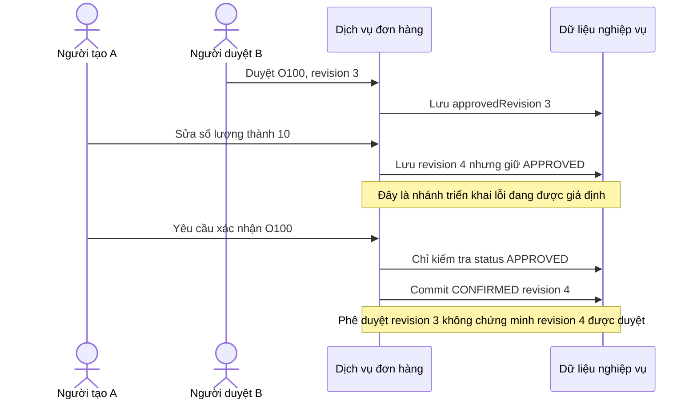

# Feature abuse narrative — Tường thuật lạm dụng một tính năng

## 1. Từ một tính năng hữu ích đến một kết quả trái quy tắc

Trong chương **Abuse Cases** của module **Business Logic Security** (`SECURITY_APPLICATION_SECURITY_BUSINESS_LOGIC_SECURITY`), **feature abuse narrative** là bản tường thuật cách một chủ thể sử dụng các khả năng của tính năng để tạo ra kết quả trái với quy tắc nghiệp vụ.

Một tính năng sửa đơn là cần thiết. Tuy nhiên, nếu sửa nội dung sau phê duyệt mà vẫn giữ hiệu lực quyết định cũ, tính năng đó có thể trở thành đường bỏ qua phê duyệt.

Một tính năng thử lại thanh toán giúp phục hồi sau lỗi mạng. Tuy nhiên, nếu mỗi lần thử tạo một tác động mới cho cùng nghĩa vụ, nó có thể dẫn tới thu tiền trùng.

Điểm cần mô tả là quan hệ nhân quả:

```text
Năng lực hợp lệ
    → chuỗi thao tác hoặc lịch xen kẽ
    → giả định bị khai thác
    → kết quả trái chính sách
    → tài sản hoặc bảo đảm bị ảnh hưởng
```

Một narrative tốt giúp người làm sản phẩm, lập trình viên và người kiểm thử thống nhất về **điều gì không được phép xảy ra**, trước khi tranh luận cách triển khai một biện pháp.

Bài học tập trung vào cách viết và sử dụng narrative. Các ví dụ là mô hình giả định để phân tích và thiết kế kiểm thử, không phải kết luận rằng mã nguồn hiện có trong module chứa các lỗi được nêu.

## 2. Một narrative cần trả lời những câu hỏi nào?

| Thành phần | Câu hỏi cần làm rõ |
| --- | --- |
| Tính năng | Người dùng đang tận dụng khả năng nào của sản phẩm? |
| Tác nhân | Ai thao tác, có tài khoản, vai trò và scope gì? |
| Mục tiêu lạm dụng | Kết quả trái quy tắc nào họ muốn đạt được? |
| Tài sản | Tiền, hạn mức, trạng thái, quyền hoặc niềm tin nào bị ảnh hưởng? |
| Điều kiện bắt đầu | Những dữ liệu và quyết định nào đã tồn tại? |
| Chuỗi hành động | Những bước cụ thể nào đưa hệ thống tới kết quả? |
| Ranh giới tin cậy | Dữ liệu hoặc quyết định nào đi từ nguồn này sang nguồn khác? |
| Giả định bị phá | Hệ thống đang tin điều gì không còn đúng? |
| Bất biến | Mệnh đề nào bị vi phạm nếu chuỗi thành công? |
| Bằng chứng | Quan sát gì sẽ chứng minh hoặc bác bỏ giả thuyết? |
| Phản ứng mong đợi | Hệ thống phải chấp nhận hoặc từ chối bước nào và giữ trạng thái ra sao? |

Không phải narrative nào cũng cần mô tả toàn bộ hệ thống. Cần đủ chi tiết để người khác dựng được cùng điều kiện, hiểu được cơ chế và biết thế nào là kết quả đúng.

### 2.1. Phân biệt narrative với những tài liệu gần nó

| Loại mô tả | Ví dụ | Điều còn thiếu nếu dùng riêng |
| --- | --- | --- |
| Use case | Người tạo sửa số lượng trong đơn | Chưa nói chuỗi nào dẫn tới vi phạm |
| Nhãn rủi ro | Có thể bypass approval | Chưa chỉ ra actor, trạng thái và đường đi |
| Abuse narrative | Người tạo sửa đơn đã duyệt rồi xác nhận bằng quyết định cũ | Cần thêm chi tiết để tái hiện và kiểm chứng |
| Test case | Given, When, Then với dữ liệu và assertion rõ | Có thể thiếu giải thích vì sao kết quả có hại |
| Finding đã xác minh | Quan sát tái hiện được cùng bằng chứng và phạm vi ảnh hưởng | Đòi hỏi dữ liệu kiểm chứng thực tế |

Narrative có thể bắt đầu như một giả thuyết. Chỉ chuyển thành phát hiện đã xác minh khi có bằng chứng tương ứng.

### 2.2. Động cơ giúp hiểu mục tiêu, nhưng không thay thế cơ chế

“Người dùng muốn tiết kiệm tiền” chưa cho biết họ làm gì.

Một câu có giá trị hơn là:

> Người tạo có quyền sửa đơn của mình muốn xác nhận một nội dung giá trị lớn bằng lần phê duyệt dành cho nội dung nhỏ hơn. Sau khi được duyệt, họ tăng số lượng rồi gọi xác nhận. Nếu máy chủ chỉ xét trạng thái APPROVED, quyết định cũ bị dùng cho nội dung mới.

Mục tiêu, thao tác và điều kiện khiến việc lạm dụng thành công đều hiện diện.

Không phải mọi trường hợp sai đều cần ý đồ xấu. Retry tự động hoặc thao tác nhầm có thể tạo cùng lịch thực thi. Bảo đảm nghiệp vụ cần chịu được cả các nguồn đó.

## 3. Bắt đầu từ quy tắc và đường đi hợp lệ

### 3.1. Đừng viết câu chuyện trước khi biết điều gì bị cấm

Trước khi dựng narrative, cần xác định:

```text
Tài sản cần bảo vệ
Actor và quyền thực tế
Trạng thái hợp lệ
Command được phép
Quyết định hoặc bằng chứng bắt buộc
Các quan hệ giữa đối tượng
```

Nếu chính sách cho phép sửa sau duyệt mà không cần duyệt lại đối với một số trường, narrative phải chỉ rõ trường thay đổi có thuộc phạm vi cần duyệt hay không.

Ví dụ, sửa ghi chú nội bộ có thể không thay quyết định tài chính. Sửa số lượng hoặc người nhận có thể ảnh hưởng trực tiếp. Không thể kết luận mọi thay đổi sau duyệt đều là vi phạm.

### 3.2. Ghi ra một bất biến đủ cụ thể

Mô tả mơ hồ:

```text
Quy trình phê duyệt phải an toàn.
```

Mô tả kiểm chứng được:

```text
Với mọi đơn đã xác nhận:
    tồn tại phê duyệt hợp lệ;
    phê duyệt thuộc đúng đơn;
    approvedRevision = contentRevision đang được xác nhận;
    người duyệt đáp ứng quy tắc quyền và tách vai trò tương ứng.
```

Một narrative có thể tập trung vào một phần bất biến. Ví dụ chính của bài tập trung vào **đúng phiên bản nội dung**, không đồng thời giả định có lỗi sai tenant hoặc tự duyệt.

### 3.3. Vẽ luồng bình thường trước

```text
Tạo đơn
→ chỉnh nội dung
→ gửi duyệt
→ người đủ quyền duyệt đúng nội dung
→ xác nhận
→ tạo nghĩa vụ hoặc tác động tiếp theo
```

Sau đó xem những tính năng nào có thể được gọi giữa các bước, gọi lại, gọi trực tiếp hoặc chạy đồng thời. Những khả năng đó cung cấp điểm xuất phát cho câu chuyện lạm dụng.

## 4. Mô hình ví dụ: sửa số lượng của đơn đã được duyệt

### 4.1. Chính sách của ví dụ

Giả sử hệ thống mua sắm có các quy tắc:

1. Người tạo được tạo và sửa đơn của mình trong tenant đã được phép.
2. Người tạo không được tự phê duyệt.
3. Người tạo được yêu cầu xác nhận đơn khi các điều kiện đã đạt.
4. Phê duyệt áp dụng cho đúng phiên bản nội dung có ý nghĩa nghiệp vụ.
5. Đổi số lượng làm tăng `contentRevision`, tính lại tổng và vô hiệu hóa phê duyệt cũ.
6. Nếu sửa một đơn đang `APPROVED`, đơn chuyển về `PENDING_APPROVAL`.
7. Xác nhận một đơn chỉ tạo một kết quả xác nhận nghiệp vụ trong mô hình này.

Như vậy, tính năng sửa sau duyệt vẫn có ích và được cho phép. Bảo đảm nằm ở cách cập nhật hiệu lực phê duyệt và kiểm tra trước khi xác nhận.

### 4.2. Actor, tài sản và dữ liệu

```text
Tenant: T1

Người tạo:
    requester-A
    quyền tạo, sửa và yêu cầu xác nhận đơn của mình
    không có quyền duyệt

Người duyệt:
    approver-B
    có quyền duyệt đơn trong scope T1

Đơn:
    orderId = O100
    productId = P10
    giá được máy chủ chấp nhận = 200.000 VND mỗi sản phẩm
```

Đơn được phê duyệt khi số lượng là 1, tổng 200.000 VND, tại `contentRevision = 3`.

Mục tiêu lạm dụng là xác nhận số lượng 10, tổng 2.000.000 VND, mà không có phê duyệt cho phiên bản mới.

Tài sản trực tiếp là tính toàn vẹn của quyết định phê duyệt và nghĩa vụ mua sắm. Nếu bước sau còn cần thanh toán hoặc xử lý ngoài hệ thống, cần bằng chứng riêng để kết luận tiền thực sự đã được chi.

### 4.3. Giả định về triển khai cần kiểm chứng

Giả thuyết lỗi là:

```text
Lệnh sửa cập nhật nội dung và tổng nhưng không vô hiệu hóa đầy đủ phê duyệt.
Lệnh xác nhận chỉ kiểm tra status = APPROVED.
```

Đây là điều kiện khiến narrative có thể thành công. Nếu hệ thống đã tăng revision, hủy quyết định cũ và bảo vệ lệnh xác nhận đúng cách, narrative sẽ bị chặn.

Cách viết có điều kiện giữ cho phân tích không biến một khả năng tưởng tượng thành cáo buộc về hệ thống thực tế.

## 5. Viết một bản tường thuật hoàn chỉnh

### 5.1. Narrative mẫu

**Mã:** `ABUSE-EDIT-APPROVAL-01`

**Tên:** Xác nhận nội dung mới bằng phê duyệt dành cho phiên bản cũ.

**Trạng thái phân tích:** Giả thuyết cần kiểm chứng.

**Tính năng liên quan:** Sửa số lượng, phê duyệt và xác nhận đơn.

**Nội dung tường thuật:**

> Người tạo requester-A có quyền sửa và xác nhận đơn của mình trong tenant T1. Họ tạo đơn O100 có một sản phẩm, tổng 200.000 VND, rồi nhận phê duyệt hợp lệ từ approver-B cho revision 3. Sau đó, họ sử dụng tính năng sửa đơn để tăng số lượng lên 10, tạo nội dung mới trị giá 2.000.000 VND. Nếu thao tác sửa vẫn để đơn mang trạng thái APPROVED và lệnh xác nhận không đối chiếu revision được duyệt với revision hiện hành, requester-A có thể xác nhận nội dung mới bằng quyết định cũ. Kết quả vi phạm yêu cầu mọi nội dung được xác nhận phải có phê duyệt cho đúng phiên bản.

**Điều kiện thành công của lạm dụng:**

```text
Có kết quả xác nhận đã commit cho nội dung 2.000.000 VND
trong khi bằng chứng phê duyệt chỉ áp dụng cho revision 3,
nội dung 200.000 VND.
```

**Kết quả bảo vệ mong đợi:**

```text
Sau khi sửa nội dung:
    revision tăng;
    tổng được máy chủ tính lại;
    phê duyệt cũ không còn hiệu lực;
    đơn trở về trạng thái cần duyệt.

Xác nhận nội dung mới:
    bị chặn cho tới khi có quyết định phù hợp.
```

### 5.2. Vì sao narrative này hữu ích?

Nó không yêu cầu giả định người tạo có quyền quản trị hoặc sửa database. Tác nhân chỉ sử dụng các tính năng vốn được cấp.

Nó cũng không đòi hỏi số lượng âm, JSON sai hoặc một lỗi parser. Dữ liệu mới có thể hoàn toàn hợp lệ về miền giá trị, nhưng mối liên hệ giữa nội dung và quyết định đã bị phá.

Điều cần sửa được xác định đúng phạm vi: bảo vệ hiệu lực phê duyệt trong cả đường sửa và đường xác nhận.

## 6. Chuyển đoạn văn thành chuỗi có thể kiểm chứng

### 6.1. Phân tích từng bước

| Bước | Actor và hành động | Điều hệ thống cần giữ | Giả thuyết dẫn tới vi phạm | Bằng chứng cần thu |
| --- | --- | --- | --- | --- |
| 1 | A tạo và gửi duyệt đơn một sản phẩm | Nội dung và tổng do máy chủ quản lý | Chưa cần giả định lỗi | Đơn, tenant, số lượng, tổng, revision |
| 2 | B duyệt revision 3 | Quyết định gắn với đúng nội dung | Chưa cần giả định lỗi | Người duyệt, scope, approvedRevision |
| 3 | A sửa số lượng lên 10 | Tăng revision và vô hiệu hóa duyệt cũ | Nội dung đổi nhưng hiệu lực duyệt không đổi đúng cách | Trạng thái, revision và bằng chứng sau sửa |
| 4 | A gọi xác nhận | Đối chiếu điều kiện trên dữ liệu hiện hành | Chỉ xét nhãn APPROVED hoặc dùng kết quả kiểm tra cũ | Command và dữ liệu dùng để quyết định |
| 5 | Hệ thống commit kết quả | Nội dung confirmed có phê duyệt đúng phiên bản | Commit nội dung mới với quyết định cũ | Trạng thái sau commit và bản ghi xác nhận |
| 6 | Hệ thống phát tác động tiếp theo | Tác động dựa trên quyết định hợp lệ | Nghĩa vụ hoặc message sai được tạo | Outbox và bản ghi tác động thuộc phạm vi thử nghiệm |

Bảng giúp tách **điều cần đúng** khỏi **điều đang nghi ngờ**. Nó cũng ngăn việc đánh đồng request trả thành công với vi phạm đã được chứng minh.

### 6.2. Một lịch minh họa cho nhánh lỗi giả định



Nếu số lượng đã đổi mà revision không tăng, đó là một nhánh lỗi khác của cùng cơ chế ràng buộc nội dung. Khi viết test, cần kiểm tra cả việc revision được tăng lẫn việc command xác nhận đối chiếu revision.

### 6.3. Xác định đúng ranh giới tin cậy

Trong narrative này có các ranh giới quan trọng:

- **Client tới máy chủ:** số lượng được yêu cầu phải được kiểm tra; tổng và revision có thẩm quyền do máy chủ quản lý.
- **Nội dung tới quyết định:** phê duyệt phải nói rõ nó áp dụng cho nội dung nào.
- **Kiểm tra tới cập nhật:** kết quả guard không được trở nên lỗi thời trước khi ghi.
- **Trạng thái nội bộ tới tác động:** một message xác nhận không được phát từ một quyết định trái invariant.

Không nên chỉ ghi chung “trust boundary bị vượt”. Cần chỉ ra dữ liệu hoặc ý nghĩa nào được chuyển qua ranh giới và tại sao bên nhận không được tin nó theo cách hiện tại.

## 7. Mở rộng narrative bằng cách thay một chiều mỗi lần

Một narrative chính có thể tạo ra nhiều biến thể kiểm thử. Thay đổi có kiểm soát giúp biết cơ chế nào thực sự bị tác động.

| Chiều thay đổi | Biến thể | Câu hỏi cần kiểm chứng |
| --- | --- | --- |
| Nội dung | Đổi người nhận thay vì số lượng | Phạm vi revision có bao gồm mọi dữ liệu mà người duyệt xét không? |
| Đối tượng | Dùng approval của đơn khác | Bằng chứng có gắn đúng orderId không? |
| Tenant | Dùng ID từ tenant khác | Quyền và bằng chứng có giữ scope không? |
| Danh tính | Người tạo dùng tài khoản khác có liên kết danh tính đã biết | Tách vai trò được định nghĩa trên chủ thể nào? |
| Thứ tự | Confirm trước approve | State machine có giữ cạnh chuyển hợp lệ không? |
| Đồng thời | Edit chạy cùng confirm | Kết quả kiểm tra có được bảo vệ trước cạnh tranh không? |
| Retry | Gửi lại confirm sau mất phản hồi | Cùng command có tạo tác động mới không? |
| Thời gian | Đợi báo giá hoặc quyền hết hiệu lực | Điều kiện được xét tại điểm nào? |
| Kênh | Cùng ý định qua API khác hoặc tác vụ nền | Có đường ghi nào không áp dụng cùng quy tắc không? |

Không nên ép mọi biến thể vào cùng một câu chuyện dài. Nếu mục tiêu đã đổi từ “dùng phê duyệt cũ” sang “xác nhận hai lần”, nên tạo một narrative có mục tiêu và bằng chứng riêng.

Ví dụ:

```text
Narrative A:
    Xác nhận nội dung mới bằng phê duyệt cũ.
    Bất biến chính: đúng phiên bản.

Narrative B:
    Tạo hai kết quả xác nhận từ cùng một nghĩa vụ.
    Bất biến chính: số lần tác động.

Narrative C:
    Dùng quyền tenant A lên đơn tenant B.
    Bất biến chính: đúng phạm vi.
```

Các narrative có thể liên quan nhưng không thay thế nhau trong thiết kế kiểm thử.

## 8. Mô tả rõ một narrative có cạnh tranh

### 8.1. Câu “gửi thật nhanh” chưa đủ

Với thao tác đồng thời, narrative cần mô tả điểm đọc, điểm kiểm tra và điểm ghi. Tốc độ chỉ là một cách kích hoạt lịch xen kẽ, không phải nguyên nhân logic.

Một biến thể của ví dụ:

| Thời điểm | Luồng A: xác nhận | Luồng B: sửa đơn |
| --- | --- | --- |
| 1 | Đọc approved, contentRevision 3, approvedRevision 3 | |
| 2 | Guard đạt | |
| 3 | | Sửa sang revision 4, vô hiệu hóa phê duyệt và commit |
| 4 | Ghi confirmed dựa trên kết quả kiểm tra cũ | |

Trong biến thể này, đường edit có thể đã làm đúng. Lỗi nằm ở việc confirm dùng dữ liệu đã lỗi thời để ghi trạng thái mới.

Đây là lý do một narrative cần nói rõ cơ chế, thay vì kết luận “hàm sửa đơn thiếu kiểm tra” chỉ từ kết quả cuối.

### 8.2. Kết quả đúng không cần cố định bên nào thắng

Với mô hình không cho sửa đơn đã confirmed:

- Nếu sửa nội dung được chấp nhận trước, confirm dựa trên quyết định cũ phải bị chặn.
- Nếu confirm được chấp nhận trước, edit sau đó phải bị chặn theo trạng thái.
- Nếu có xung đột version hoặc deadlock, hệ thống xử lý theo hợp đồng và không để lại trạng thái trái invariant.

Không nhất thiết cả hai request đều thất bại. Điều cần bảo đảm là mọi kết quả đã commit đều hợp lệ.

### 8.3. Bằng chứng của lịch xen kẽ

Trong môi trường kiểm thử, dùng barrier hoặc latch để điều khiển các điểm thực thi. Trace cần liên kết tới từng command và phiên bản đã đọc.

Chỉ chạy hai request và thấy chúng đều trả thành công chưa đủ để kết luận invariant bị phá. Có thể hai command đã thực thi tuần tự hợp lệ theo một mô hình khác.

Ngược lại, thấy một request trả lỗi cũng chưa đủ chứng minh an toàn nếu nó đã commit trước khi gặp lỗi phản hồi. Cần đọc lại dữ liệu và tác động.

## 9. Từ narrative tới các điểm bảo vệ

### 9.1. Gắn mỗi giả định với một cơ chế

| Giả định cần loại bỏ | Cơ chế có thể áp dụng |
| --- | --- |
| Nội dung vẫn như khi được duyệt | Content revision hoặc snapshot có thẩm quyền |
| Cờ approved đủ đại diện cho quyết định | Bằng chứng gắn với order, revision và actor phù hợp |
| Một lần kiểm tra đủ cho lần ghi sau | Khóa, cập nhật có điều kiện hoặc kiểm soát phiên bản |
| Client không gọi bước ngoài giao diện | Guard trong command ở máy chủ |
| Quyền chung áp dụng cho mọi đối tượng | Authorization theo tenant, đối tượng và hành động |
| Retry không gây tác động mới | Idempotency kết hợp tính duy nhất theo nghiệp vụ |
| Chỉ API chính mới thay đổi dữ liệu | Giao thức chung cho job, công cụ quản trị và các đường ghi liên quan |

Đây là các lựa chọn thiết kế cần được cụ thể hóa theo hệ thống, không phải bằng chứng rằng chỉ cần bật một cấu hình là narrative đã bị chặn.

### 9.2. Bảo vệ cả đường làm thay đổi và đường sử dụng

Với ví dụ chính:

```text
EditContent:
    kiểm tra quyền sửa và trạng thái;
    tính nội dung, tổng và revision mới;
    làm mất hiệu lực phê duyệt không còn khớp;
    lưu nhất quán với các dữ liệu liên quan.

Confirm:
    kiểm tra quyền xác nhận trên đúng đơn;
    kiểm tra trạng thái nguồn;
    kiểm tra phê duyệt thuộc đúng nội dung hiện hành;
    bảo vệ quyết định trước cạnh tranh;
    lưu kết quả và tác động cục bộ nhất quán.
```

Chỉ sửa một phía có thể bỏ sót một đường ghi khác. Ví dụ, edit đúng nhưng một công cụ nhập dữ liệu quên tăng revision; hoặc mọi đường sửa đều đúng nhưng confirm vẫn dùng snapshot cũ.

### 9.3. Giải pháp phải giữ được tính năng hợp lệ

Nếu chính sách cho phép sửa đơn và quay lại duyệt, biện pháp cần duy trì luồng đó. Đóng hoàn toàn chức năng sửa có thể là thay đổi sản phẩm cần quyết định riêng.

Một yêu cầu chấp nhận đầy đủ nên có cả:

```text
Sửa nội dung có ý nghĩa làm mất hiệu lực quyết định cũ.
Nội dung mới sau khi được duyệt hợp lệ vẫn xác nhận được.
```

Tương tự, idempotency cần cho phép lấy lại kết quả command cũ theo hợp đồng, không biến mọi retry hợp lệ thành lỗi không rõ nghĩa.

## 10. Định nghĩa kết quả kiểm thử từ bất biến

### 10.1. Test oracle là tiêu chí kết luận đúng hay sai

Một **test oracle** là cách xác định kết quả thử nghiệm có thỏa điều cần bảo vệ hay không.

Với narrative chính:

```text
Vi phạm đã được quan sát nếu:
    tồn tại kết quả confirmed đã commit
    ∧ nội dung đang được xác nhận khác nội dung được phê duyệt.
```

Ví dụ trạng thái:

```text
tenant = T1
orderId = O100
status = CONFIRMED
contentRevision = 4
approvedRevision = 3
```

Đây là dấu hiệu trực tiếp cho phần bất biến về revision, nếu các trường có đúng ngữ nghĩa đã định nghĩa.

Nếu hệ thống giữ snapshot được xác nhận riêng, phải kiểm tra snapshot đó. Không nên áp một mô hình cột khác với cách hệ thống thực sự biểu đạt nội dung và bằng chứng.

### 10.2. Minh họa một oracle hẹp bằng Java

```java
import java.util.Objects;

final class ApprovalRevisionOracle {
    enum Status {
        DRAFT, PENDING_APPROVAL, APPROVED, CONFIRMED, CANCELLED
    }

    record ApprovalView(
            String tenantId,
            String orderId,
            long contentRevision) {}

    record OrderView(
            String tenantId,
            String orderId,
            Status status,
            long contentRevision,
            ApprovalView approval) {
        OrderView {
            Objects.requireNonNull(tenantId);
            Objects.requireNonNull(orderId);
            Objects.requireNonNull(status);
            if (contentRevision <= 0) {
                throw new IllegalArgumentException("INVALID_REVISION");
            }
        }
    }

    static boolean confirmedRevisionHasMatchingEvidence(OrderView order) {
        Objects.requireNonNull(order);
        if (order.status() != Status.CONFIRMED) {
            return true;
        }

        ApprovalView approval = order.approval();
        return approval != null
                && order.tenantId().equals(approval.tenantId())
                && order.orderId().equals(approval.orderId())
                && order.contentRevision()
                    == approval.contentRevision();
    }
}
```

Hàm chỉ kiểm tra một mệnh đề: đơn confirmed có bằng chứng cùng scope và revision.

Nó không chứng minh người duyệt có quyền, không tự duyệt, mọi thay đổi đã tăng revision hoặc tiền đã được thu đúng. Những phần đó cần oracle và kiểm thử tương ứng.

Đối với đơn chưa confirmed, hàm trả true vì mệnh đề điều kiện chưa bị vi phạm; điều này không có nghĩa toàn bộ đơn hoặc cả quy trình đã hợp lệ.

### 10.3. Viết tiêu chí chấp nhận theo Given, When, Then

```gherkin
Scenario: Không xác nhận nội dung mới bằng phê duyệt cũ
  Given đơn O100 đã được duyệt cho revision 3
    And người tạo có quyền sửa nội dung đơn
  When người tạo tăng số lượng làm nội dung chuyển sang revision 4
  Then phê duyệt revision 3 không còn cho phép xác nhận revision 4
    And chưa tạo kết quả xác nhận cho revision 4

Scenario: Nội dung mới được duyệt vẫn xác nhận được
  Given đơn O100 đã đổi sang revision 4 và đang chờ duyệt
  When người đủ quyền duyệt revision 4
    And người đủ quyền gửi lệnh xác nhận đúng phiên bản
  Then đơn được xác nhận với bằng chứng áp dụng cho revision 4
    And chỉ có một kết quả xác nhận nghiệp vụ
```

Cần bổ sung dữ liệu và assertion cụ thể theo mô hình triển khai khi chuyển các tiêu chí này thành test thực thi.

## 11. Thu bằng chứng đủ để giải thích kết quả

### 11.1. Chuẩn bị một môi trường có dữ liệu kiểm soát được

Khi chuyển narrative thành kiểm thử, cần xác định fixture, actor và scope rõ ràng:

```text
Tenant và danh tính thử nghiệm
Quyền của từng actor
Đơn và nội dung ban đầu
Phê duyệt ban đầu
Điều kiện giá, thời hạn và hạn mức liên quan
Các dịch vụ ngoài được mô phỏng hoặc kiểm soát
```

Những điều kiện không thuộc mục tiêu thử nên được giữ ổn định. Nếu báo giá vô tình hết hạn giữa chừng, việc confirm bị từ chối chưa chứng minh cơ chế ràng buộc revision hoạt động.

Một đường đi hợp lệ làm đối chứng giúp biết môi trường đã sẵn sàng và chính sách được hiểu đúng.

### 11.2. Gắn bằng chứng với từng bước và đúng nguồn sự thật

Một gói bằng chứng có thể gồm:

| Bằng chứng | Mục đích |
| --- | --- |
| Quyền và scope của actor | Chứng minh tác nhân chỉ dùng năng lực đã mô tả |
| Trạng thái trước thử | Cho biết điều kiện bắt đầu thật sự tồn tại |
| Command và response đã loại bỏ bí mật | Tái dựng thứ tự và tham số có ý nghĩa |
| Revision sau từng bước | Xác định lúc nội dung và quyết định bắt đầu lệch |
| Bản ghi phê duyệt | Biết ai duyệt nội dung nào |
| Kết quả sau commit | Chứng minh trạng thái bền vững |
| Outbox hoặc bản ghi tác động | Biết có nghĩa vụ hoặc lệnh tiếp theo được tạo không |
| Trace liên quan | Ghép các bước theo command, đối tượng và tenant |
| Kết quả đối chứng | Phân biệt việc chặn đúng quy tắc với lỗi môi trường |

Không cần đưa token, mật khẩu hoặc dữ liệu cá nhân không cần thiết vào báo cáo.

Dữ liệu UI hoặc projection có thể chậm hơn nguồn ghi. Nếu thấy màn hình hiển thị approval cũ, cần xác định nội dung thực sự được dùng để xác nhận trước khi kết luận vi phạm.

### 11.3. Ví dụ dấu vết minh họa

Dưới đây là dấu vết giả định cho nhánh lỗi, dùng để giải thích tiêu chí quan sát:

```text
Sau approve:
    tenant = T1
    order = O100
    contentRevision = 3
    approvedRevision = 3
    total = 200.000 VND
    status = APPROVED

Sau edit:
    tenant = T1
    order = O100
    contentRevision = 4
    approvedRevision = 3
    total = 2.000.000 VND
    status = APPROVED

Sau confirm:
    tenant = T1
    order = O100
    contentRevision = 4
    approvedRevision = 3
    status = CONFIRMED
    confirmationCount = 1
```

Sự tồn tại của `confirmationCount = 1` không cứu được bất biến đúng nội dung. Một tác động duy nhất vẫn có thể là tác động sai.

Ngược lại, outbox có một message chỉ chứng minh một ý định phát ra trong mô hình đó. Để nói đã thanh toán hoặc đã giao hàng, cần bằng chứng về các bước tương ứng.

### 11.4. Giữ mức kết luận tương ứng mức bằng chứng

| Quan sát | Kết luận có thể đưa ra |
| --- | --- |
| Chỉ đọc được một mô tả thiết kế có vẻ thiếu guard | Có giả thuyết cần kiểm chứng |
| Một request sửa sau duyệt được chấp nhận | Tính năng cho phép sửa; chưa đủ chứng minh bypass |
| Nội dung mới bị xác nhận với phê duyệt cũ theo dữ liệu có thẩm quyền | Đã quan sát phần vi phạm ràng buộc nội dung trong scope thử |
| Không tái hiện được bằng một lịch cụ thể | Lịch đã thử không chứng minh vi phạm; cần xem phạm vi bao phủ |
| Biện pháp mới chặn narrative và đường hợp lệ vẫn chạy | Có bằng chứng cho biện pháp trong phạm vi đã kiểm tra |

Tránh dùng “không tái hiện” để khẳng định không còn bất kỳ biến thể nào, hoặc dùng một ví dụ thành công để suy ra mọi tenant và mọi kênh đều bị ảnh hưởng.

## 12. Ưu tiên narrative và quản lý điều chưa biết

### 12.1. Đánh giá khả năng đạt kết quả và tác động

Các câu hỏi ưu tiên có ích:

- Actor có thể tiếp cận tính năng bằng quyền thông thường hay cần năng lực đặc biệt?
- Chuỗi có dùng dữ liệu và trạng thái thường xuất hiện không?
- Có cần một lịch cạnh tranh hẹp hay thực hiện tuần tự cũng đạt?
- Tác động dừng ở hiển thị hay tạo nghĩa vụ, tiền hoặc quyền mới?
- Có thể lặp hoặc áp dụng trên nhiều đối tượng trong phạm vi nào?
- Hệ thống có bằng chứng phát hiện và quy trình phục hồi không?

Với ví dụ chính, actor là người dùng có chức năng hợp lệ; không cần quyền duyệt. Nếu lỗi có thể thực hiện tuần tự, đường tiếp cận tương đối trực tiếp. Mức thiệt hại thực tế còn phụ thuộc giới hạn số tiền, bước thực hiện sau xác nhận và phạm vi triển khai đã kiểm chứng.

Không nên tự gán một con số rủi ro chính xác khi chưa có dữ liệu về quy mô và khả năng khai thác.

### 12.2. Lưu giả định còn mở thay vì lấp bằng suy đoán

Ví dụ:

```text
Cần xác nhận:
    Những trường nào làm mất hiệu lực phê duyệt?
    Xác nhận tạo nghĩa vụ gì?
    Có lưu snapshot được xác nhận riêng không?
    Các job và công cụ quản trị có dùng cùng domain command không?
    Quyền và phê duyệt được đánh giá lại ở thời điểm nào?
```

Những câu hỏi này có thể được giải đáp từ chủ sở hữu nghiệp vụ, thiết kế và thử nghiệm phù hợp. Không nên tự mở rộng kết luận để narrative có vẻ nghiêm trọng hơn.

Nếu quy tắc chưa rõ, có thể tiếp tục hoàn thiện phần dữ liệu và chuỗi, đồng thời đánh dấu kết luận về vi phạm là chưa đủ điều kiện.

### 12.3. Theo dõi trạng thái phân tích

Một tập trạng thái làm việc có thể là:

| Trạng thái | Ý nghĩa |
| --- | --- |
| Giả thuyết | Có cơ chế có thể dẫn tới kết quả trái quy tắc |
| Sẵn sàng kiểm thử | Đã rõ điều kiện, bước và oracle |
| Đã tái hiện | Có bằng chứng về vi phạm trong phạm vi xác định |
| Chưa tái hiện | Các bước đã thử chưa tạo được kết quả cần chứng minh |
| Chờ làm rõ chính sách | Chưa đủ cơ sở xác định hành vi có trái quy tắc không |
| Biện pháp đã được kiểm chứng | Narrative liên quan bị chặn và hành vi hợp lệ cần giữ đã được kiểm tra |

Trạng thái cần gắn với phiên bản hệ thống hoặc phạm vi thử. Một kết quả cũ không tự đại diện cho bản triển khai đã thay đổi.

## 13. Những lỗi thường làm narrative kém hữu ích

| Cách viết hoặc xử lý | Vấn đề | Cách làm rõ |
| --- | --- | --- |
| “Hacker sửa request để gian lận” | Không biết quyền, trường hay kết quả cụ thể | Nêu actor, command, dữ liệu và invariant |
| “Có IDOR” hoặc “có race condition” | Tên kỹ thuật chưa mô tả hậu quả nghiệp vụ | Viết đường đi từ năng lực tới kết quả sai |
| Giả định actor đã sửa được database | Có thể bỏ qua chính ranh giới cần phân tích | Bắt đầu từ năng lực thực tế của actor trong phạm vi |
| Gom sai tenant, tự duyệt và request trùng vào một chuỗi | Khó biết cơ chế nào cần thiết để thành công | Tách narrative theo mục tiêu và nguyên nhân |
| Chỉ nêu một giá trị đầu vào lạ | Chưa giải thích tính năng và chuỗi trạng thái | Mô tả điều kiện trước, bước xử lý và kết quả |
| Chỉ kiểm tra HTTP 4xx | Không biết tác động đã commit hay chưa | Đọc lại trạng thái và các tác động |
| Chỉ thêm validation kiểu dữ liệu | Không xử lý quan hệ giữa nội dung, quyền và quyết định | Đặt guard và bất biến tại nơi thay đổi trạng thái |
| Chỉ ẩn nút trên UI | Không kiểm soát API hoặc kênh khác | Kiểm tra ở máy chủ và các đường ghi liên quan |
| Chỉ thêm idempotency | Không ngăn dùng phê duyệt cũ cho command mới | Giữ đúng bất biến chính của narrative |
| Chặn luôn tính năng hợp lệ | Có thể làm mất yêu cầu sản phẩm | Kiểm tra cả đường hợp lệ sau biện pháp |
| Viết giả thuyết như finding đã xác minh | Làm sai mức chắc chắn và ưu tiên | Gắn trạng thái và bằng chứng |
| Nêu thiệt hại tiền khi chỉ thấy đơn confirmed | Vượt quá điều quan sát được | Phân biệt nghĩa vụ, ý định và tác động thực tế |

Một narrative tốt không cần từ ngữ mạnh. Nó cần làm cho quan hệ giữa quyền, chuỗi hành động và kết quả trở nên dễ kiểm chứng.

## 14. Mẫu bàn giao một feature abuse narrative

Có thể dùng cấu trúc sau cho một tính năng cụ thể:

```text
Mã và tên:
Trạng thái phân tích:
Phiên bản hoặc phạm vi hệ thống:

Tính năng:
Mục tiêu hợp lệ của tính năng:
Tài sản cần bảo vệ:

Actor:
Quyền và scope:
Mục tiêu lạm dụng:

Quy tắc và bất biến:
Điều kiện bắt đầu:
Dữ liệu minh họa:

Chuỗi hành động:
    1.
    2.
    3.

Nếu có cạnh tranh:
    Điểm đọc:
    Điểm kiểm tra:
    Điểm ghi:
    Lịch xen kẽ cần tái hiện:

Ranh giới tin cậy:
Giả định khiến chuỗi có thể thành công:

Kết quả trái quy tắc cần chứng minh:
Nguồn dữ liệu dùng để kết luận:
Bằng chứng cần thu:

Hành vi bảo vệ mong đợi:
Đường hợp lệ vẫn phải hoạt động:

Biện pháp ứng viên:
Kiểm thử hồi quy tương ứng:
Giới hạn và câu hỏi chưa được giải đáp:
```

Khi bàn giao, liên kết narrative với command, guard và kiểm thử tương ứng. Người đọc cần biết phần nào là chính sách đã được xác nhận, phần nào là giả thuyết triển khai và phần nào đã có bằng chứng.

Với ví dụ O100, điểm kết thúc cần chứng minh rất cụ thể: nội dung revision 4 không thể được xác nhận bằng quyết định cho revision 3; sau khi revision 4 được duyệt đúng, luồng mua sắm hợp lệ vẫn tiếp tục được.
