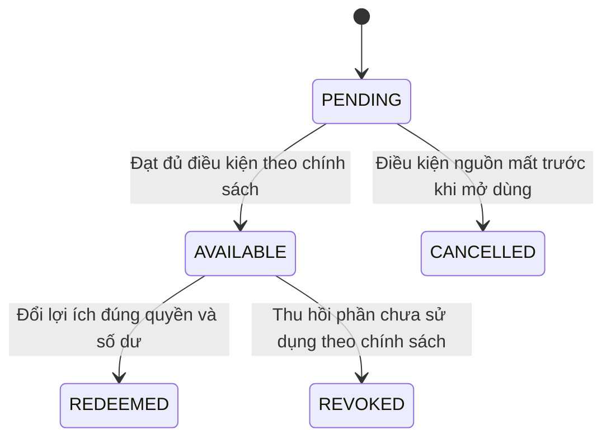

# Economic abuse scenario — Kịch bản lạm dụng lợi ích kinh tế

## 1. Mục tiêu và bối cảnh

Trong chương **Abuse Cases**, một kịch bản lạm dụng kinh tế mô tả cách sử dụng các chức năng của ứng dụng để nhận lợi ích hoặc gây chi phí vượt chính sách nghiệp vụ. Từng request có thể đúng định dạng, người gọi đã đăng nhập và đối tượng thuộc chính họ; sai phạm nằm ở kết quả của chuỗi thao tác.

Lợi ích bị khai thác không chỉ là tiền mặt. Nó có thể là mã giảm giá, điểm thưởng, số dư khuyến mại, giấy phép, hàng hóa, lượt dùng miễn phí hoặc chi phí mà hệ thống phải trả cho bên thứ ba.

Sau bài học, bạn có thể:

- Viết một abuse scenario có tài sản, chủ thể, tiền điều kiện, chuỗi hành động và kết quả sai cụ thể.
- Lần theo luồng giá trị qua đặt hàng, giảm giá, thanh toán, hoàn và thưởng.
- Diễn đạt các bất biến ngăn lợi ích được tạo thêm ngoài chính sách.
- Gắn kiểm soát với dữ liệu đáng tin, máy trạng thái, quyền theo đối tượng, transaction và idempotency.
- Xác định dữ liệu quan sát và kiểm thử để chứng minh không rò rỉ giá trị.

Ví dụ dùng số nguyên VND, bỏ qua thuế, phí vận chuyển, tranh chấp và nhiều phương thức thanh toán. Chính sách minh họa được nêu rõ để phục vụ thiết kế bảo mật; không phải quy tắc hoàn tiền chung cho mọi sản phẩm.

## 2. Nhận diện giá trị trước khi nhìn endpoint

Một danh sách API chưa cho thấy tiền hoặc quyền có thể bị tạo thêm ở đâu. Hãy bắt đầu bằng câu hỏi: **hệ thống cấp gì, khi nào cấp, căn cứ nào cho phép cấp và khi đảo giao dịch thì phần giá trị đó đi đâu?**

| Tài sản hoặc chi phí | Điểm phát sinh | Điều cần bảo vệ |
| --- | --- | --- |
| Tiền đã thu | Thanh toán được xác minh | Không hoàn quá ngân sách được phép |
| Giảm giá | Chấp nhận chương trình ưu đãi | Không biến ưu đãi thành tiền hoàn ngoài chính sách |
| Điểm thưởng | Sự kiện đạt điều kiện | Không thưởng cho điều kiện đã mất hoặc phát lại sự kiện |
| Quyền nhận hàng | Đơn đạt điều kiện fulfillment | Không giao vượt lượng đã mua hoặc sau thu hồi |
| Lượt dùng miễn phí | Đăng ký hoặc kích hoạt | Không cấp lại cùng một quyền theo định danh nghiệp vụ |
| Chi phí SMS/API ngoài | Gọi dịch vụ có tính phí | Không tạo công việc hoặc chi tiêu không giới hạn |

OWASP API6:2023 mô tả rủi ro khi một luồng nghiệp vụ nhạy cảm được dùng quá mức và gây hại cho doanh nghiệp, dù không cần một lỗi kỹ thuật truyền thống. Phạm vi được coi là lạm dụng phải gắn với chính sách sản phẩm. [Nguồn: OWASP Sensitive Business Flows](https://api-security.owasp.org/editions/2023/en/0xa6-unrestricted-access-to-sensitive-business-flows/).

### 2.1. Phân biệt quyền lợi hợp lệ với lỗi chính sách

Khách dùng một ưu đãi đã công bố hoặc yêu cầu trả hàng hợp lệ không tự là gian lận. Cần xác định chính xác quy tắc nào bị vi phạm: hoàn nhiều hơn số được phép, thưởng nhiều lần cho cùng điều kiện hay chuyển giá trị sang nguồn không được phép.

Nếu kết quả gây lỗ nhưng hoàn toàn đúng chính sách đã chọn, có thể cần thay đổi thiết kế chương trình. Đừng gán nhãn tấn công chỉ vì khách tối ưu quyền lợi. Abuse scenario hữu ích phải nêu được giả định sai hoặc điều kiện đáng lẽ cần được thực thi.

### 2.2. Không cộng tùy ý những loại giá trị khác nhau

Tiền mặt, điểm và hàng hóa cần được theo dõi theo đơn vị riêng. Một điểm không mặc nhiên bằng một VND; giá niêm yết không tự bằng thiệt hại thực tế của hàng.

Khi đánh giá tác động, nên giữ riêng ít nhất số tiền chi vượt, lượng điểm/quyền cấp sai và chi phí ngoài phát sinh. Chỉ quy đổi khi có giả định định giá rõ ràng, tránh đếm cùng một khoản thiệt hại hai lần.

## 3. Kịch bản chính: hoàn theo giá niêm yết sau khi đã giảm giá

### 3.1. Luồng hợp lệ được giả định

Một đơn có hai sản phẩm, mỗi sản phẩm một đơn vị:

| Dòng | Giá trước ưu đãi | Giảm giá phân bổ | Tiền đã trả phân bổ |
| --- | --- | --- | --- |
| A | 100.000 VND | 25.000 VND | 75.000 VND |
| B | 100.000 VND | 25.000 VND | 75.000 VND |
| Tổng | 200.000 VND | 50.000 VND | 150.000 VND |

Chính sách ví dụ phân bổ mã giảm 50.000 VND đều cho hai dòng bằng giá nhau. Khi trả một dòng đã được chấp nhận, khoản hoàn tối đa cho dòng đó là phần tiền đã trả phân bổ chưa hoàn. Nếu trả cả hai, tổng hoàn là 150.000 VND.

Ngoài ra, đơn dự kiến có 20 điểm thưởng. Điểm chỉ được sử dụng sau khi đơn đạt điều kiện thưởng đã định nghĩa; đơn bị trả toàn bộ trước thời điểm đó không được làm phát sinh 20 điểm khả dụng.

### 3.2. Hành vi và lỗi dẫn tới thất thoát

Trong môi trường minh họa, chuỗi cần kiểm tra là:

1. Khách tạo đơn A và B, áp dụng ưu đãi rồi thanh toán 150.000 VND.
2. Hệ thống lưu giá niêm yết nhưng không lưu căn cứ phân bổ tiền đã trả cho từng dòng.
3. Khách yêu cầu trả các mặt hàng theo quy trình và các yêu cầu trả được chấp nhận.
4. Bộ xử lý hoàn lấy giá niêm yết 100.000 VND cho mỗi dòng thay vì phần tiền đã trả được phép hoàn.
5. Nếu không có kiểm soát tổng, hệ thống có thể hoàn 200.000 VND dù chỉ thu 150.000 VND.
6. Nếu bộ xử lý thưởng tách rời không nhận biết điều kiện đã mất, 20 điểm còn có thể được mở sử dụng ngoài chính sách.

Sai phạm tiền mặt trong trường hợp trả toàn bộ là:

```text
tiền đã thu       = 150.000 VND
tiền hoàn sai     = 200.000 VND
tiền chi vượt     =  50.000 VND
```

Không cộng lại 50.000 VND giảm giá như một khoản chi vượt thứ hai: nó đã là nguyên nhân tạo chênh lệch giữa giá niêm yết và số thực thu. Hai mươi điểm thưởng sai là một loại giá trị riêng, chưa được quy đổi thành tiền trong ví dụ.

Lỗi này có thể xuất hiện ngay với xử lý tuần tự, không cần request đồng thời. Concurrency hoặc gửi lại chỉ là các cách khác có thể làm thất thoát nặng hơn nếu kiểm soát còn thiếu.

### 3.3. Ghi kịch bản thành một mô tả có thể kiểm chứng

| Thuộc tính | Nội dung minh họa |
| --- | --- |
| Mã | `ECON-REFUND-001` |
| Tài sản | Ngân sách hoàn tiền của thanh toán gốc và quyền nhận điểm |
| Actor | Khách đã xác thực, thao tác trên đơn thuộc quyền của mình |
| Tiền điều kiện | Đơn có ưu đãi; tiền đã thu được xác minh; việc trả hàng đạt điều kiện |
| Điểm yếu | Hoàn theo giá trước ưu đãi; thiếu ngân sách tổng hoặc theo dòng; thưởng không gắn vòng đời nguồn |
| Kết quả bị cấm | Tiền hoàn vượt phần được phép hoặc điểm khả dụng khi điều kiện thưởng không còn |
| Quan sát | Số tiền đã thu, snapshot phân bổ, ý định hoàn, kết quả ngoài và ledger thưởng |
| Tiêu chí ngăn chặn | Trả cả hai dòng chỉ hoàn 150.000 VND; không có điểm khả dụng từ đơn đã mất điều kiện |

Mô tả này có thể chuyển thành yêu cầu và kiểm thử. Câu “chống gian lận coupon” chưa đủ chỉ ra điều cần chứng minh.

## 4. Bất biến và nguồn sự thật

### 4.1. Bảo vệ ngân sách theo thanh toán và theo dòng

Trong phạm vi một thanh toán VND của ví dụ:

```text
confirmedRefundVnd + reservedRefundVnd <= capturedVnd

Với mỗi dòng:
  confirmedLineRefundVnd + reservedLineRefundVnd
      <= refundablePaidAllocationVnd
```

`reserved` là phần đã dành cho ý định hoàn chưa có kết quả cuối. Nếu bỏ phần đang dành, hai ý định cùng có thể dùng lại một ngân sách.

Giới hạn theo thanh toán chặn tổng hoàn vượt tiền thực thu. Giới hạn theo dòng và quyết định trả hàng còn ngăn dùng nhiều hồ sơ để hoàn lặp cho cùng phần quyền, ngay cả khi tổng đơn vẫn còn ngân sách ở các dòng khác.

### 4.2. Giữ snapshot giá và phân bổ đã chấp nhận

Máy chủ cần lưu hoặc tái dựng được một cách xác định giá trị đã chấp nhận: giá, số lượng, ưu đãi, phần tiền đã trả và phiên bản chính sách. Không lấy số tiền hoàn trực tiếp từ client hoặc bảng giá hiện tại.

Với giá và tỷ lệ không chia hết, cần quy tắc làm tròn và phân bổ phần dư để tổng các dòng khớp tổng đơn. Phân bổ theo tỷ lệ là một lựa chọn thiết kế, không phải quy tắc phổ quát. Chương trình có ngưỡng chi tối thiểu hoặc hoàn từng phần cần chính sách riêng được lưu đủ dữ liệu.

OWASP Business Logic Security nhấn mạnh việc tính giá trị nhạy cảm từ nguồn phía máy chủ và bảo vệ các bất biến trước thứ tự thao tác, gửi lại và cạnh tranh. [Nguồn: OWASP Business Logic Security](https://cheatsheetseries.owasp.org/cheatsheets/Business_Logic_Security_Cheat_Sheet.html).

### 4.3. Tách nguồn tiền có thể hoàn với ưu đãi và điểm

Nếu thanh toán gồm tiền đã nạp, thẻ quà tặng, điểm và tín dụng khuyến mại, cần mô hình nguồn giá trị và chính sách hoàn của từng nguồn. Không gom chúng vào một con số rồi cho phép hoàn toàn bộ ra tiền mặt.

Một nguồn đã được mua bằng tiền có thể có nghĩa vụ khác nguồn khuyến mại được cấp miễn phí. Chính sách sản phẩm phải chỉ rõ cách hoàn, giới hạn và căn cứ; tên trường `credit` không tự trả lời điều đó.

### 4.4. Quyền theo đối tượng vẫn là điều kiện bắt buộc

Khách chỉ được yêu cầu trên đơn và phần trả hàng thuộc phạm vi của mình. Nhân viên phải có năng lực xử lý và hạn mức phù hợp; nếu cần phê duyệt độc lập thì không được tự duyệt.

Chặn hoàn vượt ngân sách không đủ nếu người gọi có thể tiêu ngân sách của người khác hoặc đổi đích nhận tiền. Đích hoàn cần được xác định từ thanh toán và chính sách đáng tin, không từ tài khoản tự khai trong request.

## 5. Ví dụ Java: mô hình ngân sách hoàn

Kiểu giá trị sau chỉ kiểm soát số học của ngân sách. Nó chưa triển khai quyền, kiểm tra trả hàng, nguồn thanh toán hoặc đồng bộ dữ liệu giữa các tiến trình.

```java
public record RefundBudget(
        long capturedVnd,
        long confirmedVnd,
        long reservedVnd) {

    public RefundBudget {
        if (capturedVnd < 0 || confirmedVnd < 0 || reservedVnd < 0
                || confirmedVnd > capturedVnd
                || reservedVnd > capturedVnd - confirmedVnd) {
            throw new IllegalArgumentException("INVALID_REFUND_BUDGET");
        }
    }

    public long remainingVnd() {
        return capturedVnd - confirmedVnd - reservedVnd;
    }

    public RefundBudget reserve(long amountVnd) {
        if (amountVnd <= 0 || amountVnd > remainingVnd()) {
            throw new IllegalArgumentException("REFUND_BUDGET_EXCEEDED");
        }

        return new RefundBudget(
                capturedVnd,
                confirmedVnd,
                Math.addExact(reservedVnd, amountVnd));
    }
}
```

Với `new RefundBudget(150_000, 0, 0)`, dành 75.000 VND hai lần là hợp lệ. Sau đó không còn ngân sách để dành thêm. Một lệnh dành 100.000 VND sau khi đã dành 75.000 VND phải bị từ chối.

Số tiền đầu vào phải lấy từ quyết định hoàn đã tính và kiểm tra phía máy chủ. Không dùng kiểu `double` cho phép tính tiền trong mô hình này. Nếu có nhiều loại tiền, phải mang theo loại tiền và quy tắc đơn vị thay vì ngầm cộng các giá trị không cùng đơn vị.

Một đối tượng Java trong bộ nhớ chỉ kiểm tra bản sao nó đang có. Hai tiến trình có thể cùng thấy còn 150.000 VND rồi mỗi tiến trình dành 100.000 VND nếu lớp lưu không bảo vệ cạnh tranh.

## 6. Thực thi kiểm soát trong transaction và máy trạng thái

### 6.1. Dành tiền trước khi phát tác dụng bên ngoài

Một luồng khái niệm cho đề nghị hoàn đã được phê duyệt:

```text
BEGIN TRANSACTION
  1. Tải đúng đơn, thanh toán và quyết định trả hàng trong tenant.
  2. Kiểm tra quyền actor, trạng thái, nội dung và phiên bản quyết định.
  3. Nhận diện cùng ý định hoặc từ chối quyết định đã được sử dụng.
  4. Dành ngân sách thanh toán và ngân sách dòng bằng cơ chế nguyên tử.
  5. Tạo refund intent, phân bổ nguồn và outbox.
COMMIT
```

Cần thứ tự khóa hoặc chiến lược phiên bản nhất quán trên các đường ghi. Nếu dành được ngân sách thanh toán nhưng không dành được ngân sách dòng, rollback toàn bộ thao tác; không để phần tiền bị giữ mà không có ý định tương ứng.

Ví dụ một mảnh cập nhật ngân sách:

```sql
UPDATE refund_budget
SET reserved_vnd = reserved_vnd + :approved_amount_vnd,
    row_version = row_version + 1
WHERE tenant_id = :trusted_tenant_id
  AND payment_id = :verified_payment_id
  AND :approved_amount_vnd > 0
  AND :approved_amount_vnd <= captured_vnd
                              - confirmed_vnd
                              - reserved_vnd;
```

Các cột tiền cần ràng buộc không rỗng, không âm và cân đối theo mô hình. Chỉ tiếp tục nếu `affectedRows = 1`; nếu không, không tạo tác dụng hoàn. Câu SQL không thay thế kiểm tra quyền hoặc ngân sách dòng và phải nằm trong cùng transaction với các thay đổi liên quan.

### 6.2. Kết quả chưa rõ vẫn chiếm ngân sách

Một máy trạng thái tối thiểu có thể phân biệt ý định đã dành tiền, đang thực thi, thành công, thất bại cuối cùng và chưa rõ kết quả.

- Khi thành công đã được xác minh: chuyển lượng đang dành sang lượng đã hoàn trong cùng thao tác nhất quán.
- Khi thất bại cuối cùng được xác minh và không còn khả năng thành công muộn: giải phóng phần đang dành.
- Khi timeout hoặc mất phản hồi: giữ trạng thái chưa rõ để tra cứu/đối soát, không mặc định tiền chưa ra ngoài.

Transaction cục bộ không rollback được khoản hoàn mà nhà cung cấp đã thực hiện. Retry cùng ý định cần định danh ổn định và tuân theo hợp đồng idempotency/tra cứu của bên nhận.

### 6.3. Chống trùng ở đúng đơn vị nghiệp vụ

Khóa idempotency API nhận diện cùng lệnh gửi lại, có phạm vi chủ thể, tổ chức, hành động và nội dung. Cùng khóa nhưng nội dung khác phải bị từ chối; trả kết quả lưu sẵn vẫn cần kiểm tra quyền.

Ngoài ra, cần khóa nghiệp vụ cho quyết định hoàn đã được chấp nhận. Trong ví dụ mỗi quyết định chỉ có một lần thực thi, có thể đặt duy nhất theo `(tenant_id, approved_refund_decision_id)`. Đổi khóa HTTP không được tạo thêm một lần hoàn từ cùng quyết định.

Nếu hai hồ sơ khác nhau nhắm vào cùng dòng đã trả, ngân sách dòng, số lượng trả và lịch sử phân bổ phải tiếp tục bảo vệ. Một khóa duy nhất theo request không tự phát hiện hai request khác mã nhưng cùng tiêu một quyền.

## 7. Phần thưởng cần gắn với vòng đời của điều kiện nguồn

### 7.1. Phân biệt dự kiến, đủ điều kiện và đã sử dụng

Ví dụ một vòng đời điểm thưởng:



Với đơn trả toàn bộ trước khi điểm đủ điều kiện, `PENDING` phải bị hủy hoặc bị ngăn chuyển sang `AVAILABLE`. Job mở điểm cần kiểm tra trạng thái nguồn thích hợp, không chỉ xem đã qua một khoảng thời gian.

Hủy và mở điểm có thể cạnh tranh. Quyết định phải dùng dữ liệu cùng phiên bản hoặc cơ chế đồng bộ phù hợp; gửi hai sự kiện không có thứ tự rồi hy vọng event hủy luôn tới trước không bảo vệ được quy tắc.

### 7.2. Điểm đã tiêu không thể bị xử lý như điểm chưa dùng

Nếu điểm đã đổi sang lợi ích ở nơi khác, chỉ giảm `availablePoints` có thể tạo số âm hoặc che tác dụng đã xảy ra. Cần mô hình riêng cho điều chỉnh, thu hồi có khả năng thực hiện hoặc khoản cần xử lý theo chính sách.

Trì hoãn việc mở điểm đến khi đạt điều kiện ổn định giảm rủi ro, nhưng không chứng minh mọi sự kiện đảo giao dịch về sau đều không thể xảy ra. Cần giới hạn tổn thất và đường đối soát cho các trường hợp muộn.

### 7.3. Cấp thưởng một lần theo điều kiện thật

Một quyền thưởng cần liên kết với chương trình, người hưởng và điều kiện nguồn. Hai event ID khác nhau báo cùng một đơn đủ điều kiện không được tạo hai khoản thưởng.

Trong chương trình giới thiệu, “một email mới” không mặc nhiên là một khách hàng mới đủ điều kiện. Cần chính sách về chủ thể, giao dịch đủ điều kiện, giới hạn chương trình và tín hiệu rủi ro phù hợp. Không có một dấu hiệu đơn lẻ như IP hoặc thiết bị chứng minh tuyệt đối hai tài khoản thuộc cùng người.

Đồng thời cần đo chặn nhầm; nhiều khách hợp lệ có thể dùng chung mạng hoặc thiết bị. Biện pháp chống lạm dụng không nên chỉ thay sai phạm kinh tế bằng việc khóa quyền lợi của nhóm hợp lệ.

## 8. Mở rộng kịch bản mà vẫn giữ mục tiêu kiểm thử rõ

| Biến thể | Kết quả kinh tế có thể sai | Bất biến hoặc kiểm soát cần xác định |
| --- | --- | --- |
| Chồng ưu đãi không tương thích | Tổng giảm vượt chính sách | Kiểm tra tổ hợp, trần giảm và phiên bản chương trình |
| Hủy rồi tạo lại để nhận thưởng | Một điều kiện tạo nhiều lợi ích | Danh tính quyền thưởng và lịch sử nguồn |
| Hoàn điểm thành tiền ngoài chính sách | Đổi sai loại giá trị | Phân bổ nguồn và tuyến hoàn được phép |
| Dùng cùng voucher đồng thời | Vượt số lượt hoặc ngân sách | Nhận lượt nguyên tử, khóa nghiệp vụ và quota tổng |
| Chia yêu cầu để dưới hạn mức | Từng phần đạt nhưng tổng vượt | Phạm vi tổng theo đơn/chủ thể/kỳ hạn đã định nghĩa |
| Gọi tính năng có chi phí ngoài liên tục | Doanh nghiệp trả chi phí không giới hạn | Giới hạn số công việc, tần suất, tổng chi và mục đích |
| Sửa giá hoặc người thụ hưởng từ client | Chuyển giá trị sai nội dung hoặc người nhận | Nguồn dữ liệu máy chủ và quyền theo đối tượng |

Không phải biện pháp nào cũng chữa được mọi biến thể. Rate limit giảm tốc độ, nhưng một lần hoàn vượt vẫn sai. Kiểm tra định dạng chặn số không hợp lệ nhưng không chứng minh tiền hoàn khớp tiền đã trả. Yêu cầu thêm một bước giao diện không bảo vệ API bỏ qua bước đó.

Khi ưu tiên xử lý, xét lượng giá trị có thể thất thoát, khả năng lặp, độ khó phát hiện, tính đảo ngược và cửa sổ thời gian trước đối soát. Các ước lượng cần có giả định và đơn vị rõ ràng, thay vì một điểm số không giải thích được.

## 9. Quan sát giá trị thực, không chỉ số request

Để điều tra kịch bản chính, cần nối được:

```text
tenant, actor, order và dòng hàng
snapshot giá/phân bổ cùng phiên bản chính sách
payment đã xác minh và số tiền thực thu
quyết định trả hàng/hoàn được chấp nhận
refund intent, phần ngân sách đã dành và kết quả ngoài
nguồn cấp điểm, trạng thái điểm và các điều chỉnh liên quan
operationId, correlationId, thời điểm và mã lý do
```

Không ghi token, bí mật thanh toán hoặc dữ liệu cá nhân vượt nhu cầu. Bằng chứng thay đổi đã commit cần được lưu nhất quán với thay đổi đó; log lần thử bị từ chối không được báo như một lần hoàn thành công.

Các chỉ báo có ích gồm chênh giữa tiền hoàn và ngân sách, nhiều hồ sơ cùng tiêu một dòng, điểm còn khả dụng sau khi điều kiện mất, số lần cấp cùng một quyền và chi phí ngoài theo tính năng.

Tỷ lệ trả hàng hoặc hoàn tiền cao chưa tự chứng minh lạm dụng. Cần so sánh với chính sách, loại sản phẩm, sự cố vận hành và dữ liệu thực tế. Một chuỗi hợp lệ phải tiếp tục được phục vụ ngay cả khi nó giống một tín hiệu rủi ro.

Đối soát cần xem cả lượng đã xác nhận và lượng chưa rõ. Bỏ các ý định đang chờ khỏi báo cáo có thể làm ngân sách trông còn dư trong khi tiền đã được xử lý bên ngoài.

## 10. Kiểm thử kịch bản theo kết quả kinh tế

| Tình huống | Kết quả phải quan sát trong mô hình |
| --- | --- |
| Trả riêng A của đơn minh họa | Hoàn tối đa 75.000 VND theo snapshot, không lấy giá niêm yết 100.000 VND |
| Trả cả A và B | Tổng hoàn 150.000 VND; không chi vượt 50.000 VND |
| Đổi thứ tự trả A/B | Tổng và nguồn hoàn vẫn đúng chính sách đã chọn |
| Giá hoặc cấu hình ưu đãi hiện tại đã đổi | Không tính lại bằng dữ liệu mới rồi làm sai quyền cũ |
| Phân bổ có phần dư làm tròn | Tổng phân bổ khớp tổng đã trả, không tạo thêm đơn vị tiền qua nhiều lần hoàn |
| Tạo nhiều hồ sơ nhắm cùng dòng | Không hoàn lặp cùng phần tiền/quyền dù mã hồ sơ khác nhau |
| Hai ý định tranh phần ngân sách cuối | Chỉ lượng hợp lệ được dành; tổng đã hoàn cộng đang dành không vượt |
| Gửi lại cùng quyết định với khóa HTTP mới | Không tạo lần thực thi nghiệp vụ mới |
| Nhà cung cấp xử lý nhưng phản hồi mất | Không giải phóng tiền đang dành rồi cho ý định khác dùng lại |
| Đơn trả toàn bộ trước khi điểm được mở | Không có 20 điểm khả dụng từ điều kiện đã mất |
| Mở điểm cạnh tranh với hủy điều kiện nguồn | Kết quả cuối tuân thủ chính sách; không dựa vào may mắn thứ tự event |
| Phát lại sự kiện đủ điều kiện | Không cấp thưởng lần hai |
| Thay đơn, tenant hoặc đích hoàn bằng dữ liệu ngoài quyền | Bị chặn và không tạo tác dụng |
| Client gửi tiền âm, sai đơn vị hoặc số quá lớn | Bị từ chối trước ghi tiền và gọi bên ngoài |

Kiểm thử đơn vị phù hợp với phép phân bổ, ngân sách và bảng điều kiện. Kiểm thử tích hợp cơ sở dữ liệu cần xác minh transaction, khóa và ràng buộc bằng những giao dịch độc lập. Mock một repository luôn thành công không chứng minh được giới hạn tổng khi cạnh tranh.

Kiểm thử luồng cần mô phỏng cả dịch vụ hoàn và điểm thưởng, các sự kiện lặp, mất phản hồi và restart. Oracle kiểm thử phải bao gồm số dư, ledger, quyền và số tác dụng ngoài; phản hồi HTTP đúng không đủ nếu hệ thống đã chi thêm tiền.

Một thuộc tính đáng kiểm tra là: với mọi chuỗi trả hàng hợp lệ trong mô hình, tổng tiền đã hoàn cộng đang dành không vượt tiền đã thu; phát lại một quyết định không làm tăng tổng giá trị đã cấp. Các tình huống này là đặc tả học tập, không phải kết quả chạy thử một triển khai cụ thể.

## 11. Ứng phó khi phát hiện thất thoát

Trước hết, giới hạn đường tạo thêm giá trị sai ở đúng phạm vi: phiên bản chương trình, loại hoàn, nguồn thưởng hoặc nhóm thao tác liên quan. Giữ khả năng xử lý các yêu cầu hợp lệ bằng kiểm soát đã biết, thay vì tắt toàn bộ chức năng mà không đánh giá ảnh hưởng.

Giữ dữ liệu nguồn, ý định, kết quả và chính sách tại thời điểm phát sinh. Đối soát theo từng đơn hoặc quyết định để phân biệt tiền đã ra ngoài, tiền đang dành, điểm chưa dùng và quyền đã được sử dụng.

Không sửa tổng số dư tùy tiện để làm báo cáo cân bằng. Việc điều chỉnh, thu hồi hoặc bồi hoàn cần năng lực riêng, lý do, bằng chứng và quy trình phù hợp. Không coi một khoản khuyến khích hợp lệ hay một yêu cầu hoàn đúng chính sách là khoản cần thu hồi chỉ vì nó bị gom vào tín hiệu rủi ro.

Nếu doanh nghiệp muốn cấp thêm hỗ trợ ngoài tiền hoàn của giao dịch gốc, hãy mô hình hóa nó như một loại quyết định có nguồn ngân sách và quyền riêng. Đừng bỏ giới hạn hoàn tiền rồi dùng cùng một tên thao tác để che nhiều loại chi khác nhau.

Sau khi sửa kiểm soát, bổ sung kiểm thử tại đúng bất biến đã bị phá và đo lại lượng giá trị được cấp, không chỉ số request bị chặn.

## 12. Mẫu viết economic abuse scenario

```text
Tài sản và đơn vị:
  Tiền, điểm, hàng, quyền hoặc chi phí nào có thể bị tạo/chi sai?

Actor và tiền điều kiện:
  Người đó có quyền hợp lệ gì? Cần những trạng thái hoặc tính năng nào?

Luồng bình thường:
  Giá trị được cấp và thu hồi theo chính sách nào?

Chuỗi lạm dụng:
  Những thao tác nào được kết hợp, lặp hoặc đổi thứ tự?

Giả định sai:
  Hệ thống tin nhầm dữ liệu, bỏ điều kiện hoặc chia rời quyết định ở đâu?

Kết quả bị cấm:
  Khoản chi vượt hoặc quyền cấp thêm được đo cụ thể như thế nào?

Bất biến và điểm thực thi:
  Điều kiện theo actor, đối tượng, trạng thái và ngân sách là gì?
  Transaction, khóa nghiệp vụ và idempotency bảo vệ những phần nào?

Quan sát và kiểm thử:
  Dữ liệu nào chứng minh có/không có thất thoát?
  Happy path, gửi lại, cạnh tranh và lỗi giữa chừng được kiểm tra ra sao?
```

Một kịch bản lạm dụng kinh tế có giá trị khi chỉ ra được **nguồn giá trị, điều kiện cấp, cách đảo giao dịch và giới hạn không được vượt**. Từ đó, nhóm phát triển có thể biến một chuỗi thao tác có vẻ bình thường thành các yêu cầu bảo vệ và kiểm thử đo được trên kết quả nghiệp vụ.
