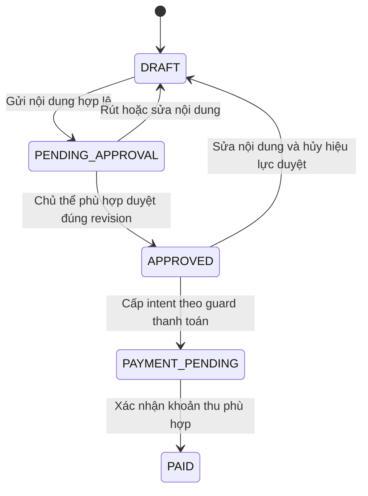

# Workflow skipping scenario — Kịch bản bỏ qua bước nghiệp vụ

Giao diện chỉ hiện nút thanh toán sau khi đơn đã được duyệt. Tuy nhiên, người dùng có thể lưu request, tự tạo lời gọi API hoặc dùng một ứng dụng cũ để gọi chức năng thanh toán trực tiếp. Nếu máy chủ chỉ kiểm tra người dùng đã đăng nhập và đơn chưa thanh toán, bước phê duyệt có thể bị bỏ qua dù mọi request đều đúng định dạng.

**Workflow skipping** là việc đi tới một hành động hoặc tác động khi chưa đáp ứng các điều kiện nghiệp vụ bắt buộc của quy trình. Điều cần bảo vệ là ý nghĩa của bước trước: quyền, quyết định, dữ liệu và hiệu lực mà bước đó phải tạo ra.

Trong chương **Abuse Cases**, bài học này phân tích một kịch bản bỏ qua phê duyệt trước thanh toán, sau đó mở rộng sang việc dùng bằng chứng của đối tượng khác, dùng quyết định lỗi thời, gọi qua tác vụ nền và lợi dụng cạnh tranh. Trọng tâm là business invariant, state machine, quyền theo đối tượng, transaction, idempotency và kiểm thử tác động thực tế.

## 1. Bỏ qua màn hình và bỏ qua điều kiện nghiệp vụ

Một quy trình có thể có nhiều màn hình nhưng chỉ một số bước tạo ra quyết định bảo mật. Ví dụ, trang xem hướng dẫn có thể được bỏ qua hợp lệ; quyết định phê duyệt theo chính sách thì không.

Cần phân biệt:

| Loại bước | Vai trò | Điều cần bảo vệ |
| --- | --- | --- |
| Điều hướng giao diện | Giúp người dùng đi qua các màn hình | Không mặc định phải ghi nhận người dùng đã mở từng trang |
| Nhập và xác nhận dữ liệu | Thu thập lựa chọn hoặc ý định cụ thể | Dữ liệu, chủ thể và tác động được xác nhận phải khớp |
| Kiểm tra điều kiện | Xác định đối tượng hoặc giao dịch đủ tiêu chuẩn | Điều kiện phải được thực thi ở nơi có thẩm quyền |
| Phê duyệt | Tạo quyết định cho nội dung và phạm vi nhất định | Đúng người, đúng đối tượng, đúng nội dung và hiệu lực |
| Cam kết tác động | Giữ tài nguyên, tạo nghĩa vụ hoặc phát lệnh thực hiện | Không xảy ra khi thiếu điều kiện bắt buộc |
| Xác nhận kết quả | Ghi nhận một tác động đã thực sự xảy ra | Nguồn xác nhận và quan hệ với nghĩa vụ phải hợp lệ |

Workflow skipping không nhất thiết là gọi bước 5 trước bước 4 theo số thứ tự. Nó còn có thể là:

- Dùng một phê duyệt có thật nhưng thuộc đơn khác.
- Dùng một quyết định đã hết hiệu lực.
- Thay nội dung sau khi được duyệt mà không đi lại bước cần thiết.
- Gọi một đường xử lý khác không kiểm tra điều kiện tương đương.
- Làm bước trước thất bại rồi được chuyển sang bước sau bởi nhánh phục hồi sai.
- Tự ghi một trạng thái cuối khiến hệ thống tưởng các điều kiện trước đã được đáp ứng.

Vì vậy, lịch sử “đã từng đi qua bước duyệt” chưa đủ. Quyết định phải còn có ý nghĩa đối với hành động hiện tại.

## 2. Kịch bản xuyên suốt: thanh toán đơn chưa được phê duyệt

Giả sử một nền tảng đặt hàng cho doanh nghiệp có quy trình:

```text
DRAFT
→ PENDING_APPROVAL
→ APPROVED
→ PAYMENT_PENDING
→ PAID
```

Các trạng thái mang ý nghĩa:

- `DRAFT`: nội dung còn đang soạn.
- `PENDING_APPROVAL`: bản nội dung hiện tại đã được gửi chờ quyết định.
- `APPROVED`: có quyết định hợp lệ cho bản nội dung cụ thể.
- `PAYMENT_PENDING`: hệ thống đã cấp một payment intent hợp lệ và đang thực thi hoặc chờ xác định kết quả.
- `PAID`: đã ghi nhận khoản thu phù hợp từ nguồn xác nhận đáng tin.

Trong ví dụ, **payment intent** là bản ghi nội bộ biểu diễn một quyết định cho phép thực thi nghĩa vụ thanh toán với tham số xác định. Thuật ngữ này không giả định một sản phẩm hay API cụ thể của nhà cung cấp.

Chính sách minh họa:

1. Người tạo không được tự duyệt đơn.
2. Người duyệt phải có quyền trên đúng đơn và đủ hạn mức.
3. Quyết định gắn với revision nội dung, tổng tiền và tiền tệ.
4. Các trường quan trọng thay đổi phải làm mất hiệu lực phê duyệt cũ hoặc bị chặn sửa.
5. Chỉ được cấp lệnh thu tiền khi đơn đủ điều kiện phê duyệt.
6. Một nghĩa vụ không được thu trùng do retry hoặc chạy đồng thời.

Đây là chính sách của ví dụ. Một sản phẩm có thể cho phép đặt giữ tiền trước phê duyệt hoặc thanh toán theo hạn mức tín dụng. Khi đó cần mô hình hóa chính xác việc đặt giữ, thu tiền và ngoại lệ tương ứng, thay vì áp nguyên quy trình này cho mọi hệ thống.

### 2.1. Luồng hợp lệ

```text
Người mua A tạo nội dung revision 7, tổng 1.000.000 VND.
A gửi duyệt.
Người B có quyền duyệt trong cùng phạm vi phê duyệt revision 7.
Người có quyền yêu cầu thanh toán.
Máy chủ kiểm tra điều kiện và cấp payment intent cho đúng nội dung.
Worker thực thi đúng intent.
Hệ thống xác nhận khoản thu và chuyển đơn thành PAID.
```

### 2.2. Chuỗi bỏ bước giả định

```text
Người mua A có một đơn đang PENDING_APPROVAL.
A gọi trực tiếp API bắt đầu thanh toán.
Máy chủ chỉ kiểm tra A đã đăng nhập và đơn chưa PAID.
Máy chủ tạo lệnh thu tiền.
Nhà cung cấp thực hiện khoản thu dù chưa có quyết định duyệt.
```

Chuỗi trên là một giả thuyết dùng để phân tích. Nó trở thành lỗ hổng được xác nhận khi có bằng chứng đường xử lý thực sự cho phép tác động trái chính sách.

## 3. Viết invariant cho bước không được bỏ qua

Một câu như “phải duyệt trước khi thanh toán” cần được chuyển thành điều kiện đủ rõ để triển khai và kiểm thử.

| Mã | Invariant | Ví dụ vi phạm |
| --- | --- | --- |
| W1 | Chủ thể yêu cầu có quyền thực hiện hành động trên đúng đơn và tổ chức | Có vai trò thanh toán nhưng dùng được đơn tổ chức khác |
| W2 | Quyết định duyệt có nguồn thẩm quyền hợp lệ | Tin `approvedBy` hoặc `approved=true` do client gửi |
| W3 | Quyết định thuộc đúng đối tượng và vòng xử lý liên quan | Dùng approval của đơn A cho đơn B |
| W4 | Nội dung thực thi khớp nội dung được duyệt còn hiệu lực | Duyệt revision 7 nhưng thu tiền theo revision 8 |
| W5 | Chuyển trạng thái chỉ được thực hiện khi guard tương ứng thỏa | Đơn nháp chuyển thẳng sang đang thanh toán |
| W6 | Kiểm tra điều kiện và cam kết tác động không bị tách bởi thay đổi cạnh tranh không được phát hiện | Hủy phê duyệt sau kiểm tra nhưng trước khi tạo lệnh thu |
| W7 | Các đường API, batch, worker và vận hành giữ điều kiện tương đương theo quyền của chúng | API chính chặn nhưng consumer nội bộ cho qua |
| W8 | Retry, lỗi và phục hồi không tạo đường đi tắt mới | Timeout rồi trả đơn về trạng thái cho phép thu lần nữa |
| W9 | Trạng thái kết quả đến từ bằng chứng phù hợp | Browser gửi `success=true` rồi đơn được ghi PAID |

Một hành động nhạy cảm có thể được mô tả:

```text
Được phép thực hiện
= đúng chủ thể
  và đúng đối tượng
  và đúng trạng thái nguồn
  và có quyết định đủ thẩm quyền
  và quyết định khớp nội dung hiện tại
  và hiệu lực, hạn mức cùng các điều kiện khác còn phù hợp.
```

Đây là các điều kiện cùng phải thỏa. Có nhiều điều kiện đúng không bù được việc thiếu quyết định phê duyệt.

## 4. Các biến thể bỏ bước cần tìm

### 4.1. Gọi thẳng hành động ở bước sau

Người dùng không cần nút trên giao diện để gọi API. Cần thử yêu cầu thanh toán khi đơn còn nháp, đang chờ duyệt, bị từ chối hoặc đã hủy.

Một kiểm tra đơn giản như “không phải PAID” sẽ nhận cả nhiều trạng thái không đủ điều kiện. Guard nên xác định trạng thái nguồn và các điều kiện cho phép cụ thể.

### 4.2. Tự cập nhật trạng thái qua API tổng quát

Nếu API sửa đơn cho phép ghi tùy ý `status`, `approvalId` hoặc `approvedContentRevision`, người dùng có thể không cần gọi hành động duyệt.

Hợp đồng cập nhật nên giới hạn các trường client được phép đề xuất. Những hành động như gửi duyệt, duyệt và bắt đầu thanh toán cần có điều kiện thực thi tương ứng. Tách endpoint giúp thể hiện ý nghĩa, nhưng tên endpoint riêng chưa tự tạo bảo vệ.

Nếu ứng dụng bỏ qua trường không được hỗ trợ hoặc từ chối request chứa trường đó, hành vi cần nhất quán với hợp đồng. Dù chọn cách nào, dữ liệu client không được tự tạo quyết định có thẩm quyền.

### 4.3. Dùng bằng chứng của đối tượng hoặc vòng xử lý khác

Một approval có thật chưa chắc áp dụng cho đơn đang xử lý. Cần liên kết tổ chức, đối tượng, phiên bản nội dung và phạm vi quyết định.

Nếu quy trình có hủy rồi mở lại hoặc nhiều vòng gửi duyệt, chỉ biết cùng `orderId` có thể chưa đủ. Cần xác định revision hoặc định danh vòng xử lý theo mô hình để quyết định cũ không bị tái sử dụng ngoài hiệu lực.

Một token có chữ ký chỉ chứng minh nội dung được nguồn tương ứng phát hành theo cơ chế ký. Nó vẫn phải được kiểm tra bên phát hành, mục đích, đối tượng, phạm vi, thời hạn và trạng thái dùng lại theo thiết kế.

### 4.4. Sửa nội dung sau duyệt

Sửa sản phẩm, số lượng, giá, tiền tệ hoặc một điều kiện ảnh hưởng tác động có thể làm quyết định cũ không còn phù hợp. Những trường nào cần duyệt lại phải do nghiệp vụ xác định.

Không nên chỉ bảo vệ `total` nếu đổi một trường khác vẫn thay đổi quyền lợi hoặc rủi ro. Cũng không nên bắt mọi thay đổi không liên quan, chẳng hạn một nhãn trình bày được phép sửa, phải đi lại toàn bộ quy trình nếu chính sách không yêu cầu.

### 4.5. Gọi đường cũ, batch hoặc tác vụ nền

Một API cũ có thể chỉ kiểm tra vai trò. Một batch có thể kiểm tra đơn đầu tiên rồi xử lý cả danh sách. Một worker có thể coi mọi message nội bộ là đủ điều kiện.

Cần tìm mọi đường tạo payment intent, phát lệnh thu hoặc đổi trạng thái liên quan. Quyền kỹ thuật của dịch vụ không được biến yêu cầu thiếu phê duyệt thành công việc hợp lệ.

### 4.6. Lợi dụng nhánh lỗi hoặc giá trị mặc định

Ví dụ nguy hiểm là “không tìm thấy approval thì coi là không cần duyệt”, hoặc “dịch vụ kiểm tra lỗi thì cho tiếp tục”. Hành vi khi thiếu bằng chứng và khi kiểm tra thất bại cần được định nghĩa theo chính sách.

Một nhánh phục hồi cũng có thể sai khi đưa đơn từ `PAYMENT_PENDING` trở lại `APPROVED` dù khoản thu bên ngoài chưa rõ. Lần thử mới sau đó có thể tạo thu trùng.

## 5. State machine phải chứa guard, không chỉ chứa danh sách trạng thái

Có thể mô tả một phần quy trình:



Sơ đồ tập trung vào các nhánh dùng trong bài. Những trạng thái từ chối, hủy, hết hạn và đối soát phải được bổ sung theo nghiệp vụ thực tế.

Mỗi mũi tên cần có:

- Trạng thái nguồn được phép.
- Chủ thể và quyền trên đối tượng.
- Dữ liệu hoặc bằng chứng đầu vào cần có.
- Nội dung và phiên bản được quyết định.
- Tác động được commit.
- Hành vi khi request lặp hoặc có xung đột.
- Dấu vết cần lưu để giải thích quyết định.

Không nên coi enum trạng thái là cơ chế đủ. Enum có thể chặn một giá trị lạ nhưng vẫn cho phép chuyển sai từ `DRAFT` sang `PAID` nếu code cập nhật không giữ guard.

### 5.1. Điều kiện ở bước cuối bảo vệ điều gì?

Bước cấp intent cần kiểm tra thẩm quyền thực thi hiện tại. Nó không cần chứng minh người dùng đã bấm qua mọi màn hình nếu những màn hình đó không tạo quyết định bắt buộc.

Dữ liệu có thể chứng minh điều kiện là bản nội dung được duyệt, quan hệ quyền và bản ghi quyết định hợp lệ. Một trường như `hasVisitedApprovalPage` không thay thế những điều đó.

### 5.2. Phê duyệt và thực thi là hai thẩm quyền khác nhau

Người có quyền bắt đầu thanh toán không mặc nhiên có quyền tạo quyết định duyệt. Worker thực thi cũng không trở thành người duyệt độc lập chỉ vì có tài khoản dịch vụ khác.

Trong ví dụ cấm người tạo tự duyệt, chạy lệnh qua worker không làm thay đổi ý nghĩa người khởi xướng. Nếu có phê duyệt tự động theo chính sách, cần mô hình loại quyết định và giới hạn riêng.

## 6. Bằng chứng phê duyệt cần gắn với dữ liệu nào?

Một mô hình tối thiểu có thể lưu:

| Thành phần | Vai trò |
| --- | --- |
| Tổ chức và mã đơn | Xác định phạm vi và đối tượng |
| Revision nội dung | Chỉ đúng bản dữ liệu được duyệt |
| Nội dung hoặc snapshot bất biến | Cho biết quyết định đã áp dụng cho dữ liệu gì |
| Chủ thể ra quyết định | Liên kết với danh tính được xác minh |
| Loại quyết định và chính sách | Phân biệt duyệt thường, tự động hoặc ngoại lệ |
| Số tiền, tiền tệ và điều kiện quan trọng | Ràng buộc ý nghĩa tác động |
| Thời gian và hiệu lực | Xác định khi nào được dùng theo hợp đồng |
| Trạng thái thu hồi hoặc thay thế | Ngăn dùng quyết định không còn áp dụng |

Các giá trị phải được tạo hoặc xác minh ở máy chủ. Client gửi `approvedRevision=7` chỉ là một lời khai nếu máy chủ không đối chiếu nguồn quyết định thật.

Có thể tham chiếu một revision bất biến thay vì sao chép mọi trường vào approval. Nhưng revision đó phải còn đọc được và không bị sửa đè; một tham chiếu tới nội dung luôn thay đổi sẽ mất ý nghĩa.

Cần phân biệt **content revision** với **phiên bản kỹ thuật của aggregate**. Một lần ghi nhận phê duyệt có thể tăng phiên bản aggregate trong khi nội dung vẫn là revision 7. Guard và audit phải diễn đạt đúng quan hệ này.

### 6.1. Quy định thời điểm xét hiệu lực

Trong ví dụ, phê duyệt được kiểm tra tại quyết định cấp payment intent trong transaction. Khi transaction thành công, intent trở thành thẩm quyền thực thi có phạm vi riêng cho nội dung đã chốt; worker không tự tính một khoản thu khác từ dữ liệu mới.

Nếu sản phẩm yêu cầu kiểm tra lại trước khi gửi nhà cung cấp hoặc hỗ trợ dừng intent sau khi cấp, cần thêm giao thức nhận việc, thu hồi và xử lý tác động chưa rõ. Không nên giả định một lần kiểm tra từ nhiều giờ trước vẫn đáp ứng chính sách đó.

Thay đổi chính sách hoặc thu hồi sau khi tác động đã xảy ra không tự làm tác động biến mất. Ranh giới quyết định và cách phục hồi cần rõ ràng.

## 7. Bảo vệ khoảng cách giữa kiểm tra và cam kết

Một triển khai có thể kiểm tra đúng nhưng vẫn cho đi tắt do cạnh tranh:

```text
T1 đọc: đơn APPROVED, nội dung revision 7.
T1 xác nhận có approval cho revision 7.

T2 sửa nội dung thành revision 8 và hủy hiệu lực approval cũ.
T2 commit.

T1 tạo lệnh thu dựa trên bản đơn hiện tại mà không kiểm tra thay đổi.
```

Vấn đề là điều kiện được kiểm tra không còn khớp với tác động được cam kết. Đây là một dạng sai lệch giữa lúc kiểm tra và lúc sử dụng dữ liệu.

Có thể chọn khóa, optimistic locking hoặc cập nhật có điều kiện theo mô hình. Điều quan trọng là mọi đường sửa liên quan phải phối hợp cùng một giao thức.

### 7.1. Minh họa service Java

Đoạn dưới minh họa đường cấp intent. Các kiểu và repository cần được triển khai theo ứng dụng; `AuthenticatedActor` đến từ ngữ cảnh đã xác thực, không lấy trực tiếp từ request body.

```java
@Transactional
public PaymentStartResult beginPayment(
        AuthenticatedActor actor,
        UUID orderId,
        PaymentRequest request) {

    Order order = orders.findForUpdate(actor.tenantId(), orderId)
            .orElseThrow(OrderNotVisibleException::new);

    authorization.requireMayUsePaymentAction(actor, order);

    var replay = paymentOperations.findAuthorizedReplay(
            actor, order, request);
    if (replay.isPresent()) {
        return PaymentStartResult.from(replay.get());
    }

    order.requireStatus(OrderStatus.APPROVED);

    ApprovalSnapshot approval = approvals.findCurrentFor(
                    order.tenantId(),
                    order.id(),
                    order.contentRevision())
            .orElseThrow(ApprovalRequiredException::new);

    approvalPolicy.requireValidFor(
            actor, order, approval, clock.instant());

    PaymentIntent intent = paymentIntents.createFor(
            order, approval, request.operationKey(), actor.principalId());

    order.markPaymentPending(intent.id());
    orders.save(order);
    outbox.append(PaymentRequested.from(intent));
    audit.append(PaymentIntentCreated.from(actor, order, intent));

    return PaymentStartResult.from(intent);
}
```

Các hợp đồng bắt buộc phía sau mã:

- `findForUpdate` thực sự khóa bản ghi trong transaction và giữ đúng phạm vi tổ chức.
- `requireMayUsePaymentAction` kiểm tra quyền đối tượng; điều kiện trạng thái để tạo tác động mới được kiểm tra riêng.
- Đường replay xác minh đúng phạm vi, nội dung thao tác và quyền truy cập hiện tại theo hợp đồng. Nó không chỉ tìm một chuỗi khóa rồi trả dữ liệu.
- `requireValidFor` xác minh nguồn quyết định, đối tượng, revision và các điều kiện chính sách; dữ liệu giá có thẩm quyền phải khớp.
- Intent chốt tham số thực thi từ dữ liệu có thẩm quyền, thay vì lấy số tiền hoặc người nhận tùy ý từ request.
- Tạo intent, đổi trạng thái, ghi outbox và audit bắt buộc dùng cùng transaction phù hợp.
- Ràng buộc dữ liệu và điều kiện trạng thái phải chống việc tạo thêm tác động cho cùng nghĩa vụ, kể cả khi người gọi đổi khóa.
- Lỗi nghiệp vụ và lỗi ghi phải rollback theo cấu hình thực tế.

Khóa đơn chỉ đủ cho những điều kiện được bảo vệ theo giao thức đó. Nếu approval có thể bị sửa hoặc thu hồi ở bảng khác mà không phối hợp với đơn, phải bảo vệ cả quan hệ này. Hạn mức dùng chung cũng cần cơ chế riêng đúng phạm vi.

### 7.2. Vì sao không gọi nhà cung cấp ngay sau một kiểm tra rời rạc?

Nếu kiểm tra xong rồi gọi hệ thống ngoài mà không tạo một cam kết nội bộ có thẩm quyền, thay đổi cạnh tranh hoặc lỗi ở giữa có thể làm mất liên kết giữa quyết định và tác động.

Outbox giúp công bố công việc đã commit. Nó không tự bảo đảm nhà cung cấp chỉ thu một lần; luồng thực thi vẫn cần idempotency, trạng thái và đối soát tương ứng.

## 8. Retry và phục hồi không được trở thành đường bỏ bước

Một request lặp có thể đến khi đơn đã là `PAYMENT_PENDING` hoặc `PAID`. Nếu cùng một thao tác đã được cấp hợp lệ, trả kết quả cũ có thể đúng hợp đồng; không cần giả vờ tạo intent mới.

Do đó phải phân biệt:

- Kiểm tra quyền và phạm vi để trả lại kết quả.
- Kiểm tra điều kiện tạo một tác động mới.
- Ràng buộc cùng thao tác và cùng nội dung.
- Trạng thái của nghĩa vụ nghiệp vụ.

Nếu API chỉ cho mọi request từ `APPROVED` mới được xử lý, một retry hợp lệ có thể nhận lỗi không cần thiết. Nhưng nếu mọi trạng thái đều cho tạo intent mới để “hỗ trợ retry”, hệ thống lại mở đường thu trùng.

### 8.1. Cùng khóa không phải toàn bộ câu chuyện

Idempotency cần phạm vi tổ chức, chủ thể hoặc quyền truy cập phù hợp, loại thao tác và dấu vết nội dung có ý nghĩa. Cùng khóa nhưng đổi đơn hoặc tác động không được coi là cùng yêu cầu một cách mù quáng.

Khác khóa cũng không được làm một nghĩa vụ hoàn tất trở thành nghĩa vụ mới. State machine và ràng buộc nghiệp vụ phải giữ điều đó.

### 8.2. Timeout không có nghĩa chưa thu tiền

Nếu nhà cung cấp đã thu nhưng response bị mất, trả đơn về `APPROVED` rồi cho tạo một lần thu độc lập có thể gây trùng tác động.

Cần giữ trạng thái đang xử lý hoặc chưa rõ, truy vấn và đối soát. Chỉ chuyển sang nhánh cho phép thử lại khi hợp đồng thực thi xác định được điều kiện an toàn tương ứng.

### 8.3. Chạy lại từ công cụ vận hành

Công cụ retry, hàng lỗi và batch sửa dữ liệu thường có quyền kỹ thuật rộng. Việc chạy lại phải giữ định danh thao tác, nội dung đã cấp, nguồn thẩm quyền và trạng thái hiện tại.

Một nút “reprocess” không được mặc định bỏ guard hoặc phát lại mọi tác động như một công việc mới.

## 9. Bỏ qua bước ở phía kết quả và hệ thống bên ngoài

Ngay cả khi bước bắt đầu thanh toán được bảo vệ, hệ thống vẫn có thể bị đi tắt bằng việc tự ghi nhận kết quả.

Ví dụ:

```text
Người dùng mở URL quay lại từ trang thanh toán.
URL chứa success=true và orderId.
Ứng dụng tin tham số trình duyệt, đặt đơn thành PAID.
Chức năng giao hàng được mở dù chưa xác nhận khoản thu.
```

Trang quay lại phục vụ trải nghiệm người dùng, không tự là nguồn xác nhận tài chính có thẩm quyền.

Khi nhận callback hoặc kết quả truy vấn nhà cung cấp, cần kiểm tra theo giao thức tích hợp:

- Nguồn và tính hợp lệ của thông tin nhận được.
- Quan hệ với intent, nghĩa vụ và giao dịch tương ứng.
- Trạng thái thực sự mà nguồn đang xác nhận.
- Số tiền, tiền tệ và các điều kiện cần khớp.
- Khả năng callback bị lặp, đến muộn hoặc sai thứ tự.
- Điều kiện chuyển trạng thái hiện tại.

Một callback hợp lệ về nguồn nhưng liên quan đơn khác không được chuyển đơn đang xét thành `PAID`. Một sự kiện cũ cũng không được làm trạng thái quay lùi hoặc tạo thêm tác động.

Các bước sau như giao hàng, cấp quyền sử dụng hoặc phát hành chứng từ cần dựa vào trạng thái có ý nghĩa đã được xác lập. Không nên chỉ dựa vào việc “đã nhận một message thanh toán” nếu message chưa gắn với nguồn và kết quả đúng.

## 10. Ngoại lệ hợp lệ phải có đường cấp quyền rõ ràng

Một số quy trình có thanh toán theo hạn mức tín dụng, khách hàng được miễn một bước hoặc cơ chế xử lý khẩn cấp. Những nhánh này có thể là hành vi hợp lệ nếu được định nghĩa.

Cần ghi rõ:

| Nội dung | Ví dụ điều cần xác định |
| --- | --- |
| Ai được cấp ngoại lệ | Vai trò, chủ thể hoặc bộ phận độc lập nào |
| Phạm vi áp dụng | Tổ chức, đơn, loại giao dịch hoặc khách hàng nào |
| Giới hạn | Số tiền, thời gian, số lần và điều kiện sử dụng |
| Nguồn quyết định | Cấu hình, hợp đồng hoặc bản ghi phê duyệt nào |
| Tác động lên trạng thái | Nhánh state machine nào được phép |
| Dấu vết | Ai cấp, vì sao, cho nội dung nào và khi nào dùng |

Một trường `skipApproval=true` trong request không phải chính sách ngoại lệ. Máy chủ phải xác minh người gọi có quyền yêu cầu và đối tượng đủ điều kiện.

Nếu thay đổi cấu hình có thể miễn bước cho chính người thao tác, cần xem xét quy trình cấp quyền và tách trách nhiệm. Nếu không, guard phê duyệt có thể bị vô hiệu qua đường sửa chính sách.

Các nhánh ngoại lệ cũng cần kiểm thử như một phần state machine. Không nên gộp chúng vào một nhánh “admin được làm mọi thứ” mà không có hợp đồng tác động.

## 11. Mô tả abuse case có thể giao cho người khác xác minh

### WF-01 — Gọi thanh toán trước quyết định duyệt

**Mục tiêu hợp lệ:** thanh toán một đơn đã được duyệt đúng chính sách.

**Tài sản:** tiền, độ tin cậy của quyết định phê duyệt và quyền kiểm soát chi tiêu.

**Tác nhân:** người mua có phiên hợp lệ, thuộc tổ chức có đơn. Tác nhân gọi API trực tiếp, sửa tham số, lặp và gửi đồng thời; không giả định họ có quyền sửa cơ sở dữ liệu hoặc tài khoản người duyệt.

**Điều kiện trước:** đơn ở `PENDING_APPROVAL` và chưa có quyết định đủ hiệu lực.

**Điểm vào giả định:** lệnh bắt đầu thanh toán; cần kiểm kê thêm các đường tạo intent tương đương.

**Chuỗi thử:**

```text
1. Tạo và gửi đơn chờ duyệt.
2. Gọi trực tiếp lệnh thanh toán bằng quyền người mua.
3. Nếu bị chặn, thử các đường batch, worker hoặc API khác trong phạm vi kiểm thử.
4. Quan sát việc tạo intent, thông điệp và tác động bên ngoài.
```

**Kết quả trái phép giả định:** có cam kết hoặc tác động thu tiền không được phép trước khi đủ điều kiện duyệt.

**Hành vi an toàn:** không tạo tác động trái chính sách; response phản ánh thiếu điều kiện hoặc không đủ quyền theo hợp đồng API.

**Bằng chứng cần kiểm tra:** trạng thái và revision đã commit, approval liên quan, intent, outbox, số lần gọi nhà cung cấp và audit.

**Biến thể:** đơn nháp, approval thuộc đơn khác, nội dung đã đổi, approval bị thu hồi theo chính sách, gọi qua dịch vụ nội bộ và tranh chấp đồng thời.

**Trạng thái ban đầu:** giả thuyết cần xác minh. Chỉ ghi là đã tái hiện khi có bằng chứng tác động; chỉ ghi đã kiểm soát khi đường liên quan được kiểm tra ở mức phù hợp.

Mẫu này giúp tránh mô tả quá ngắn như “bypass bước duyệt” mà không biết tác nhân, điều kiện và tài sản bị ảnh hưởng.

## 12. Kiểm thử các cạnh của quy trình

Một ma trận nguồn trạng thái giúp tìm những lệnh không được tạo tác động mới. Ví dụ rút gọn:

| Trạng thái hiện tại | Tạo quyết định duyệt mới | Cấp intent thanh toán mới | Mở bước cần xác nhận đã trả tiền |
| --- | --- | --- | --- |
| `DRAFT` | Không | Không | Không |
| `PENDING_APPROVAL` | Có, nếu đúng người và điều kiện | Không | Không |
| `APPROVED` | Không tự tạo thêm cùng quyết định | Có, nếu đủ mọi guard | Không |
| `PAYMENT_PENDING` | Không qua đường duyệt thông thường | Không tạo nghĩa vụ trùng; replay theo hợp đồng | Không |
| `PAID` | Không qua đường duyệt thông thường | Không thu lại cùng nghĩa vụ | Có, nếu quyền và điều kiện bước sau phù hợp |

Bảng không thay thế đặc tả đầy đủ. Các lệnh trả lại kết quả cũ, từ chối, sửa và ngoại lệ cần được mô tả riêng.

### 12.1. Danh sách tình huống cần bao phủ

| Tình huống | Điều cần xác minh |
| --- | --- |
| Người mua gọi thanh toán trên đơn nháp hoặc chờ duyệt | Không tạo intent, outbox hoặc khoản thu trái phép |
| Người tạo gọi duyệt bằng request hợp lệ | Không tạo quyết định trái chính sách tách trách nhiệm |
| Client gửi trường trạng thái hoặc danh tính người duyệt | Không biến dữ liệu tự khai thành thẩm quyền |
| Đổi approval sang đối tượng khác | Không chấp nhận vì quyết định có thật nhưng không thuộc đơn |
| Sửa nội dung sau duyệt | Chặn sửa hoặc làm mất hiệu lực duyệt đúng hợp đồng |
| Approval không còn hiệu lực | Không cấp tác động mới ngoài chính sách |
| Gọi qua batch hoặc worker | Mỗi đối tượng và lệnh giữ đúng điều kiện |
| Sửa hoặc thu hồi tranh với cấp intent | Kết quả phù hợp thứ tự quyết định được bảo vệ; không dùng dữ liệu lỗi thời |
| Hai request cùng bắt đầu thanh toán | Không tạo thêm nghĩa vụ hoặc tác động trùng |
| Retry cùng thao tác sau commit | Trả kết quả theo hợp đồng mà không thực thi lại |
| Đổi khóa sau khi nghĩa vụ đã hoàn tất | Không được xem là lý do thu lại |
| Rollback sau kiểm tra guard | Không có lệnh thực thi được công bố như thể đã commit |
| Timeout nhà cung cấp | Không tự khẳng định chưa thu và mở đường thu mới |
| Browser hoặc callback giả báo thành công | Không chuyển trạng thái tài chính từ nguồn không đủ thẩm quyền |
| Callback đúng nguồn nhưng sai số tiền hoặc liên kết | Không xác nhận nhầm nghĩa vụ |
| Chạy lại từ công cụ vận hành | Giữ đúng intent, quyền, trạng thái và idempotency |

### 12.2. Kiểm tra tác động, không chỉ mã phản hồi

Một request trả lỗi có thể đã gọi nhà cung cấp trước đó. Cần quan sát thêm cơ sở dữ liệu, thông điệp đã commit và hệ thống ngoài hoặc thành phần giả lập có đếm tác động.

Mã HTTP cụ thể phụ thuộc hợp đồng và chính sách tiết lộ tài nguyên. Tiêu chí bảo mật chính là không có tác động hoặc dữ liệu ngoài quyền, không phải mọi hệ thống đều phải dùng cùng một mã lỗi.

### 12.3. Kiểm thử cạnh tranh cần diễn giải đúng thứ tự

Nếu yêu cầu duyệt và thanh toán chạy gần nhau, thanh toán có thể thành công hợp lệ khi quyết định duyệt đã được ghi nhận và điều kiện đủ tại thời điểm cấp intent. Không nên kết luận bỏ bước chỉ vì hai request bắt đầu gần cùng lúc.

Điều cần chứng minh là không cấp intent từ một quyết định chưa tồn tại có thẩm quyền hoặc không còn khớp theo giao thức đã chọn.

Với sửa nội dung hoặc thu hồi, kết quả phải tuân theo thứ tự được bảo vệ: hoặc thay đổi làm intent mới không đủ điều kiện, hoặc intent hợp lệ đã được cấp trước và các bước sau xử lý theo chính sách đã định. Không được trộn dữ liệu của hai thứ tự thành một quyết định chưa từng được cho phép.

Unit test hữu ích cho guard và state machine. Integration test cần kiểm tra khóa, transaction, điều kiện cập nhật và ràng buộc dữ liệu. Test API và consumer giúp phát hiện đường vào bỏ kiểm tra; test tích hợp thanh toán cần bao phủ timeout và kết quả lặp.

## 13. Dấu vết cần có để phát hiện và điều tra bỏ bước

Lịch sử hữu ích nên nối được:

```text
Ai gửi duyệt và gửi nội dung nào.
Ai ra quyết định, theo quyền và chính sách nào.
Nội dung có bị sửa, thu hồi hoặc thay thế sau đó không.
Ai hoặc dịch vụ nào yêu cầu cấp payment intent.
Intent tham chiếu quyết định và tham số thực thi nào.
Lệnh nào được công bố sau commit.
Kết quả bên ngoài được xác nhận hoặc đối soát ra sao.
```

Các định danh như tổ chức, đơn, revision, approval, intent và operation giúp tái dựng quan hệ. Chỉ có timestamp không luôn đủ vì đồng hồ, hàng đợi và retry có thể làm thứ tự quan sát khác thứ tự quyết định.

Sự kiện bị từ chối nên khác sự kiện thay đổi đã commit. Một dòng log tự do “approved” trước rollback không được coi là quyết định đã có hiệu lực.

Audit và giám sát hỗ trợ phát hiện các lần gọi bước sau khi thiếu điều kiện, hoặc chênh lệch giữa intent và quyết định duyệt. Chúng không thay thế guard chủ động ngăn tác động.

Dữ liệu audit có thể chứa số tiền, danh tính và điều kiện nội bộ; cần giới hạn quyền đọc, bảo vệ khỏi sửa xóa trái phép và tránh ghi credential.

## 14. Cách áp dụng khi thiết kế hoặc rà soát một workflow

Với một quy trình nhạy cảm, có thể đi theo trình tự:

1. **Xác định tác động cần chặn:** thu tiền, giao hàng, xuất dữ liệu hay cấp quyền lợi nào không được xảy ra sớm?
2. **Tách bước giao diện khỏi quyết định bắt buộc:** bước nào thực sự tạo bằng chứng hoặc thẩm quyền?
3. **Viết guard theo đối tượng và nội dung:** ai, đơn nào, revision nào, điều kiện gì?
4. **Kiểm kê mọi đường tạo tác động:** API, batch, consumer, callback và công cụ vận hành.
5. **Chốt ranh giới quyết định:** khi nào điều kiện được xét và khi nào có intent hoặc cam kết hợp lệ?
6. **Bảo vệ thay đổi đồng thời:** dùng transaction, khóa hoặc phiên bản đúng với dữ liệu liên quan.
7. **Định nghĩa retry và lỗi chưa rõ:** không cho nhánh phục hồi tạo đường thu hoặc cấp quyền mới trái phép.
8. **Mô hình ngoại lệ:** quyền, phạm vi, thời hạn và audit riêng cho nhánh được miễn bước.
9. **Kiểm thử các cạnh bị cấm:** cả trạng thái, dữ liệu, nguồn gọi và tác động thực tế.

Một hợp đồng cụ thể có thể là:

> Chỉ chủ thể có quyền trên đơn mới được yêu cầu cấp intent thanh toán. Intent chỉ được cấp khi có quyết định duyệt đủ thẩm quyền cho nội dung hiện tại; số tiền và tiền tệ được chốt từ nguồn có thẩm quyền. Quyết định cấp intent và thông điệp thực thi được ghi nguyên tử. Retry không tạo nghĩa vụ mới, và mọi đường thực thi phải giữ các điều kiện tương ứng.

Bảo vệ workflow đòi hỏi kiểm soát mối liên hệ giữa các quyết định và tác động. Khi điều kiện bắt buộc được thực thi ở máy chủ, gắn với đúng đối tượng và nội dung, rồi giữ nhất quán qua cạnh tranh và phục hồi, việc gọi thẳng bước sau không thể tự tạo thẩm quyền mà người gọi chưa có.
