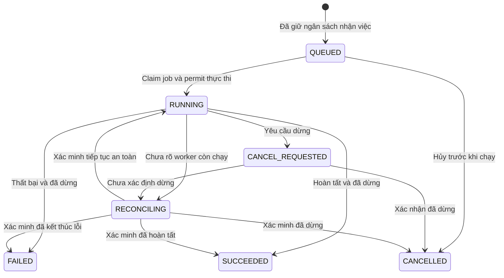

# Kịch bản làm cạn kiệt tài nguyên — Resource exhaustion scenario

## 1. Khi chức năng hợp lệ trở thành công cụ chiếm tài nguyên

Một người dùng đăng nhập hợp lệ, chỉ đọc dữ liệu thuộc tổ chức của mình và không gửi mã độc vẫn có thể khiến hệ thống khó phục vụ người khác. Họ có thể liên tục tạo báo cáo nặng, giữ các tác vụ chạy rất lâu hoặc làm hàng đợi tăng nhanh hơn khả năng xử lý.

Đây là một **resource exhaustion scenario**: kịch bản trong đó một tác nhân làm tiêu hao hoặc chiếm dụng tài nguyên đến mức hệ thống không còn đáp ứng được mục tiêu phục vụ.

Trong chương **Abuse Cases**, điều quan trọng là mô tả được chuỗi hành vi và quy tắc bị thiếu. Không nên chỉ kết luận “cần chống quá nhiều request”. Một request nhỏ có thể kích hoạt công việc rất lớn; nhiều request ít tốn kém chưa chắc gây tác động tương đương.

Bài này dùng một dịch vụ xuất báo cáo làm ví dụ giả định. Các con số chỉ phục vụ phân tích, không phải cấu hình áp dụng chung cho hệ thống production.

Sau bài này, bạn cần có thể:

- Mô tả tác nhân, tài nguyên và mục tiêu lạm dụng.
- Xác định chi phí bị khuếch đại sau một request.
- Viết bất biến cho admission, quota và xử lý đồng thời.
- Phân biệt rate limit, giới hạn công việc đang chạy và ngân sách sử dụng.
- Thiết kế vòng đời job, hủy, retry và thu hồi tài nguyên.
- Kiểm thử tình huống cạn tài nguyên bằng tải có giới hạn trong môi trường được kiểm soát.

## 2. Bối cảnh hệ thống và mục tiêu nghiệp vụ

Một nền tảng phân tích có nhiều tenant. Thành viên có quyền xuất báo cáo của tenant mình bằng API:

```http
POST /reports/exports
Content-Type: application/json

{
  "fromDate": "2026-01-01",
  "toDate": "2026-11-21",
  "includeAttachments": true,
  "format": "archive"
}
```

Phiên bản ban đầu hoạt động như sau:

1. Kiểm tra đăng nhập và quyền đọc dữ liệu.
2. Tạo một job mới cho mỗi request.
3. Đưa job vào hàng đợi không có giới hạn nghiệp vụ rõ ràng.
4. Worker truy vấn dữ liệu, tải tệp đính kèm và tạo archive.
5. Lưu kết quả rồi gửi thông báo cho người yêu cầu.

Hệ thống có bốn worker xử lý báo cáo. Các tenant dùng chung năng lực này.

Mục tiêu hợp lệ là giúp người dùng lấy báo cáo trong phạm vi được phép, với khối lượng và chi phí mà gói dịch vụ/chính sách cho phép. Quyền đọc một tập dữ liệu không tự đồng nghĩa quyền yêu cầu xử lý không giới hạn trên tập dữ liệu đó.

### 2.1. Hồ sơ abuse case

| Thành phần | Mô tả |
| --- | --- |
| Tác nhân | Thành viên hợp lệ hoặc bên điều khiển nhiều tài khoản. |
| Quyền ban đầu | Được yêu cầu xuất báo cáo trong tenant của mình. |
| Mục tiêu lạm dụng | Chiếm năng lực chung, gây chậm cho tenant khác hoặc tạo chi phí xử lý ngoài chính sách. |
| Tài nguyên | CPU, RAM, kết nối database, worker, hàng đợi, dung lượng tạm, lưu trữ và lượt gọi dịch vụ phụ trợ. |
| Điểm vào | API tạo job, retry, lịch xuất tự động, công cụ tạo lại báo cáo. |
| Giả định bị khai thác | Mỗi request được phép tạo một công việc mới; request hợp lệ được xem như chi phí chấp nhận được. |
| Tác động | Tăng thời gian chờ, lỗi do thiếu tài nguyên, chi phí tăng, mất công bằng giữa tenant. |

Tác nhân không cần vượt quyền đọc dữ liệu để đạt mục tiêu này. Lỗ hổng nằm ở quyền **tiêu thụ tài nguyên**, vòng đời công việc và cách chia sẻ năng lực.

## 3. Chuỗi lạm dụng từng bước

### Bước 1: Chọn đầu vào có chi phí cao

Người dùng chọn khoảng thời gian rất dài, kèm toàn bộ tệp đính kèm và định dạng cần nhiều công đoạn xử lý.

Nếu server chỉ kiểm tra ngày hợp lệ và định dạng được hỗ trợ, một request có vài trăm byte có thể dẫn tới hàng triệu dòng dữ liệu hoặc rất nhiều lần đọc tệp.

### Bước 2: Tạo nhiều job độc lập

Người dùng gửi thêm yêu cầu trước khi các job đầu hoàn tất. Mỗi lần đều nhận một job ID mới.

Nếu caller thay một ghi chú hoặc một tham số không đáng kể để tránh cache, hệ thống lại thực hiện gần như toàn bộ công việc. Một tùy chọn “tạo lại” do client điều khiển cũng có thể trở thành đường né cơ chế tái sử dụng kết quả.

### Bước 3: Khai thác độ dài công việc

Giả sử mỗi báo cáo nặng mất tám phút và luôn chiếm một worker. Khi bốn job đó chạy đồng thời, toàn bộ bốn worker bị chiếm trong khoảng thời gian tương ứng.

Nếu luồng yêu cầu nặng đến đều ba job mỗi phút, trong khi bốn worker chỉ hoàn tất trung bình bốn job mỗi tám phút, năng lực hoàn tất là khoảng 0,5 job/phút. Khi tất cả job có cùng chi phí đó và không có tải khác, hàng đợi có xu hướng tăng khoảng 2,5 job/phút sau giai đoạn ban đầu.

Một ngưỡng request/phút có thể vẫn cho phép lượng công việc vượt xa khả năng phục vụ.

### Bước 4: Retry làm tăng công việc thay vì tìm lại kết quả

Client không nhận được response hoặc thấy trạng thái chậm nên gửi lại. Nếu không có idempotency, retry tiếp tục tạo thêm job.

Việc người dùng bấm nhiều lần có thể là hành vi vô ý. Bất biến bảo vệ tài nguyên vẫn cần đúng dù nguyên nhân là lỗi mạng, thao tác lặp hay lạm dụng có chủ đích.

### Bước 5: Chuyển áp lực sang các tầng khác

Ngay cả khi số worker bị giới hạn, hàng đợi có thể tiếp tục phình ra. Job chờ chiếm metadata và nghĩa vụ xử lý tương lai. Job đang chạy có thể làm đầy ổ tạm hoặc giữ kết nối database quá lâu.

Nếu ứng dụng trả response nhanh vì đã chuyển việc sang queue, điều đó chỉ thay đổi vị trí chịu tải. Nó chưa chứng minh hệ thống đã kiểm soát lượng công việc nhận vào.

## 4. Bề mặt tài nguyên và mức khuếch đại

| Tài nguyên | Cách bị tiêu hao | Giới hạn cần xem xét |
| --- | --- | --- |
| CPU | Nén, chuyển định dạng, tính toán tổng hợp. | Thời gian và năng lực xử lý cho từng job/nhóm. |
| RAM | Đọc toàn bộ dữ liệu/tệp vào bộ nhớ. | Bộ nhớ đỉnh, kích thước lô, streaming có giới hạn. |
| Database | Quét dữ liệu lớn, giữ connection, truy vấn fan-out. | Phạm vi truy vấn, timeout, số truy vấn và kết nối. |
| Worker | Job dài chiếm slot. | Concurrent jobs toàn hệ thống và theo tenant. |
| Hàng đợi | Nhận việc nhanh hơn xử lý. | Số lượng, dung lượng, tuổi job và chính sách nhận thêm. |
| Ổ tạm/lưu trữ | Tệp trung gian, archive, kết quả không được dọn. | Byte tối đa, vòng đời và ngân sách lưu giữ. |
| Dịch vụ phụ trợ | Tải nhiều tệp hoặc gọi API xử lý. | Số lần gọi, số byte và ngân sách tác động. |
| Kênh thông báo | Mỗi retry tạo thêm email/sự kiện. | Tác động theo operation và giới hạn fan-out. |

Một phép đo hữu ích về tư duy:

```text
Mức khuếch đại =
    công việc downstream được kích hoạt
    so với đầu vào/yêu cầu được chấp nhận
```

Không có một tỷ lệ duy nhất biểu diễn mọi tài nguyên. Cần biết nút nghẽn và đo đúng đơn vị: số request, số hàng, byte, thời gian CPU hoặc lượt gọi bên ngoài.

Một job có thể nhẹ ở CPU nhưng nặng về lưu trữ. Giới hạn duy nhất theo “số job” không phản ánh hết chi phí.

## 5. Những kiểm tra thông thường còn thiếu điều gì?

### 5.1. Xác thực và phân quyền dữ liệu

Chúng trả lời caller là ai và được đọc dữ liệu nào. Cần thêm chính sách họ được yêu cầu bao nhiêu công việc, trong khoảng nào và với mức chiếm dụng nào.

### 5.2. Rate limiting

Rate limit kiểm soát lượng yêu cầu trong một phạm vi thời gian. Nó hữu ích để giảm lặp nhanh nhưng không trực tiếp giới hạn tổng chi phí của công việc đang chạy.

Một job mất tám phút khác một job mất một giây. Cùng một mức request/phút có thể tạo áp lực rất khác.

### 5.3. Timeout HTTP

Client hết thời gian chờ không có nghĩa worker hoặc truy vấn đã ngừng. Nếu client retry trong khi công việc cũ vẫn chạy, mức tiêu hao còn tăng.

### 5.4. Chuyển sang bất đồng bộ

Queue giúp tách thời gian phản hồi khỏi thời gian xử lý. Nếu không giới hạn admission và backlog, hệ thống có thể nhận một lượng nghĩa vụ không thể phục vụ trong thời gian phù hợp.

### 5.5. Tăng worker

Tăng worker có thể làm giảm thời gian chờ ở một tầng nhưng tăng tải lên database, bộ nhớ hoặc dịch vụ ngoài. Khi công việc nhận vào không bị chặn theo ngân sách, mở rộng năng lực cũng có thể mở rộng chi phí bị lạm dụng.

Cần nối quyền nhận việc với khả năng thực thi, thay vì chỉ xử lý triệu chứng ở tầng hiện đang đầy.

## 6. Xác định chính sách trước khi chọn bộ đếm

Một chính sách minh họa cho hệ thống bốn worker:

- Mỗi chủ thể có tối đa một job chưa kết thúc.
- Mỗi tenant có tối đa ba job chưa kết thúc.
- Mỗi tenant được dùng tối đa hai slot thực thi.
- Toàn hệ thống có tối đa bốn slot thực thi.
- Hàng đợi có tối đa 20 job chờ.
- Mỗi job có phạm vi dữ liệu, số hàng, số byte và thời gian thực thi tối đa.
- Ngân sách theo kỳ tính cả phần đã dùng và phần đang giữ cho job đã nhận.
- Retry cùng operation không tạo job mới hoặc gia hạn quyền chiếm dụng ngoài chính sách.

Các con số này chỉ để cụ thể hóa bài học. Cần chọn theo đặc điểm sản phẩm và năng lực đo được.

### 6.1. Định nghĩa “chưa kết thúc”

Một job đang chờ, đang chạy hoặc đang chờ xác định đã dừng hay chưa vẫn chiếm một phần năng lực/quyền nhận việc.

Không chỉ đếm `RUNNING`. Nếu chỉ đếm công việc đang chạy, caller có thể đẩy vô hạn job vào queue.

### 6.2. Chủ thể và tenant phải do server xác lập

Quota theo tài khoản có thể chưa đủ nếu một người điều khiển nhiều tài khoản. Giới hạn theo tenant giúp gom tải trong cùng một tổ chức; giới hạn toàn hệ thống bảo vệ khi có nhiều tenant cùng gửi.

Nếu chính sách muốn giới hạn theo một khách hàng có nhiều tài khoản hoặc tenant, cần định danh/quan hệ phù hợp. Header `tenantId` hoặc trường `quotaOwner` do client tự khai không được tạo ngân sách mới.

Mỗi tầng giới hạn giải quyết một phạm vi khác nhau. Không dùng một ngưỡng theo IP để thay cho toàn bộ mô hình chủ thể nghiệp vụ.

## 7. Viết bất biến theo loại tài nguyên

Gọi:

- `A_s`: số job chưa kết thúc của chủ thể s.
- `A_t`: số job chưa kết thúc của tenant t.
- `Q`: số job đang chiếm chỗ trong hàng đợi.
- `E`: số permit thực thi đang bị chiếm toàn hệ thống.
- `E_t`: số permit thực thi của tenant t.
- `B_used`, `B_reserved`: ngân sách đã dùng và đang giữ trong cùng kỳ/tài nguyên.

Theo chính sách minh họa:

```text
I1. Với mọi s: 0 <= A_s <= 1.
I2. Với mọi t: 0 <= A_t <= 3.
I3. 0 <= Q <= 20.
I4. 0 <= E <= 4 và với mọi t: E_t <= 2.
I5. B_used + B_reserved <= B_limit.
I6. Một operation chỉ tạo tối đa một job nghiệp vụ theo hợp đồng.
I7. Mọi lần thu hồi permit/ngân sách gắn với một chuyển đổi hợp lệ.
I8. Không giải phóng slot thực thi nếu công việc cũ còn có thể tiếp tục
    ngoài cơ chế kiểm soát đã xác định.
```

Tất cả bộ đếm phải có phạm vi rõ: theo chủ thể, tenant, loại tài nguyên, kỳ và môi trường phù hợp.

### 7.1. Ước lượng chi phí chưa phải giới hạn cứng

Một ước lượng “báo cáo này tốn 100 đơn vị” chỉ là thông tin lập kế hoạch nếu job thực tế có thể tiêu thụ 10.000 đơn vị.

Để I5 có ý nghĩa bảo vệ, cần một trong các cơ chế phù hợp:

- Giữ ngân sách dựa trên giới hạn trên có thể thực thi.
- Chia công việc thành các phần và chỉ tiếp tục sau khi giữ thêm ngân sách.
- Có runtime cap chặn công việc trước khi vượt phần được phép.
- Phân biệt rõ ngưỡng dự báo, ngưỡng mềm và ngưỡng cứng của chính sách.

Khi chi phí thực tế lớn hơn dự kiến, không chỉ ghi số âm sau khi công việc đã hoàn tất rồi coi quota là được bảo vệ.

### 7.2. Ngân sách không phải lúc nào cũng hoàn trả

Một slot worker có thể được trả khi công việc thực sự kết thúc. CPU đã dùng hoặc lượt gọi dịch vụ ngoài đã thực hiện không tự được hoàn lại vì job thất bại.

Nếu job giữ trước 100 đơn vị và đã dùng 40, khi dừng có thể chuyển 40 sang phần đã dùng và chỉ trả 60 chưa dùng theo chính sách. Không xóa toàn bộ lịch sử chi phí chỉ vì trạng thái là `FAILED`.

Dung lượng kết quả cũng có vòng đời riêng: job đã kết thúc nhưng tệp vẫn tồn tại thì phần lưu trữ vẫn đang bị chiếm. Đánh dấu “cần xóa” chưa đồng nghĩa byte đã được giải phóng.

## 8. Admission control: quyết định nhận việc trước khi làm việc nặng

Admission control là quyết định hệ thống có nhận trách nhiệm xử lý một công việc mới hay không, dựa trên quyền, giới hạn và năng lực phù hợp.

Một luồng nên thực hiện các kiểm tra tương đối rẻ trước khi truy vấn/tải dữ liệu lớn:

1. Giới hạn kích thước và cấu trúc request.
2. Xác thực actor và đối chiếu tenant.
3. Kiểm tra quyền tạo loại báo cáo và phạm vi dữ liệu.
4. Chuẩn hóa bộ lọc và kiểm tra miền cho phép.
5. Xác định một kế hoạch có giới hạn theo chính sách.
6. Claim idempotency và giữ các ngân sách nhận việc.
7. Ghi job cùng ý định đưa vào xử lý.
8. Chỉ sau đó mới bắt đầu công việc nặng.

Bước lập kế hoạch không nên tự chạy toàn bộ báo cáo chỉ để biết báo cáo có được nhận hay không. Có thể dùng metadata/ước lượng rẻ, kết hợp giới hạn khi thực thi.

### 8.1. Command có ý định, giới hạn đến từ server

```java
record ExportCommand(
    LocalDate fromDate,
    LocalDate toDate,
    boolean includeAttachments,
    String format,
    String idempotencyKey
) {}
```

Client không tự chọn `workerPriority`, `quotaOwner`, `maxMemory`, `bypassLimit` hoặc ngân sách được phép tiêu thụ. Những quyết định đó đến từ gói dịch vụ, vai trò và chính sách server.

Nếu sản phẩm cho phép tùy chọn “tất cả dữ liệu”, tùy chọn đó vẫn phải chịu giới hạn số hàng, byte, thời gian và chi phí. Một giá trị đặc biệt không được biến thành đường bỏ qua quota.

### 8.2. Phác thảo nhận job

```java
// Minh họa kiến trúc; các abstraction cần có bảo đảm thực tế tương ứng.
ExportAccepted submit(Actor actor, UUID tenantId, ExportCommand command) {
    ReportScope scope = access.requireExportScope(actor, tenantId, command);
    BoundedExportPlan plan = planner.validateAndBound(scope, command);

    return transaction.required(() -> {
        IdempotencyClaim claim = idempotency.claim(
            tenantId, actor.subjectId(), "REPORT_EXPORT",
            command.idempotencyKey(), fingerprints.of(plan)
        );

        if (claim.isCompletedWithSamePayload()) {
            return claim.savedResult();
        }

        ResourcePolicy policy = policies.requireApplicable(scope, plan);
        AdmissionReservation reservation = budgets.reserveAdmission(
            actor, tenantId, plan, policy
        );

        ExportJob job = jobs.create(actor, tenantId, plan, reservation);
        outbox.appendExportRequested(job);

        ExportAccepted result = ExportAccepted.from(job);
        idempotency.complete(claim, result);
        return result;
    });
}
```

Các bảo đảm cần hiện thực:

- Claim có khóa duy nhất và phát hiện cùng key nhưng khác nội dung.
- Quyền đọc kết quả cũ được kiểm tra theo chính sách.
- Kế hoạch và phiên bản policy được đối chiếu tại thời điểm chấp nhận thích hợp.
- Giữ ngân sách chủ thể, tenant, hàng đợi và chi phí diễn ra nguyên tử với tạo job.
- Nếu bất kỳ ngưỡng nào không đạt, không commit phần giữ ở các ngưỡng khác.
- Thứ tự khóa/cập nhật giữa các bộ đếm được thống nhất.
- Mọi instance dùng chung một cơ chế hạn mức hoặc chia ngân sách có bảo đảm tổng.

Một biến `AtomicInteger` trong từng process chỉ đếm được phạm vi process đó. Chạy thêm instance có thể nhân giới hạn nếu chính sách thực sự là toàn tenant hoặc toàn hệ thống.

### 8.3. Response phải đúng nghĩa tiếp nhận

Chỉ trả trạng thái “đã nhận xử lý” khi nghĩa vụ đã được lưu theo hợp đồng và có phần ngân sách tương ứng. Không nhận vô hạn rồi hy vọng worker sẽ xử lý được.

Có thể dùng response thể hiện quá hạn mức hoặc tạm hết năng lực, cùng chỉ dẫn retry phù hợp. Mã HTTP cụ thể cần nhất quán với hợp đồng API; điều quyết định là không có job/ngân sách nửa vời sau khi từ chối.

Outbox giúp gắn job đã commit với ý định phát vào queue. Nó không tự khử trùng message; worker cần nhận diện cùng job và không chạy lại tác động trái bất biến.

## 9. Vòng đời job, hủy và permit thực thi

Một mô hình giản lược:



Trạng thái thể hiện điều hệ thống biết. Không chuyển sang trạng thái cuối chỉ để làm bộ đếm trống.

### 9.1. Chuyển từ chờ sang chạy

Khi worker claim:

- Job phải còn ở trạng thái chờ hợp lệ.
- Có permit toàn hệ thống và permit tenant.
- Số chờ giảm, số permit thực thi tăng theo cùng quyết định.
- Ngân sách job chưa kết thúc của actor/tenant vẫn bị giữ.
- Một message trùng không tạo worker thứ hai cho cùng job.

Nếu chỉ kiểm tra có slot rồi khởi chạy ngoài một cơ chế phối hợp, hai worker có thể cùng thấy slot cuối còn trống.

### 9.2. Yêu cầu hủy khác đã hủy

Với job đang chạy, `CANCEL_REQUESTED` chỉ cho biết đã yêu cầu dừng. Slot thực thi vẫn bị chiếm cho đến khi có căn cứ công việc đã kết thúc hoặc đã được kiểm soát an toàn.

Nếu giảm bộ đếm ngay khi người dùng bấm hủy nhưng tác vụ cũ vẫn chạy, họ có thể tạo job mới trong khi tiếp tục tiêu hao ở job cũ.

Hủy một job đang chờ có thể được thực hiện nguyên tử trước khi worker claim. Tranh chấp giữa hủy và claim phải chỉ có một quyết định hợp lệ.

### 9.3. Lease hết hạn không chứng minh CPU đã ngừng

Worker có thể mất kết nối điều phối nhưng vẫn tiếp tục truy vấn, nén hoặc gọi dịch vụ ngoài.

Một lease hết hạn giúp phát hiện tình huống cần xử lý. Nó không tự chứng minh an toàn để cấp lại cùng phần năng lực.

Fencing token có thể ngăn worker cũ ghi kết quả sau khi mất quyền. Nhưng fencing không tự làm process cũ ngừng dùng CPU/RAM. Cần phối hợp cơ chế dừng/cô lập, kiểm tra trạng thái và đối soát trước khi thu hồi permit theo yêu cầu bảo đảm.

Ngược lại, giữ permit mãi mà không có đường phục hồi cũng làm cạn năng lực. Cần worker/reconciler, mốc xử lý vận hành và dấu vết cho các job bị kẹt.

### 9.4. Thu hồi đúng một lần

Thay đổi trạng thái cuối và hoàn trả phần ngân sách được phép phải được bảo vệ cùng nhau.

Các lần retry hoàn tất, hủy lặp hoặc worker dọn dẹp chạy lại không được:

- Giảm bộ đếm xuống âm.
- Cộng thêm slot giả.
- Hoàn trả phần chi phí đã thực sự tiêu thụ.
- Xóa tệp của job khác.
- Làm mất quota đã dùng ở kỳ cũ.

Mỗi lần hoàn trả cần liên kết với reservation/operation cụ thể và trạng thái hiện tại.

## 10. Giới hạn công việc trong khi thực thi

Admission chỉ bảo vệ phần có thể biết trước. Worker cần kiểm soát những chiều phát sinh khi chạy.

| Chiều giới hạn | Ví dụ thực thi |
| --- | --- |
| Phạm vi dữ liệu | Đối chiếu tenant, bộ lọc và khoảng thời gian đã được chấp nhận. |
| Số hàng | Dừng/đổi luồng theo chính sách khi chạm trần. |
| Byte | Giới hạn dữ liệu đọc, tệp đính kèm, tệp tạm và đầu ra. |
| Bộ nhớ | Xử lý từng lô/stream có giới hạn, tránh gom toàn bộ vào RAM. |
| Thời gian | Deadline công việc và timeout từng bước có ý nghĩa. |
| Fan-out | Giới hạn số tác vụ con và lượt gọi downstream. |
| Ngân sách | Giữ thêm trước khi tiếp tục phần việc vượt phần đã dành. |
| Tái xử lý | Retry có giới hạn, giữ operation ổn định và không nhân tác vụ con. |

Streaming giúp giảm bộ nhớ đỉnh nhưng không tự giới hạn tổng byte hoặc thời gian. Pagination cũng không có giới hạn tổng nếu worker cứ đọc trang tiếp theo mãi.

Deadline cần được truyền/xử lý ở các bước liên quan. HTTP timeout ở API không tự dừng truy vấn hoặc worker nền.

Nếu phải tạo nhiều tác vụ con, tổng tài nguyên của chúng cần thuộc ngân sách của job/tenant. Không để mỗi tác vụ con tự nhận một quota mới độc lập.

## 11. Công bằng, backpressure và chính sách phục vụ

Một hàng đợi FIFO chung có thể để một tenant lấp đầy backlog trước những tenant khác. Giới hạn per-tenant và bộ lập lịch theo chính sách giúp giảm độc chiếm.

Trong ví dụ:

- Một tenant chỉ có tối đa ba job chưa kết thúc.
- Tối đa hai permit thực thi thuộc cùng tenant.
- Các lượt đủ điều kiện được xét theo chính sách phục vụ của server.

Nếu đầu hàng thuộc tenant đã chạm giới hạn, cần cách chọn lượt đủ điều kiện khác hoặc tổ chức hàng đợi phù hợp. Không để một lượt không thể chạy chặn vô hạn mọi tenant phía sau.

**Backpressure** là cách hệ thống phản ánh giới hạn phục vụ về phía nơi tạo công việc: chậm nhận, từ chối có kiểm soát hoặc dừng nguồn tạo thêm khi không đủ năng lực. Nó cần tác động tới điểm admission, không chỉ làm một buffer phía sau lớn thêm.

Nếu có ưu tiên, caller không tự chọn hạng cao. Cũng cần xem nhóm thường có bị bỏ đói khi tải ưu tiên liên tục xuất hiện hay không.

Tách pool hoặc ngân sách cho tác vụ nặng có thể bảo vệ chức năng quan trọng khác, nhưng không bỏ nhu cầu quota và giới hạn trong chính pool đó.

## 12. Dấu vết và chỉ số để xác định tác động

Một sự cố cạn tài nguyên có thể trông giống tải hợp lệ tăng cao hoặc một truy vấn kém hiệu quả. Không nên kết luận có tác nhân xấu chỉ từ một báo cáo chậm.

Cần có dữ liệu để nối yêu cầu với chi phí:

```text
actor / allocation subject
tenantId
operationId, jobId, attemptId
policyVersion, planReference
admissionDecision, reasonCode
admissionReservation, executionPermit
queuedAt, startedAt, stoppedAt
rowsRead, bytesRead, bytesWritten
reservedUnits, consumedUnits, releasedUnits
finalState, cancellationState, reconciliationReference
```

Không cần ghi dữ liệu báo cáo hoặc token vào log để có bằng chứng tốt. Giữ tham chiếu và các đại lượng đủ cho kiểm toán.

### 12.1. Những chỉ số cần đọc cùng nhau

| Nhóm | Chỉ số minh họa | Câu hỏi |
| --- | --- | --- |
| Nhận việc | Tỷ lệ nhận/từ chối theo lý do | Đang chạm quota, năng lực hay quyền? |
| Hàng đợi | Độ dài, tổng byte, tuổi job chờ | Nghĩa vụ có tăng nhanh hơn phục vụ không? |
| Thực thi | Permit bị chiếm, thời gian chạy | Slot có bị giữ lâu hoặc lệch theo tenant không? |
| Chi phí | CPU, bộ nhớ đỉnh, hàng/byte, lượt gọi | Loại công việc nào khuếch đại tài nguyên? |
| Hiệu chỉnh | Ước lượng so với mức dùng thực | Mô hình admission có liên tục đánh giá quá thấp không? |
| Hủy/phục hồi | Tuổi trạng thái chờ dừng/đối soát | Có permit bị treo hoặc thu hồi quá sớm không? |
| Lưu trữ | Dung lượng tạm, đầu ra và tồn đọng dọn | Job kết thúc có còn chiếm tài nguyên không? |
| Công bằng | Thời gian chờ và phần năng lực theo tenant | Có nhóm đủ điều kiện nhưng bị bỏ đói không? |

Số request/phút thấp không chứng minh chi phí thấp. Ngược lại, nhiều request trùng được trả cùng trạng thái job có thể nhẹ ở xử lý nghiệp vụ nhưng vẫn cần giới hạn tải kỹ thuật ở lớp tiếp nhận.

### 12.2. Tín hiệu lạm dụng và lỗi vận hành có thể giống nhau

Các mẫu đáng điều tra gồm:

- Tạo nhiều báo cáo tương tự nhưng luôn tránh tái sử dụng kết quả.
- Liên tục chạm giới hạn tối đa của nhiều chiều dữ liệu.
- Hủy rồi tạo lại ngay khi job mới được chạy.
- Phân tán công việc qua nhiều tài khoản trong cùng tenant.
- Retry bằng key mới dù operation trước vẫn đang xử lý.
- Tỷ lệ tác vụ chi phí cao nhưng ít được tải kết quả.
- Lưu lượng tập trung ở endpoint cũ hoặc lịch tự động không chịu quota mới.

Từng dấu hiệu riêng lẻ chưa chứng minh gian lận. Cơ chế giới hạn vẫn cần bảo vệ hệ thống trước hành vi đó mà không phụ thuộc việc đã xác định động cơ.

## 13. Kiểm thử abuse case với tài nguyên có giới hạn

Trong môi trường kiểm thử, dùng dữ liệu tổng hợp, worker có thời gian/chi phí mô phỏng điều khiển được và mức tải trần rõ ràng. Mục tiêu là tái hiện vi phạm bất biến, không cần tạo ra sự cố diện rộng.

### 13.1. Ma trận kiểm thử

| Tình huống | Cách thực hiện | Kết quả cần chứng minh |
| --- | --- | --- |
| Job quá lớn | Phạm vi ngày, hàng hoặc byte vượt chính sách. | Từ chối hoặc chuyển luồng theo hợp đồng trước khi làm việc nặng. |
| Một chủ thể gửi nhiều job | Job đầu chưa kết thúc, gửi key mới. | Không vượt giới hạn một job chưa kết thúc. |
| Nhiều tài khoản cùng tenant | Các tài khoản cùng xin job. | Tổng tenant không vượt giới hạn chung. |
| Nhiều instance API | Gửi đồng thời qua các instance. | Giới hạn không bị nhân theo số process. |
| Hai lệnh tranh quota cuối | Đồng bộ thời điểm giữ ngân sách. | Chỉ phần được phép được commit. |
| Hàng đợi đầy | Tạo tới ngưỡng rồi thêm job. | Không nhận nghĩa vụ vượt ngưỡng; không giữ ngân sách nửa vời. |
| Retry cùng key | Mất response sau commit rồi gửi lại. | Cùng job; không thêm outbox, slot hoặc lượt dùng. |
| Cùng key, khác nội dung | Thay phạm vi báo cáo. | Phát hiện xung đột, không âm thầm tạo việc mới. |
| Message queue trùng | Giao lại cùng job message. | Không có hai worker thực hiện cùng operation ngoài hợp đồng. |
| Hai worker tranh slot cuối | Claim đồng thời. | Permit thực thi không vượt giới hạn. |
| Hủy job đang chờ khi worker claim | Tạo cạnh tranh trạng thái. | Chỉ một quyết định hợp lệ; bộ đếm nhất quán. |
| Hủy job đang chạy | Chưa cho worker dừng ngay. | Slot vẫn bị giữ; không nhận job mới trái quota. |
| Lease hết hạn nhưng worker còn chạy | Ngắt liên lạc điều phối có kiểm soát. | Không tái cấp năng lực theo giả định sai rằng việc cũ đã dừng. |
| Hoàn tất/hủy lặp | Retry thao tác kết thúc. | Không trả slot hoặc ngân sách hai lần. |
| Chi phí thực vượt dự báo | Tăng dữ liệu sinh trong lúc chạy. | Giữ thêm ngân sách hợp lệ hoặc dừng theo trần; không tiêu thụ vô hạn. |
| Job thất bại sau dùng một phần | Đã tiêu thụ một phần ngân sách. | Chỉ trả phần chưa dùng theo chính sách. |
| Tệp đầu ra còn tồn tại | Job compute đã kết thúc. | Ngân sách lưu trữ chưa bị coi là đã giải phóng sai. |
| Tenant A liên tục có việc | Tenant B gửi việc đủ điều kiện. | B vẫn được xét theo chính sách phục vụ. |
| Đổi kỳ khi job đang chạy | Hoàn tất/retry sau ranh giới kỳ. | Sổ dùng/giữ gắn đúng kỳ, không nhận ngân sách mới cho cùng tác động. |
| Endpoint hoặc job lịch cũ | Gọi đường tạo báo cáo thay thế. | Cùng giới hạn hoặc ngoại lệ có kiểm soát. |

### 13.2. Quan sát trạng thái, không chỉ response

Sau một request bị từ chối, kiểm tra:

- Không có job mới ngoài hợp đồng.
- Không phát message gây công việc sau đó.
- Không giữ sót budget/slot.
- Không thay đổi bộ đếm của tenant khác.
- Không bắt đầu truy vấn hoặc tác vụ lớn trước khi từ chối.

Sau một request hủy, quan sát công việc thực tế có dừng không và thời điểm permit được trả. Response “đã nhận yêu cầu hủy” không đồng nghĩa toàn bộ tài nguyên đã được giải phóng.

### 13.3. Tạo cạnh tranh có chủ đích

Dùng điểm đồng bộ để hai request hoặc worker cùng tới giai đoạn tranh quota/claim. Gửi hai request liên tiếp nhanh chưa chắc tạo được cách xen kẽ cần kiểm tra.

Những bảo đảm của transaction, khóa và unique constraint cần kiểm tra ở mức tích hợp với database phù hợp. Mock một hàm `reserve()` luôn trả thành công hoặc thất bại không chứng minh các bộ đếm thật giữ đúng bất biến.

### 13.4. Kiểm thử khôi phục

Mô phỏng tiến trình dừng:

1. Sau khi giữ ngân sách nhưng trước tạo job.
2. Sau khi tạo job nhưng trước ghi outbox.
3. Sau commit nhưng trước trả response.
4. Sau claim worker nhưng trước bắt đầu công việc.
5. Sau tạo tệp nhưng trước ghi trạng thái hoàn tất.
6. Trong lúc đang dừng công việc hoặc dọn tài nguyên.

Mỗi điểm cần một đường rollback, retry hoặc đối soát có ý nghĩa. Không dùng việc “reset toàn bộ counter” để phục hồi nếu còn công việc thật đang chạy hoặc tệp thật còn tồn tại.

## 14. Diễn biến của cùng tình huống sau khi bảo vệ

Giả sử tenant A có bốn tài khoản khác nhau cùng yêu cầu xuất báo cáo:

1. Hai job được chạy nếu còn đủ permit toàn hệ thống.
2. Job thứ ba có thể được nhận vào hàng đợi nếu còn ngân sách và chỗ chờ.
3. Job thứ tư bị từ chối vì tenant đã có ba job chưa kết thúc.
4. Tenant B gửi một job hợp lệ có thể được xét chạy bằng phần năng lực còn lại theo chính sách.
5. Retry của A nhận lại trạng thái của job cũ, không tạo job thứ năm.
6. Một người dùng A yêu cầu hủy job đang chạy; job chuyển sang chờ dừng, chưa tự trả permit.
7. Khi worker được xác nhận đã dừng, hệ thống chốt phần chi phí đã dùng, trả phần được phép và cho phép nhận công việc mới theo quota.

Ngay cả job đã được nhận vẫn bị chặn khi chạm trần hàng, byte hoặc thời gian. Việc admission thành công không trao quyền tiêu thụ vô hạn.

Nếu job thứ ba chờ lâu vì hai job của A đang chạy, đó có thể là hành vi đúng của giới hạn per-tenant. Nếu B vẫn không được xét dù đủ điều kiện và còn phần năng lực cho phép, cần điều tra bộ lập lịch.

Kết quả mong muốn không phải mọi yêu cầu đều thành công. Kết quả là hệ thống phục vụ trong giới hạn đã cam kết, từ chối có căn cứ và không để một tác nhân biến lỗi mạng hoặc thao tác lặp thành quyền chiếm thêm tài nguyên.

## 15. Bài tập áp dụng

Một dịch vụ cho phép mỗi tài khoản tạo tối đa 10 request xuất dữ liệu mỗi phút. Không giới hạn khoảng ngày. Job chạy nền, tải toàn bộ kết quả vào RAM rồi nén. Hàng đợi không có trần. Khi user bấm hủy, API giảm ngay bộ đếm đang chạy nhưng worker chỉ kiểm tra hủy sau khi nén xong.

Hãy phân tích:

1. Tài nguyên nào có thể cạn trước, và đầu vào nào làm chi phí tăng mạnh?
2. Vì sao giới hạn 10 request/phút chưa đủ?
3. Viết bất biến cho chủ thể, tenant, hàng đợi, permit thực thi và ngân sách.
4. Xác định phần nào cần nguyên tử với tạo job.
5. Thiết kế idempotency khi response bị mất.
6. Sửa vòng đời hủy để không tái cấp slot khi việc cũ vẫn chạy.
7. Chọn các giới hạn cần thực thi trong worker.
8. Viết một kiểm thử tranh quota và một kiểm thử lease hết hạn khi worker vẫn tiếp tục.

Gợi ý tự đánh giá:

- Nhận ra quyền đọc dữ liệu khác quyền tiêu thụ tài nguyên.
- Tính cả job chờ và trạng thái chưa rõ trong phạm vi thích hợp.
- Không coi chuyển sang queue hoặc HTTP timeout là đã giới hạn công việc.
- Không trả lại chi phí đã dùng chỉ vì job thất bại.
- Có bằng chứng trạng thái thật trước khi thu hồi permit.
- Kết hợp kiểm soát an toàn với khả năng phục vụ tenant khác.

## 16. Những điểm cần ghi nhớ

Kịch bản cạn tài nguyên thường bắt đầu từ chức năng hợp lệ có chi phí khuếch đại. Tác nhân có thể không cần nhiều lưu lượng nếu mỗi request tạo ra công việc dài, nhiều dữ liệu hoặc nhiều tác vụ downstream.

Một thiết kế bảo vệ tốt nối **quyền tạo việc, admission, quota, slot thực thi, giới hạn runtime và vòng đời thu hồi** thành cùng một hợp đồng. Rate limit, idempotency, transaction và lập lịch mỗi cơ chế giữ một phần khác nhau của hợp đồng đó.

Bất biến chỉ có giá trị khi bộ đếm phản ánh tài nguyên thật. Hủy đã được yêu cầu, lease đã hết hạn hoặc trạng thái đã đổi không tự chứng minh CPU đã ngừng, tệp đã bị xóa hoặc tác động ngoài chưa xảy ra.
