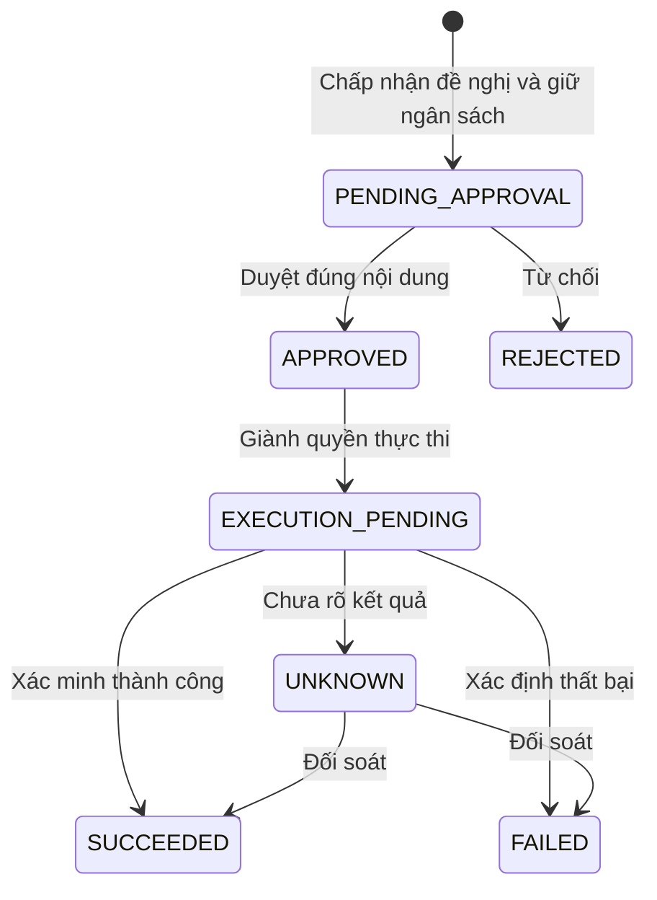
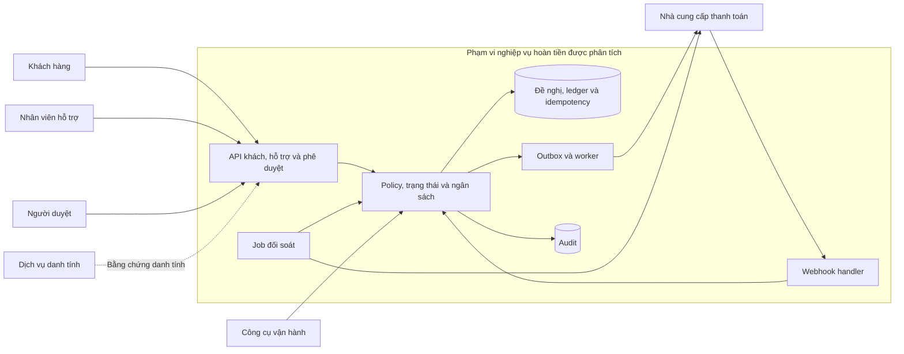

# Xác định phạm vi mô hình đe dọa nghiệp vụ

## 1. Phạm vi quyết định điều gì được phân tích

**Phạm vi mô hình đe dọa nghiệp vụ** (*business threat model scope*) xác định phần hoạt động cần phân tích: kết quả phải bảo vệ, tài sản liên quan, tác nhân, luồng xử lý, ranh giới tin cậy, khoảng thời gian và các phụ thuộc.

Một phạm vi hữu ích giúp đội dự án trả lời:

- Đang bảo vệ quyết định và tài sản nào?
- Ai có thể tác động đến chúng, qua những đường vào nào?
- Quy tắc nào phải được giữ khi có sửa dữ liệu, bỏ bước, lặp yêu cầu hoặc cạnh tranh?
- Phần nào được phân tích trực tiếp, phần nào dựa vào một hợp đồng hoặc giả định cần kiểm chứng?
- Kết luận của mô hình áp dụng đến đâu và khi nào cần cập nhật?

Câu “mô hình đe dọa cho service thanh toán” thường chưa đủ rõ. Nó có thể bỏ sót API hỗ trợ, webhook, job đối soát hoặc công cụ gửi lại lệnh, dù các đường đó cùng làm thay đổi một khoản tiền.

Ngược lại, “phân tích toàn bộ mọi rủi ro của doanh nghiệp” có thể quá rộng để tạo ra quyết định thiết kế và kiểm thử cụ thể. Cần chọn một phần đủ quản lý được nhưng vẫn bao quát những đường có thể phá vỡ quy tắc của phần đó.

Bài học thuộc chương **Threat Modeling** của module **SECURITY_APPLICATION_SECURITY_BUSINESS_LOGIC_SECURITY**. Trọng tâm là xây dựng phạm vi để sau đó phân tích đúng business invariants, state machine, quyền theo đối tượng, transaction và idempotency.

## 2. Vai trò của phạm vi trong threat modeling

### 2.1. Phạm vi là nền tảng, chưa phải toàn bộ mô hình

Một quá trình threat modeling thường cần làm rõ hệ thống đang xét, điều có thể sai, cách xử lý và cách đánh giá kết quả. [Threat Modeling Manifesto](https://www.threatmodelingmanifesto.org/) trình bày bốn câu hỏi này cùng định hướng phân tích lặp theo các phần có thể quản lý.

Phạm vi chủ yếu giúp thiết lập một cách hiểu chung về **đối tượng đang được phân tích**. Sau đó đội dự án mới xác định đe dọa, chọn phản ứng và kiểm chứng biện pháp.

Một tài liệu phạm vi chưa đủ để kết luận hệ thống an toàn. Một danh sách đe dọa cũng chưa chứng minh các biện pháp đã được triển khai hoặc hoạt động đúng.

### 2.2. Phân biệt các khái niệm

| Khái niệm | Câu hỏi được trả lời | Ví dụ |
|---|---|---|
| Phạm vi mô hình | Chúng ta phân tích phần nào và với giả định nào? | Luồng hoàn tiền từ tiếp nhận đến đối soát |
| Ranh giới tin cậy | Dữ liệu hoặc quyền thay đổi mức tin cậy ở đâu? | Webhook từ nhà cung cấp đi vào ứng dụng |
| Ranh giới transaction | Những thay đổi nào cùng commit hoặc rollback? | Giữ ngân sách và tạo đề nghị trong một database |
| Phạm vi sở hữu của nhóm | Nhóm nào vận hành hoặc sửa thành phần nào? | Nhóm đơn hàng không sở hữu cổng thanh toán |
| Phạm vi kiểm thử | Lần kiểm tra này thực hiện ở đâu và kiểm chứng điều gì? | Kiểm thử consumer với thông điệp lặp trong môi trường thử nghiệm |

Các khái niệm có liên hệ nhưng không đồng nhất. Không sở hữu code của nhà cung cấp không có nghĩa được bỏ qua giao diện tích hợp. Một transaction cục bộ cũng không bao trùm khoản tiền đã chuyển ở hệ thống ngoài.

### 2.3. Bắt đầu từ kết quả kinh doanh

Đối với bảo mật logic nghiệp vụ, hãy viết mục tiêu có thể bị phá vỡ:

> Chỉ hoàn đúng số tiền được phép, cho đúng giao dịch, sau quyết định có thẩm quyền; retry không làm phát sinh thêm khoản hoàn và kết quả chưa rõ phải được làm rõ.

Mục tiêu này cho thấy cần xét quyền, số tiền, phê duyệt, đích hoàn, tính lặp và vòng đời kết quả. Chỉ liệt kê controller, database và message broker sẽ chưa bộc lộ đủ những yêu cầu đó.

OWASP khuyến khích phân tích từ quy trình nghiệp vụ và viết các bất biến cần bảo vệ, bên cạnh góc nhìn kỹ thuật. Xem [OWASP Business Logic Security Cheat Sheet](https://cheatsheetseries.owasp.org/cheatsheets/Business_Logic_Security_Cheat_Sheet.html#threat-model-from-the-business-process).

## 3. Những chiều cần có trong phạm vi

| Chiều phạm vi | Nội dung cần làm rõ |
|---|---|
| Mục tiêu | Kết quả đúng và hậu quả cần ngăn |
| Tài sản | Tiền, hàng, quyền, dữ liệu, hạn mức hoặc năng lực xử lý |
| Quy tắc | Điều kiện trước/sau, bất biến và điều kiện chuyển trạng thái |
| Tác nhân | Người dùng, nhân viên, quản trị, dịch vụ và bên ngoài |
| Năng lực tác động | Sửa tham số, gọi lại, đổi thứ tự, gửi đồng thời hoặc dùng quyền hợp lệ sai mục đích |
| Vòng đời | Bắt đầu, kết thúc, trạng thái chờ và phục hồi |
| Đường vào/ra | API, UI, webhook, queue, batch, job và công cụ vận hành |
| Dữ liệu có thẩm quyền | Nguồn của giá trị, quyền, chủ sở hữu và bằng chứng kết quả |
| Ranh giới tin cậy | Điểm phải kiểm chứng danh tính, dữ liệu hoặc quyền |
| Môi trường và biến thể | Phiên bản đang xét, kênh truy cập, cấu hình, tenant và nhà cung cấp |
| Phụ thuộc/giả định | Điều dựa vào bên khác và cách xác nhận |
| Trách nhiệm | Người quyết định nghiệp vụ, người xử lý kỹ thuật, người xác nhận bằng chứng |
| Tiêu chí hoàn thành | Điều kiện đủ để bắt đầu phân tích và cách đánh giá độ bao phủ |

Không nhất thiết tạo một tài liệu dài cho mọi thay đổi. Mức chi tiết cần đủ để các bên hiểu cùng một hành vi và không vô tình đưa một đường tác động quan trọng ra ngoài.

## 4. Ví dụ xuyên suốt: hoàn tiền theo đơn đã thu

### 4.1. Mô hình minh họa

Xét một ứng dụng thương mại có luồng hoàn tiền:

- Khách có quyền trên đơn hoặc nhân viên hỗ trợ được cấp phạm vi có thể tạo đề nghị.
- Một người có thẩm quyền khác phải phê duyệt.
- Tiền hoàn về tham chiếu thanh toán gốc.
- Cho phép nhiều khoản hoàn từng phần nhưng tổng không vượt phần được phép hoàn.
- Khi chấp nhận đề nghị, hệ thống giữ ngân sách hoàn tương ứng.
- Worker gửi lệnh đến nhà cung cấp.
- Webhook và job đối soát cập nhật kết quả.

Trong ví dụ, đơn và khoản hoàn dùng VND, không có quy đổi ngoại tệ. Công thức tiền dưới đây dùng mô hình đơn giản chưa có chargeback hoặc bút toán điều chỉnh phức tạp.

Đây là kiến trúc và chính sách giả định để học cách xác định phạm vi, không phải mô tả một hệ thống đã được kiểm tra thực tế.

### 4.2. Mục tiêu và tài sản

| Tài sản | Giá trị cần bảo vệ | Hậu quả nếu sai |
|---|---|---|
| Phần tiền được phép hoàn | Không trả vượt hoặc trả nhầm | Tổn thất tiền và nghĩa vụ đối soát |
| Ngân sách đang giữ | Không chiếm trùng hoặc bị kẹt vô thời hạn | Hoàn vượt hoặc cản trở yêu cầu hợp lệ |
| Quyết định phê duyệt | Đúng người, nội dung và phiên bản | Thực thi lệnh chưa được chấp thuận |
| Quyền trên đơn | Đúng khách và tenant | Lộ dữ liệu hoặc thao tác trên tài sản người khác |
| Định danh thực thi | Cùng nghiệp vụ không được chạy thêm | Hoàn tiền trùng |
| Hồ sơ kết quả | Phản ánh đúng điều đã biết | Hiển thị sai, xử lý bù sai hoặc che giấu chênh lệch |

### 4.3. Các bất biến xác định phạm vi cần bao phủ

- **INV-01 — Đúng đối tượng:** người gọi chỉ đọc hoặc tác động đơn trong phạm vi quyền tương ứng.
- **INV-02 — Giới hạn tiền:** tiền hoàn thành công cộng ngân sách còn giữ không vượt số tiền được phép hoàn của đơn.
- **INV-03 — Phê duyệt hợp lệ:** chỉ thực thi nội dung đã được duyệt đúng thẩm quyền và đúng phiên bản.
- **INV-04 — Tách trách nhiệm:** người tạo không tự phê duyệt trong chính sách minh họa.
- **INV-05 — Không thực thi lặp:** một quyết định thực thi có định danh ổn định không tạo thêm khoản hoàn khi được xử lý lại.
- **INV-06 — Kết quả có căn cứ:** chỉ ghi thành công khi bằng chứng khớp giao dịch, bên nhận, số tiền, tiền tệ và trạng thái được chấp nhận.
- **INV-07 — Không mất khả năng phục hồi:** trạng thái chưa rõ và ngân sách liên quan còn được tìm, đối soát và xử lý theo chính sách.

Trong mô hình số lượng tiền đơn giản:

```text
refundAvailable = refundableBase - refundedSucceeded - refundReserved

refundedSucceeded >= 0
refundReserved >= 0
refundAvailable >= 0
```

Phải xác định trạng thái nào đóng góp vào `refundReserved`. Không được quên các khoản đang chờ duyệt, chờ thực thi hoặc chưa rõ kết quả nếu chúng vẫn chiếm ngân sách.

Nếu mô hình thực tế có chargeback, ví tiền, tín dụng khuyến mãi hoặc tiền tệ khác, cần định nghĩa lại sổ lượng và phạm vi; không áp dụng nguyên công thức này mà bỏ qua các nghĩa vụ liên quan.

## 5. Chọn điểm bắt đầu, điểm kết thúc và các nhánh

### 5.1. Phạm vi theo thời gian nghiệp vụ

**Điểm bắt đầu:** hệ thống tiếp nhận ý định hoàn đối với một đơn đã có dữ liệu thu tiền, trước khi chấp nhận người gọi có quyền và trước khi giữ ngân sách.

**Điểm kết thúc của một nhánh:** đề nghị bị từ chối/hủy hợp lệ hoặc có kết quả thực thi đã được xác định, kèm xử lý ngân sách và hồ sơ tương ứng.

**Nhánh chưa rõ:** khoản hoàn đang `UNKNOWN` không được coi là đã hoàn thành về mặt nghiệp vụ. Phạm vi phải bao gồm quy trình làm rõ, trách nhiệm và bằng chứng để kết thúc nó.

Không kết thúc phạm vi tại HTTP 200, lúc đưa message vào queue hoặc lúc nhà cung cấp chỉ báo “đã tiếp nhận”. Những thời điểm đó có thể mới là bước trung gian.

### 5.2. Những nhánh cần có trong ví dụ

| Nhánh | Lý do phải xem xét |
|---|---|
| Tạo đề nghị hợp lệ | Xác lập quyền, số tiền và ngân sách |
| Từ chối hoặc hủy | Trả ngân sách một lần và không thực thi về sau |
| Phê duyệt | Gắn thẩm quyền với nội dung cụ thể |
| Sửa nội dung | Tránh dùng phê duyệt cũ cho số tiền/đích mới |
| Thực thi thành công | Cập nhật sổ lượng và bằng chứng |
| Thất bại xác định | Xử lý ngân sách theo chính sách, tránh hồi sinh lệnh cũ |
| Timeout hoặc mất response | Phân biệt chưa biết với chưa thực hiện |
| Webhook trùng/đến muộn | Ngăn cập nhật và tác dụng phụ lặp |
| Đối soát | Làm rõ chênh lệch với hệ thống ngoài |
| Can thiệp vận hành | Ngăn công cụ sửa trạng thái bỏ qua quy tắc |

### 5.3. Khung trạng thái phục vụ việc chốt phạm vi



Sơ đồ lược giản, chưa biểu diễn mọi nhánh hủy và hết hạn. Nó giúp đặt câu hỏi về phạm vi: ai đổi từng trạng thái, căn cứ ở đâu, ngân sách thay đổi thế nào và đường nào có thể bỏ qua bước.

Một sơ đồ chỉ có luồng thành công thường che mất nơi retry, giải phóng ngân sách và tác vụ vận hành có thể phá vỡ bất biến.

## 6. Xác định tác nhân và năng lực tác động

### 6.1. Không chỉ mô hình hóa người dùng “xấu” từ bên ngoài

| Tác nhân | Quyền hoặc khả năng cần xét | Mục tiêu lạm dụng hoặc lỗi liên quan |
|---|---|---|
| Khách hợp lệ | Gửi đề nghị cho đơn trong phạm vi của mình | Đòi vượt tiền, gửi nhiều đề nghị cạnh tranh hoặc đổi đối tượng |
| Người không có quyền | Gọi trực tiếp endpoint, sửa ID và tham số | Đọc dữ liệu hoặc tạo tác vụ cho đơn khác |
| Nhân viên hỗ trợ | Tác động thay khách theo grant/chính sách | Dùng quyền quá phạm vi hoặc bỏ căn cứ yêu cầu |
| Người duyệt | Chấp thuận trong hạn mức | Tự duyệt, duyệt sai nội dung hoặc dùng thẩm quyền sai đối tượng |
| Quản trị/vận hành | Replay, sửa cấu hình, xử lý ngoại lệ | Thực thi lại hoặc làm mất dấu vết |
| Worker/dịch vụ | Nhận message và gọi cổng thanh toán | Dùng quyền dịch vụ cho nội dung chưa được chấp nhận |
| Nhà cung cấp | Tiếp nhận lệnh, trả response và sự kiện | Kết quả chậm, lặp, sai thứ tự hoặc không khớp nghiệp vụ |

Một người dùng hợp lệ có thể cố tình tận dụng chức năng đúng định dạng. Một lỗi mạng bình thường cũng có thể gây retry giống hành vi phát lại. Cả hai đều liên quan nếu có thể phá vỡ cùng bất biến.

Cần nêu mức năng lực đang xét. Ví dụ, mô hình có thể xét người nắm credential hỗ trợ còn hiệu lực, nhưng không phân tích chi tiết cách xâm nhập nhà cung cấp danh tính. Điều đó không làm quyền hỗ trợ trở thành không cần giới hạn.

### 6.2. Phân biệt năng lực với kết quả giả định

“Kẻ tấn công sửa được `amountVnd` trong request” là một năng lực thường có ở phía client. “Kẻ tấn công sửa được ledger trực tiếp” là một giả định mạnh hơn nhiều.

Nếu trộn hai mức này mà không ghi rõ, đội dự án có thể:

- Bỏ qua lạm dụng đơn giản vì quá tập trung vào chiếm toàn bộ database.
- Kết luận không thể phòng vệ vì đã giả định bên tấn công kiểm soát mọi thành phần.
- Coi nhân viên nội bộ là hoàn toàn đáng tin và bỏ qua quyền theo đối tượng.

Hãy viết năng lực đủ cụ thể để dựng được chuỗi hành vi và đánh giá biện pháp.

## 7. Bao phủ đường vào, đường ra và ranh giới tin cậy

### 7.1. Bảng đường vào cho ví dụ

| ID | Đường vào | Quyết định hoặc tài sản bị tác động |
|---|---|---|
| EP-01 | API khách tạo/xem/hủy đề nghị | Quyền trên đơn, số tiền và ngân sách |
| EP-02 | API hỗ trợ tạo đề nghị thay khách | Grant, khách đích và actual actor |
| EP-03 | API phê duyệt | Thẩm quyền, nội dung và tách trách nhiệm |
| EP-04 | Webhook thanh toán | Bằng chứng kết quả và trạng thái |
| EP-05 | Consumer thực thi hoàn | Quyết định đã duyệt và chống tác dụng phụ lặp |
| EP-06 | Job đối soát | Kết luận cho khoản chưa rõ, sửa chênh lệch có căn cứ |
| EP-07 | Công cụ vận hành gửi lại/xử lý ngoại lệ | Định danh thực thi, trạng thái và audit |

Danh sách này mô tả mô hình minh họa. Khi áp dụng vào dự án, cần đối chiếu route, consumer, lịch chạy và công cụ thực tế; không mặc định tên service đã đại diện đủ mọi đường.

API cũ, kênh di động hoặc script nội bộ nếu còn thay đổi cùng dữ liệu phải được đưa vào hoặc ghi rõ quan hệ với mô hình khác. Nhãn “deprecated” không tự làm một route ngừng tác động.

Đường ra cũng quan trọng: lệnh đến nhà cung cấp, sự kiện đến hệ thống kế toán và dữ liệu gửi sang audit có thể tạo tác dụng phụ hoặc nghĩa vụ tiếp theo.

### 7.2. Sơ đồ phạm vi và phụ thuộc



Khung lớn biểu diễn phạm vi phân tích, không khẳng định mọi thành phần bên trong có cùng mức tin cậy hay cùng transaction. Đây là sơ đồ logic lược giản, không phải mô tả đầy đủ mọi kết nối triển khai.

Dịch vụ danh tính và nhà cung cấp nằm ngoài phần triển khai được phân tích chi tiết, nhưng dữ liệu và quyền đi qua giao diện với chúng vẫn thuộc câu hỏi của mô hình.

OWASP mô tả việc dùng sơ đồ hoặc biểu diễn tương đương để làm rõ luồng dữ liệu, kho dữ liệu, tác nhân và ranh giới tin cậy. Xem [OWASP Threat Modeling Cheat Sheet, phần System Modeling](https://cheatsheetseries.owasp.org/cheatsheets/Threat_Modeling_Cheat_Sheet.html#system-modeling).

### 7.3. Những ranh giới cần kiểm tra trong ví dụ

| Ranh giới | Điều cần kiểm chứng |
|---|---|
| Client → API | Danh tính, quyền trên đối tượng; dữ liệu client chỉ là đề xuất |
| Hỗ trợ → tài nguyên khách | Actual actor, grant, tenant, đối tượng và hành động |
| Dịch vụ danh tính → ứng dụng | Bằng chứng được phát hành và chấp nhận cho đúng mục đích |
| Producer → consumer | Nguồn message, ngữ cảnh quyền và quan hệ với hồ sơ đã chấp nhận |
| Ứng dụng → nhà cung cấp | Đúng giao dịch, số tiền, tiền tệ, định danh thực thi |
| Nhà cung cấp → webhook | Nguồn thông báo, chống lặp và đối chiếu ngữ nghĩa |
| Công cụ vận hành → dữ liệu nghiệp vụ | Quyền ngoại lệ, điều kiện trạng thái và dấu vết |

Một ranh giới tin cậy không nhất thiết trùng một hop mạng. Nó xuất hiện khi thay đổi căn cứ tin cậy hoặc quyền có thể sử dụng. Ngược lại, không phải mọi lần gọi giữa hai class đều tạo một miền tin cậy mới.

### 7.4. Thời gian và cạnh tranh là một chiều khác cần bao phủ

Sơ đồ luồng dữ liệu không tự thể hiện hai request cùng đọc ngân sách cũ. Bổ sung tình huống theo thời gian:

```text
Khoản tiền còn được hoàn: 1.000.000 VND.

A: kiểm tra còn đủ để hoàn 1.000.000.
B: kiểm tra còn đủ để hoàn 1.000.000.
A và B: cùng chấp nhận đề nghị nếu không có điều phối phù hợp.
```

Phạm vi phải gồm việc chấp nhận và giữ ngân sách dưới cạnh tranh, không chỉ kiểm tra kiểu dữ liệu của số tiền.

Tương tự, cần xét quyền bị thu hồi giữa lúc đọc và ghi, nội dung thay đổi sau duyệt, worker chạy lại sau restart và response mất sau tác dụng phụ. Đây là những chiều nhất quán và vòng đời; không nên chỉ gọi chung chúng là “lỗi mạng” rồi đưa ra ngoài.

## 8. Quyết định phần trong và ngoài phạm vi

### 8.1. Bảng quyết định phải có lý do

| Hạng mục | Xử lý trong ví dụ | Lý do và nghĩa vụ còn lại |
|---|---|---|
| Quyền trên đơn, grant hỗ trợ | Phân tích trực tiếp | Quyết định ai được tác động tiền |
| Giữ/giải phóng ngân sách hoàn | Phân tích trực tiếp | Bảo vệ tổng tiền khi cạnh tranh hoặc xử lý lặp |
| Phê duyệt và nội dung thực thi | Phân tích trực tiếp | Chặn bỏ bước và sửa nội dung sau duyệt |
| Retry, webhook và đối soát | Phân tích trực tiếp | Kết quả cuối phụ thuộc các đường này |
| UI xác nhận | Xét ý nghĩa và dữ liệu hiển thị | Backend vẫn phải kiểm tra; không coi UI là hàng rào duy nhất |
| Giao thức đăng nhập nội bộ của IdP | Không phân tích sâu ở mô hình này | Phải có hợp đồng bằng chứng danh tính và kiểm tra tại ứng dụng |
| Nội bộ cổng thanh toán | Không phân tích triển khai nội bộ | Vẫn phân tích hợp đồng API, idempotency và xác minh kết quả |
| Luồng thu tiền gốc | Mô hình phụ thuộc | Xét nguồn ledger, quyền sở hữu và ý nghĩa số tiền đầu vào |
| Quy trình kiểm định hàng vật lý | Ngoài phần triển khai của ví dụ | Nếu là điều kiện hoàn, phải xác định nguồn trạng thái đủ điều kiện |
| Tính lương hoặc nghiệp vụ không dùng tài sản này | Ngoài phạm vi | Không nằm trong mục tiêu và chuỗi quyết định đã chọn |

“Không phân tích sâu” không có nghĩa “không có rủi ro” hoặc “bên đó hoàn toàn đúng”. Nó có nghĩa mô hình này xử lý giao diện và giả định, còn phần nội bộ có trách nhiệm đánh giá riêng.

### 8.2. Đặt ngoài phạm vi không tương đương chấp nhận rủi ro

Có bốn quyết định khác nhau:

- Một phần không liên quan đến mục tiêu đã chọn.
- Một phần liên quan nhưng được đánh giá trong mô hình khác.
- Một giả định cần kiểm chứng trước khi kết luận.
- Một rủi ro đã được người có thẩm quyền quyết định chấp nhận.

Không được ghi “ngoài phạm vi” để thay thế quyết định chấp nhận rủi ro mà chưa xác định tác động và người chịu trách nhiệm.

Ví dụ, bỏ job đối soát vì nhóm hiện tại không sở hữu nó sẽ làm thiếu INV-07. Cách phù hợp là phân tích hợp đồng và trách nhiệm liên nhóm, hoặc mở một phần đánh giá liên quan.

### 8.3. Không cắt ngang một bất biến

Nếu bất biến nói “cùng một quyết định không hoàn tiền hai lần”, phạm vi phải xem được các đường có thể gửi lệnh: worker chính, retry, replay thủ công và đường gọi khác nếu có.

Có thể phân tích mỗi đường ở các phần khác nhau, nhưng phải có điểm nối và người kiểm chứng quy tắc chung. Không thể chỉ đánh giá worker chính rồi kết luận cho toàn bộ nghiệp vụ.

## 9. Quản lý giả định và câu hỏi chưa được xác nhận

### 9.1. Viết giả định thành mệnh đề có thể kiểm chứng

| ID | Giả định hoặc câu hỏi | Cách xác nhận cần có | Hậu quả nếu sai |
|---|---|---|---|
| ASM-01 | Ledger đầu vào phản ánh số tiền đã thu theo đúng đơn/tenant | Hợp đồng dữ liệu và bằng chứng kiểm tra quan hệ | Tính sai nền tiền được phép hoàn |
| ASM-02 | Nhà cung cấp hỗ trợ chống trùng trong phạm vi và thời gian phù hợp | Tài liệu tích hợp và kiểm thử hành vi | Retry có thể tạo khoản hoàn mới |
| ASM-03 | Danh tính và scope hỗ trợ được kiểm chứng phía server | Thiết kế xác thực/phân quyền và kiểm thử | Khách hoặc tenant sai bị tác động |
| ASM-04 | Mọi đường giữ ngân sách dùng cùng cơ chế nhất quán | Đối chiếu đường ghi và kiểm thử cạnh tranh | Tổng đề nghị vượt phần tiền được phép |
| ASM-05 | Có chủ thể xử lý các khoản UNKNOWN | Quy trình, dữ liệu truy xuất và bằng chứng vận hành | Tiền/ngân sách kẹt hoặc bị xử lý hai lần |
| Q-01 | Có API cũ hoặc công cụ nào còn ghi cùng dữ liệu không? | Danh mục triển khai và người phụ trách xác nhận | Bỏ sót đường vượt kiểm soát |

Các dòng này là ví dụ về điều phải xác nhận, không phải bằng chứng chúng đã đúng trong một hệ thống thực tế.

Mỗi mục nên có người phụ trách, trạng thái và điều kiện cần hoàn tất. Đừng chuyển một câu hỏi thành “giả định đúng” chỉ để đóng tài liệu.

### 9.2. Tách sự thật, giả thuyết và đề xuất

| Loại thông tin | Cách diễn đạt |
|---|---|
| Hành vi đã có bằng chứng | “Đường X hiện giữ ngân sách và tạo đề nghị trong cùng transaction theo bằng chứng Y.” |
| Giả định cần xác nhận | “Mô hình dựa vào điều kiện Z; chưa đủ bằng chứng.” |
| Kịch bản đe dọa | “Nếu hai đường cùng dùng snapshot cũ, có thể giữ vượt ngân sách.” |
| Biện pháp dự kiến | “Sẽ dùng cập nhật có điều kiện hoặc điều phối tương đương tại điểm chấp nhận.” |
| Biện pháp đã kiểm chứng | “Kiểm thử T đã quan sát bất biến được giữ trong điều kiện đã mô tả.” |

Một kịch bản hợp lý chưa tự là phát hiện lỗi đã xác nhận. Một dòng “dùng transaction” cũng chưa chứng minh đã xử lý đúng các dòng dữ liệu hoặc mức cô lập cần thiết.

## 10. Một bản phạm vi mẫu có thể dùng để bắt đầu

Bản sau tổng hợp mô hình hoàn tiền đã mô tả. Các mã và vai trò là minh họa; chúng không đại diện cho một lần đánh giá đã hoàn tất.

| Trường | Nội dung mẫu |
|---|---|
| Mã và phiên bản | `TM-REFUND-EXAMPLE/v1` |
| Quyết định cần hỗ trợ | Thiết kế và kiểm chứng việc hoàn từng phần mà không vượt tiền, sai quyền hoặc thực thi lặp |
| Luồng | Tiếp nhận đề nghị → giữ ngân sách → duyệt → thực thi → kết quả/đối soát |
| Phạm vi thời gian | Từ trước khi chấp nhận quyền và nội dung đến khi kết quả được giải quyết cùng ngân sách; bao gồm nhánh chưa rõ |
| Tài sản | Tiền được phép hoàn, ngân sách giữ, quyết định duyệt, quyền trên đơn và bằng chứng kết quả |
| Tác nhân | Khách, người ngoài quyền, support, người duyệt, vận hành, worker và nhà cung cấp |
| Đường vào | EP-01 đến EP-07; phải xác nhận thêm kênh cũ hoặc đường ghi khác trong hệ thống thực tế |
| Quy tắc | INV-01 đến INV-07 của bài |
| Phần phân tích trực tiếp | Quyền đối tượng, grant, chuyển trạng thái, ngân sách, định danh lệnh và xử lý sự kiện |
| Phụ thuộc | Danh tính, ledger thu tiền, hợp đồng nhà cung cấp và điều kiện được hoàn |
| Ngoài phần triển khai chi tiết | Nội bộ IdP, nội bộ cổng thanh toán, kiểm định vật lý và nghiệp vụ không liên quan |
| Biến thể đang giả định | VND, hoàn từng phần, phê duyệt độc lập, không có FX hoặc chargeback trong công thức minh họa |
| Câu hỏi mở | ASM-01 đến ASM-05, Q-01; trạng thái cần được cập nhật theo bằng chứng |
| Trách nhiệm | Chủ nghiệp vụ, backend, tích hợp thanh toán, hỗ trợ, kiểm thử và vận hành xác nhận phần tương ứng |
| Kết quả cần tạo tiếp | Kịch bản đe dọa, quyết định xử lý, bằng chứng thiết kế/kiểm thử và các rủi ro còn lại |

Một bản phạm vi cũng nên ghi ngày, baseline thiết kế và người tham gia khi áp dụng thực tế. “Baseline” cần nhận diện được chính sách và hợp đồng đang xét, không chỉ tên ứng dụng.

Có thể giữ mô hình tổng quan và tách các phần sâu cho ngân sách, quyền hỗ trợ hoặc tích hợp thanh toán. Mỗi phần cần dẫn lại cùng tài sản, bất biến và giao diện để tránh mất tính liên kết.

## 11. Nối phạm vi với đe dọa, biện pháp và kiểm chứng

### 11.1. Bảng truy vết khởi đầu

Bảng dưới đây là các hướng phân tích và kiểm chứng dự kiến của ví dụ, chưa khẳng định có lỗi hay kiểm thử đã chạy trong một dự án.

| Kịch bản | Phần phạm vi và bất biến | Hướng kiểm soát cần đánh giá | Bằng chứng cần tìm |
|---|---|---|---|
| TH-01: đổi ID sang đơn người khác | EP-01/02, INV-01 | Quyền theo đối tượng và tenant tại use case/đường dữ liệu | Yêu cầu sai phạm vi không đọc hoặc thay đổi đối tượng |
| TH-02: sửa số tiền sau duyệt | EP-03/05, INV-03 | Gắn phê duyệt với phiên bản nội dung và kiểm tra trước thực thi | Nội dung mới không sử dụng quyết định cũ |
| TH-03: hai đề nghị cùng chiếm phần tiền cuối | EP-01/02, INV-02 | Giữ ngân sách nguyên tử trên đúng phạm vi | Tổng ngân sách chấp nhận không vượt phần được phép |
| TH-04: retry hoặc replay thành khoản hoàn mới | EP-05/07, INV-05 | Định danh thực thi ổn định, idempotency và trạng thái | Nhiều lần gọi kỹ thuật vẫn tương ứng một tác dụng nghiệp vụ |
| TH-05: webhook không khớp được nhận là thành công | EP-04, INV-06 | Xác minh nguồn và đối chiếu giao dịch, tiền, bên nhận | Không chuyển thành công từ bằng chứng sai ngữ nghĩa |
| TH-06: giữ ngân sách rồi không tiến triển | EP-01/02/06, INV-07 | Hạn mức, vòng đời đề nghị và quy trình xử lý chờ | Phần giữ được tìm và xử lý đúng, không giải phóng khoản chưa rõ tùy ý |
| TH-07: support dùng grant cho khách khác | EP-02, INV-01/04 | Phạm vi grant và nguồn danh tính nhân viên | Sai khách/đơn bị chặn, audit giữ actual actor |
| TH-08: công cụ vận hành bỏ điều kiện | EP-07, INV-03/05/06 | Quyền ngoại lệ, state machine và dấu vết | Replay/sửa trạng thái không âm thầm bỏ bất biến |

Bảng này giúp phát hiện thiếu phạm vi. Nếu TH-04 không thể đánh giá vì “không xét công cụ vận hành”, cần xem lại điểm cắt. Nếu TH-06 chỉ kết thúc tại request HTTP, phải bổ sung vòng đời xử lý chờ.

Một bất biến có thể được bảo vệ bởi nhiều cơ chế. Một cơ chế cũng có thể phục vụ nhiều bất biến; không cần ép quan hệ một–một.

### 11.2. Viết một chuỗi hành vi thay vì chỉ tên loại lỗi

Ví dụ TH-04:

```text
Mục tiêu:
- Làm một quyết định hoàn 1.000.000 VND được thực thi hai lần.

Điều kiện đang xét:
- Đơn có nền tiền đủ lớn để hai khoản đều chưa vượt tổng.
- Quyết định R đã được duyệt cho một lần thực thi.

Chuỗi có thể xảy ra:
1. Worker gửi R và nhà cung cấp thực hiện.
2. Response bị mất; trạng thái cục bộ chưa được làm rõ.
3. Người vận hành replay với một định danh nhà cung cấp mới.
4. Nhà cung cấp coi đó là yêu cầu khác và hoàn thêm.

Bất biến bị đe dọa:
- INV-05, kể cả tổng tiền vẫn chưa vượt nền tiền của đơn.

Phần cần có trong phạm vi:
- Worker, kết quả chưa rõ, công cụ replay và hợp đồng chống trùng.
```

Giới hạn tổng tiền chưa đủ để chặn thực thi hai lần cùng một quyết định. Phạm vi cần giữ cả ngữ nghĩa của quyết định lẫn sổ lượng tổng.

### 11.3. Tiêu chí kiểm chứng phải quan sát tác dụng nghiệp vụ

Ví dụ cho TH-03:

```text
Cho:
- Phần tiền còn được phép hoàn là 1.000.000 VND.
- Hai đề nghị độc lập đều yêu cầu 800.000 VND.

Khi:
- Hai đường chấp nhận thực sự chạy chồng lấn.

Cần quan sát:
- Không có cả hai đề nghị cùng giữ đủ 800.000 VND.
- Tổng tiền đã hoàn và ngân sách giữ vẫn trong giới hạn.
- Đề nghị bị từ chối không để lại phần giữ mồ côi.
```

Nếu hợp đồng không cho tự giảm số tiền đề nghị, hệ thống không được tự đổi một đề nghị thành 200.000 VND chỉ để làm phép tổng hợp lệ mà không xử lý xác nhận nội dung.

Ví dụ cho TH-04 cần quan sát số khoản hoàn logic mà nhà cung cấp chấp nhận, không chỉ số lần gọi HTTP. Retry mạng có thể tạo nhiều lần gọi nhưng vẫn chỉ một khoản hoàn nếu giao thức chống trùng được dùng đúng.

### 11.4. Phân biệt chọn phạm vi với chọn mức ưu tiên

Một đường vào có thể thuộc phạm vi nhưng được phân tích sau trong một vòng làm việc. Ghi rõ mức ưu tiên, người phụ trách và phần chưa kiểm chứng.

Không dùng “ưu tiên thấp” như từ đồng nghĩa với “không thể gây rủi ro”. Ngược lại, không cần gán một điểm số rất chính xác khi chưa có dữ liệu về giá trị tài sản, năng lực tác nhân hoặc hiệu lực kiểm soát.

Khi ưu tiên, có thể xem xét tác động nghiệp vụ, mức tiếp cận, khả năng lặp/nhân rộng, quyền cần có và mức khó phát hiện. Các tiêu chí cần phản ánh bối cảnh thay vì chỉ số lượng endpoint.

## 12. Kiểm tra phạm vi đã đủ để phân tích hay chưa

### 12.1. Những câu hỏi kiểm tra hữu ích

- Mỗi bất biến có những đường nào có thể thay đổi dữ liệu liên quan?
- Có đường quản trị, batch, consumer hoặc API cũ đang bị bỏ sót không?
- Mô hình có xét người dùng hợp lệ nhưng hành động không trung thực không?
- Mỗi giá trị quan trọng có nguồn và bên chịu trách nhiệm rõ không?
- Phạm vi có xét retry, thao tác đồng thời, hủy và kết quả đến muộn không?
- Nhánh lỗi có được theo đến khi ngân sách và nghĩa vụ được xử lý không?
- Mỗi phần ngoài phạm vi có lý do, hợp đồng hoặc mô hình liên quan không?
- Giả định nào chưa có bằng chứng và ai sẽ làm rõ?
- Có thể viết phép kiểm chứng cho kết quả nghiệp vụ cần bảo vệ không?
- Kết luận dự kiến có vượt quá biến thể và môi trường đã mô tả không?

Các câu hỏi này đánh giá chất lượng của việc xác định phạm vi. Chúng không chứng minh hệ thống đã vượt mọi kiểm thử hoặc không còn đe dọa.

### 12.2. Người tham gia giúp phát hiện điểm cắt sai

| Vai trò | Điều cần làm rõ trong ví dụ |
|---|---|
| Chủ nghiệp vụ/sản phẩm | Đủ điều kiện hoàn, giới hạn, tách trách nhiệm và hậu quả cần ngăn |
| Backend Java | Đường vào use case, nơi thực thi policy, transaction và ràng buộc |
| Tích hợp thanh toán | Ngữ nghĩa response/webhook, định danh và cửa sổ chống trùng |
| Hỗ trợ | Cách xử lý thay khách, căn cứ grant và đường ngoại lệ |
| Kiểm thử | Oracle, dữ liệu quan sát, cách tạo cạnh tranh và lỗi giữa chừng |
| Vận hành | Replay, đối soát, phục hồi và tác vụ thực tế ngoài UI |
| Bảo mật | Thách thức giả định, ranh giới quyền và cách lạm dụng chuỗi thao tác |

Trong một nhóm nhỏ, một người có thể giữ nhiều vai trò. Điều quan trọng là các góc nhìn và trách nhiệm được đại diện, không phải số người tham gia.

### 12.3. Khi ánh xạ sang ứng dụng Java

Một luồng có thể đi qua controller, application service, domain policy, repository, consumer, scheduler và gateway. Phạm vi cần theo quyết định nghiệp vụ qua các thành phần đó.

Không nhất thiết một service triển khai tương ứng đúng một phần của mô hình. Một monolith vẫn có nhiều tác nhân và ranh giới quyền; một luồng microservice vẫn có thể được phân tích như một quy trình nghiệp vụ có nhiều ranh giới transaction.

Tài liệu phạm vi nên giúp người triển khai chỉ ra nơi kiểm tra quyền, nơi giành ngân sách, nơi chuyển trạng thái và nơi tạo tác dụng phụ. Nó chưa thay thế thiết kế chi tiết của từng cơ chế.

## 13. Khi nào cần mở lại phạm vi?

| Thay đổi | Vì sao cần xem lại |
|---|---|
| Thêm kênh khách chưa đăng nhập hoặc đối tác | Thay đổi bằng chứng danh tính và đường vào |
| Cho support sửa thêm trường hoặc hỗ trợ tenant khác | Thay đổi quyền đối tượng và phạm vi ủy quyền |
| Tự động duyệt một nhóm đề nghị | Thay đổi điều kiện INV-03/04 và chủ thể quyết định |
| Thêm tiền tệ, ví hoặc chargeback | Thay đổi sổ lượng, nền tiền và cách đối soát |
| Đổi nhà cung cấp hoặc chính sách idempotency | Thay đổi giả định retry và kết quả chưa rõ |
| Thêm job, consumer hoặc công cụ replay | Thêm đường gây tác dụng phụ |
| Đổi cơ chế cache/replica cho quyền hoặc số dư | Thay đổi độ mới của dữ liệu quyết định |
| Tách service hoặc database | Thay đổi ranh giới transaction và điều phối |
| Sự cố thực tế làm sai một giả định | Kết luận cũ có thể không còn áp dụng |

Thay đổi chính sách có thể hợp lệ, nhưng phải cập nhật bất biến và bằng chứng thay vì tiếp tục dùng kết luận cũ.

Theo dõi phiên bản mô hình, điều thay đổi, giả định bị ảnh hưởng và các kịch bản phải đánh giá lại. Giữ liên kết giữa phạm vi, thiết kế và kiểm chứng để biết phần nào còn có căn cứ sau thay đổi.

## 14. Những sai lầm khi chốt phạm vi

| Cách làm | Hệ quả | Cách làm rõ |
|---|---|---|
| Chỉ liệt kê tên service | Không thấy quyết định và tài sản cần bảo vệ | Viết mục tiêu, bất biến và vòng đời |
| Chỉ theo luồng UI | Bỏ sót API trực tiếp, job và công cụ | Liệt kê mọi đường đổi cùng dữ liệu/tác dụng phụ |
| Kết thúc tại lúc gửi queue | Bỏ qua lặp, timeout và kết quả cuối | Theo đến xử lý nghĩa vụ và đối soát |
| Coi nội bộ là đáng tin tuyệt đối | Bỏ qua quyền nhân viên hoặc quyền dịch vụ bị lạm dụng | Mô tả tác nhân, scope và căn cứ quyền |
| Loại phần khó vì nhóm khác sở hữu | Cắt ngang bất biến liên hệ thống | Ghi hợp đồng và trách nhiệm phối hợp |
| Coi “ngoài phạm vi” là đã chấp nhận rủi ro | Không có quyết định chịu trách nhiệm | Tách phạm vi, giả định và quyết định rủi ro |
| Chọn công cụ/phân loại trước khi hiểu luồng | Danh sách chung khó gắn với tác động | Chốt tài sản và hành vi rồi dùng kỹ thuật phù hợp |
| Coi scanner sạch là mô hình đầy đủ | Thiếu ngữ cảnh quy tắc và chuỗi hành động | Dùng kịch bản và oracle nghiệp vụ |
| Đánh dấu giả định là đúng mà chưa xác nhận | Kết luận dựa trên nền không có bằng chứng | Ghi trạng thái, người phụ trách và điều kiện xác minh |

Một phương pháp như STRIDE có thể hỗ trợ đặt câu hỏi về đe dọa sau khi hiểu hệ thống. Nhãn phân loại không tự xác định đầy đủ phạm vi nghiệp vụ hoặc thay thế bất biến.

## 15. Tài liệu tham khảo

- [OWASP Threat Modeling Cheat Sheet](https://cheatsheetseries.owasp.org/cheatsheets/Threat_Modeling_Cheat_Sheet.html) — mô hình hóa hệ thống, xác định đe dọa, phản ứng và đánh giá.
- [OWASP Threat Modeling Project](https://owasp.org/projects/threat-modeling-project) — tài nguyên về thực hành threat modeling.
- [OWASP Business Logic Security Cheat Sheet](https://cheatsheetseries.owasp.org/cheatsheets/Business_Logic_Security_Cheat_Sheet.html) — phân tích từ quy trình và bất biến nghiệp vụ.
- [Threat Modeling Manifesto](https://www.threatmodelingmanifesto.org/) — câu hỏi cốt lõi, cộng tác và việc duy trì mô hình theo thay đổi.

Luồng hoàn tiền, các mã INV/EP/ASM/TH và bản phạm vi trong bài là minh họa. Khi áp dụng, cần thay chúng bằng chính sách, kiến trúc, biến thể triển khai và bằng chứng thực tế của hệ thống.
