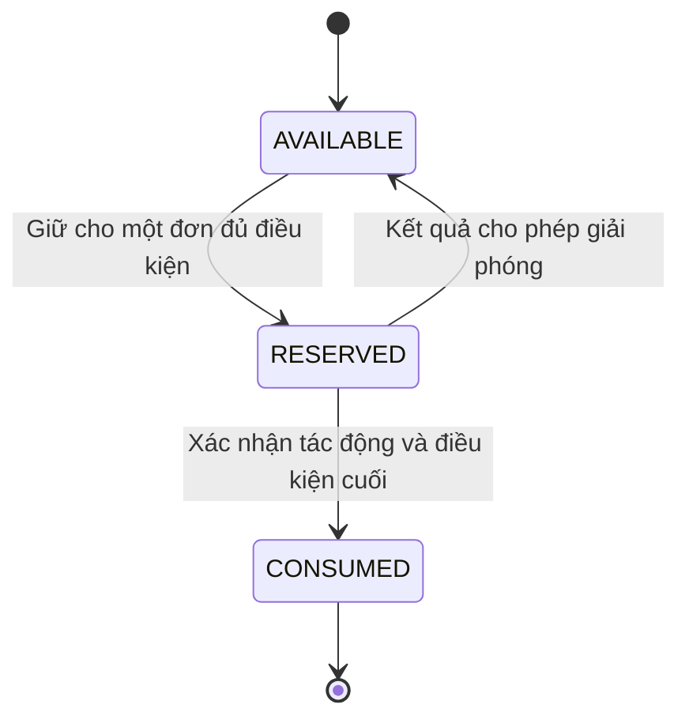
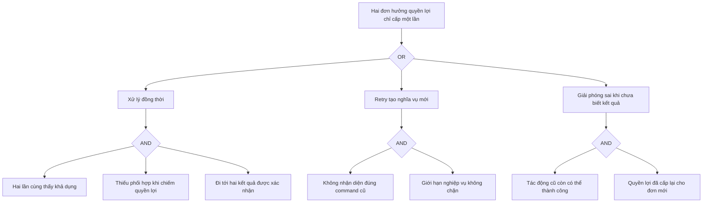

# Attacker goal analysis — Phân tích mục tiêu của kẻ tấn công

## 1. Bắt đầu từ kết quả mà hệ thống phải ngăn

Trong chương **Threat Modeling** của module **Business Logic Security** (`SECURITY_APPLICATION_SECURITY_BUSINESS_LOGIC_SECURITY`), **attacker goal analysis** là việc xác định kết quả trái quy tắc mà một chủ thể muốn tạo ra, rồi phân tích các con đường có thể dẫn tới kết quả đó.

Trong một ứng dụng nghiệp vụ, kẻ lạm dụng có thể dùng tài khoản hợp lệ và các tính năng bình thường. Điều họ muốn đạt có thể là:

- Nhận quyền lợi nhiều hơn mức được cấp.
- Xác nhận một nội dung chưa được phê duyệt.
- Chuyển tiền hoặc hàng tới đối tượng ngoài quyết định đã chấp thuận.
- Thực hiện hành động trên tài nguyên của tenant khác.
- Làm sai danh tiếng hoặc điểm tin cậy.
- Chiếm giữ tài nguyên để người khác không sử dụng được.

Những tên kỹ thuật như “race condition”, “parameter tampering” hay “replay” giúp mô tả cơ chế, nhưng chưa nói rõ tác động nghiệp vụ.

Thay vì dừng ở:

```text
Có thể có race condition ở checkout.
```

hãy đặt câu hỏi:

```text
Kẻ lạm dụng muốn kết quả nào?
Quyền và điều kiện ban đầu của họ là gì?
Nếu kết quả đó xảy ra, invariant nào bị phá?
Những nhánh nào có thể đưa tới kết quả?
Quan sát gì đủ để kết luận mục tiêu đã đạt?
```

Phân tích mục tiêu giúp lựa chọn đúng phạm vi threat model, tránh chỉ liệt kê lỗi kỹ thuật hoặc chỉ bảo vệ một endpoint trong khi đường khác vẫn dẫn tới cùng hậu quả.

## 2. Phân biệt mục tiêu, năng lực, con đường và kỹ thuật

| Khái niệm | Câu hỏi | Ví dụ |
| --- | --- | --- |
| Mục tiêu | Chủ thể muốn kết quả gì? | Nhận ưu đãi một lần trên hai đơn khác nhau |
| Tài sản | Giá trị nào bị ảnh hưởng? | Quyền lợi khuyến mãi và ngân sách chiến dịch |
| Năng lực ban đầu | Họ đang được phép làm gì? | Tạo và thanh toán đơn của chính mình |
| Điều kiện cần | Điều gì phải tồn tại để thử con đường? | Tài khoản đủ điều kiện cho chiến dịch |
| Con đường tấn công | Chuỗi hành động nào dẫn tới mục tiêu? | Tạo hai đơn rồi dùng quyền lợi đồng thời |
| Kỹ thuật | Cơ chế nào hỗ trợ con đường? | Khai thác kiểm tra và cập nhật không nguyên tử |
| Điểm yếu giả định | Hệ thống thiếu bảo đảm nào? | Không giữ chỗ quyền lợi khi chấp nhận sử dụng |
| Bằng chứng thành công | Điều gì cho thấy hậu quả thực sự xảy ra? | Hai đơn có kết quả hưởng ưu đãi đã được xác nhận |

Một mục tiêu có thể có nhiều con đường. Một kỹ thuật có thể phục vụ nhiều mục tiêu.

Ví dụ, replay có thể gây thu tiền trùng, tăng số đánh giá hoặc tạo nhiều bản ghi giữ chỗ. Cơ chế giống nhau không làm các tài sản và oracle kiểm thử trở thành một.

### 2.1. Mục tiêu không nhất thiết đòi hỏi quyền cao

Một người mua có thể không sửa được database, không có quyền quản trị và không giả mạo được người duyệt. Họ vẫn có thể gửi nhiều command được cấp quyền, thay đổi thứ tự hoặc thử lại trong các trạng thái đặc biệt.

Nên bắt đầu từ năng lực thực tế. Nếu mặc nhiên cho actor toàn quyền sửa dữ liệu, mô hình có thể bỏ qua chính ranh giới mà ứng dụng cần giữ.

### 2.2. Mục tiêu trực tiếp và mục tiêu hỗ trợ

Ví dụ:

```text
Mục tiêu trực tiếp:
    Hai đơn được hưởng quyền lợi chỉ cấp một lần.

Mục tiêu hỗ trợ:
    Làm quyền lợi trông như chưa sử dụng.
    Tạo một lần xử lý mới từ retry.
    Vượt qua bước kiểm tra điều kiện.
```

Mục tiêu hỗ trợ là một phần của con đường. Đạt nó chưa đủ chứng minh mục tiêu trực tiếp đã xảy ra.

Tương tự, nhận response “accepted” không tự chứng minh người dùng đã nhận tiền, hàng hoặc quyền lợi cuối cùng.

## 3. Liên kết mục tiêu với security objective và business invariant

### 3.1. Đi từ giá trị cần bảo vệ

Có thể dùng chuỗi:

```text
Tài sản
→ mục tiêu bảo vệ
→ bất biến
→ mục tiêu đối nghịch
→ con đường
→ bằng chứng
```

Ví dụ:

| Mức | Nội dung |
| --- | --- |
| Tài sản | Quyền sử dụng một ưu đãi của tài khoản |
| Mục tiêu bảo vệ | Chỉ cấp đúng số lần theo chính sách |
| Bất biến | Cùng tenant, chiến dịch và tài khoản có tối đa một lần tiêu dùng quyền lợi được xác nhận |
| Mục tiêu đối nghịch | Có hai đơn khác nhau cùng được xác nhận hưởng quyền lợi đó |
| Con đường giả thuyết | Hai lần sử dụng cùng vượt qua kiểm tra trước khi quyền lợi được giữ chỗ |
| Bằng chứng | Hai kết quả nghiệp vụ cùng chứng minh quyền lợi đã áp dụng, vượt giới hạn |

Nếu chính sách chưa rõ “một lần” tính theo tài khoản, người, doanh nghiệp hay phương thức thanh toán, cần làm rõ trước khi kết luận một hành vi là lạm dụng.

### 3.2. Đừng biến mục tiêu thành một khẩu hiệu quá rộng

“Lấy tiền của hệ thống” không đủ để thiết kế kiểm thử. Có thể phân rã thành:

```text
Nhận hoàn vượt số tiền được hoàn.
Được giảm giá khi không đủ điều kiện.
Chi tiền bằng quyết định cũ.
Nhận cùng một khoản chi hai lần.
Chuyển khoản tới người nhận khác với người được duyệt.
```

Mỗi mục tiêu có phạm vi, bằng chứng và cơ chế ngăn khác nhau. Phân rã giúp nhóm phát triển quyết định biện pháp cụ thể.

### 3.3. Mục tiêu có thể liên quan một lịch sử hành động

Một số mục tiêu được thể hiện bằng trạng thái cuối, chẳng hạn đơn confirmed với phê duyệt sai revision.

Những mục tiêu khác cần xem lịch sử:

```text
Đã nhận hai lần quyền lợi trong cùng chiến dịch,
dù bản ghi hiện tại chỉ còn thể hiện một lần.
```

Nếu handler ghi đè lần sử dụng cũ bằng lần mới, chỉ đọc một cột `used = true` có thể bỏ sót vi phạm. Oracle phải dựa vào dữ liệu có thể giải thích các tác động đã xảy ra.

## 4. Mô hình ví dụ: một ưu đãi cho mỗi tài khoản và chiến dịch

### 4.1. Chính sách minh họa

Giả sử tenant T1 chạy chiến dịch C1:

1. Mỗi tài khoản đủ điều kiện được hưởng giảm 100.000 VND trên một đơn đáp ứng điều kiện giá trị.
2. Giới hạn áp dụng theo bộ `(tenantId, campaignId, beneficiaryAccountId)`.
3. Trước khi tiến hành thanh toán với ưu đãi, hệ thống giữ chỗ quyền lợi cho một đơn cụ thể.
4. Khi thanh toán của đơn được xác nhận thành công và các điều kiện cuối đạt, quyền lợi được ghi nhận đã tiêu dùng.
5. Hủy trước tác động thanh toán có thể giải phóng giữ chỗ khi đã có kết quả đủ chắc chắn theo hợp đồng tích hợp.
6. Timeout không được diễn giải thành chắc chắn chưa thanh toán.
7. Trong ví dụ, quyền lợi đã tiêu dùng không tự được cấp lại chỉ vì đơn về sau được hoàn tiền.
8. Giá, số tiền giảm và điều kiện đủ được máy chủ xác định.

Ngưỡng giá trị đơn và chính sách hoàn là các phần cần được đặc tả trong hệ thống thực tế. Ở đây chúng được giữ ổn định để tập trung vào giới hạn số lần sử dụng.

### 4.2. Actor và phạm vi

Actor A:

```text
Có tài khoản B1 trong tenant T1.
Được tạo và thanh toán đơn của mình.
Đủ điều kiện dùng C1 một lần.
Được gửi request đồng thời và retry.
Không có quyền duyệt ngoại lệ, sửa campaign hoặc sửa database.
```

Mục tiêu chính không giả định A có nhiều tài khoản. Việc một người dùng nhiều danh tính là một phân tích khác nếu chính sách thực sự giới hạn theo người và có mô hình liên kết danh tính tương ứng.

Một giới hạn theo account không thể được mô tả như đã ngăn mọi trường hợp một người nhận ưu đãi qua nhiều account.

### 4.3. Mô hình quyền lợi

Một trạng thái đơn giản:



Trong RESERVED cần biết đơn nào giữ quyền lợi. Việc giải phóng phải áp dụng đúng reservation và phiên bản, tránh một thông báo cũ giải phóng một lần giữ chỗ mới.

Mô hình này không có cạnh tự động `CONSUMED → AVAILABLE` sau refund. Nếu nghiệp vụ khác cho phép cấp lại, phải thay chính sách và bất biến cho phù hợp.

### 4.4. Phát biểu mục tiêu cụ thể

```text
G:
Tồn tại hai đơn O1 và O2 khác nhau,
cùng tenant T1, campaign C1 và beneficiary B1,
mỗi đơn có kết quả hưởng ưu đãi được xác nhận,
trong khi chính sách chỉ cấp một lần cho bộ khóa đó.
```

Mục tiêu này hẹp hơn “sử dụng endpoint apply coupon hai lần”. Endpoint có thể được gọi nhiều lần hợp lệ khi báo giá hoặc retry, miễn chỉ một tác động quyền lợi cuối cùng được chấp nhận.

### 4.5. Bất biến tương ứng

```text
confirmedBenefitConsumptionCount(T, C, B) <= 1

Một reservation còn hiệu lực chỉ gắn với một đơn theo mô hình.

Một kết quả tiêu dùng quyền lợi phải gắn với:
    đúng tenant,
    đúng campaign,
    đúng beneficiary,
    đúng đơn và nội dung đủ điều kiện.
```

Count cần phản ánh các tác động nghiệp vụ được xác nhận trong lịch sử theo chính sách, không chỉ số bản ghi còn tồn tại sau một lần cập nhật hoặc xóa.

## 5. Xác định năng lực và giả định trước khi dựng con đường

### 5.1. Dùng một hồ sơ actor đủ cụ thể

| Thành phần | Actor A trong ví dụ |
| --- | --- |
| Danh tính | Tài khoản B1 đã xác thực |
| Scope | Tenant T1, đơn do B1 sở hữu |
| Quyền | Tạo đơn, chọn chương trình đủ điều kiện, bắt đầu thanh toán |
| Dữ liệu có thể chọn | Sản phẩm, số lượng hợp lệ và thời điểm gửi command |
| Khả năng lập lịch | Gửi đồng thời, thử lại, chờ hoặc gửi lại một command cũ |
| Điều không được giả định | Tự sửa discount, tự tạo bằng chứng thanh toán, ghi database |
| Quyền không có | Quản trị campaign, duyệt ngoại lệ hoặc thao tác đơn người khác |

Khả năng gửi nhiều request không tự tạo quyền nhận nhiều lợi ích. Đây là điểm mà cơ chế nghiệp vụ phải kiểm soát.

### 5.2. Tách giả định môi trường khỏi điểm yếu

Ví dụ:

```text
Giả định môi trường:
    Tài khoản đủ điều kiện.
    Hai đơn đều có hàng hợp lệ và đạt ngưỡng.
    Người dùng có thể hoàn tất thanh toán các đơn được chấp nhận.

Điểm yếu cần kiểm chứng:
    Quyền lợi không được giữ chỗ nguyên tử.
    Retry có thể tạo nghĩa vụ mới.
    Trạng thái unknown bị giải phóng như thất bại chắc chắn.
```

Nếu tài khoản không đủ điều kiện ngay từ đầu, việc thử bị từ chối không cho biết các điểm yếu giả định có tồn tại hay không.

Ngược lại, nếu mô hình giả định actor sửa được toàn bộ bản ghi campaign, kết quả có thể không giúp đánh giá ranh giới dành cho người mua thông thường.

### 5.3. Ghi các giả định về hệ thống bên ngoài

Một con đường liên quan thanh toán cần biết:

- Tạo ý định có đồng nghĩa thu tiền không?
- Có thể truy vấn hoặc hủy một lần thực hiện đang chờ không?
- Một kết quả timeout có thể xuất hiện sau khi tác động đã thành công không?
- Định danh nào được dùng để liên kết retry và kết quả?
- Việc xác nhận quyền lợi diễn ra trước hay sau bằng chứng bên ngoài nào?

Không được tự giả định một API bên ngoài có thuộc tính mà hợp đồng tích hợp chưa cung cấp.

## 6. Dựng cây mục tiêu với quan hệ OR và AND

### 6.1. Ý nghĩa của hai loại quan hệ

**OR:** chỉ cần một nhánh khả thi để đạt mục tiêu cha.

**AND:** cần đồng thời có các điều kiện hoặc mục tiêu con đã liệt kê cho nhánh đang xét.

Một cây minh họa cho G:

```text
G: Hai đơn khác nhau được xác nhận hưởng quyền lợi một lần [OR]

├─ P1: Hai lần sử dụng vượt qua cơ chế cạnh tranh [AND]
│  ├─ Có hai đơn đủ điều kiện trong cùng scope quyền lợi
│  ├─ Hai lần kiểm tra cùng thấy quyền lợi khả dụng
│  ├─ Kiểm tra và chiếm quyền lợi không được phối hợp nguyên tử
│  └─ Các bước cuối không ngăn việc xác nhận cả hai
│
├─ P2: Retry bị xử lý như một nghĩa vụ được hưởng mới [AND]
│  ├─ Một command có ưu đãi đã được chấp nhận
│  ├─ Lần gửi lại tạo một đối tượng hoặc tác động nghiệp vụ mới
│  ├─ Không có giới hạn nghiệp vụ độc lập chặn lần sử dụng mới
│  └─ Nghĩa vụ thứ hai đi tới kết quả hưởng ưu đãi được xác nhận
│
└─ P3: Quyền lợi được giải phóng khi tác động cũ còn có thể hoàn tất [AND]
   ├─ Đơn thứ nhất giữ quyền lợi và có tiến trình chưa xác định kết quả
   ├─ Logic giải phóng coi timeout hoặc yêu cầu hủy là đủ
   ├─ Đơn thứ hai dùng lại quyền lợi
   └─ Cả hai tiến trình có thể đi tới kết quả hưởng ưu đãi được xác nhận
```

Đây là các nhánh giả thuyết, chưa phải bằng chứng hệ thống có lỗi.

Các nhánh có thể chia sẻ điểm yếu. Không nên coi chúng là các sự kiện độc lập rồi cộng hoặc nhân xác suất một cách tùy tiện.

### 6.2. Một sơ đồ để trao đổi trong nhóm



Sơ đồ chỉ thể hiện cấu trúc mục tiêu. Để kiểm chứng concurrency hoặc timeout, cần thêm lịch thực thi và dữ liệu ở từng bước.

### 6.3. AND không tự mô tả thứ tự thời gian

Một nhánh có các điều kiện A, B và C không có nghĩa A xảy ra trước B.

Với P3, thứ tự quan trọng:

```text
Giữ cho O1
→ bắt đầu tác động
→ chưa biết kết quả
→ giải phóng sai
→ giữ cho O2
→ cả hai được hoàn tất theo nhánh lỗi giả định
```

Đảo thứ tự có thể tạo một hành vi hoàn toàn hợp lệ. Vì vậy, attack tree cần đi cùng narrative hoặc timeline cho các nhánh phụ thuộc trạng thái.

## 7. Phân tích từng con đường tới mục tiêu

### 7.1. P1 — Khoảng trống giữa kiểm tra và chiếm quyền lợi

Một lịch giả định:

| Thời điểm | Tiến trình O1 | Tiến trình O2 |
| --- | --- | --- |
| 1 | Đọc AVAILABLE | |
| 2 | | Đọc AVAILABLE |
| 3 | Kiểm tra điều kiện đạt | |
| 4 | | Kiểm tra điều kiện đạt |
| 5 | Ghi sử dụng hoặc bắt đầu thanh toán có ưu đãi | |
| 6 | | Ghi sử dụng hoặc bắt đầu thanh toán có ưu đãi |
| 7 | Đi tới kết quả cuối | Đi tới kết quả cuối |

Câu hỏi trọng tâm là cơ chế nào biến “quyền lợi còn khả dụng” thành một quyền sử dụng dành riêng cho một đơn.

Một kiểm tra đầu vào hoặc một lần đọc cờ `used = false` không đủ. Cần xem transaction, khóa, cập nhật có điều kiện hoặc ràng buộc nào thực sự giải quyết cạnh tranh.

Tuy nhiên, hai request vượt qua bước báo giá vẫn chưa chứng minh G. Phải theo dõi xem bước cuối có chặn một đơn hay không và có tác động nào đã xảy ra trước khi chặn.

### 7.2. P2 — Nhầm lần gửi với một yêu cầu nghiệp vụ mới

Một lịch giả định:

```text
1. Command K tạo O1 hoặc một lần sử dụng được chấp nhận.
2. Hệ thống commit nhưng phản hồi bị mất.
3. Client gửi lại cùng command.
4. Hệ thống tạo O2 như một yêu cầu mới.
5. Giới hạn quyền lợi không ngăn O2.
6. Hai đơn đi tới kết quả hưởng quyền lợi được xác nhận.
```

Con đường này cần phân tích cả idempotency và giới hạn nghiệp vụ.

Nếu chỉ sửa xử lý cùng khóa K, actor vẫn có thể gửi một command mới với khóa khác. Nếu có giới hạn nghiệp vụ nguyên tử đúng, retry tạo thêm đối tượng có thể gây lỗi khác nhưng chưa chắc đạt G.

Một goal analysis tốt không gán cho một biện pháp tác dụng lớn hơn bảo đảm nó cung cấp.

### 7.3. P3 — Giải phóng trước khi biết tác động cũ đã kết thúc an toàn

Một tình huống khó hơn:

```text
1. O1 giữ quyền lợi.
2. Lệnh thanh toán cho O1 được gửi ra ngoài.
3. Kết nối timeout, chưa xác định đã thu hay chưa.
4. Ứng dụng giải phóng quyền lợi như thể O1 thất bại cuối cùng.
5. O2 giữ và sử dụng quyền lợi.
6. Kết quả thành công của O1 được xác nhận về sau.
```

Nếu cả hai được hoàn tất và hưởng quyền lợi, G có thể xảy ra dù từng lần chuyển AVAILABLE sang RESERVED đều được khóa đúng.

Điểm yếu nằm ở điều kiện **được phép giải phóng**. Chỉ thêm khóa hoặc unique constraint trên một bản ghi hiện hành không tự chứng minh vòng đời của quyền lợi đúng.

TTL của reservation cũng cần cùng lập luận. Hết thời gian chờ nội bộ không tự chứng minh một tác động ngoài hệ thống không còn khả năng thành công.

### 7.4. Tìm thêm đường qua các kênh khác

Sau khi phân tích API chính, hỏi:

```text
Luồng đặt hàng theo lô có áp dụng cùng quyền lợi không?
Một endpoint cũ có bỏ qua giữ chỗ không?
Job phục hồi có tạo lại tác động mà thiếu scope không?
Công cụ hỗ trợ có thể đặt AVAILABLE trực tiếp không?
```

Các câu hỏi tạo nhánh mới khi có cơ sở kiến trúc, không phải kết luận mọi kênh đều có lỗi.

## 8. Tìm các điểm bảo vệ cắt được con đường

### 8.1. Gắn biện pháp với điều kiện nó làm sai

| Điều kiện cần của nhánh | Điểm bảo vệ ứng viên |
| --- | --- |
| Hai tiến trình cùng sử dụng quyền lợi khả dụng | Một điểm phối hợp chung cho scope quyền lợi |
| Kiểm tra và chiếm quyền lợi tách rời | Transaction với khóa hoặc cập nhật có điều kiện |
| Retry tạo tác động mới | Idempotency có scope và nội dung command rõ |
| Khóa mới vẫn tạo thêm quyền lợi | Giới hạn theo nghiệp vụ, không chỉ theo request |
| Giải phóng khi kết quả chưa xác định | State machine phân biệt pending, unknown và thất bại cuối |
| Sự kiện cũ tác động reservation mới | Gắn sự kiện với reservationId, orderId và version phù hợp |
| Kênh khác bỏ qua quy tắc | Cơ chế domain hoặc application chung cho mọi đường liên quan |
| Ánh xạ sai đối tượng hoặc tenant | Authorization theo đối tượng và liên kết dữ liệu có scope |

Một điểm bảo vệ dùng chung có thể chặn nhiều nhánh. Cũng có những nhánh cần nhiều cơ chế phối hợp.

### 8.2. Ràng buộc duy nhất cần đúng thứ được bảo vệ

Một khóa duy nhất theo `(tenantId, campaignId, beneficiaryId)` trên đối tượng entitlement có thể giúp duy trì một điểm phối hợp cho quyền lợi.

Nhưng chỉ có một bản ghi không đồng nghĩa chỉ có một tác động trong lịch sử. Nếu cùng bản ghi bị chuyển từ CONSUMED về AVAILABLE sai chính sách, nó vẫn có thể phục vụ nhiều đơn.

Cần kiểm tra cả:

```text
Tính duy nhất của đối tượng quản lý quyền lợi.
Tính đúng của các cạnh chuyển trạng thái.
Liên kết với đơn và reservation.
Tính duy nhất của tác động nghiệp vụ.
Dữ liệu lịch sử đủ để phát hiện dùng lại.
```

### 8.3. Không dời điểm kiểm tra ra sau tác động không thể rollback

Nếu chỉ kiểm tra quota cuối cùng sau khi đã thu tiền hoặc tạo một nghĩa vụ không thể hủy bằng transaction cục bộ, hệ thống có thể chặn trạng thái nội bộ nhưng vẫn để lại chênh lệch cần xử lý.

Cần xác định bước nào thực sự giữ hoặc tiêu dùng quyền lợi trước khi cho phép tác động tương ứng. Nếu phải dùng quy trình bù trừ, hãy mô hình hóa trạng thái, điều kiện và giới hạn của nó.

### 8.4. Kiểm tra biện pháp vẫn giữ luồng hợp lệ

Đối với chính sách ví dụ:

```text
Đơn đầu tiên đủ điều kiện vẫn dùng được ưu đãi.
Retry hợp lệ không tạo tác động mới.
Một lần hủy được xác minh trước tác động có thể giải phóng theo chính sách.
Reservation cũ không được làm hỏng reservation mới.
Đơn thứ hai sau khi quyền lợi đã tiêu dùng không được hưởng lại.
```

Chặn mọi lần hủy hoặc mọi retry có thể che một nhánh trong kiểm thử, nhưng làm thay đổi yêu cầu sản phẩm nếu những thao tác đó vốn được phép.

## 9. Biến mục tiêu thành một điều kiện kiểm chứng

### 9.1. Phát biểu goal predicate

Với mục tiêu G, có thể dùng mệnh đề:

```text
goalReached(T, C, B)
=
    số đơn khác nhau có kết quả hưởng ưu đãi được xác nhận
    trong cùng (T, C, B)
    > 1
```

Tập dữ liệu đầu vào phải được xác định từ nguồn có thẩm quyền và ngữ nghĩa “được xác nhận” của hệ thống.

Không dùng số request, số lần mở màn hình hoặc số bản ghi báo giá thay cho số kết quả nghiệp vụ.

### 9.2. Một ví dụ Java cho oracle hẹp

```java
import java.util.HashSet;
import java.util.List;
import java.util.Objects;
import java.util.Set;

final class BenefitGoalOracle {
    record BenefitScope(
            String tenantId,
            String campaignId,
            String beneficiaryAccountId) {
        BenefitScope {
            Objects.requireNonNull(tenantId);
            Objects.requireNonNull(campaignId);
            Objects.requireNonNull(beneficiaryAccountId);
        }
    }

    // Đầu vào đã được xác minh là một kết quả hưởng ưu đãi cuối.
    record ConfirmedBenefitUse(
            BenefitScope scope,
            String orderId) {
        ConfirmedBenefitUse {
            Objects.requireNonNull(scope);
            Objects.requireNonNull(orderId);
        }
    }

    static boolean goalReached(
            BenefitScope target,
            List<ConfirmedBenefitUse> evidence) {
        Objects.requireNonNull(target);
        Objects.requireNonNull(evidence);

        Set<String> orders = new HashSet<>();
        for (ConfirmedBenefitUse use : evidence) {
            if (target.equals(use.scope())) {
                orders.add(use.orderId());
            }
        }
        return orders.size() > 1;
    }
}
```

Hàm thể hiện rõ phạm vi của G:

- Hai lần xuất hiện của cùng orderId chưa tạo thành hai đơn khác nhau.
- Cùng campaignId nhưng khác tenant không bị gộp.
- Cùng campaign nhưng hai tài khoản khác nhau không vi phạm giới hạn theo account của ví dụ.

Đầu vào của hàm phải là bằng chứng đã được xác minh. Việc tạo một record có tên `ConfirmedBenefitUse` từ dữ liệu client không chứng minh ưu đãi thực sự đã được hưởng.

Hàm cũng không phát hiện mọi lỗi khác, chẳng hạn cùng một đơn bị tính giảm sai số tiền hoặc một người kiểm soát nhiều tài khoản. Mỗi mục tiêu khác cần predicate tương ứng.

### 9.3. Phân biệt oracle mục tiêu và kiểm tra cơ chế

Các kiểm tra cơ chế có thể là:

```text
Chỉ một reservation còn hiệu lực cho scope.
Cập nhật có điều kiện tác động đúng một dòng.
Retry cùng command trả cùng kết quả.
Event cũ không đổi reservation hiện hành.
```

Chúng giúp giải thích vì sao hệ thống an toàn hoặc không an toàn. Tuy nhiên, một kiểm tra cơ chế riêng lẻ không thay thế kiểm tra mục tiêu cuối.

Một bản ghi entitlement duy nhất không đủ chứng minh không có hai đơn đã hưởng. Ngược lại, một lần báo giá thứ hai được tạo chưa đủ chứng minh quyền lợi đã bị dùng hai lần.

## 10. Thiết kế kiểm thử và thu bằng chứng theo nhánh

### 10.1. Ma trận kiểm thử

| Nhánh hoặc ranh giới | Tình huống | Bằng chứng cần kiểm tra |
| --- | --- | --- |
| Luồng hợp lệ | Một đơn đủ điều kiện sử dụng ưu đãi | Đúng số tiền giảm, scope và kết quả cuối |
| P1 | Hai command khác nhau cùng thấy quyền lợi khả dụng | Reservation, version và các đơn sau commit |
| P1 | Hai command khác idempotency key | Giới hạn nghiệp vụ không phụ thuộc khóa client |
| P1 | Hai lần báo giá thành công nhưng chỉ một lần được sử dụng cuối | Không kết luận nhầm rằng G đã đạt |
| P2 | Mất phản hồi sau commit, gửi lại cùng command | Không tạo một lần hưởng mới |
| P2 | Cùng khóa nhưng đổi orderId hoặc nội dung | Không tái sử dụng kết quả sai nghĩa |
| P3 | Timeout sau khi bên ngoài có thể đã thực hiện | Quyền lợi chưa bị cấp lại chỉ từ timeout |
| P3 | Yêu cầu hủy chưa có kết quả cuối | Không coi việc yêu cầu hủy là bằng chứng đã hủy |
| P3 | Thất bại cuối được xác minh trước tác động | Giải phóng đúng reservation theo chính sách |
| P3 | Event giải phóng cũ tới sau một lần giữ chỗ mới | Reservation mới không bị giải phóng nhầm |
| Vòng đời | Đơn đã hưởng được hoàn tiền | Không cấp lại tự động trong chính sách ví dụ |
| Scope | Cùng mã campaign ở hai tenant | Tách quyền lợi và bằng chứng đúng tenant |
| Scope | Hai beneficiary khác nhau | Không chặn nhầm quyền độc lập |
| Kênh | Đặt hàng theo lô hoặc job phục hồi | Cùng giới hạn và state machine được áp dụng |
| Lỗi cục bộ | Lỗi sau một phần ghi nhưng trước commit | Không để reservation và đơn ở trạng thái dở dang |
| Phục hồi | Replay và đối soát chạy nhiều lần | Không phát sinh thêm kết quả hưởng |

Các nhánh cần có đối chứng hợp lệ. Một chiến dịch bị tắt hoàn toàn có thể làm mọi thử nghiệm thất bại mà không chứng minh các cơ chế cần kiểm tra đã đúng.

### 10.2. Dùng lịch thực thi được điều khiển

Đối với P1:

```text
1. Tạo scope quyền lợi và hai đơn hợp lệ.
2. Đưa hai transaction tới điểm kiểm tra đã chọn.
3. Cho phép lịch xen kẽ cần thử.
4. Chờ các transaction kết thúc.
5. Hoàn tất hoặc mô phỏng các bước liên quan theo phạm vi thử.
6. Đọc lại dữ liệu có thẩm quyền và đánh giá goal predicate.
```

Dùng barrier hoặc latch để kiểm soát lịch khi có thể. Sleep cố định không chứng minh hai transaction đã đi qua đúng điểm cần phân tích.

Đối với P3, cần mô phỏng được trường hợp bên ngoài đã nhận hoặc đã thực hiện nhưng phản hồi chưa đến. Một mock luôn trả exception trước mọi tác động không đại diện cho nhánh đó.

### 10.3. Thu bằng chứng ở cả trạng thái và tác động

Một gói bằng chứng có thể gồm:

```text
Danh tính, tenant và permission của actor
Chính sách campaign áp dụng
Scope quyền lợi và lịch sử trạng thái
OrderId và reservationId
CommandId và idempotency reference
Version ở mỗi quyết định
Giá và mức giảm được máy chủ chấp nhận
Bằng chứng thanh toán theo hợp đồng tích hợp
Kết quả nghiệp vụ cuối
Outbox, audit hoặc bút toán liên quan
```

Chỉ lưu dữ liệu cần thiết và loại bỏ bí mật khỏi báo cáo kiểm thử.

Nếu hệ thống có projection bất đồng bộ, cần so sánh dữ liệu ở mốc nhất quán xác định. Một màn hình chưa cập nhật không đủ chứng minh đã có hai kết quả hưởng, hoặc đã ngăn được chúng.

### 10.4. Ghi mức chắc chắn của kết luận

| Mức | Điều đã biết |
| --- | --- |
| Giả thuyết | Có con đường hợp lý nếu một số bảo đảm bị thiếu |
| Có dấu hiệu | Quan sát được điều kiện hỗ trợ, chưa đủ bằng chứng mục tiêu cuối |
| Đã tái hiện trong phạm vi | Goal predicate đúng với bằng chứng đáng tin cậy |
| Chưa tái hiện | Lịch và dữ liệu đã thử chưa đạt mục tiêu |
| Đã kiểm chứng biện pháp trong phạm vi | Các nhánh đã kiểm tra bị chặn và đối chứng hợp lệ hoạt động |

“Chưa tái hiện” không đồng nghĩa mọi nhánh đều bất khả thi. “Đã tái hiện” trên một luồng không tự chứng minh mọi tenant và mọi phiên bản đều bị ảnh hưởng.

## 11. Ưu tiên mục tiêu và con đường theo tác động thực tế

### 11.1. Đánh giá mục tiêu trước khi đếm số lỗi

Một mục tiêu có nhiều nhánh không nhất thiết rủi ro hơn một mục tiêu có một nhánh trực tiếp và tác động lớn.

Cần xem:

| Yếu tố | Câu hỏi |
| --- | --- |
| Giá trị bị ảnh hưởng | Tiền, quyền, dữ liệu, tài nguyên hay danh tiếng nào? |
| Khả năng tiếp cận | Actor có thể thử bằng quyền bình thường không? |
| Điều kiện cần | Dễ chuẩn bị hay đòi hỏi một trạng thái đặc biệt? |
| Mức lặp | Có thể áp dụng trên bao nhiêu đối tượng trong scope? |
| Khả năng hoàn tất | Đường đi có thực sự tới kết quả cuối hay bị chặn giữa chừng? |
| Khả năng phát hiện | Có đối soát, audit hoặc cảnh báo nhận ra không? |
| Khả năng phục hồi | Có thể sửa trạng thái, bù trừ và liên hệ đúng tác động không? |
| Bằng chứng | Đã tái hiện, có dấu hiệu hay mới là giả thuyết? |

Không nên tự gán xác suất hoặc thiệt hại chính xác khi chưa có dữ liệu hỗ trợ.

### 11.2. Xem động cơ và chi phí như giả thuyết

Một quyền lợi nhỏ nhưng dễ lặp có thể hấp dẫn. Một đường đi yêu cầu actor tự bỏ chi phí đáng kể có thể có động cơ khác, chẳng hạn làm cạn ngân sách hoặc gây gián đoạn.

Tuy nhiên, không nên loại một mục tiêu chỉ vì nghĩ người dùng “chắc không làm thế”. Nhận định về động cơ cần đi cùng khả năng và tác động có thể kiểm chứng.

Cũng không nên giả định mọi người dùng gửi request lặp đều cố tình lạm dụng. Retry và lỗi mạng có thể tạo cùng một lịch. Cơ chế bảo vệ cần giữ quy tắc trong cả hai trường hợp.

### 11.3. Cân bằng an toàn và khả năng tiếp tục xử lý

Giữ reservation khi kết quả còn unknown giúp tránh cấp quyền lợi hai lần. Nếu không có đối soát hoặc xử lý trạng thái quá hạn, người dùng có thể bị giữ quyền lợi quá lâu.

Đó là một mục tiêu vận hành khác cần phân tích:

```text
An toàn:
    Không cấp lại khi tác động cũ vẫn có thể tiêu dùng quyền lợi.

Tiến triển:
    Trạng thái chưa xác định được xác minh,
    phục hồi hoặc chuyển xử lý sự cố theo quy trình.
```

Không giải quyết tiến triển bằng cách giả định timeout là thất bại. Cần một cơ chế làm rõ kết quả và xử lý trường hợp không thể tự phục hồi.

## 12. Những lỗi thường gặp khi phân tích mục tiêu

| Cách làm | Vì sao chưa đủ | Cách làm rõ |
| --- | --- | --- |
| Viết “khai thác API” làm mục tiêu | Chưa biết tài sản và kết quả sai | Nêu trạng thái hoặc tác động trái chính sách |
| Bắt đầu bằng công cụ hoặc kỹ thuật | Có thể chỉ tìm được một loại đường đi | Bắt đầu từ kết quả, sau đó phân rã cơ chế |
| Coi mọi request thành công là thành công tấn công | Accepted, pending và tác động cuối có ý nghĩa khác nhau | Đặt oracle theo bằng chứng nghiệp vụ |
| Giả định actor có quyền sửa database | Có thể vượt xa năng lực thực tế đang cần mô hình | Ghi rõ quyền và phạm vi ban đầu |
| Dùng giới hạn theo account để tuyên bố theo người | Hai khái niệm danh tính không tương đương | Định nghĩa beneficiary và khả năng liên kết |
| Vẽ AND nhưng không ghi thứ tự | Bỏ qua lịch mà con đường cần | Thêm timeline hoặc narrative |
| Chỉ kiểm tra API chính | Kênh khác có thể tạo cùng kết quả | Theo dõi mọi đường tới tài sản và tác động |
| Chỉ thêm idempotency | Actor có thể dùng command hoặc khóa mới | Giữ cả giới hạn theo nghiệp vụ |
| Chỉ thêm unique key | Vòng đời có thể cấp lại sai | Kiểm tra chuyển trạng thái và lịch sử tác động |
| Dùng log hiện tại làm toàn bộ bằng chứng | Log có thể thiếu bước hoặc không chứng minh commit | Liên kết dữ liệu nguồn, quyết định và kết quả |
| Cộng xác suất của các nhánh phụ thuộc nhau | Tạo mức chắc chắn không có cơ sở | Ghi quan hệ và ưu tiên theo dữ liệu thực tế |
| Xem một cây là đầy đủ mãi mãi | Tính năng và thẩm quyền thay đổi | Cập nhật khi kiến trúc hoặc chính sách thay đổi |

## 13. Cập nhật goal analysis khi hệ thống thay đổi

Những thay đổi sau có thể mở hoặc đóng con đường:

- Cho phép thanh toán nhiều phần hoặc kết hợp nhiều ưu đãi.
- Thêm trạng thái chờ và xử lý qua queue.
- Đổi chính sách hủy, refund hoặc cấp lại quyền lợi.
- Thêm công cụ quản trị hoặc endpoint theo lô.
- Thay nguồn danh tính, membership hoặc cách định nghĩa beneficiary.
- Chuyển dữ liệu sang service khác.
- Thêm cache, projection hoặc cơ chế phục hồi.
- Thay đổi hợp đồng idempotency và xác nhận của tích hợp ngoài.

Khi có thay đổi, xem lại cả mục tiêu lẫn predicate. Nếu chính sách cho phép cấp lại sau một loại hủy, không nên giữ nguyên oracle “một lần trong toàn bộ lịch sử” rồi báo mọi lần dùng lại hợp lệ là lỗi.

Ngược lại, nếu chỉ sửa giao diện mà goal predicate và các con đường ở máy chủ không đổi, không có cơ sở để kết luận mục tiêu đã bị ngăn.

Một goal analysis có giá trị cần liên kết được:

```text
Mục tiêu
→ bất biến
→ nhánh
→ guard hoặc cơ chế
→ kiểm thử
→ bằng chứng
→ câu hỏi còn mở
```

Quan hệ này giúp một thay đổi ở policy hoặc luồng dữ liệu chỉ ra ngay những phần cần được xem lại.

## 14. Mẫu hồ sơ phân tích mục tiêu

```text
Mã và tên mục tiêu:
Phạm vi hệ thống và phiên bản:

Tài sản:
Security objective:
Chính sách nghiệp vụ:
Bất biến liên quan:

Actor:
Danh tính và scope:
Quyền ban đầu:
Dữ liệu và thời điểm có thể kiểm soát:
Những năng lực không được giả định:

Kết quả trái quy tắc cần đạt:
Goal predicate:
Nguồn bằng chứng có thẩm quyền:

Các mục tiêu hỗ trợ:
Các nhánh OR:
Các điều kiện AND của từng nhánh:
Thứ tự hoặc lịch cạnh tranh cần thiết:
Ranh giới tin cậy đi qua:

Giả định môi trường:
Điểm yếu giả thuyết:
Kênh khác dẫn tới cùng kết quả:

Điểm bảo vệ ứng viên:
Nhánh được chặn bởi từng cơ chế:
Luồng hợp lệ vẫn phải hoạt động:

Kiểm thử và đối chứng:
Kết quả quan sát:
Mức chắc chắn:
Tác động đã chứng minh và giới hạn kết luận:
Câu hỏi còn mở:
Điều kiện cần cập nhật phân tích:
```

Với chiến dịch C1, việc đánh giá cuối cùng cần trả lời được một câu cụ thể: cùng tài khoản B1 trong tenant T1 có thể làm hai đơn khác nhau được xác nhận hưởng một quyền lợi chỉ cấp một lần hay không, và bằng chứng nào giải thích kết luận đó.
