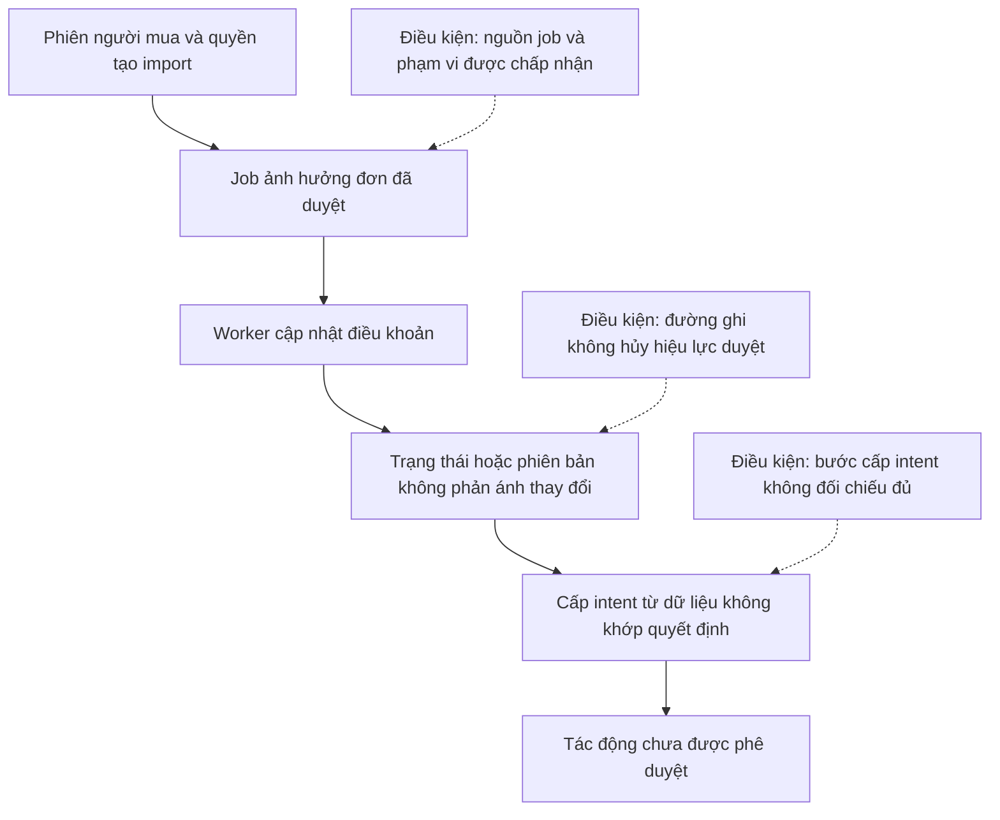

# Abuse path discovery — Khám phá đường lạm dụng nghiệp vụ

Một API thanh toán có thể kiểm tra đơn đã được duyệt. Một API cập nhật thông thường có thể cấm sửa đơn sau duyệt. Tuy nhiên, chức năng nhập dữ liệu qua worker có thể sửa cùng nội dung mà không làm mất hiệu lực quyết định cũ. Khi nối những hành vi riêng lẻ lại, một đường đi mới xuất hiện: gửi dữ liệu vào job, để worker sửa đơn rồi thanh toán nội dung chưa được duyệt.

**Abuse path discovery** là hoạt động khám phá các chuỗi điều kiện và hành động mà một tác nhân có thể tận dụng để đi từ khả năng ban đầu đến tác động trái quy tắc. Đơn vị phân tích là cả đường đi qua dữ liệu, trạng thái, quyền và thành phần, thay vì chỉ một request hoặc một endpoint.

Trong chương **Threat Modeling**, bài học này trình bày cách tìm đường theo chiều tiến và chiều ngược, biểu diễn điều kiện phụ thuộc, kiểm tra giả định và chọn điểm kiểm soát. Trọng tâm là bảo vệ business invariant liên quan đến phê duyệt, giá, quyền theo đối tượng, transaction, idempotency và tác vụ nền.

## 1. Đường lạm dụng gồm những gì?

Một đường lạm dụng có thể được mô tả bằng:

```text
Khả năng ban đầu của tác nhân
→ hành động có thể thực hiện
→ trạng thái hoặc quyền đạt được
→ hành động tiếp theo có điều kiện
→ tác động trái invariant.
```

Mỗi mũi tên cần có ý nghĩa cụ thể. Một thành phần đứng sau một thành phần khác trên sơ đồ kiến trúc không chứng minh tác nhân có thể đi từ thành phần này sang thành phần kia.

Ví dụ:

```text
Có phiên người mua
→ yêu cầu nhập dữ liệu cho đơn thuộc mình
→ worker nhận nội dung do người mua ảnh hưởng
→ worker thay điều khoản của đơn đã duyệt mà không hủy hiệu lực duyệt
→ thanh toán dùng điều khoản mới
→ thu tiền cho nội dung chưa có quyết định hợp lệ.
```

Đường trên chỉ là giả thuyết cho đến khi các bước, điều kiện và tác động được xác minh. Nếu worker chặn cập nhật hoặc thanh toán dùng snapshot được duyệt đúng cách, đường đó có thể bị cắt.

### 1.1. Phân biệt với các mô tả liên quan

| Khái niệm | Điều nó giúp mô tả | Giới hạn khi dùng riêng |
| --- | --- | --- |
| Sơ đồ thành phần | API, worker, cơ sở dữ liệu và hệ thống ngoài | Chưa thể hiện đầy đủ điều kiện nghiệp vụ để đi qua |
| Luồng hợp lệ | Cách hoàn thành mục tiêu được phép | Có thể không bao phủ đường thay thế, lỗi và phục hồi |
| Misuse case | Một tình huống sử dụng sai có tác động cụ thể | Có thể cần phân rã thành nhiều điều kiện và bước |
| Đường lạm dụng | Chuỗi có khả năng nối tác nhân đến tác động | Cần bằng chứng cho các cạnh và phạm vi giả định |
| Lỗ hổng | Điểm yếu cho phép vi phạm quy tắc | Một điểm yếu có thể xuất hiện trong nhiều đường |
| Rủi ro | Hậu quả và khả năng xảy ra trong bối cảnh | Cần hiểu đường, điều kiện và tài sản trước khi đánh giá |

Một đường có thể dùng nhiều điểm yếu. Nhiều đường cũng có thể đi qua cùng một điểm yếu, chẳng hạn thiếu kiểm tra quyền ở nơi sở hữu tài nguyên.

## 2. Xác định đích bằng business invariant

Bắt đầu từ một tác động cụ thể giúp giới hạn không gian tìm kiếm. “Chiếm hệ thống” thường quá rộng cho phân tích logic của một chức năng.

Các đích có thể là:

| Tài sản | Invariant | Tác động cần tìm đường tới |
| --- | --- | --- |
| Tiền và thẩm quyền chi tiêu | Điều khoản thanh toán phải được cho phép | Thực thi khoản thu không khớp nội dung được duyệt |
| Dữ liệu nghiệp vụ | Chỉ tiết lộ bản ghi và trường trong phạm vi | Tải file chứa dữ liệu tổ chức khác |
| Hạn mức | Tổng cam kết không vượt giới hạn | Nhiều thao tác cùng được cấp vượt ngân sách |
| Quyền lợi | Điều kiện hưởng và số lần sử dụng phải được giữ | Nhận lại quyền lợi đã dùng hết |
| Năng lực vận hành | Công việc không vượt quota hoặc phần năng lực được cấp | Giữ hoặc tiêu thụ tài nguyên ngoài giới hạn |
| Lịch sử thay đổi | Quyết định quan trọng phải có bằng chứng phù hợp | Tạo tác động mà không có dấu vết chuẩn cần thiết |

Cần mô tả chính xác điều gì là trái phép. Một giá khác giá mới nhất không tự là vi phạm nếu sản phẩm cho phép dùng báo giá đã khóa. Một yêu cầu lặp không tự là lạm dụng nếu chỉ trả kết quả đã có và không tạo thêm tác động.

Trong bài học, đích chính là:

> Một nghĩa vụ thanh toán được cấp hoặc thực thi với điều khoản chưa có quyết định phê duyệt hợp lệ theo chính sách của đơn.

Đích này bao gồm số tiền và tiền tệ; các điều khoản khác cần được xác định theo nghiệp vụ. Không nên chỉ nhìn mã trạng thái hoặc một cờ `approved`.

## 3. Mô hình tác nhân và điều kiện ban đầu

Một đường chỉ có ý nghĩa nếu tác nhân thực sự có thể tạo hoặc tận dụng những bước trong đó.

Giả sử tác nhân là người mua thuộc tổ chức A:

- Có một phiên đăng nhập hợp lệ.
- Được tạo và xem một số đơn trong tổ chức A.
- Được yêu cầu nhập dữ liệu qua chức năng mà sản phẩm cung cấp.
- Có thể sửa tham số, gọi API trực tiếp, gửi lại và gửi đồng thời.
- Không có quyền duyệt đơn.
- Không giả định có credential dịch vụ, quyền ghi trực tiếp cơ sở dữ liệu hoặc quyền điều khiển worker.

Các thành phần xác thực, người duyệt độc lập và nơi lưu quyết định được giả định còn đáng tin trong kịch bản này. Nếu muốn xét một worker bị kiểm soát, cần thêm mô hình riêng với phạm vi khác.

### 3.1. Phân biệt hành động của tác nhân với sự kiện môi trường

Một đơn có thể được người duyệt thật chấp thuận trong quá trình sử dụng bình thường. Đây có thể là điều kiện để tác nhân thử sửa sau duyệt; không có nghĩa tác nhân điều khiển người duyệt.

Tương tự, timeout, callback trễ hoặc worker khởi động lại có thể là sự kiện môi trường mà tác nhân chờ hoặc tận dụng. Đừng mô hình hóa mọi sự kiện đó thành hành động mà tác nhân tùy ý ra lệnh nếu không có căn cứ.

### 3.2. Ghi điều kiện càng rõ, kết luận càng chính xác

Một đường yêu cầu người mua hợp lệ khác với đường cần tài khoản quản trị. Một đường chỉ ảnh hưởng đơn của chính tác nhân khác với đường lan sang mọi tổ chức.

Độ dài chuỗi không tự quyết định mức nghiêm trọng. Một bước cần quyền rất hiếm có thể khó tiếp cận hơn nhiều bước mà mọi người dùng đều thực hiện được.

## 4. Biểu diễn trạng thái đủ để thấy quy tắc bị phá

Nếu đồ thị chỉ có các nút “API”, “worker” và “database”, nhiều lỗi logic sẽ không hiện ra. Cần biểu diễn những sự thật liên quan đến invariant.

Với đơn hàng, trạng thái phân tích có thể gồm:

```text
Chủ thể và tổ chức đang xét.
Đối tượng thuộc phạm vi nào.
Trạng thái quy trình của đơn.
Revision nội dung hiện tại.
Snapshot và revision được phê duyệt.
Điều khoản dùng để tạo payment intent.
Thẩm quyền và phạm vi của job.
Trạng thái nghĩa vụ, khóa thao tác và tác động đã xảy ra.
```

Không cần đưa mọi cột dữ liệu vào mô hình. Chỉ giữ những thuộc tính ảnh hưởng khả năng thực hiện hành động hoặc kết luận vi phạm.

### 4.1. Ví dụ trạng thái trừu tượng

| Nút | Những sự thật quan trọng |
| --- | --- |
| S0 | Người mua có phiên hợp lệ; đơn thuộc phạm vi; nội dung còn nháp |
| S1 | Nội dung revision 7 đã được người có quyền duyệt với tổng 1.000.000 VND |
| S2 | Có job nhập dữ liệu liên kết với đơn; payload chịu ảnh hưởng của người mua |
| S3 | Điều khoản hiện tại đổi thành 5.000.000 VND nhưng revision và hiệu lực duyệt không được cập nhật đúng |
| S4 | Payment intent dùng điều khoản hiện tại, thiếu đối chiếu đầy đủ với quyết định |
| S5 | Có cam kết hoặc tác động thu tiền không phù hợp nội dung đã được duyệt |

S3 là trạng thái nghi vấn cần xác minh, không phải một thuộc tính được phép mặc định có ở mọi hệ thống.

Sự khác biệt giữa revision và nội dung là điểm quan trọng: một phép so sánh số revision có thể không đủ nếu một đường ghi đã sửa nội dung mà không tăng revision theo đúng giao thức.

### 4.2. Điều kiện trước và kết quả sau của mỗi hành động

Với một cạnh, nên ghi:

```text
Hành động: worker áp dụng dữ liệu nhập.

Điều kiện trước:
  Job có thể được tạo và consumer nhận được.
  Job tham chiếu đúng đơn.
  Đường xử lý cho phép cập nhật các trường liên quan.
  Những kiểm tra còn lại không chặn trạng thái đã duyệt.

Kết quả sau giả định:
  Điều khoản thay đổi.
  Tham chiếu quyết định cũ vẫn được coi là có hiệu lực.
```

Nếu một điều kiện chưa biết, đánh dấu chưa biết. Đừng biến nó thành sự thật chỉ vì cần nó để hoàn thành đường.

## 5. Tìm theo chiều tiến từ khả năng ban đầu

Tìm chiều tiến bắt đầu từ những gì tác nhân có, rồi hỏi hành động nào khả dụng và tạo ra trạng thái gì.

Một trình tự:

1. Liệt kê các điểm vào mà tác nhân tiếp cận được.
2. Xác định dữ liệu, định danh và thứ tự họ có thể điều khiển.
3. Ghi các kết quả mà mỗi hành động có thể tạo ra.
4. Từ kết quả mới, tìm hành động hoặc thành phần tiếp theo.
5. Theo dõi quyền, trạng thái và dữ liệu có thẩm quyền có thay đổi hay không.
6. Dừng hoặc tách nhánh khi gặp điều kiện chưa có bằng chứng.

Trong ví dụ:

```text
Có quyền yêu cầu import
→ có thể tạo job gắn với đơn
→ có thể ảnh hưởng dữ liệu worker dùng
→ cần xác minh worker có sửa đơn đã duyệt không
→ cần xác minh việc sửa có làm mất hiệu lực duyệt không
→ cần xác minh thanh toán dùng dữ liệu nào.
```

Một bước “cần xác minh” chưa đủ để đi tiếp như thể chắc chắn. Có thể tiếp tục lập nhánh giả thuyết, nhưng nhãn bằng chứng phải đi cùng nhánh.

### 5.1. Những điểm vào dễ bị bỏ sót

| Điểm vào | Mối liên hệ cần tìm |
| --- | --- |
| API chính | Dữ liệu nào được phép thay đổi và guard nào được thực thi |
| API cũ hoặc đường tương thích | Có cùng điều kiện với đường mới không |
| Batch | Phạm vi được kiểm tra từng đối tượng hay chỉ một lần chung |
| Import và tệp | Nội dung đi tới worker với quyền và ràng buộc nào |
| Export hoặc báo cáo | Dữ liệu đầu ra có phạm vi rộng hơn dữ liệu được phép xem không |
| Callback | Nguồn xác nhận có gắn đúng nghĩa vụ và tham số không |
| Công cụ vận hành | Retry hoặc sửa dữ liệu có bỏ điều kiện thường dùng không |
| Tác vụ định kỳ | Thẩm quyền hệ thống có giới hạn rõ theo đối tượng và thời điểm không |

Khám phá chiều tiến đặc biệt hữu ích để thấy dữ liệu không đáng tin đi vào một thành phần có quyền rộng hơn, rồi tác động tới tài sản mà tác nhân không trực tiếp sửa được.

## 6. Tìm theo chiều ngược từ tác động

Tìm chiều ngược bắt đầu từ đích rồi xác định những điều kiện nào cần đúng để đích xảy ra.

Với việc thu tiền theo nội dung chưa được duyệt:

```text
Muốn có tác động thu tiền sai
← phải có lệnh hoặc intent cho điều khoản không được phép
← nơi cấp intent phải chấp nhận bằng chứng không còn khớp
← nội dung hoặc thẩm quyền phải bị thay đổi hay thay thế
← phải có đường mà tác nhân tạo được thay đổi đó.
```

Ở mỗi bước, cần liệt kê các khả năng thay thế:

- Không cần approval do thiếu guard.
- Có approval nhưng thuộc đơn khác.
- Approval đúng đơn nhưng nội dung đã thay đổi.
- Nội dung còn khớp nhưng quyết định không còn hiệu lực theo chính sách.
- Có ngoại lệ nhưng ngoại lệ được cấp hoặc sử dụng ngoài phạm vi.

Chiều ngược giúp tránh dành quá nhiều thời gian cho điểm vào không thể dẫn tới tài sản đang xét.

### 6.1. Gặp nhau giữa hai chiều

Chiều tiến có thể cho thấy người mua ảnh hưởng nội dung import. Chiều ngược cho thấy cần một đường sửa điều khoản mà không làm mất hiệu lực phê duyệt.

Khi hai kết quả gặp nhau, xuất hiện một giả thuyết đáng kiểm tra:

> Đường import có thể tạo đúng trạng thái mà đường thanh toán đang giả định không thể tồn tại.

Sự gặp nhau này chưa chứng minh khai thác thành công. Nó chỉ thu hẹp câu hỏi thành các cạnh và guard cụ thể cần kiểm tra.

## 7. Phân biệt điều kiện AND và đường thay thế OR

Một lỗi thường gặp là vẽ nhiều điều kiện trỏ vào tác động rồi hiểu rằng chỉ cần một điều kiện bất kỳ là đủ.

Trong đường import đang xét, có thể cần đồng thời:

- A: tác nhân tạo được job gắn với đơn đã duyệt.
- B: worker sửa được trường ảnh hưởng thanh toán.
- C: thay đổi không được phản ánh đúng vào hiệu lực quyết định hoặc phiên bản.
- D: nơi cấp intent dùng điều khoản mới mà không chặn sự không khớp.

Đây là quan hệ **AND** cho đường cụ thể. Chỉ chứng minh A không đủ để kết luận toàn bộ đường tồn tại.

Ngược lại, tác động cuối có thể đạt qua các đường **OR**:

```text
Tạo intent không được phép
  có thể qua đường thiếu kiểm tra approval,
  hoặc đường dùng approval của đối tượng khác,
  hoặc đường dùng nội dung đã bị thay đổi.
```

Sơ đồ minh họa đường nội dung thay đổi:



Các nhãn điều kiện nhắc rằng mỗi cạnh có tiền đề. Đồ thị luồng thông thường không tự biểu diễn đầy đủ logic AND; cần phần mô tả hoặc mô hình chuyên biệt khi phân tích phức tạp hơn.

### 7.1. Không cộng quyền của các tác nhân tùy ý

Nếu một bước cần quyền người duyệt còn bước khác cần quyền quản trị, phải biết ai nắm các quyền đó hoặc có quan hệ ủy quyền nào.

Không được ghép khả năng của những người độc lập thành một đường của người mua nếu chưa giả định chiếm nhiều tài khoản, thông đồng hoặc có một đường nâng quyền cụ thể. Điều kiện này ảnh hưởng trực tiếp tới đánh giá rủi ro.

## 8. Mô tả đầy đủ một đường ứng viên

### AP-01 — Sửa điều khoản qua import rồi dùng lại thẩm quyền cũ

**Tài sản:** tiền và độ tin cậy của quyết định phê duyệt.

**Invariant:** điều khoản dùng cho payment intent phải thuộc nội dung đã được duyệt còn hiệu lực theo chính sách.

**Tác nhân:** người mua có phiên hợp lệ trong tổ chức A, có quyền yêu cầu chức năng import theo phạm vi được giao.

**Điều kiện môi trường:** có đơn revision 7 đã được người duyệt độc lập chấp thuận ở mức 1.000.000 VND. Việc được duyệt ban đầu là hoạt động hợp lệ, không giả định người mua điều khiển người duyệt.

**Chuỗi ứng viên:**

| Bước | Hành động hoặc chuyển tiếp | Điều cần xác minh |
| --- | --- | --- |
| 1 | Người mua yêu cầu import cho đơn đã duyệt | API có nhận loại yêu cầu này và phạm vi có cho phép không |
| 2 | Job được đưa tới worker | Producer nào tạo, dữ liệu nào đã được kiểm tra và consumer tin gì |
| 3 | Worker đổi nội dung quan trọng | Guard trạng thái và quyền đối tượng có được thực thi không |
| 4 | Đơn vẫn được coi là có thẩm quyền cũ | Revision và quyết định có bị cập nhật hoặc hủy hiệu lực không |
| 5 | Người có quyền gọi thanh toán | Đường cấp intent dùng snapshot duyệt hay dữ liệu hiện tại |
| 6 | Intent hoặc tác động phản ánh nội dung mới | Có đối chiếu đủ điều khoản và ràng buộc trạng thái không |

**Kết quả trái phép giả định:** intent 5.000.000 VND được cấp bằng quyết định chỉ cho phép nội dung 1.000.000 VND.

**Bằng chứng cần có:**

- Request hoặc lệnh có thể được tạo bằng quyền tác nhân đã giả định.
- Nguồn job, phạm vi và dữ liệu đầu vào được consumer sử dụng.
- Nội dung, revision và trạng thái trước/sau cập nhật.
- Quyết định duyệt và snapshot hoặc bản nội dung mà nó tham chiếu.
- Tham số payment intent và tác động bên ngoài nếu có.
- Liên kết định danh cho thấy đây là cùng đơn, cùng vòng xử lý và cùng chuỗi nguyên nhân.

**Trạng thái ban đầu:** giả thuyết. Mỗi cạnh có thể mang trạng thái đã xác minh cho phép, đã xác minh bị chặn hoặc chưa đủ dữ liệu.

### 8.1. Những kết quả có thể đóng đường này

Nếu worker từ chối sửa đơn đã duyệt, cạnh cập nhật bị chặn. Nếu worker tạo revision mới và hủy hiệu lực quyết định, trạng thái cần cho bước sau không xuất hiện.

Nếu nơi cấp intent chỉ dùng đúng snapshot được duyệt và không cho điều khoản mới đi vào tác động, đường tới tác động sai có thể bị chặn ở bước cuối. Tuy vậy, việc nội dung đơn bị sửa trái chính sách vẫn có thể là một vấn đề khác cần đánh giá.

Phải nói rõ kết luận: “AP-01 bị chặn tại cạnh nào dưới điều kiện nào”. Không nên suy rộng thành “mọi đường tới thanh toán sai đều đã được loại bỏ”.

## 9. Đường lạm dụng qua đồng thời, thời gian và lỗi

Một chuỗi tuyến tính chưa bao phủ mọi cách tạo trạng thái nguy hiểm. Có những đường chỉ xuất hiện khi các hoạt động xen kẽ hoặc hệ thống chưa biết kết quả.

### 9.1. Xen kẽ giữa kiểm tra và cập nhật

```text
T1: Đọc đơn đang APPROVED, revision 7.
T1: Kiểm tra quyết định cho revision 7.

T2: Đổi nội dung thành revision 8.
T2: Hủy hiệu lực quyết định cũ và commit.

T1: Ghi intent mà không phát hiện dữ liệu đã thay đổi.
```

Đường này không yêu cầu T2 bỏ quên hủy hiệu lực duyệt. Lỗi có thể nằm ở T1 dùng kết quả kiểm tra cũ để cam kết tác động sau một thay đổi hợp lệ khác.

Cần biểu diễn điều kiện tranh chấp: dữ liệu nào được đọc, tài nguyên nào được bảo vệ, thay đổi nào tăng phiên bản và nơi nào phát hiện xung đột.

Khi có cơ chế khóa hoặc cập nhật có điều kiện đúng, một trong các thứ tự hợp lệ sẽ được giữ. Không được kết luận có đường chỉ vì hai request có thể bắt đầu cùng lúc.

### 9.2. Tận dụng thời gian chờ và hiệu lực

Một job được tạo khi người dùng còn quyền có thể chạy sau khi người đó mất quyền. Một grant có thể hết hạn trong hàng đợi. Một quyết định có thể bị thu hồi giữa lúc nhận và thực thi lệnh.

Cần biết hợp đồng xét hiệu lực ở thời điểm nào: tạo yêu cầu, cấp intent hay trước tác động. Có quy trình dùng quyền hiện tại; có quy trình dùng quyền thực hiện đã cấp với phạm vi riêng.

Nếu không biết hợp đồng, hãy ghi câu hỏi chính sách. Không nên tự chọn cách hiểu có lợi cho việc hoàn thành một đường nghi vấn.

### 9.3. Kết quả bên ngoài chưa rõ

```text
Gửi lệnh thu tiền.
Nhà cung cấp có thể đã xử lý.
Hệ thống nội bộ timeout.
Nhánh phục hồi cho phép tạo một lần thu mới độc lập.
```

Ở đây tồn tại nhiều khả năng về trạng thái thật của nhà cung cấp. Timeout chỉ là điều hệ thống quan sát được; nó không chứng minh chưa có tác động.

Mô hình cần giữ trạng thái chưa rõ và quan hệ với nghĩa vụ ban đầu. Đường lạm dụng có thể nằm ở việc biến thiếu thông tin thành thẩm quyền để thực hiện thêm.

### 9.4. Vòng lặp làm tăng tác động

Một vòng “tạo job → hủy → tạo lại” có thể quay về cùng trạng thái hiển thị nhưng đã tiêu thêm CPU, lượt gọi hoặc thời gian nhân viên.

Nếu mô hình bỏ bộ đếm sử dụng, nó có thể gộp sai các trạng thái đó thành một và bỏ lỡ đường tích lũy thiệt hại. Với quota, hoàn tiền hoặc ưu đãi, cần giữ các giá trị tổng hợp liên quan.

## 10. Kiểm chứng cạnh bằng bằng chứng đúng mức

Một bảng bằng chứng giúp tránh nhầm suy đoán với kết luận:

| Nhận định | Bằng chứng phù hợp | Điều chưa đủ |
| --- | --- | --- |
| Tác nhân tiếp cận được điểm vào | Kiểm tra bằng đúng danh tính, quyền và phạm vi giả định | Gọi thành công bằng tài khoản quản trị |
| Dữ liệu tới worker không bị đổi phạm vi | Đối chiếu lệnh được lưu, producer và consumer | Chỉ thấy trường đó trong request ban đầu |
| Worker sửa trường quan trọng | Đọc trạng thái đã commit và đường xử lý tương ứng | Chỉ thấy thông báo “job completed” |
| Quyết định vẫn được chấp nhận | Đối chiếu snapshot, revision và guard thực tế | Chỉ thấy `status=APPROVED` trên giao diện |
| Intent dùng điều khoản sai | Quan sát bản ghi cam kết và dữ liệu có thẩm quyền | Một response chứa tổng tiền để hiển thị |
| Tác động ngoài đã xảy ra | Bằng chứng từ môi trường thử nghiệm hoặc nguồn xác nhận phù hợp | Chỉ có span hoặc mã HTTP thành công |
| Một guard chặn đường | Ca kiểm thử và trạng thái/tác động cho thấy không vượt điều kiện | Chỉ biết dự án có annotation hoặc thư viện bảo mật |

Khi kiểm tra thiết kế hoặc mã, cần tìm nơi quyết định thực sự được thực thi, không chỉ tên hàm hoặc comment. Khi chạy kiểm thử, cần kiểm tra cả response và tác động sau lỗi.

Trong tài liệu phân tích, có thể dùng các nhãn:

- **Giả thuyết:** chuỗi hợp lý nhưng còn cạnh chưa kiểm chứng.
- **Cần làm rõ chính sách:** chưa xác định hành vi nào là được phép.
- **Đã tái hiện trong phạm vi thử nghiệm:** có bằng chứng cho chuỗi và tác động với các điều kiện đã ghi.
- **Đã bị chặn tại cạnh cụ thể:** có bằng chứng kiểm soát giữ điều kiện tại đó.
- **Chưa kết luận:** bằng chứng thiếu, mâu thuẫn hoặc môi trường chưa phù hợp.

Nhãn là quy ước làm việc của nhóm, không phải một thang chuẩn bắt buộc. Cần giữ ngữ nghĩa nhất quán và dẫn tới bước tiếp theo.

## 11. Tìm kiếm có hệ thống mà không phóng đại độ bao phủ

Có thể hình dung việc khám phá bằng mã giả:

```text
frontier = các trạng thái ban đầu đã được mô tả
visited = rỗng

Trong giới hạn phân tích đã chọn:
    lấy một trạng thái S từ frontier
    với mỗi hành động áp dụng được theo mô hình:
        kiểm tra chủ thể và điều kiện cần
        tạo trạng thái kế tiếp S2
        giữ nhãn bằng chứng và giả định của cạnh
        nếu S2 vi phạm invariant:
            lưu chuỗi ứng viên cùng các điều kiện
        nếu S2 chưa được xét theo tiêu chí tương đương:
            đưa S2 vào frontier
```

“Hành động áp dụng được” có thể là hành động của tác nhân hoặc chuyển tiếp môi trường đã mô hình hóa. Nó không có nghĩa bên tấn công tự điều khiển mọi thành phần.

Trong thực hành, nhóm có thể làm bằng bảng và sơ đồ cho một phạm vi nhỏ. Với mô hình hình thức hoặc công cụ tự động, vẫn phải chọn abstraction, điều kiện, dữ liệu và giới hạn tìm kiếm phù hợp.

### 11.1. Giảm lặp nhưng giữ khác biệt có ý nghĩa

Hai URL có thể cùng đi vào một guard và tạo cùng tác động. Có thể nhóm chúng để tránh lặp phân tích, sau khi xác minh sự tương đương cần thiết.

Ngược lại, không nên gộp hai đường chỉ vì tên chức năng giống nhau nếu một đường dùng worker, một đường chạy trực tiếp hoặc dữ liệu có nguồn khác nhau.

Các trạng thái khác nhau về quyền, revision, hiệu lực, nghĩa vụ hoặc số dư thường không thể gộp tùy ý nếu chính khác biệt đó quyết định invariant.

### 11.2. Giới hạn tìm kiếm không phải chứng minh tuyệt đối

Không tìm thấy đường trong ba bước chưa chứng minh không có đường dài hơn. Bỏ qua cạnh tranh chưa bao phủ race condition. Chỉ xét API chưa bao phủ đường vận hành hoặc xử lý bất đồng bộ.

Cần ghi phạm vi đã xét, giả định, độ sâu hoặc lớp trạng thái đã bao phủ và những phần để lại. Giá trị của kết quả nằm ở kết luận có điều kiện và bằng chứng, không phải tuyên bố “không còn đường nào” khi mô hình chưa hỗ trợ điều đó.

## 12. Chọn điểm cắt đường và kiểm soát có ý nghĩa

Một **điểm cắt** là nơi kiểm soát có thể ngăn một đường đi tới tác động. Với AP-01, có thể gồm:

| Điểm cắt | Kiểm soát có thể xem xét |
| --- | --- |
| Khi yêu cầu import | Kiểm tra quyền trên đơn, trạng thái và phạm vi trường được thay đổi |
| Khi worker áp dụng | Dùng cùng quy tắc miền cho cập nhật quan trọng và thay đổi hiệu lực duyệt |
| Khi lưu nội dung | Giao thức phiên bản, snapshot và transaction giữ nhất quán |
| Khi cấp intent | Kiểm tra nội dung được duyệt, thẩm quyền và ràng buộc tác động |
| Khi thực thi | Chỉ dùng intent đã cấp hợp lệ, chống trùng và giữ phạm vi |
| Khi ghi nhận kết quả | Xác minh đúng nguồn, nghĩa vụ, số tiền và trạng thái |

Chặn một cạnh là đủ để cắt đường cụ thể nếu các điều kiện khác không có đường vòng trong mô hình. Nhưng nếu còn nhiều đường OR tới cùng tác động, phải xem xét cả những đường đó.

Kiểm soát gần nơi tạo tác động thường có khả năng bảo vệ nhiều điểm vào, nhưng vẫn cần quyền và dữ liệu đúng ở các lớp trước. Không nên để một nơi trở thành điểm duy nhất biết mọi quy tắc mà các thành phần khác có thể bỏ qua bằng quyền ghi trực tiếp.

### 12.1. Phân biệt nhiều lớp với nhiều lần tin cùng một dữ liệu sai

API, worker và payment-service cùng kiểm tra `approved=true` lấy từ một nguồn client kiểm soát không tạo ra ba bằng chứng độc lập.

Các lớp nên bảo vệ những quan hệ có ý nghĩa: nguồn danh tính, quyền đối tượng, tính toàn vẹn của nội dung duyệt, cam kết nguyên tử và giới hạn tác động. Cần biết lớp nào còn có hiệu lực khi lớp khác sai.

### 12.2. Không dùng phát hiện thay cho ngăn chặn mà không nói rõ

Audit có thể cho biết một import đã sửa nội dung và một intent được tạo sau đó. Nó hỗ trợ điều tra nhưng không tự chặn khoản thu.

Nếu một rủi ro được quản lý bằng phát hiện và phản ứng thay vì guard, quyết định đó cần được nêu rõ cùng khả năng phản ứng và hậu quả còn lại.

## 13. Chuyển đường ứng viên thành kiểm thử

Với AP-01, một tiêu chí có thể là:

```text
Given:
  Người mua có đúng quyền được mô tả.
  Đơn có quyết định duyệt cho nội dung 1.000.000 VND.
  Các đường import và worker tồn tại trong phạm vi kiểm thử.

When:
  Người mua yêu cầu một thay đổi quan trọng qua import.
  Worker xử lý.
  Có yêu cầu bắt đầu thanh toán.

Then:
  Không có intent hoặc tác động cho nội dung chưa được duyệt.
  Nếu thay đổi bị từ chối: nội dung và quyết định giữ đúng trạng thái hợp lệ.
  Nếu thay đổi được chấp nhận: hiệu lực duyệt và revision được cập nhật theo chính sách.
  Bất kỳ intent nào được cấp đều gắn với thẩm quyền hợp lệ cho đúng điều khoản.
```

Cần kiểm tra trạng thái trung gian để biết đường bị chặn ở đâu. Chỉ thấy bước cuối trả lỗi chưa đủ nếu worker đã sửa dữ liệu ngoài quyền hoặc một tác động khác đã xảy ra.

Các biến thể hữu ích:

| Biến thể | Mục tiêu kiểm thử |
| --- | --- |
| Gọi API cập nhật trực tiếp | So sánh guard với đường import |
| Import khi nháp, chờ duyệt và đã duyệt | Xác định điều kiện trạng thái |
| Trộn đơn ngoài phạm vi trong batch | Kiểm tra quyền từng đối tượng |
| Chạy lại cùng job | Không thay đổi nội dung hoặc tạo tác động thêm ngoài hợp đồng |
| Sửa tranh với cấp intent | Kiểm tra giao thức cạnh tranh |
| Đổi khóa thao tác | Không biến cùng nghĩa vụ thành tác động mới trái phép |
| Job chờ tới khi quyền thay đổi | Kiểm tra hiệu lực thẩm quyền theo thời điểm đã định |
| Worker lỗi giữa chừng | Không để trạng thái và bằng chứng lệch ngoài hợp đồng |
| Timeout khi thực thi ngoài | Không suy ra chưa xử lý rồi cấp thêm tác động |
| Chạy lại từ công cụ vận hành | Bao phủ đường có quyền kỹ thuật rộng |

Unit test hỗ trợ quy tắc và phép chuyển trạng thái. Integration test cần cho transaction, khóa và ràng buộc dữ liệu. Kiểm thử API, producer và consumer giúp xác minh ranh giới tin cậy. Tác động bên ngoài cần môi trường thử nghiệm hoặc thành phần giả lập có quan sát phù hợp.

Không nên viết test chỉ để tái khẳng định một hàm được gọi. Test cần chứng minh invariant hoặc bằng chứng quan trọng của đường.

## 14. Ưu tiên và duy trì kết quả khám phá

Có thể ưu tiên xác minh theo:

- Tác động lên tiền, dữ liệu, quyền hoặc năng lực.
- Phạm vi một đối tượng, một tổ chức hay nhiều tổ chức.
- Quyền và điều kiện cần để tiếp cận.
- Khả năng lặp, tự động hóa hoặc mở rộng.
- Tính khó đảo ngược của tác động.
- Các cạnh đã có bằng chứng và các giả định còn yếu.
- Mức độc lập của kiểm soát đã xác minh.

Đường ngắn không tự nguy hiểm hơn đường dài. Một chuỗi nhiều bước dùng chức năng thường ngày có thể thực tế hơn một bước cần quyền hạ tầng hiếm gặp.

Độ chắc chắn và mức tác động nên được ghi riêng. Một đường có hậu quả lớn nhưng mới là giả thuyết có thể cần xác minh sớm; không vì ưu tiên cao mà được trình bày như lỗ hổng đã xác nhận.

Đầu ra nên có mã đường, invariant, tác nhân, trạng thái ban đầu, cạnh và điều kiện, bằng chứng, điểm cắt, trạng thái xử lý và tiêu chí kiểm thử.

Cần xem lại khi thêm import, batch, worker, API cũ tương thích, ngoại lệ phê duyệt hoặc cơ chế phục hồi. Những thay đổi đó có thể tạo một cạnh mới nối hai phần trước đây tách biệt.

## 15. Cách áp dụng cho một luồng nghiệp vụ

Một trình tự thực dụng là:

1. **Chọn tài sản và đích trái phép:** mô tả tác động có thể quan sát.
2. **Phát biểu invariant:** điều gì phải đúng đối với đối tượng và thời điểm nào.
3. **Chọn tác nhân:** quyền, mức chiếm quyền và dữ liệu điều khiển được.
4. **Vẽ trạng thái quan trọng:** quyền, nội dung, revision, quyết định và nghĩa vụ.
5. **Đi tiến từ điểm vào:** xem khả năng nào tạo được dữ liệu hoặc trạng thái mới.
6. **Đi ngược từ tác động:** xác định những điều kiện thiếu hoặc sai có thể cho phép nó.
7. **Ghép chuỗi với logic rõ:** tách AND, OR, sự kiện môi trường và quan hệ thời gian.
8. **Kiểm chứng từng cạnh:** giữ nhãn giả thuyết, bằng chứng và câu hỏi chính sách.
9. **Tìm điểm cắt và đường vòng:** chọn kiểm soát giữ invariant trên các đường liên quan.
10. **Chuyển thành kiểm thử và đầu việc:** xác định điều kiện hoàn tất, phạm vi còn lại và lúc cần xem lại.

Một phát biểu đủ cụ thể có thể là:

> Xác minh liệu người mua có thể đưa dữ liệu qua import để sửa điều khoản của đơn đã duyệt mà không làm mất hiệu lực quyết định, rồi khiến nơi cấp intent dùng dữ liệu mới hay không. Mỗi cạnh phải được kiểm tra bằng đúng quyền đã giả định; kết luận dựa trên nội dung, quyết định và tác động đã quan sát.

Khám phá đường lạm dụng giúp thấy những vi phạm xuất hiện khi các chức năng và ranh giới được nối lại. Giá trị cốt lõi là tìm được chuỗi có điều kiện rõ ràng, biết cạnh nào đã được chứng minh và chọn được nơi giữ invariant trước khi tác động vượt khỏi quyền của tác nhân.
