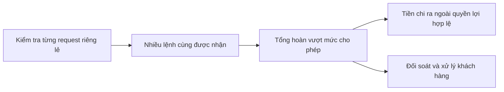

# Chấm điểm tác động nghiệp vụ — Business impact scoring

## 1. Điểm tác động phải giải thích được hậu quả

Hai lỗi cùng nằm ở endpoint thanh toán có thể gây hậu quả rất khác nhau. Một lỗi chỉ hiển thị nhầm trạng thái; lỗi khác tạo thêm lệnh hoàn tiền; lỗi thứ ba cho phép thay đổi người có quyền phê duyệt cho toàn tổ chức.

Nếu chỉ chấm theo tên chức năng, mức độ phức tạp kỹ thuật hoặc cảm giác “liên quan tiền nên nghiêm trọng”, nhóm sẽ khó ưu tiên nhất quán.

**Business impact scoring** là việc đánh giá mức hậu quả đối với hoạt động và tài sản nghiệp vụ nếu một kịch bản đe dọa thành công, theo một thang được định nghĩa trước.

Điểm số cần đi cùng:

- Kịch bản cụ thể và bất biến bị vi phạm.
- Tài sản, chủ thể và phạm vi bị ảnh hưởng.
- Khoảng thời gian tác động có thể tiếp diễn.
- Điều kiện giới hạn hoặc khuếch đại.
- Bằng chứng và phần chưa biết.
- Phiên bản thang điểm và người chịu trách nhiệm xác nhận.

Trong chương **Threat Modeling**, mục tiêu là biến “lỗi này có vẻ nặng” thành một nhận định có thể kiểm tra, tranh luận và cập nhật.

Bài này dùng một rubric nội bộ giả định để minh họa. Các mức tiền, thời gian và nhãn điểm không phải chuẩn chung hay cam kết về tổn thất của hệ thống thật.

## 2. Tách tác động, khả năng xảy ra và ưu tiên

| Khái niệm | Câu hỏi | Ví dụ |
| --- | --- | --- |
| **Impact — tác động** | Nếu kịch bản thành công, hậu quả là gì và lớn đến đâu? | Có thể hoàn vượt tổng tiền được phép trong một nhóm giao dịch. |
| **Likelihood — khả năng xảy ra** | Với điều kiện hiện tại, kịch bản có thể xảy ra đến mức nào? | Caller cần tài khoản nội bộ hiếm có hay tài khoản khách hàng phổ biến? |
| **Exploitability — điều kiện/khả năng khai thác** | Cần những quyền, đầu vào và cách phối hợp nào để thực hiện? | Hai request đồng thời cùng vượt kiểm tra quota. |
| **Confidence — độ tin cậy đánh giá** | Có bao nhiêu bằng chứng cho nhận định? | Đã tái hiện ở môi trường tích hợp, nhưng chưa xác minh giới hạn ngoài. |
| **Priority — ưu tiên xử lý** | Nhóm cần hành động khi nào và bằng cách nào? | Chặn đường lạm dụng ngay, rồi sửa và kiểm thử hồi quy. |

Một kịch bản khó thực hiện vẫn có thể có tác động rất lớn nếu thành công. Một kịch bản dễ thực hiện có thể chỉ gây hậu quả nhỏ nhưng lặp thường xuyên.

Không nên giảm điểm tác động chỉ vì chưa có bằng chứng bị khai thác. “Chưa thấy bị khai thác” cũng có thể do thiếu log hoặc chưa tìm đúng tín hiệu.

Ngược lại, chỉ nêu hậu quả lớn nhất có thể tưởng tượng mà không có đường đi và điều kiện hỗ trợ cũng không phải đánh giá tốt.

### 2.1. Ba câu cần viết riêng

```text
Tác động:
  Kịch bản thành công tạo thêm tối đa N tác động hoàn tiền
  trong phạm vi và cửa sổ được giả định.

Khả năng xảy ra:
  Tác nhân cần quyền yêu cầu hoàn và gửi đồng thời;
  điều kiện này có thể/không thể đạt trong hệ thống hiện tại.

Ưu tiên:
  Dựa trên tác động, khả năng xảy ra, dấu hiệu đang bị lạm dụng
  và chính sách xử lý của tổ chức.
```

Việc tách ba câu giúp tránh biến một phép chấm điểm thành lời khẳng định quá mức.

## 3. Đơn vị đánh giá là một kịch bản có giới hạn

Không chấm chung “API hoàn tiền” hoặc “microservice thanh toán”. Hãy chấm một chuỗi hành vi gắn với tài sản và bất biến.

Ví dụ:

> Người có quyền yêu cầu hoàn tiền gửi nhiều lệnh cho cùng giao dịch. Hệ thống chỉ kiểm tra từng lệnh không vượt số tiền đã thu, nhưng không giữ ngân sách hoàn nguyên tử. Nhiều lệnh được chấp nhận làm tổng hoàn thành công vượt phần được phép.

Chuỗi nhân quả:



### 3.1. Thẻ kịch bản đầu vào

| Trường | Nội dung cần xác định |
| --- | --- |
| Tác nhân | Ai có thể khởi tạo hành động và với quyền ban đầu nào? |
| Tài sản | Tiền, hàng tồn, quyền lợi, quyền phê duyệt, dữ liệu hoặc năng lực xử lý. |
| Đường đi | Chuỗi request, sự kiện hoặc cách xen kẽ gây vi phạm. |
| Bất biến | Điều gì phải đúng nhưng bị phá? |
| Phạm vi | Một đối tượng, một tenant, nhiều tenant hay nguồn quyền toàn hệ thống? |
| Đơn vị hậu quả | Tiền chi vượt, số hồ sơ lộ, thời gian gián đoạn, số quyết định trái phép. |
| Cửa sổ | Tác động tích lũy trong khoảng nào và vì sao dừng? |
| Giới hạn thực tế | Hạn mức, số đối tượng đủ điều kiện, tốc độ xử lý, cơ chế ngăn tác động. |
| Khả năng phục hồi | Dừng được gì, đảo ngược được gì và còn hậu quả nào? |
| Bằng chứng | Mã, dữ liệu, kiểm thử, cấu hình hoặc thông tin đã xác nhận. |

Một kịch bản có thể có nhiều hậu quả. Cần phân biệt các hậu quả đó, rồi mới tổng hợp theo rubric.

### 3.2. So với hành vi hợp lệ nào?

Tác động phải được so với một baseline.

Nếu một khách được phép hoàn 900.000 VND một lần và hệ thống thực hiện ba lần, tổng chi ra là 2.700.000 VND nhưng phần hoàn vượt là:

```text
2.700.000 - 900.000 = 1.800.000 VND
```

Nếu lần hoàn hợp lệ đã xảy ra trước đó và ba lệnh mới đều là lặp sai, phần chi vượt lại khác. Thẻ đánh giá cần nói rõ baseline để người đọc không hiểu nhầm.

## 4. Chọn những chiều tác động có ý nghĩa

Một rubric nhỏ, được dùng nhất quán thường hữu ích hơn danh sách dài không có tiêu chí phân biệt.

Trong ví dụ này, dùng bốn chiều:

1. **F — Tài chính và chi phí tài nguyên:** tiền chi ngoài quyền lợi hợp lệ, chi phí dịch vụ tăng, hàng hóa mất hoặc công sức xử lý có thể lượng hóa phù hợp.
2. **O — Hoạt động và phục vụ:** gián đoạn, chậm luồng quan trọng, backlog và khả năng tiếp tục phục vụ.
3. **D — Dữ liệu:** lộ, mất hoặc sai dữ liệu ảnh hưởng nghiệp vụ.
4. **A — Quyền hạn và tính toàn vẹn quyết định:** vượt phê duyệt, cấp quyền sai, thay đổi nguồn có thẩm quyền hoặc mất khả năng tin vào quyết định.

Tác động tới khách hàng, tính công bằng và nghĩa vụ đã cam kết phải được mô tả trong thẻ đánh giá. Chúng có thể thể hiện ở nhiều chiều trên; tổ chức có thể bổ sung chiều riêng khi cần.

Không ép mọi hậu quả về tiền nếu không có căn cứ. Ví dụ, dữ liệu nhạy cảm đã bị sao chép không trở nên “nhẹ” chỉ vì chưa ước tính được doanh thu mất.

## 5. Rubric minh họa từ 0 đến 4

### 5.1. Ý nghĩa chung

| Điểm | Mức minh họa | Ý nghĩa |
| --- | --- | --- |
| 0 | Không có tác động được xác nhận trong chiều này | Có đủ căn cứ cho nhận định, hoặc chiều đó không áp dụng. |
| 1 | Nhỏ | Phạm vi hẹp, hậu quả thấp theo ngưỡng tổ chức, phục hồi tương đối đơn giản. |
| 2 | Đáng kể nhưng giới hạn | Một nhóm nghiệp vụ chịu ảnh hưởng rõ, có giới hạn và đường phục hồi. |
| 3 | Lớn | Thiệt hại hoặc gián đoạn trọng yếu, phạm vi rộng hay quyết định quan trọng bị phá. |
| 4 | Rất lớn / hệ thống | Vượt ngưỡng cao nhất, phá nguồn quyền trọng yếu hoặc có hậu quả rộng khó đảo ngược. |

**Chưa biết không được tự gán 0.** Nếu thiếu dữ liệu, ghi khoảng điểm, giả định và việc cần xác minh.

### 5.2. Neo tài chính cho tổ chức giả định

Giả sử nhóm đã thống nhất chấm F theo phần thiệt hại/chi phí thuộc phạm vi đánh giá:

| F | Khoảng tiền minh họa |
| --- | --- |
| 0 | Không có phần tổn thất/chi phí tăng thuộc chiều này đã được xác định. |
| 1 | Lớn hơn 0 và nhỏ hơn 5 triệu VND. |
| 2 | Từ 5 triệu đến dưới 50 triệu VND. |
| 3 | Từ 50 triệu đến dưới 500 triệu VND. |
| 4 | Từ 500 triệu VND trở lên. |

Các mốc này chỉ có nghĩa với tổ chức giả định và loại chi phí đã định nghĩa. Doanh nghiệp khác có thể cần ngưỡng hoàn toàn khác.

Cần ghi:

- Đang chấm phần chi vượt ban đầu hay tổn thất ròng sau thu hồi.
- Đã tính chi phí xử lý và bồi hoàn nào.
- Tiền tệ và quy tắc chuyển đổi nếu có.
- Cửa sổ tác động và giới hạn được dùng.

Không trộn tổn thất ròng đã giả định thu hồi với số tiền chi vượt ban đầu mà không giải thích.

### 5.3. Neo cho những chiều còn lại

| Điểm | O — Hoạt động | D — Dữ liệu | A — Quyền hạn/quyết định |
| --- | --- | --- | --- |
| 0 | Không thay đổi khả năng phục vụ đã xác định. | Không có thay đổi/lộ dữ liệu ngoài chính sách. | Không phá quyền hoặc điều kiện quyết định. |
| 1 | Chậm hoặc gián đoạn nhỏ ở chức năng phụ, phạm vi hẹp. | Sai/lộ lượng hạn chế dữ liệu ít nhạy cảm, dễ xử lý. | Sai lệch quyết định phụ, giới hạn rõ và dễ sửa. |
| 2 | Gián đoạn đáng kể cho một nhóm; còn cách làm thay thế phù hợp. | Dữ liệu nghiệp vụ bị ảnh hưởng có phạm vi, cần phục hồi/đối soát. | Cấp sai quyền lợi có giới hạn hoặc bỏ điều kiện trong một luồng hẹp. |
| 3 | Luồng trọng yếu ngừng hoặc suy giảm lớn cho một tenant/nhóm lớn. | Dữ liệu nhạy cảm hoặc hồ sơ trọng yếu bị lộ/sai trên phạm vi lớn của một miền. | Bỏ qua phê duyệt tài chính, thao tác quản trị hoặc quyết định quan trọng trong phạm vi đáng kể. |
| 4 | Gián đoạn rộng/kéo dài của dịch vụ cốt lõi, khó có phương án thay thế. | Dữ liệu nhạy cảm diện rộng, mất dữ liệu trọng yếu hoặc hậu quả khó đảo ngược. | Chiếm nguồn cấp quyền/phê duyệt trọng yếu hoặc phá giới hạn có tính hệ thống. |

Đây là các neo định tính. Trước khi dùng chính thức, tổ chức cần hiệu chỉnh “phạm vi hẹp”, “nhóm lớn”, “trọng yếu” và “kéo dài” bằng dữ liệu của mình.

Không tự ép một gián đoạn ngắn nhưng ảnh hưởng toàn bộ hoạt động vào điểm thấp chỉ vì thời gian ngắn. Thời lượng, phạm vi và độ quan trọng cần được xét cùng nhau.

Cũng không mặc định mọi truy cập chéo tenant đều cùng một điểm. Cần biết dữ liệu nào, có thể đọc/sửa bao nhiêu, có mở rộng sang nguồn quyền hay không và tác động có thể đảo ngược đến đâu.

## 6. Tổng hợp điểm mà không che mất hậu quả nghiêm trọng

Giữ vector chi tiết:

```text
ImpactVector = (F, O, D, A)
```

Với rubric minh họa, điểm tổng hợp là:

```text
I = max(F, O, D, A)
```

Đây là một quy tắc quản trị được chọn để không làm nhẹ một chiều nghiêm trọng. Nó không phải công thức đo tự nhiên cho mọi tổ chức.

Ví dụ:

```text
F = 1, O = 1, D = 4, A = 2
I = 4
```

Lấy trung bình có thể che việc dữ liệu nhạy cảm đã bị lộ diện rộng. Giữ vector giúp người ra quyết định biết tác động đến từ đâu.

### 6.1. Không xem thang thứ bậc như tiền hoặc xác suất

Điểm 4 không có nghĩa hậu quả gấp đôi điểm 2. Khoảng cách giữa các mức cũng không được bảo đảm bằng nhau.

Một tổ chức có thể dùng trọng số hoặc phép tổng hợp khác, nhưng cần giải thích:

- Mỗi trọng số phản ánh quyết định gì.
- Có cho phép một chiều cao bị bù bởi các chiều thấp không.
- Trường hợp nào cần xem xét đặc biệt.
- Cách kiểm tra tính nhất quán giữa người chấm.

Không gọi tích của hai điểm thứ bậc là “tổn thất kỳ vọng bằng tiền”. Muốn ước lượng tổn thất kỳ vọng cần mô hình và dữ liệu khác, bao gồm xác suất theo nghĩa phù hợp.

### 6.2. Quy tắc đưa lên xem xét riêng

Có những tình huống nên được đưa tới người có thẩm quyền đánh giá dù tổng tiền ước tính còn thấp, ví dụ:

- Mất kiểm soát nguồn cấp quyền hoặc phê duyệt.
- Không còn tin được sổ quyết định phục vụ đối soát.
- Dữ liệu đã rời khỏi ranh giới có thể thu hồi.
- Một lỗi có thể mở rộng sang nhiều tenant nhưng chưa xác minh được giới hạn.

Đây là quy tắc xử lý bất định và trách nhiệm. Nó không cho phép tự điền mọi chiều là 4 mà không có lập luận.

## 7. Thu thập bằng chứng trước khi lượng hóa

Bằng chứng cần nối đường lạm dụng với hậu quả thực tế hoặc hậu quả có căn cứ.

| Câu hỏi | Bằng chứng có ích | Suy diễn cần tránh |
| --- | --- | --- |
| Có tạo được tác động không? | Kết quả kiểm thử tích hợp, bản ghi operation và trạng thái liên quan. | API trả 200 nên tiền chắc chắn đã chi. |
| Lặp được bao nhiêu? | Giới hạn được thực thi nguyên tử, khóa nghiệp vụ và thử nghiệm phù hợp. | Tái hiện ba lần nên tối đa chỉ có ba lần. |
| Ảnh hưởng bao nhiêu đối tượng? | Truy vấn phạm vi có quyền, dữ liệu đủ điều kiện, quan hệ tenant. | Có một ID bị lỗi nên mọi tài khoản đều ảnh hưởng. |
| Dừng sau bao lâu? | Thử nghiệm cơ chế chặn, thời gian can thiệp và đường lan truyền. | Có cảnh báo sau năm phút nên tác động dừng sau năm phút. |
| Có thu hồi được không? | Trạng thái thanh toán/hàng hóa và quy trình phục hồi đã kiểm chứng. | Có endpoint hủy nên mọi tác động đã xảy ra đều đảo ngược được. |
| Chi phí ngoài có bị giới hạn? | Ngân sách/hạn mức đúng phạm vi trên mọi đường tác động. | Có rate limit nên chi phí tổng chắc chắn nhỏ. |

### 7.1. Phân biệt giới hạn thực thi với giả định vận hành

**Giới hạn thực thi** có thể trực tiếp cản tác động, như một ngân sách hữu hạn được giữ nguyên tử.

**Giả định vận hành** có thể là nhóm trực sẽ tắt chức năng trong ba giờ sau khi phát hiện.

Cả hai đều có thể tham gia đánh giá, nhưng cần ghi mức tin cậy khác nhau. Thời gian con người phản ứng không nên được trình bày như một constraint đã được chứng minh.

### 7.2. Bằng chứng thiếu cần biến thành câu hỏi có người nhận

Thay vì ghi “chưa rõ”, hãy cụ thể hóa:

```text
Chưa xác minh hạn mức ở cấp đối tác có áp dụng chung
cho API, batch và công cụ hỗ trợ hay không.

Việc cần làm:
  xác minh phạm vi hạn mức và đường cập nhật.

Chủ thể xác nhận:
  nhóm tích hợp / chủ sở hữu luồng.

Ảnh hưởng tới đánh giá:
  nếu không có giới hạn chung, tăng cận trên phần chi vượt.
```

Không cần mở rộng quyền truy cập dữ liệu chỉ để có một con số đẹp. Có thể dùng số liệu tổng hợp hoặc mô phỏng phù hợp, đồng thời ghi giới hạn của bằng chứng.

## 8. Ví dụ lượng hóa: hoàn tiền trùng

### 8.1. Phạm vi và baseline

Xét một nhân viên có quyền yêu cầu hoàn đối với một tập giao dịch của một đơn vị. Quyền này không cho phép tổng hoàn vượt số đã được chấp nhận.

Giả định đã được tách rõ:

- Mỗi giao dịch trong ví dụ được hoàn hợp lệ 900.000 VND một lần.
- Lỗi cho phép tạo thêm hai khoản hoàn 900.000 VND sau khoản hợp lệ.
- Có 600 giao dịch thuộc tập đủ điều kiện và phạm vi actor.
- Trong cửa sổ ba giờ đang xét, đường xử lý cho phép tác động tới tối đa 60 giao dịch khác nhau.
- Giới hạn hai khoản vượt trên mỗi giao dịch có căn cứ thực thi riêng trong mô hình minh họa.
- Chưa tính phần thu hồi hoặc chi phí xử lý phát sinh.

Nếu trên thực tế chỉ mới thử thành công hai khoản vượt, đó chưa phải bằng chứng cho giới hạn cuối cùng. Khi ấy cần thay giả định tương ứng bằng một khoảng hoặc cận trên chưa xác định.

### 8.2. Tính phần chi vượt

```text
Chi vượt mỗi giao dịch
    = 2 × 900.000
    = 1.800.000 VND

Số giao dịch bị tác động trong cửa sổ
    = min(600, 60)
    = 60

Chi vượt ban đầu
    = 60 × 1.800.000
    = 108.000.000 VND
```

Theo neo tài chính giả định, F = 3.

Đây là ước lượng hậu quả có điều kiện. Nó không nói tác nhân chắc chắn sẽ tấn công đủ 60 giao dịch và không phải phép ước lượng xác suất.

### 8.3. Áp dụng giới hạn đúng chỗ

Giả sử sau các khoản hoàn hợp lệ, chỉ còn ngân sách không được bổ sung là 50 triệu VND có thể bị luồng này sử dụng. Nếu ngân sách đó thực sự được thực thi nguyên tử và mọi khoản sai đều phải đi qua nó:

```text
Số khoản hoàn vượt tối đa theo ngân sách
    = floor(50.000.000 / 900.000)
    = 55

Chi vượt tối đa theo ngân sách
    = 55 × 900.000
    = 49.500.000 VND
```

Khi đó cận theo ngân sách nhỏ hơn cận 108 triệu. Với các giả định còn lại, F giảm xuống 2.

Nhưng không được áp giới hạn này nếu:

- Nó là hạn mức mỗi request, mỗi credential hoặc mỗi instance.
- Nó được kiểm tra rồi ghi ở hai bước có thể cạnh tranh.
- Đường batch/công cụ nội bộ không dùng chung ngân sách.
- Ngân sách được tự động nạp lại trong cửa sổ mà chưa tính.
- Thực tế còn những khoản chi ngoài phạm vi bộ đếm.

Mức điểm thấp hơn chỉ có căn cứ khi cơ chế giới hạn thực sự chặn hậu quả.

### 8.4. Không dừng ở tiền

Giả sử nhóm nghiệp vụ xác nhận thêm:

- Cần đối soát và xử lý một nhóm giao dịch nhưng vẫn có đường vận hành thay thế: O = 2.
- Kịch bản đang xét không tạo đường đọc/sửa dữ liệu khác ngoài các bản ghi tác động đã mô tả: D = 0 trong phạm vi đánh giá này.
- Giới hạn quyết định tài chính quan trọng bị phá: A = 3.

Nếu chưa có giới hạn ngân sách 50 triệu đã xác minh:

```text
(F, O, D, A) = (3, 2, 0, 3)
I = 3
```

Ngay cả khi F xuống 2 nhờ giới hạn ngân sách, I vẫn có thể là 3 vì A. Đây là lý do giữ các chiều riêng.

## 9. Cửa sổ tác động, phạm vi lan rộng và phục hồi

### 9.1. Cửa sổ phải gắn với thời điểm dừng hữu hiệu

Cửa sổ tác động có thể phụ thuộc:

```text
phát hiện
    → phân loại
    → quyết định chặn
    → triển khai chặn
    → các tác vụ đang chạy/chờ thực sự ngừng tạo tác động
```

Một cảnh báo không tự dừng queue, worker hoặc các lệnh đã được đối tác nhận.

Trong ví dụ 108 triệu, cửa sổ ba giờ là một giả định quan trọng. Nếu không có căn cứ cho việc dừng sau ba giờ, cần xem xét cửa sổ dài hơn.

Ví dụ minh họa khác, nếu vẫn có thể tác động 20 giao dịch/giờ trong 24 giờ, có đủ 600 giao dịch và không có giới hạn ngân sách chung:

```text
Số giao dịch bị tác động = min(600, 20 × 24) = 480
Chi vượt = 480 × 1.800.000 = 864.000.000 VND
```

F khi đó là 4 theo rubric giả định. Sự thay đổi đến từ giả định cửa sổ, không phải từ khả năng xảy ra.

### 9.2. Blast radius phải có đường mở rộng cụ thể

Phạm vi lan rộng có thể tăng nếu:

- Actor đổi ID để thao tác trên đối tượng ngoài quyền.
- Một service dùng quyền rộng thay caller mà không kiểm tra phạm vi.
- Cùng lỗ hổng tồn tại ở batch hoặc công cụ hỗ trợ.
- Một tài khoản có quyền với nhiều đơn vị/tenant.
- Kết quả sai kích hoạt thêm tác động downstream.

Mỗi bước mở rộng cần bằng chứng hoặc giả định được ghi. Không nhân số tenant, số user và số giao dịch một cách độc lập nếu các tập đó giao nhau hoặc caller không thể tiếp cận toàn bộ.

### 9.3. Phục hồi không xóa mọi hậu quả

Phân biệt:

- Tác động ban đầu.
- Phần có thể thu hồi và thời gian thu hồi.
- Chi phí xử lý/gián đoạn phát sinh.
- Hậu quả còn lại không đảo ngược được.

Chặn credential ngăn hành động mới nhưng không tự thu hồi dữ liệu đã sao chép. Rollback database không hoàn tác giao dịch bên ngoài đã commit. Hoàn tiền bù trừ cũng có thể cần thời gian và tạo công việc vận hành.

Có thể trình bày cả chi vượt ban đầu và tổn thất ròng có căn cứ, không dùng một dự đoán thu hồi lạc quan để che quy mô tác động ban đầu.

### 9.4. Tránh cộng trùng

Nếu 108 triệu đã là phần chi vượt, không cộng lại chính các khoản đó dưới một tên “tổn thất thanh toán” khác.

Chi phí nhân sự đối soát có thể là khoản khác, nhưng cần phương pháp và dữ liệu riêng. Doanh thu chậm ghi nhận không tự là doanh thu mất vĩnh viễn. Không cộng mọi hậu quả được nêu thành một tổng tiền nếu chưa thống nhất đơn vị và quan hệ.

## 10. So sánh những kịch bản logic khác nhau

Bảng sau dùng cùng rubric và các giả định minh họa riêng cho từng dòng:

| Kịch bản | F | O | D | A | I | Lý do chính |
| --- | ---: | ---: | ---: | ---: | ---: | --- |
| Hoàn tiền trùng trong cửa sổ tạo chi vượt 108 triệu như ví dụ | 3 | 2 | 0 | 3 | 3 | Chi vượt lớn và phá giới hạn quyết định tài chính. |
| Bỏ qua phê duyệt một giao dịch 2 triệu, phạm vi một đơn vị | 1 | 1 | 0 | 3 | 3 | Số tiền nhỏ nhưng bước phê duyệt quan trọng đã bị vượt. |
| Xuất báo cáo nặng làm chặn pool dùng chung với tác vụ chốt kỳ trong bốn giờ | 1 | 3 | 0 | 2 | 3 | Gián đoạn luồng trọng yếu chi phối, dù chi phí tài nguyên thấp. |

Các điểm O/A trong ví dụ phụ thuộc độ quan trọng mà tổ chức đã xác nhận. Không mặc định mọi báo cáo hay mọi bước duyệt đều trọng yếu như nhau.

Điểm tổng giống nhau không có nghĩa biện pháp xử lý giống nhau:

- Hoàn tiền trùng cần giữ ngân sách, state machine và idempotency.
- Bỏ phê duyệt cần kiểm soát chuyển trạng thái và gắn quyết định với nội dung.
- Cạn tài nguyên cần admission, quota, runtime cap và cách chia sẻ năng lực.

Thẻ đánh giá cần giữ nguyên đường nhân quả để nhóm chọn biện pháp đúng.

## 11. Dùng tác động để hỗ trợ ưu tiên, không thay thế quyết định rủi ro

Sau khi có I, đánh giá khả năng xảy ra và tình trạng hiện tại trong các trường riêng.

Ví dụ các thông tin ảnh hưởng tới ưu tiên:

- Kịch bản có đang được lạm dụng hay không.
- Tác nhân cần quyền phổ biến hay quyền đặc biệt.
- Đường tác động còn mở trong production không.
- Có biện pháp chặn tạm thời giữ được bất biến không.
- Sắp có thay đổi làm tăng số đối tượng hoặc mở thêm tenant không.
- Việc trì hoãn có làm tác động khó đảo ngược hơn không.

Một tổ chức có thể chọn quy tắc nội bộ như:

| Tình huống | Hướng xử lý minh họa |
| --- | --- |
| Tác động cao và có dấu hiệu đang tạo hậu quả | Ưu tiên ngăn tác động, bảo toàn bằng chứng và triển khai phục hồi phù hợp. |
| Tác động cao nhưng còn nhiều điều kiện chưa xác minh | Đặt việc xác minh trọng yếu ở mức ưu tiên cao, đồng thời xem xét giảm phạm vi phơi bày. |
| Tác động có giới hạn nhưng dễ lặp trên quy mô lớn | Xác minh tốc độ tích lũy và các ngưỡng; không chỉ nhìn một lần thực hiện. |
| Tác động thấp, điều kiện hiếm, có giới hạn đã chứng minh | Lập kế hoạch theo chính sách xử lý và chi phí cơ hội. |

Bảng này không quy định thời hạn xử lý chung cho mọi tổ chức. Người chịu trách nhiệm nghiệp vụ cần biết rõ giả định, rủi ro còn lại và điều kiện phải đánh giá lại.

### 11.1. Tránh nhân hai điểm rồi quên nội dung

Một ma trận hoặc phép tính thứ bậc có thể hỗ trợ sắp xếp hàng đợi công việc. Nó không thay thế thẻ kịch bản.

Hai kịch bản có cùng kết quả số có thể khác hoàn toàn về tính đảo ngược và yêu cầu ngăn chặn. Trường hợp lộ dữ liệu đã xảy ra không được xử lý như một lỗi hiển thị chỉ vì phép tính ưu tiên cho cùng một con số.

### 11.2. Đừng dùng độ tin cậy để làm nhẹ hậu quả

Nếu chưa rõ có thể thao tác chéo tenant hay không, cách đúng là ghi một khoảng và xác minh quyền theo đối tượng.

Nhân I với một hệ số “chỉ tự tin 50%” có thể khiến hậu quả rất lớn bị đẩy xuống cuối danh sách. Độ tin cậy thấp là lý do cần làm rõ hoặc có biện pháp giới hạn phù hợp, không phải bằng chứng hậu quả nhỏ.

## 12. Xử lý bất định bằng khoảng và các trường hợp có điều kiện

### 12.1. Ghi khoảng thay vì điền một số tùy ý

Ví dụ:

```text
F hiện tại: 2–4.

Cận thấp:
  có ngân sách chung hữu hạn và thực sự chặn mọi đường tác động.

Cận cao:
  chưa có giới hạn chung; luồng có thể tiếp tục qua cửa sổ dài hơn.

Thông tin cần xác minh:
  phạm vi ngân sách, cơ chế cập nhật và thời gian dừng hữu hiệu.
```

Khoảng quá rộng cho thấy một giả định quan trọng chưa được chốt. Nó giúp ưu tiên thu thập bằng chứng.

### 12.2. Tách đánh giá theo điều kiện

Với ví dụ hoàn tiền, có thể lưu hai trường hợp:

- **Trường hợp cửa sổ ba giờ:** I = 3 theo các giả định đã nêu.
- **Trường hợp chưa dừng trong 24 giờ, không có ngân sách chung:** F = 4 và I ít nhất là 4 theo rubric.

Không lấy trung bình hai trường hợp thành “3,5” rồi xem đó là một kết quả khách quan. Cần xác định điều kiện nào phản ánh hệ thống hiện tại hoặc dùng một khoảng có chú giải.

### 12.3. Phân loại độ tin cậy theo căn cứ

| Độ tin cậy | Dấu hiệu minh họa |
| --- | --- |
| Cao | Đường tác động, phạm vi và giới hạn quan trọng có bằng chứng phù hợp; các chủ sở hữu dữ kiện đã xác nhận. |
| Trung bình | Đã chứng minh đường vi phạm nhưng một số giới hạn hoặc thời gian phục hồi còn dựa trên giả định có căn cứ. |
| Thấp | Chủ yếu dựa vào sơ đồ hoặc mô tả; chưa xác minh một số bước quyết định hậu quả. |

Độ tin cậy cao không có nghĩa tuyệt đối. Dữ liệu, cấu hình và quyền có thể thay đổi sau đánh giá.

Nếu hai người chấm khác nhau, hãy so:

1. Có đang đánh giá cùng một kịch bản không?
2. Baseline, tập đối tượng và cửa sổ có giống nhau không?
3. Có người tính tiền chi ra, người khác tính tổn thất ròng không?
4. Có đang dùng cùng phiên bản rubric không?
5. Khác nhau ở dữ kiện hay ở cách diễn giải ngưỡng?

Giải quyết nguyên nhân trước khi tìm một con số thỏa hiệp.

## 13. Liên kết điểm với biện pháp kiểm soát và tác động còn lại

Mỗi biện pháp cần được nối với mắt xích mà nó thay đổi.

| Biện pháp | Tác dụng có thể có | Điều không được mặc định |
| --- | --- | --- |
| Phân quyền theo đối tượng/tenant | Chặn đường mở rộng hoặc thu hẹp phạm vi tiếp cận. | Một check ở API chính bảo vệ cả batch và công cụ nội bộ. |
| State machine và version binding | Chặn dùng sai trạng thái hoặc bản duyệt cũ. | Một cờ đã duyệt chứng minh đúng nội dung. |
| Giữ ngân sách nguyên tử | Đặt trần phần tác động có thể tích lũy. | Bộ đếm kiểm tra rời rạc cũng có cùng bảo đảm. |
| Idempotency và khóa nghiệp vụ | Chặn tác động lặp của cùng yêu cầu/nghĩa vụ. | Caller đổi key là mọi tác động đã an toàn. |
| Runtime cap và giới hạn đồng thời | Giới hạn tài nguyên bị chiếm theo hợp đồng. | HTTP timeout nghĩa là công việc đã ngừng. |
| Cảnh báo và tự động chặn có kiểm chứng | Có thể rút ngắn cửa sổ tạo tác động. | Có cảnh báo đồng nghĩa hậu quả đã dừng. |
| Audit và đối soát | Tăng khả năng phát hiện, giải thích và phục hồi. | Có log tự làm giảm trần tổn thất. |
| Bù trừ/thu hồi có căn cứ | Có thể giảm hậu quả ròng hoặc phục hồi hoạt động. | Mọi tác động đều đảo ngược được hoàn toàn. |

### 13.1. Phòng ngừa và giảm hậu quả có thể khác nhau

Một kiểm tra mới có thể làm đường khai thác khó hơn hoặc chặn hẳn đường đó. Nhưng nếu chỉ xét trường hợp kiểm tra bị vượt qua và phạm vi tác động không đổi, hậu quả khi thành công có thể vẫn lớn như trước.

Ngược lại, một ngân sách thực thi độc lập có thể giới hạn hậu quả dù một đường lỗi vẫn còn tồn tại.

Cần mô tả chính xác:

- Kịch bản gốc còn thực hiện được không.
- Nếu đã được chứng minh bị chặn, bằng chứng đóng đường đó là gì.
- Còn đường lạm dụng nào khác.
- Biện pháp nào giới hạn hậu quả của những đường còn lại.

Không giữ nguyên một kịch bản đã được đóng rồi gọi nó “rủi ro còn lại” một cách máy móc. Cũng không hạ mọi chiều về 0 chỉ vì một bản sửa vừa được triển khai.

### 13.2. Chấm lại với cùng baseline

Khi đánh giá sau sửa:

- Giữ rõ phiên bản kịch bản và rubric.
- Chỉ thay những giả định mà biện pháp thực sự tác động.
- Kiểm tra các đường thay thế.
- Phân biệt kiểm soát đã triển khai với đề xuất chưa áp dụng.
- Lưu điểm trước/sau và lý do thay đổi.

Nếu điểm F giảm từ 3 xuống 2 nhờ ngân sách, nhưng ngân sách chưa được kiểm thử cạnh tranh hoặc chưa áp dụng cho batch, đó mới là mức mong đợi có điều kiện.

## 14. Mẫu thẻ đánh giá đã điền

Mẫu sau là ví dụ trong tài liệu, không phải kết quả đánh giá một hệ thống production:

```text
Kịch bản:
  Hoàn tiền lặp vượt tổng được phép.

Tài sản:
  Ngân sách hoàn và tính toàn vẹn quyết định tài chính.

Actor:
  Nhân viên có quyền yêu cầu hoàn trên tập giao dịch của một đơn vị.

Bất biến:
  Tổng đã hoàn và đang giữ để hoàn không vượt phần được phép.

Đường vi phạm:
  Kiểm tra từng request tách khỏi việc giữ ngân sách tổng.

Baseline:
  Một khoản hoàn 900.000 VND đã được chấp nhận cho mỗi giao dịch.

Giả định để chấm:
  Hai khoản vượt/giao dịch có giới hạn đã xác minh.
  Tối đa 60 giao dịch bị tác động trong cửa sổ ba giờ.
  Chưa có ngân sách chung 50 triệu đã được xác minh.
  Phạm vi không mở rộng ngoài đơn vị trong kịch bản hiện tại.

Kết quả:
  Chi vượt ban đầu: 108 triệu VND.
  F=3, O=2, D=0, A=3.
  I=max(F,O,D,A)=3.
  Độ tin cậy: trung bình, do cửa sổ dừng còn là giả định vận hành.

Bất định trọng yếu:
  Thời gian ngừng tác động thực tế, bao gồm queue và lệnh ngoài.
  Có đường batch/công cụ hỗ trợ nào không chịu cùng giới hạn không.

Trường hợp thay thế:
  Nếu tiếp diễn 24 giờ theo điều kiện đã mô tả, F có thể là 4.

Hành động:
  Bảo vệ ngân sách tổng, idempotency và chuyển trạng thái.
  Xác minh thời gian chặn hữu hiệu và đường thay thế.
  Chấm lại sau kiểm thử tích hợp.

Trách nhiệm:
  Chủ luồng hoàn tiền xác nhận baseline và hậu quả.
  Nhóm kỹ thuật xác nhận cơ chế và giới hạn.
  Chủ thể quản lý rủi ro quyết định ưu tiên theo chính sách nội bộ.

Thông tin quản lý:
  Phiên bản rubric, phiên bản kịch bản, ngày đánh giá,
  tham chiếu bằng chứng và điều kiện đánh giá lại.
```

Thẻ đủ rõ để một người khác xem lại phép tính và xác định thông tin nào có thể làm thay đổi điểm.

## 15. Xác minh các giả định bằng kiểm thử và đối soát

Chấm điểm là hoạt động phân tích, nhưng nhiều đầu vào cần bằng chứng kỹ thuật.

| Giả định | Cách xác minh phù hợp | Tác dụng với đánh giá |
| --- | --- | --- |
| Chỉ một tenant bị ảnh hưởng | Kiểm thử quyền theo đối tượng, quan hệ tenant và đường danh sách/batch. | Xác định cận phạm vi. |
| Chỉ một số tác động lặp có thể xảy ra | Kiểm tra khóa/state machine và tái hiện cạnh tranh ở mức tích hợp. | Tránh nhầm số lần thử với giới hạn thật. |
| Ngân sách chung chặn mọi đường | Kiểm thử API, batch, worker và cập nhật đồng thời. | Xác định cận hậu quả tài chính/tài nguyên. |
| Tác động dừng sau khi chặn | Theo dõi job chờ, job đang chạy và lệnh đã gửi ra ngoài. | Xác định cửa sổ hữu hiệu. |
| Retry không tạo tác động mới | Mô phỏng mất response sau commit, message trùng và key khác. | Kiểm tra nguồn khuếch đại. |
| Có thể phục hồi trong khoảng đã nêu | Diễn tập quy trình với dữ liệu và hệ thống mô phỏng phù hợp. | Xác nhận O và giả định hậu quả ròng. |
| Không có tác động dữ liệu bổ sung | Xem phạm vi đọc/ghi và thông tin trả về trong kịch bản. | Hỗ trợ điểm D theo phạm vi. |

Bằng chứng từ môi trường mô phỏng cần ghi rõ giới hạn. Một hạn mức được cấu hình trong kiểm thử không chứng minh production đang dùng cùng cấu hình hoặc cùng đường xử lý.

### 15.1. Kiểm tra tính nhất quán của rubric

Có thể dùng một bộ tình huống chuẩn để so sánh cách chấm giữa các nhóm:

- 49,5 triệu thuộc F = 2; 50 triệu thuộc F = 3 theo ngưỡng minh họa.
- 500 triệu thuộc F = 4.
- Chưa biết tổn thất không tự thành F = 0.
- Một chiều bằng 4 không bị kéo xuống khi các chiều khác thấp trong quy tắc lấy max.
- Tăng phạm vi hoặc cửa sổ, khi các điều kiện khác giữ nguyên và không có giới hạn mới, không được vô cớ làm cận tác động thấp đi.
- Tái hiện thêm một lần chỉ tăng bằng chứng về khả năng lặp, không chứng minh đã chạm trần.

Nếu nhiều người chấm một tình huống ra các mức khác nhau đáng kể, cần làm rõ neo và giả định trước khi áp dụng diện rộng.

### 15.2. Điều kiện cần đánh giá lại

Điểm có thể thay đổi khi:

- Mở thêm tenant, sản phẩm hoặc nhóm actor.
- Thay đổi giá trị giao dịch, quota hoặc kỳ quyền lợi.
- Tăng năng lực xử lý khiến tác động tích lũy nhanh hơn.
- Thêm API, import, job hoặc công cụ quản trị mới.
- Thay cơ chế phê duyệt, idempotency hoặc phân quyền.
- Phát hiện giới hạn đã giả định thực tế không tồn tại.
- Cải thiện hoặc suy giảm khả năng phát hiện/phục hồi.

Điểm không phải nhãn vĩnh viễn gắn với một endpoint.

## 16. Bài tập áp dụng

Một ứng dụng cho phép khách dùng coupon giảm 100.000 VND. Chính sách là một lần mỗi khách hàng trong chiến dịch. Hệ thống chỉ đánh dấu đã dùng sau khi thanh toán xong và không gộp các tài khoản thuộc cùng chủ thể theo chính sách.

Bạn nhận được hai nhận định:

> Chỉ mất 100.000 VND nên tác động thấp.

> Tất cả khách hàng đều có thể dùng vô hạn nên chắc chắn tác động cao nhất.

Hãy đánh giá lại:

1. Viết actor, baseline, tài sản và bất biến.
2. Tách đường cạnh tranh cùng tài khoản với đường nhiều tài khoản.
3. Xác định số đơn, số chủ thể đủ điều kiện và thời gian có thể tiếp diễn.
4. Tìm ngân sách chiến dịch hoặc cơ chế có thể thực sự chặn tổng quyền lợi.
5. Phân biệt tiền giảm được cấp, phần biên lợi nhuận bị ảnh hưởng và các chi phí khác để tránh cộng trùng.
6. Chấm vector F/O/D/A bằng các giả định được nêu rõ.
7. Ghi một khoảng khi chưa biết giới hạn, cùng câu hỏi cần xác minh.
8. Đề xuất kiểm thử cho cập nhật đồng thời và tác động của idempotency.
9. Nêu điều kiện nào làm thay đổi điểm sau khi bổ sung ngân sách nguyên tử.

Một câu trả lời tốt không bắt buộc trùng một số duy nhất. Nó cần có đường nhân quả, giới hạn và bằng chứng đủ để người khác kiểm tra.

## 17. Những điểm cần ghi nhớ

Chấm tác động nghiệp vụ bắt đầu từ **kịch bản và bất biến**, rồi xác định tài sản, baseline, phạm vi, tốc độ tích lũy, cửa sổ và khả năng phục hồi.

Điểm cần phản ánh hậu quả có căn cứ, giữ riêng những chiều quan trọng và không bị nhầm với khả năng xảy ra hoặc độ tin cậy. Dùng khoảng và các trường hợp có điều kiện khi dữ kiện chưa đủ.

Giá trị của việc chấm không nằm ở một con số đứng riêng. Nó nằm ở khả năng nối **đường lạm dụng → hậu quả → bằng chứng → biện pháp → tác động còn lại**, để quyết định xử lý có thể được giải thích và cập nhật khi hệ thống thay đổi.
