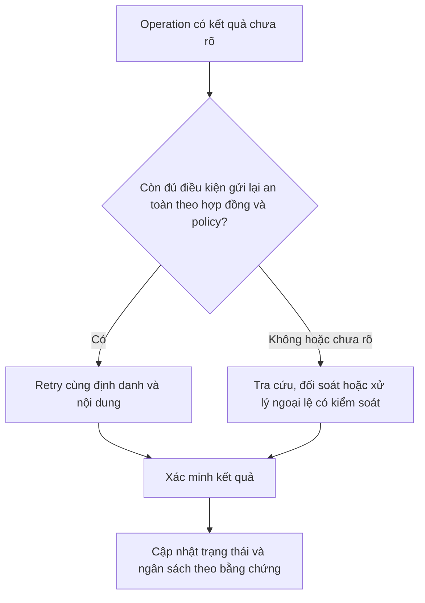

# Rà soát rủi ro còn lại trong bảo mật logic nghiệp vụ

## 1. Rủi ro còn lại là gì?

**Rủi ro còn lại** (*residual risk*) là phần rủi ro vẫn tồn tại sau khi các biện pháp xử lý đã được áp dụng. Với bảo mật logic nghiệp vụ, đó có thể là khả năng hoặc hậu quả vẫn còn của việc sai quyền, bỏ bước, sửa nội dung, chiếm tài nguyên hoặc thực thi một nghiệp vụ nhiều lần.

NIST định nghĩa thuật ngữ này theo phần rủi ro còn lại sau biện pháp bảo vệ hoặc sau việc thực hiện phản ứng rủi ro. Xem [NIST CSRC Glossary: Residual risk](https://csrc.nist.gov/glossary/term/residual_risk).

**Residual risk review** là việc xem lại kịch bản, hiệu lực kiểm soát và bằng chứng để xác định:

- Điều gì vẫn có thể xảy ra?
- Trong điều kiện nào, trên tài sản và phạm vi nào?
- Hậu quả, mức khả năng xảy ra và mức không chắc chắn là gì?
- Có cần giảm thiểu thêm, tránh hoạt động, chia sẻ một phần hậu quả hoặc chấp nhận trong điều kiện rõ ràng không?
- Ai chịu trách nhiệm, theo dõi bằng gì và khi nào phải xem lại?

Có rủi ro còn lại không tự có nghĩa là thiết kế thất bại. Nhưng gọi một vấn đề là “residual risk” cũng không biến nó thành được chấp nhận hoặc đã xử lý xong.

Bài học thuộc chương **Threat Modeling** của module **SECURITY_APPLICATION_SECURITY_BUSINESS_LOGIC_SECURITY**. Trọng tâm là đánh giá rủi ro từ quy tắc nghiệp vụ, quyền đối tượng, state machine, transaction, idempotency và bằng chứng kiểm thử tương ứng.

## 2. Phân biệt ba thời điểm đánh giá

| Khái niệm | Cách hiểu trong bài | Điều cần tránh |
|---|---|---|
| Rủi ro vốn có (*inherent risk*) | Mức rủi ro theo baseline khi chưa tính những kiểm soát đang được đánh giá | Không mô tả baseline đến mức mỗi người hình dung một hệ thống khác |
| Rủi ro còn lại hiện tại | Đánh giá sau các kiểm soát thực sự đang áp dụng trong phạm vi xác định | Không tính biện pháp mới nằm trong kế hoạch như đã có hiệu lực |
| Rủi ro mục tiêu/dự kiến | Mức kỳ vọng sau khi hoàn thành phương án xử lý bổ sung | Không trình bày dự báo như kết quả đã được kiểm chứng |

Ví dụ:

```text
Kịch bản: xử lý lại một quyết định hoàn tiền sau timeout.

Hiện tại:
- Có định danh nội bộ và khóa idempotency.
- Chưa xác nhận cách xử lý retry sau cửa sổ bảo đảm của nhà cung cấp.

Kế hoạch:
- Chặn replay mù sau cửa sổ đó.
- Chuyển sang quy trình làm rõ kết quả.

Kết luận:
- Phần bảo vệ dự kiến chưa được dùng để hạ rủi ro hiện tại
  cho đến khi có triển khai và bằng chứng phù hợp.
```

Các thời điểm phải dùng cùng tài sản, kịch bản và phạm vi đủ tương ứng. Nếu đổi từ “mất tiền toàn hệ thống” sang “một request đơn lẻ”, việc điểm số giảm có thể chỉ do đổi câu hỏi.

## 3. Không nhầm rủi ro với trạng thái công việc

### 3.1. Những khái niệm liên quan nhưng khác nhau

| Thông tin | Ý nghĩa | Có tự chứng minh rủi ro đã giảm không? |
|---|---|---|
| Kịch bản đe dọa | Chuỗi có thể dẫn đến hậu quả xấu | Chưa; cần biết điều kiện và kiểm soát |
| Lỗ hổng đã xác nhận | Một điểm yếu có bằng chứng | Chưa; cần biết tác động và đường khai thác |
| Pull request đã merge | Mã đã được tích hợp | Chưa chứng minh đã triển khai đúng |
| Kiểm soát đã triển khai | Cơ chế đang có trong môi trường xét | Cần kiểm chứng phạm vi và hiệu lực |
| Kiểm thử vượt qua | Bằng chứng cho một tập điều kiện | Không bao phủ mặc nhiên mọi đường và tình huống |
| Rủi ro được chấp nhận | Quyết định có thẩm quyền trong điều kiện đã ghi | Không làm lỗ hổng biến mất |
| Vấn đề ngoài phạm vi | Không được phân tích trực tiếp trong mô hình này | Không đồng nghĩa rủi ro đã được chấp nhận |

Rủi ro hiện tại có thể bao gồm một lỗ hổng chưa sửa. Khi đó phải giữ thông tin lỗ hổng và công việc xử lý rõ ràng; không đổi nhãn để tạo ấn tượng kiểm soát đã hoàn tất.

### 3.2. Không kết luận từ số lượng biện pháp

Danh sách “có JWT, transaction, idempotency và audit” còn thiếu câu trả lời:

- JWT được chấp nhận cho đối tượng và hành động nào?
- Transaction giữ nhất quán những dòng dữ liệu nào?
- Khóa idempotency có phạm vi và thời hạn gì?
- Audit giúp ngăn, phát hiện hay chỉ dựng lại sự việc?

Một cơ chế có thể hoạt động đúng theo thiết kế mà vẫn để lại đường lạm dụng. Chẳng hạn, giới hạn 5.000.000 VND mỗi đề nghị không ngăn một người tạo nhiều đề nghị nếu không có giới hạn tổng tương ứng.

## 4. Đầu vào cần có cho một lần rà soát

### 4.1. Chốt baseline và phạm vi

Trước khi đánh giá, cần nhận diện được:

- Quy trình, phiên bản thiết kế và môi trường đang xét.
- Tài sản và business invariants cần bảo vệ.
- Tác nhân, quyền có thể sử dụng và các đường vào.
- Các nhánh hủy, timeout, retry, xử lý nền và can thiệp vận hành.
- Kiểm soát đang bật, cấu hình có ý nghĩa và phụ thuộc bên ngoài.
- Những thay đổi kể từ lần đánh giá trước.

Không suy ra môi trường thật đã có kiểm soát chỉ vì một nhánh code thử nghiệm đã có. Nếu nhiều tenant, phiên bản hoặc nhà cung cấp có cấu hình khác nhau, cần ghi rõ kết luận áp dụng cho nhóm nào.

### 4.2. Lập bảng bằng chứng theo kịch bản

| Nhóm bằng chứng | Điều giúp xác nhận | Giới hạn thường gặp |
|---|---|---|
| Đặc tả nghiệp vụ | Quy tắc và kết quả được phép | Có thể còn mơ hồ hoặc đã thay đổi |
| Thiết kế và đường ghi | Nơi đặt kiểm soát, dữ liệu liên quan | Chưa chứng minh môi trường thực tế dùng đúng đường |
| Cấu hình triển khai | Cơ chế và giới hạn đang bật | Có thể khác giữa tenant hoặc instance |
| Unit test | Logic policy trong điều kiện đã mô tả | Không mô phỏng đầy đủ transaction hoặc hệ thống ngoài |
| Integration/concurrency test | Ràng buộc, rollback và cạnh tranh cụ thể | Phải tương ứng cơ sở dữ liệu và đường thực thi |
| Kiểm thử luồng/lỗi giữa chừng | Retry, sự kiện trùng và kết quả đến muộn | Mô phỏng có thể chưa giống hợp đồng ngoài |
| Telemetry và đối soát | Hành vi vận hành, chênh lệch và thời gian xử lý | Chỉ quan sát được điều hệ thống có khả năng phát hiện |
| Diễn tập phục hồi | Khả năng tìm, dừng hoặc làm rõ nghiệp vụ | Kết quả cũ có thể không còn đúng sau thay đổi |

Các nhóm bằng chứng bổ sung cho nhau. Không phải mọi rủi ro cần cùng mức kiểm tra, nhưng bằng chứng phải phù hợp với điều đang được khẳng định.

### 4.3. Gắn mức trưởng thành đúng với kiểm soát

Có thể ghi riêng các trạng thái như:

```text
Đề xuất → Đã triển khai → Đã kiểm chứng trong điều kiện nêu rõ
                          → Đang được theo dõi vận hành
```

Đây là cách biểu diễn minh họa, không phải thang trạng thái bắt buộc của một tiêu chuẩn.

Một kiểm soát đã triển khai nhưng chưa có đủ bằng chứng vẫn có giá trị thiết kế, song mức tin cậy vào hiệu lực của nó cần được trình bày đúng. Không mặc định “chưa kiểm chứng” là chắc chắn thất bại, cũng không coi là chắc chắn thành công.

## 5. Đánh giá kiểm soát theo mục tiêu và giới hạn

### 5.1. Mỗi kiểm soát tác động vào phần nào của kịch bản?

| Kiểm soát | Tác dụng chính có thể có | Phần rủi ro cần xem tiếp |
|---|---|---|
| Quyền theo đối tượng | Chặn tác động sai đơn/tenant/khách | Đường bị bỏ sót, scope sai, dữ liệu quyền cũ |
| State machine và cập nhật có điều kiện | Chặn bỏ bước và chuyển trạng thái cạnh tranh | Mọi đường ghi có thực thi điều kiện không? |
| Transaction giữ ngân sách | Ngăn chấp nhận vượt lượng trong phạm vi được điều phối | Quy tắc tổng trên nhiều đối tượng hoặc hệ thống ngoài |
| Idempotency | Hạn chế tác dụng phụ lặp cho cùng thao tác | Khóa mới, thời hạn, phạm vi và hợp đồng nhà cung cấp |
| Tách trách nhiệm | Giảm khả năng một chủ thể tự hoàn tất hành động nhạy cảm | Nhiều tài khoản cùng người, thông đồng hoặc quyền bị gán sai |
| Hạn mức | Giới hạn phạm vi hoặc quy mô tổn thất | Cộng dồn theo thời gian, nhiều tài khoản hoặc nhiều kênh |
| Audit và cảnh báo | Phát hiện, điều tra, truy trách nhiệm | Tác hại có thể đã xảy ra trước khi phát hiện |
| Đối soát và phục hồi | Làm rõ kết quả, sửa chênh lệch hoặc xử lý hậu quả | Độ trễ, dữ liệu thiếu và khả năng không đảo ngược được |

Bằng chứng phải cho thấy cơ chế bảo vệ đúng bất biến. Ví dụ, một transaction trên dòng đơn chưa tự bảo vệ hạn mức chung của khách trên nhiều đơn.

OWASP tổng hợp các nhóm kiểm soát như kiểm tra server-side, workflow, cạnh tranh và chống xử lý lặp trong [Business Logic Security Cheat Sheet](https://cheatsheetseries.owasp.org/cheatsheets/Business_Logic_Security_Cheat_Sheet.html). Khi rà soát, cần nối từng cơ chế với đường lạm dụng cụ thể.

### 5.2. Kiểm tra độ bao phủ

Một kiểm soát đúng ở API khách có thể không được dùng ở API hỗ trợ. Một worker chính có thể giữ định danh lệnh đúng nhưng công cụ replay lại tạo định danh khác.

Với mỗi kiểm soát, hãy chỉ ra:

- Đối tượng, hành động và trạng thái được bảo vệ.
- Các đường trực tiếp và bất đồng bộ phải đi qua.
- Khoảng thời gian còn hiệu lực.
- Điều kiện phụ thuộc như nguồn quyền, đồng hồ hoặc registry.
- Hành vi khi thành phần lỗi, không tìm được dữ liệu hoặc timeout.

Mặc định cho phép khi thiếu dữ liệu, dùng giá trị client làm phương án thay thế hoặc bỏ qua kiểm tra để “xử lý tiếp” có thể tạo phần rủi ro lớn hơn dự kiến.

### 5.3. Kiểm soát phát hiện không xóa tác hại tức thời

Một cảnh báo sau khoản hoàn trùng có thể giúp dừng các khoản tiếp theo. Nó chưa chứng minh khoản đầu đã được ngăn hoặc thu hồi.

Tương tự, hoàn trả được tiền về sau không làm một lần lộ dữ liệu cá nhân chưa từng xảy ra. Khi đánh giá phần còn lại, cần xét cả hậu quả phục hồi được và không phục hồi được.

Nếu dựa vào đối soát thủ công, phải kiểm tra người phụ trách, quyền truy cập, thời gian phản ứng và việc họ có đủ bằng chứng để làm rõ kết quả. Một runbook chưa được thực hành không tự chứng minh khả năng phục hồi.

## 6. Ước lượng phần còn lại và thể hiện sự không chắc chắn

### 6.1. Viết lại kịch bản sau kiểm soát

Không chỉ ghi “trước cao, sau thấp”. Hãy mô tả điều kiện còn có thể dẫn đến hậu quả:

```text
Sau kiểm soát C:
- Tác nhân còn cần quyền hoặc điều kiện gì?
- Phải đi qua đường nào?
- Cơ chế nào đã chặn được?
- Trường hợp nào vẫn chưa được chặn hoặc chưa được xác nhận?
- Hậu quả còn lan đến đâu và kéo dài bao lâu?
```

Ví dụ, sau kiểm tra quyền theo đơn, người ngoài quyền có thể bị chặn. Rủi ro từ một nhân viên có quyền hợp lệ nhưng dùng sai mục đích vẫn cần đánh giá theo hạn mức, tách trách nhiệm và khả năng quan sát.

### 6.2. Khả năng xảy ra và tác động cần có căn cứ

Có thể đánh giá định tính hoặc định lượng tùy dữ liệu và chính sách của tổ chức. Khi dùng mức như thấp, trung bình, cao, phải định nghĩa tiêu chí và khoảng thời gian áp dụng.

Các câu hỏi thực tế gồm:

- Đường còn lại có công khai không hay cần quyền đặc biệt?
- Có cần phối hợp nhiều điều kiện hiếm, hay chỉ cần retry bình thường?
- Có thể thực hiện nhiều lần với chi phí thấp không?
- Tác động giới hạn ở một đơn, một tenant hay nhiều khách?
- Hệ thống có giới hạn cộng dồn thật sự không?
- Tổn thất được phát hiện và dừng trong khoảng nào?
- Bằng chứng có đại diện cho môi trường, thời gian và tác nhân đang xét không?

Mức thành công của một lần thử không đồng nghĩa tần suất tổn thất trong một năm. Một hành vi khó thành công từng lần vẫn có thể đáng quan tâm nếu được lặp với khối lượng lớn.

Nếu kiểm soát chỉ giảm khả năng xảy ra, không tự hạ luôn mức tác động. Ngược lại, một hạn mức tổng được kiểm chứng có thể giảm quy mô tổn thất trong phạm vi cụ thể dù đường lạm dụng vẫn còn.

### 6.3. Không tạo độ chính xác giả

Điểm 1–5 thường là thứ bậc theo quy ước. Tích của hai điểm không tự trở thành xác suất hoặc giá trị tổn thất kỳ vọng. Nếu tổ chức dùng ma trận, cần áp dụng đúng ý nghĩa và quy tắc của ma trận đó.

Cũng không tự nhân các “xác suất thất bại” của nhiều lớp khi chưa có bằng chứng về tính độc lập và cùng cách đo. Hai lớp cùng phụ thuộc một nguồn quyền hoặc một tài khoản quản trị có thể hỏng cùng lúc.

Nếu chưa đủ dữ liệu, ghi rõ mức chưa chắc chắn, phạm vi giá trị hoặc điều cần xác nhận. Không có dữ liệu về sự cố có thể do không có khả năng quan sát, không chỉ do sự cố chưa từng xảy ra.

NIST SP 800-30 thảo luận sự không chắc chắn trong đánh giá và các cách truyền đạt kết quả phù hợp. Xem [Guide for Conducting Risk Assessments](https://csrc.nist.gov/pubs/sp/800/30/r1/final).

### 6.4. Tách mức rủi ro và độ tin cậy của nhận định

| Nhận định | Cách hiểu |
|---|---|
| Tác động lớn, khả năng chưa xác định, độ tin cậy thấp | Cần thêm bằng chứng hoặc giới hạn đường rủi ro trước khi kết luận |
| Tác động giới hạn, cơ chế giới hạn đã được kiểm chứng | Có căn cứ về phạm vi thiệt hại, chưa có nghĩa xác suất bằng 0 |
| Đánh giá thấp nhưng dựa vào giả định chưa xác nhận | Kết luận yếu hơn nhãn “thấp” gợi ra |
| Đánh giá cao với bằng chứng rõ | Có cơ sở để ưu tiên và chọn xử lý phù hợp |

Không dùng độ tin cậy thấp như lý do tự giảm mức rủi ro. Với hậu quả nghiêm trọng, thiếu bằng chứng có thể chính là lý do phải thận trọng trong quyết định.

## 7. Ví dụ: idempotency có thời hạn và replay khoản hoàn

### 7.1. Giả định minh họa

Xét một luồng hoàn tiền có:

- Một quyết định được duyệt hoàn 1.000.000 VND cho giao dịch gốc.
- Bản ghi thực thi cục bộ và định danh nghiệp vụ ổn định.
- Khóa idempotency gửi cho nhà cung cấp được giữ nguyên qua retry.
- Transaction giữ ngân sách hoàn trong database.
- Webhook và job đối soát.
- Nhà cung cấp **giả định** chỉ cam kết chống trùng tối thiểu 24 giờ theo hợp đồng.
- Ứng dụng cho phép tự động hoặc thủ công replay đến 72 giờ.

Các con số và khả năng nhà cung cấp trong phần này hoàn toàn giả định để phân tích. Chúng không mô tả chính sách của một dịch vụ thanh toán cụ thể và không phải kết quả kiểm thử của dự án.

### 7.2. Chuỗi gây rủi ro còn lại

```text
T0:
- Worker gửi lệnh với khóa K.
- Nhà cung cấp thực hiện khoản hoàn.
- Response bị mất; dữ liệu cục bộ ở trạng thái UNKNOWN.

Sau cửa sổ bảo đảm:
- Nhà cung cấp có thể không còn lưu căn cứ chống trùng cho K.
- Worker hoặc người vận hành replay với cùng khóa K.
- Lệnh có thể được coi là một yêu cầu mới.
```

Sau 24 giờ không có nghĩa chắc chắn nhà cung cấp đã xóa khóa. Nhưng từ hợp đồng giả định, chưa có đủ bảo đảm để kết luận replay ở giờ thứ 48 sẽ không hoàn thêm.

Giữ khóa lâu hơn ở database của ứng dụng không tự kéo dài thời gian nhà cung cấp nhớ khóa. Bản ghi cục bộ duy nhất cũng không ngăn một lời gọi bên ngoài bị coi là mới khi operation đang chưa rõ kết quả và vẫn được gửi lại.

Nếu tổng tiền đơn đủ lớn, hai khoản 1.000.000 VND có thể chưa vượt số tiền đã thu nhưng vẫn vi phạm quy tắc: **một quyết định chỉ được thực thi một lần theo chính sách**.

### 7.3. Bảng rà soát theo mục tiêu

| Kiểm soát đang được giả định | Phần đã hỗ trợ | Điều còn thiếu |
|---|---|---|
| Unique operation nội bộ | Không tạo thêm object thực thi tùy ý | Chưa quyết định khi nào được gửi lại operation UNKNOWN |
| Khóa K ổn định | Chống trùng trong điều kiện nhà cung cấp cam kết | Không có căn cứ cho toàn bộ cửa sổ replay 72 giờ |
| Transaction ngân sách | Bảo vệ sổ lượng cục bộ khi thực hiện đúng | Không rollback khoản hoàn bên ngoài |
| Webhook | Cập nhật khi có sự kiện hợp lệ | Có thể trễ, lặp hoặc chưa đến |
| Đối soát | Có hướng làm rõ chênh lệch | Cần biết thời gian, dữ liệu, người phụ trách và quyền xử lý |
| Hạn mức mỗi khoản | Giới hạn một khoản cụ thể | Không tự giới hạn mọi khoản lặp hoặc cộng dồn |

Một review chỉ kiểm tra rằng “có idempotency key” sẽ bỏ qua sự không khớp giữa các cửa sổ thời gian.

### 7.4. Hướng xử lý cần đánh giá thêm

Có thể thiết kế để sau khi không còn đủ căn cứ gửi lại an toàn, operation chuyển sang làm rõ kết quả thay vì tiếp tục gửi lệnh hoàn một cách mù quáng.



Điều kiện an toàn không chỉ là so sánh giờ hiện tại với một hằng số. Phải hiểu mốc tính thời gian của nhà cung cấp, phạm vi khóa, dữ liệu so sánh, độ trễ, độ lệch đồng hồ và ngữ nghĩa khi request chưa rõ đã được tiếp nhận hay chưa.

Một truy vấn tạm thời báo “không tìm thấy” cũng chưa luôn chứng minh lệnh cũ không thể hoàn thành về sau. Quy trình phải dựa trên trạng thái và hợp đồng có đủ thẩm quyền cho quyết định tiếp theo.

Sau thay đổi, vẫn còn các câu hỏi:

- Đối soát có phát hiện được đúng giao dịch không?
- Ai xử lý khoản chờ lâu?
- Có thể vô tình giải phóng ngân sách khi kết quả chưa rõ không?
- Việc dừng replay có làm chậm yêu cầu hợp lệ ngoài mức chấp nhận không?
- Công cụ vận hành có thể bỏ qua hàng rào mới không?

Chỉ hạ đánh giá hiện tại sau khi có bằng chứng về kiểm soát và các giới hạn đó.

### 7.5. Cách diễn đạt kết luận có ích

Kết luận yếu:

> Có idempotency và log nên rủi ro thấp.

Kết luận cụ thể hơn:

> Trong mô hình này, chống trùng của nhà cung cấp chưa bao phủ toàn bộ thời gian ứng dụng cho phép replay. Khi kết quả còn UNKNOWN sau cửa sổ được bảo đảm, cùng một quyết định có thể bị thực thi thêm. Cần kiểm soát đường replay và xác nhận khả năng làm rõ kết quả; chưa đủ căn cứ dùng biện pháp dự kiến để giảm đánh giá hiện tại.

Đây là kết luận phân tích ví dụ, không phải phát hiện đã xác nhận về một hệ thống đang triển khai.

## 8. Chọn phản ứng và người có thẩm quyền

### 8.1. Những hướng xử lý thường gặp

| Hướng | Ý nghĩa | Ví dụ trong luồng hoàn |
|---|---|---|
| Giảm thiểu | Bổ sung hoặc cải thiện kiểm soát | Hạn chế replay theo hợp đồng, bảo vệ chuyển trạng thái và kiểm chứng đối soát |
| Tránh | Loại bỏ hoạt động hoặc điều kiện gây rủi ro | Không cho tự động replay sau khi hết căn cứ an toàn |
| Chia sẻ/chuyển một phần | Phân bổ một phần hậu quả hoặc nghĩa vụ với bên khác | Hợp đồng và cơ chế cung cấp bảo đảm xử lý rõ hơn |
| Chấp nhận | Chủ thể có thẩm quyền quyết định giữ phần rủi ro trong ngưỡng và điều kiện đã ghi | Theo dõi một phần chậm trễ còn lại với trách nhiệm và tiêu chí xem lại |

Các hướng có thể kết hợp. Chia sẻ một phần tổn thất không xóa mọi hậu quả đối với dữ liệu, uy tín hoặc vận hành. Chấp nhận cần đi kèm theo dõi theo chính sách.

NIST IR 8286B liên hệ lựa chọn phản ứng với mức chấp nhận của tổ chức và hồ sơ rủi ro. Xem [Prioritizing Cybersecurity Risk for Enterprise Risk Management, bản cập nhật 2025](https://csrc.nist.gov/pubs/ir/8286/b/upd1/final).

### 8.2. Phân biệt trách nhiệm

| Vai trò | Trách nhiệm minh họa |
|---|---|
| Chủ rủi ro | Chịu trách nhiệm quản lý rủi ro trong phạm vi được giao |
| Người có quyền quyết định chấp nhận | Quyết định trong giới hạn thẩm quyền và tiêu chí của tổ chức |
| Người thực hiện xử lý | Triển khai biện pháp và cung cấp bằng chứng |
| Người đánh giá | Kiểm tra kịch bản, giả định và tính phù hợp của bằng chứng |
| Người vận hành | Theo dõi tín hiệu, xử lý bất thường và duy trì khả năng phục hồi |

Một người có thể giữ nhiều vai trò nếu tổ chức cho phép. Tuy nhiên, không nên mặc định người sửa code có quyền chấp nhận mọi hậu quả nghiệp vụ.

Nếu rủi ro vượt thẩm quyền hoặc vi phạm một điều kiện bắt buộc, phải chuyển quyết định đến đúng cấp. Một chữ ký của người không có quyền không làm phần rủi ro trở thành hợp lệ.

### 8.3. Chấp nhận có điều kiện phải phản ánh trạng thái thật

Nếu quyết định phụ thuộc vào kiểm soát C phải được bật trước khi vận hành, thì trước khi điều kiện đó hoàn tất, trạng thái vẫn là chờ xử lý hoặc chờ quyết định theo quy trình.

Có thể ghi việc chấp nhận phần còn lại cùng một kế hoạch cải thiện tiếp theo, nhưng phải phân biệt:

- Điều kiện bắt buộc đang phải được thỏa ngay.
- Nghĩa vụ tiếp tục duy trì trong thời gian chấp nhận.
- Hành động bổ sung có thời hạn.
- Mốc hoặc sự kiện làm quyết định phải được xem lại.

Im lặng, hết sprint hoặc không ai phản đối không nên được trình bày thành quyết định chấp nhận có căn cứ.

## 9. Mẫu hồ sơ rủi ro còn lại

Một hồ sơ nên đủ để người chưa tham gia buổi review hiểu quyết định:

| Trường | Nội dung cần ghi |
|---|---|
| ID và liên kết | Kịch bản đe dọa, bất biến, thay đổi hoặc sự cố liên quan |
| Phạm vi/baseline | Luồng, môi trường, tenant, nhà cung cấp và phiên bản áp dụng |
| Kịch bản còn lại | Tác nhân, điều kiện, chuỗi hành vi và hậu quả |
| Kiểm soát hiện tại | Cơ chế, phạm vi và cấu hình có ý nghĩa |
| Bằng chứng | Nguồn, thời điểm, điều kiện kiểm tra và giới hạn |
| Đánh giá hiện tại | Khả năng, tác động, khoảng thời gian, mức không chắc chắn |
| Biện pháp dự kiến | Điều cần làm, người phụ trách và kết quả phải chứng minh |
| Rủi ro mục tiêu | Dự báo sau phương án, tách khỏi hiện trạng |
| Quyết định | Phản ứng, người có quyền, căn cứ và điều kiện |
| Theo dõi | Tín hiệu, giới hạn, người phản ứng và tiêu chí chuyển cấp |
| Xem lại | Thời hạn hoặc sự kiện kích hoạt, trạng thái và lịch sử thay đổi |

NIST IR 8286A trình bày cách đưa kịch bản, khả năng và tác động vào hồ sơ rủi ro phục vụ quyết định. Xem [Identifying and Estimating Cybersecurity Risk for Enterprise Risk Management, Rev. 1](https://csrc.nist.gov/pubs/ir/8286/a/r1/final).

Một bản ghi minh họa cho ví dụ:

```text
ID: RR-REFUND-02
Bất biến: một quyết định hoàn không được thực thi thêm khi xử lý lại.
Phạm vi: operation UNKNOWN, worker và công cụ replay.

Phần còn lại:
- Cửa sổ replay 72 giờ dài hơn bảo đảm chống trùng 24 giờ
  của hợp đồng giả định.

Hiện trạng bằng chứng:
- Các cơ chế trong ví dụ là giả định thiết kế.
- Cần xác nhận hợp đồng và kiểm thử đường hết cửa sổ.
- Chưa có kết quả kiểm thử thực tế trong bài học này.

Hướng xử lý đề xuất:
- Hạn chế gửi lại khi không còn đủ căn cứ an toàn.
- Hoàn thiện và kiểm chứng quy trình làm rõ kết quả.
- Giữ riêng trạng thái và ngân sách của khoản chưa rõ.

Trạng thái:
- Chờ xử lý/đánh giá thêm; chưa phải một quyết định chấp nhận.

Chủ trách nhiệm:
- Cần chỉ định theo quy trình thực tế của tổ chức.

Xem lại khi:
- Có bằng chứng triển khai, thay nhà cung cấp, thay cửa sổ retry,
  xuất hiện khoản trùng hoặc quá hạn xử lý UNKNOWN.
```

Không cần một thang điểm rất chi tiết để làm rõ khoảng trống này. Điều cần có là kịch bản, hậu quả, bằng chứng còn thiếu và người chịu trách nhiệm tiếp tục xử lý.

## 10. Kiểm chứng những điều đã dùng để giảm đánh giá

### 10.1. Ma trận kiểm chứng theo bất biến

Các tình huống dưới đây là đề xuất cho một hệ thống cụ thể hóa mô hình; bài học không báo cáo rằng chúng đã được chạy.

| Tình huống | Điều cần chứng minh |
|---|---|
| Hai đề nghị 800.000 VND tranh phần còn lại 1.000.000 VND | Không chấp nhận cả hai nguyên số tiền nếu chính sách không cho giảm nội dung; không có phần giữ mồ côi |
| Tạo đề nghị lỗi sau khi giữ ngân sách | Rollback đúng phần dữ liệu cục bộ |
| Cùng operation và cùng key được retry trong điều kiện hợp đồng cho phép | Một tác dụng nghiệp vụ tương ứng, dù có nhiều lần gọi mạng |
| Operation UNKNOWN được replay sau cửa sổ bảo đảm | Không gửi lại lệnh một cách mù quáng; đi vào quy trình làm rõ đã thiết kế |
| Bản ghi idempotency request hết hạn | Ràng buộc nghiệp vụ dài hạn vẫn ngăn chạy lại quyết định đã dùng |
| Worker dừng sau tác dụng phụ nhưng trước khi lưu kết quả | Có thể tìm và làm rõ operation, không suy ra chưa thực hiện |
| Công cụ vận hành replay với key mới | Không bỏ ràng buộc theo quyết định/execution |
| Webhook đúng nguồn nhưng sai đơn, số tiền hoặc tiền tệ | Không chuyển nhầm thành công hoặc cập nhật sổ lượng |
| Client gửi cờ approved hoặc đổi nội dung sau duyệt | Backend giữ đúng điều kiện và phiên bản được duyệt |
| Quyền support bị thu hồi trong lúc xử lý | Hành vi đáp ứng cam kết thu hồi tại điểm quyết định đã quy định |
| Giới hạn tồn tại ở API khách nhưng có thêm đường hỗ trợ | Đường hỗ trợ không vượt phạm vi giới hạn mà mô hình đang dựa vào |
| Job đối soát chậm hoặc mất dữ liệu đầu vào | Tình trạng được phát hiện và có trách nhiệm xử lý, không giải phóng UNKNOWN tùy tiện |
| Kích hoạt tạm dừng tác vụ rủi ro | Chặn đúng công việc mới và tiếp tục xử lý nghĩa vụ đang tồn tại theo policy |

Nếu một kiểm soát là căn cứ chính cho kết luận, kiểm thử cần có khả năng phát hiện khi điều kiện bảo vệ tương ứng bị thiếu hoặc áp dụng sai. Một bài test chỉ gọi đúng luồng thuận lợi thường không đủ cho nhận định về xử lý tấn công logic.

### 10.2. Phù hợp giữa bằng chứng và môi trường

Trong ứng dụng Java, policy có thể đúng trong unit test nhưng repository dùng cách ghi không nguyên tử. Một mock nhà cung cấp giữ key vô hạn có thể che mất rủi ro hết cửa sổ ở hệ thống ngoài.

Cần ghi rõ:

- Cơ sở dữ liệu và hành vi transaction được kiểm tra.
- Những entry point và instance tham gia.
- Cách tạo sự chồng lấn thực sự cho kiểm thử cạnh tranh.
- Cách mô phỏng thời gian, timeout, mất response và thông điệp trùng.
- Hợp đồng nào của nhà cung cấp được mô phỏng, phần nào còn cần xác nhận riêng.
- Dữ liệu quan sát sau khi tiến trình hoặc thành phần khởi động lại.

Thời gian có thể được điều khiển trong test để kiểm tra các mốc trước, đúng và sau hạn. Điều đó không thay thế việc xác nhận mốc hợp đồng ngoài được tính từ đâu.

### 10.3. Kiểm tra kết quả, không chỉ mã phản hồi

Một request trả lỗi vẫn có thể đã gây tác dụng phụ trước khi lỗi xuất hiện. Một bảng chỉ có một operation vẫn có thể liên hệ với hai khoản hoàn bên ngoài.

Cần quan sát trạng thái, ngân sách, sự kiện, actual actor và kết quả ở ranh giới liên quan. Với số lần thực thi, phân biệt:

```text
Số request kỹ thuật
Số quyết định nghiệp vụ
Số operation đã được chấp nhận
Số tác dụng phụ bên ngoài thực sự xảy ra
```

Chúng không nhất thiết bằng nhau. Bằng chứng phải phù hợp với bất biến mà kết luận đang dựa vào.

## 11. Theo dõi phần rủi ro đã được giữ lại

### 11.1. Chỉ số phải gắn với giả thuyết rủi ro

| Phần rủi ro | Tín hiệu cần xem | Phản ứng cần xác định |
|---|---|---|
| UNKNOWN tồn tại lâu | Tuổi operation cũ nhất, số lượng và số tiền liên quan | Người làm rõ, ngưỡng chuyển cấp và giới hạn tác vụ mới |
| Replay ngoài điều kiện an toàn | Lần thử bị chặn, nguồn gọi, định danh liên quan | Điều tra công cụ hoặc đường tự động gây ra |
| Lệch ledger với nhà cung cấp | Khoản trùng, thiếu hoặc sai số tiền | Đối soát và xử lý theo bằng chứng |
| Vượt phạm vi grant | Từ chối theo khách/đơn/tenant, hành vi đổi ID | Kiểm tra phân quyền và khả năng tài khoản bị lạm dụng |
| Chia nhỏ để né hạn mức | Tổng theo chủ thể, tài nguyên và khoảng thời gian | Xem lại giới hạn tổng và căn cứ cấp quyền |
| Mất khả năng quan sát | Collector ngừng, sự kiện thiếu, truy vấn lỗi | Khôi phục bằng chứng và đánh giá tác động đến quyết định |
| Kiểm soát bị tắt hoặc cấu hình lệch | Khác biệt giữa môi trường/tenant/instance | Xác nhận phạm vi kết luận còn hiệu lực |

Một biểu đồ đẹp chưa chứng minh có người phản ứng. Cần có quyền truy cập, người phụ trách, đường chuyển cấp và cách xử lý tình huống quá tải.

### 11.2. Dùng đúng ý nghĩa của các con số

Nếu 95% operation được làm rõ trong 15 phút, điều đó không bảo đảm mọi operation được giải quyết trong 15 phút. Cần xem phần đuôi, khoản cũ nhất và mức tiền có thể tiếp tục tích lũy.

Một tỷ lệ lỗi thấp trên lượng giao dịch lớn vẫn có thể tạo hậu quả đáng kể. Ngược lại, vài lỗi kỹ thuật có thể đã được retry an toàn và không trở thành tổn thất nghiệp vụ.

Định nghĩa tử số, mẫu số, phạm vi và thời gian đo. Phân biệt chỉ số vận hành tốt với bằng chứng trực tiếp về rủi ro.

### 11.3. Chuẩn bị khả năng hạn chế tác hại

Tùy chính sách, có thể cần cách tạm dừng một đường thực thi, vô hiệu hóa grant, giảm phạm vi tác vụ mới hoặc đưa operation sang xử lý có kiểm soát.

Cần biết cơ chế dừng có hiệu lực ở giai đoạn nào. Một lệnh đã gửi ra ngoài không tự bị thu hồi vì ứng dụng vừa tắt worker.

Dừng xử lý cũng không được làm mất nghĩa vụ với các khoản đang chờ. Không xóa operation UNKNOWN hoặc trả ngân sách chỉ để danh sách chờ trông sạch hơn.

Kế hoạch này có thể làm giảm khả dụng hoặc tăng chi phí vận hành. Những tác động đó phải được xem cùng mục tiêu bảo vệ tiền và tính đúng của quy trình.

### 11.4. Chấp nhận cần điều kiện xem lại

Các điều kiện phổ biến gồm:

- Đến mốc đánh giá mà tổ chức đã quy định.
- Kiểm soát bị tắt hoặc bằng chứng quan trọng không còn đại diện.
- Thay đổi cửa sổ retry, hợp đồng, scope hoặc provider.
- Thêm API, worker, công cụ hỗ trợ hoặc cách can thiệp mới.
- Chạm ngưỡng tồn đọng, tổn thất hoặc hành vi lạm dụng.
- Có sự cố, near miss hoặc kịch bản mới làm sai giả định.
- Người hoặc nhóm chịu trách nhiệm thay đổi.

Khi điều kiện chấp nhận không còn đúng, phải đưa rủi ro trở lại luồng quyết định theo quy trình. Không tự động gia hạn kết luận cũ chỉ vì chưa có sự cố mới được báo cáo.

## 12. Xem cả rủi ro cộng dồn và phụ thuộc chung

### 12.1. Hạn mức từng lần không phải cận tổn thất tổng

Giả sử một quyền cho phép mỗi đề nghị tối đa 5.000.000 VND. Một trăm đề nghị như vậy có tổng 500.000.000 VND nếu các điều kiện còn lại cho phép.

Con số này chỉ minh họa việc cộng dồn, không phải ước lượng tổn thất thực tế. Muốn nêu cận, cần biết số lần được chấp nhận, khoảng thời gian, tổng ngân sách, quyền chủ thể và mọi đường gây tiền ra.

Một bộ đếm giới hạn số tiền đề nghị cục bộ cũng chưa tự giới hạn tiền ra bên ngoài nếu replay có thể gây thêm tác dụng phụ mà không tạo thêm đề nghị. Kiểm soát phải bao phủ đại lượng thực sự gây hậu quả.

Giới hạn theo ngày còn cần định nghĩa ngày nghiệp vụ, thời điểm quy thuộc, xử lý khoản chờ và hành vi tại ranh giới kỳ. Không nên dùng nhãn “có cap” để kết luận cho mọi cửa sổ thời gian.

### 12.2. Nhiều lớp có thể cùng một điểm hỏng

Ví dụ:

- API khách và API hỗ trợ cùng tin một trường owner do client gửi.
- Worker và công cụ replay cùng dùng một thư viện tạo key sai.
- Bản ghi nghiệp vụ và log điều tra đều có thể bị một tài khoản quản trị sửa.
- Nhiều kiểm soát quyền cùng dựa vào cache không còn đáp ứng cam kết thu hồi.

Không coi đây là các bảo vệ độc lập chỉ vì chúng xuất hiện ở nhiều lớp. Cần xác định nguồn dữ liệu, quyền quản trị và điều kiện lỗi chung.

### 12.3. Các rủi ro riêng lẻ có thể tạo chuỗi

Một độ trễ thu hồi quyền, một chức năng export rộng và một khoảng trống audit có thể kết hợp thành khả năng lấy dữ liệu khó phát hiện.

Ngược lại, cùng một sự cố có thể được mô tả trong nhiều dòng rủi ro. Khi tổng hợp tác động, cần tránh tính trùng hoặc giả định các kịch bản độc lập mà chưa có căn cứ.

Các mức thấp/trung bình/cao không phải các số có thể cộng trực tiếp. Cần tổng hợp theo tài sản, nguồn đe dọa, điều kiện chung và phạm vi hậu quả.

## 13. Tổ chức một vòng rà soát có đầu ra rõ ràng

Một quy trình gọn có thể thực hiện như sau:

1. **Chốt baseline:** xác nhận luồng, môi trường, tài sản và những thay đổi liên quan.
2. **Chọn kịch bản:** bắt đầu từ bất biến và những đường có thể làm nó sai.
3. **Đối chiếu kiểm soát:** ghi rõ trạng thái, phạm vi, thời hạn và phụ thuộc.
4. **Đánh giá bằng chứng:** xác định điều đã biết và điều chưa có căn cứ.
5. **Viết phần còn lại:** mô tả chuỗi vẫn có thể xảy ra, hậu quả và độ không chắc chắn.
6. **So với tiêu chí:** dùng ngưỡng và thẩm quyền của tổ chức.
7. **Quyết định phản ứng:** có người chịu trách nhiệm, điều kiện và thời hạn phù hợp.
8. **Kiểm chứng và theo dõi:** sau thay đổi, đánh giá lại hiện trạng thay vì chỉ đóng task.

Sự tham gia của nghiệp vụ, phát triển, kiểm thử, tích hợp và vận hành giúp phát hiện những điều một nhóm riêng lẻ không thấy. OWASP đưa review và validation vào quá trình threat modeling, với việc đánh giá cả biện pháp và mô hình. Xem [OWASP Threat Modeling Cheat Sheet](https://cheatsheetseries.owasp.org/cheatsheets/Threat_Modeling_Cheat_Sheet.html#review-and-validation).

### Trạng thái hồ sơ phải nói đúng điều đã xảy ra

Một bộ trạng thái minh họa có thể là:

| Trạng thái | Ý nghĩa |
|---|---|
| `NEEDS_EVIDENCE` | Chưa đủ bằng chứng cho quyết định |
| `TREATMENT_OPEN` | Có phương án xử lý chưa hoàn thành/kiểm chứng |
| `PENDING_DECISION` | Đánh giá đã được chuẩn bị, chờ đúng chủ thể quyết định |
| `ACCEPTED_MONITORED` | Có quyết định chấp nhận có hiệu lực và cơ chế theo dõi |
| `RETIRED` | Kịch bản không còn áp dụng theo bằng chứng, vẫn giữ lịch sử |

Đây là quy ước dạy học. Tổ chức có thể dùng trạng thái khác miễn là phân biệt được sự thật tương ứng.

Một rủi ro được chấp nhận vẫn cần được theo dõi. Một kịch bản chỉ nên được coi là không còn áp dụng khi tài sản, hoạt động hoặc điều kiện đã thực sự thay đổi, không chỉ vì hết thời hạn task.

## 14. Những kết luận thường làm review sai lệch

| Kết luận vội | Điều cần xem lại |
|---|---|
| “Đã thêm transaction nên không còn race.” | Đúng dòng, đúng bất biến, đúng mức cô lập và mọi đường ghi chưa? |
| “Khóa idempotency giữ một tuần nên provider cũng chống trùng một tuần.” | Hai cơ chế có thể có thời hạn và ngữ nghĩa khác nhau |
| “Không thấy sự cố nên khả năng thấp.” | Khả năng phát hiện và dữ liệu quan sát có đủ không? |
| “Có cảnh báo là đã giảm tổn thất xuống gần 0.” | Phát hiện trước hay sau tác hại; ai phản ứng trong bao lâu? |
| “Có hai người duyệt nên không thể lạm dụng.” | Căn cứ độc lập, gán quyền và khả năng thông đồng ra sao? |
| “Rủi ro thấp vì chưa có bằng chứng khai thác.” | Thiếu bằng chứng không tự chứng minh khó xảy ra |
| “Provider chịu trách nhiệm nên ứng dụng không còn rủi ro.” | Tác động dữ liệu, tiền, vận hành và hợp đồng vẫn cần xét |
| “Task đã đóng nên hồ sơ rủi ro đóng.” | Điều kiện xử lý, kiểm chứng và chấp nhận có thực sự hoàn tất? |
| “Mỗi khoản nhỏ nên tổng tác động nhỏ.” | Có thể lặp, chia nhỏ, đổi chủ thể hoặc chạy nhiều kênh không? |
| “Được chấp nhận một lần thì dùng cho mọi bản phát hành.” | Baseline, phạm vi và các điều kiện xem lại có còn đúng? |

Một review có ích không chỉ tạo thêm nhãn mức độ. Nó phải làm rõ điều còn có thể sai, căn cứ để tin vào giới hạn, người chịu trách nhiệm và hành động tiếp theo.

## 15. Tài liệu tham khảo

- [NIST CSRC Glossary: Residual risk](https://csrc.nist.gov/glossary/term/residual_risk) — định nghĩa rủi ro còn lại theo các nguồn NIST.
- [NIST SP 800-30 Rev. 1: Guide for Conducting Risk Assessments](https://csrc.nist.gov/pubs/sp/800/30/r1/final) — đánh giá, sự không chắc chắn và duy trì thông tin rủi ro.
- [NIST IR 8286A Rev. 1](https://csrc.nist.gov/pubs/ir/8286/a/r1/final) — kịch bản, khả năng, tác động và hồ sơ rủi ro.
- [NIST IR 8286B-upd1](https://csrc.nist.gov/pubs/ir/8286/b/upd1/final) — ưu tiên, phản ứng và theo dõi rủi ro trong bối cảnh doanh nghiệp.
- [OWASP Threat Modeling Cheat Sheet](https://cheatsheetseries.owasp.org/cheatsheets/Threat_Modeling_Cheat_Sheet.html) — review và validation trong threat modeling.
- [OWASP Business Logic Security Cheat Sheet](https://cheatsheetseries.owasp.org/cheatsheets/Business_Logic_Security_Cheat_Sheet.html) — kiểm soát và kiểm thử quy tắc nghiệp vụ.

Các tình huống, số tiền, cửa sổ 24/72 giờ và trạng thái hồ sơ trong bài là minh họa. Khi áp dụng, cần dùng hợp đồng, tiêu chí chấp nhận, dữ liệu và thẩm quyền thực tế của tổ chức.
