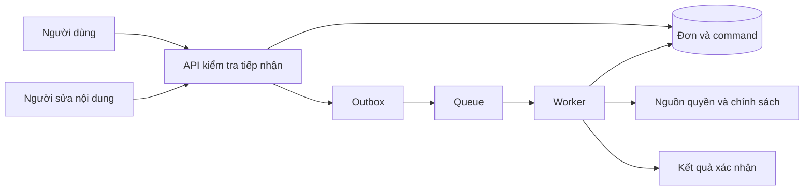

# Threat model maintenance — Bảo trì mô hình mối đe dọa

## 1. Mô hình phải tiếp tục mô tả đúng hệ thống đang vận hành

Trong chương **Threat Modeling** của module **Business Logic Security** (`SECURITY_APPLICATION_SECURITY_BUSINESS_LOGIC_SECURITY`), **threat model maintenance** là quá trình giữ mô hình mối đe dọa phù hợp với nghiệp vụ, kiến trúc, cách triển khai và bằng chứng hiện tại.

Một mô hình có thể từng mô tả đúng hệ thống nhưng mất hiệu lực khi:

- Đơn hàng được phép sửa ở một trạng thái trước đây không được sửa.
- Lệnh xác nhận chuyển từ xử lý đồng bộ sang hàng đợi.
- Người hỗ trợ được cấp thêm một quyền quản trị.
- Một tenant được phép chia sẻ dữ liệu với đối tác.
- Thời gian lưu khóa idempotency bị rút ngắn.
- Worker mới và cũ cùng chạy trong một đợt triển khai.
- Công cụ sửa dữ liệu tạo thêm một đường ghi ngoài luồng chính.

Nếu tài liệu vẫn ghi “quyền được kiểm tra ngay trước khi thực hiện” nhưng thực tế có thể chờ nhiều giờ trong queue, nhóm phát triển đang dựa vào một giả định không còn đúng.

Mục tiêu của bảo trì là trả lời được:

> Hệ thống hiện tại cần giữ những bảo đảm nào, còn những con đường lạm dụng nào khả thi, cơ chế nào đang chặn chúng và bằng chứng nào còn áp dụng?

Đó là một hoạt động kỹ thuật gắn với thay đổi và vận hành, không chỉ là cập nhật ngày trên tài liệu.

## 2. Cần bảo trì những phần nào?

Một threat model cho business logic thường có nhiều thành phần liên kết:

| Thành phần | Nội dung cần giữ đúng |
| --- | --- |
| Tài sản | Tiền, quyền lợi, trạng thái, dữ liệu và bằng chứng cần bảo vệ |
| Actor | Danh tính, vai trò, năng lực và scope thực tế |
| Ranh giới tin cậy | Nguồn nào có thẩm quyền cho dữ liệu hoặc quyết định nào |
| Luồng dữ liệu và command | API, queue, worker, database, cache, file và tích hợp |
| State machine | Trạng thái, cạnh chuyển và điều kiện của mỗi cạnh |
| Business invariant | Quan hệ phải được giữ tại ranh giới nhất quán đã chọn |
| Mục tiêu tấn công | Kết quả trái quy tắc mà actor có thể muốn đạt |
| Con đường lạm dụng | Các bước, điều kiện và lịch cạnh tranh dẫn tới kết quả |
| Biện pháp | Guard, authorization, transaction, constraint và cơ chế phối hợp |
| Bằng chứng | Kiểm thử, cấu hình, trace hoặc dữ liệu xác nhận cơ chế |
| Rủi ro còn lại | Phạm vi chưa giải quyết, quyết định và điều kiện xem lại |
| Trách nhiệm | Ai sở hữu quy tắc, biện pháp và việc xác minh |

Chỉ sửa sơ đồ kiến trúc mà không cập nhật giả định quyền hoặc oracle kiểm thử có thể để lại một mô hình nhất quán về hình vẽ nhưng sai về bảo đảm.

### 2.1. Mỗi phần có vòng đời khác nhau

Một invariant như “không xác nhận nội dung chưa được duyệt” có thể ổn định qua nhiều phiên bản.

Cơ chế giữ invariant có thể đổi từ khóa bản ghi sang cập nhật có điều kiện. Kiểm thử và bằng chứng phải thay tương ứng.

Vì vậy, nên giữ ổn định danh tính của các quy tắc còn nguyên ý nghĩa, đồng thời lưu phiên bản và lịch sử thay đổi của cơ chế, giả định và kết luận.

### 2.2. Threat model có phạm vi

Một kết luận cần đi kèm phạm vi như:

```text
Luồng nghiệp vụ
Phiên bản ứng dụng và worker
Policy hoặc cấu hình liên quan
Schema và cơ chế dữ liệu
Kiểu triển khai
Môi trường đã kiểm chứng
Điều kiện giả định
```

Bằng chứng trên một cấu hình đơn tiến trình chưa tự chứng minh một luồng nhiều worker có cạnh tranh là đúng. Một kiểm thử dùng role database có chính sách hạn chế chưa đại diện nếu ứng dụng thật dùng role có quyền rộng hơn.

## 3. Khi nào phải xem lại mô hình?

### 3.1. Thay đổi nghiệp vụ

| Thay đổi | Câu hỏi bảo mật cần đặt lại |
| --- | --- |
| Cho phép sửa sau phê duyệt | Quyết định cũ còn áp dụng cho nội dung nào? |
| Thêm hoàn tiền một phần | Giới hạn tổng và phân bổ theo dòng được giữ thế nào? |
| Cho cộng nhiều ưu đãi | Giới hạn từng chương trình và tổng phải trả là gì? |
| Thêm ngoại lệ quản trị | Actor nào được mở ngoại lệ và invariant nào vẫn bắt buộc? |
| Đổi chính sách hủy | Khi nào giải phóng tiền, hàng hoặc quyền lợi? |
| Chia sẻ dữ liệu liên tenant | Đối tượng, trường và hành động nào được chia sẻ? |

Những thay đổi không sửa nhiều dòng code vẫn có thể thay lời khẳng định bảo mật của sản phẩm.

### 3.2. Thay đổi actor và quyền

Cần xem lại khi thêm role, sửa scope, đổi nguồn danh tính, cho phép thao tác thay người dùng hoặc thay cách cấp và thu hồi quyền.

Ví dụ, một permission `order.confirm` trước đây chỉ dùng trong tenant nhưng nay được cấp cho dịch vụ chạy toàn nền tảng. Mọi command của dịch vụ vẫn cần scope được xác minh; danh tính dịch vụ rộng không tự tạo quyền cho từng request đầu vào.

### 3.3. Thay đổi kiến trúc và ranh giới nhất quán

Các thay đổi đáng chú ý gồm:

```text
Đồng bộ → bất đồng bộ
Một database → nhiều dịch vụ dữ liệu
Một worker → nhiều worker
Đọc trực tiếp → đọc cache hoặc projection
Gọi trực tiếp → nhận webhook
Một phiên bản → nhiều phiên bản cùng chạy
```

Mỗi thay đổi có thể ảnh hưởng thời điểm kiểm tra, khả năng retry, thứ tự thông điệp và những gì một transaction thực sự bao phủ.

### 3.4. Thay đổi cấu hình và vận hành

Không nên giới hạn đầu vào bảo trì ở các lần sửa source code. Các thay đổi sau có thể làm mất một giả định:

- Role database hoặc quyền bỏ qua chính sách dữ liệu.
- Cấu hình cache và thời gian sống.
- Chính sách retry, concurrency và timeout.
- Thời gian lưu idempotency record hoặc bản ghi khử trùng.
- Cách định tuyến tenant, credential hoặc endpoint tích hợp.
- Tác vụ dọn dữ liệu, phục hồi backup hoặc replay message.
- Công cụ hỗ trợ và script sửa chữa.

Một thao tác khôi phục dữ liệu có thể mang trạng thái cũ trở lại trong khi dịch vụ bên ngoài đã thực hiện tác động. Mô hình cần xét khả năng phục hồi, không chỉ hoạt động bình thường.

### 3.5. Bằng chứng mới và sự cố

Một incident, kết quả kiểm thử hoặc phản ánh vận hành có thể bác bỏ giả định dù chưa có thay đổi tính năng.

Ví dụ, một event vốn được xem là đến đúng thứ tự thực tế có thể bị phát lại. Mô hình cần cập nhật giả định và xem lại mọi biện pháp đang dựa vào thứ tự đó.

Lịch rà soát định kỳ có thể giúp phát hiện sai lệch không được ghi nhận. Tần suất nên dựa trên mức thay đổi và tác động của luồng, cùng các yêu cầu cụ thể của tổ chức.

## 4. Ví dụ xuyên suốt: đưa xác nhận đơn vào queue

### 4.1. Mô hình ban đầu

Giả sử phiên bản ban đầu xử lý:

```text
Nhận ConfirmOrder
→ xác thực actor và tenant
→ tải đơn trong transaction
→ kiểm tra quyền, trạng thái và phê duyệt đúng revision
→ xác nhận và lưu outbox liên quan
→ commit
```

Chính sách yêu cầu:

```text
CONFIRMED
⇒ có phê duyệt đúng contentRevision
   ∧ actor có quyền theo thời điểm quyết định đã định
   ∧ các điều kiện hiệu lực còn đạt
```

Giả định quan trọng là việc đánh giá điều kiện và áp dụng diễn ra trong cùng ranh giới xử lý cục bộ có cơ chế cạnh tranh phù hợp.

### 4.2. Thay đổi được đề xuất

Để giảm thời gian chờ, API tiếp nhận command rồi đưa vào queue. Worker có thể thực thi sau đó.

Hệ thống cũng cho phép người tạo sửa nội dung khi command còn chờ. Theo chính sách minh họa:

- Sửa dữ liệu ảnh hưởng phê duyệt phải tăng revision và làm mất hiệu lực quyết định cũ.
- Đơn quay về `PENDING_APPROVAL`; command đang chờ cho nội dung cũ không còn đủ điều kiện xác nhận.
- Quyền của actor và hiệu lực báo giá phải được đánh giá tại thời điểm worker ra quyết định thực thi.
- Retry và replay không tạo thêm kết quả xác nhận.
- Worker dùng danh tính dịch vụ, đồng thời giữ actor khởi tạo và scope của command.

Đây là các lựa chọn chính sách của ví dụ. Một hệ thống không cho sửa khi command chờ sẽ cần mô hình khác.

### 4.3. Vì sao mô hình cũ không còn đủ?

```text
API đã kiểm tra
→ command chờ
→ nội dung hoặc quyền thay đổi
→ worker sử dụng kết quả kiểm tra cũ
```

Khoảng chờ làm kết quả kiểm tra có thể lỗi thời. Danh tính worker có thể che mất actor ban đầu. Queue tạo thêm retry, replay và sai thứ tự. Trong triển khai chuyển tiếp, worker cũ có thể diễn giải message theo giả định cũ.

Mô hình cần bổ sung những yếu tố này trước khi kết luận invariant cũ vẫn được giữ.

### 4.4. Phạm vi tài sản và actor sau thay đổi

| Thành phần | Phần được thêm hoặc thay đổi |
| --- | --- |
| Tài sản | Command đang chờ và bằng chứng chấp nhận |
| Actor | Producer, worker, người sửa đơn trong lúc chờ |
| Dữ liệu | CommandId, targetRevision, actor khởi tạo, tenant, phiên bản hợp đồng |
| Ranh giới tin cậy | API tới queue, queue tới worker, service identity tới quyền nghiệp vụ |
| Thời gian | Tiếp nhận khác thời điểm thực thi |
| Cạnh tranh | Edit và confirm có thể xen kẽ |
| Phục hồi | Retry, replay và các command tồn đọng |
| Bằng chứng | Kiểm thử lịch xen kẽ, message cũ và quyền bị thu hồi |

## 5. Bảo trì theo phần thay đổi và các phụ thuộc của nó

### 5.1. Lập đường cơ sở trước khi cập nhật

Một đường cơ sở hữu ích cần biết:

```text
Phiên bản mô hình đang dùng
Phạm vi nghiệp vụ
Các invariant và giả định
Actor và ranh giới hiện tại
Biện pháp đã triển khai
Bằng chứng và môi trường kiểm chứng
Rủi ro chưa giải quyết
```

Nếu thiếu phần nào, hãy ghi rõ khoảng trống. Không điền một trạng thái “đã an toàn” chỉ vì tài liệu cũ không ghi nhận mối đe dọa.

### 5.2. Mô tả thay đổi dưới dạng quan hệ trước và sau

| Quan hệ | Trước thay đổi | Sau thay đổi |
| --- | --- | --- |
| Thời điểm đánh giá | Trong lần xử lý confirm | Có tiếp nhận rồi thực thi muộn |
| Chủ thể thực thi | Service xử lý request người dùng | Worker có danh tính dịch vụ |
| Nội dung tham chiếu | Được tải trong transaction quyết định | Command có thể nói về revision cũ |
| Scope | Được dựng từ request đã xác thực | Phải truyền và kiểm chứng qua message |
| Retry | Chủ yếu từ client hoặc transaction | Thêm retry và replay của queue |
| Triển khai | Luồng đồng bộ hiện có | Có thể có producer và consumer nhiều phiên bản |

Bảng này giúp phát hiện tác động lan truyền. Một thay đổi ở thời điểm xử lý có thể kéo theo thay đổi actor, dữ liệu hợp đồng và kiểm thử.

### 5.3. Theo dõi tác động đến giả định

Ví dụ các giả định cần xem lại:

```text
A1: Quyền kiểm tra tại API còn đủ cho điểm quyết định.
A2: Nội dung không thay đổi giữa chấp nhận và thực hiện.
A3: Mỗi command chỉ được xử lý một lần.
A4: Mọi worker hiểu cùng một hợp đồng message.
A5: Tenant có thẩm quyền không thể bị thay trong quá trình truyền.
```

Sau thay đổi:

- A1 cần thay bằng quy tắc kiểm tra quyền tại worker theo chính sách đã chọn.
- A2 không còn đúng vì nghiệp vụ cho phép sửa trong thời gian chờ.
- A3 không nên được dùng như bảo đảm giao nhận nếu hệ thống thực tế có replay.
- A4 cần có kế hoạch tương thích và bằng chứng triển khai.
- A5 cần cơ chế nguồn tin cậy, scope và ánh xạ tài nguyên rõ ràng.

Giả định được ghi ra để có thể kiểm chứng và thay thế, không phải để chuyển trách nhiệm bảo mật sang một câu trong tài liệu.

## 6. Cập nhật mô hình hành vi và ranh giới tin cậy

### 6.1. Sơ đồ mới phải thể hiện nơi ra quyết định



Sơ đồ cần được đọc cùng mô tả transaction và scope. Một đường nối tới cùng database không tự chứng minh các bước diễn ra trong cùng transaction.

Trong chính sách ví dụ, worker là nơi quyết định xác nhận cuối. API tiếp nhận không được trả một ý nghĩa nghiệp vụ khiến người dùng tưởng đơn đã confirmed khi command mới đang chờ.

### 6.2. Cập nhật hợp đồng command

Một cấu trúc minh họa:

```text
ConfirmOrder
    schemaVersion
    commandId
    tenantId
    orderId
    expectedContentRevision
    initiatingPrincipalId
    acceptedAt
    authorizationReference nếu mô hình có dùng
```

Các trường cần có nguồn và ý nghĩa rõ ràng:

| Trường | Điều cần đặc tả |
| --- | --- |
| `tenantId` | Nguồn đã được kiểm tra quyền và cách worker đối chiếu |
| `expectedContentRevision` | Nội dung mà ý định xác nhận hướng tới |
| `initiatingPrincipalId` | Actor ban đầu, không phải quyền vô hạn của service |
| `acceptedAt` | Mốc tiếp nhận; không tự thay cho thời điểm kiểm tra hiệu lực |
| `authorizationReference` | Nếu tồn tại, nó chứng minh điều gì và có thời hạn nào |
| `schemaVersion` | Consumer nào được phép diễn giải phiên bản này |

Một trường `authorized = true` không thay thế các điều trên.

Message phải đến từ producer được phép và được kiểm tra theo hợp đồng. Worker có credential đọc nhiều tenant không tự được phép nhận mọi tenant trong payload.

### 6.3. Cập nhật state machine và hành vi của command cũ

Các chuyển trạng thái quan trọng trong ví dụ:

| Tình huống | Hành vi cần định nghĩa |
| --- | --- |
| Chấp nhận confirm cho revision 7 | Ghi command và gắn trạng thái chờ với command đó |
| Worker xử lý khi revision và điều kiện còn đúng | Chuyển sang confirmed bằng quyết định được bảo vệ |
| Người dùng sửa sang revision 8 trong lúc chờ | Vô hiệu hóa phê duyệt cũ, trở về chờ duyệt theo chính sách |
| Worker nhận lại command cho revision 7 | Không xác nhận revision 8 |
| Một command mới đã thay command cũ | Command cũ không được ghi đè trạng thái của command mới |

Một kiểu lỗi dễ gặp là worker phát hiện command cũ thất bại rồi chạy:

```text
set order.status = APPROVED
```

mà không đối chiếu revision và command đang gắn với đơn. Câu lệnh đó có thể ghi đè trạng thái hợp lệ mới hơn.

Vì vậy, bảo trì mô hình phải xét cả **nhánh thành công và nhánh từ chối, lỗi hoặc phục hồi**.

## 7. Cập nhật danh mục mối đe dọa và biện pháp

### 7.1. Tạo hoặc sửa mối đe dọa từ thay đổi

Các mã dưới đây là ví dụ phục vụ việc theo dõi:

| Mã | Mối đe dọa | Điều cần chứng minh |
| --- | --- | --- |
| THR-QUEUE-01 | Worker xác nhận nội dung đã đổi | Nội dung mới không dùng phê duyệt cũ |
| THR-QUEUE-02 | Quyền đã bị thu hồi nhưng command vẫn thực hiện | Đúng chính sách hiệu lực tại điểm thực thi |
| THR-QUEUE-03 | Message dùng quyền rộng của worker để vượt tenant | Scope và quyền của command được kiểm chứng |
| THR-QUEUE-04 | Replay tạo thêm kết quả xác nhận | Cùng nghĩa vụ không tạo tác động lặp |
| THR-QUEUE-05 | Consumer cũ bỏ qua điều kiện mới | Các phiên bản còn chạy đều giữ bảo đảm cần thiết |
| THR-QUEUE-06 | Nhánh lỗi của command cũ ghi đè trạng thái mới | Mọi ghi đều gắn đúng command và version |

Không cần tạo bản ghi mới nếu một mối đe dọa cũ vẫn có cùng ý nghĩa. Có thể cập nhật đường đi, điều kiện và bằng chứng, đồng thời giữ lịch sử của nó.

### 7.2. Liên kết mỗi mối đe dọa với cơ chế cụ thể

| Mối đe dọa | Biện pháp ứng viên |
| --- | --- |
| Nội dung đã đổi | Guard revision, bằng chứng phê duyệt và trạng thái nguồn |
| Quyền hết hiệu lực | Đánh giá quyền tại worker theo chính sách, với nguồn quyền phù hợp |
| Vượt tenant | Context được xác minh, repository có scope, đối chiếu tài nguyên |
| Replay | Idempotency, chuyển trạng thái có điều kiện và tính duy nhất nghiệp vụ |
| Consumer cũ | Hợp đồng phiên bản, routing và thứ tự rollout có kiểm chứng |
| Command cũ ghi đè | Điều kiện currentCommandId, revision hoặc rowVersion khi ghi |

Biện pháp cần chỉ rõ vị trí thực thi và phạm vi dữ liệu. Câu “đã có transaction” chưa cho biết transaction khóa gì, đọc gì và chặn lịch xen kẽ nào.

### 7.3. Phân công người chịu trách nhiệm

Có thể cần các trách nhiệm khác nhau:

```text
Chủ sở hữu nghiệp vụ:
    Xác nhận quy tắc và ngoại lệ.

Chủ sở hữu dịch vụ:
    Thiết kế và duy trì guard, state machine, dữ liệu.

Người kiểm chứng:
    Tạo và duy trì kiểm thử, bằng chứng.

Người vận hành:
    Xác nhận cấu hình thực tế, rollout, queue tồn đọng và phục hồi.

Người có thẩm quyền quyết định rủi ro:
    Chấp nhận phạm vi còn lại khi chính sách tổ chức cho phép.
```

Một nhóm có thể đảm nhiệm nhiều vai trò, nhưng từng trách nhiệm cần rõ người hoặc đơn vị nhận.

## 8. Giữ liên kết giữa mô hình, triển khai và bằng chứng

### 8.1. Một chuỗi truy vết có ý nghĩa

Ví dụ:

```text
INV-ORDER-01:
    Confirmed phải có phê duyệt đúng contentRevision.

THR-QUEUE-01:
    Sửa nội dung sau khi command được nhận nhưng trước khi worker chạy.

CTRL-REVISION:
    Worker đối chiếu revision, approval và command hiện hành
    trong cơ chế cạnh tranh phù hợp.

TEST-QUEUE-EDIT:
    Giữ command, sửa nội dung rồi mới cho worker thực thi.

EVIDENCE:
    Dữ liệu sau commit và tác động chứng minh nội dung mới
    không được xác nhận bằng quyết định cũ.
```

Chuỗi này giúp một thay đổi ở invariant hoặc control chỉ ra ngay các kiểm thử và kết luận cần xem lại.

### 8.2. Bằng chứng có điều kiện áp dụng

Một kết quả kiểm thử cần biết ít nhất các yếu tố ảnh hưởng:

```text
Phiên bản code và hợp đồng message
Policy hoặc feature flag
Schema và role database
Mức cô lập hoặc cơ chế cạnh tranh cần thiết
Kiểu thực thi đồng thời
Dữ liệu và lịch đã thử
Kết quả quan sát
Giới hạn kết luận
```

Không cần lưu mọi chi tiết môi trường nếu chúng không ảnh hưởng lập luận. Cần lưu đủ để biết khi nào một kết quả không còn đại diện.

### 8.3. Thay đổi có thể làm bằng chứng cần kiểm tra lại

Ví dụ:

| Thay đổi | Bằng chứng bị ảnh hưởng |
| --- | --- |
| Thêm nhiều worker | Test chống lặp chạy một consumer chưa đủ |
| Đổi role database | Kết quả về row policy hoặc quyền dữ liệu cần xem lại |
| Đổi thời gian lưu dedupe | Bảo đảm đối với replay cũ cần được đánh giá lại |
| Đổi cách tăng revision | Test ràng buộc nội dung và phê duyệt cần xem lại |
| Thêm nhánh phục hồi | Test chỉ có đường thành công chưa bao phủ |
| Đổi trạng thái hoặc hợp đồng message | Test của consumer cũ có thể không còn đúng scope |

Có thể đánh dấu bằng chứng cũ là cần rà soát đối với phiên bản mới, đồng thời giữ nó làm lịch sử. Không nên xóa toàn bộ kết quả cũ hoặc tiếp tục hiển thị chúng như bằng chứng cho mọi cấu hình.

### 8.4. Tự động hóa hỗ trợ sự nhất quán

Có thể dùng kiểm tra tự động để phát hiện:

- Thay đổi ở thành phần được mô hình hóa nhưng thiếu liên kết đánh giá tác động.
- Mối đe dọa chưa có người sở hữu hoặc biện pháp theo dõi.
- Biện pháp đã đổi nhưng kiểm thử liên quan chưa được xem lại.
- Quyết định chấp nhận rủi ro hết hạn.
- Bằng chứng được gắn với một phiên bản không còn triển khai.

Các kiểm tra đó giúp nhắc việc và giữ cấu trúc. Chúng không tự hiểu rằng một invariant đã được phát biểu đúng hoặc một nhánh lạm dụng đã được chặn.

## 9. Mô hình phải bao phủ cả giai đoạn triển khai chuyển tiếp

### 9.1. Nhiều phiên bản cùng chạy là một trạng thái hệ thống

Trong rollout, có thể tồn tại:

```text
API cũ + worker cũ
API mới + worker cũ
API cũ + worker mới
API mới + worker mới
Message cũ còn trong queue hoặc kho retry
```

Không nên chỉ đánh giá trạng thái cuối mà bỏ các tổ hợp thực tế có thể xảy ra.

Nếu worker cũ không kiểm tra expectedContentRevision hoặc quyền hiện hành, việc producer mới gửi thêm trường chưa chứng minh worker đó sẽ giữ quy tắc.

### 9.2. Hợp đồng không tương thích cần xử lý rõ

Có thể cần cơ chế phiên bản, định tuyến hoặc giới hạn nhận message để chỉ consumer hiểu đúng được xử lý.

Với message cũ thiếu tenant, actor hoặc revision bắt buộc, không nên tự điền bằng tenant mặc định, quyền của service hoặc revision mới nhất. Cách đó có thể chuyển thiếu dữ liệu thành một quyết định ngoài ý định ban đầu.

Cần một cách xử lý rõ: từ chối có theo dõi, chuyển xác minh, xử lý theo bằng chứng lịch sử đủ tin cậy hoặc một quy trình chuyển đổi được thiết kế.

### 9.3. Migration không được tạo bằng chứng giả

Nếu schema mới cần `approvedRevision`, không thể mặc nhiên điền bằng `contentRevision` hiện tại cho mọi đơn đã từng được đánh dấu approved.

Việc điền như vậy chỉ hợp lệ khi có đủ bằng chứng rằng quyết định cũ thực sự áp dụng cho nội dung đó. Nếu không, cần phân loại và xử lý theo chính sách, chẳng hạn yêu cầu xác minh hoặc duyệt lại.

Tương tự, chuyển một trạng thái pending cũ sang succeeded chỉ để giảm tồn đọng không làm tác động ngoài hệ thống trở thành sự thật.

### 9.4. Rollback cũng cần điều kiện an toàn

Quay về code cũ có thể không còn đúng với:

```text
Trạng thái mới đã được ghi
Message mới còn tồn tại
Dữ liệu đã migration
Quyền hoặc policy đã đổi
Idempotency record theo hợp đồng mới
```

Kế hoạch phục hồi cần biết phiên bản nào còn hiểu dữ liệu và giữ invariant. “Có thể chạy lại binary cũ” không tự chứng minh rollback giữ đúng nghiệp vụ.

## 10. Kiểm chứng lại đúng phần bảo đảm bị ảnh hưởng

### 10.1. Ma trận cho thay đổi xác nhận qua queue

| Tình huống | Bảo đảm cần kiểm tra |
| --- | --- |
| Command hợp lệ, dữ liệu không đổi | Luồng bình thường vẫn confirmed đúng |
| Sửa revision 7 sang 8 trước khi worker chạy | Command revision 7 không xác nhận revision 8 |
| Sửa và worker chạy đồng thời | Mọi trạng thái commit giữ đúng quan hệ nội dung và phê duyệt |
| Quyền bị thu hồi trước thực thi | Worker áp dụng đúng chính sách kiểm tra quyền tại thời điểm thực thi |
| Báo giá hết hạn trong lúc chờ | Điều kiện thời gian được đánh giá theo ranh giới đã định |
| Message tenant A chứa orderId thuộc B | Không dùng quyền rộng của service để vượt scope |
| Replay cùng command | Không tạo thêm kết quả hoặc tác động nghiệp vụ |
| Command mới dùng khóa khác cho đơn đã confirmed | State machine và tính duy nhất vẫn giữ |
| Command cũ xử lý sau command mới | Không ghi đè trạng thái hoặc bằng chứng mới hơn |
| Lỗi sau một phần ghi trước commit | Không để lại trạng thái, giữ chỗ hoặc outbox dở dang |
| Message cũ thiếu trường bắt buộc | Không tự tạo scope hoặc quyết định bằng giá trị mặc định nguy hiểm |
| Producer mới gặp consumer cũ | Tổ hợp thực tế không bỏ qua bảo đảm mới |
| Queue retry sau khi dedupe đã được dọn | Hành vi vẫn đúng trong thời hạn và chính sách đã cam kết |
| Phục hồi từ dữ liệu cũ | Không tự chạy lại tác động bên ngoài đã xảy ra |
| Tính lại projection | Kết quả khớp nguồn tại mốc nhất quán được chọn |

Đây là kế hoạch kiểm chứng cho ví dụ, không phải báo cáo rằng các tình huống đã được chạy trên một hệ thống cụ thể.

### 10.2. Chọn cấp kiểm thử phù hợp

**Unit test** phù hợp với guard về trạng thái, revision, scope và cách diễn giải policy.

**Integration test** cần cho transaction, khóa, cập nhật có điều kiện, idempotency và hành vi consumer với database thực được sử dụng.

**Kiểm thử hợp đồng** giúp xác định producer và consumer có cùng ý nghĩa về trường dữ liệu, phiên bản và trạng thái.

**Kiểm thử triển khai và phục hồi** cần xét tổ hợp phiên bản, message tồn đọng, cấu hình role, retry và rollback.

Mock repository không chứng minh được khóa của database. Một kiểm thử hợp đồng đúng cấu trúc JSON cũng chưa chứng minh trường tenant được authorization đúng.

### 10.3. Với concurrency, kiểm tra bất biến thay vì cố định người thắng

Trong ví dụ:

```text
Nếu edit được chấp nhận trước:
    command cũ không được confirmed.

Nếu confirm được chấp nhận trước:
    hành vi edit tiếp theo phải tuân theo chính sách cho đơn confirmed.

Trong mọi trường hợp:
    không tồn tại trạng thái commit dùng phê duyệt sai nội dung.
```

Có thể dùng barrier hoặc latch để dựng lịch xen kẽ cần kiểm tra. Việc hai test chạy gần nhau hoặc dùng sleep không đủ chứng minh lịch đã được tái hiện.

### 10.4. Kiểm tra cấu hình thực tế và ranh giới kết luận

Bằng chứng có thể mất ý nghĩa nếu:

- Feature flag trong kiểm thử khác với nơi vận hành.
- Role database thực tế bỏ qua một chính sách mà test dựa vào.
- Consumer còn chạy phiên bản cũ không xuất hiện trong môi trường thử.
- Retry hoặc retention khác với giả định.
- Một đường công cụ quản trị không đi qua guard được kiểm tra.

Không cần chạy lại toàn bộ mọi kiểm thử cho mỗi chỉnh sửa nhỏ. Cần xác định phần bị ảnh hưởng và mở rộng khi có thay đổi, lỗi hoặc giả định chưa được giải quyết.

Kết luận phải nói đúng điều đã chứng minh và những điều kiện còn cần xác nhận.

## 11. Quản lý trạng thái mối đe dọa và rủi ro còn lại

### 11.1. Tách tiến độ công việc khỏi mức chắc chắn

“Đã viết code” là trạng thái triển khai. “Có bằng chứng chặn nhánh trong cấu hình được chọn” là trạng thái kiểm chứng. Hai điều không nên được gộp làm một.

Một cách theo dõi có thể gồm:

| Trạng thái | Ý nghĩa |
| --- | --- |
| Mới ghi nhận | Có thay đổi hoặc giả thuyết cần phân loại |
| Đang phân tích | Đang xác định actor, đường đi và phạm vi |
| Đã có phương án | Đã chọn biện pháp và người chịu trách nhiệm |
| Đã triển khai | Cơ chế đã được đưa vào phiên bản được chỉ định |
| Đã kiểm chứng trong phạm vi | Có bằng chứng áp dụng cho phiên bản và cấu hình xác định |
| Đã chấp nhận rủi ro còn lại | Có quyết định có thẩm quyền cho phạm vi và điều kiện cụ thể |
| Không còn áp dụng | Đường đi hoặc tính năng không còn tồn tại trong phạm vi được xét |

Một trạng thái “không còn áp dụng” cần lý do. Xóa nút giao diện không chứng minh API, worker hoặc message cũ đã biến mất.

### 11.2. Chấp nhận rủi ro phải có điều kiện

Một quyết định chấp nhận rủi ro còn lại nên nêu:

```text
Mối đe dọa và mục tiêu có thể đạt
Phạm vi bị ảnh hưởng
Bằng chứng và mức chắc chắn
Tác động còn lại
Biện pháp bù đắp hoặc giới hạn đang áp dụng
Người có thẩm quyền quyết định
Thời hạn hoặc điều kiện xem lại
Người theo dõi
```

Không biến “chấp nhận” thành nhãn tồn tại mãi sau mọi thay đổi. Thêm tenant, tăng hạn mức hoặc mở một kênh mới có thể làm quyết định cũ không còn đại diện.

Người triển khai không nên tự suy ra rủi ro đã được chấp nhận chỉ vì một ticket bị đóng hoặc một thời hạn phát hành đến gần.

### 11.3. Bằng chứng mới có thể mở lại một kết luận

Ví dụ, kiểm thử ban đầu chứng minh replay không tạo thêm xác nhận trong thời gian dedupe được giữ. Sau đó retention bị rút ngắn nhưng message có thể được replay lâu hơn.

Cần xem lại bảo đảm ngoài khoảng lưu đó và tính duy nhất theo nghiệp vụ. Không nên giữ kết luận “replay đã được xử lý” mà bỏ điều kiện thời gian.

Tương tự, một đường phục hồi mới có thể dùng credential khác và bỏ guard. Biện pháp ở API vẫn tồn tại, nhưng threat model phải phản ánh thêm đường mới.

## 12. Đưa phản hồi vận hành trở lại mô hình

### 12.1. Theo dõi dấu hiệu kiểm chứng giả định

Các tín hiệu hữu ích cho ví dụ gồm:

| Tín hiệu | Giả định hoặc cơ chế cần quan sát |
| --- | --- |
| Tuổi command đang chờ | Thời gian chờ có vượt phạm vi thiết kế không? |
| Từ chối do revision cũ | Luồng edit và confirm đang tương tác thế nào? |
| Từ chối vì quyền đã đổi | Chính sách hiệu lực có được thực thi không? |
| Replay hoặc trùng command | Dedupe và tính duy nhất đang chịu tải gì? |
| Message không hỗ trợ phiên bản | Có lệch hợp đồng hoặc consumer cũ không? |
| Tenant không khớp tài nguyên | Có lỗi nguồn scope, routing hoặc hành vi ngoài quyền không? |
| Kết quả chưa xác định quá lâu | Tiến trình phục hồi và đối soát có hoạt động không? |
| Trạng thái confirmed thiếu bằng chứng đúng revision | Có vi phạm hoặc lỗi ghi nhận cần điều tra không? |

Một số lần từ chối là kết quả bảo vệ đúng khi người dùng sửa dữ liệu hợp lệ. Không nên tự gắn mọi metric tăng thành tấn công.

Ngược lại, không có cảnh báo chưa chứng minh hệ thống an toàn nếu đường ghi metric hoặc đối soát đã ngừng hoạt động.

### 12.2. Từ sự cố tới thay đổi mô hình

Một vòng phản hồi có thể là:

```text
Quan sát sự cố
→ xác định kết quả và phạm vi thật
→ tái dựng actor, dữ liệu và thứ tự
→ tìm giả định sai hoặc cơ chế thiếu
→ cập nhật đường lạm dụng và ảnh hưởng
→ sửa biện pháp
→ thêm kiểm thử hồi quy và bằng chứng
→ xem lại các luồng dùng cùng giả định
```

Nếu sự cố cho thấy worker dùng quyền của service thay cho actor ban đầu, cần kiểm tra các command khác đi qua cùng cơ chế. Chỉ sửa một case cụ thể có thể bỏ những nhánh cùng nguyên nhân.

Dữ liệu điều tra nên giữ đủ quan hệ và hạn chế bí mật hoặc thông tin cá nhân không cần thiết. Audit cũng cần quyền truy cập phù hợp với tenant và vai trò.

### 12.3. Phục hồi và replay là các luồng được mô hình hóa

Khi khôi phục backup, database nội bộ có thể quay về trước một tác động đã xảy ra bên ngoài. Một worker nhìn trạng thái cũ có thể muốn thực hiện lại.

Mô hình cần trả lời:

```text
Định danh nào vẫn nhận diện tác động gốc?
Bằng chứng ngoài hệ thống được đối chiếu thế nào?
Có bước xác minh trước khi mở lại xử lý không?
Idempotency và lịch sử nào được giữ hoặc phục hồi?
Những command nào cần được cách ly để xác định kết quả?
```

Không nên giả định phục hồi dữ liệu nội bộ cũng hoàn tác những tác động ngoài hệ thống.

Tương tự, dọn bảng dedupe hoặc tombstone có thể làm một event cũ trông như chưa từng được xử lý. Việc dọn dữ liệu phải phù hợp với thời hạn replay và các bảo đảm nghiệp vụ tồn tại lâu hơn.

## 13. Các cách bảo trì dễ tạo cảm giác an toàn sai

| Cách làm | Vấn đề | Điều cần bổ sung |
| --- | --- | --- |
| Chỉ đổi ngày cập nhật | Không chứng minh giả định và luồng còn đúng | Đánh giá tác động có phạm vi |
| Chỉ cập nhật sơ đồ | Có thể bỏ state machine, quyền và oracle | Liên kết đầy đủ các thành phần bị ảnh hưởng |
| Sao chép nguyên kết luận từ phiên bản trước | Bằng chứng có thể không còn áp dụng | Ghi điều kiện và phiên bản của bằng chứng |
| Đánh dấu đã xử lý sau khi merge code | Chưa có bằng chứng cơ chế chặn đường đi | Kiểm thử và xác nhận cấu hình liên quan |
| Chỉ xem đường thành công | Nhánh lỗi hoặc phục hồi có thể ghi sai | Mô hình hóa từ chối, retry và rollback |
| Chỉ đánh giá trạng thái sau rollout | Có thể bỏ tổ hợp phiên bản chuyển tiếp | Ma trận tương thích và dữ liệu tồn đọng |
| Cho message cũ dùng mặc định mới | Thiếu bằng chứng bị biến thành quyền hoặc nội dung mới | Quy tắc chuyển đổi hoặc xử lý riêng |
| Điền approvedRevision bằng revision hiện tại khi thiếu lịch sử | Tạo vẻ ngoài phê duyệt mà không có quyết định tương ứng | Dùng bằng chứng thật hoặc yêu cầu xử lý lại |
| Chỉ ghi rủi ro mà không có người theo dõi | Công việc có thể không được thực hiện | Owner, điều kiện xem lại và trạng thái |
| Coi mọi thay đổi đều phải vẽ lại toàn bộ | Dễ biến bảo trì thành nghi thức tốn công | Theo dõi phần thay đổi và phụ thuộc |
| Chỉ dùng checklist tự động | Cấu trúc đúng chưa chứng minh logic đúng | Suy luận về invariant và kiểm chứng hành vi |
| Xóa mối đe dọa cũ không giữ lý do | Mất dấu giả định và quyết định | Lưu lịch sử cùng phạm vi không còn áp dụng |

Một mô hình ngắn nhưng thể hiện đúng các quyết định và bằng chứng có ích hơn một bộ hồ sơ dài không phản ánh cách hệ thống đang chạy.

## 14. Mẫu bàn giao một lần cập nhật threat model

Có thể sử dụng cấu trúc sau để giữ cuộc trao đổi cụ thể:

```text
Định danh và phiên bản mô hình:
Phạm vi nghiệp vụ:
Chủ sở hữu:

Thay đổi được đánh giá:
Mục đích nghiệp vụ:
Phiên bản code, policy và cấu hình liên quan:

Đường cơ sở:
Tài sản:
Actor và scope:
Ranh giới tin cậy:
State machine:
Business invariants:
Các giả định đang được dùng:

Phần thay đổi:
Quan hệ trước và sau:
Giả định không còn đúng:
Dữ liệu hoặc quyền mới:
Các đường tác động và phục hồi mới:

Mối đe dọa:
Mục tiêu trái quy tắc:
Điều kiện và lịch thực thi:
Phạm vi và tác động:
Mức chắc chắn:
Câu hỏi còn mở:

Biện pháp:
Vị trí thực thi:
Ranh giới nhất quán:
Chính sách retry và idempotency:
Thẩm quyền và điều kiện hiệu lực:
Người thực hiện:

Kiểm chứng:
Test hoặc bằng chứng liên quan:
Cấu hình và phiên bản áp dụng:
Kết quả và giới hạn:
Bằng chứng cũ cần xem lại:

Triển khai:
Tổ hợp phiên bản có thể tồn tại:
Message và dữ liệu cũ:
Migration:
Rollback và phục hồi:

Rủi ro còn lại:
Quyết định và người có thẩm quyền:
Điều kiện hoặc thời hạn xem lại:

Vận hành:
Tín hiệu cần theo dõi:
Cách phản hồi sự cố:
Người theo dõi:
Những thay đổi sẽ kích hoạt lần xem lại tiếp theo:
```

Với thay đổi xác nhận qua queue, một lần cập nhật có thể được xem là đủ cho phạm vi đã chọn khi nhóm giải thích được command cũ sẽ ra sao sau khi nội dung hoặc quyền đổi, mọi phiên bản còn chạy thực thi quy tắc nào, và bằng chứng nào cho thấy các kết quả commit vẫn giữ invariant.

Các khoảng trống còn lại cần được thể hiện bằng câu hỏi, công việc hoặc quyết định rủi ro có người theo dõi, thay vì bị che bởi trạng thái “đã cập nhật tài liệu”.
