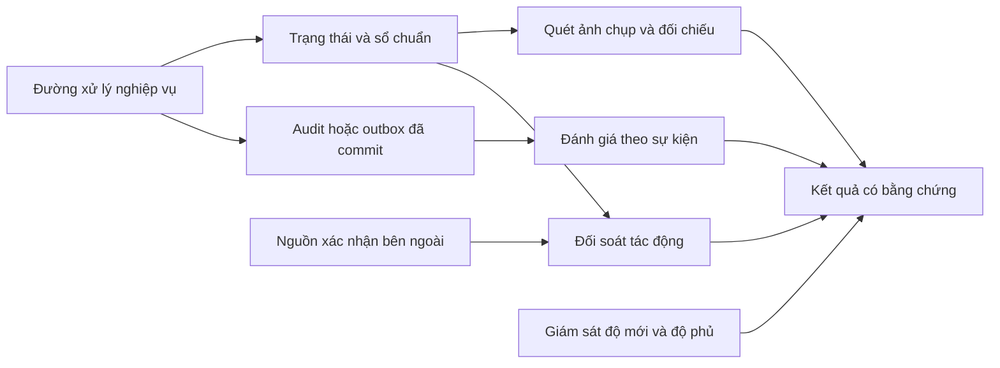

# Invariant monitoring — Giám sát bất biến bảo mật

Một hệ thống có thể có guard kiểm tra quyền, transaction và ràng buộc dữ liệu nhưng vẫn cần phát hiện khi quy tắc bị phá qua đường ghi mới, lỗi triển khai, tác vụ vận hành hoặc sai lệch giữa các dịch vụ. Ngược lại, một dashboard không báo lỗi chưa chứng minh quy tắc đang được giữ nếu dữ liệu giám sát đã ngừng cập nhật.

**Invariant monitoring** là việc quan sát và đánh giá các điều kiện nghiệp vụ hoặc bảo mật trên trạng thái, quyết định và tác động thực tế. Mục tiêu là phát hiện vi phạm hoặc thiếu bằng chứng đúng lúc, cung cấp dữ liệu điều tra và hỗ trợ phản ứng có kiểm soát.

Trong chương **Security Invariants**, bài học này tập trung vào giám sát quy tắc liên quan đến phê duyệt, giá, quyền theo đối tượng, transaction, idempotency và giới hạn tài nguyên. Ví dụ xuyên suốt là giám sát tiền hoàn và các cam kết hoàn tiền, vì nó thể hiện rõ nhu cầu có dữ liệu nhất quán, xử lý bất đồng bộ và phân biệt vi phạm với trạng thái chưa rõ.

## 1. Giám sát, thực thi và audit có vai trò khác nhau

| Cơ chế | Câu hỏi chính | Ví dụ |
| --- | --- | --- |
| Enforcement | Có cho phép tác động này xảy ra không? | Không cấp giữ chỗ khi ngân sách hoàn không đủ |
| Audit | Điều gì đã xảy ra và được quy cho chủ thể nào? | Ghi người yêu cầu, số tiền, quyết định và transaction liên quan |
| Invariant monitoring | Trạng thái hoặc tác động quan sát được có thỏa quy tắc không? | Phát hiện tổng đã hoàn và đang giữ chỗ vượt giới hạn |
| Giám sát vận hành | Thành phần có hoạt động và có đủ năng lực không? | Worker ngừng chạy, backlog tăng hoặc cơ sở dữ liệu chậm |
| Phát hiện bất thường | Hành vi có khác mô hình thường gặp không? | Số lần hoàn tăng đột biến ở một nhóm tài khoản |

Các cơ chế bổ trợ nhau. Giám sát không thay thế điểm thực thi chủ động, và một dòng audit không tự chứng minh invariant đã được giữ.

Một kiểm tra sau commit có thể phát hiện vi phạm nhưng không tự rollback tác động đã xảy ra. Nếu kiểm tra nằm trước commit và chặn thay đổi khi sai, nó đang tham gia thực thi invariant chứ không chỉ quan sát.

### 1.1. Không đồng nhất vi phạm với tín hiệu đáng ngờ

Nhiều lần bị từ chối có thể là dấu hiệu tấn công, lỗi client hoặc thao tác nhầm. Chúng chưa chứng minh tiền đã bị hoàn vượt giới hạn.

Ngược lại, chỉ một bản ghi được xác minh là vi phạm điều kiện cứng cũng có thể quan trọng dù tỷ lệ lỗi toàn hệ thống rất thấp. Không nên đợi đủ nhiều lần vi phạm mới công nhận rằng quy tắc không được giữ.

## 2. Chuyển invariant thành hợp đồng giám sát

Một monitor chỉ hữu ích khi biết chính xác nó đang đánh giá điều gì và kết luận có hiệu lực trong phạm vi nào.

| Nội dung hợp đồng | Điều cần ghi |
| --- | --- |
| Mã và mục đích | Quy tắc nào, tài sản nào được bảo vệ |
| Predicate | Điều kiện cụ thể hoặc quan hệ phải thỏa |
| Phạm vi | Tổ chức, đối tượng, tiền tệ, loại thao tác hoặc kỳ tính |
| Nguồn có thẩm quyền | Bảng, bản ghi quyết định, sự kiện hoặc xác nhận bên ngoài nào |
| Ranh giới thời gian | Tại commit, tại quyết định, sau một mốc xử lý hay trong thời hạn nào |
| Tính đầy đủ cần có | Những phần dữ liệu nào phải hiện diện để kết luận |
| Độ trễ cho phép | Vì sao có độ trễ và khi nào dữ liệu phải hội tụ |
| Trạng thái đánh giá | Đạt, vi phạm, đang chờ, chưa đủ dữ liệu hoặc ngoài phạm vi |
| Bằng chứng | Giá trị, phiên bản và liên kết nào cần giữ |
| Phản ứng | Ai xử lý, cần xác minh gì và có được tự động chặn phạm vi nào không |

Ví dụ yếu:

> Cảnh báo khi hoàn tiền có vấn đề.

Ví dụ cụ thể:

> Với mỗi khoản thanh toán và tiền tệ trong mô hình đã chọn, kiểm tra tại một ảnh chụp nhất quán rằng số tiền đã hoàn cộng số tiền đang giữ chỗ không vượt giới hạn hoàn. Nếu thiếu dữ liệu nguồn hoặc chưa biết ảnh chụp có đầy đủ hay không, không kết luận đạt.

Hợp đồng còn phải phân biệt thời gian phát sinh, thời gian ghi nhận, thời gian monitor đọc và thời gian phát cảnh báo. Một timestamp duy nhất thường không đủ giải thích độ trễ.

## 3. Ví dụ: giám sát giới hạn hoàn tiền

Giả sử hệ thống có giới hạn hoàn `P`, tổng đã hoàn thành công `F` và tổng đang giữ chỗ `R` cho một khoản thanh toán.

Invariant số học:

```text
P >= 0
F >= 0
R >= 0
F + R <= P
```

Các lần hoàn chưa xác định kết quả vẫn có thể phải giữ chỗ. Trong ví dụ, các trạng thái `RESERVED`, `SUBMITTING` và `UNKNOWN` đều được tính vào `R`. `SUCCEEDED` được tính vào `F`. `FAILED_FINAL` không còn chiếm giữ chỗ khi đã đủ căn cứ kết thúc theo hợp đồng.

Ví dụ này không mô hình hóa chargeback hoặc điều chỉnh làm giảm giới hạn sau khi đã có cam kết. Nếu sản phẩm hỗ trợ, monitor phải dùng quy tắc chuyển đổi và chính sách áp dụng tương ứng.

### 3.1. Ba câu hỏi giám sát khác nhau

| Câu hỏi | Dữ liệu cần | Ý nghĩa kết quả |
| --- | --- | --- |
| Số dư có vi phạm `F + R <= P` không? | Bản ghi số dư tại một ranh giới nhất quán | Phát hiện vi phạm số học ở nguồn đó |
| Số dư có khớp sổ operation không? | Số dư và trạng thái chuẩn của các operation | Phát hiện sai lệch giữa bộ đếm và chi tiết |
| Tiền thực sự đã hoàn có khớp nguồn bên ngoài không? | Operation và bằng chứng nhà cung cấp | Phát hiện chênh lệch tác động thực tế |

Ba câu hỏi không thay thế nhau. Một bộ đếm tự nhất quán nhưng bỏ sót một khoản hoàn ngoài luồng vẫn có thể không phản ánh đầy đủ tác động thực tế.

Nếu số dư và sổ operation do cùng một writer kiểm soát, đối chiếu chúng giúp phát hiện nhiều lỗi nhưng không phải bằng chứng hoàn toàn độc lập trước việc writer đó bị kiểm soát.

## 4. Các loại quy tắc cần giám sát

### 4.1. Invariant trạng thái

Đánh giá trên một trạng thái có ngữ nghĩa rõ:

- Các bộ đếm không âm.
- Tổng cam kết không vượt hạn mức.
- Đơn đang có thẩm quyền thanh toán phải tham chiếu quyết định hợp lệ theo mô hình.
- Reservation phải thuộc đúng khoản thanh toán và tiền tệ.

### 4.2. Invariant chuyển trạng thái hoặc quyết định

Đánh giá dựa trên trạng thái trước, hành động và trạng thái sau:

- Chỉ có quyết định phù hợp mới cấp được payment intent.
- Sửa nội dung quan trọng phải làm mất hiệu lực duyệt theo chính sách.
- Kết quả hoàn thành chỉ được áp dụng một lần.
- Lệnh từ dịch vụ không được mở rộng phạm vi tổ chức của người khởi xướng.

Những quy tắc này thường cần sự kiện có phiên bản hoặc dữ liệu quyết định được lưu. Chỉ nhìn trạng thái hiện tại có thể không biết một chuyển đổi sai đã xảy ra rồi bị ghi đè hay chưa.

### 4.3. Quy tắc đối chiếu

So sánh các biểu diễn của cùng một sự thật:

- Bộ đếm và sổ reservation.
- Operation nội bộ và giao dịch nhà cung cấp.
- Quyết định phê duyệt và điều khoản intent.
- Trạng thái nghiệp vụ và audit chuẩn bắt buộc.

### 4.4. Điều kiện thời gian

Một reservation tồn lâu có thể cần được xử lý. Nhưng cần biết đây là vi phạm hợp đồng thời gian, vi phạm mục tiêu vận hành hay chỉ là tín hiệu cần xem xét.

“Không được vượt giới hạn” là thuộc tính an toàn. “Mọi job phải hoàn tất trong một thời hạn” là yêu cầu về tiến triển có giới hạn thời gian. Có thể giám sát cả hai, nhưng không nên gọi mọi job chậm là một vi phạm tài chính đã xác nhận.

## 5. Đặt monitor ở đâu và nó nhìn thấy được gì?

Một thiết kế thường phối hợp nhiều cách:



| Cách quan sát | Ưu điểm | Giới hạn cần biết |
| --- | --- | --- |
| Quan sát gần đường xử lý | Có ngữ cảnh hành động và quyết định | Có thể cùng chịu lỗi với ứng dụng hoặc mất dữ liệu nếu phát không bền vững |
| Đánh giá theo sự kiện | Phát hiện nhanh và theo dõi chuyển đổi | Cần xử lý lặp, trễ, sai thứ tự và mất sự kiện |
| Quét nguồn dữ liệu | Thấy trạng thái đã lưu, phát hiện đường ghi không phát sự kiện | Có độ trễ, chi phí và yêu cầu nhất quán khi đọc |
| Đối soát bên ngoài | Kiểm tra tác động ngoài ứng dụng | Phụ thuộc độ trễ, phạm vi và độ đầy đủ của nguồn đối soát |

Một sự kiện tạo trong bộ nhớ rồi gửi trước commit có thể mô tả thay đổi sau đó bị rollback. Sự kiện chỉ gửi sau commit bằng một bước không bền vững lại có thể mất khi tiến trình dừng.

Audit hoặc outbox gắn với transaction có thể cung cấp nguồn chuyển tiếp bền vững theo thiết kế, nhưng pipeline nhận vẫn cần giám sát tồn đọng và lỗi.

Không có một vị trí duy nhất thấy mọi sự thật. Cần mô tả giới hạn quan sát của từng monitor thay vì chỉ nói “đã bật monitoring”.

## 6. Đọc dữ liệu tại một ranh giới nhất quán

Giả sử một transaction chuyển hoàn tiền thành công:

```text
Trước: F = 0, R = 600.000.
Sau:   F = 600.000, R = 0.
```

Nếu monitor đọc `F` sau transaction nhưng đọc `R` từ một nguồn trễ còn giữ giá trị cũ, nó có thể tính nhầm tổng 1.200.000. Đây là dữ liệu bị ghép từ hai thời điểm, chưa phải bằng chứng số dư chuẩn đã vi phạm.

### 6.1. Cùng cơ sở dữ liệu

Các phép so sánh cần ảnh chụp phù hợp với bảo đảm của hệ quản trị và cách truy vấn. Một transaction chỉ đánh dấu “read only” không tự chứng minh nhiều lệnh đọc thấy cùng một snapshot.

Có thể dùng một truy vấn nhất quán hoặc mức cô lập, cơ chế snapshot tương ứng. Cần hiểu điều kiện thực tế thay vì suy ra từ tên annotation.

Với quét phân trang, phải xác định mỗi đối tượng được đánh giá ở thời điểm nào. Không nên cộng các phần đọc ở nhiều thời điểm thành một tổng toàn cục rồi diễn giải như một ảnh chụp duy nhất.

### 6.2. Nhiều nguồn hoặc nhiều dịch vụ

Hai nguồn có thể cập nhật với độ trễ khác nhau. Cần biết vị trí xử lý, phiên bản hoặc mốc dữ liệu mà mỗi nguồn đã bao phủ.

Một timestamp trông giống nhau không tự tạo snapshot phân tán. Đồng hồ có thể lệch và thời điểm ghi nhận có thể khác thời điểm nghiệp vụ.

Nếu chưa đủ dữ liệu cho cùng một quyết định hoặc phạm vi đối chiếu, kết quả nên là đang chờ hoặc chưa đủ bằng chứng, theo hợp đồng.

### 6.3. Không dùng giá trị hiện tại để xét sai quyết định lịch sử

Một người duyệt bị thu hồi quyền hôm nay không tự làm quyết định hợp lệ hôm qua trở thành sai. Ngược lại, một chính sách yêu cầu quyền hiện tại khi thực thi cần được kiểm tra theo ranh giới đó.

Monitor phải dùng phiên bản chính sách và dữ liệu có ý nghĩa tại quyết định liên quan. Cần giữ được snapshot hoặc tham chiếu còn đọc hiểu, không chỉ một cờ trạng thái cuối.

## 7. Ví dụ SQL: kiểm tra số dư và đối chiếu sổ chi tiết

Các truy vấn dưới minh họa ý tưởng. Chúng giả định dữ liệu có thẩm quyền, tiền được lưu theo đơn vị nguyên đã thống nhất và việc đọc đáp ứng yêu cầu snapshot của hệ thống.

### 7.1. Tìm số dư vi phạm trực tiếp

```sql
SELECT tenant_id,
       payment_id,
       currency,
       captured_minor,
       refunded_minor,
       reserved_minor
FROM payment_refund_balance
WHERE captured_minor < 0
   OR refunded_minor < 0
   OR reserved_minor < 0
   OR refunded_minor > captured_minor
   OR reserved_minor > captured_minor - refunded_minor;
```

Trong mô hình đơn giản này, `captured_minor` biểu diễn giới hạn hoàn. Các cột được giả định bắt buộc có giá trị; nếu schema cho phép thiếu, cần monitor riêng cho dữ liệu thiếu thay vì để cách xử lý `NULL` che khuất vấn đề.

Một kết quả trả về cho thấy bản ghi được quan sát vi phạm predicate. Nó chưa tự xác định tác nhân, nguyên nhân hay số tiền thực sự đã đi ra ngoài.

### 7.2. Đối chiếu bộ đếm với operation chuẩn

Giả sử mỗi operation có một bản ghi chuẩn với trạng thái hiện tại, số tiền dương và tiền tệ rõ ràng. Không dùng trực tiếp các lần giao message làm sổ operation vì chúng có thể lặp.

```sql
WITH operation_totals AS (
    SELECT tenant_id,
           payment_id,
           currency,
           SUM(CASE
                 WHEN state = 'SUCCEEDED' THEN amount_minor
                 ELSE 0
               END) AS expected_refunded,
           SUM(CASE
                 WHEN state IN ('RESERVED', 'SUBMITTING', 'UNKNOWN')
                 THEN amount_minor
                 ELSE 0
               END) AS expected_reserved
    FROM refund_operation
    GROUP BY tenant_id, payment_id, currency
)
SELECT b.tenant_id,
       b.payment_id,
       b.currency,
       b.refunded_minor,
       b.reserved_minor,
       COALESCE(o.expected_refunded, 0) AS expected_refunded,
       COALESCE(o.expected_reserved, 0) AS expected_reserved
FROM payment_refund_balance b
LEFT JOIN operation_totals o
  ON o.tenant_id = b.tenant_id
 AND o.payment_id = b.payment_id
 AND o.currency = b.currency
WHERE b.refunded_minor <> COALESCE(o.expected_refunded, 0)
   OR b.reserved_minor <> COALESCE(o.expected_reserved, 0);
```

Việc gộp operation trước khi join giúp tránh nhân bản số tiền khi nối với các bảng có nhiều dòng liên quan. Phạm vi tổ chức và tiền tệ phải được giữ trong cả group lẫn join.

`COALESCE` về 0 chỉ có ý nghĩa khi đã biết nguồn operation đầy đủ và không có dòng thực sự nghĩa là không có số tiền tương ứng. Nếu dữ liệu chưa đồng bộ hoặc đã được lưu trữ sang nơi khác mà chưa đưa số dư nền vào đối chiếu, không được mặc định phần thiếu bằng 0.

### 7.3. Những phần truy vấn chưa bao phủ

Truy vấn bắt đầu từ bảng số dư sẽ không tự phát hiện mọi operation mồ côi không có số dư tương ứng. Cần thêm kiểm tra chiều ngược, tính duy nhất, trạng thái lạ và quan hệ tham chiếu.

Nếu operation cũ được lưu trữ hoặc tổng hợp, phép đối chiếu phải cộng đúng số liệu nền và dữ liệu còn lại. Không nên quét một phần lịch sử rồi so với bộ đếm toàn bộ vòng đời.

Kiểu dữ liệu tính tổng phải đủ lớn. Nếu phép tổng bị tràn, truy vấn lỗi hoặc một partition bị bỏ qua, lần đánh giá đó không được ghi là đạt.

## 8. Giám sát theo sự kiện: lặp, trễ và sai thứ tự

Một monitor nhận sự kiện có thể kiểm tra:

- Trạng thái trước có cho phép chuyển đổi không.
- Quyết định tham chiếu đúng đối tượng và nội dung không.
- Một nghĩa vụ có bị ghi nhận tác động thêm không.
- Có thay đổi quan trọng nhưng thiếu sự kiện liên quan theo hợp đồng không.

Cần nhận diện sự kiện bằng định danh ổn định. Cùng một sự kiện được giao hai lần không phải hai lần hoàn tiền.

### 8.1. Định danh thao tác khác định danh sự kiện

Một thao tác có thể có nhiều sự kiện như giữ chỗ, gửi nhà cung cấp và xác nhận thành công. Không được gộp chúng thành một chỉ vì cùng `operationId`.

Ngược lại, một sự kiện được chuyển tiếp nhiều lần nên giữ cách nhận diện để monitor không cộng lại tác động.

### 8.2. Thứ tự cần dựa trên ngữ nghĩa nguồn

Phiên bản aggregate, số thứ tự hoặc vị trí nguồn có thể hỗ trợ khôi phục thứ tự trong phạm vi tương ứng. Không nên dùng thời gian nhận làm bằng chứng duy nhất.

Nếu một phiên bản có nhiều sự kiện, chỉ lưu “đã thấy version 13” rồi bỏ mọi sự kiện version 13 tiếp theo có thể làm mất thông tin hợp lệ. Cơ chế chống trùng phải phù hợp mô hình định danh và thứ tự thật.

Một khoảng trống phiên bản cần được giải thích theo hợp đồng nguồn. Không phải mọi số phiên bản đều nhất thiết có một loại sự kiện mà monitor đang subscribe.

### 8.3. Bộ nhớ trạng thái và replay

Nếu monitor cần nhớ operation đã thành công hoặc sự kiện đã xử lý, phải có chính sách lưu trạng thái phù hợp thời gian có thể nhận lại dữ liệu.

Xóa bộ nhớ chống trùng quá sớm có thể khiến sự kiện cũ bị tính lại. Replay để khôi phục monitor cũng không nên tạo một đợt cảnh báo mới cho cùng một vấn đề đang mở nếu không có thay đổi ý nghĩa.

## 9. Phân loại kết quả: đạt, vi phạm và chưa đủ dữ liệu

Một monitor nên biểu diễn nhiều trạng thái thay vì chỉ có boolean.

| Kết quả | Ý nghĩa |
| --- | --- |
| `PASS` | Predicate thỏa trên phạm vi và dữ liệu đủ điều kiện đã đánh giá |
| `VIOLATION` | Có bằng chứng đủ theo hợp đồng rằng predicate bị phá |
| `PENDING` | Đang chờ dữ liệu hoặc bước xử lý hợp lệ trong thời hạn xác định |
| `UNKNOWN` | Không đủ dữ liệu, nguồn lỗi hoặc không thể đánh giá đáng tin |
| `NOT_APPLICABLE` | Đối tượng không thuộc quy tắc, với lý do xác định |

Đây là quy ước minh họa. Nhóm có thể chọn tên khác nhưng cần giữ phân biệt ngữ nghĩa.

### 9.1. Khoảng chờ phải có căn cứ

Một projection bất đồng bộ có thể cần thời gian để bắt kịp. Có thể dùng khoảng chờ dựa trên hợp đồng dữ liệu và mục tiêu phát hiện, kèm giới hạn theo dõi.

Không nên thêm một khoảng chờ dài tùy ý để làm biến mất cảnh báo của một invariant vốn phải đúng ngay tại nguồn chuẩn. Nếu số dư chuẩn đã thể hiện vượt giới hạn trong một snapshot nhất quán, độ trễ dashboard không giải thích được vi phạm đó.

### 9.2. Hết thời gian chờ chưa luôn là vi phạm nghiệp vụ đã xác nhận

Nếu chưa thấy sự kiện kết quả sau thời hạn, điều được biết có thể là pipeline chậm hoặc operation chưa rõ. Cần phân biệt với bằng chứng rằng tiền đã hoàn vượt giới hạn.

Có thể phát cảnh báo về mất độ mới, thiếu dữ liệu hoặc vi phạm hợp đồng thời gian, rồi nâng mức xử lý. Không được tự điền một kết quả nghiệp vụ chưa quan sát được.

### 9.3. Không có kết quả không phải là đạt

Một vòng quét xử lý 0 đối tượng vì nguồn lỗi không được báo “0 vi phạm” như một lần kiểm tra toàn bộ thành công.

Kết quả `PASS` phải gắn với phạm vi đã đọc, mốc dữ liệu, phiên bản monitor và thời điểm đánh giá. Nó không chứng minh mọi đối tượng ở mọi thời điểm đều an toàn.

## 10. Giám sát chính pipeline và độ phủ

Monitor cũng có thể dừng, bỏ partition, không đọc được schema mới hoặc mất quyền truy cập. Vì vậy cần quan sát cơ chế giám sát.

Các thông tin hữu ích:

- Thời điểm đánh giá thành công gần nhất.
- Vị trí nguồn đã xử lý và độ trễ theo partition hoặc phạm vi.
- Số đối tượng đủ điều kiện và số đối tượng đã được đánh giá ở mốc tương ứng.
- Số kết quả `UNKNOWN`, lỗi đọc và lỗi tính toán.
- Số sự kiện chưa giải mã được hoặc bị đưa sang hàng lỗi.
- Tuổi vấn đề chưa được đánh giá lại.
- Tình trạng gửi cảnh báo và khả năng người xử lý nhận được.

Một tỷ lệ độ phủ cần mẫu số có ý nghĩa. Tổng số lần kiểm tra lặp không phải số đối tượng khác nhau đã được bao phủ. Kiểm tra một khoản thanh toán 1.000 lần không thay thế việc chưa kiểm tra 999 khoản khác.

### 10.1. Độ mới không chỉ là trung bình

Độ trễ trung bình thấp có thể che một partition đã đứng lâu. Cần quan sát những phạm vi bị bỏ lại và tuổi dữ liệu lớn nhất có ý nghĩa với hợp đồng.

Nếu nguồn không cung cấp mốc đầy đủ, phải biết giới hạn đó. Không nên tự gọi dữ liệu là “toàn bộ tới thời điểm T” chỉ vì monitor đã nhận một sự kiện có timestamp T.

### 10.2. Đồng hồ và thời gian quan sát

Chênh lệch giữa thời gian do producer gửi và thời gian nhận có thể chịu ảnh hưởng lệch đồng hồ. Cần phân biệt độ trễ đo được theo nguồn với thời gian xử lý đo trong một thành phần.

Khi yêu cầu phát hiện rất chặt, phải xác định mốc nào đáng tin và cách kiểm tra đồng bộ thời gian tương ứng. Một biểu đồ âm hoặc nhảy bất thường có thể là vấn đề đo lường, không nhất thiết là dữ liệu đi ngược thời gian nghiệp vụ.

## 11. Thiết kế finding và cảnh báo có thể xử lý

Một finding cần đủ bằng chứng để xác minh mà không buộc người trực phải suy ra từ một con số tổng.

Ví dụ:

```json
{
  "findingId": "finding-refund-2048-episode-3",
  "invariantId": "REFUND_NO_OVERCOMMIT",
  "evaluationId": "evaluation-8841",
  "monitorVersion": "2",
  "result": "VIOLATION",
  "observedAt": "2026-11-21T04:25:16Z",
  "scope": {
    "tenantId": "organization-a",
    "paymentId": "payment-2048",
    "currency": "VND"
  },
  "evidence": {
    "limitMinor": 1000000,
    "refundedMinor": 600000,
    "reservedMinor": 500000,
    "excessCommittedMinor": 100000,
    "balanceVersion": 53
  },
  "source": {
    "kind": "AUTHORITATIVE_BALANCE_SNAPSHOT",
    "completeForEvaluation": true
  },
  "status": "OPEN"
}
```

Ví dụ xác nhận vượt cam kết ở nguồn số dư, không tự khẳng định 100.000 VND đã bị hoàn thừa thực tế. Cần đối chiếu reservation và nhà cung cấp để biết tác động đã xảy ra.

Mốc snapshot hoặc tham chiếu bằng chứng phải có ngữ nghĩa thực sự trong hệ thống. Không nên tạo một trường “complete” từ cảm tính rồi dùng nó để hợp thức hóa kết luận.

### 11.1. Chống cảnh báo trùng theo một đợt vấn đề

Cùng một vi phạm được quét thấy nhiều lần có thể cập nhật một finding đang mở: thời điểm thấy đầu/cuối, số lần quan sát và bằng chứng mới.

Khóa gom cần phản ánh invariant và phạm vi phù hợp, có thể thêm định danh đợt vấn đề. Không nên gộp mọi khoản thanh toán của tổ chức vào một finding nếu điều đó làm mất đối tượng cần xử lý.

Xác nhận đã tiếp nhận cảnh báo khác với giải quyết vi phạm. Chỉ đóng theo điều kiện có bằng chứng: nguồn đã tiến tới mốc phù hợp, đánh giá lại đạt hoặc có quyết định xử lý được ghi rõ.

### 11.2. Giữ metric có số lượng nhãn kiểm soát được

Metric tổng hợp có thể dùng các chiều như invariant, kết quả, dịch vụ và môi trường. Đưa mọi `paymentId`, `operationId` hoặc người dùng thành nhãn có thể tạo quá nhiều chuỗi đo và gây tốn tài nguyên.

Chi tiết theo đối tượng nên nằm ở finding, log hoặc kho tra cứu được bảo vệ. Nếu cần chia metric theo tổ chức, phải có thiết kế giới hạn số lượng và mục đích rõ ràng.

Các tên như `evaluation_total`, `violation_total` và `last_successful_evaluation_at` có thể dùng để minh họa. Cần phân biệt số lần đánh giá, số đối tượng vi phạm và số finding đang mở; chúng không phải cùng một đại lượng.

## 12. Phân loại mức xử lý và điều tra

Không nên xử lý mọi tín hiệu như nhau:

| Tín hiệu | Hướng xác minh đầu tiên |
| --- | --- |
| Vi phạm số học trên nguồn chuẩn nhất quán | Kiểm tra operation, cam kết và đường ghi liên quan |
| Sai lệch giữa số dư và sổ operation | Kiểm tra transaction, quyết toán lặp, dữ liệu thiếu và lưu trữ lịch sử |
| Sai lệch với nhà cung cấp | Kiểm tra trạng thái chưa rõ, liên kết và phạm vi đối soát |
| Tăng nhiều lần bị từ chối | Xem client lỗi, thay đổi sản phẩm và dấu hiệu lạm dụng |
| Monitor thiếu dữ liệu hoặc ngừng tiến | Kiểm tra pipeline, nguồn, schema và độ phủ |
| Reservation quá lâu | Kiểm tra worker, nhà cung cấp và chính sách thời gian; chưa tự giải phóng |

Một quy trình điều tra có thể là:

1. Xác định invariant, tổ chức, đối tượng, phiên bản và mốc nguồn.
2. Kiểm tra dữ liệu đủ và nhất quán cho kết luận chưa.
3. Phân biệt vi phạm thật với sự chờ hợp lệ hoặc sai cấu hình monitor.
4. Tìm operation, request, job, quyết định và audit liên quan.
5. Đối chiếu tác động bên ngoài nếu tài sản đã ra khỏi hệ thống cục bộ.
6. Áp dụng biện pháp giới hạn phạm vi theo quyền và quy trình đã định.
7. Đánh giá lại sau xử lý và giữ bằng chứng nguyên nhân.

Nếu cần chặn thêm hoàn tiền cho một khoản đang nghi vấn, hành động đó nên đi qua một lệnh có thẩm quyền, phạm vi hẹp và audit phù hợp. Không nên để monitor có quyền sửa mọi bộ đếm chỉ để tự làm cảnh báo biến mất.

Cũng không nên giải phóng reservation hoặc đặt lại tổng tiền dựa trên một nguồn trễ. Việc sửa dữ liệu là hành động nghiệp vụ nhạy cảm, cần bằng chứng và cơ chế phối hợp riêng.

## 13. Kiểm thử monitor bằng cả vi phạm và thiếu bằng chứng

Bộ kiểm thử nên có những trạng thái hợp lệ khó phân biệt với lỗi, thay vì chỉ một ví dụ số âm.

| Tình huống | Kết quả cần kiểm tra |
| --- | --- |
| Số dư và sổ chuẩn khớp, trong giới hạn | `PASS` cho đúng phạm vi và mốc dữ liệu |
| `F + R > P` ở snapshot chuẩn | `VIOLATION` với giá trị và đối tượng chính xác |
| Số dư âm hoặc dữ liệu bắt buộc thiếu | Phát hiện lỗi dữ liệu theo quy tắc tương ứng |
| `F` và `R` được chuyển nguyên tử | Không báo sai do monitor tự ghép hai thời điểm |
| Projection còn trễ trong thời hạn | `PENDING` theo hợp đồng, không khẳng định vi phạm tiền |
| Nguồn không truy cập được | `UNKNOWN` hoặc lỗi đánh giá, không ghi đạt |
| Event bị giao lặp | Không nhân đôi tổng hoặc finding |
| Event đến sai thứ tự | Khôi phục hoặc chờ đúng quy tắc, không kết luận từ thứ tự nhận đơn thuần |
| Thiếu một partition hoặc khoảng dữ liệu | Độ phủ và độ mới phản ánh phần thiếu |
| Operation không có số dư tương ứng | Kiểm tra chiều ngược phát hiện bản ghi mồ côi |
| Dữ liệu cũ đã lưu trữ | Đối chiếu có số dư nền đúng, không coi phần thiếu bằng 0 |
| Nhiều dòng join làm nhân số tiền | Phép tổng không tạo vi phạm giả |
| Tổng số vượt kiểu dữ liệu | Báo lỗi đánh giá, không âm thầm bỏ qua |
| Monitor dừng rồi replay | Không mất trạng thái cần thiết hoặc tạo cảnh báo mới vô nghĩa |
| Chính sách thay đổi | Quyết định lịch sử được đánh giá theo chính sách áp dụng |
| Bộ gửi cảnh báo lỗi | Có tín hiệu về lỗi chuyển tiếp và cơ chế tiếp tục xử lý |

Có thể dùng dữ liệu thử nghiệm và fault injection trong môi trường được thiết kế cho kiểm thử. Không cần tạo một khoản hoàn sai thật để chứng minh detector nhận ra bộ dữ liệu vi phạm.

Unit test phù hợp với predicate và trạng thái đánh giá. Integration test cần cho snapshot, truy vấn, aggregation, nguồn sự kiện và lưu finding. Kiểm thử cả đường gửi cảnh báo giúp xác minh phát hiện có tới được nơi xử lý.

Một kiểm thử tổng thể hữu ích có thể đưa một sự kiện hoặc đối tượng thử nghiệm được nhận diện rõ qua pipeline rồi xác minh monitor đã đánh giá ở đúng thời hạn. Nó chứng minh đường quan sát hoạt động cho trường hợp đó, không chứng minh bao phủ mọi dữ liệu nghiệp vụ.

## 14. Triển khai và thay đổi monitor có kiểm soát

Một monitor mới có thể hiểu sai trạng thái, bỏ sót dữ liệu nền hoặc dùng chính sách không đúng phiên bản. Có thể chạy ở chế độ chỉ ghi kết quả để đối chiếu trước khi dùng cho cảnh báo khẩn hoặc phản ứng tự động.

Cần xác định:

- Phạm vi đối tượng và phiên bản chính sách áp dụng.
- Bộ dữ liệu nền hoặc lịch sử cần nạp.
- Cách xử lý dữ liệu đến muộn.
- Ngưỡng cho điều kiện thời gian và tín hiệu vận hành.
- Nơi lưu bằng chứng và quyền truy cập.
- Chi phí truy vấn, tác động lên nguồn và lịch chạy.
- Cách đổi phiên bản monitor và đánh giá lại finding.

Không nên dùng ngưỡng tỷ lệ để làm nhẹ một invariant tuyệt đối mà không đổi cách diễn đạt. Có thể điều chỉnh mức thông báo theo phạm vi và tác động, nhưng một vi phạm đã xác nhận vẫn là vi phạm.

Quét nặng có thể cạnh tranh với hệ thống nghiệp vụ. Có thể chia lô, dùng nguồn đọc phù hợp hoặc dữ liệu chuyển tiếp, nhưng phải ghi rõ ảnh hưởng đến độ mới, tính đầy đủ và khả năng phát hiện.

Khi thay schema hoặc thêm trạng thái, monitor cần được cập nhật tương ứng. Một trạng thái không hiểu nên tạo tín hiệu cần xử lý, không mặc định được bỏ khỏi tổng.

## 15. Cách thiết kế một hợp đồng giám sát thực dụng

Với mỗi invariant quan trọng, có thể đi theo trình tự:

1. Phát biểu predicate, phạm vi và thời điểm cần đúng.
2. Chọn nguồn có thẩm quyền cho trạng thái, quyết định và tác động.
3. Xác định dữ liệu đủ để kết luận cùng ranh giới nhất quán.
4. Chọn đánh giá theo sự kiện, quét hoặc đối soát, có thể kết hợp.
5. Định nghĩa `PASS`, `VIOLATION`, `PENDING` và `UNKNOWN`.
6. Xử lý lặp, trễ, sai thứ tự, lưu trữ lịch sử và thay đổi chính sách.
7. Đo độ mới, độ phủ và tình trạng của chính pipeline.
8. Thiết kế finding có bằng chứng, gom trùng và đường xử lý.
9. Kiểm thử vi phạm, dữ liệu thiếu và các trạng thái hợp lệ dễ gây nhầm.
10. Giữ phản ứng tự động trong phạm vi đã được cấp quyền và có thể kiểm chứng.

Một hợp đồng cụ thể có thể là:

> Monitor hoàn tiền đánh giá số dư và sổ operation theo tổ chức, khoản thanh toán và tiền tệ trên dữ liệu đủ điều kiện. Vi phạm giới hạn ở nguồn chuẩn tạo finding có bằng chứng. Độ trễ hoặc thiếu dữ liệu được biểu diễn riêng, không được tính là đạt. Các lần quan sát cùng vấn đề được liên kết, và mọi thao tác sửa hoặc chặn tiếp theo đi qua lệnh nghiệp vụ có thẩm quyền.

Giám sát invariant có giá trị khi kết luận đi cùng phạm vi, mốc dữ liệu và bằng chứng đáng tin. Nó giúp phát hiện những quy tắc đã bị phá, những đường thực thi chưa được bao phủ và cả những thời điểm hệ thống chưa đủ thông tin để khẳng định an toàn.
