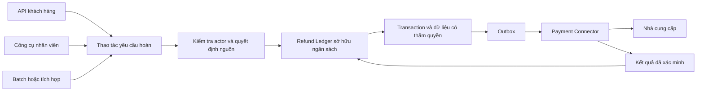

# Invariant ownership — Trách nhiệm sở hữu bất biến nghiệp vụ

## 1. Invariant ownership là gì?

**Invariant — bất biến** là điều kiện bắt buộc phải đúng ở những trạng thái quan sát được mà mô hình hệ thống đã quy định. Ví dụ, tổng tiền đã hoàn cộng phần đang dành để hoàn không được vượt ngân sách hợp lệ của một thanh toán.

**Invariant ownership** xác định ai chịu trách nhiệm về ý nghĩa của điều kiện đó, thành phần nào có quyền quyết định thay đổi liên quan, và cơ chế nào buộc mọi đường ghi phải giữ điều kiện.

Một bất biến chưa có ownership đầy đủ nếu đội đơn hàng nghĩ đội thanh toán sẽ kiểm tra, đội thanh toán lại tin rằng yêu cầu từ đội đơn hàng đã được kiểm tra. Cả hai có thể làm đúng hợp đồng mà họ tưởng tượng, trong khi kết quả chung vẫn sai.

Trong chương **Security Invariants**, ownership giúp đưa yêu cầu bảo mật nghiệp vụ từ một câu mô tả sang trách nhiệm có thể triển khai, kiểm thử và vận hành. Bài học gắn ownership với quyền theo đối tượng, máy trạng thái, transaction, idempotency và kiểm thử đường lách logic.

Sau bài học, bạn có thể:

- Tách trách nhiệm quyết định chính sách, giữ nguồn sự thật, thực thi và vận hành.
- Chọn ranh giới aggregate hoặc dịch vụ phù hợp với dữ liệu cần nhất quán.
- Xác định đường ghi nào phải đi qua owner và đường nào chỉ được đọc bản sao.
- Thiết kế hợp đồng giữa các owner khi một quy trình đi qua nhiều miền.
- Nhận diện ownership bị bỏ trống, bị chia sai hoặc bị chuyển giao không an toàn.
- Lập đặc tả và kiểm thử chứng minh các thành phần không tự cấp quyền thay đổi ngoài phạm vi.

Ví dụ xuyên suốt dùng luồng hoàn tiền giả định. Các quy tắc là lựa chọn cho mô hình học tập, không phải chính sách tài chính chung.

## 2. Phân biệt những nghĩa khác nhau của “owner”

### 2.1. Owner của bất biến khác owner của tài nguyên

Khách hàng có thể là chủ thể sở hữu một đơn hàng theo quyền ứng dụng. Điều đó không làm khách trở thành người quyết định công thức ngân sách hoàn hoặc được sửa bộ đếm tiền đã hoàn.

Tương tự, một đội đang quản lý bảng dữ liệu chưa chắc là bên có đủ thông tin nghiệp vụ để định nghĩa quy tắc. Cần phân biệt ít nhất:

| Loại trách nhiệm | Câu hỏi cần trả lời | Ví dụ minh họa |
| --- | --- | --- |
| Chính sách nghiệp vụ | Điều gì phải đúng, phạm vi và ngoại lệ hợp lệ là gì? | Bộ phận phụ trách sản phẩm và nghiệp vụ tài chính xác định ngân sách hoàn |
| Quyền quyết định kỹ thuật | Thành phần nào chấp nhận hoặc từ chối việc tiêu ngân sách? | Miền Refund Ledger giữ quyết định dành tiền |
| Nguồn dữ liệu có thẩm quyền | Bản ghi nào dùng làm căn cứ, ai được ghi? | Ledger thanh toán và các ý định hoàn đang mở |
| Duy trì triển khai | Ai sửa code, schema, hợp đồng và kiểm thử? | Nhóm phụ trách miền thanh toán |
| Vận hành và khắc phục | Ai nhận cảnh báo, đối soát và xử lý trạng thái lỗi? | Nhóm vận hành được giao trách nhiệm và quyền phù hợp |

Một nhóm có thể đảm nhận nhiều phần, nhưng từng phần vẫn cần được xác định. Ownership không nhất thiết đồng nghĩa một cá nhân duy nhất làm mọi việc; cần có đầu mối chốt quyết định và cơ chế phối hợp rõ khi trách nhiệm khác nhau.

### 2.2. Có trách nhiệm nhưng thiếu quyền kiểm soát là chưa đủ

Nếu đội Refund Ledger bị giao trách nhiệm “không hoàn vượt” nhưng các dịch vụ khác vẫn được sửa bảng ngân sách hoặc gọi nhà cung cấp trực tiếp, họ không kiểm soát được toàn bộ điều kiện mình phải bảo vệ.

Ngược lại, nếu một thành phần có thể chi tiền nhưng không có nhóm chịu trách nhiệm về quy tắc, kiểm thử và sự cố, quyền kỹ thuật đang thiếu trách nhiệm tương ứng.

Ownership cần nối được ba yếu tố: **trách nhiệm, thẩm quyền và bằng chứng kiểm chứng**.

### 2.3. Owner là một ranh giới logic, không bắt buộc một tiến trình

Một miền có thể chạy nhiều instance và phân vùng theo tenant hoặc thanh toán. Những instance đó vẫn có thể thuộc cùng một owner logic nếu cùng tuân theo giao thức ghi, nguồn dữ liệu và hợp đồng quyết định.

Gọi một service là owner không tự ngăn hai instance cùng tiêu một ngân sách. Khóa, cập nhật có điều kiện, phiên bản hoặc cơ chế phối hợp phù hợp vẫn cần bảo vệ cạnh tranh trên đúng khóa nghiệp vụ.

## 3. Ví dụ: ai giữ điều kiện “không hoàn vượt”?

### 3.1. Quy tắc và phạm vi giả định

Hệ thống có các miền:

- **Orders:** nội dung đơn, giá trị đã chấp nhận và dữ liệu hiển thị tiến trình.
- **Returns:** hồ sơ trả hàng và quyết định chấp nhận hoàn theo chính sách.
- **Refund Ledger:** ý định hoàn, phần tiền đang dành và kết quả đã xác nhận.
- **Payment Connector:** giao tiếp kỹ thuật với nhà cung cấp thanh toán.
- **Support:** công cụ của nhân viên, gọi các thao tác được cấp quyền.

Trong ví dụ, một thanh toán bằng VND là nguồn cho nhiều đề nghị hoàn. Không xét thanh toán chia nhiều nguồn, tranh chấp hoặc điều chỉnh khác. Mỗi quyết định hoàn đã được chấp nhận chỉ có một ý định thực thi.

Bất biến ngân sách:

```text
Với mỗi (tenantId, paymentId, currency):

  confirmedRefund + reservedRefund <= capturedAmount

  confirmedRefund >= 0
  reservedRefund >= 0
```

`reservedRefund` bao gồm ý định đang xử lý hoặc chưa rõ kết quả nếu vẫn có khả năng tạo tác dụng. Không chỉ tính những khoản đã nhận được phản hồi thành công.

### 3.2. Phân công theo từng quyết định

| Quy tắc hoặc dữ liệu | Owner quyết định trong mô hình | Thành phần khác sử dụng thế nào? |
| --- | --- | --- |
| Hồ sơ trả đạt điều kiện, số tiền được chấp nhận | Returns và chính sách nghiệp vụ liên quan | Phát quyết định có định danh, nội dung và phạm vi |
| Thanh toán nào thực sự đã thu tiền | Miền thanh toán qua quy trình xác minh nguồn | Refund Ledger dùng căn cứ đã xác minh |
| Ngân sách còn có thể dành để hoàn | Refund Ledger | Caller gửi yêu cầu, không tự trừ bộ đếm |
| Một quyết định chỉ tạo một ý định hoàn | Refund Ledger trong phạm vi đã chọn | Retry tham chiếu cùng quyết định |
| Gửi lệnh và kiểm tra phản hồi nhà cung cấp | Payment Connector theo hợp đồng | Báo kết quả gắn đúng ý định; không tự cấp ngân sách |
| Hiển thị “đang hoàn”, “đã hoàn” | Hình chiếu của Orders/Support | Đọc sự kiện hoặc API, không dùng bản sao để cấp quyền chi |

Owner của ngân sách không được bỏ kiểm tra nguồn quyết định. Owner của tính đủ điều kiện cũng không tự có quyền phát tiền vượt nguồn đã thu. Một quy trình có thể cần nhiều quyết định, mỗi quyết định có ranh giới chịu trách nhiệm riêng.

### 3.3. Dấu hiệu không có owner thực sự

Giả sử Orders và Support đều giữ biến `remainingRefund` riêng. Mỗi bên thấy còn 1.000.000 VND rồi gửi hoàn 800.000 VND. Nếu Payment Connector tin rằng các caller đã kiểm tra, nó có thể phát tổng 1.600.000 VND.

Có hai bộ kiểm tra không đồng nghĩa có một quyết định nhất quán. Vấn đề là chưa có nơi điều phối việc nhận ngân sách trên cùng nguồn sự thật.

## 4. Chọn ranh giới đủ để giữ bất biến

### 4.1. Bắt đầu từ dữ liệu cần cùng tham gia quyết định

Để dành ngân sách hoàn, cần biết số đã thu, số đã hoàn, số đang dành và ý định đã tồn tại. Nếu mỗi refund request tự giữ bản sao số còn lại, không request nào có đủ thẩm quyền bảo vệ tổng chung.

Vì vậy, trong mô hình này, khóa điều phối nằm ở thanh toán và loại tiền, không chỉ ở mã đề nghị hoàn. Các request khác nhau cùng tiêu một nguồn phải gặp cùng quyết định ngân sách.

Một câu hỏi hữu ích là:

> Thành phần nào có thể đọc đủ dữ liệu quyết định và ghi thay đổi liên quan bằng một giao thức nhất quán, đồng thời chặn các đường ghi bỏ qua?

### 4.2. Aggregate root là một cách tổ chức owner trong code

Trong thiết kế hướng miền, aggregate xác định một ranh giới nhất quán và aggregate root là điểm vào để thay đổi dữ liệu bên trong theo quy tắc của nó. Điều này giúp không sửa entity con độc lập rồi bỏ điều kiện chung. [Nguồn: Microsoft — Design a microservice domain model](https://learn.microsoft.com/dotnet/architecture/microservices/microservice-ddd-cqrs-patterns/microservice-domain-model).

Ví dụ, `RefundBudget` có thể cung cấp thao tác `reserve`, `confirm` và `releaseAfterVerifiedFailure`, thay vì cho các caller tự đặt `reservedRefund` hoặc `confirmedRefund`.

Không bắt buộc tạo một microservice cho mỗi bất biến. Một module trong ứng dụng nguyên khối cũng có thể giữ ranh giới này. Điều quan trọng là quyền ghi, giao thức và trách nhiệm, không phải số lượng service.

### 4.3. Không gom mọi quy tắc vào một thành phần khổng lồ

Refund Ledger không cần tự quyết định khách đã trả hàng đạt yêu cầu hay chưa nếu Returns là miền chịu trách nhiệm việc đó. Nó cần kiểm tra căn cứ đủ tin cậy, đúng đối tượng, đúng số tiền và đủ điều kiện để sử dụng.

Nếu một bất biến thật sự trải qua nhiều nguồn độc lập, cần thiết kế hợp đồng phối hợp hoặc xem lại ranh giới. Không giải quyết bằng một lớp `ValidationService` biết mọi bảng nhưng không có quyền kiểm soát việc ghi.

### 4.4. Shared validator không tự trở thành owner

Một thư viện có thể giúp các caller diễn giải cùng một quy tắc. Nhưng các caller có thể dùng phiên bản cũ, dữ liệu cũ hoặc chạy đồng thời.

Shared validator phù hợp cho tái sử dụng, phản hồi sớm hoặc phòng vệ bổ sung. Nếu mỗi nơi vẫn tự quyết định dựa trên bản sao riêng, bất biến tổng chưa có một cơ chế giữ nhất quán.

## 5. Mọi đường thay đổi phải gặp cùng cơ chế quyết định

### 5.1. Vẽ các đường vào trước khi tuyên bố có owner



Sơ đồ thể hiện đường đi logic, không bắt buộc mỗi hộp là một service triển khai riêng. Nhánh kết quả quay lại owner vì xác nhận thành công hoặc giải phóng ngân sách cũng làm thay đổi bất biến.

Những đường cần rà gồm endpoint cũ, API nội bộ, job retry, import, công cụ sửa lỗi, callback, replay sự kiện và migration. Một owner chỉ được gọi ở happy path chưa kiểm soát được các nhánh còn lại.

OWASP khuyến nghị ánh xạ thao tác nhạy cảm với mọi điểm vào có thể kích hoạt nó. Trong bài này, đó là cơ sở để kiểm tra quyền thay đổi không bị mở ở một nhánh phụ. [Nguồn: OWASP Business Logic Security](https://cheatsheetseries.owasp.org/cheatsheets/Business_Logic_Security_Cheat_Sheet.html).

### 5.2. Đọc bản sao không tạo quyền ghi nguồn

Orders có thể lưu `refundStatus` để hiển thị nhanh. Nó không được tăng `confirmedRefund` hoặc giảm `reservedRefund` của nguồn chính chỉ vì màn hình cần chuyển trạng thái.

Một bản sao có thể đủ cho báo cáo nhưng không đủ để cấp quyền chi tiền. Cần đặt tên, API và quyền dữ liệu sao cho người dùng code biết đâu là nguồn quyết định và đâu là hình chiếu.

### 5.3. Chặn đường ghi trực tiếp ở mức phù hợp

Trong code, tránh setter công khai cho bộ đếm và không để repository của owner được gọi tùy ý từ module khác. Ở cơ sở dữ liệu và hạ tầng, phân quyền ghi theo thiết kế để những service khác không sửa trực tiếp nguồn ngân sách hoặc tự gọi nhà cung cấp ngoài ý định được phép.

`private` trong Java không bảo vệ trước người có credential ghi database. Mặt khác, không cần coi mọi lớp trong cùng tiến trình là một tổ chức đối địch. Cần nêu ranh giới bảo vệ thực tế: lỗi gọi nhầm, đường API trái quyền, tài khoản dịch vụ bị chiếm hay quyền quản trị nền.

Nếu có công cụ sửa trực tiếp, đó phải là một đường thay đổi được nhận diện với thẩm quyền, điều kiện và đối soát riêng. Không được vừa cho nó bỏ mọi quy tắc vừa khẳng định toàn bộ invariant đã được giữ chỉ bởi domain model.

### 5.4. Kiểm tra nhiều lớp vẫn có ích

UI và adapter có thể kiểm tra sớm để phản hồi nhanh. Database có thể chặn số âm hoặc khóa duy nhất. Các service nhận kết quả có thể xác minh nguồn và phạm vi.

Những lớp đó bổ sung cho owner. Cần tránh để mỗi lớp trở thành một nơi tự cấp cùng quyền dựa trên sự thật khác nhau, hoặc để owner bỏ kiểm tra vì tin rằng lớp trước đã làm.

## 6. Ví dụ điều phối: owner nhận và dành ngân sách

### 6.1. Hợp đồng của thao tác

Lệnh từ caller chỉ cần tham chiếu một quyết định hoàn đã được tiếp nhận theo chính sách. Số tiền, thanh toán gốc, người hưởng và loại tiền phải được lấy/đối chiếu từ quyết định đáng tin.

Owner cần xử lý được:

- Caller có quyền yêu cầu hành động trên đối tượng này không?
- Quyết định nguồn có xác thực, đúng nội dung và dùng được cho yêu cầu mới không?
- Cùng quyết định đã có ý định chưa, và nội dung có khớp không?
- Ngân sách còn đủ khi thực sự ghi không?
- Nếu một bước lưu thất bại, có còn lượng tiền bị dành dở không?

### 6.2. Mã giả theo phong cách Java

Đoạn sau minh họa vị trí trách nhiệm, không phải mã có đủ interface để biên dịch. `tx`, `decisions`, `budgets`, `access`, `eligibility`, `intents` và `outbox` là các thành phần theo hợp đồng của ví dụ, không phải API của một framework cụ thể.

```java
RefundReceipt requestRefund(VerifiedCaller caller, RefundCommand command) {
    // Tải từ nguồn được xác minh; không tin amount/payment do client tự khai.
    VerifiedRefundDecision decision =
            decisions.loadTrusted(command.decisionId());

    return tx.required(() -> {
        // Khóa theo nguồn tiền chung, không chỉ theo mã refund request.
        RefundBudget budget = budgets.lock(decision.paymentKey());

        access.requireCanRequest(caller, decision, budget.key());

        RefundIntent existing = intents.findByDecision(
                decision.tenantId(), decision.id());

        if (existing != null) {
            existing.requireSameDecision(decision);
            return RefundReceipt.from(existing);
        }

        eligibility.requireUsableForNewIntent(decision, budget);

        // Domain operation giữ công thức ngân sách, không có cờ bỏ qua.
        budget.reserve(decision.amountMinor());

        RefundIntent intent = RefundIntent.prepare(
                decision, caller.actorReference());

        budgets.save(budget);
        intents.insert(intent);
        outbox.append(RefundRequested.from(intent));

        return RefundReceipt.from(intent);
    });
}
```

Điều kiện của các thành phần cần rõ:

1. `VerifiedCaller` đến từ ngữ cảnh đã xác thực, gồm danh tính dịch vụ và ngữ cảnh đại diện nếu có.
2. `paymentKey()` gồm tenant, thanh toán và loại tiền; quyền đối tượng phải khớp khóa đó.
3. `budgets.lock` đại diện cho cơ chế đồng bộ được triển khai thật, không chỉ một tên phương thức.
4. `reserve` từ chối lượng không hợp lệ hoặc vượt phần còn lại, bất kể caller có vai trò nhân viên hay quản trị.
5. Trong phạm vi một quyết định–một ý định, `intents.insert` có ràng buộc duy nhất theo `(tenantId, decisionId)` và dữ liệu bắt buộc.
6. Lưu budget, intent và outbox thuộc cùng transaction. Lỗi chèn ý định phải rollback cả tiền vừa dành.
7. Receipt cho ý định mới phản ánh đã tiếp nhận/dành ngân sách, không khẳng định nhà cung cấp đã hoàn xong.

Không dùng `ON CONFLICT DO NOTHING` rồi commit phần ngân sách đã trừ mà thiếu ý định tương ứng. Không trả kết quả lưu sẵn cho người không có quyền chỉ vì họ biết mã quyết định.

### 6.3. Owner logic vẫn cần bảo vệ concurrency

Với nguồn còn 1.000.000 VND, hai instance có thể cùng nhận yêu cầu 800.000 VND. Tên service giống nhau hoặc cùng dùng một class không ngăn được cuộc đua.

Cần khóa, cập nhật có điều kiện hoặc cơ chế phiên bản/mức cô lập thích hợp trên nguồn chung. Những thay đổi cùng ảnh hưởng ngân sách, như xác nhận hoặc giải phóng, cũng phải tôn trọng giao thức đó.

Nếu mô hình có thêm ngân sách theo dòng hàng hoặc quyết định nguồn, các giới hạn đó cũng phải được phối hợp. Giữ tổng theo thanh toán không cho phép hoàn nhiều lần cho cùng phần quyền chỉ vì dòng khác còn tiền.

## 7. Hợp đồng giữa các owner

### 7.1. Chuyển quyết định có phạm vi, không chuyển một cờ `approved`

Returns có thể cung cấp quyết định chứa:

```text
decisionId, issuer và phiên bản quyết định
tenantId, orderId, paymentId
amount, currency và phân bổ được chấp nhận
đích nhận giá trị theo chính sách
phiên bản nội dung nguồn
người lập, người duyệt nếu cần và căn cứ chính sách
điều kiện hiệu lực hoặc hủy
```

Hợp đồng truyền/lưu phải bảo vệ nguồn và nội dung theo kiến trúc. Một boolean hoặc một header tự khai không thay thế được kiểm tra nguồn phát và phạm vi.

Refund Ledger kiểm tra quyết định này có được issuer cấp cho đúng mục đích hay không. Nó không cho issuer tùy ý thay số đã thu hoặc đặt lại lịch sử hoàn.

### 7.2. Việc hủy quyết định cần có semantics rõ

Giả sử Refund Ledger đọc quyết định là đã duyệt, ngay sau đó Returns thu hồi nó. Nếu hai bên chỉ trao đổi event bất đồng bộ, chưa thể khẳng định thao tác dành tiền và lần thu hồi có cùng một thứ tự nguyên tử.

Cần chọn một hợp đồng thực tế, chẳng hạn:

- Quyết định được chốt có giá trị cho lần tiếp nhận hợp lệ; yêu cầu rút lại sau điểm đó đi qua quy trình hủy/khắc phục riêng.
- Hoặc quyết định còn thu hồi được đến một điểm xác định, khi đó cần giao thức nhận/tiêu quyền và đồng bộ phù hợp để không chấp nhận căn cứ đã bị thu hồi.

Lựa chọn thứ hai có thể đòi hỏi thay đổi ranh giới hoặc cơ chế phối hợp mạnh hơn. Chỉ gọi API “kiểm tra còn hợp lệ” rồi ghi ở nơi khác vẫn có khoảng trống giữa kiểm tra và hành động.

Mã giả ở phần trước chỉ đúng khi `eligibility` và giao thức nguồn đáp ứng hợp đồng hiệu lực đã chọn. Một interface kiểm tra không tự giải quyết bài toán phân tán.

### 7.3. Owner của quy trình không tự sở hữu mọi dữ liệu

Một orchestrator có thể theo dõi các bước Returns → Refund Ledger → Connector và điều phối lỗi. Nó không vì thế được ghi trực tiếp vào ledger của từng miền hoặc bỏ quyền đối tượng.

Các owner vẫn có quyền từ chối lệnh không thỏa điều kiện của mình. Khi một bước thất bại, orchestrator cần biết bước nào đã cam kết, bước nào chưa rõ và thao tác bù nào thật sự được phép.

## 8. Ownership không kết thúc ở lúc phát sự kiện

### 8.1. Dữ liệu và ý định phát phải nhất quán

Nếu ledger đã dành tiền nhưng sự kiện thực thi bị mất, công việc có thể kẹt. Nếu sự kiện phát ra nhưng transaction dành tiền rollback, bên nhận có thể thực hiện một ý định chưa được chấp nhận.

Transactional outbox giải quyết khoảng trống giữa ghi dữ liệu nội bộ và ghi ý định phát thông báo trong cùng transaction. Bên nhận vẫn cần xử lý trùng phù hợp vì quá trình gửi có thể lặp. [Nguồn: AWS — Transactional outbox pattern](https://docs.aws.amazon.com/prescriptive-guidance/latest/cloud-design-patterns/transactional-outbox.html).

Connector chỉ thực thi ý định thuộc nguồn được chấp nhận và đúng phạm vi của nó. Nó không được coi mọi message có trường `refundId` là một lệnh có quyền chi tiền.

### 8.2. Owner tiếp nhận kết quả và chuyển ngân sách

Khi nhận thành công đã xác minh, Refund Ledger chuyển lượng đang dành sang lượng đã hoàn, gắn đúng ý định và chỉ một lần. Nếu có thất bại cuối cùng và không còn khả năng thành công muộn, owner giải phóng phần đang dành.

Timeout chỉ cho biết một bên ngừng chờ. Connector không được tự xóa reservation hoặc tự tạo ý định khác khi chưa biết kết quả. Owner giữ trạng thái chưa rõ cùng bằng chứng để đối soát.

Nguồn bên ngoài có khả năng riêng về idempotency, tra cứu và thời hạn giữ khóa. Một owner nội bộ không thể tự bảo đảm tác dụng ngoài chỉ xảy ra một lần nếu giao thức bên nhận không đáp ứng và không có đường phục hồi thích hợp.

### 8.3. Saga không tự giữ mọi giới hạn cứng

Một saga có thể phối hợp các bước và thao tác bù theo mô hình đã thiết kế. Nếu hai nơi đã phát tiền vượt nguồn rồi mới bù, điều kiện “không bao giờ vượt” đã bị phá trong khoảng đó.

Với giới hạn cứng, cần nhận ngân sách trước hoặc một giao thức phân bổ giữ được giới hạn. Tên mẫu kiến trúc không thay cho lập luận bất biến.

### 8.4. Khi cần nhiều nơi cấp ngân sách

Có thể phân bổ quyền tiêu thành các phần hữu hạn cho các nhánh xử lý. Ví dụ, nguồn 1.000.000 VND chỉ cấp tổng 1.000.000 VND ngân sách con; mỗi nhánh giữ giới hạn cục bộ của mình theo giao thức rõ ràng.

Việc chuyển lại phần chưa dùng, thu hồi và tái cấp không được nhân đôi quyền tiêu. Nhánh cũ phải không còn dùng được phần đã chuyển. Cách này thay đổi cơ chế thực thi, nhưng vẫn cần owner và bằng chứng cho ngân sách gốc lẫn ngân sách con; không phải mỗi service tự giữ một bản sao đầy đủ của nguồn.

## 9. Thay đổi chính sách và chuyển giao ownership

### 9.1. Ownership cần được lưu như một phần của thiết kế

Với mỗi invariant, nên có đầu mối nghiệp vụ, thành phần thực thi, nhóm duy trì và đầu mối vận hành. Tài liệu cũng cần chỉ ra nguồn dữ liệu, các đường ghi, phụ thuộc và kiểm thử liên quan.

Một tên nhóm trong danh sách không đủ nếu không biết họ sở hữu quyết định nào. Khi đội tổ chức lại, cần bảo toàn trách nhiệm và quyền sửa triển khai, không chỉ chuyển tên người nhận cảnh báo.

Các thay đổi có thể ảnh hưởng ownership gồm thêm endpoint, tách service, chuyển database, thêm nhà cung cấp, thay chính sách hoàn, hỗ trợ nhiều nguồn thanh toán hoặc đưa một công cụ vận hành vào sử dụng.

### 9.2. Thay công thức là thay hợp đồng nghiệp vụ

Nếu thêm một loại ngân sách hoặc khoản điều chỉnh, cần xác định ý nghĩa, dữ liệu nguồn và ảnh hưởng đến ý định đang mở. Không sửa công thức ở một service rồi để các service khác tiếp tục tính theo phiên bản cũ mà không có kế hoạch tương thích.

Phiên bản chính sách giúp giải thích quyết định đã được chấp nhận theo quy tắc nào. Không nên tính lại mọi lịch sử bằng cấu hình hiện tại rồi coi chênh lệch là sai phạm của actor cũ.

Migration cũng là đường thay đổi trạng thái. Cần kiểm tra dữ liệu ban đầu, trạng thái sau chuyển đổi và khả năng tiếp tục những công việc đã cam kết.

### 9.3. Chuyển owner phải giữ quyền ghi và lịch sử

Một kế hoạch chuyển Refund Ledger sang thành phần mới cần xử lý ít nhất:

1. Xác định phạm vi chuyển theo khóa nghiệp vụ và thời điểm hoặc phiên bản chuyển quyền.
2. Chọn cách ngừng/drain đường ghi cũ hoặc phối hợp chuyển giao có kiểm soát.
3. Chuyển dữ liệu đã xác nhận, đang dành, chưa rõ, ý định và lịch sử chống trùng cần thiết từ một ảnh chụp nhất quán.
4. Đối soát công thức và liên kết với quyết định nguồn, kết quả ngoài.
5. Bảo đảm writer cũ không còn được tạo thay đổi hoặc tác dụng cho phạm vi đã chuyển.
6. Mở đường ghi mới và tiếp tục xử lý kết quả đang tới theo định danh ổn định.

Chỉ đổi routing không đủ nếu worker cũ vẫn có quyền ghi hoặc tiếp tục gọi nhà cung cấp. Nếu dùng epoch/fencing để nhận biết owner hiện hành, phiên bản đó phải được kiểm tra ở nơi thật sự kiểm soát ghi/tác dụng, không chỉ là một header để tham khảo.

Không khởi tạo `reservedRefund = 0` ở hệ thống mới chỉ vì các ý định chưa có phản hồi cuối. Không để chuyển khóa API hay đổi service làm lịch sử chống trùng bắt đầu lại từ đầu.

### 9.4. Rollback triển khai không được quay lùi tác dụng nghiệp vụ

Quay lại code cũ có thể cần thiết, nhưng dữ liệu và hiệu ứng ngoài đã phát sinh vẫn tồn tại. Cần khả năng tương thích schema/hợp đồng và kế hoạch tiếp tục những ý định đã nhận, thay vì khôi phục một ảnh dữ liệu cũ rồi chi lại ngân sách.

Nếu không thể bảo đảm hai bên không cùng giữ quyền ghi, cần điều chỉnh kế hoạch chuyển giao. Tạm dừng nhận công việc mới có kiểm soát có thể cần thiết hơn việc cho hai owner độc lập cùng quyết định trên bản sao đầy đủ.

## 10. Trách nhiệm vận hành và bằng chứng

### 10.1. Owner phải quan sát được điều mình chịu trách nhiệm

Các dữ liệu hữu ích gồm:

```text
invariantId và phiên bản chính sách/hợp đồng
owner logic và phạm vi khóa nghiệp vụ
tenantId, paymentId, currency
quyết định nguồn, intentId, operationId
actor khởi tạo và danh tính dịch vụ thực thi
captured, confirmed, reserved cùng thời điểm quan sát
trạng thái trước/sau, kết quả, mã lý do
tham chiếu kết quả bên ngoài và mã tương quan
```

Không đưa bí mật tích hợp, token hay dữ liệu cá nhân không cần thiết vào log. Bằng chứng cần được bảo vệ khỏi sửa/xóa ngoài quyền; nhân viên được xử lý nghiệp vụ không mặc nhiên được sửa lịch sử của chính mình.

Đối soát phải dùng trạng thái đủ nhất quán. So tổng ở một bản sao trễ với chi tiết ở nguồn mới có thể tạo cảnh báo giả. Tuy nhiên, việc báo cáo trễ không được dùng làm lý do bỏ qua một chênh lệch đã xác minh ở nguồn có thẩm quyền.

### 10.2. Có người nhận cảnh báo và có quyền khắc phục phù hợp

Nhóm vận hành cần biết ai quyết định khi xuất hiện tiền đang dành không có ý định, ý định chưa rõ quá lâu, nhiều kết quả cho cùng thao tác hoặc caller đang ghi vòng qua owner.

Runbook cần chỉ rõ cách giảm đầu vào, đóng băng phạm vi bị ảnh hưởng, giữ bằng chứng và đối soát. Không sửa bộ đếm chỉ để công thức nhìn cân bằng mà chưa biết tiền đã ra ngoài hay chưa.

Nếu cần một điều chỉnh hợp lệ, dùng hành động có thẩm quyền, căn cứ và lịch sử. Công cụ khắc phục không được trở thành quyền bỏ mọi kiểm tra hoặc phát lại một ý định chưa biết kết quả như thể nó chưa từng chạy.

### 10.3. Owner cũng chịu trách nhiệm cho khả năng phục vụ

Một owner quá tải có thể làm nhiều luồng phụ thuộc bị kẹt. Cần giới hạn công việc, năng lực đồng thời, retry và hàng đợi theo phạm vi; bảo vệ cả năng lực đối soát/kết thúc công việc cũ.

Khi owner không sẵn sàng, UI có thể hiển thị tiến trình đã biết hoặc hệ thống có thể nhận một yêu cầu chờ theo hợp đồng rõ ràng. Không báo đã cấp ngân sách nếu owner chưa chấp nhận, và không cho caller dùng bản sao cũ để tự cấp thay.

Một invariant có thể vẫn đúng khi hệ thống từ chối mọi lệnh. Vì vậy, owner cần mục tiêu vận hành và kiểm thử luồng được phép, không chỉ đếm số yêu cầu bị chặn.

## 11. Kiểm thử ownership bằng cách thử đi vòng qua owner

### 11.1. Ma trận kiểm thử

| Tình huống | Kết quả cần chứng minh |
| --- | --- |
| Hai caller hợp lệ cùng tiêu nguồn còn 1.000.000 VND, mỗi bên yêu cầu 800.000 VND | Tổng phần được dành không vượt nguồn, dù caller ở hai service/instance |
| Cùng quyết định được gửi từ UI rồi Support bằng khóa API khác | Một ý định nghiệp vụ theo mô hình; không dành tiền thêm |
| Caller dùng quyết định của tenant/thanh toán khác | Owner từ chối theo phạm vi và nguồn quyết định |
| Caller sửa số tiền hoặc loại tiền trong lệnh | Không ghi đè nội dung đã được chấp nhận |
| Cùng decision ID có nội dung khác | Không trả hoặc áp dụng kết quả như cùng một quyết định hợp lệ |
| Endpoint cũ, batch hoặc job gọi thao tác tương đương | Cùng bất biến và quyền đối tượng được bảo vệ |
| Service khác dùng tài khoản dữ liệu của nó để sửa nguồn ledger | Bị giới hạn theo quyền ghi và ranh giới đã thiết kế |
| Orders có hình chiếu còn dư do trễ sự kiện | Không tạo quyền chi vượt tại Refund Ledger |
| Insert intent hoặc outbox lỗi sau bước dành tiền | Transaction không để lại tiền bị dành dở |
| Connector timeout sau khi bên ngoài đã thực hiện | Không tự giải phóng ngân sách hoặc tạo lần thực thi mới |
| Kết quả thành công được gửi lặp | Chỉ chuyển reserved sang confirmed một lần |
| Thu hồi quyết định nguồn cạnh tranh với tiếp nhận | Kết quả đáp ứng đúng hợp đồng hiệu lực và điểm cam kết đã chọn |
| Message tự khai `approved=true` tới connector/worker | Không vượt cơ chế xác thực nguồn và phạm vi ý định |
| Writer cũ tiếp tục chạy sau chuyển giao | Không ghi hoặc tạo tác dụng mới cho phạm vi đã mất quyền |
| Chuyển owner khi còn ý định UNKNOWN | Ngân sách đang dành và định danh ngoài được giữ, không mở lại quyền tiêu |
| Một yêu cầu đúng quyền, đúng quyết định và đủ ngân sách | Được tiếp nhận và có đường hoàn tất/phục hồi hợp lệ |

### 11.2. Kiểm tra ở cả kiến trúc và hành vi

Kiểm tra phụ thuộc module có thể phát hiện code ngoài miền truy cập repository hoặc entity nội bộ trái thiết kế. Kiểm tra quyền database xác minh credential ứng dụng chỉ có năng lực cần thiết. Những kiểm tra đó bổ sung cho kiểm thử nghiệp vụ; chúng không tự chứng minh công thức được giữ dưới concurrency.

Kiểm thử đơn vị xác minh phép chuyển trong aggregate và các điều kiện miền. Kiểm thử tích hợp với cơ sở dữ liệu thật xác minh khóa, ràng buộc, transaction và rollback. Kiểm thử hợp đồng xác minh quyết định liên miền có đúng nguồn, đúng phạm vi và đúng semantics.

Kiểm thử phục hồi cần mô phỏng restart, timeout, sự kiện trùng, chuyển quyền và kết quả muộn. Quan sát cả ledger, ý định, outbox và số tác dụng ngoài, thay vì chỉ assert một service đã gọi một phương thức đúng tên.

Các trường hợp trên là đặc tả cho bài học, không phải báo cáo rằng một triển khai cụ thể đã chạy và đạt. Nếu quyền quản trị nền nằm ngoài khả năng chặn của ứng dụng, cần nêu rõ giả định và cơ chế quản trị tương ứng.

## 12. Mẫu hợp đồng ownership cho một invariant

Ví dụ hồ sơ cho bất biến đang xét:

| Thành phần | Nội dung minh họa |
| --- | --- |
| Mã | `INV-REFUND-BUDGET-001` |
| Phát biểu | Đã hoàn cộng đang dành không vượt số đã thu trong phạm vi mô hình; các lượng không âm |
| Khóa phạm vi | `(tenantId, paymentId, currency)` |
| Ranh giới quan sát | Trạng thái ledger đã commit; tác dụng ngoài phải gắn ý định đã được owner chấp nhận |
| Đầu mối chính sách | Bên phụ trách nghiệp vụ hoàn tiền và người được giao chốt thay đổi |
| Owner logic | Miền Refund Ledger, thao tác qua `RefundBudget` và lớp điều phối của miền |
| Nhóm duy trì | Nhóm được giao code, schema, hợp đồng và kiểm thử của Refund Ledger |
| Nguồn sự thật | Căn cứ thu tiền đã xác minh, ý định hoàn và kết quả được tiếp nhận |
| Phụ thuộc | Returns cung cấp quyết định; Connector cung cấp bằng chứng kết quả theo hợp đồng |
| Thao tác được phép | Dành, xác nhận, hủy/giải phóng an toàn và điều chỉnh nguồn theo chính sách riêng |
| Các đường vào | API, Support, batch, worker kết quả, công cụ vận hành và migration đã được nhận diện |
| Cơ chế nhất quán | Giao thức ghi theo nguồn chung, transaction, ràng buộc dữ liệu và khóa nghiệp vụ |
| Trường hợp chưa rõ | Tiếp tục giữ ngân sách và đối soát cùng ý định |
| Kiểm chứng | Cạnh tranh, retry, quyền đối tượng, rollback, đường lách và chuyển giao owner |
| Vận hành | Đầu mối trực, cảnh báo, đối soát và quyền khắc phục có bằng chứng |

Khi áp dụng cho một tính năng khác, cần trả lời thêm:

```text
Ai có thể thay đổi dữ liệu làm invariant đúng hoặc sai?
Ai có thể gây tác dụng ngoài dù không sửa bảng nguồn?
Thành phần nào được phép ra quyết định cuối cùng?
Các caller phải cung cấp căn cứ nào, owner phải kiểm tra lại điều gì?
Những bản sao nào chỉ dùng để đọc?
Khi lỗi hoặc chuyển giao, ai vẫn đang giữ quyền ghi và quyền tiêu?
```

Một câu trả lời như “backend chịu trách nhiệm” còn thiếu cụ thể. Cần lần được từ invariant tới đầu mối chính sách, thao tác thực thi, nguồn dữ liệu, mọi đường thay đổi và bằng chứng kiểm thử.

Invariant ownership được thiết kế đầy đủ khi **bên chịu trách nhiệm có thẩm quyền giữ điều kiện, các bên khác đi qua hợp đồng rõ ràng và mọi thay đổi liên quan đều có thể kiểm chứng**. Nhờ đó, quy tắc không bị bỏ trống giữa các đội hoặc bị phá qua một đường ghi mà không ai nhận là mình sở hữu.
