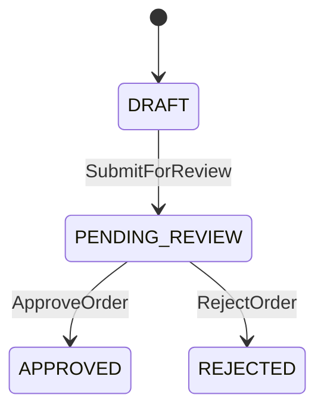

# Từ vựng trạng thái trong mô hình nghiệp vụ

## 1. Vì sao tên trạng thái liên quan đến bảo mật?

**Từ vựng trạng thái** (*state vocabulary*) là tập thuật ngữ có định nghĩa rõ để mô tả tình trạng của đối tượng nghiệp vụ tại một thời điểm. Từ vựng này giúp người phụ trách nghiệp vụ, lập trình viên, kiểm thử và vận hành hiểu cùng một điều khi sử dụng một mã như `APPROVED`, `IN_PROGRESS` hoặc `CANCELLED`.

Một tên mơ hồ có thể làm sai quyết định:

- `SUCCESS` là gửi request thành công hay đã thu tiền?
- `APPROVED` là quản lý duyệt nội dung hay ngân hàng chấp nhận thanh toán?
- `CANCELLED` là hủy giao hàng, hủy quyền giữ chỗ hay đã hoàn tiền?
- `PENDING` đang chờ ai, chờ bằng chứng gì và trong bao lâu?
- `FAILED` là có kết luận thất bại hay chỉ là chưa nhận response?

Nếu các thành phần hiểu khác nhau, một service có thể xuất hàng sau khi service khác mới chỉ đưa lệnh thanh toán vào hàng đợi. Mọi enum đều hợp lệ về kiểu nhưng quy tắc “chỉ xuất sau khi đủ điều kiện” vẫn bị phá vỡ.

Bài học thuộc chương **Domain State** của module **SECURITY_APPLICATION_SECURITY_BUSINESS_LOGIC_SECURITY**. Sau bài học, bạn có thể:

- Viết định nghĩa trạng thái có đối tượng, phạm vi và bằng chứng.
- Phân biệt trạng thái với command, event, guard, dữ kiện và nhãn hiển thị.
- Tách các chiều phê duyệt, thanh toán và giao hàng khi chúng có ý nghĩa độc lập.
- Biểu diễn trạng thái trong Java và hợp đồng dữ liệu mà không ngầm tạo quyền.
- Thiết kế tình huống kiểm tra các cách hiểu sai có thể dẫn đến lạm dụng logic.

## 2. Trạng thái cần một ngôn ngữ chung

### 2.1. Mỗi từ phải có một nghĩa trong bối cảnh đã chọn

Câu “đơn đã được chấp nhận” có thể chỉ:

- Hệ thống đã nhận dữ liệu.
- Đơn đã qua kiểm tra đầu vào.
- Quản lý đã duyệt.
- Thanh toán đã được xác nhận.
- Kho đã nhận nhiệm vụ.
- Đơn đã được giao.

Hãy xác định đang nói về đối tượng và quyết định nào. Có thể dùng các thuật ngữ cụ thể như `PENDING_REVIEW`, `CAPTURE_CONFIRMED` hoặc `RELEASED` trong những chiều tương ứng.

Khái niệm *ubiquitous language* trong Domain-Driven Design nhấn mạnh ngôn ngữ chung, chặt chẽ giữa người phát triển và người hiểu nghiệp vụ. Xem [Martin Fowler: Ubiquitous Language](https://martinfowler.com/bliki/UbiquitousLanguage.html).

Một từ không cần có cùng nghĩa trong mọi hệ thống. Nhưng trong một hợp đồng hoặc ngữ cảnh nghiệp vụ, ý nghĩa phải được chỉ rõ và dùng nhất quán.

### 2.2. Tên mã, nhãn và định nghĩa là ba thứ khác nhau

| Thành phần | Ví dụ | Vai trò |
|---|---|---|
| Mã ổn định | `approval.approved` | Dùng trong hợp đồng, lưu trữ hoặc trao đổi theo thiết kế |
| Tên Java | `ApprovalState.APPROVED` | Biểu diễn có kiểu trong chương trình |
| Nhãn tiếng Việt | Đã phê duyệt | Hiển thị cho người dùng |
| Định nghĩa | Có quyết định duyệt hợp lệ cho phiên bản nội dung xác định | Làm căn cứ hiểu và kiểm tra |

Đổi nhãn dịch thuật không nên vô tình đổi mã lưu trữ. Đổi tên hằng Java cũng không nên tự làm dữ liệu lịch sử mất nghĩa.

Ngược lại, chỉ giữ nguyên mã mà thay ý nghĩa của nó vẫn là thay đổi hợp đồng. Các consumer cũ có thể tiếp tục thực hiện một quyết định không còn đúng.

## 3. Phân biệt những thuật ngữ nền tảng

| Thuật ngữ | Ý nghĩa | Ví dụ |
|---|---|---|
| State — trạng thái | Một tình trạng được mô hình hóa trong vòng đời của đối tượng | Đề nghị đang chờ duyệt |
| Status — trường/mã trạng thái | Cách một hệ thống biểu diễn hoặc công bố trạng thái | `approvalStatus` trong response |
| Command — lệnh/yêu cầu | Ý định muốn hệ thống thực hiện hành động; có thể bị từ chối | `ApproveOrder` |
| Event — sự kiện | Mệnh đề về điều đã xảy ra ở phạm vi được định nghĩa | `OrderApproved` |
| Transition — chuyển trạng thái | Thay đổi hợp lệ từ trạng thái nguồn sang đích | Chờ duyệt → Đã duyệt |
| Guard — điều kiện chuyển | Điều kiện phải thỏa để một chuyển tiếp được chấp nhận | Đúng quyền, đúng phiên bản, không tự duyệt |
| Invariant — bất biến | Quy tắc phải được duy trì trong phạm vi đã xác định | Không xuất hàng hai lần cho cùng quyền xuất |
| Fact — dữ kiện | Thông tin làm căn cứ, có thể chi tiết hơn mã trạng thái | Số tiền, tiền tệ và tham chiếu khoản thu |
| Projection — mô hình đọc | Biểu diễn được tạo từ dữ liệu có thẩm quyền cho mục đích đọc | Nhãn “Đang xử lý” trên trang đơn |
| Terminal state — trạng thái kết thúc | Trạng thái kết thúc của một vòng đời hoặc chiều cụ thể | Đã từ chối một lần đề nghị |

Không có một quy tắc đặt tên phổ quát buộc mọi dự án dùng `State` và `Status` theo đúng hai hàng đầu. Điều quan trọng là dự án ghi rõ cách dùng và không gán quyền dựa trên sự nhầm lẫn đó.

### 3.1. Lệnh chưa phải sự kiện thành công

Client gửi `ApproveOrder` chưa làm đơn thành `APPROVED`. Backend còn phải kiểm tra và commit quyết định.

Sự kiện `PaymentRequestAccepted` có thể chỉ nói ý định thanh toán đã được nhận. Nó không đồng nghĩa `PaymentCaptureConfirmed`. Mỗi sự kiện phải nói đúng giai đoạn mà nó chứng minh.

Nếu sự kiện khẳng định một quyết định nghiệp vụ đã được lưu, cách phát sự kiện phải phù hợp với việc commit đó. Không công bố “đã duyệt” cho một transaction đã rollback.

### 3.2. Điều kiện UI chưa phải quyền hoặc trạng thái có thẩm quyền

`canApprove=true` trong response có thể giúp UI hiển thị nút. Nó là kết quả tính tại một thời điểm, không phải credential cho request tiếp theo.

Backend phải kiểm tra lại khi xử lý hành động. Trong thời gian người dùng xem trang, đơn có thể đã đổi nội dung, được người khác duyệt hoặc quyền người gọi đã thay đổi.

### 3.3. Không trộn trạng thái request với trạng thái nghiệp vụ

HTTP 200, một future hoàn tất hoặc message đã được enqueue đều nói về một giai đoạn xử lý kỹ thuật. Ý nghĩa nghiệp vụ phụ thuộc hợp đồng cụ thể.

Một API trả “đã tiếp nhận” phải giúp bên gọi phân biệt đang chờ với đã hoàn tất. Nếu dùng cùng chữ `SUCCESS` cho mọi lớp, các thành phần sau có thể cấp hàng hoặc quyền truy cập quá sớm.

## 4. Định nghĩa một trạng thái phải trả lời được gì?

Một mục từ vựng nên có:

- **Đối tượng:** đơn, đề nghị, payment operation hay shipment?
- **Chiều trạng thái:** phê duyệt, thanh toán, giao hàng hoặc xử lý lỗi?
- **Ý nghĩa:** mệnh đề nghiệp vụ nào đang được khẳng định?
- **Bằng chứng:** dữ liệu hoặc quyết định nào cho phép khẳng định?
- **Nguồn quản lý:** thành phần nào có quyền tạo hoặc cập nhật?
- **Không suy ra:** điều gì tên này không chứng minh?
- **Điều kiện vào/ra:** tóm tắt chuyển tiếp và điều kiện liên quan.
- **Dữ liệu được sửa:** trường nào còn được thay đổi?
- **Thời gian:** có thời hạn hay phải làm rõ sau một mốc không?
- **Tính kết thúc:** kết thúc chiều nào, còn nghĩa vụ nào?
- **Phiên bản và truy vết:** mã hợp đồng, actor, dữ kiện liên quan.

Không nhất thiết mọi mục từ đều có tài liệu dài. Nhưng với trạng thái làm căn cứ cho tiền, hàng hoặc quyền, thiếu nghĩa và bằng chứng dễ tạo sai sót nghiêm trọng.

### Mục từ mẫu: APPROVED

| Thuộc tính | Định nghĩa minh họa |
|---|---|
| Đối tượng | Đơn mua hàng cần phê duyệt |
| Chiều | Phê duyệt |
| Mã | `approval.approved` |
| Ý nghĩa | Có quyết định duyệt được hệ thống chấp nhận cho một phiên bản nội dung |
| Bằng chứng | Người duyệt, thời điểm, căn cứ quyền và phiên bản/digest nội dung |
| Không suy ra | Chưa khẳng định đã thu tiền, đã giữ đủ hàng hoặc đã giao |
| Trường quan trọng | Số tiền, mặt hàng và nội dung phải gắn với quyết định duyệt |
| Khi sửa nội dung | Xử lý lại hiệu lực phê duyệt theo chính sách |
| Khi dùng để thực thi | Kiểm tra quyết định còn áp dụng cho nội dung và điều kiện hiện tại |
| Truy vết | Liên hệ lệnh yêu cầu, quyết định đã commit và sự kiện tương ứng |

Một cờ `approved=true` không mang đủ thông tin của mục từ này. Tuy nhiên, một giá trị boolean được tính từ dữ liệu có thẩm quyền vẫn có thể hữu ích như một thuộc tính dẫn xuất; vấn đề là không để nó thay thế toàn bộ ý nghĩa và bằng chứng.

## 5. Xây dựng bộ từ vựng cho một ví dụ đơn hàng

### 5.1. Giả định nghiệp vụ

Ví dụ trong bài dùng đơn mua hàng có ba chiều:

1. Phê duyệt nội dung.
2. Xác nhận một nghiệp vụ thu tiền toàn bộ.
3. Cho phép và thực hiện xuất hàng.

Đơn có tổng tiền dương, dùng VND, cần phê duyệt trước khi bắt đầu thu tiền. Chỉ được cấp quyền xuất khi nội dung được duyệt còn phù hợp và khoản thu đã được xác nhận.

Bộ từ vựng thanh toán dưới đây xét một ngữ cảnh/operation toàn bộ của đơn. Retry kỹ thuật vẫn có thể xảy ra cho cùng operation. Các tình huống nhiều lần thu, nhiều attempt độc lập, thu từng phần, hoàn tiền hoặc quyết toán được mô hình hóa thêm ở hệ thống thực tế; chúng chưa nằm trong bộ enum tối thiểu của ví dụ.

### 5.2. Chiều phê duyệt

| Mã Java | Nghĩa | Không tự chứng minh |
|---|---|---|
| `DRAFT` | Nội dung đang được chuẩn bị, chưa gửi vào vòng duyệt này | Không có quyền thực thi chỉ vì dữ liệu đã được lưu |
| `PENDING_REVIEW` | Nội dung đã được gửi và đang chờ quyết định có thẩm quyền | Chưa được duyệt |
| `APPROVED` | Có quyết định duyệt hợp lệ cho phiên bản nội dung xác định | Chưa có bằng chứng thanh toán hoặc giao hàng |
| `REJECTED` | Vòng duyệt đã có quyết định từ chối | Không xóa dữ kiện thanh toán nếu bên ngoài đã phát sinh ngoại lệ |

Chính sách có thể cho sửa rồi tạo vòng duyệt mới. Nếu có, cần nhận diện vòng/phiên bản để không dùng quyết định cũ cho nội dung mới.

### 5.3. Chiều thanh toán

| Mã Java | Nghĩa trong mô hình này | Bằng chứng hoặc giới hạn |
|---|---|---|
| `NOT_STARTED` | Chưa chấp nhận ý định bắt đầu operation thanh toán đang xét | Không được suy ra chỉ vì response cũ bị mất |
| `IN_PROGRESS` | Operation đã được chấp nhận và chưa có kết luận cuối | Có operation ID và ý định bền vững; chưa đủ để xuất hàng |
| `CAPTURE_CONFIRMED` | Đã xác minh khoản thu phù hợp cho toàn bộ nội dung cần trả | Đúng giao dịch, bên nhận, số tiền, tiền tệ và loại xác nhận |
| `FAILED_CONFIRMED` | Có kết luận đủ thẩm quyền rằng operation này thất bại và không còn kết quả thành công có thể đến theo hợp đồng | Khác với timeout hoặc lỗi kết nối |
| `OUTCOME_UNKNOWN` | Chưa đủ bằng chứng để kết luận đã thu hay chưa | Cần làm rõ; không tự gửi một operation mới |

Tên `CAPTURE_CONFIRMED` được dùng để tránh nhầm việc chấp nhận request hoặc giữ hạn mức thẻ với bằng chứng thu tiền. Ý nghĩa chính xác của dữ liệu từ nhà cung cấp phải được ánh xạ theo hợp đồng.

Trạng thái này cũng chưa khẳng định đã quyết toán hoặc đã đối soát xong. Nếu các bước đó là tài sản cần bảo vệ, cần từ vựng và dữ liệu riêng.

### 5.4. Chiều thực hiện đơn

| Mã Java | Nghĩa | Không tự chứng minh |
|---|---|---|
| `NOT_RELEASED` | Chưa cấp quyền xuất cho lần thực hiện đang xét | Không nói phê duyệt hoặc thanh toán đang ở đâu |
| `RELEASED` | Đã cấp quyền xuất theo định danh và điều kiện nghiệp vụ | Chưa chắc hàng đã rời kho |
| `SHIPPED` | Có bằng chứng xuất/bàn giao được hệ thống chấp nhận theo quy trình | Chưa chắc khách đã nhận hoặc không thể trả hàng |
| `CANCELLED` | Luồng thực hiện này đã bị hủy và không được cấp xuất theo đường bình thường | Không tự khẳng định chưa thu hoặc đã hoàn tiền |

Cùng một đơn có thể có nhiều chiều đồng thời. Việc `fulfillment=CANCELLED` không được dùng để tự xóa một xác nhận thu tiền đã xảy ra.

## 6. Một đối tượng có thể có nhiều chiều trạng thái

### 6.1. Tách khi các câu hỏi khác nhau

Một trường `orderStatus` chứa lẫn `APPROVED`, `PAID`, `SHIPPED` và `REFUNDED` dễ làm mất thông tin. Đổi sang `PAID` có thể khiến hệ thống không còn biết phiên bản nào đã được duyệt; đổi sang `CANCELLED` có thể che mất nghĩa vụ xử lý khoản thu.

Có thể biểu diễn:

```text
approvalState    = APPROVED
paymentState     = CAPTURE_CONFIRMED
fulfillmentState = NOT_RELEASED
```

Các chiều riêng giúp nói đồng thời nhiều mệnh đề. Chúng vẫn có quan hệ điều kiện; tách field không làm mọi tổ hợp đều được phép đi qua luồng bình thường.

Các mô hình statechart cũng có cách biểu diễn những vùng trạng thái đồng thời có hiệu lực. [W3C SCXML](https://www.w3.org/TR/scxml/#parallel) mô tả khái niệm này; nó không buộc một mô hình nghiệp vụ phải dùng nhiều thread hoặc một engine SCXML cụ thể.

### 6.2. Các tổ hợp mang ý nghĩa khác nhau

| Phê duyệt | Thanh toán | Thực hiện | Ý nghĩa đối với cấp quyền xuất |
|---|---|---|---|
| `APPROVED` | `NOT_STARTED` | `NOT_RELEASED` | Chưa đủ bằng chứng thu tiền |
| `APPROVED` | `IN_PROGRESS` | `NOT_RELEASED` | Chưa hoàn tất điều kiện thanh toán |
| `APPROVED` | `OUTCOME_UNKNOWN` | `NOT_RELEASED` | Phải làm rõ, không coi là đã thu hoặc chưa thu |
| `APPROVED` | `CAPTURE_CONFIRMED` | `NOT_RELEASED` | Đủ nhóm điều kiện trạng thái tối thiểu, còn các guard khác |
| `PENDING_REVIEW` | `CAPTURE_CONFIRMED` | `NOT_RELEASED` | Có tình trạng cần xử lý ngoại lệ; không tự bỏ bước duyệt |
| `APPROVED` | `CAPTURE_CONFIRMED` | `RELEASED` | Đã có quyền xuất, không tạo thêm quyền xuất mới |
| `APPROVED` | `CAPTURE_CONFIRMED` | `SHIPPED` | Không lặp nghiệp vụ xuất của cùng lần thực hiện |
| `APPROVED` | `CAPTURE_CONFIRMED` | `CANCELLED` | Không xuất; khoản thu có thể cần xử lý riêng |

Không dùng phép “trạng thái lớn hơn hoặc bằng PAID” dựa vào thứ tự enum để suy ra quyền xuất. Mối quan hệ nghiệp vụ không nhất thiết là một trục tăng dần.

### 6.3. Khi nào dùng state, field hay reason?

| Thông tin | Cách biểu diễn có thể phù hợp |
|---|---|
| Giai đoạn quyết định hành động tiếp theo và trách nhiệm xử lý | State |
| Số tiền, thời hạn, số lượng, actor hoặc phiên bản | Field/dữ kiện |
| Lý do từ chối hoặc lỗi chi tiết | Reason code đi kèm state |
| Điều kiện được tính từ dữ liệu hiện tại | Thuộc tính dẫn xuất hoặc guard |
| Nội dung gọn cho giao diện | Nhãn/projection |

Không cần tạo một enum state riêng cho mỗi giá trị số tiền. Ngược lại, nếu “chờ kiểm tra thủ công” có người nhận việc, SLA và các bước ra/vào riêng, nó có thể cần trạng thái rõ thay vì một cờ bị bỏ quên.

### 6.4. Nhiều boolean cho cùng một chiều có thể tạo mâu thuẫn

Trong một vòng duyệt với một kết quả tổng hợp, các cờ độc lập:

```text
isDraft = false
isApprovalPending = true
isApproved = true
isRejected = false
```

không nói rõ đơn còn chờ hay đã được duyệt. Một enum cho kết quả của vòng duyệt giúp tránh biểu diễn hai giá trị loại trừ nhau trong cùng field.

Điều này không có nghĩa mọi boolean đều sai. Các dữ kiện độc lập hoặc giá trị dẫn xuất vẫn có thể là boolean; cần định nghĩa nó thuộc đối tượng, chiều và thời điểm nào.

## 7. Minh họa Java: vocabulary có kiểu

Ví dụ Java 17 sau biểu diễn ba chiều đã định nghĩa. Hàm bên trong chỉ kiểm tra nhóm điều kiện trạng thái tối thiểu; nó không tự cấp quyền hoặc thực hiện xuất hàng.

```java
import java.util.Objects;

public final class OrderStateVocabulary {
    private OrderStateVocabulary() {
    }

    public enum ApprovalState {
        DRAFT,
        PENDING_REVIEW,
        APPROVED,
        REJECTED
    }

    public enum PaymentState {
        NOT_STARTED,
        IN_PROGRESS,
        CAPTURE_CONFIRMED,
        FAILED_CONFIRMED,
        OUTCOME_UNKNOWN
    }

    public enum FulfillmentState {
        NOT_RELEASED,
        RELEASED,
        SHIPPED,
        CANCELLED
    }

    public record Lifecycle(
            ApprovalState approval,
            PaymentState payment,
            FulfillmentState fulfillment) {

        public Lifecycle {
            Objects.requireNonNull(approval, "approval");
            Objects.requireNonNull(payment, "payment");
            Objects.requireNonNull(fulfillment, "fulfillment");
        }

        public boolean hasReleaseStatePrerequisites() {
            return approval == ApprovalState.APPROVED
                    && payment == PaymentState.CAPTURE_CONFIRMED
                    && fulfillment == FulfillmentState.NOT_RELEASED;
        }
    }
}
```

Từ vựng có kiểu giúp tránh so sánh nhầm một trạng thái phê duyệt với trạng thái thanh toán. Nó không chứng minh dữ liệu đầu vào có nguồn đáng tin.

Trước khi cấp quyền xuất, use case còn phải kiểm tra:

- Người gọi có quyền hành động trên đúng đối tượng và tenant.
- Quyết định duyệt còn gắn với nội dung đang thực thi.
- Bằng chứng thu tiền khớp số tiền, tiền tệ và giao dịch.
- Tồn kho hoặc quyền phân bổ còn phù hợp.
- Chưa có quyền xuất cho cùng nghiệp vụ.
- Các điều kiện được bảo vệ đến điểm ghi khi có cạnh tranh.

Ví dụ không từ chối mọi tổ hợp bất thường ngay ở constructor. Một sự kiện bên ngoài có thể làm xuất hiện sự thật “đã thu tiền nhưng đơn bị hủy”; hệ thống cần lưu và giải quyết, thay vì không thể biểu diễn tình trạng đó.

## 8. Phân biệt đang chờ, thất bại, chưa rõ và hết hạn

### 8.1. IN_PROGRESS phải có điểm chờ

Một trạng thái đang xử lý cần nói rõ:

- Operation hoặc công việc nào đã được chấp nhận.
- Thành phần nào đang chịu trách nhiệm.
- Bằng chứng nào sẽ cho phép chuyển tiếp.
- Khi quá hạn thì tra cứu, đối soát hoặc chuyển xử lý ra sao.

Không để `IN_PROGRESS` chỉ là nhãn chung cho mọi trường hợp không biết. Nếu đủ điều kiện kết luận rằng kết quả đã không còn xác định được bằng luồng thông thường, vocabulary nên biểu diễn tình trạng đó và quy trình làm rõ.

### 8.2. Timeout không tự là FAILED_CONFIRMED

```text
Ứng dụng gửi lệnh.
Nhà cung cấp thực hiện.
Response bị mất.
```

Ứng dụng chưa có bằng chứng thành công nhưng cũng chưa có bằng chứng không thực hiện. Gán `FAILED_CONFIRMED` rồi tạo một nghiệp vụ mới có thể dẫn đến thu tiền hai lần.

`OUTCOME_UNKNOWN` là mô tả về mức biết của hệ thống. Nó không nói tiền đang ở một trạng thái vật lý riêng; cần giữ tham chiếu và nghĩa vụ làm rõ.

Tương tự, “không tìm thấy” trong một nguồn có độ trễ không luôn đủ làm kết luận cuối. Điều kiện vào `FAILED_CONFIRMED` phải dựa trên hợp đồng và bằng chứng được chấp nhận.

### 8.3. Tên EXPIRED phải có đối tượng và hệ quả

Một session, báo giá, challenge hoặc reservation có thể hết hạn. Chúng không nhất thiết hết hạn cùng lúc hoặc có cùng tác dụng:

| Đối tượng hết hạn | Hệ quả có thể có | Điều không tự xảy ra |
|---|---|---|
| Session | Không còn dùng credential đó theo quyền cũ | Không tự hoàn tiền hoặc trả tồn |
| Báo giá | Không tiếp tục chấp nhận giá theo hiệu lực cũ | Không tự thay nội dung đã được khách xác nhận |
| Challenge | Không chấp nhận xác nhận mới theo challenge đó | Không xóa bằng chứng giao dịch đã hoàn tất |
| Reservation | Không được xác nhận theo thời hạn cũ; cần xử lý giải phóng theo policy | Bộ đếm tồn không tự đồng bộ chỉ vì thời gian đã trôi qua |

Hệ thống phải kiểm tra thời hạn theo nguồn thời gian tin cậy ở điểm quyết định. Nếu lưu cả trạng thái và deadline, cần xác định cách xử lý khi field vẫn là `ACTIVE` nhưng thời gian đã vượt hạn.

### 8.4. Kết thúc của chiều này chưa kết thúc mọi nghĩa vụ

`REJECTED` có thể kết thúc một vòng duyệt. `SHIPPED` có thể kết thúc lần xuất kho, nhưng đơn còn giao nhận hoặc đổi trả. `CANCELLED` ở giao hàng có thể vẫn để lại khoản thu cần xử lý.

Do đó cần chỉ rõ terminal đối với **đối tượng và vòng đời nào**. Không dùng một từ “closed” chung để ngừng mọi xử lý sự kiện liên quan.

## 9. Từ vựng là nền cho chuyển trạng thái

### 9.1. Tên state chưa đủ mô tả một mũi tên

Một chiều phê duyệt đơn giản có thể là:



Mỗi mũi tên còn cần guard. Chẳng hạn, `ApproveOrder` phải kiểm tra quyền người duyệt, không tự duyệt theo chính sách, nội dung đầy đủ và phiên bản vẫn đúng.

Nếu cho sửa sau từ chối hoặc sau duyệt, cần bổ sung luồng rõ về vòng duyệt mới và hiệu lực quyết định cũ. Không mặc định thêm một phép gán về `DRAFT` ở bất kỳ đâu cũng an toàn.

OWASP nhấn mạnh kiểm soát các bước và dữ liệu đã được chấp thuận ở phía server. Xem [Transaction Authorization Cheat Sheet](https://cheatsheetseries.owasp.org/cheatsheets/Transaction_Authorization_Cheat_Sheet.html#25-application-should-control-which-transaction-state-transitions-are-allowed).

### 9.2. Quyền và trạng thái là các điều kiện khác nhau

| Quyền đối tượng | Điều kiện trạng thái | Quyết định sơ bộ |
|---|---|---|
| Không có | Đúng | Vẫn phải từ chối hành động ngoài quyền |
| Có | Sai | Không thực hiện qua đường bình thường |
| Không có | Sai | Không thực hiện |
| Có | Đúng | Còn kiểm tra các guard và bất biến khác |

Một nhân viên có role duyệt không được duyệt đơn ngoài phạm vi. Một chủ đơn có quyền sửa cũng không được sửa tự do nội dung đã dùng cho một giao dịch đang thực thi.

### 9.3. Tránh API chỉ nhận trạng thái đích rồi gán

Ví dụ đầu vào:

```http
PATCH /orders/order-73/status
Content-Type: application/json

{
  "status": "SHIPPED"
}
```

Chuỗi `SHIPPED` có thể là một enum hợp lệ. Nhưng tính hợp lệ của mã không chứng minh có quyền xuất, đã thu tiền hoặc hàng đã được bàn giao.

Một hợp đồng theo hành động như `ReleaseForShipment` giúp nêu ý định rõ hơn. Backend chọn chuyển tiếp dựa trên trạng thái hiện tại và dữ kiện, đồng thời giữ bằng chứng.

Nếu cần công cụ migration hoặc ngoại lệ, đó là một đường có quyền và quy tắc riêng. Không để nó trở thành một cách sửa status tùy ý mà các API khác phải tin.

## 10. Trạng thái phải gắn với dữ kiện và điểm ghi

### 10.1. Mã state là bản tóm tắt, không thay thế chứng cứ

`APPROVED` cần liên hệ với quyết định và nội dung. `CAPTURE_CONFIRMED` cần liên hệ với giao dịch, số tiền, tiền tệ và nguồn xác nhận. `SHIPPED` cần liên hệ với lần xuất và bằng chứng tương ứng.

Nếu chỉ có enum nhưng không biết điều gì cho phép chuyển vào đó, các service sau có thể tin một khẳng định không được bảo vệ.

Không nhận `approved=true`, `paid=true` hoặc trạng thái tương đương từ client như dữ kiện có thẩm quyền. OWASP đề cập biểu diễn workflow phía server và kiểm tra từng chuyển tiếp trong [Business Logic Security Cheat Sheet](https://cheatsheetseries.owasp.org/cheatsheets/Business_Logic_Security_Cheat_Sheet.html#enforce-workflows-as-explicit-state-machines).

### 10.2. Phân biệt các loại phiên bản

| Phiên bản | Mục đích |
|---|---|
| Phiên bản nội dung | Xác định mặt hàng, giá, số lượng hoặc dữ liệu nào đã được duyệt |
| Phiên bản cập nhật/aggregate | Phát hiện ghi cạnh tranh theo cơ chế được chọn |
| Phiên bản schema | Xác định cách giải nghĩa hợp đồng hoặc payload |
| Phiên bản policy | Xác định quy tắc đã dùng để ra quyết định |

Không dùng một giá trị duy nhất cho các nghĩa này chỉ vì chúng đều là số. Ví dụ, tăng phiên bản kỹ thuật do nhận một sự kiện không nhất thiết là đổi nội dung cần khách hoặc quản lý duyệt.

### 10.3. Kiểm tra trên snapshot chưa bảo vệ được lúc ghi

Một người có thể đọc đơn ở `PENDING_REVIEW`, nhưng người khác vừa từ chối trước khi lệnh duyệt được ghi. Nếu bỏ qua điều kiện hiện tại hoặc phiên bản, lệnh cũ có thể ghi đè quyết định mới.

Transaction, khóa hoặc cập nhật có điều kiện cần bảo vệ đúng trạng thái và dữ kiện liên quan tại điểm thay đổi. Khi xung đột, nạp và đánh giá lại theo chính sách, không chỉ thay version rồi áp dụng quyết định cũ.

Idempotency cũng cần dùng đúng định danh nghiệp vụ. Request lặp khi đối tượng đã chuyển tiếp có thể trả kết quả cũ hoặc bị từ chối theo hợp đồng, nhưng không được tạo tác dụng phụ lần nữa.

## 11. Biểu diễn được ngoại lệ mà không làm sai sự thật

### 11.1. Tổ hợp không được tạo qua luồng bình thường vẫn có thể xuất hiện

Giả sử hệ thống đã hủy thực hiện đơn, sau đó nhận bằng chứng có thẩm quyền rằng khoản thu thực sự đã hoàn tất.

Không nên:

- Đổi `fulfillmentState` về đang mở rồi xuất hàng chỉ để tổ hợp “đẹp”.
- Bỏ qua khoản thu vì đơn đang hủy.
- Gán thanh toán thất bại để khớp với quyết định hủy.
- Dùng một mã `ERROR` chung rồi mất tham chiếu tiền.

Có thể cần giữ đồng thời:

```text
fulfillmentState = CANCELLED
paymentState = CAPTURE_CONFIRMED
resolution = cần xử lý ngoại lệ theo chính sách
```

Từ vựng `resolution` phải được định nghĩa nếu đưa vào mô hình. Nó không thay thế các dữ kiện tiền và giao hàng.

Phải phân biệt **ngăn một command tạo kết quả trái quy tắc** với **ghi nhận bằng chứng về một tình trạng đã xảy ra bên ngoài**. Trường hợp sau cần lưu sự thật, chặn các bước không được phép và thực hiện đối soát hoặc xử lý bù phù hợp.

### 11.2. Xác định chính xác đối tượng mang trạng thái

Nếu cho phép nhiều payment attempt, một attempt thất bại không chứng minh đơn chưa được thanh toán: attempt khác có thể đã thành công.

Nếu có nhiều shipment, một shipment đã giao không chứng minh toàn bộ đơn đã hoàn tất. Nếu có nhiều người duyệt, một người đã duyệt không đồng nghĩa kết quả tổng hợp đã đạt chính sách.

Khi mở rộng ví dụ, phải xác định các state thuộc:

- Một attempt hay toàn bộ payment operation.
- Một lần thực hiện hay toàn bộ đơn.
- Một quyết định cá nhân hay kết quả của vòng duyệt.
- Một khoản hoàn hay tổng hoàn của giao dịch.

Sau đó mới viết quy tắc tổng hợp. Không dùng cùng field để âm thầm đổi từ nghĩa “một phần” sang “toàn bộ”.

### 11.3. Nguồn trạng thái bên ngoài phải được ánh xạ

| Thông tin nhận được | Cách hiểu cần kiểm tra |
|---|---|
| Request được tiếp nhận | Có thể mới đủ cho `IN_PROGRESS` |
| Hạn mức thẻ được giữ | Chưa tự là `CAPTURE_CONFIRMED`; có thể cần state/dữ kiện riêng |
| Xác nhận thu tiền | Chỉ chuyển khi khớp giao dịch, số tiền, tiền tệ và nguồn được chấp nhận |
| Timeout sau khi có thể đã gửi | Có thể cần `OUTCOME_UNKNOWN`, không tự là thất bại |
| Mã “failed” từ nhà cung cấp | Phải biết là thất bại giai đoạn nào và đã đủ kết luận cuối chưa |
| Mã mới chưa biết | Chưa đủ căn cứ để cấp kết quả nhạy cảm; cần xử lý dữ liệu và vận hành có kiểm soát |

Một chữ ký webhook hợp lệ chứng minh nguồn theo mô hình xác minh, không tự chứng minh giá trị `status` có cùng nghĩa với enum nội bộ.

Với mã chưa biết, có thể cần từ chối ánh xạ, lưu bằng chứng, đưa vào luồng cách ly/làm rõ và cảnh báo. Không tự map sang trạng thái thành công. Cách ACK, retry hoặc giữ message phải được thiết kế để không mất dữ liệu và không tạo vòng lặp lỗi vô hạn.

### 11.4. Sự kiện cũ không tự được ghi đè trạng thái mới

Sau `CAPTURE_CONFIRMED`, một sự kiện “đang xử lý” đến muộn không được tùy ý đưa operation về `IN_PROGRESS`.

Cần dùng ID sự kiện, operation, phiên bản hoặc quy tắc chuyển tiếp theo hợp đồng. Timestamp của nhiều nguồn không tự tạo ra thứ tự nghiệp vụ đáng tin để dùng nguyên tắc “thời gian lớn hơn luôn thắng”.

Lặp lại một sự kiện hợp lệ cũng không tạo thêm lần cấp hàng, cộng tiền hoặc gửi lệnh. Ý nghĩa state phải đi cùng điều kiện xử lý lặp của đối tượng.

## 12. Mã lưu trữ và hợp đồng phải ổn định

### 12.1. Tránh dùng ordinal làm ý nghĩa lâu dài

Trong Java, `ordinal()` là vị trí hằng trong khai báo enum. Thêm hoặc đổi thứ tự có thể làm cùng một số trỏ đến nghĩa khác nếu dùng vị trí đó như hợp đồng lưu trữ.

Tài liệu [Java SE 17: Enum](https://docs.oracle.com/en/java/javase/17/docs/api/java.base/java/lang/Enum.html) mô tả `ordinal()`, `name()` và `valueOf()`. Từ đặc tính vị trí của ordinal, cần chọn mã tường minh hoặc một hợp đồng được quản lý nếu muốn dữ liệu giữ nghĩa qua phiên bản.

Nếu dùng tên hằng làm mã, hãy coi việc đổi tên là thay đổi hợp đồng. `toString()` có thể phục vụ hiển thị; không mặc nhiên dùng nó làm giao thức ổn định khi có thể bị thay đổi.

### 12.2. Ánh xạ mã tường minh

Hàm minh họa sau có thể đặt trong lớp `OrderStateVocabulary` đã nêu. Nó nhận mã hợp đồng của chiều phê duyệt và từ chối giá trị không được biết:

```java
public static ApprovalState approvalFromCode(String code) {
    if (code == null) {
        throw new IllegalArgumentException(
                "Missing approval state code");
    }

    return switch (code) {
        case "approval.draft" -> ApprovalState.DRAFT;
        case "approval.pending_review" ->
                ApprovalState.PENDING_REVIEW;
        case "approval.approved" -> ApprovalState.APPROVED;
        case "approval.rejected" -> ApprovalState.REJECTED;
        default -> throw new IllegalArgumentException(
                "Unsupported approval state code");
    };
}
```

Hàm không phải một endpoint cho phép client gán state. Chuyển được chuỗi sang enum chỉ là bước giải nghĩa dữ liệu; use case vẫn kiểm tra ai được yêu cầu thay đổi và chuyển tiếp nào hợp lệ.

Không dùng kiểu fallback:

```text
Không parse được → APPROVED
Không có field → CAPTURE_CONFIRMED
Mã lạ → trạng thái cao nhất
```

Cũng không tự map lỗi parse sang trạng thái ban đầu rồi cho bắt đầu nghiệp vụ lại. “Chưa hiểu dữ liệu cũ” khác với “đối tượng mới được tạo hợp lệ”.

### 12.3. Tách schema, nhãn dịch thuật và state machine

Một response có thể có cấu trúc như:

```json
{
  "schemaVersion": "order-view/v1",
  "orderId": "order-73",
  "contentVersion": 7,
  "rowVersion": 12,
  "approvalState": "approval.approved",
  "paymentState": "payment.capture_confirmed",
  "fulfillmentState": "fulfillment.not_released",
  "display": {
    "labelVi": "Đã xác nhận thanh toán, chờ xử lý xuất hàng"
  }
}
```

Đây là ví dụ dữ liệu trả về, không phải request cấp quyền. Nhãn `display` được tạo từ trạng thái và chính sách hiển thị; consumer nghiệp vụ không nên parse câu tiếng Việt để quyết định xuất hàng.

Nếu mô hình đọc cập nhật chậm, cần xác định nó được dùng để hiển thị hay đủ thẩm quyền cho quyết định nào. Một projection cũ không được tự thay thế nguồn ghi khi đang tranh chấp tài nguyên.

Ràng buộc database giới hạn tập mã có thể giúp chặn giá trị không hợp lệ về miền. Nó không tự kiểm tra mọi chuyển tiếp, quyền người gọi hoặc bằng chứng tài chính.

## 13. Duy trì và thay đổi từ vựng an toàn

### 13.1. Thống nhất ý nghĩa với người hiểu nghiệp vụ

Một buổi làm rõ từ vựng có thể đi theo các bước:

1. Chọn một đối tượng và một quyết định có hậu quả cụ thể.
2. Thu thập các từ đang được UI, API, vận hành và nghiệp vụ sử dụng.
3. Viết nghĩa, bằng chứng và điều không được suy ra của từng từ.
4. Tách các chiều đang bị gộp.
5. Dựng vài luồng đúng, sai và ngoại lệ để kiểm tra cách hiểu.
6. Chọn mã ổn định, nơi quản lý và cách ánh xạ.
7. Liên kết từ vựng với guard, dữ kiện và tình huống kiểm chứng.

Trong các ngữ cảnh khác nhau, cùng một từ có thể có nghĩa khác nhau. Khi trao đổi, dùng hợp đồng và phép ánh xạ rõ, không cần ép mọi hệ thống có một enum toàn cục chứa mọi ý nghĩa.

### 13.2. Đổi nghĩa là thay đổi hợp đồng

Nếu trước đây `SUCCESS` chỉ có nghĩa gửi request thành công, không được đổi toàn bộ dữ liệu lịch sử thành `CAPTURE_CONFIRMED` chỉ bằng một migration thay chuỗi.

Cần biết có đủ dữ kiện lịch sử để xác định khoản thu hay không. Nếu thiếu, giữ được nguồn gốc và đưa vào quy trình phân loại/làm rõ phù hợp. Một giá trị chưa rõ không được nâng thành quyền hoặc bằng chứng thành công.

Nếu cần một trạng thái xử lý dữ liệu lịch sử như “chờ phân loại”, phải định nghĩa nó tường minh và quy định hành động được phép. Điều đó khác với fallback âm thầm khi parser gặp lỗi.

### 13.3. Xem xét mọi bên đọc và ghi

Khi thêm state mới, cần xem:

- Service nào tạo mã và service nào hiểu mã.
- API cũ, consumer cũ và công cụ vận hành có xử lý được không.
- Có nhánh mặc định nào vô tình cho phép hành động không.
- Báo cáo, cache và nhãn UI có làm người dùng hiểu sai không.
- Dữ liệu hiện tại được chuyển đổi dựa trên bằng chứng gì.
- Nếu triển khai nhiều phiên bản cùng lúc, thông điệp mới được xử lý ra sao.
- Khi rollback, hệ thống có tiếp tục hiểu dữ liệu đã tạo hay không.

Không chỉ sửa enum rồi coi mọi bên đã cùng hiểu. Có thể cần triển khai tương thích, kiểm soát bên phát mã mới và quy trình khôi phục trước khi bật hành vi.

### 13.4. Trạng thái cần giữ được ngữ cảnh trong audit

Một lần chuyển tiếp nên đủ để liên hệ đối tượng, trạng thái trước/sau, actor thực hiện, command/event, phiên bản và mã lý do khi cần.

`REJECTED` có thể đi kèm reason code nhưng không nên tạo một state mới cho mọi câu diễn giải. Lý do tự do cần được xử lý và giới hạn như dữ liệu không tin cậy.

Audit hỗ trợ hiểu quá trình, không tự hợp thức hóa một chuyển tiếp trái quyền. Những dữ kiện nhạy cảm hoặc credential không nên được ghi chỉ để làm dấu vết đầy đủ hơn.

## 14. Kiểm thử ý nghĩa của từ vựng

Các tình huống dưới đây là gợi ý kiểm chứng, không phải kết quả kiểm thử đã chạy cho một dự án.

| Tình huống | Kỳ vọng nghiệp vụ |
|---|---|
| Đơn mới được tạo hợp lệ | Có trạng thái ban đầu rõ trong từng chiều |
| Đang chờ duyệt nhưng client gửi `APPROVED` | Không biến dữ liệu client thành quyết định duyệt |
| Người không có quyền gọi lệnh đúng trạng thái | Vẫn bị chặn |
| Cờ UI nói có thể duyệt nhưng snapshot đã thay đổi | Backend đánh giá lại tại điểm quyết định |
| State là APPROVED nhưng nội dung đã đổi | Không dùng quyết định cũ khi chính sách yêu cầu duyệt lại |
| API chỉ tiếp nhận thanh toán thành công | Chưa chuyển thành `CAPTURE_CONFIRMED` |
| Timeout sau khi có thể gửi lệnh | Không tự kết luận `FAILED_CONFIRMED` |
| Xác nhận nguồn đúng nhưng sai số tiền/tiền tệ | Không dùng làm bằng chứng thu đủ cho đơn |
| Đã cấp quyền xuất, nhận lại cùng command/event | Không tạo thêm quyền xuất hoặc trừ tồn lần nữa |
| Đơn hủy nhận xác nhận thu đến muộn | Lưu sự thật, không tự xuất; có hướng xử lý ngoại lệ |
| Sự kiện IN_PROGRESS cũ đến sau capture | Không ghi đè trạng thái đã xác nhận trái quy tắc |
| Session hoặc reservation vượt deadline | Thực hiện đúng điều kiện hiệu lực, không chỉ nhìn field cũ |
| Nhận mã mới hoặc thiếu mã | Không fallback thành thành công hay tự tái khởi tạo nghiệp vụ |
| Thay thứ tự hằng enum | Dữ liệu theo mã hợp đồng không đổi nghĩa |
| Dữ liệu cũ có SUCCESS nhưng thiếu chứng cứ | Không đoán thành thu tiền thành công |
| UI đổi nhãn tiếng Việt | Không đổi ý nghĩa mã hoặc policy |
| Mở rộng nhiều payment attempt | Thất bại một attempt không tự xóa thành công của attempt khác |
| API quản trị sửa trạng thái | Vẫn có quyền, quy tắc ngoại lệ và bằng chứng phù hợp |

Có thể dùng unit test cho định nghĩa policy và mapping, integration test cho nguồn dữ liệu và cập nhật có điều kiện, kiểm thử luồng cho sự kiện ngoài, retry và cạnh tranh.

Phép kiểm tra quan trọng là kết quả nghiệp vụ: tiền, hàng, quyền, trạng thái và bằng chứng có giữ đúng nghĩa sau chuỗi hành động hay không. Chỉ kiểm tra string thuộc một danh sách chưa đủ.

## 15. Mẫu ghi một mục từ trạng thái

Có thể sử dụng mẫu sau trong tài liệu của dự án:

```text
Tên/mã:
- Mã ổn định và nhãn hiển thị.

Đối tượng và chiều:
- State này thuộc bản ghi, operation hay vòng đời nào?

Định nghĩa:
- Những điều gì đúng khi hệ thống công bố state này?

Bằng chứng:
- Dữ kiện, quyết định và nguồn nào làm căn cứ?

Không suy ra:
- State này không chứng minh những kết quả liên quan nào?

Vào/ra:
- Những command/event và guard nào có ý nghĩa?

Dữ liệu:
- Trường nào được sửa, trường nào phải giữ nguyên hoặc duyệt lại?

Thời gian:
- Có deadline, điều kiện hết hiệu lực hoặc quy trình làm rõ không?

Kết thúc/ngoại lệ:
- Kết thúc chiều nào và còn nghĩa vụ gì?
- Biểu diễn sự thật bất thường ra sao?

Hợp đồng:
- Ai đọc/ghi, phiên bản nào, mã lạ và migration xử lý thế nào?

Kiểm chứng:
- Tình huống nào phân biệt được nghĩa đúng với cách hiểu sai?
```

Đối với một hành động nhạy cảm, từ vựng chỉ hoàn chỉnh khi các bên có thể cùng giải thích vì sao trạng thái đó được công bố và nó cho phép xem xét bước gì tiếp theo. Quyền thực thi vẫn phải được quyết định cùng dữ kiện, ngữ cảnh và cơ chế nhất quán.

## 16. Tài liệu tham khảo

- [Martin Fowler: Ubiquitous Language](https://martinfowler.com/bliki/UbiquitousLanguage.html) — ngôn ngữ chung và tính chặt chẽ của mô hình miền.
- [OWASP Business Logic Security Cheat Sheet](https://cheatsheetseries.owasp.org/cheatsheets/Business_Logic_Security_Cheat_Sheet.html) — workflow phía server, kiểm tra trạng thái và cạnh tranh.
- [OWASP Transaction Authorization Cheat Sheet](https://cheatsheetseries.owasp.org/cheatsheets/Transaction_Authorization_Cheat_Sheet.html) — trình tự giao dịch và bảo vệ nội dung đã được chấp thuận.
- [W3C SCXML](https://www.w3.org/TR/scxml/) — mô tả state, transition, điều kiện và các vùng trạng thái.
- [Java SE 17: Enum](https://docs.oracle.com/en/java/javase/17/docs/api/java.base/java/lang/Enum.html) — tên và vị trí hằng enum trong Java.

Bộ trạng thái, lớp Java và chính sách đơn hàng trong bài là minh họa. Khi áp dụng, cần xác định từ vựng theo quy tắc nghiệp vụ, hợp đồng tích hợp và bằng chứng mà hệ thống thực sự có.
