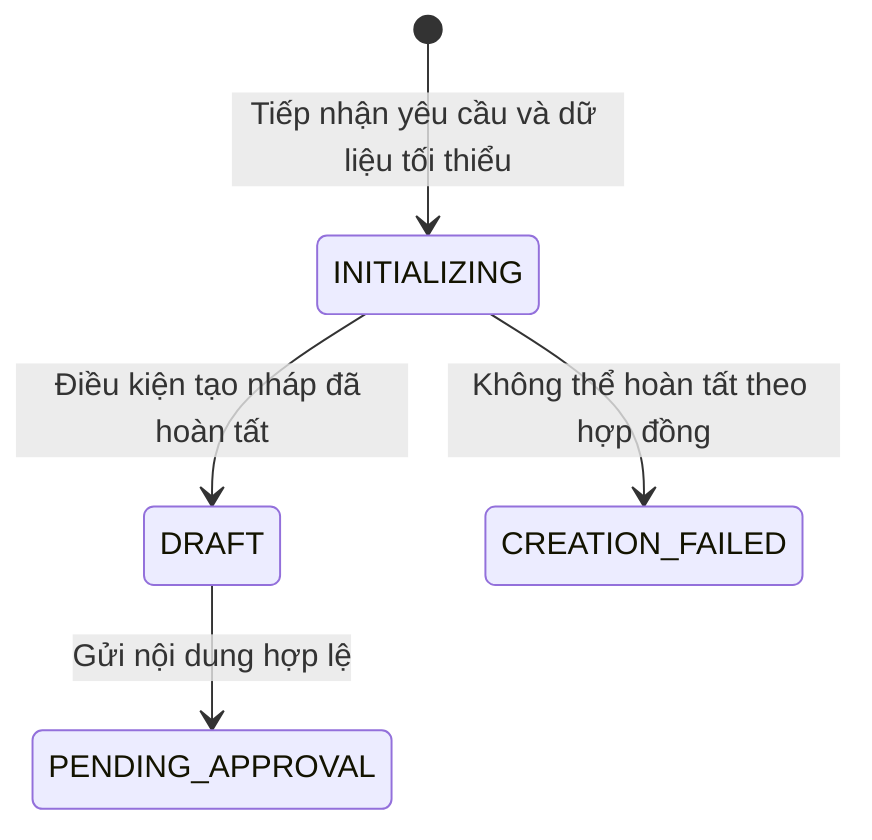

# Initial domain state — Trạng thái nghiệp vụ ban đầu

Một đơn hàng mới có thể bắt đầu với `status = DRAFT` nhưng vẫn không an toàn nếu `approved = true` được lấy từ request, chủ sở hữu thuộc tổ chức khác hoặc một sự kiện thanh toán được phát ngay khi lưu. Ngược lại, một đơn nháp chưa có dòng hàng không nhất thiết là dữ liệu lỗi nếu sản phẩm cho phép soạn nội dung từng bước.

**Initial domain state** là trạng thái nghiệp vụ đầu tiên mà hệ thống chấp nhận cho một đối tượng trong một luồng tạo cụ thể. Nó bao gồm danh tính, quan hệ, dữ liệu, quyền và tác động ban đầu, chứ không chỉ một giá trị enum.

Trong chương **Domain State**, bài học này tập trung vào cách xác lập trạng thái đầu tiên hợp lệ và an toàn. Mục tiêu là giữ business invariant ngay từ lúc tạo, ngăn tự gán trạng thái hoặc thẩm quyền, đồng thời xử lý đúng transaction, idempotency, tác vụ nền và các luồng khôi phục dữ liệu.

## 1. Trạng thái ban đầu là điểm xuất phát của các bảo đảm

Với một đơn hàng, trạng thái nghiệp vụ có thể gồm:

- Định danh của đơn và tổ chức.
- Người tạo, chủ sở hữu hoặc người mua.
- Trạng thái quy trình.
- Nội dung, revision và nguồn giá.
- Quyết định phê duyệt đang có hiệu lực, nếu có.
- Nghĩa vụ hoặc intent thanh toán liên quan.
- Các phần tài nguyên đang giữ chỗ.
- Mốc thời gian và nguồn tạo đối tượng.
- Các sự kiện hoặc công việc được phép phát sinh từ việc tạo.

Một quy tắc như “chỉ thanh toán nội dung đã duyệt” phụ thuộc vào việc đối tượng mới không tự có thẩm quyền duyệt từ dữ liệu client.

Có thể diễn đạt ý tưởng bằng hai phần:

```text
Bước tạo:
  Trạng thái đầu tiên S0 phải thỏa các invariant áp dụng cho nó.

Các bước tiếp theo:
  Từ một trạng thái hợp lệ,
  mỗi hành động được phép phải giữ các invariant liên quan.
```

Đây là cơ sở để suy luận về tính an toàn của vòng đời. Nếu trạng thái đầu tiên đã sai, việc các phương thức chuyển trạng thái sau đó có guard không tự sửa được mọi hậu quả.

Phạm vi suy luận vẫn phụ thuộc vào các đường tạo, đường ghi và giả định đã xét. Một constructor hợp lệ không chứng minh script nhập dữ liệu hoặc writer khác cũng giữ quy tắc.

## 2. Phân biệt không tồn tại, chưa khởi tạo và trạng thái đầu hợp lệ

| Tình huống | Ý nghĩa | Cách xử lý cần rõ |
| --- | --- | --- |
| Đối tượng chưa tồn tại | Chưa có aggregate nghiệp vụ tương ứng | Không coi là đã đủ điều kiện thực hiện hành động |
| Đối tượng trong bộ nhớ đang được xây dựng | Chưa chắc đã sẵn sàng công bố hoặc lưu | Không để lộ trạng thái dở dang ngoài hợp đồng |
| Trạng thái khởi tạo đã được chấp nhận | Đã có đối tượng hợp lệ ở giai đoạn đầu | Chỉ cho phép những hành động phù hợp giai đoạn đó |
| Trạng thái khởi tạo bất đồng bộ | Một phần điều kiện cần chờ công việc nền | Biểu diễn bằng trạng thái có ngữ nghĩa và quyền rõ ràng |
| Dữ liệu không đọc hiểu được | Thiếu trường, trạng thái lạ hoặc schema không phù hợp | Không mặc định biến thành một đối tượng mới an toàn |

Một `null` không có ý nghĩa chung cho mọi trường. Ví dụ:

- `activeApprovalId = null` có thể nghĩa là chưa có quyết định duyệt đang hiệu lực.
- `status = null` có thể là dữ liệu không hợp lệ.
- `paymentResult = null` có thể không phân biệt được chưa gửi với đã gửi nhưng chưa rõ kết quả.

Các ý nghĩa này phải được mô hình hóa cụ thể. Nếu một tác động bên ngoài có thể đã xảy ra, không nên đưa đối tượng về trạng thái “chưa bắt đầu” chỉ vì chưa nhận được kết quả.

## 3. Ví dụ xuyên suốt: tạo một đơn nháp

Giả sử nền tảng bán hàng cho tổ chức cho phép người mua mở đơn nháp rồi thêm nội dung sau.

Quy trình chính:

```text
DRAFT
→ PENDING_APPROVAL
→ APPROVED
→ PAYMENT_PENDING
→ PAID
```

Chính sách minh họa khi tạo đơn nháp:

1. Chủ thể phải được phép tạo đơn trong tổ chức hiện hành.
2. Tổ chức và người tạo lấy từ ngữ cảnh đã được máy chủ xác minh.
3. Đơn bắt đầu ở `DRAFT`.
4. Đơn có revision nội dung ban đầu theo quy ước hệ thống.
5. Chưa có quyết định phê duyệt đang hiệu lực.
6. Chưa có intent hoặc tác động thanh toán do việc mở nháp tạo ra.
7. Tiền tệ thuộc phạm vi sản phẩm cho phép.
8. Retry của cùng thao tác tạo không sinh thêm đơn theo hợp đồng idempotency.

Một trạng thái ban đầu có thể là:

| Thuộc tính | Giá trị minh họa | Ý nghĩa |
| --- | --- | --- |
| `tenantId` | Tổ chức đã được xác minh | Phạm vi nghiệp vụ của đơn |
| `createdBy` | Principal của người thực hiện | Danh tính tạo được máy chủ ghi nhận |
| `buyerId` | Người mua phù hợp chính sách | Có thể trùng người tạo trong luồng thông thường |
| `status` | `DRAFT` | Nội dung còn được soạn |
| `contentRevision` | `1` | Revision đầu theo quy ước đã chọn |
| `items` | Danh sách rỗng | Hợp lệ với chức năng mở nháp |
| `total` | Giá trị 0 với tiền tệ rõ ràng | Tổng nội dung hiện có, chưa phải thẩm quyền thu tiền |
| `activeApprovalId` | Không có | Chưa có quyết định đang hiệu lực |
| `paymentStage` | `NOT_STARTED` | Chưa khởi tạo thực thi thanh toán |
| `createdAt` | Thời điểm do máy chủ ghi nhận | Không lấy thời gian client làm mốc có thẩm quyền |

Các con số phiên bản là quy ước của ví dụ. Phiên bản kỹ thuật do ORM hoặc cơ sở dữ liệu quản lý có thể khác revision nội dung; không nên dùng hai khái niệm thay nhau.

### 3.1. Giá trị 0 không đồng nghĩa đã hoàn thành nghĩa vụ

Đơn nháp rỗng có tổng 0 không có nghĩa đã được duyệt hoặc được phép thanh toán. Guard ở các bước sau vẫn phải kiểm tra nội dung và thẩm quyền phù hợp.

Một sản phẩm có thể có đơn hàng miễn phí hợp lệ. Khi đó cần định nghĩa riêng cách hoàn tất nghĩa vụ và cấp quyền lợi; không nên suy ra từ phép so sánh `total == 0` rằng mọi bước đều được bỏ qua.

## 4. Chọn trạng thái đầu theo ý nghĩa nghiệp vụ

Không phải mọi aggregate đều phải bắt đầu bằng `DRAFT`. Trạng thái đầu phụ thuộc vào cam kết của hành động tạo.

| Đối tượng hoặc luồng | Trạng thái đầu có thể phù hợp | Điều cần bảo đảm |
| --- | --- | --- |
| Mở đơn để soạn | `DRAFT` | Chưa tạo thẩm quyền duyệt hoặc thanh toán |
| Gửi hồ sơ hoàn chỉnh ngay | `PENDING_APPROVAL` | Toàn bộ điều kiện gửi đã được kiểm tra nguyên tử theo hợp đồng |
| Tạo tài khoản cần xác minh | `PENDING_VERIFICATION` | Chưa có quyền chỉ dành cho tài khoản đã xác minh |
| Đặt chỗ có cam kết | `RESERVED` | Tài nguyên thực sự đã được cấp và giữ đúng cách |
| Tạo công việc bất đồng bộ | `QUEUED` | Job và dữ liệu cần thực thi đã được chấp nhận bền vững |
| Khởi tạo cần nhiều bước | `INITIALIZING` | Chỉ cho phép hành động phù hợp khi điều kiện còn thiếu |

Chọn tên trạng thái để diễn đạt sự thật đã được xác lập. Nếu chưa kiểm tra hoặc chưa tạo được cam kết, tên như `APPROVED` hoặc `RESERVED` có thể tạo niềm tin sai ở thành phần khác.

### 4.1. Nhiều luồng tạo cần hợp đồng riêng

Sản phẩm có thể hỗ trợ cả “mở nháp” và “tạo rồi gửi duyệt”. Đây là hai lệnh nghiệp vụ có tiền điều kiện và hậu điều kiện khác nhau.

Không nên cho client truyền một `initialStatus` tùy ý rồi dùng chung một hàm ghi dữ liệu không kiểm soát. Máy chủ phải chọn trạng thái theo luồng đã được cấp quyền và các điều kiện thực sự hoàn thành.

Nếu một vai trò có thể tạo đơn thay người khác, cần quyền trên đúng tổ chức và đối tượng, đồng thời giữ được người thực hiện và người được đại diện. Quyền tạo thay không tự bao gồm quyền tự duyệt.

## 5. Viết invariant cho trạng thái mới

| Mã | Invariant trong luồng mở nháp | Rủi ro khi thiếu |
| --- | --- | --- |
| I0-1 | Đơn thuộc tổ chức mà chủ thể được phép tạo | Tạo dữ liệu hoặc chiếm tài nguyên ở tổ chức khác |
| I0-2 | Danh tính người thực hiện được ghi từ nguồn xác thực | Client tự nhận là quản trị hoặc người duyệt |
| I0-3 | Trạng thái đầu phản ánh đúng công việc đã hoàn thành | Đơn mới được coi là đã duyệt hoặc đã trả tiền |
| I0-4 | Dữ liệu ban đầu hợp lệ cho giai đoạn nháp | Giá trị không thể xử lý lan sang các bước sau |
| I0-5 | Không có thẩm quyền phê duyệt tự phát | Bỏ qua quy trình tách người tạo và người duyệt |
| I0-6 | Các cam kết tài nguyên phản ánh tác động thật | Giữ chỗ giả, cấp quyền lợi hoặc tạo nợ không có căn cứ |
| I0-7 | Tạo mới và kết quả idempotency nhất quán | Một thao tác tạo nhiều đơn hoặc nhiều quyền lợi |
| I0-8 | Đối tượng chỉ được công bố theo hợp đồng đã commit | Consumer xử lý một đối tượng sau đó bị rollback |
| I0-9 | Mọi đường tạo bình thường giữ cùng quy tắc áp dụng | Batch hoặc worker tạo được trạng thái vượt quyền |

“Hợp lệ cho giai đoạn nháp” không đồng nghĩa “đủ điều kiện gửi duyệt”. Các trạng thái có thể cho phép mức hoàn thiện dữ liệu khác nhau.

Ví dụ, đơn nháp có thể chưa có địa chỉ giao hàng, nhưng một khi gửi duyệt hoặc cấp lệnh thực thi, địa chỉ và các điều khoản liên quan phải đáp ứng chính sách.

## 6. Dữ liệu client được đề xuất và dữ liệu máy chủ quyết định

Một request mở nháp tối giản có thể là:

```json
{
  "currency": "VND",
  "operationKey": "create-draft-771"
}
```

Máy chủ vẫn phải kiểm tra tiền tệ được hỗ trợ và phạm vi khóa thao tác. Các trường không có trong hợp đồng không được tự trở thành thẩm quyền nếu client cố gửi thêm.

| Trường | Cách xử lý có thể phù hợp |
| --- | --- |
| `tenantId` | Xác định hoặc đối chiếu với phạm vi đã được xác minh |
| `createdBy` | Ghi từ principal thực hiện, không tin giá trị tự khai |
| `buyerId` | Chỉ cho chọn theo quyền tạo thay hoặc quan hệ hợp lệ |
| `status` | Máy chủ chọn theo lệnh nghiệp vụ |
| `approvedBy`, `activeApprovalId` | Không nhận như bằng chứng duyệt trong luồng mở nháp |
| `unitPrice`, `total` | Không dùng làm giá có thẩm quyền nếu chỉ là đề xuất client |
| `createdAt` | Ghi mốc có thẩm quyền theo chính sách máy chủ |
| `operationKey` | Ràng buộc với chủ thể, hành động, phạm vi và nội dung phù hợp |

### 6.1. Tránh gán hàng loạt vào entity

Ánh xạ trực tiếp toàn bộ request thành entity có thể làm những trường nhạy cảm bị thiết lập ngoài ý muốn. Một trường mới thêm vào entity cũng có thể vô tình trở thành đầu vào được chấp nhận.

Nên dùng hợp đồng đầu vào rõ ràng và ánh xạ có chủ đích. Tùy API, trường không được hỗ trợ có thể bị từ chối hoặc bỏ qua; điều quan trọng là nó không được tạo quyền hoặc trạng thái trái hợp đồng.

### 6.2. ID không phải bằng chứng quyền

Một ID do máy chủ tạo giúp nhận diện đối tượng. Dù ID khó đoán, các thao tác tiếp theo vẫn phải kiểm tra quyền theo đối tượng.

Ngược lại, nếu dùng định danh nghiệp vụ bên ngoài để chống tạo trùng, phải giữ phạm vi nguồn và tổ chức. Một mã do client gửi không được tự cho phép ghi đè đối tượng đã có.

## 7. Khởi tạo qua factory có hợp đồng rõ ràng

Một factory hoặc constructor có kiểm soát giúp tập trung quy tắc của trạng thái đầu. Ví dụ Java rút gọn:

```java
public static Order openDraft(
        TenantId tenantId,
        UserId creatorId,
        CurrencyCode currency,
        Instant createdAt) {

    Objects.requireNonNull(tenantId);
    Objects.requireNonNull(creatorId);
    Objects.requireNonNull(currency);
    Objects.requireNonNull(createdAt);

    return new Order(
            OrderId.newId(),
            tenantId,
            creatorId,
            OrderStatus.DRAFT,
            1L,
            List.of(),
            Money.zero(currency),
            null,
            PaymentStage.NOT_STARTED,
            createdAt);
}
```

Ví dụ dùng `null` cho tham chiếu approval không tồn tại theo hợp đồng nội bộ. Một ứng dụng có thể dùng kiểu hoặc phương thức truy cập khác để thể hiện sự vắng mặt rõ ràng hơn.

Factory này thể hiện trạng thái được chọn, nhưng không tự xác minh người gọi có quyền tạo trong tổ chức. Tầng phối hợp phải dựng đầu vào có thẩm quyền.

Nếu luồng cho phép có sẵn dòng hàng khi tạo, factory hoặc lệnh tương ứng cần kiểm tra nội dung và tính giá theo chính sách. Không nên tạm tạo một trạng thái sai rồi kỳ vọng một bước gọi tiếp theo chắc chắn sửa lại trước khi ai quan sát.

### 7.1. Kiểu dữ liệu có ý nghĩa nhưng không tự tạo ranh giới bảo mật

Các kiểu như `TenantId`, `UserId` hoặc `CreationScope` giúp tránh nhầm lẫn và diễn đạt hợp đồng. Nếu chúng được dựng trực tiếp từ dữ liệu client mà không kiểm tra, tên kiểu không làm dữ liệu trở nên đáng tin.

### 7.2. Không công bố đối tượng trước khi đủ điều kiện

Một builder hoặc ORM có thể cần thiết lập nhiều trường. Cần bảo đảm trạng thái đang xây dựng không bị đưa vào cache, phát sự kiện hoặc trả ra ngoài như một aggregate đã được chấp nhận.

Nếu trạng thái dở dang cần tồn tại bền vững, hãy mô hình hóa nó thành một trạng thái nghiệp vụ rõ ràng với giới hạn hành động, thay vì để người dùng thấy một đối tượng thiếu ngữ nghĩa.

## 8. Application service: quyền, tạo mới và transaction

Một luồng mở nháp có thể phối hợp như sau:

```java
@Transactional
public OrderCreated createDraft(
        AuthenticatedActor actor,
        CreateDraftRequest request) {

    CreationScope scope = policy.requireCanCreateInCurrentTenant(actor);
    CurrencyCode currency = currencyPolicy.validateFor(
            scope.tenantId(), request.currency());

    var replay = idempotency.findAuthorizedReplay(
            actor, scope, request);
    if (replay.isPresent()) {
        return replay.get();
    }

    Order draft = Order.openDraft(
            scope.tenantId(),
            actor.userId(),
            currency,
            clock.instant());

    orders.insert(draft);

    OrderCreated result = OrderCreated.from(draft);
    idempotency.recordResult(actor, scope, request, result);
    audit.append(OrderDraftCreated.from(actor, draft));
    outbox.append(OrderDraftOpened.from(draft));

    return result;
}
```

Đoạn mã minh họa hợp đồng service, không phải bản cài đặt hoàn chỉnh. Các repository phải cùng tham gia transaction phù hợp; lỗi cần rollback phải có hành vi đúng theo cấu hình ứng dụng.

Những điều cần triển khai phía sau:

- `CreationScope` được tạo sau khi kiểm tra quyền và tổ chức.
- Replay chỉ trả kết quả đúng phạm vi và đúng nội dung thao tác theo hợp đồng.
- Hai request tranh cùng khóa được xử lý bằng cơ chế nguyên tử, không chỉ đọc trước rồi cùng ghi.
- Lưu đơn, ghi nhận kết quả tạo, audit bắt buộc và outbox nhất quán với nhau.
- Thông điệp tạo nháp không được consumer diễn giải thành quyết định duyệt hoặc yêu cầu thu tiền.
- Nếu có quota tạo mới hoặc giữ tài nguyên, chúng phải được phối hợp theo nguồn và ranh giới thực tế.

### 8.1. Quan hệ con và trạng thái được commit

Nếu một lệnh tạo bao gồm cả đơn, dòng hàng và dữ liệu liên quan, cần xác định tính nguyên tử của lệnh đó.

Một đơn nháp rỗng có thể hợp lệ, nhưng việc lệnh tạo đầy đủ bị lỗi giữa chừng rồi âm thầm trả thành công một nháp thiếu dòng hàng có thể trái hợp đồng. Phải phân biệt tính hợp lệ của trạng thái với việc hoàn thành đúng lệnh đã nhận.

### 8.2. Tác động khởi tạo không nhất thiết bằng không

Một nghiệp vụ đặt chỗ có thể bắt đầu bằng việc giữ năng lực; một lệnh tạo job có thể bắt đầu bằng việc chiếm quota. Đây có thể là hành vi đúng nếu được cấp và ghi nhận phù hợp.

Với luồng mở nháp trong ví dụ, hợp đồng không tạo thẩm quyền thanh toán. Nếu việc tạo nháp phát sinh tác động khác như giữ quota, tác động đó cần được mô tả và kiểm soát riêng.

## 9. Idempotency và cạnh tranh tại thời điểm tạo

Hai request tạo giống nhau có thể đến gần nhau do double click, timeout hoặc retry của client.

```text
Request A kiểm tra: chưa có operationKey.
Request B kiểm tra: chưa có operationKey.
A tạo đơn 1.
B tạo đơn 2.
```

Nếu hợp đồng nói cùng thao tác phải trả cùng kết quả, chỉ kiểm tra sự tồn tại trước khi ghi là chưa đủ. Cần ràng buộc hoặc cơ chế nhận quyền xử lý nguyên tử trong đúng phạm vi.

Có thể xác định phạm vi theo tổ chức, chủ thể và loại lệnh, kèm dấu vết nội dung có ý nghĩa. Cùng khóa nhưng khác tham số phải được phát hiện theo hợp đồng.

### 9.1. Đổi khóa không thay thế quota

Một người có thể tạo nhiều đơn nháp hợp lệ bằng các thao tác khác nhau. Idempotency không nhằm ngăn mọi trường hợp payload giống nhau.

Nếu cần giới hạn số nháp hoặc chi phí tạo mới, phải có quota và vòng đời tương ứng. Không nên mặc định mọi yêu cầu cùng nội dung là trùng trái phép, cũng không nên để đổi khóa thành cách nhận lại quyền lợi dùng một lần.

### 9.2. Consumer và nguồn ngoài có thể giao lại lệnh tạo

Nếu đối tượng được tạo từ message hoặc tích hợp, có thể cần định danh nguồn và thao tác bên ngoài để chống tạo lại.

UUID mới cho mỗi lần xử lý không tự chống trùng; nó chỉ tạo thêm những định danh khác nhau. Tính duy nhất cần gắn với nghĩa vụ hoặc lệnh nguồn mà sản phẩm muốn nhận diện là cùng một thao tác.

### 9.3. Mất response không làm trạng thái trở lại chưa tồn tại

Đối tượng có thể đã commit dù client không nhận được phản hồi. Client hoặc hệ thống tích hợp cần có cách truy xuất kết quả theo hợp đồng, thay vì luôn tạo lại từ đầu.

Audit có thể ghi nhiều lần tiếp nhận, nhưng số đối tượng và quyền lợi được tạo phải phản ánh thao tác thật đã được chấp nhận.

## 10. Giá trị mặc định ở code và cơ sở dữ liệu

Giá trị mặc định có ích để giảm thiếu sót, nhưng không thay thế hợp đồng tạo.

### 10.1. Mặc định trong class

Một field initializer đặt `status = DRAFT` không chứng minh mọi đối tượng đọc từ JSON, dựng qua constructor khác, khôi phục từ dữ liệu hoặc cập nhật bằng SQL đều giữ đúng quy tắc.

Cần xem các đường tạo thực tế và quyền truy cập vào những trường nhạy cảm. Nếu có một constructor công khai nhận trạng thái tùy ý, factory an toàn không tự làm đường đó biến mất.

### 10.2. Mặc định khi insert

Một đường ghi có thể chọn rõ giá trị ban đầu:

```sql
INSERT INTO orders (
    tenant_id,
    order_id,
    created_by,
    status,
    content_revision,
    total_minor,
    currency,
    active_approval_id,
    payment_stage
) VALUES (
    :trustedTenantId,
    :serverGeneratedOrderId,
    :authenticatedCreatorId,
    'DRAFT',
    1,
    0,
    :validatedCurrency,
    NULL,
    'NOT_STARTED'
);
```

Các tên tham số nhấn mạnh nguồn dữ liệu phải được xác định ở máy chủ. Truy vấn cần được thực hiện bằng cơ chế bind tham số phù hợp.

Một `DEFAULT 'DRAFT'` chỉ phục vụ những lần insert dùng ngữ nghĩa mặc định tương ứng; nó không tự ngăn writer truyền giá trị khác. Cũng không tự kiểm tra quyền tổ chức hoặc nguồn phê duyệt.

### 10.3. Constraint bảo vệ điều gì?

`NOT NULL` và ràng buộc miền giá trị giúp chặn một số trạng thái không hợp lệ. Ràng buộc tham chiếu và tính duy nhất có thể bảo vệ quan hệ, phạm vi và chống trùng.

Tuy nhiên, một `CHECK` cho phép các trạng thái `DRAFT`, `APPROVED` và `PAID` chưa chứng minh một insert ban đầu được phép chọn `PAID`. Ngược lại, ràng buộc mọi bản ghi luôn phải là `DRAFT` sẽ chặn cả chuyển trạng thái hợp lệ sau đó.

Cần kết hợp quyền ghi, đường tạo có kiểm soát và các constraint phù hợp với vòng đời thật. Không nên giao toàn bộ quy tắc khởi tạo cho một danh sách giá trị enum.

## 11. Khởi tạo bất đồng bộ cần trạng thái trung gian rõ ràng

Có những đối tượng chỉ sẵn sàng sau khi tạo tài nguyên bên ngoài hoặc hoàn tất một số bước.

Một mô hình có thể là:



Trong `INITIALIZING`, cần quy định:

- Người dùng được xem thông tin nào.
- Có được sửa, gửi duyệt hoặc thực thi tác động không.
- Job nào có quyền hoàn tất khởi tạo.
- Điều kiện nào xác nhận thành công.
- Thời hạn, retry và trạng thái chưa rõ được xử lý ra sao.
- Tài nguyên hoặc quota đã giữ có thể giải phóng khi nào.

Không nên coi `INITIALIZING` như một trạng thái mà mọi hành động đều được phép vì “chưa có dữ liệu để kiểm tra”.

### 11.1. Hết thời gian chờ không tự chứng minh chưa có tài nguyên

Nếu một hệ thống ngoài có thể đã tạo tài nguyên nhưng phản hồi bị mất, thử lại bằng một nghĩa vụ mới có thể tạo trùng.

Cần liên kết định danh thao tác, tra cứu kết quả và đối soát theo giao thức. Việc rollback bản ghi cục bộ không tự xóa được tác động ngoài.

### 11.2. Consumer chỉ làm đúng ý nghĩa sự kiện

`OrderDraftOpened` có thể kích hoạt lập chỉ mục hoặc cập nhật danh sách. Nó không phải bằng chứng cho phép giao hàng hoặc thu tiền.

Tên sự kiện, payload và hợp đồng consumer cần phân biệt việc đối tượng đã tồn tại với việc nó đã đạt các trạng thái tiếp theo.

## 12. Tạo mới, sao chép, nhập và khôi phục không cùng một thao tác

### 12.1. Sao chép để tạo đơn mới

Khi người dùng sao chép một đơn cũ, có thể tái sử dụng nội dung được phép, nhưng không được tự sao chép thẩm quyền hoặc lịch sử như thể đối tượng mới đã trải qua các quyết định cũ.

Cần quyết định rõ:

- Những trường nội dung nào được sao chép.
- Giá có phải tính lại hoặc liên kết báo giá mới không.
- Danh tính, tổ chức và người tạo của đơn mới.
- Revision ban đầu và nguồn tham chiếu đến bản cũ.
- Việc bỏ các tham chiếu duyệt, thanh toán và giữ chỗ không còn áp dụng.

Một đơn mới có nội dung giống đơn đã duyệt không tự thừa hưởng quyết định đó nếu chính sách không cấp phạm vi như vậy.

### 12.2. Nhập dữ liệu đã có lịch sử

Import một đơn lịch sử đã thanh toán khác với tạo một đơn mới qua luồng mở nháp. Dữ liệu có thể cần giữ trạng thái thực tế, nhưng phải có nguồn, quyền nhập và bằng chứng phù hợp.

Không nên tin cột `status=PAID` trong một tệp như xác nhận thanh toán. Nếu chưa đủ bằng chứng, cần trạng thái hoặc quy trình đối soát phù hợp, thay vì tự gán hoàn tất.

Nếu import được phép bảo tồn trạng thái lịch sử, cần ngăn nó kích hoạt lại các tác động vốn đã xảy ra, chẳng hạn thu tiền hoặc cấp quyền lợi lần nữa.

### 12.3. Khôi phục đối tượng đã lưu

Khi đọc một đơn `APPROVED` từ nơi lưu, không được dùng factory mở nháp để đặt lại trạng thái và mất lịch sử. Đây là tái dựng trạng thái đã có, không phải tạo một aggregate nghiệp vụ mới.

Đồng thời, dữ liệu khôi phục vẫn phải được kiểm tra tính đọc hiểu và nhất quán theo mô hình. Thiếu trường hoặc trạng thái lạ không được âm thầm diễn giải thành một nháp hợp lệ rồi tiếp tục ghi đè lịch sử.

### 12.4. Hủy, mở lại và tạo lại

Mở lại một quy trình có thể cần vòng xử lý hoặc revision mới. Không nên reset những bộ đếm quyền lợi, quota hoặc quyết định đã tiêu thụ chỉ vì đối tượng được đưa về trạng thái đầu của một nhánh.

Điểm bắt đầu của một vòng mới không nhất thiết là điểm bắt đầu của toàn bộ nghĩa vụ nghiệp vụ.

## 13. Các tình huống lạm dụng liên quan đến trạng thái đầu

| Tình huống | Invariant bị đe dọa | Điều cần kiểm tra |
| --- | --- | --- |
| Gửi `status=APPROVED` khi tạo | Không tự tạo thẩm quyền duyệt | Trạng thái và quyết định được máy chủ xác lập |
| Gửi người tạo hoặc tổ chức khác | Quyền theo đối tượng và quy kết | Nguồn principal và phạm vi tạo |
| Gửi tổng tiền thấp hơn | Nguồn giá có thẩm quyền | Luồng mở nháp và bước chốt điều khoản |
| Tạo đơn rỗng rồi gọi thanh toán | Không bỏ bước bằng dữ liệu mặc định | Guard nội dung, duyệt và intent |
| Sao chép approval của đơn cũ | Quyết định gắn đúng đối tượng | Phạm vi và nguồn quyết định |
| Import trạng thái hoàn tất | Kết quả phải có bằng chứng | Quyền import và cơ chế đối soát |
| Retry nhiều lần sau mất response | Một thao tác không tạo nhiều đối tượng | Idempotency và transaction |
| Tạo lại sau xóa để nhận ưu đãi | Quyền lợi thuộc đúng chủ thể và vòng đời | Lịch sử sử dụng và phạm vi quota |
| Worker tạo trực tiếp với quyền rộng | Không mở rộng thẩm quyền qua tác vụ nền | Nguồn lệnh và factory hoặc quy tắc tương ứng |
| Đặt dữ liệu thiếu thành mặc định cho qua | Không biến chưa biết thành được phép | Ngữ nghĩa thiếu dữ liệu và trạng thái lỗi |
| Phát sự kiện trước commit | Không cho consumer tin đối tượng chưa được chấp nhận | Giao thức lưu và chuyển tiếp |
| Khôi phục thành đối tượng mới | Không mất lịch sử hoặc thực thi lại | Tách create với rehydrate |

Các dòng trên là tình huống để xác minh trong phạm vi kiểm thử. Chúng không tự là kết luận rằng một ứng dụng cụ thể có lỗ hổng.

## 14. Kiểm thử hợp đồng khởi tạo và hành động đầu tiên

Kiểm tra getter trả về `DRAFT` là hữu ích nhưng chưa đủ. Cần chứng minh trạng thái đầu không cho tạo tác động mà nó chưa có thẩm quyền.

| Tình huống | Kết quả cần quan sát |
| --- | --- |
| Người có quyền mở nháp | Có đối tượng đúng tổ chức, principal và trạng thái |
| Tài khoản không có quyền tạo | Không có đối tượng hoặc tác động dở dang ngoài hợp đồng |
| Payload tự gán trạng thái, role hoặc approval | Không tạo thẩm quyền từ dữ liệu tự khai |
| Tiền tệ không được hỗ trợ | Không lưu trạng thái mơ hồ về tiền |
| Nháp rỗng | Hợp lệ nếu chính sách cho phép, nhưng không tự được thanh toán |
| Gọi gửi duyệt khi thiếu dữ liệu bắt buộc | Không chuyển trạng thái trước khi đủ điều kiện |
| Gọi thanh toán ngay sau tạo | Không có intent hoặc lời gọi thu tiền trái phép |
| Hai request tranh cùng khóa | Một kết quả tạo theo hợp đồng, không nhân đôi quyền lợi |
| Cùng khóa nhưng nội dung khác | Phát hiện xung đột hoặc xử lý đúng hợp đồng đã công bố |
| Lỗi sau insert nhưng trước ghi kết quả bắt buộc | Rollback các thay đổi thuộc cùng transaction |
| Message tạo được giao lại | Không tạo aggregate thứ hai cho cùng nghĩa vụ nguồn |
| Khởi tạo bất đồng bộ chưa xong | Không mở hành động yêu cầu đối tượng sẵn sàng |
| Sao chép hoặc import | Không kế thừa thẩm quyền ngoài chính sách hoặc phát lại tác động cũ |
| Khôi phục từ nơi lưu | Giữ đúng trạng thái, lịch sử và quan hệ hiện có |

Một kịch bản quan trọng có thể được mô tả:

```text
Given:
  Người mua hợp lệ được phép mở đơn nháp.
  Luồng mở nháp không tạo phê duyệt hoặc thẩm quyền thanh toán.

When:
  Người mua tạo nháp, kể cả khi payload cố gửi trường phê duyệt.
  Sau đó gọi trực tiếp hành động thanh toán.

Then:
  Không có quyết định duyệt hợp lệ được tạo từ payload đó.
  Không có intent hoặc tác động thu tiền trái phép.
  Trạng thái đã commit và audit phản ánh đúng việc mở nháp.
```

Unit test phù hợp với factory và guard. Integration test cần cho quyền, transaction, ràng buộc duy nhất và ánh xạ request. Luồng bất đồng bộ cần kiểm tra cả consumer, retry và ý nghĩa sự kiện.

Ngoài response, cần quan sát bản ghi đã commit, tác động ra ngoài, số lần tạo và tài nguyên đã giữ. Một API trả lỗi không tự chứng minh chưa có thay đổi.

## 15. Cách thiết kế trạng thái đầu có thể bảo vệ

Với một aggregate hoặc luồng tạo mới, có thể đi theo trình tự:

1. **Chọn ý nghĩa lệnh tạo:** mở nháp, gửi hồ sơ, giữ chỗ hay tiếp nhận công việc.
2. **Liệt kê dữ liệu và quan hệ ban đầu:** tổ chức, chủ thể, nội dung, revision, giá và tài nguyên.
3. **Phát biểu invariant tại thời điểm công bố hoặc commit.**
4. **Tách trường client đề xuất khỏi trường máy chủ có thẩm quyền.**
5. **Thiết kế factory và đường phối hợp có kiểm soát.**
6. **Giữ nguyên tử các thay đổi và bằng chứng bắt buộc trong phạm vi thực tế.**
7. **Xác định idempotency, quota và tác động của retry.**
8. **Mô hình trạng thái trung gian khi cần xử lý bất đồng bộ.**
9. **Tách tạo mới khỏi sao chép, import và khôi phục.**
10. **Kiểm thử những hành động nhạy cảm ngay sau khởi tạo.**

Một hợp đồng cụ thể có thể là:

> Lệnh mở nháp chỉ tạo đơn trong tổ chức mà chủ thể được phép đại diện. Đơn bắt đầu ở DRAFT với nội dung và tiền tệ hợp lệ cho giai đoạn đó, không có phê duyệt đang hiệu lực hay intent thanh toán. Các trường thẩm quyền không lấy từ payload. Retry của cùng thao tác trả cùng kết quả theo hợp đồng, và các hành động sau vẫn phải đi qua guard phù hợp.

Trạng thái đầu an toàn tạo nền cho toàn bộ vòng đời. Khi dữ liệu, quyền, cam kết và sự kiện ban đầu đều phản ánh đúng điều đã được xác lập, các bước tiếp theo có thể dựa vào một điểm xuất phát rõ ràng để giữ quy tắc nghiệp vụ.
