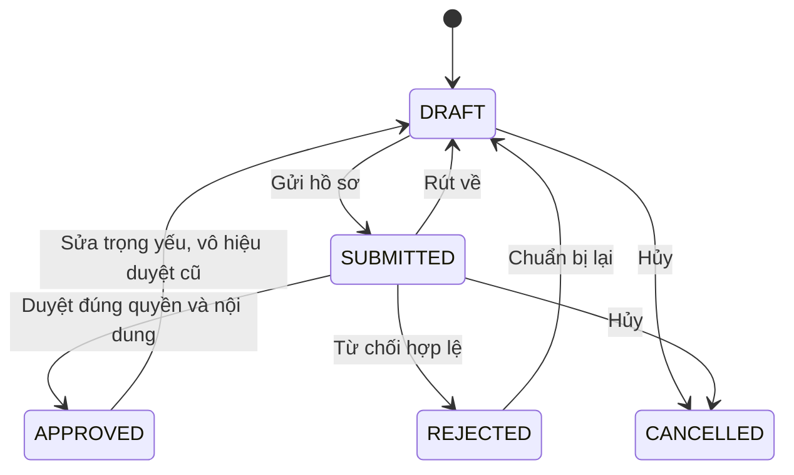

# Tập trạng thái hợp lệ — Valid state set

## 1. Một giá trị status đúng chưa làm cả đối tượng hợp lệ

Một đề nghị mua hàng có `status = APPROVED` nhưng không có quyết định duyệt là một trạng thái đáng ngờ. Tên `APPROVED` có thể thuộc enum được hỗ trợ, JSON có thể đúng kiểu và bản ghi có thể đã lưu thành công, nhưng đối tượng vẫn thiếu căn cứ nghiệp vụ.

Tương tự:

- Đơn đã hủy nhưng vẫn có tác vụ đặt hàng đang hoạt động.
- Quyết định duyệt gắn với phiên bản 4 trong khi nội dung hiện tại là phiên bản 5.
- Một đề nghị của tenant A tham chiếu quyết định thuộc tenant B.
- Trạng thái bị từ chối lại chứa quyết định có kết quả phê duyệt.
- Một bản nháp chưa hoàn thiện bị bắt buộc tuân theo mọi điều kiện dành cho hồ sơ đã gửi.

**Tập trạng thái hợp lệ** là tập những cấu hình dữ liệu được mô hình nghiệp vụ chấp nhận trong phạm vi và điều kiện đã xác định.

Trong chương **Domain State**, chủ đề này giúp trả lời: “Một đối tượng được phép trông như thế nào ở thời điểm hệ thống quan sát hoặc commit nó?”

Mục tiêu là làm rõ các cấu hình được phép, biểu diễn chúng chính xác và ngăn những tổ hợp không có ý nghĩa lọt vào đường xử lý.

## 2. State là cả cấu hình dữ liệu

Trong nhiều hệ thống, từ state được dùng với hai nghĩa:

1. **Nhãn vòng đời:** `DRAFT`, `SUBMITTED`, `APPROVED`.
2. **Trạng thái đầy đủ:** nhãn vòng đời cùng dữ liệu, quan hệ và bằng chứng cần thiết.

Ví dụ khái niệm:

```text
RequestState = (
    tenantId,
    requestId,
    createdBy,
    businessVersion,
    status,
    content,
    currentSubmission,
    currentDecision,
    cancellation
)
```

Tập các nhãn có thể hữu hạn. Tập trạng thái đầy đủ thường rất lớn, vì số tiền, dòng hàng, định danh và phiên bản có nhiều giá trị khác nhau.

Do đó, “xác định tập hợp lệ” thường không phải liệt kê từng đối tượng. Ta định nghĩa các điều kiện mà mọi phần tử của tập phải thỏa.

### 2.1. Biểu diễn bằng vị từ

Gọi `S_struct` là tập cấu hình có thể biểu diễn theo schema hoặc kiểu dữ liệu. Một mô hình có thể viết:

```text
S_valid = {
    s thuộc S_struct
    | commonRules(s)
      AND rulesForStatus(s)
      AND evidenceRelationsHold(s)
}
```

Trong đó:

- `commonRules`: điều kiện chung, như định danh/phạm vi và miền số hợp lệ.
- `rulesForStatus`: yêu cầu riêng của từng trạng thái.
- `evidenceRelationsHold`: quan hệ đúng giữa đối tượng, lần gửi, phiên bản và quyết định.

Những điều kiện phụ thuộc nguồn có thẩm quyền hoặc lịch sử phải có cơ chế kiểm chứng tương ứng. Một hàm kiểm tra field cục bộ không tự chứng minh mọi phần của định nghĩa.

## 3. Bốn khái niệm cần tách biệt

| Khái niệm | Câu hỏi | Ví dụ |
| --- | --- | --- |
| Tập nhãn được hỗ trợ | Status này có thuộc ngôn ngữ của hệ thống không? | `APPROVED` được hỗ trợ, `AUTO_SUPER_APPROVED` không được hỗ trợ. |
| Trạng thái hợp lệ | Cấu hình hiện tại có đủ và nhất quán không? | Đã duyệt phải có quyết định đúng lần gửi và phiên bản. |
| Trạng thái có thể đạt tới | Có đường đi được phép từ một trạng thái khởi tạo để tạo ra nó không? | Phải gửi duyệt trước khi quyết định duyệt. |
| Hành động được phép hiện tại | Actor này có được làm hành động này lúc này không? | Chỉ người đủ quyền mới duyệt một hồ sơ đang chờ. |

Một snapshot có thể đáp ứng các kiểm tra hình dạng nhưng được tạo bằng một đường ghi bỏ qua phê duyệt. Khi đó kiểm tra hình dạng chưa chứng minh tính hợp lệ toàn diện của nguồn tạo hoặc lịch sử.

Nếu mọi chuyển đổi được kiểm soát đúng, ta mong muốn:

```text
S_initial nằm trong S_valid.

Với mọi chuyển đổi được phép:
  s thuộc S_valid
  và guard(s, actor, command, context) đạt
  ⇒ apply(s, command) thuộc S_valid.
```

Đây là yêu cầu thiết kế và kiểm thử. Nó không tự đúng chỉ vì có một enum hoặc một sơ đồ trạng thái.

### 3.1. Trạng thái hợp lệ không đồng nghĩa được sửa

Một đề nghị `APPROVED` có thể hoàn toàn hợp lệ, nhưng nhân viên không có quyền trên đơn vị đó vẫn không được thay đổi nó.

Ngược lại, một request bị từ chối vì actor không có quyền không chứng minh đối tượng đang có dữ liệu hỏng.

### 3.2. Trạng thái kết thúc vẫn có điều kiện dữ liệu

`CANCELLED` không có nghĩa “bỏ qua mọi kiểm tra”. Nó vẫn cần tenant, định danh, căn cứ hủy và các quan hệ lịch sử phù hợp.

## 4. Phạm vi mô hình minh họa

Xét quy trình xem xét đề nghị mua hàng. Phạm vi bài này dừng ở quyết định duyệt; đặt hàng, thanh toán và giao nhận có mô hình riêng.

Các nhãn:

```text
DRAFT
SUBMITTED
APPROVED
REJECTED
CANCELLED
```

Chính sách minh họa:

- Bản nháp có thể chưa có đủ nội dung để gửi.
- Hồ sơ gửi duyệt phải đầy đủ và có một lần gửi hiện hành.
- Quyết định phải thuộc đúng tenant, đề nghị, lần gửi và phiên bản nội dung.
- Người quyết định trong mô hình này phải khác người lập và có quyền tương ứng tại thời điểm ra quyết định.
- Sửa nội dung trọng yếu sau khi duyệt đưa hồ sơ về bản nháp và vô hiệu liên kết quyết định hiện hành.
- Chỉ bản nháp hoặc hồ sơ đang chờ được hủy trực tiếp.
- Lịch sử gửi, duyệt, từ chối và hủy được giữ riêng theo mô hình.
- Hủy là kết thúc của quy trình này; không có lệnh mở lại trực tiếp.

Một sơ đồ tham chiếu:



Các cạnh chỉ cho biết đường đi dự kiến. Phải kết hợp điều kiện dữ liệu và quyền cho từng cạnh.

Nếu nghiệp vụ thực sự cần hủy sau duyệt hoặc xử lý đơn đã đặt, cần bổ sung thao tác/trạng thái tương ứng. Không dùng `CANCELLED` hiện tại để ngầm bỏ các nghĩa vụ nằm ngoài phạm vi mô hình.

## 5. Điều kiện chung và điều kiện theo trạng thái

### 5.1. Điều kiện chung

Ví dụ các điều kiện áp dụng cho mọi trạng thái:

- Đề nghị thuộc một tenant được xác lập hợp lệ.
- Định danh và người lập có giá trị theo schema.
- `businessVersion` là số dương.
- Dòng hàng đang tồn tại có số lượng dương và giá trị tiền trong miền cho phép.
- Tham chiếu hiện hành không trỏ chéo tenant/đối tượng.
- Field chỉ server được xác lập không bị client tự ghi.
- Bằng chứng có nguồn tạo được kiểm soát.

Bản nháp có thể thiếu nhà cung cấp hoặc chưa chọn loại tiền. Điều đó không cho phép số lượng âm hoặc một quyết định duyệt thuộc đề nghị khác.

### 5.2. Bảng tập con theo nhãn

| Nhãn | Lần gửi hiện hành | Quyết định hiện hành | Căn cứ hủy | Nội dung |
| --- | --- | --- | --- | --- |
| `DRAFT` | Không có | Không có | Không có | Có thể chưa đủ điều kiện gửi, vẫn giữ các điều kiện chung. |
| `SUBMITTED` | Bắt buộc | Không có | Không có | Đầy đủ theo chính sách gửi; khớp phiên bản đã gửi. |
| `APPROVED` | Bắt buộc | Kết quả APPROVE | Không có | Khớp nội dung và lần gửi được duyệt. |
| `REJECTED` | Bắt buộc | Kết quả REJECT | Không có | Khớp nội dung và lần gửi bị từ chối. |
| `CANCELLED` | Có thể có nếu hủy từ SUBMITTED | Không có | Bắt buộc | Giữ nội dung tại thời điểm hủy; có thể chưa đầy đủ nếu hủy từ DRAFT. |

Mỗi hàng là một tập con của `S_valid`. Trong mô hình này, nhãn xác định các tập con riêng biệt.

### 5.3. Lịch sử khác liên kết hiện hành

Một đề nghị về `DRAFT` có thể có các bản duyệt cũ trong lịch sử. Điều kiện “không có quyết định hiện hành” không bắt buộc xóa lịch sử đó.

Nên phân biệt:

```text
currentDecision
decisionHistory
```

Khi sửa trọng yếu:

```text
businessVersion tăng.
currentSubmission được bỏ/vô hiệu theo quy trình.
currentDecision được bỏ/vô hiệu theo quy trình.
status trở thành DRAFT.
Lịch sử vẫn được lưu.
```

Những thay đổi xác định trạng thái mới phải được áp dụng nhất quán, không để một request quan sát hoặc commit nội dung mới nhưng vẫn gắn bản duyệt cũ.

## 6. Các quan hệ bắt buộc của bằng chứng

Một quyết định APPROVE không chỉ là mã của người duyệt.

Ví dụ:

```text
Decision
  decisionId
  tenantId
  requestId
  submissionId
  businessVersion
  outcome
  reviewerId
  policyVersion
  decidedAt
```

Với trạng thái `APPROVED`, cần các quan hệ tương ứng:

```text
decision.outcome == APPROVE

decision.tenantId == request.tenantId
decision.requestId == request.id

decision.submissionId == currentSubmission.id

decision.businessVersion == currentSubmission.businessVersion
decision.businessVersion == request.businessVersion

decision.reviewerId != request.createdBy
```

Ngoài quan hệ dữ liệu, đường tạo quyết định phải bảo đảm reviewer có quyền theo chính sách và phạm vi đối tượng tại thời điểm quyết định.

### 6.1. Vì sao cần cả submission ID và business version?

Một hồ sơ có thể được rút về rồi gửi lại mà nội dung không đổi. Hai lần gửi có thể cùng business version nhưng là hai vòng xử lý khác nhau.

Nếu chỉ đối chiếu phiên bản, quyết định của một lần gửi trước có thể bị gắn nhầm vào lần gửi hiện hành.

Định danh lần gửi, vòng xem xét hoặc cơ chế tương đương giúp phân biệt ý nghĩa này. Chọn tên field theo mô hình, nhưng đừng giả định một số version giải quyết mọi loại vòng đời.

### 6.2. Quan hệ đúng chưa chứng minh nguồn tạo đúng

Một payload có thể điền đầy đủ các ID khớp nhau. Nếu client được tự tạo decision hoặc tự chọn reviewer, những quan hệ đó vẫn chưa đủ.

Tính hợp lệ cần dựa vào cả:

```text
cấu trúc đúng
+ quan hệ đúng
+ nguồn tạo có thẩm quyền
+ quy trình tạo được bảo vệ
```

Đây là lý do việc kiểm tra trạng thái phải phối hợp với phân quyền và các điểm ghi dữ liệu.

## 7. Biểu diễn sao cho tổ hợp sai khó được tạo ra

### 7.1. Tránh nhiều cờ biểu diễn cùng một trục

Nếu năm trạng thái loại trừ nhau được biểu diễn bằng năm cờ boolean, schema cho phép 32 tổ hợp cờ. Chỉ năm tổ hợp có đúng một cờ bật là phù hợp với ý nghĩa “đang ở một trong năm trạng thái”.

Các tổ hợp như “vừa đang duyệt vừa đã hủy” xuất hiện vì biểu diễn cho phép chúng tồn tại.

Một enum giải quyết được trục nhãn loại trừ nhau. Nó vẫn cần dữ liệu đi kèm đúng cho từng trường hợp.

### 7.2. Dùng các biến thể có dữ liệu riêng

Một hướng trong Java là biểu diễn các biến thể bằng sealed interface và record:

```java
// Cấu trúc minh họa; các kiểu Ref/Decision bên dưới là abstraction của miền.
sealed interface ReviewState {
    record Draft() implements ReviewState {}

    record Submitted(SubmissionRef submission) implements ReviewState {
        public Submitted {
            java.util.Objects.requireNonNull(submission);
        }
    }

    record Approved(
        SubmissionRef submission,
        ApprovalDecision approval
    ) implements ReviewState {
        public Approved {
            java.util.Objects.requireNonNull(submission);
            java.util.Objects.requireNonNull(approval);
            if (!approval.appliesTo(submission)) {
                throw new IllegalArgumentException("Approval scope mismatch");
            }
        }
    }

    record Rejected(
        SubmissionRef submission,
        RejectionDecision rejection
    ) implements ReviewState {
        public Rejected {
            java.util.Objects.requireNonNull(submission);
            java.util.Objects.requireNonNull(rejection);
            if (!rejection.appliesTo(submission)) {
                throw new IllegalArgumentException("Rejection scope mismatch");
            }
        }
    }

    record Cancelled(CancellationRef cancellation) implements ReviewState {
        public Cancelled {
            java.util.Objects.requireNonNull(cancellation);
        }
    }
}
```

Ý tưởng:

- Không tạo được biến thể `Approved` mà không truyền một quyết định.
- Kiểu `ApprovalDecision` phân biệt quyết định duyệt với quyết định từ chối.
- `appliesTo` phải đối chiếu tenant, đề nghị, submission và business version.
- Căn cứ hủy có thể ghi việc hủy từ bản nháp hay từ một lần gửi cụ thể.

Những kiểu tham chiếu cũng cần miền giá trị và nguồn tạo được kiểm soát. Một wrapper chứa UUID không tự chứng minh UUID thuộc đúng đối tượng.

### 7.3. Kiểu dữ liệu không thay mọi bảo đảm

Ví dụ trên chưa tự kiểm tra:

- Decision có tồn tại trong nguồn có thẩm quyền không.
- Reviewer có quyền khi tạo quyết định không.
- State có khớp aggregate cha và nội dung hiện tại không.
- Request đang bị cập nhật đồng thời không.
- Mọi đường ORM/deserialization có tuân theo quy trình tạo đối tượng không.

Aggregate hoặc application service vẫn cần kiểm tra các quan hệ với context thật. Kiểu dữ liệu giúp giảm tổ hợp sai có thể biểu diễn; nó không tự cấp thẩm quyền nghiệp vụ.

### 7.4. Không mở setter cho các mảnh trạng thái nhạy cảm

Một chuỗi lệnh như:

```text
setStatus(APPROVED)
setCurrentDecision(...)
setCurrentSubmission(...)
```

cho phép caller bỏ sót hoặc sắp xếp sai các phần liên quan.

Thao tác có ý nghĩa như `approve(submission, decision)` có thể tạo một cấu hình mới đã được kiểm tra, thay vì yêu cầu bên ngoài tự lắp từng field.

DTO cập nhật chung cũng không nên cho client tự ghi status, reviewer hoặc tham chiếu quyết định. Client gửi ý định; server tạo trạng thái qua hành động được phép.

## 8. Thực thi một phần tập hợp lệ ở database

Constraint giúp nhiều đường ghi cùng chịu điều kiện dữ liệu.

SQL dưới đây dùng cú pháp PostgreSQL để minh họa phần cấu trúc, không phải schema đầy đủ của quy trình:

```sql
CREATE TABLE purchase_request (
    tenant_id UUID NOT NULL,
    id UUID NOT NULL,
    business_version BIGINT NOT NULL CHECK (business_version > 0),
    row_version BIGINT NOT NULL CHECK (row_version >= 0),

    status TEXT NOT NULL,
    current_submission_id UUID,
    current_decision_id UUID,
    cancellation_id UUID,

    PRIMARY KEY (tenant_id, id),

    CHECK (status IN (
        'DRAFT', 'SUBMITTED', 'APPROVED', 'REJECTED', 'CANCELLED'
    )),

    CHECK (
        (
            status = 'DRAFT'
            AND current_submission_id IS NULL
            AND current_decision_id IS NULL
            AND cancellation_id IS NULL
        )
        OR (
            status = 'SUBMITTED'
            AND current_submission_id IS NOT NULL
            AND current_decision_id IS NULL
            AND cancellation_id IS NULL
        )
        OR (
            status IN ('APPROVED', 'REJECTED')
            AND current_submission_id IS NOT NULL
            AND current_decision_id IS NOT NULL
            AND cancellation_id IS NULL
        )
        OR (
            status = 'CANCELLED'
            AND current_decision_id IS NULL
            AND cancellation_id IS NOT NULL
        )
    )
);
```

Constraint này chặn được các tổ hợp thiếu/thừa tham chiếu trong bảng. Nó chưa phân biệt decision APPROVE với REJECT và chưa xác nhận tham chiếu thuộc đúng đề nghị.

### 8.1. Quan hệ nhiều bảng cần bảo đảm riêng

Có thể cần:

- Khóa ngoại có tenant và định danh đối tượng phù hợp.
- Bảng phiên bản nội dung bất biến.
- Decision liên kết đúng submission.
- Constraint duy nhất cho vai trò hiện hành theo mô hình.
- Kiểm tra trong transaction hoặc cơ chế dữ liệu thích hợp cho quan hệ phức tạp.

Không mặc định một `CHECK` trên vài cột xử lý được mọi quan hệ ở bảng khác.

Nếu evidence lịch sử gắn với phiên bản 3, không nên thiết kế khóa ngoại của nó theo cách buộc root luôn giữ phiên bản hiện tại là 3. Mô hình có thể cần một bản revision bất biến mà evidence tham chiếu, còn root trỏ tới revision đang dùng.

Như vậy, tăng phiên bản hiện tại không làm mất tính hợp lệ của bằng chứng lịch sử, đồng thời bằng chứng cũ không tự trở thành bằng chứng hiện hành.

### 8.2. NULL cần mang ý nghĩa có chủ đích

`current_decision_id = NULL` trong `SUBMITTED` nghĩa là chưa có quyết định hiện hành. Trong `APPROVED`, cùng giá trị đó là thiếu dữ kiện bắt buộc.

SQL có logic ba giá trị. Một phép so sánh liên quan NULL có thể ra `UNKNOWN` thay vì false. Vì vậy, điều kiện bắt buộc có giá trị cần được biểu diễn bằng `NOT NULL` hoặc `IS NOT NULL` đúng chỗ, không chỉ bằng phép bằng giữa hai field có thể NULL.

Không dùng một giá trị giả như UUID toàn số 0 hoặc chuỗi “unknown” để né ràng buộc nếu mô hình chưa định nghĩa ý nghĩa đó.

## 9. Điều kiện hiện tại và sự thật lịch sử

### 9.1. Đã duyệt không luôn đồng nghĩa được thực thi ngay

Trong mô hình minh họa, `APPROVED` ghi nhận rằng đã có quyết định cho đúng nội dung/lần gửi. Khả năng dùng quyết định để đặt hàng tại thời điểm hiện tại còn cần các guard của hành động đặt hàng.

Ví dụ:

- Báo giá có thể đã hết hạn.
- Grant thực thi có thể bị thu hồi.
- Actor hiện tại có thể không còn quyền.
- Ngân sách hiện tại có thể không đủ.
- Chính sách có thể yêu cầu duyệt lại trong một số thay đổi.

Không tự kết luận hồ sơ lưu trữ bị hỏng chỉ vì một hành động hiện tại không được phép.

Nếu sản phẩm định nghĩa `APPROVED` phải luôn bao hàm hiệu lực hiện tại, cần thiết kế cơ chế chuyển/derived state phù hợp khi thời gian hoặc chính sách thay đổi. Không vừa dùng nghĩa lịch sử vừa dùng nghĩa “được thực thi ngay” ở những nơi khác nhau.

### 9.2. Dữ liệu hợp lệ khi lưu nhưng điều kiện hành động thay đổi

Một bản nháp có thể hợp lệ nhưng không đủ điều kiện gửi. Một bản duyệt lịch sử có thể hợp lệ nhưng không đủ cho một thao tác mới.

Có thể biểu diễn:

```text
isValidStoredState(snapshot)

canSubmit(snapshot, actor, currentPolicy)

canUseApproval(snapshot, actor, currentPolicy, trustedNow)
```

Các câu hỏi khác nhau giúp tránh đặt mọi điều kiện biến động vào một cờ.

### 9.3. Thời gian và thứ tự cần nguồn thích hợp

Mốc tạo quyết định phải do hệ thống có thẩm quyền xác lập. Thời điểm client tự khai không chứng minh đã được duyệt trước khi hết hạn.

Nếu dựa vào thứ tự thời gian giữa nhiều service, cần xét độ lệch đồng hồ và hợp đồng nguồn. Phiên bản, submission ID hoặc sequence có phạm vi xác định có thể giúp biểu diễn thứ tự nhân quả rõ hơn việc so timestamp một cách máy móc.

Một trạng thái `PENDING` có thể hoàn toàn hợp lệ nếu hệ thống thực sự chưa biết kết quả. Không ép nó thành thành công/thất bại chỉ để tập nhãn trông đơn giản.

## 10. Giữ trạng thái hợp lệ qua transaction và cạnh tranh

### 10.1. Đổi các thành phần liên quan cùng quyết định

Khi chuyển từ `SUBMITTED` sang `APPROVED`:

```text
Kiểm tra actor và phạm vi.
Kiểm tra submission hiện hành.
Kiểm tra nội dung/phiên bản cần duyệt.
Tạo decision có nguồn và liên kết đúng.
Cập nhật status và currentDecision.
Ghi audit/outbox nếu cần.
Commit theo cùng ranh giới dữ liệu đã thiết kế.
```

Không commit `APPROVED` rồi mới tạo decision ở một bước rời rạc.

Trong quá trình xây dựng đối tượng hoặc transaction, có thể có trạng thái trung gian nội bộ. Cần bảo đảm các trạng thái đó không bị công bố hoặc commit ngoài ý định. Side effect đã gọi ra ngoài không tự được che bởi transaction database.

### 10.2. Cập nhật có điều kiện

Một đoạn SQL minh họa sau khi đã kiểm tra quyền và tạo decision phù hợp trong cùng transaction:

```sql
UPDATE purchase_request
SET status = 'APPROVED',
    current_decision_id = :decision_id,
    row_version = row_version + 1
WHERE tenant_id = :tenant_id
  AND id = :request_id
  AND status = 'SUBMITTED'
  AND current_submission_id = :expected_submission_id
  AND business_version = :expected_business_version
  AND row_version = :expected_row_version;
```

Ứng dụng phải kiểm tra đúng một hàng được cập nhật. Nếu không, rollback quyết định chưa được chấp nhận và xử lý xung đột theo hợp đồng.

Điều kiện này ngăn dùng lần gửi hoặc phiên bản đã cũ. Nó chưa thay thế kiểm tra người duyệt, hạn mức hay tính hợp lệ của decision.

### 10.3. Sửa nội dung khi đã duyệt

Thay đổi trọng yếu cần phối hợp:

```text
sửa nội dung/revision
tăng businessVersion
đưa status về DRAFT
bỏ liên kết submission/decision hiện hành
giữ lịch sử
```

Nếu dòng hàng ở bảng khác, các đường sửa phải phối hợp với root/version theo giao thức đã chọn. Chỉ tăng version trong một phương thức edit không bảo vệ được một bulk update bỏ qua phương thức đó.

### 10.4. Retry không phải tạo vòng quyết định mới

Khi response duyệt bị mất sau commit, retry nên được nhận diện theo hợp đồng idempotency. Không tạo thêm decision cho một vòng đã kết thúc chỉ vì lệnh được gửi lại.

Phân biệt xung đột với một kết quả đã thành công trước đó. Kiểm tra operation/command ổn định và quyền đọc kết quả trước khi quyết định phản hồi.

## 11. Tái tạo trạng thái từ lưu trữ và dữ liệu chưa hỗ trợ

Các đường đọc có thể gặp:

- Bản ghi cũ chưa đủ field theo mô hình mới.
- Status mới từ một phiên bản service khác.
- Evidence thiếu hoặc tham chiếu sai.
- Projection cập nhật chậm.
- Dữ liệu từng được tạo bởi đường ghi lỗi.

Không tự map status chưa biết thành `DRAFT`, `APPROVED` hoặc một giá trị mặc định dễ xử lý. Làm vậy có thể mở lại hồ sơ đã kết thúc hoặc cấp quyền không có căn cứ.

Một đường rehydration nên:

1. Đọc theo schema/version đã xác định.
2. Phân biệt thiếu dữ kiện với trường hợp không áp dụng.
3. Kiểm tra các quan hệ cần thiết cho hành động sắp thực hiện.
4. Từ chối tạo domain object có thể thao tác nếu chưa đủ bảo đảm.
5. Giữ được tham chiếu và dữ kiện gốc để điều tra/migration.

Có thể có một biểu diễn đọc “chưa hỗ trợ/không nhất quán” để hiển thị trạng thái có kiểm soát. Biểu diễn đó không tự nằm trong tập đối tượng được phép thực hiện mọi command nghiệp vụ.

### 11.1. Schema rollout là một phần của hợp đồng

Khi thêm trạng thái, cần xét service cũ, consumer, truy vấn, constraint, giao diện và job. Một enum mới ở một nơi chưa có nghĩa toàn hệ thống đã hiểu ý nghĩa và guard của nó.

Dữ liệu lịch sử cần được chuyển đổi theo nguồn bằng chứng, không chỉ thay NULL bằng một ID hoặc outcome giả.

### 11.2. Projection khác nguồn ra quyết định

Một màn hình có thể tạm hiển thị trạng thái cũ theo hợp đồng nhất quán cuối cùng. Điểm tạo tác động không nên mặc định dùng projection đó như nguồn đủ mới để duyệt hoặc đặt hàng.

Cần chỉ rõ loại dữ liệu nào được dùng để hiển thị, loại nào đủ thẩm quyền để quyết định và độ trễ nào được chấp nhận.

## 12. Ghép nhiều trục trạng thái mà vẫn giữ ý nghĩa

Khi thêm đặt hàng hoặc thanh toán, một nhãn duy nhất có thể trở nên quá tải. Cũng có thể xuất hiện nhiều trục riêng:

```text
ReviewState
DispatchState
PaymentState
```

Tách trục không có nghĩa mọi tổ hợp đều hợp lệ.

Nếu:

```text
S_product = S_review × S_dispatch × S_payment
```

thì tập hợp lệ của hệ thống chỉ gồm những phần tử của tích đó thỏa các quan hệ liên trục.

### 12.1. Ví dụ mở rộng với đặt hàng

Giả sử quy tắc mới yêu cầu chỉ được bắt đầu đặt hàng từ một nội dung đã duyệt:

| Trạng thái xem xét | Trạng thái đặt hàng | Nhận định theo chính sách này |
| --- | --- | --- |
| SUBMITTED | Chưa bắt đầu | Có thể hợp lệ. |
| APPROVED | Chưa bắt đầu | Có thể hợp lệ, còn guard để bắt đầu. |
| SUBMITTED | Đã bắt đầu | Không hợp lệ nếu chưa có căn cứ ngoại lệ được mô hình hóa. |
| APPROVED | Đang chờ kết quả ngoài | Có thể hợp lệ nếu operation và căn cứ được ràng buộc đúng. |
| CANCELLED | Chưa bắt đầu | Có thể hợp lệ. |
| CANCELLED | Vẫn đang tạo đơn ngoài | Không phù hợp với ý nghĩa hủy trước thực thi; cần xử lý nghĩa vụ và mô hình khác nếu hỗ trợ hủy sau khi gửi. |

Khi ghép trục, cạnh `APPROVED → DRAFT` không còn được áp dụng vô điều kiện. Nếu đã có operation sử dụng revision đó, cần cấm sửa trong phạm vi hiện tại hoặc tạo revision/quy trình thay đổi riêng.

Một state machine hợp lý khi đứng riêng có thể không còn đủ khi kết hợp với một miền khác.

### 12.2. Trạng thái chưa rõ là một sự thật cần biểu diễn

Nếu đã gửi lệnh ra ngoài nhưng chưa biết kết quả, trạng thái chờ đối soát có thể là trạng thái hợp lệ.

Không đổi thành “thất bại” chỉ vì không muốn có thêm một nhãn. Làm vậy có thể giải phóng ngân sách hoặc tạo operation mới trong khi tác động cũ đã xảy ra.

Tập trạng thái hợp lệ cần bao gồm các tình huống hệ thống thực sự có thể biết và phải xử lý, gồm cả chưa đủ thông tin.

### 12.3. Bất biến nhiều đối tượng không tự nằm trong từng enum

Ví dụ:

```text
ghế đang dùng + ghế đang giữ <= hạn mức có hiệu lực

tiền đã hoàn + tiền đang giữ để hoàn <= phần được phép hoàn
```

Mọi ghế hoặc operation riêng lẻ có thể có status đúng mà tổng vẫn sai. Khi phạm vi bất biến bao phủ nhiều đối tượng, định nghĩa trạng thái hợp lệ phải xét cả quan hệ/tổng tương ứng.

Các phương thức tạo state cục bộ cần phối hợp với transaction, ngân sách hoặc bên có thẩm quyền giữ bất biến chung.

## 13. Khi gặp cấu hình ngoài tập hợp lệ

Phản ứng phụ thuộc thời điểm và loại bằng chứng:

| Tình huống | Hướng xử lý |
| --- | --- |
| Command muốn tạo tổ hợp sai | Từ chối trước khi tạo tác động, giữ trạng thái cũ. |
| Ghi dữ liệu bị constraint chặn | Rollback phù hợp và phân loại theo ngữ nghĩa. |
| Xung đột phiên bản | Không tiếp tục dựa trên snapshot cũ; xử lý theo hợp đồng. |
| Dữ liệu đã commit thiếu/chéo evidence | Ngăn hành động có thể làm nặng thêm, ghi bằng chứng và đối soát. |
| Không hiểu status mới | Không tự cấp hành động; xử lý tương thích/migration có kiểm soát. |
| Projection tạm chậm | Dùng nguồn/mốc phù hợp để xác minh, tránh kết luận vội. |
| Kết quả bên ngoài chưa rõ | Biểu diễn trạng thái chờ hợp lệ, giữ nghĩa vụ cần thiết. |

Không tự sửa một đề nghị `APPROVED` thiếu decision bằng cách tạo một decision giả. Không tự gán tất cả trạng thái lỗi về `DRAFT`, vì có thể làm mất quyết định hoặc mở lại đối tượng đã kết thúc.

Phục hồi cần dựa trên nguồn có thẩm quyền và lịch sử, có phiên bản, quyền sửa và kiểm tra lại. Mục tiêu là giữ đúng sự thật nghiệp vụ, không chỉ làm hàm validation trả về true.

## 14. Kiểm thử tập trạng thái hợp lệ

### 14.1. Kiểm thử từng tập con

Với mỗi status, xác nhận:

- Một cấu hình điển hình hợp lệ.
- Field bắt buộc bị thiếu.
- Field không được phép lại có giá trị.
- Miền số hoặc định danh không hợp lệ.
- Evidence sai loại, tenant, đề nghị, submission hoặc version.
- Đường ghi không có thẩm quyền.

Không chỉ có một test “status nằm trong enum”.

### 14.2. Ma trận ví dụ

| Snapshot hoặc thao tác | Kết quả mong đợi |
| --- | --- |
| DRAFT chưa chọn nhà cung cấp, không có liên kết hiện hành | Có thể hợp lệ theo chính sách bản nháp. |
| DRAFT có dòng hàng số lượng âm | Không hợp lệ dù chưa gửi. |
| DRAFT không có quyết định hiện hành nhưng có lịch sử duyệt cũ | Có thể hợp lệ; không xóa lịch sử. |
| DRAFT vẫn trỏ decision hiện hành | Bị chặn theo mô hình. |
| SUBMITTED thiếu submission | Bị chặn. |
| SUBMITTED có submission đúng nhưng nội dung chưa đủ điều kiện gửi | Bị chặn ở đường tạo trạng thái. |
| APPROVED thiếu decision | Bị chặn. |
| APPROVED trỏ quyết định REJECT | Bị chặn dù các ID khác khớp. |
| APPROVED trỏ tenant/đề nghị khác | Bị chặn. |
| Version khớp nhưng submission khác vòng | Bị chặn. |
| Decision do chính người lập tạo trong chính sách cấm tự duyệt | Không được chấp nhận. |
| Client tự khai reviewer hợp lệ | Không trở thành quyết định có nguồn đúng. |
| REJECTED có quyết định đúng vòng và lý do theo policy | Hợp lệ nếu các điều kiện còn lại đạt. |
| CANCELLED từ bản nháp chưa đủ nội dung, có căn cứ hủy đúng | Có thể hợp lệ. |
| Sửa nội dung đã duyệt nhưng giữ decision cũ | Không được commit như trạng thái hợp lệ. |
| Rút về rồi gửi lại cùng nội dung | Submission mới không dùng nhầm quyết định vòng cũ. |
| Status không được phiên bản đọc hỗ trợ | Không fallback thành một trạng thái cho phép thao tác. |
| Báo giá hết hạn sau khi duyệt | Guard hành động thay đổi theo chính sách; không tự coi mọi bằng chứng lịch sử bị hỏng. |
| Tăng phiên bản hiện tại | Evidence lịch sử vẫn gắn revision cũ; không bị gán sang revision mới. |
| Cạnh tranh giữa duyệt và rút/sửa | Chỉ trạng thái có các liên kết nhất quán được commit. |

### 14.3. Kiểm thử tính đóng của chuyển đổi

Với trạng thái đầu hợp lệ và command được phép:

```text
Nếu chuyển đổi thành công:
  trạng thái sau vẫn thuộc S_valid.

Nếu chuyển đổi bị từ chối:
  không commit một trạng thái trung gian sai;
  không tạo tác động ngoài trái hợp đồng.
```

Dùng kiểm thử dựa trên mô hình để sinh chuỗi gửi, rút, sửa, duyệt, từ chối và hủy. Có thể kết hợp sinh dữ liệu theo thuộc tính để thay đổi số lượng, tenant, phiên bản và tham chiếu.

Không chỉ dùng chính hàm `isValid` của implementation làm bằng chứng duy nhất. Nên kiểm tra các quan hệ quan trọng độc lập theo bảng chính sách và nguồn evidence, tránh việc hàm kiểm tra và hàm cập nhật cùng sai theo một cách.

### 14.4. Kiểm thử ở đúng tầng

- Kiểu/constructor: tổ hợp field và miền giá trị.
- Domain/application: quyền, policy, vòng gửi và nguồn quyết định.
- Database tích hợp: NULL, khóa ngoại, unique constraint, rollback và cạnh tranh.
- Luồng nhiều thành phần: thông điệp cũ, sai thứ tự, projection chậm và hành động dùng revision.
- Migration/compatibility: dữ liệu cũ, status mới và consumer chưa được nâng cấp.

Mock repository không chứng minh được transaction hoặc constraint thật giữ đúng tập trạng thái khi nhiều lệnh chạy đồng thời.

## 15. Một cách xây dựng tập hợp lệ từ yêu cầu

Có thể làm theo trình tự:

1. **Xác định phạm vi:** đang mô hình hóa xem xét, thực thi hay cả hai?
2. **Chọn các nhãn có ý nghĩa:** mỗi nhãn phải giải thích được điều gì đã xảy ra hoặc hệ thống đang biết gì.
3. **Liệt kê dữ liệu theo nhãn:** bắt buộc, không áp dụng hay tùy chọn có điều kiện.
4. **Viết điều kiện chung:** định danh, miền giá trị, tenant và nội dung.
5. **Viết quan hệ evidence:** đối tượng, lần gửi, phiên bản, loại quyết định và nguồn.
6. **Tách lịch sử với liên kết hiện hành.**
7. **Tách validity với guard của hành động và điều kiện theo thời gian.**
8. **Chọn biểu diễn và điểm thực thi:** kiểu, aggregate, application, constraint và transaction.
9. **Kiểm tra các đường vào thay thế:** import, bulk, worker, công cụ nội bộ.
10. **Thiết kế xử lý dữ liệu không hiểu/không nhất quán và kiểm thử.**

Một tài liệu ngắn gồm bảng trạng thái, điều kiện và quan hệ thường giúp phát hiện khoảng trống sớm hơn một enum đứng riêng.

### 15.1. Những câu hỏi đánh giá mô hình

- Nếu bỏ một field, có vô tình tạo được trạng thái “đã xong” không?
- Có thể dùng decision của đối tượng khác mà vẫn qua kiểm tra không?
- Có thể dùng decision cũ của cùng đối tượng nhưng khác vòng không?
- Bản nháp có bị buộc có dữ liệu chưa hợp lý ở giai đoạn đó không?
- Có một giá trị mặc định nào vô tình mở quyền không?
- Có status nào mang hai nghĩa khác nhau ở hai service không?
- Có giữ được sự thật khi kết quả bên ngoài chưa rõ không?
- Có đường ghi nào làm thay đổi nội dung mà không đổi version/liên kết không?

Câu trả lời cần chỉ ra cơ chế bảo vệ và kiểm thử tương ứng.

## 16. Bài tập áp dụng

Một hệ thống lưu:

```text
status
businessVersion
submittedAt
approvedBy
rejectedBy
currentDecisionId
```

Endpoint PATCH cho phép gửi mọi field. Người dùng có thể rút về rồi gửi lại mà không thay đổi business version. Trạng thái không hiểu được sẽ mặc định thành DRAFT.

Hãy thiết kế lại:

1. Xác định những nhãn phù hợp cho phạm vi quy trình.
2. Viết bảng field bắt buộc/không áp dụng theo từng nhãn.
3. Bổ sung định danh lần gửi và quan hệ decision cần có.
4. Tách dữ liệu lịch sử khỏi các liên kết hiện hành.
5. Chọn phần dùng kiểu dữ liệu, phần dùng constraint và phần cần policy/transaction.
6. Thay cập nhật chung bằng command có ý nghĩa.
7. Xử lý status chưa hỗ trợ mà không tự mở lại đối tượng.
8. Viết ba snapshot không hợp lệ và hai snapshot hợp lệ dễ bị hiểu nhầm.

Tự xét các trường hợp:

- Bản nháp có lịch sử duyệt nhưng không còn liên kết duyệt hiện hành.
- Bản đã duyệt phiên bản 8 nhưng quyết định thuộc phiên bản 7.
- Bản đã duyệt đúng nội dung, nhưng actor hiện tại không được đặt hàng.
- Bản hủy từ một bản nháp chưa chọn nhà cung cấp.
- Hai lần gửi cùng nội dung nhưng decision thuộc lần gửi trước.

Mục tiêu là phân biệt dữ liệu hiện tại hợp lệ, lịch sử có căn cứ và hành động được phép, thay vì dùng một kiểm tra status cho tất cả.

## 17. Những điểm cần ghi nhớ

Tập trạng thái hợp lệ mô tả **toàn bộ cấu hình được nghiệp vụ chấp nhận**, gồm dữ liệu và quan hệ evidence. Enum chỉ giới hạn một trục nhãn.

Mỗi trạng thái cần điều kiện riêng, đồng thời giữ các bất biến chung. Lịch sử, liên kết hiện hành, phiên bản nội dung và lần gửi phải có ý nghĩa rõ ràng. Quyền và hiệu lực hiện tại của hành động tiếp tục được kiểm tra theo context.

Một mô hình vững kết hợp **biểu diễn khó tạo tổ hợp sai, đường tạo có thẩm quyền, constraint, transaction và kiểm thử chuyển đổi**, để mọi trạng thái được công bố/commit đều có thể giải thích bằng quy tắc và bằng chứng.
