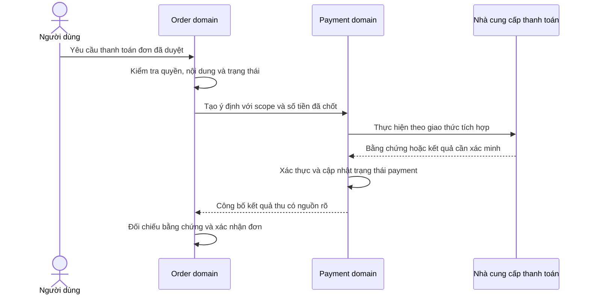

# State ownership — Quyền làm chủ trạng thái nghiệp vụ

## 1. Ai được quyết định một trạng thái là sự thật?

Trong chương **Domain State** của module **Business Logic Security** (`SECURITY_APPLICATION_SECURITY_BUSINESS_LOGIC_SECURITY`), **state ownership** xác định thành phần có thẩm quyền duy trì một trạng thái nghiệp vụ: định nghĩa ý nghĩa của nó, kiểm soát các chuyển đổi và công bố bằng chứng cho bên khác sử dụng.

Một hệ thống có thể có nhiều nơi lưu chữ “đã thanh toán”:

- Cờ trên giao diện.
- Bản sao trong dịch vụ đơn hàng.
- Bản ghi của dịch vụ thanh toán.
- Kết quả do nhà cung cấp thanh toán gửi về.
- Dòng dữ liệu trong báo cáo.

Những nơi này không tự có cùng thẩm quyền.

Nếu frontend được đặt `paid = true`, hoặc dịch vụ hỗ trợ có thể sửa thẳng trạng thái thanh toán, hệ thống có thể tạo ra một “sự thật” không có tác động tiền tệ tương ứng. Ngược lại, nếu tiền đã được thu nhưng một bản sao chậm cập nhật bị xem là nguồn quyết định, hệ thống có thể thực hiện lại.

Mục tiêu là giữ rõ:

```text
Trạng thái nào?
Ai có thẩm quyền thay đổi?
Theo command và điều kiện nào?
Bằng chứng đến từ đâu?
Các bản sao được sử dụng tới mức nào?
```

Đây là một phần của việc bảo vệ business invariants, quyền theo đối tượng, transaction và idempotency.

## 2. Phân biệt các ý nghĩa của “owner”

### 2.1. Chủ sở hữu đối tượng là một quan hệ nghiệp vụ

Một khách hàng có thể sở hữu đơn của mình. Điều đó có thể cho phép xem, sửa nháp hoặc yêu cầu hủy.

Nó không tự cho phép khách hàng:

```text
Tự duyệt đơn cần người khác duyệt.
Tự đặt trạng thái thanh toán thành công.
Tự tăng hạn mức hoàn.
Tự sửa số tiền đã được chốt.
```

`createdBy`, `customerId` hoặc `ownerId` là đầu vào của chính sách quyền, không phải quyền ghi mọi trường.

### 2.2. Thành phần làm chủ trạng thái là nơi giữ quy tắc

Ví dụ:

```text
Order domain:
    Quyết định đơn có thể chuyển sang confirmed không.

Payment domain:
    Quản lý ý định thanh toán và ghi nhận kết quả thu theo bằng chứng.

Inventory domain:
    Quản lý khả năng giữ chỗ và giải phóng tồn kho.
```

Những thành phần này có thể ở cùng một ứng dụng hoặc ở các dịch vụ riêng.

### 2.3. Người sở hữu mã nguồn là trách nhiệm tổ chức

Một nhóm kỹ thuật có thể chịu trách nhiệm duy trì domain và vận hành nó. Trách nhiệm đó không thay thế cơ chế runtime.

Ghi tên nhóm trong tài liệu không ngăn một script khác sửa bảng sai cách. Quyền ghi, đường command, constraint và transaction vẫn cần thực thi ranh giới.

### 2.4. Một owner không có nghĩa một tiến trình

Nhiều instance của cùng dịch vụ có thể cùng xử lý request. Chúng vẫn thuộc một thẩm quyền logic nếu cùng tuân theo giao thức quyết định và cơ chế cạnh tranh.

Ngược lại, hai module cùng ghi một bảng nhưng dùng quy tắc độc lập có thể tạo ra hai nguồn quyết định xung đột, dù chỉ chạy trong một process.

| Loại ownership | Câu hỏi chính |
| --- | --- |
| Ownership của người dùng | Ai có quan hệ và quyền gì trên đối tượng? |
| Ownership của domain | Ai có thẩm quyền thay đổi sự thật nghiệp vụ này? |
| Ownership vận hành | Ai chịu trách nhiệm triển khai, theo dõi và sửa lỗi? |
| Ownership lưu trữ | Thành phần nào quản lý dữ liệu vật lý và quyền truy cập? |

Cần mô tả các loại này mà không thay thế lẫn nhau.

## 3. Lập bản đồ thẩm quyền theo từng phần trạng thái

Một ví dụ phân công:

| Trạng thái hoặc dữ liệu | Thành phần có thẩm quyền | Bên khác có thể làm gì? |
| --- | --- | --- |
| Nội dung đơn và phiên bản | Order domain | Gửi command sửa trong phạm vi được phép |
| Hiệu lực phê duyệt của đơn | Domain phụ trách quy trình phê duyệt và liên kết với nội dung | Yêu cầu duyệt, nhận quyết định có scope |
| Kết quả thu tiền nội bộ | Payment domain, dựa trên bằng chứng tích hợp thích hợp | Yêu cầu thanh toán hoặc sử dụng kết quả đã xác nhận |
| Tồn kho được giữ chỗ | Inventory domain | Yêu cầu giữ, xác nhận hoặc giải phóng theo giao thức |
| Quyền của principal | Nguồn phân quyền được chỉ định | Hỏi hoặc kiểm chứng quyền theo hợp đồng |
| Tiến trình workflow | Thành phần điều phối workflow | Điều phối, theo dõi và yêu cầu các domain thực hiện |
| Điểm hiển thị hoặc báo cáo | Projection từ dữ liệu có nguồn rõ | Đọc theo scope, không tự sửa sự thật nguồn |

Một hệ thống nhỏ có thể để cùng một aggregate quản lý nội dung và phê duyệt. Một hệ thống khác tách chúng. Trong cả hai trường hợp, cần xác định ai chịu trách nhiệm cho quan hệ:

```text
Phê duyệt nào áp dụng cho nội dung nào?
```

Không để hai bên cùng cho rằng bên còn lại sẽ kiểm tra.

### 3.1. Không giao thẩm quyền cho một bảng chỉ vì nó được dùng chung

Tên bảng hoặc vị trí database không tự xác định owner.

Nếu nhiều module dùng chung bảng, cần biết:

- Trường nào do domain nào duy trì.
- Những thay đổi nào phải đi cùng nhau.
- Command nào được phép tạo thay đổi.
- Quyền ghi và constraint nào giữ ranh giới.
- Công cụ vận hành tham gia quy tắc ra sao.

Có quyền chạy SQL là năng lực kỹ thuật, không tự là thẩm quyền tạo mọi quyết định nghiệp vụ.

### 3.2. Nguồn bằng chứng và owner nội bộ có thể khác nhau

Payment domain là nơi quản lý trạng thái thanh toán trong ứng dụng. Nhưng sự thật rằng nhà cung cấp đã thu tiền phải được hỗ trợ bởi bằng chứng phù hợp với hợp đồng tích hợp.

Dịch vụ thanh toán không nên tự gán `CAPTURE_CONFIRMED` chỉ vì quản trị viên hoặc client yêu cầu.

Owner chịu trách nhiệm kiểm chứng, liên kết và lưu kết quả có thẩm quyền; nó không được tự sáng tạo ra sự kiện ngoài hệ thống.

## 4. Ví dụ xuyên suốt: đơn đã duyệt cần bằng chứng thanh toán

### 4.1. Chính sách minh họa

Trong ví dụ:

1. Order domain quản lý nội dung, revision và vòng đời đơn.
2. Phê duyệt gắn với đúng nội dung theo chính sách của đơn.
3. Order tạo một yêu cầu thanh toán cho số tiền và tiền tệ đã được chấp nhận.
4. Trong trạng thái `PAYMENT_PENDING`, không cho sửa trực tiếp những trường ảnh hưởng số tiền; thay đổi loại này cần một quy trình điều chỉnh riêng.
5. Payment domain quản lý tiến trình và bằng chứng thu.
6. Order chỉ xác nhận khi có bằng chứng thu khớp đúng đơn, payment intent, số tiền, tiền tệ và phiên bản nội dung.
7. Retry hoặc event lặp không tạo thêm kết quả xác nhận.

Ở đây, `CONFIRMED` nghĩa là đơn đã đáp ứng điều kiện xác nhận gồm bằng chứng thu theo chính sách. Nó không đồng nghĩa hàng đã giao hoặc tiền đã quyết toán.

Hoàn tiền hoặc tranh chấp về sau là các nghiệp vụ có trạng thái và xử lý riêng. Bằng chứng lịch sử tại thời điểm xác nhận không phải lời khẳng định rằng kết quả thanh toán sẽ không bao giờ thay đổi.

### 4.2. Hai vòng đời có liên hệ nhưng không bị gộp

```text
Order:
    DRAFT
    → PENDING_APPROVAL
    → APPROVED
    → PAYMENT_PENDING
    → CONFIRMED

Payment:
    CREATED
    → PENDING
    → CAPTURE_CONFIRMED
       hoặc FAILED
       hoặc UNKNOWN rồi được xác minh tiếp
```

Order không tự ghi trạng thái Payment. Payment không tự chọn nội dung hay giá mới của Order.

Hai bên cần một hợp đồng để liên kết:

```text
tenantId
orderId
orderContentRevision
paymentIntentId
amount
currency
bằng chứng và phiên bản nguồn liên quan
```

### 4.3. Luồng phối hợp



Sơ đồ không khẳng định các bước thuộc một transaction chung. Cơ chế bền vững, retry và xử lý kết quả chưa xác định phải được thiết kế tại từng ranh giới.

## 5. Dùng command để yêu cầu, dùng bằng chứng để thông báo sự thật

### 5.1. Command không được tự chọn kết quả cuối

Một command thể hiện ý định:

```text
SubmitOrder
ApproveOrder
StartPayment
CancelOrder
RequestRefund
```

Owner đánh giá quyền, trạng thái nguồn, dữ liệu và các điều kiện liên quan rồi quyết định chấp nhận hay từ chối.

Một request như sau trao quá nhiều quyền cho bên gọi:

```text
PATCH /orders/O100
{
    "status": "CONFIRMED",
    "paymentStatus": "CAPTURE_CONFIRMED",
    "approvedBy": "user-B"
}
```

Client có thể yêu cầu một hành động hợp lệ, nhưng không tự quyết định các sự thật mà hành động đó cần chứng minh.

### 5.2. Event cần nói sự kiện của đúng owner

Payment domain có thể công bố một sự kiện về kết quả thu đã được xác nhận trong phạm vi hợp đồng của nó.

Bên nhận cần kiểm tra nguồn phát và scope, rồi áp dụng quy tắc của chính mình. Không phải mọi message có tên `PaymentSucceeded` đều có thẩm quyền.

Ví dụ:

```text
Payment công bố:
    Một payment intent cụ thể đã có kết quả thu xác nhận.

Order quyết định:
    Bằng chứng đó có cho phép đơn cụ thể chuyển trạng thái không?
```

Payment không nên gửi một mệnh lệnh chung kiểu “đặt mọi đơn có mã này thành confirmed” để bên nhận bỏ các điều kiện domain.

### 5.3. Workflow có quyền điều phối, không tự thay bằng chứng

Thành phần workflow có thể gọi các command, ghi tiến độ và xử lý lỗi.

Nó không tự biến:

```text
Đã gửi lệnh thanh toán
```

thành:

```text
Đã thu tiền thành công.
```

Nếu cần quyền sửa chữa ngoại lệ, đó là một năng lực riêng có điều kiện, bằng chứng và dấu vết. Quyền điều phối không tự bao gồm quyền tạo sự thật tài chính.

### 5.4. Service identity rộng không phải quyền của mọi command

Một service có thể đọc nhiều tenant để xử lý tác vụ. Mỗi command vẫn phải gắn với scope đã được kiểm chứng.

Không lấy một `tenantId` hoặc `actorId` do caller tùy ý gửi rồi dùng toàn bộ quyền của service để thực hiện hộ. Owner cần biết nguồn thẩm quyền cho hành động và tài nguyên cụ thể.

## 6. Ví dụ Java: Order chỉ chuyển trạng thái của chính mình

Đoạn mã sau minh họa guard khi Order sử dụng một bằng chứng thu đã được Payment domain xác minh. Record bằng chứng không được bind trực tiếp từ request người dùng.

```java
import java.util.Currency;
import java.util.Objects;

final class OrderConfirmation {
    enum Status {
        APPROVED, PAYMENT_PENDING, CONFIRMED
    }

    record OrderSnapshot(
            String tenantId,
            String orderId,
            long contentRevision,
            Long approvedRevision,
            String expectedPaymentId,
            long totalMinor,
            Currency currency,
            Status status,
            String paymentEvidenceId) {
        OrderSnapshot {
            Objects.requireNonNull(tenantId);
            Objects.requireNonNull(orderId);
            Objects.requireNonNull(currency);
            Objects.requireNonNull(status);
            if (contentRevision <= 0 || totalMinor < 0) {
                throw new IllegalArgumentException("INVALID_ORDER_DATA");
            }
        }
    }

    // Chỉ tạo sau bước xác minh nguồn và ngữ nghĩa kết quả thu.
    record CapturedPaymentEvidence(
            String evidenceId,
            String tenantId,
            String orderId,
            String paymentId,
            long orderContentRevision,
            long capturedMinor,
            Currency currency) {
        CapturedPaymentEvidence {
            Objects.requireNonNull(evidenceId);
            Objects.requireNonNull(tenantId);
            Objects.requireNonNull(orderId);
            Objects.requireNonNull(paymentId);
            Objects.requireNonNull(currency);
            if (orderContentRevision <= 0 || capturedMinor < 0) {
                throw new IllegalArgumentException("INVALID_PAYMENT_DATA");
            }
        }
    }

    static OrderSnapshot confirmFromEvidence(
            OrderSnapshot order,
            CapturedPaymentEvidence payment) {
        Objects.requireNonNull(order);
        Objects.requireNonNull(payment);

        if (order.status() != Status.PAYMENT_PENDING) {
            throw new IllegalStateException("INVALID_SOURCE_STATE");
        }
        if (order.approvedRevision() == null
                || order.approvedRevision().longValue()
                    != order.contentRevision()) {
            throw new IllegalStateException("APPROVAL_NOT_CURRENT");
        }
        if (!order.tenantId().equals(payment.tenantId())
                || !order.orderId().equals(payment.orderId())
                || order.expectedPaymentId() == null
                || !order.expectedPaymentId().equals(payment.paymentId())) {
            throw new IllegalStateException("WRONG_PAYMENT_SCOPE");
        }
        if (order.contentRevision()
                != payment.orderContentRevision()) {
            throw new IllegalStateException("WRONG_PAYMENT_CONTENT");
        }
        if (order.totalMinor() != payment.capturedMinor()
                || !order.currency().equals(payment.currency())) {
            throw new IllegalStateException("WRONG_PAYMENT_AMOUNT");
        }

        return new OrderSnapshot(
                order.tenantId(),
                order.orderId(),
                order.contentRevision(),
                order.approvedRevision(),
                order.expectedPaymentId(),
                order.totalMinor(),
                order.currency(),
                Status.CONFIRMED,
                payment.evidenceId());
    }
}
```

Mã chỉ tạo trạng thái Order mới. Nó không sửa Payment, không thực hiện thu tiền và không tự thay bằng chứng phê duyệt.

Các trách nhiệm còn lại cần được đặt đúng nơi:

- Nguồn gọi phải có thẩm quyền; tên record không tạo ra bằng chứng.
- Phê duyệt đầy đủ phải được tạo và duy trì bởi quy trình có thẩm quyền; bằng nhau về revision chỉ là một điều kiện.
- Snapshot phải được tải trong đúng scope và bảo vệ trước cập nhật cạnh tranh.
- Việc lưu kết quả, inbox hoặc outbox liên quan cần nhất quán.
- Replay cần được nhận diện theo hợp đồng, thay vì chạy lại toàn bộ tác động.

Ví dụ này sử dụng phép so sánh tiền theo đơn vị nguyên đã quy ước cho cùng tiền tệ. Nó không thực hiện tính giá hoặc chuyển đổi tiền tệ.

## 7. Ownership trong một aggregate và một database

### 7.1. Aggregate là ranh giới quyết định, không chỉ là tập bảng

Nếu đơn và các dòng hàng cùng tham gia một bất biến, các thay đổi ảnh hưởng quyết định cần đi qua giao thức nhất quán của aggregate.

Ví dụ:

```text
Tổng đơn phải khớp các dòng hàng.
Phê duyệt phải khớp phiên bản nội dung.
Đơn confirmed không được sửa bởi command sửa nháp.
```

Có thể lưu dữ liệu ở nhiều bảng, nhưng không để từng bảng có một writer độc lập tự diễn giải quy tắc.

### 7.2. Khóa bản ghi gốc cần quy ước chung

Một transaction xác nhận có thể khóa bản ghi Order rồi đọc và kiểm tra các dữ liệu liên quan.

Lập luận đó chỉ đúng nếu các writer sửa dòng hàng hoặc bằng chứng liên quan cũng tham gia giao thức khóa hoặc cơ chế tương đương.

Nếu một script sửa trực tiếp dòng hàng mà không theo giao thức, việc transaction khác khóa Order chưa chắc bảo vệ được nội dung nó đã kiểm tra.

Tương tự, optimistic locking ở bản ghi gốc cần bảo đảm các thay đổi quan trọng làm tăng version thích hợp.

### 7.3. Constraint bảo vệ quan hệ dữ liệu, không tự phân quyền actor

Khóa ngoại, unique constraint, check và not-null có thể giữ nhiều quan hệ.

Chúng không tự chứng minh người gọi có quyền tạo quyết định, hoặc một giá trị payment status đến từ đúng nguồn.

Cần phối hợp:

```text
Authorization theo đối tượng
+ domain method
+ transaction và cơ chế cạnh tranh
+ constraint
+ quyền truy cập dữ liệu phù hợp
```

Nếu một constraint không biểu đạt được toàn bộ điều kiện, điều đó không cho phép bỏ điều kiện khỏi thiết kế.

### 7.4. Hạn chế đường ghi vô tình đi vòng owner

Các đường dễ gặp:

- Repository dùng chung cho nhiều module với phương thức cập nhật mọi trường.
- ORM entity có setter công khai cho trạng thái nội bộ.
- Bind request trực tiếp vào entity rồi save.
- Dirty checking làm một thay đổi ngoài ý định được ghi cùng transaction.
- SQL hoặc script vận hành không đi qua domain rule.

Có thể dùng command rõ nghĩa, DTO giới hạn trường, API module, quyền database và đường sửa chữa riêng để kiểm soát.

Ranh giới package và kiểu dữ liệu giúp giảm sai sót trong code tin cậy. Chúng không tự thay thế cơ chế cách ly nếu thành phần bên trong được xem là mã đối địch có cùng đặc quyền.

## 8. Ownership giữa các dịch vụ và giới hạn của transaction

### 8.1. Một transaction cục bộ không sở hữu trạng thái của dịch vụ khác

Order có thể lưu trạng thái chờ và ý định gửi yêu cầu trong cùng database bằng cơ chế phù hợp.

Nó không thể mặc nhiên rollback một lệnh Payment đã thực hiện thành công chỉ vì transaction Order gặp lỗi sau đó.

Cần mô hình hóa:

```text
Trạng thái chờ
Định danh command và nghĩa vụ
Kết quả chưa xác định
Retry có nhận diện
Đối soát
Bù trừ nếu nghiệp vụ cần
```

Bù trừ là một hành động nghiệp vụ mới có owner và guard riêng, không phải hoàn tác tức thời mọi sự kiện.

### 8.2. Đọc trạng thái khác với nhận được một cam kết

Nếu Inventory trả “còn một sản phẩm”, dữ liệu đó không tự giữ sản phẩm cho Order.

Nếu cần bảo đảm có tài nguyên, phải có reservation hoặc cơ chế cam kết thích hợp do owner tài nguyên duy trì.

Tương tự, đọc “còn đủ hạn mức hoàn” rồi tự tạo lệnh ở dịch vụ khác có thể tạo khoảng trống cạnh tranh. Owner của hạn mức hoặc giao thức phối hợp cần kiểm soát việc chiếm dụng.

### 8.3. Một bất biến xuyên domain cần trách nhiệm rõ

Với ví dụ xác nhận đơn, cần phân công:

| Quan hệ cần giữ | Trách nhiệm |
| --- | --- |
| Kết quả thu có nguồn hợp lệ | Payment xác minh và lưu bằng chứng |
| Kết quả thuộc payment intent nào | Payment duy trì ánh xạ và scope |
| Payment intent nói về nội dung đơn nào | Hợp đồng giữa Order và Payment |
| Bằng chứng cho phép xác nhận đơn không | Order kiểm tra theo chính sách |
| Tác động xác nhận không bị lặp | Owner quyết định và cơ chế dữ liệu liên quan |
| Sai lệch được xử lý | Quy trình đối soát có owner và quyền phù hợp |

Không để trách nhiệm ở dòng “hợp đồng giữa hai bên” trở thành không ai chịu trách nhiệm. Cần xác định nơi tạo, nơi kiểm tra và cách kiểm chứng liên kết đó.

## 9. Bản sao trạng thái phải giữ nguồn gốc và giới hạn sử dụng

### 9.1. Projection phục vụ đọc không tự trở thành nguồn quyết định

Order có thể lưu `paymentSummary` để hiển thị. Báo cáo có thể lưu số đơn đã thanh toán. Cache có thể lưu một trạng thái gần nhất.

Cần biết:

```text
Nguồn gốc là gì?
Thuộc aggregate nào?
Đã áp dụng tới sourceVersion nào?
Có thể chậm bao lâu?
Hành động nào được phép dựa vào bản sao?
```

Nếu một command nhạy cảm cần bằng chứng xác nhận hiện hành theo chính sách, một bản cache không có ngữ nghĩa phù hợp không đủ.

### 9.2. Version thuộc phạm vi của owner phát hành

`paymentVersion = 12` và `orderRowVersion = 8` không có một thứ tự chung để so sánh số lớn hơn.

Dấu phiên bản phải đi cùng nguồn và định danh aggregate. Một watermark của projection cũng không tự tương đương version nghiệp vụ của đối tượng.

Với event snapshot đủ thông tin, có thể dùng version nguồn để ngăn bản cũ ghi đè bản mới. Với delta cần áp dụng tuần tự, việc bỏ qua phiên bản trung gian đòi hỏi cơ chế khác.

### 9.3. Trạng thái không phải lúc nào cũng có thứ tự tăng đơn giản

Không nên tự gán hạng số cho các trạng thái rồi luôn giữ hạng cao hơn.

Một payment có thể có sự kiện thu, hoàn hoặc tranh chấp với ý nghĩa khác nhau. Một phê duyệt có thể hết hiệu lực khi nội dung thay đổi. Các chuyển đổi phải theo mô hình của owner.

Một event pending cũ không nên làm lùi kết quả thu đã xác nhận. Một sự kiện điều chỉnh hợp lệ về sau lại cần được xử lý như nghiệp vụ tương ứng, không bị bỏ chỉ vì tên trạng thái có vẻ “thấp hơn”.

### 9.4. Consumer vẫn phải chống lặp và giữ scope

Một luồng cục bộ có thể là:

```text
Xác minh producer và phạm vi được phép.
Bắt đầu transaction.
Nhận diện event theo hợp đồng dedupe.
Tải đối tượng theo tenant và ID.
Đối chiếu liên kết và phiên bản liên quan.
Thực hiện chuyển trạng thái của domain nhận.
Lưu bằng chứng đã xử lý và các ghi cục bộ liên quan.
Commit.
```

Các consumer chạy đồng thời phải được phối hợp để không cùng áp dụng một tác động. Outbox hoặc queue không tự tạo bảo đảm “đúng một lần” cho toàn chuỗi.

## 10. Quyền của actor phải đi qua thẩm quyền của domain

### 10.1. Authorization và ownership bổ sung cho nhau

Có hai câu hỏi riêng:

```text
Actor có được yêu cầu hành động này trên đối tượng không?
Domain có đủ điều kiện để chấp nhận hành động đó không?
```

Một khách hàng được phép yêu cầu hủy vẫn có thể bị từ chối vì đơn đã tới trạng thái không cho hủy. Một quản trị viên có quyền hoàn tiền vẫn phải tuân hạn mức, trạng thái và bằng chứng.

Owner chịu trách nhiệm làm cho quyết định giữ đúng các điều kiện liên quan. Kiểm tra role ở gateway không thay thế guard của domain.

### 10.2. Tenant là một phần của danh tính tài nguyên

Một bằng chứng Payment cho `orderId = O100` trong tenant A không áp dụng cho đơn cùng mã ở tenant B.

Cần giữ scope khi:

- Tải aggregate và các đối tượng liên quan.
- Gửi command giữa các thành phần.
- Tạo payment intent hoặc reservation.
- Xử lý event và dedupe.
- Cache và trả projection.
- Ghi audit hoặc thực hiện sửa chữa.

Service có thẩm quyền trên một loại trạng thái vẫn phải giới hạn mỗi quyết định trong đúng tài nguyên và tenant.

### 10.3. Quản trị viên cần command có ngữ nghĩa

Một endpoint quản trị sửa trạng thái tùy ý có thể phá ranh giới owner.

Nếu cần phục hồi một payment chưa được ghi nhận, quy trình nên xác minh bằng chứng, nhận diện tác động gốc và yêu cầu domain áp dụng một điều chỉnh hoặc kết quả hợp lệ.

Không nên cho nhập một người duyệt hoặc cờ thành công rồi coi đó là bằng chứng đã xảy ra.

Nếu nghiệp vụ hỗ trợ ghi nhận thanh toán thủ công, phải định nghĩa loại bằng chứng, quyền và quy trình tương ứng. Không phát một sự kiện giả rằng nhà cung cấp đã thu tiền khi nguồn thực tế là một quyết định ghi nhận khác.

### 10.4. Thực thi thay mặt phải giữ chuỗi trách nhiệm

Một worker có thể thực hiện command do người dùng hoặc quản trị viên khởi tạo. Cần phân biệt:

```text
Actor khởi tạo
Chủ thể nghiệp vụ liên quan
Thẩm quyền hoặc ủy quyền cho command
Dịch vụ thực thi
Owner của trạng thái được thay đổi
```

Không thay actor khởi tạo bằng tên service rồi bỏ kiểm tra tách vai trò hoặc scope mà nghiệp vụ yêu cầu.

Quyền tại thời điểm tiếp nhận hay thực thi cần được đặc tả. Ownership không tự trả lời chính sách thời gian đó, nhưng owner và hợp đồng phối hợp phải thực thi lựa chọn đã đưa ra.

## 11. Chuyển giao ownership khi hệ thống thay đổi

### 11.1. Di chuyển dữ liệu chưa chuyển xong thẩm quyền

Khi tách Payment khỏi một ứng dụng nguyên khối, có thể xuất hiện:

```text
Module cũ tiếp tục ghi bảng payment.
Service mới cũng cập nhật payment của riêng mình.
Hai bên cùng công bố trạng thái.
Một job đồng bộ cố sửa bên còn lại.
```

Đây có thể trở thành hai nguồn quyết định độc lập.

Kế hoạch chuyển giao cần biết bên nào có thẩm quyền cho từng đối tượng và thời điểm, cũng như cách ngăn bên còn lại ghi trái giao thức.

### 11.2. Hợp đồng chuyển tiếp cần rõ

Các mục quan trọng:

| Thành phần | Câu hỏi |
| --- | --- |
| Đối tượng | Nhóm payment nào đã chuyển owner? |
| Mốc hiệu lực | Từ thời điểm, phiên bản hoặc thế hệ nào? |
| Writer | Ai còn quyền quyết định và ai chỉ được đọc? |
| Command tồn đọng | Bên nào xử lý, theo điều kiện nào? |
| Event cũ | Được diễn giải, đối chiếu hoặc xử lý ra sao? |
| Định danh | Payment intent và nghĩa vụ có giữ nguyên liên kết không? |
| Bảo vệ ghi | Cơ chế nào thật sự ngăn writer cũ? |
| Phục hồi | Có thể quay lại code nào mà vẫn giữ quy tắc? |

Một nhãn `newOwner = payment-service` trong dữ liệu không tự ngăn script hoặc binary cũ có quyền database rộng.

### 11.3. Giữ một nguồn quyết định trong lúc có nhiều bản sao

Có thể cần bản sao để đối chiếu hoặc hỗ trợ reader cũ. Cần phân biệt bản sao đó với nơi có quyền chấp nhận tác động mới.

Nếu chạy logic shadow, kết quả dùng để so sánh không nên đồng thời phát lệnh thu hoặc ghi quyết định chính thức.

Định danh nghiệp vụ phải giúp nhận ra cùng nghĩa vụ ở cả đường cũ và mới. Nếu mỗi bên tạo một ID hoàn toàn mới cho cùng tác động, idempotency cục bộ có thể không ngăn việc thực hiện hai lần.

### 11.4. Hợp đồng thay đổi cần được consumer hiểu đúng

Nếu Payment bổ sung một trạng thái hoặc tách ý nghĩa “được chấp nhận” khỏi “đã thu”, Order không nên tiếp tục diễn giải mọi thành công như capture confirmed.

Cần xem tổ hợp producer và consumer đang chạy, message tồn đọng và các đường phục hồi.

Một message cũ hợp lệ có thể vẫn cần được xử lý hoặc đối soát theo hợp đồng. Không nên tự chuyển nó thành ý định mới bằng cách lấy revision hoặc scope hiện tại khi thiếu dữ liệu.

## 12. Kiểm thử quyền làm chủ trạng thái

### 12.1. Ma trận tình huống

| Tình huống | Bảo đảm cần quan sát |
| --- | --- |
| Client gửi status confirmed hoặc paymentStatus thành công | Không tự quyết định trạng thái nội bộ |
| Người dùng sở hữu đơn gọi thao tác ngoài quyền | Quan hệ sở hữu không mở mọi năng lực |
| Workflow yêu cầu bỏ qua bước thu tiền | Owner không coi tiến độ workflow là bằng chứng tài chính |
| Message có tên đúng nhưng nguồn không được phép | Không áp dụng chỉ dựa vào tên event |
| Bằng chứng thanh toán khác tenant | Không xác nhận đơn ngoài scope |
| Bằng chứng khác payment intent hoặc orderId | Không gắn tác động nhầm đối tượng |
| Bằng chứng đúng amount nhưng sai currency | Không xác nhận sai nghĩa tiền tệ |
| Bằng chứng đúng payment nhưng khác contentRevision | Không dùng cho nội dung ngoài quyết định |
| Order đã đổi trạng thái trước khi event được xử lý | Guard và cơ chế cạnh tranh giữ chuyển đổi đúng |
| Người dùng sửa số lượng trong PAYMENT_PENDING | Không đi vòng chính sách điều chỉnh của ví dụ |
| Event được nhận hai lần hoặc đồng thời | Không tạo hai kết quả xác nhận |
| Event pending cũ tới sau capture confirmed | Không làm lùi trạng thái theo thứ tự nhận ngẫu nhiên |
| Một sự kiện hoàn hoặc điều chỉnh hợp lệ tới sau | Được xử lý theo đúng vòng đời, không bị bỏ bằng thứ hạng trạng thái đơn giản |
| Cache nói paid nhưng nguồn chưa có bằng chứng | Command nhạy cảm không coi cache là thẩm quyền ngoài chính sách |
| Script sửa dòng hàng trực tiếp | Không phá giao thức nhất quán của aggregate |
| ORM entity bị sửa qua đường không dự định | Không lặng lẽ ghi các trường owner bảo vệ |
| Quản trị viên đánh dấu thành công khi còn unknown | Không biến thiếu thông tin thành bằng chứng |
| Worker mất phản hồi sau commit | Retry không tạo tác động mới |
| Lỗi giữa cập nhật Order và lưu inbox hoặc outbox cục bộ | Không để lại trạng thái dở dang theo ranh giới đã thiết kế |
| Writer cũ hoạt động sau chuyển ownership | Không còn tạo quyết định trái owner mới |
| Công cụ đối soát chạy lại | Không ghi đè sự thật hoặc tạo tác động trùng |

### 12.2. Kiểm tra ở nơi quyết định và nơi lưu

Unit test có thể chứng minh domain guard từ chối bằng chứng sai và tạo đúng trạng thái mới.

Integration test cần kiểm tra transaction, khóa, version, constraint và cách lưu inbox hoặc outbox.

Kiểm thử hợp đồng cần xác nhận hai bên hiểu cùng một ý nghĩa của capture, pending, failed và các bằng chứng liên quan.

Kiểm thử API cần bảo đảm request không bind được các trường nội bộ, actor và tenant được xác định đúng, và mọi command đi qua chính sách cần thiết.

Mock một Payment service luôn trả success không chứng minh được việc xác thực nguồn hoặc xử lý unknown.

### 12.3. Kiểm tra cả trạng thái nguồn, bản sao và tác động

Sau một tình huống, cần xem những dữ liệu liên quan:

```text
Order và phiên bản nội dung
Phê duyệt và bằng chứng
Payment intent và kết quả nguồn
Bản ghi xác nhận của Order
Inbox, outbox và idempotency record
Projection hoặc cache liên quan
Tác động ngoài hệ thống trong phạm vi thử
```

Một response lỗi không chứng minh không có commit. Một màn hình đúng không chứng minh dữ liệu nguồn và các tác động đều đúng.

Với projection bất đồng bộ, cần biết mốc đã xử lý trước khi đối chiếu.

### 12.4. Đường hợp lệ cũng phải được giữ

Bảo vệ ownership phải cho phép phối hợp đúng:

```text
Người đủ quyền gửi command hợp lệ.
Owner quyết định theo dữ liệu hiện hành.
Bằng chứng đúng được sử dụng.
Domain nhận cập nhật trạng thái của mình.
Retry hợp lệ nhận kết quả phù hợp.
Projection theo kịp theo cam kết.
```

Nếu mọi event đều bị chặn vì hợp đồng quá mơ hồ, hệ thống không thể hoàn tất nghiệp vụ dù chưa tạo kết quả trái quy tắc. Cần đồng thời thiết kế an toàn và khả năng tiến triển.

## 13. Quan sát và sửa sai mà không làm mờ owner

### 13.1. Giữ dấu vết quyết định theo nguồn

Dữ liệu hỗ trợ điều tra có thể gồm:

```text
Actor gốc và service thực thi
Tenant và aggregate ID
Command ID hoặc event ID
Nguồn bằng chứng và định danh tác động
Phiên bản nội dung và phiên bản nguồn liên quan
Trạng thái trước, trạng thái sau
Kết quả quyết định
Correlation ID
```

Các trường nguồn phải được xác định từ đường xác thực và xử lý thực tế. Client gửi `source = payment-service` không làm một payload trở thành bằng chứng của Payment.

Không ghi token, khóa bí mật hoặc dữ liệu nhạy cảm không cần thiết để có một trace đầy đủ hơn.

### 13.2. Chuỗi liên kết cần tái dựng được

Với ví dụ:

```text
Command của người dùng
→ nội dung và phê duyệt của đơn
→ ý định thanh toán
→ bằng chứng kết quả
→ sự kiện Payment
→ quyết định xác nhận Order
```

Chuỗi này giúp biết trạng thái sai bắt đầu từ nguồn, ánh xạ, điều kiện domain hay bản sao.

Nếu chỉ có một dòng “order confirmed by worker”, khó xác định worker đang dùng quyền nào, nội dung nào hoặc bằng chứng nào.

### 13.3. Đối soát nên tìm nguồn sai, không sửa con số cho giống nhau

Nếu Order vẫn payment pending nhưng Payment đã có bằng chứng thu, cần xác định event bị thiếu, consumer bị lỗi hay bằng chứng không khớp điều kiện.

Nếu Order confirmed mà không có bằng chứng phù hợp, không nên tự gán Payment thành công để hai bên khớp.

Một quy trình sửa chữa tốt đi qua owner tương ứng, giữ lý do và quan hệ với tác động gốc. Nếu cần điều chỉnh, điều chỉnh đó có ngữ nghĩa và bằng chứng riêng.

### 13.4. Các tín hiệu phát hiện đường ghi ngoài thẩm quyền

Có thể theo dõi:

- Chuyển trạng thái không có command hoặc bằng chứng cần thiết.
- Số lần scope hoặc revision không khớp.
- Tác động hoặc xác nhận bị trùng.
- Bản sao quá chậm so với nguồn.
- Writer cũ còn cố ghi sau cutover.
- Trạng thái unknown hoặc reservation chờ quá lâu.
- Chênh lệch khi đối soát giữa owner và projection.

Số lần từ chối tăng có thể do cạnh tranh hợp lệ, lỗi tích hợp hoặc hành vi lạm dụng. Cần điều tra với ngữ cảnh, không tự gán mọi trường hợp là tấn công.

## 14. Mẫu hợp đồng quyền làm chủ trạng thái

Với một nhóm trạng thái, có thể ghi rõ:

```text
Tên trạng thái hoặc tập trường:
Ý nghĩa nghiệp vụ:
Aggregate và tenant scope:

Owner có thẩm quyền:
Nguồn bằng chứng bên ngoài nếu có:
Nhóm chịu trách nhiệm vận hành:

Actor được phép yêu cầu:
Command được hỗ trợ:
Trạng thái nguồn và guard:
Các trường client không được quyết định:

Business invariants:
Ranh giới nhất quán:
Cơ chế cạnh tranh:
Constraint và quyền ghi:
Các đường quản trị hoặc sửa chữa:

Hợp đồng phối hợp:
Bên phát và bên nhận:
Command, event hoặc reservation:
Định danh nghĩa vụ:
Liên kết đối tượng, amount, currency và revision khi cần:
Ngữ nghĩa thời gian, pending và unknown:
Cách xác thực nguồn và scope:

Bản sao:
Projection hoặc cache nào tồn tại:
Nguồn và phiên bản:
Giới hạn sử dụng:
Cách cập nhật và đối soát:

Retry và phục hồi:
Idempotency:
Dedupe:
Thứ tự hoặc version:
Bù trừ hoặc điều chỉnh:
Cách tránh thực hiện lại tác động gốc:

Chuyển giao ownership:
Writer cũ và mới:
Mốc thẩm quyền:
Message tồn đọng:
Cách rào đường ghi cũ:

Kiểm chứng:
Test domain:
Test dữ liệu và cạnh tranh:
Test hợp đồng:
Bằng chứng và giới hạn:
Metric và quy trình sửa sai:
```

Với luồng Order và Payment, hợp đồng cần chỉ ra ai chứng minh việc thu, ai kiểm tra bằng chứng cho đơn và ai được chuyển từng trạng thái. Các bản sao, quyền quản trị và tác vụ phục hồi đều cần tiếp tục tôn trọng sự phân công đó.
