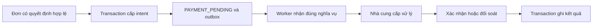

# State persistence — Lưu bền trạng thái nghiệp vụ

Một đơn hàng được đổi thành `APPROVED` trong bộ nhớ chưa có nghĩa quyết định duyệt đã được lưu bền. Một câu lệnh cập nhật trạng thái thành công cũng chưa đủ nếu snapshot phê duyệt không được lưu cùng, hoặc một writer khác có thể ghi đè bằng bản dữ liệu cũ.

**State persistence** là việc biểu diễn và lưu trạng thái nghiệp vụ để hệ thống có thể đọc lại, tiếp tục xử lý và giữ các quy tắc sau cạnh tranh, lỗi tiến trình hoặc khởi động lại. Trong bảo mật logic nghiệp vụ, điều cần lưu không chỉ là tên trạng thái mà còn là những sự thật làm cho trạng thái đó có ý nghĩa.

Trong chương **Domain State**, bài học này tập trung vào lưu trữ đúng trạng thái, phiên bản, quyết định và cam kết. Ví dụ xuyên suốt là một đơn hàng cần phê duyệt trước thanh toán, kết hợp transaction, quyền theo đối tượng, idempotency và xử lý bất đồng bộ.

## 1. Trạng thái trong bộ nhớ khác trạng thái đã được chấp nhận

Một thay đổi có thể đi qua nhiều mốc:

```text
Tạo hoặc tải đối tượng trong bộ nhớ
→ kiểm tra điều kiện và tính trạng thái mới
→ gửi lệnh ghi
→ transaction commit
→ hệ thống khác nhận được thông tin
→ tác động bên ngoài được xác nhận.
```

Các mốc này không đồng nghĩa với nhau.

| Mốc | Điều có thể khẳng định | Điều chưa tự được khẳng định |
| --- | --- | --- |
| Setter hoặc domain method đã chạy | Đối tượng trong tiến trình đã thay đổi | Thay đổi đã được lưu |
| Lệnh ghi hoặc flush đã thực hiện | Dữ liệu đã đi vào quá trình lưu theo cơ chế tương ứng | Transaction cuối cùng đã commit |
| Commit được xác nhận | Thay đổi cục bộ được chấp nhận theo bảo đảm lưu trữ đã cấu hình | Mọi replica, cache và dịch vụ khác đã cập nhật |
| Message đã được gửi | Một lần chuyển tiếp đã được thử hoặc xác nhận theo giao thức | Consumer đã áp dụng đúng một lần |
| Nhà cung cấp xác nhận tác động | Có bằng chứng theo giao thức về tác động tương ứng | Mọi trạng thái cục bộ đã được đối soát |

Cần hiểu bảo đảm durability của cơ sở dữ liệu trong cấu hình thực tế. Không nên suy ra rằng mọi kiểu ghi được xác nhận đều có cùng khả năng chịu lỗi phần cứng, mất kết nối hoặc chuyển đổi nơi phục vụ.

### 1.1. Thành công với người gọi phải có ngữ nghĩa rõ

Nếu API trả “đã duyệt”, hợp đồng cần xác định quyết định đã được commit hay chỉ được tiếp nhận để xử lý sau.

Nếu chỉ mới tiếp nhận, nên mô tả đúng trạng thái đó. Một nhãn thành công quá sớm có thể khiến người dùng hoặc consumer thực hiện bước tiếp theo khi thẩm quyền chưa được xác lập.

Ngược lại, mất response không chứng minh transaction thất bại. Dữ liệu có thể đã commit rồi kết nối mới bị ngắt; retry cần nhận diện thao tác đã có.

## 2. Lưu điều gì để trạng thái có ý nghĩa?

Giả sử đơn hàng có các trạng thái:

```text
DRAFT
→ PENDING_APPROVAL
→ APPROVED
→ PAYMENT_PENDING
→ PAID
```

Một trường `status` không thể tự trả lời:

- Đơn thuộc tổ chức và người mua nào?
- Revision nội dung nào đã được duyệt?
- Ai có thẩm quyền duyệt và theo chính sách nào?
- Số tiền, tiền tệ và điều kiện nào được phép thực thi?
- Intent thanh toán nào đang xử lý?
- Khoản thu nào làm căn cứ cho trạng thái `PAID`?
- Writer đang cập nhật dựa trên phiên bản nào?

Có thể chia dữ liệu lưu thành các nhóm:

| Nhóm | Ví dụ | Vai trò |
| --- | --- | --- |
| Định danh và phạm vi | Tổ chức, mã đơn, người tạo | Giữ quan hệ và quyền theo đối tượng |
| Nội dung hiện tại | Dòng hàng, số lượng, giá có thẩm quyền, tiền tệ | Mô tả nội dung nghiệp vụ đang có |
| Trạng thái vòng đời | Nháp, chờ duyệt, đã duyệt | Xác định hành động tiếp theo được phép |
| Phiên bản | Revision nội dung, phiên bản aggregate | Liên kết quyết định và phát hiện ghi từ dữ liệu cũ |
| Quyết định | Approval, snapshot, chủ thể, chính sách | Chứng minh thẩm quyền cho nội dung cụ thể |
| Cam kết và tác động | Payment intent, operation, tham chiếu nhà cung cấp | Tiếp tục xử lý và tránh thực hiện trùng |
| Dấu vết | Audit và liên kết nguyên nhân | Giải thích thay đổi đã xảy ra |
| Chuyển tiếp | Outbox hoặc cơ chế tương đương | Công bố công việc sau commit một cách bền vững |

Không nhất thiết đặt mọi dữ liệu vào một bảng. Cần bảo đảm mô hình lưu có thể biểu diễn và duy trì các quan hệ cần thiết.

## 3. Viết invariant cho trạng thái được lưu

Trong ví dụ, các quy tắc gồm:

| Mã | Invariant | Vi phạm có thể xảy ra |
| --- | --- | --- |
| P1 | Mỗi đối tượng và quan hệ nhạy cảm giữ đúng phạm vi tổ chức | Đơn tổ chức A tham chiếu approval của tổ chức B |
| P2 | Trạng thái đã duyệt có quyết định có thẩm quyền cho nội dung phù hợp | Chỉ ghi `status=APPROVED` mà không có quyết định |
| P3 | Thay đổi nội dung quan trọng cập nhật revision và hiệu lực quyết định theo chính sách | Sửa số lượng nhưng giữ nguyên duyệt cũ |
| P4 | Writer không được âm thầm ghi đè thay đổi mới bằng dữ liệu cũ | Một lệnh lưu toàn bộ object khôi phục trạng thái lỗi thời |
| P5 | Những thay đổi cục bộ bắt buộc nhất quán được commit hoặc rollback theo cùng hợp đồng | Có trạng thái nhưng thiếu snapshot hoặc outbox bắt buộc |
| P6 | Retry không tạo thêm đối tượng hoặc tác động cho cùng thao tác | Mất response rồi tạo intent lần hai |
| P7 | Dữ liệu chưa rõ kết quả không bị diễn giải thành chưa thực hiện | Timeout làm đơn quay về trạng thái cho phép thu mới |
| P8 | Đọc lại và khôi phục không tự phát lại tác động | Tải đơn từ nơi lưu làm gửi lại yêu cầu thanh toán |

Các invariant cần được giữ ở ranh giới xác định, thường là trạng thái cục bộ sau commit và các quyết định thực thi tương ứng.

Một projection đang trễ chưa chắc là vi phạm P2 nếu nguồn chuẩn đã có dữ liệu đầy đủ. Nhưng dùng projection trễ để cấp một tác động mới mà không có bảo đảm phù hợp có thể tạo vấn đề khác.

## 4. Lưu trạng thái và bằng chứng có quan hệ rõ ràng

Một mô hình quan hệ minh họa:

```text
orders
  tenant_id, order_id
  status
  content_revision
  row_version
  current_total_minor, currency
  active_approval_id
  active_payment_intent_id

order_approvals
  tenant_id, order_id, approval_id
  content_revision
  approved_total_minor, currency
  approver_id
  policy_reference
  decided_at
  validity_information

payment_intents
  tenant_id, order_id, intent_id
  approval_id, content_revision
  amount_minor, currency
  operation_reference
  execution_state
```

Đây là cấu trúc khái niệm, không phải schema đầy đủ. Sản phẩm có thể lưu snapshot nội dung ở một nơi khác hoặc dùng mô hình dữ liệu khác.

### 4.1. Quyết định cần tham chiếu nội dung không bị sửa đè

Nếu approval chỉ tham chiếu “đơn hiện tại”, sau khi đơn đổi sẽ không còn biết người duyệt đã xem gì.

Có thể lưu snapshot bất biến hoặc tham chiếu một revision bất biến. Dữ liệu đó phải còn đọc được trong thời hạn cần giải thích quyết định.

Không nên giữ hai bản sao cùng được coi là có thẩm quyền mà không có cách duy trì nhất quán. Nếu chép tổng tiền vào approval và intent, cần nói rõ bản nào chốt điều khoản và những bản nào phải khớp nó.

### 4.2. Phạm vi tổ chức phải nằm trong quan hệ

Nếu mã chỉ duy nhất trong từng tổ chức, khóa và foreign key phải thể hiện đúng phạm vi. Ngay cả khi ID là duy nhất toàn hệ thống, việc giữ quan hệ tổ chức rõ ràng vẫn giúp thực thi và kiểm tra chính sách.

Một foreign key chứng minh bản ghi đích tồn tại theo quan hệ đã khai báo. Nó không tự chứng minh người duyệt có quyền, approval còn hiệu lực hay nội dung đáp ứng chính sách.

## 5. Phân biệt revision nội dung và phiên bản ghi

Hai khái niệm thường bị trộn lẫn:

- **Content revision:** nhận diện bản nội dung ảnh hưởng đến quyết định nghiệp vụ.
- **Row version hoặc aggregate version:** hỗ trợ nhận diện thay đổi và kiểm soát cập nhật theo giao thức lưu.

Ví dụ:

| Hành động | Revision nội dung | Phiên bản aggregate |
| --- | --- | --- |
| Gửi nội dung bản 7 | Giữ 7 | Tăng theo lần thay đổi |
| Phê duyệt bản 7 | Giữ 7 | Tăng |
| Sửa số lượng | Thành 8 | Tăng |
| Ghi nhận intent cho bản hợp lệ | Theo bản được phép | Tăng |

Cách tăng cụ thể là lựa chọn mô hình. Điều quan trọng là mọi writer liên quan cùng tuân thủ quy ước.

### 5.1. Revision không tự chứng minh thẩm quyền

Một số revision do client gửi chỉ là kỳ vọng để đối chiếu. Nó không chứng minh bản đó đã được duyệt.

Ngay cả khi số revision khớp, vẫn cần bảo đảm mọi thay đổi nội dung quan trọng thực sự cập nhật revision. Một đường import sửa dữ liệu mà không tăng số có thể làm phép so sánh mất ý nghĩa.

### 5.2. Phiên bản không thay thế quyền theo đối tượng

Biết đúng phiên bản hiện tại không tạo quyền sửa đơn. Máy chủ vẫn phải xác thực, xác định tổ chức và kiểm tra hành động trên đúng đối tượng.

Một lệnh cập nhật có điều kiện nên giữ cả phạm vi và phiên bản, thay vì chỉ dựa vào ID và số version do người gọi biết được.

## 6. Transaction cho một chuyển trạng thái hoàn chỉnh

Giả sử người duyệt chấp thuận đơn đang ở `PENDING_APPROVAL`. Một transaction có thể gồm:

```text
BEGIN
  Đọc đơn trong đúng phạm vi.
  Xác minh quyền và các điều kiện phê duyệt.
  Tạo snapshot quyết định cho nội dung đã được xem.
  Chuyển đơn sang APPROVED bằng giao thức chống xung đột.
  Ghi audit bắt buộc.
  Ghi outbox nếu cần công bố quyết định.
  Ghi kết quả idempotency theo hợp đồng.
COMMIT
```

Nếu ghi snapshot thành công nhưng đổi đơn thất bại vì phiên bản đã khác, snapshot và các thay đổi bắt buộc liên quan phải rollback theo hợp đồng đã chọn.

Một transaction chỉ bảo vệ các tài nguyên thật sự nằm trong ranh giới của nó. Hai repository dùng hai nguồn dữ liệu độc lập không tự trở thành nguyên tử vì được gọi trong cùng một phương thức.

### 6.1. Không phát sự thật đã commit trước khi commit

Nếu gửi message “đơn đã duyệt” trước commit, consumer có thể cấp bước tiếp theo dù transaction sau đó rollback.

Nếu commit rồi mới gửi bằng một bước không bền vững, tiến trình có thể dừng giữa hai bước và làm mất thông điệp. Outbox hoặc giao thức tương ứng giúp gắn thay đổi với dữ liệu cần chuyển tiếp.

### 6.2. Trạng thái trong bộ nhớ sau rollback

Một object đã bị domain method sửa trong bộ nhớ có thể không phản ánh trạng thái đã được lưu sau khi transaction thất bại.

Không nên tiếp tục đưa object đó vào cache hoặc dùng nó để trả thành công. Khi retry, cần tải và đánh giá lại theo ranh giới xử lý phù hợp, thay vì cố lưu nguyên snapshot cũ.

## 7. Chống ghi đè bằng dữ liệu cũ

Một lỗi phổ biến là:

```text
T1 đọc đơn đang PENDING_APPROVAL, phiên bản 12.
T2 hủy yêu cầu hoặc sửa nội dung, lưu phiên bản 13.
T1 lưu toàn bộ object đã đọc và đặt APPROVED.
Kết quả: thay đổi của T2 có thể bị ghi đè nếu không phát hiện xung đột.
```

Cần một cơ chế phối hợp phù hợp, chẳng hạn khóa, optimistic locking hoặc cập nhật có điều kiện.

### 7.1. Minh họa cập nhật có điều kiện

```sql
UPDATE orders
SET status = 'APPROVED',
    active_approval_id = :serverCreatedApprovalId,
    row_version = row_version + 1
WHERE tenant_id = :trustedTenantId
  AND order_id = :orderId
  AND status = 'PENDING_APPROVAL'
  AND content_revision = :reviewedContentRevision
  AND row_version = :loadedRowVersion;
```

Số dòng bị ảnh hưởng phải được kiểm tra. Không cập nhật được không phải lý do để bỏ điều kiện rồi ghi lại bằng quyền cao hơn.

Câu lệnh này giả định approval được tạo từ dữ liệu có thẩm quyền, có quan hệ đúng và nằm trong transaction phù hợp. Nó không tự thực hiện toàn bộ kiểm tra quyền hoặc hạn mức người duyệt.

Mọi đường sửa aggregate cần tuân thủ giao thức phiên bản tương thích. Một bulk update âm thầm không tăng version có thể làm writer khác không phát hiện thay đổi.

### 7.2. Khóa cũng phải đúng phạm vi

Khóa bản ghi đơn giúp phối hợp các thao tác trên đơn nếu các đường khác sử dụng cơ chế tương thích.

Nó không tự bảo vệ hạn mức chung của tổ chức, quyền đang được sửa ở nơi khác hoặc một approval có thể bị thu hồi độc lập mà không phối hợp. Cần xác định thêm dữ liệu nào tham gia quyết định và bảo vệ chúng theo hợp đồng thời điểm hiệu lực.

### 7.3. Không retry mù

Sau xung đột, tải lại rồi kiểm tra guard có thể cho kết quả khác. Đơn đã hủy hoặc nội dung đã đổi thì thao tác cũ có thể không còn được phép.

Retry không nên đồng nghĩa “cố ghi cho đến khi thành công”. Đặc biệt, không thực hiện lại tác động bên ngoài như một nghĩa vụ mới chỉ vì một lần lưu trạng thái gặp lỗi.

## 8. Minh họa service Java với hợp đồng lưu rõ ràng

Ví dụ sau dùng một abstraction transaction để nhấn mạnh ranh giới. Hợp đồng của `transactions.required` là chỉ trả kết quả thành công cho caller khi transaction đã commit thành công theo cơ chế của ứng dụng; khi thất bại, các thay đổi trong phạm vi được rollback.

```java
public ApprovalResult approve(
        AuthenticatedActor actor,
        ApproveOrderCommand command) {

    return transactions.required(() -> {
        OrderState before = orders.loadInTenant(
                        actor.tenantId(), command.orderId())
                .orElseThrow(OrderNotVisibleException::new);

        authorization.requireMayApprove(actor, before);

        var replay = idempotency.findAuthorizedReplay(
                actor, before, command);
        if (replay.isPresent()) {
            return replay.get();
        }

        approvalPolicy.requireApprovable(
                actor, before, command.expectedContentRevision());

        ApprovalSnapshot approval = approvalFactory.create(
                actor, before, clock.instant());

        approvals.insert(approval);

        int changed = orders.approveIfUnchanged(
                before, approval.id());
        if (changed != 1) {
            throw new ConcurrentOrderChangeException();
        }

        ApprovalResult result = ApprovalResult.from(approval);
        audit.append(OrderApproved.from(actor, before, approval));
        outbox.append(ApprovalRecorded.from(approval));
        idempotency.recordResult(actor, command, result);

        return result;
    });
}
```

Đây là mã minh họa ở mức application service. Các kiểu, repository và cơ chế transaction cần được cài đặt theo ứng dụng thực tế.

Các điều kiện phía sau:

- Actor và tổ chức hiện hành đến từ nguồn đã xác minh.
- Quyền thao tác và điều kiện trạng thái được tách rõ, kể cả khi trả lại kết quả cũ.
- Snapshot chứa đúng nội dung được duyệt, không lấy thông tin thẩm quyền từ payload.
- `approveIfUnchanged` giữ đúng phạm vi, trạng thái, revision và version cần thiết.
- Lỗi ghi audit, outbox hoặc kết quả bắt buộc không để transaction commit dở dang.
- Hai request tranh khóa idempotency phải có cơ chế nguyên tử và rollback đúng khi xung đột.
- Nếu dùng hạn mức hoặc quyền có thể đổi đồng thời ngoài đơn, cần phối hợp dữ liệu đó.
- Không gọi nhà cung cấp thanh toán trong đoạn minh họa này.

Tên phương thức như `save` hoặc `load` không tự thể hiện mọi bảo đảm. Hợp đồng repository cần nói rõ phạm vi, phiên bản và ngữ nghĩa khi không ghi được.

## 9. Ràng buộc lưu trữ bảo vệ trạng thái nhưng không thay toàn bộ policy

Có thể dùng các ràng buộc để chặn:

- Trường bắt buộc bị thiếu.
- Trạng thái ngoài tập cho phép.
- Số tiền hoặc bộ đếm không hợp lệ theo mô hình.
- Quan hệ tham chiếu không tồn tại.
- Định danh thao tác bị tạo trùng trong phạm vi đã xác định.

Tuy nhiên:

| Ràng buộc | Điều chưa tự chứng minh |
| --- | --- |
| `CHECK status IN (...)` | Chuyển từ trạng thái nguồn sang đích có hợp lệ không |
| `active_approval_id NOT NULL` ở trạng thái cần duyệt | Approval có đúng nội dung và nguồn thẩm quyền không |
| Foreign key | Chủ thể có quyền thực hiện hành động không |
| Unique operation key | Khác khóa có còn tạo trùng cùng nghĩa vụ không |
| Số tiền dương | Giá trị có đến từ nguồn có thẩm quyền không |

Constraint và application policy cần có phân công rõ. Không nhất thiết sao chép mọi quy tắc động vào cơ sở dữ liệu, nhưng những quan hệ lưu trữ cốt lõi không nên chỉ dựa vào sự cẩn thận của từng writer.

Tiền cần đơn vị và tiền tệ rõ ràng, kiểu dữ liệu đủ lớn cùng quy tắc làm tròn nếu có. Lưu một số chính xác vẫn không ngăn việc lưu giá do sai nguồn quyết định.

## 10. Lưu cam kết trước, thực thi bên ngoài theo đúng cam kết

Đơn `APPROVED` không nên được ghi thẳng thành `PAID` chỉ vì sắp gọi nhà cung cấp.

Một luồng có thể là:



Intent cần chốt đối tượng, số tiền, tiền tệ, quyết định và định danh thao tác liên quan. Worker thực thi đúng intent, thay vì tính lại một tác động khác từ dữ liệu hiện tại có thể đã đổi.

### 10.1. Trạng thái chưa rõ phải được lưu bền

Nếu nhà cung cấp có thể đã xử lý nhưng hệ thống timeout, cần giữ đủ thông tin để truy vấn và đối soát.

Không nên đặt lại `APPROVED` hoặc `NOT_STARTED` chỉ vì chưa ghi được kết quả. Làm vậy có thể cho một request mới tạo thêm khoản thu.

### 10.2. Callback lặp hoặc đến muộn

Kết quả phải gắn đúng intent và nghĩa vụ. Việc áp dụng thành công cần chống lặp, giữ trạng thái và số liệu nhất quán.

Một callback thuộc lần xử lý cũ không được ghi đè sai nghĩa vụ hiện tại. Đồng thời, nếu có bằng chứng một tác động thật đã xảy ra, hệ thống cần lưu đúng sự thật và đối soát, thay vì bỏ qua chỉ vì trạng thái mong đợi đã đổi.

### 10.3. Outbox và consumer

Publisher có thể gửi thành công rồi dừng trước khi ghi nhận đã gửi, khiến message được giao lại. Consumer cần nhận diện sự kiện hoặc nghĩa vụ ổn định và xử lý lặp an toàn.

Số lần nhận message không phải số lần tác động nghiệp vụ. Trạng thái chuẩn và các định danh phải phản ánh sự khác biệt đó.

## 11. Nguồn chuẩn, cache và read model

Một hệ thống có thể có:

- Bản ghi nghiệp vụ chuẩn.
- Cache.
- Bản sao đọc.
- Chỉ mục tìm kiếm.
- Dashboard hoặc projection từ sự kiện.

Chúng có độ mới và mục đích khác nhau. Cần xác định nguồn nào có thẩm quyền cho quyết định cấp tác động mới.

### 11.1. Dữ liệu trễ có thể đủ để hiển thị nhưng không đủ để cấp quyền

Một danh sách có thể tạm hiển thị `APPROVED` trong khi nguồn chuẩn đã hủy hiệu lực duyệt. Nếu lệnh thanh toán đọc nguồn chuẩn và giữ guard đúng, dữ liệu hiển thị trễ chưa tự làm phát sinh tác động sai.

Nếu lệnh tin trạng thái từ browser hoặc cache mà không có bảo đảm phù hợp, sự trễ trở thành một đường lạm dụng.

### 11.2. Không cập nhật cache như thể transaction chắc chắn thành công

Đưa object đã sửa vào cache trước commit có thể làm lộ trạng thái chưa bao giờ được chấp nhận.

Cơ chế cập nhật hoặc vô hiệu hóa cache cần gắn với thay đổi đã commit và xử lý được retry, trễ cùng phạm vi quyền. Cache response còn phải phân biệt tổ chức và mức dữ liệu được phép thấy.

### 11.3. Đọc lại cần giữ quyền theo đối tượng

Lưu đúng `tenant_id` không tự làm mọi truy vấn an toàn. Repository và đường đọc cần áp dụng phạm vi mà actor được phép truy cập.

Tải được entity bằng ID không có nghĩa được trả mọi trường. Giá vốn, ghi chú duyệt và dữ liệu nội bộ vẫn cần hợp đồng đầu ra phù hợp.

## 12. Lưu trạng thái hiện tại, lịch sử và event sourcing

Có nhiều cách tổ chức nơi lưu:

| Mô hình | Nguồn chính để biết trạng thái | Điều cần chú ý |
| --- | --- | --- |
| Lưu trạng thái hiện tại | Bản ghi hoặc document hiện hành | Cần version, quan hệ và lịch sử đủ cho quyết định quan trọng |
| Trạng thái kèm audit hoặc outbox | Bản ghi hiện hành, có dấu vết và chuyển tiếp | Audit hoặc outbox không mặc nhiên là nguồn dựng lại toàn bộ domain |
| Event sourcing | Chuỗi sự kiện chuẩn theo mô hình đã chọn | Append có kiểm soát cạnh tranh, schema và replay đúng ngữ nghĩa |

Một ứng dụng có bảng outbox không tự trở thành event-sourced. Outbox có thể bị dọn sau khi gửi và không chứa mọi sự kiện cần dựng lại trạng thái.

### 12.1. Snapshot và sự kiện có vai trò riêng

Trong event sourcing, snapshot có thể là điểm tăng tốc khôi phục từ một vị trí nguồn xác định. Cần biết nó tương ứng chuỗi nào, phiên bản nào và cách đọc khi schema đổi.

Trong mô hình lưu trạng thái hiện tại, một bản ghi chuẩn có thể có thẩm quyền trực tiếp. Không nên áp các giả định của mô hình này sang mô hình khác mà chưa xác định nguồn chuẩn.

### 12.2. Replay không được tự phát lại tác động

Dựng lại trạng thái từ dữ liệu hoặc sự kiện không nên gọi lại nhà cung cấp, gửi lại quyền lợi hoặc tạo nghĩa vụ mới ngoài hợp đồng.

Cần tách việc áp dụng sự kiện để tái dựng khỏi việc phát lệnh thực thi. Các quyết định lịch sử cũng không nên bị viết lại bằng cách áp quyền và chính sách hiện tại như thể chúng luôn có hiệu lực trong quá khứ.

## 13. Khôi phục, migration và những writer ngoài luồng chính

### 13.1. Đọc lại không phải tạo mới

Một đơn đã được duyệt không được đi qua factory mở nháp rồi mất trạng thái, approval và operation liên quan.

Cần tách đường tạo mới với đường tái dựng. Dữ liệu không đọc hiểu được hoặc vi phạm quan hệ cần được xử lý như vấn đề dữ liệu, không âm thầm gán thành một trạng thái thuận tiện.

### 13.2. Migration phải giữ ngữ nghĩa

Khi thêm trạng thái, revision hoặc snapshot mới, cần biết các writer cũ và mới cùng tồn tại ra sao.

Không nên backfill mọi đơn thiếu approval thành “đã duyệt mặc định” chỉ để schema mới chạy được. Phải có chính sách chuyển đổi, nguồn bằng chứng và trạng thái xử lý phù hợp cho dữ liệu chưa đủ căn cứ.

Một giá trị trạng thái lạ không nên được ánh xạ thành `DRAFT` hoặc `APPROVED` một cách tùy tiện. Điều đó có thể che mất lịch sử hoặc mở quyền không đúng.

### 13.3. Phục hồi từ bản sao lưu

Sau phục hồi, dữ liệu cục bộ có thể cũ hơn những tác động đã xảy ra bên ngoài. Một khoản thu có thể đã được thực hiện sau mốc backup, trong khi bản khôi phục chưa biết tới.

Cần đối chiếu operation, nguồn ngoài và vị trí chuyển tiếp trước khi cho thực thi lại những nghĩa vụ chưa rõ. Không nên xóa bảng idempotency hoặc reset trạng thái chỉ để công việc chạy lại.

Bản khôi phục của outbox hoặc dữ liệu chống trùng cũng có thể làm message được gửi lại. Các bảo đảm cần xét trên toàn chuỗi phục hồi, không chỉ một bảng.

### 13.4. Công cụ vận hành và ghi trực tiếp

API đúng không đủ nếu script, batch hoặc tài khoản hỗ trợ có thể ghi trạng thái tùy ý mà không giữ revision và quan hệ.

Có thể thu hẹp quyền ghi, dùng lệnh quản trị có hợp đồng, ràng buộc lưu trữ và audit phù hợp. Phạm vi bảo đảm phải phản ánh những chủ thể thực tế có thể thay đổi dữ liệu hoặc cơ chế kiểm soát.

## 14. Kiểm thử lưu trạng thái bằng cạnh tranh và lỗi giữa chừng

| Tình huống | Bảo đảm cần xác minh |
| --- | --- |
| Duyệt hợp lệ | Trạng thái, snapshot và tham chiếu khớp sau commit |
| Sai đối tượng hoặc tổ chức | Không đọc hoặc ghi ngoài phạm vi |
| Hai writer cùng phiên bản | Không âm thầm ghi đè; xung đột được xử lý theo hợp đồng |
| Sửa nội dung tranh với duyệt | Không có quyết định áp nhầm nội dung |
| Insert approval rồi cập nhật đơn thất bại | Không để quyết định dở dang được hiểu là có hiệu lực |
| Lỗi sau đổi trạng thái nhưng trước audit hoặc outbox bắt buộc | Các thay đổi thuộc cùng transaction rollback |
| Đã commit nhưng mất response | Retry liên kết với kết quả cũ, không tạo tác động mới |
| Object trong bộ nhớ đã đổi nhưng transaction lỗi | Không đưa trạng thái sai vào cache hoặc trả thành công |
| Publisher gửi rồi dừng trước xác nhận cục bộ | Gửi lại không tạo thêm tác động ngoài hợp đồng |
| Worker timeout sau lời gọi ngoài | Lưu đủ trạng thái và định danh để đối soát |
| Callback lặp hoặc đến muộn | Không áp sai hoặc nhân đôi kết quả |
| Đọc từ nguồn trễ | Không dùng dữ liệu trễ để vượt guard cấp tác động |
| Khôi phục dữ liệu đã lưu | Giữ đúng trạng thái và không phát lại tác động |
| Schema cũ hoặc trạng thái lạ | Không mặc định thành trạng thái có quyền rộng hơn |
| Phục hồi từ backup | Không coi tác động chưa có trong backup là chắc chắn chưa xảy ra |
| Batch hoặc công cụ quản trị | Vẫn giữ version, phạm vi và invariant tương ứng |

Unit test phù hợp với chuyển trạng thái và nội dung snapshot. Integration test cần cho transaction, cập nhật có điều kiện, khóa và ràng buộc cơ sở dữ liệu.

Các tình huống crash hoặc lỗi giữa chừng cần được dựng trong môi trường kiểm thử có quan sát rõ. Không chỉ xác nhận một repository method đã được gọi; cần kiểm tra dữ liệu thực sự commit và tác động ở các ranh giới.

Ngoài response, nên đối chiếu trạng thái, version, approval, intent, audit, outbox và số lần thực thi ở thành phần ngoài giả lập hoặc môi trường thử nghiệm.

## 15. Quan sát và thiết kế hợp đồng lưu bền

Những dấu hiệu cần theo dõi có thể gồm:

- Đơn ở trạng thái yêu cầu approval nhưng thiếu quan hệ phù hợp.
- Nội dung hiện tại không khớp snapshot có hiệu lực.
- Intent thiếu nguồn thẩm quyền hoặc sai liên kết.
- Operation tồn lâu ở trạng thái chưa rõ.
- Xung đột ghi tăng bất thường.
- Outbox ngừng tiến hoặc có thông điệp không đọc được.
- Writer bỏ giao thức version hoặc dữ liệu mồ côi sau công cụ vận hành.

Giám sát cần dữ liệu nhất quán và mốc quan sát rõ. Một projection trễ không được đánh đồng với vi phạm ở nguồn chuẩn; ngược lại, không có cảnh báo không chứng minh mọi đường ghi đã được bao phủ.

Với một chuyển trạng thái mới, có thể đi theo trình tự:

1. Xác định dữ liệu nào là nguồn chuẩn và trạng thái cần có ý nghĩa gì.
2. Liệt kê nội dung, quyết định và cam kết cần lưu cùng nhau.
3. Chọn revision và giao thức phiên bản cho các writer.
4. Kiểm tra quyền theo đối tượng ở đúng phạm vi.
5. Chốt ranh giới transaction và điều kiện khi ghi.
6. Gắn audit, idempotency và chuyển tiếp với thay đổi đã commit.
7. Tách cam kết cục bộ khỏi tác động bên ngoài.
8. Mô hình kết quả chưa rõ, retry và đối soát.
9. Tách tạo mới, đọc lại, replay và phục hồi.
10. Kiểm thử bằng cạnh tranh, mất response và lỗi giữa các bước.

Một hợp đồng cụ thể có thể là:

> Khi duyệt đơn, hệ thống lưu quyết định cho đúng nội dung và chuyển trạng thái bằng điều kiện phiên bản trong cùng transaction với các dữ liệu bắt buộc. Writer dựa trên dữ liệu cũ không được ghi đè thay đổi mới. Sau commit, công việc được chuyển tiếp bền vững; retry và khôi phục phải giữ định danh nghĩa vụ và không tự thực thi lại tác động.

Lưu bền trạng thái nghiệp vụ là giữ được sự thật và thẩm quyền qua thời gian, cạnh tranh và sự cố. Khi trạng thái, phiên bản, bằng chứng và cam kết được lưu với quan hệ rõ ràng, hệ thống có cơ sở để tiếp tục xử lý mà không bỏ qua quy tắc hoặc tạo lại tác động đã xảy ra.
