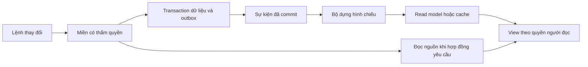

# State visibility — Khả năng quan sát và phạm vi hiển thị trạng thái nghiệp vụ

## 1. State visibility là gì?

**State visibility** mô tả trạng thái nghiệp vụ nào có thể được quan sát, bởi chủ thể nào, qua biểu diễn nào và tại thời điểm nào. Nó liên quan đồng thời đến tính bí mật, tính đúng đắn và khả năng sử dụng quy trình.

Trong chương **Domain State**, trạng thái không chỉ là chuỗi `status` trên màn hình. Nó còn gồm dữ liệu quyết định như phiên bản nội dung, quyền đang có hiệu lực, số tiền đang dành, bằng chứng phê duyệt và kết quả từ hệ thống ngoài.

Ba câu hỏi cần tách riêng:

| Trục quan sát | Câu hỏi | Ví dụ rủi ro |
| --- | --- | --- |
| Phạm vi được xem | Ai được biết đối tượng và thuộc tính nào? | Khách thấy ghi chú điều tra nội bộ hoặc trạng thái đơn của tenant khác |
| Nguồn và tính nhất quán | Biểu diễn dựa trên trạng thái nào, có cùng một ảnh chụp không? | Một phần phản hồi trước commit, phần khác sau commit |
| Độ mới và độ trễ | Trạng thái được phản ánh đến đâu, sau bao lâu? | Màn hình còn “được hủy” dù nguồn đã bắt đầu thực thi |

Sau bài học, bạn có thể:

- Phân biệt trạng thái có thẩm quyền với hình chiếu dùng để đọc và hiển thị.
- Thiết kế quyền xem theo đối tượng, thuộc tính và vai trò trong quy trình.
- Công khai trạng thái đủ trung thực mà không lộ dữ liệu nội bộ ngoài chính sách.
- Giải thích ảnh hưởng của commit, snapshot, replica, cache và xử lý bất đồng bộ.
- Giữ các lệnh thay đổi an toàn dù thông tin người dùng đang nhìn đã cũ.
- Thiết kế kiểm thử cho rò rỉ trạng thái, phản hồi trộn phiên bản và độ trễ hiển thị.

Ví dụ chính là đề nghị hoàn tiền giả định. Các trạng thái và quyền xem là lựa chọn cho bài học, không phải mô hình bắt buộc cho mọi sản phẩm.

## 2. Ví dụ: một đề nghị có nhiều góc nhìn

Giả sử đề nghị `R-807` thuộc tenant `T-01`, của khách hàng `C-25`. Miền hoàn tiền có các trạng thái nội bộ:

```text
SUBMITTED
REVIEW_REQUIRED
APPROVED
EXECUTING
OUTCOME_UNKNOWN
SUCCEEDED
REJECTED
CANCELLED
```

Trong mô hình, `SUCCEEDED` chỉ được ghi sau khi kết quả hoàn đủ điều kiện đã được xác minh. `OUTCOME_UNKNOWN` nghĩa là hệ thống chưa xác định được kết quả, không đồng nghĩa đã thất bại.

### 2.1. Trạng thái nội bộ và trạng thái công khai có thể khác nhau

| Trạng thái nội bộ | Biểu diễn cho khách trong ví dụ | Ý nghĩa công khai |
| --- | --- | --- |
| `SUBMITTED`, `REVIEW_REQUIRED` | `IN_REVIEW` | Đề nghị đang được xem xét |
| `APPROVED`, `EXECUTING`, `OUTCOME_UNKNOWN` | `PROCESSING` | Chưa có kết luận hoàn tất để công bố |
| `SUCCEEDED` | `COMPLETED` | Kết quả thành công đã được xác minh theo hợp đồng |
| `REJECTED` | `NOT_APPROVED` | Đề nghị không được chấp nhận |
| `CANCELLED` | `CANCELLED` | Đề nghị đã được hủy hợp lệ |

Ánh xạ nhiều trạng thái về một nhãn giúp cung cấp thông tin đúng mục đích. Nó không cho phép nói “đã hoàn tất” khi mới phát lệnh, hoặc nói “thất bại” chỉ vì timeout.

Nếu sản phẩm muốn công khai một số trạng thái chi tiết hơn, cần định nghĩa lại chính sách và ý nghĩa cho người nhận. Không mặc định mọi enum trong domain đều là một phần của API công khai.

### 2.2. Các actor không nhất thiết thấy cùng dữ liệu

| Actor | Có thể cần xem | Không tự có quyền xem |
| --- | --- | --- |
| Khách sở hữu đề nghị | Trạng thái công khai, số tiền và thông tin tiến trình được phép | Ghi chú điều tra, bí mật tích hợp, hồ sơ khách khác |
| Nhân viên hỗ trợ | Tiến trình và lý do đã được biên tập trong hồ sơ phụ trách | Toàn bộ chi tiết kiểm soát rủi ro hoặc mọi tenant |
| Người xem xét được phân công | Dữ liệu cần cho quyết định trong phạm vi được cấp | Hồ sơ ngoài nhiệm vụ hoặc quyền sửa lịch sử |
| Dịch vụ thực thi | Nội dung ý định, phiên bản và điều kiện để thực hiện | Tự chọn thêm dữ liệu khách hàng không cần thiết |
| Người vận hành được cấp quyền | Chẩn đoán cần cho đối soát và phục hồi | Mặc định mọi dữ liệu nhạy cảm hoặc quyền bỏ kiểm soát |

Quyền xem và quyền thay đổi cần được phân biệt. Một người được xem `APPROVED` không vì thế có quyền chuyển sang `SUCCEEDED`.

### 2.3. Biết trạng thái có thể mang giá trị tấn công

Chi tiết như lý do bị chặn, người duyệt được phân công, thời điểm một bước kiểm soát kết thúc hoặc phiên bản cấu hình có thể giúp suy đoán cách vượt quy trình. Mặt khác, giấu quá nhiều khiến người dùng không biết có nên tiếp tục hay đã hoàn tất.

Cần chọn thông tin theo mục đích và rủi ro cụ thể. Không coi một trạng thái là bí mật tuyệt đối chỉ vì đã đổi tên nó; các thuộc tính phụ và hành vi của API vẫn có thể tiết lộ điều tương tự.

## 3. Phân biệt nguồn sự thật với hình chiếu trạng thái

### 3.1. Nơi hiển thị không nhất thiết là nơi quyết định



Read model có thể tối ưu cho truy vấn và phản ánh chậm hơn nguồn ghi. Điều này là một đánh đổi thường gặp khi tách mô hình đọc/ghi; không bắt buộc dùng hai database hoặc Event Sourcing để có sự khác nhau giữa hai biểu diễn. [Nguồn: Microsoft — CQRS Pattern](https://learn.microsoft.com/en-us/azure/architecture/patterns/cqrs).

Trong ví dụ, Refund Domain quyết định đề nghị còn được hủy hay không. Một bản sao để hiển thị tiến trình không tự có quyền mở bước hủy hoặc phát lại lệnh hoàn.

### 3.2. Độ trễ hiển thị không phải quyền dùng dữ liệu cũ để ghi

Màn hình có thể còn `IN_REVIEW` trong khi nguồn đã `EXECUTING`. Nếu khách bấm hủy, phía máy chủ phải tải trạng thái có thẩm quyền và kiểm tra điều kiện hủy hiện hành.

Không tin `currentState`, `canCancel` hoặc `isApproved` do client gửi lại. Chúng là dữ liệu đầu vào, không phải chứng nhận rằng thao tác còn hợp lệ.

Ngay cả một lần đọc trực tiếp nguồn vừa thành công cũng không khóa trạng thái cho request sau. Kiểm tra và thay đổi vẫn cần cơ chế nhất quán tại điểm ghi.

### 3.3. Các mục tiêu bảo vệ cần được mô tả riêng

```text
Phạm vi đọc:
  Chỉ chủ thể được phép nhận đối tượng và thuộc tính tương ứng.

Tính trung thực:
  Biểu diễn không khẳng định một kết quả chưa có căn cứ.

Tính nhất quán:
  Các dữ liệu cần cùng được hiểu phản ánh một ảnh chụp phù hợp hợp đồng.

Điều kiện ghi:
  Lệnh thay đổi dùng dữ liệu có thẩm quyền và bảo vệ cạnh tranh,
  bất kể view client đang giữ là phiên bản nào.
```

Một nguồn đọc rất mới vẫn có thể lộ thuộc tính ngoài quyền. Một response đã lọc quyền đúng vẫn có thể nói sai rằng thanh toán đã xong. Không dùng một mục tiêu để thay thế việc kiểm tra mục tiêu khác.

## 4. Thiết kế view theo quyền đối tượng và thuộc tính

### 4.1. Được xem đối tượng chưa chắc được xem mọi field

API cần kiểm tra cả quyền với `R-807` và tập thuộc tính được công khai cho actor hiện tại. Không serialize toàn bộ entity rồi trông chờ giao diện ẩn các trường nội bộ.

OWASP API3 mô tả rủi ro khi một đối tượng bị trả ra hoặc bị sửa qua những thuộc tính mà người gọi không được phép truy cập. Cấu trúc response cần được chọn có chủ đích theo chức năng. [Nguồn: OWASP Broken Object Property Level Authorization](https://github.com/OWASP/API-Security/blob/master/editions/2023/en/0xa3-broken-object-property-level-authorization.md).

Trong ví dụ chỉ cho khách sở hữu đề nghị đọc view khách hàng. Nếu hỗ trợ đại diện hoặc tài khoản tổ chức, cần chính sách quan hệ riêng thay vì mở rộng bằng một cờ client tự khai.

### 4.2. Ví dụ Java: ánh xạ trạng thái vào DTO công khai

Đoạn mã chỉ minh họa kiểm tra phạm vi và tạo view. `VerifiedCustomer` được dựng từ ngữ cảnh đã xác thực; các định danh bắt buộc được giả định không rỗng. `RefundSnapshot` là phần trích dữ liệu cần cho việc ánh xạ, không phải request DTO để client tự tạo.

```java
import java.util.UUID;

enum InternalRefundState {
    SUBMITTED, REVIEW_REQUIRED, APPROVED, EXECUTING,
    OUTCOME_UNKNOWN, SUCCEEDED, REJECTED, CANCELLED
}

enum CustomerRefundStatus {
    IN_REVIEW, PROCESSING, COMPLETED, NOT_APPROVED, CANCELLED
}

record VerifiedCustomer(UUID tenantId, UUID customerId) {}

record RefundSnapshot(
        UUID requestId, UUID tenantId, UUID customerId,
        InternalRefundState state, long publicRevision) {}

record CustomerRefundView(
        UUID requestId, CustomerRefundStatus status, long revision) {}

final class RefundViews {
    static CustomerRefundView forCustomer(
            VerifiedCustomer viewer, RefundSnapshot source) {

        if (!viewer.tenantId().equals(source.tenantId())
                || !viewer.customerId().equals(source.customerId())) {
            throw new SecurityException("FORBIDDEN");
        }

        CustomerRefundStatus status = switch (source.state()) {
            case SUBMITTED, REVIEW_REQUIRED ->
                    CustomerRefundStatus.IN_REVIEW;
            case APPROVED, EXECUTING, OUTCOME_UNKNOWN ->
                    CustomerRefundStatus.PROCESSING;
            case SUCCEEDED -> CustomerRefundStatus.COMPLETED;
            case REJECTED -> CustomerRefundStatus.NOT_APPROVED;
            case CANCELLED -> CustomerRefundStatus.CANCELLED;
        };

        return new CustomerRefundView(
                source.requestId(), status, source.publicRevision());
    }
}
```

DTO này không có ghi chú rủi ro, raw response nhà cung cấp hoặc người duyệt nội bộ. Thêm field vào entity không tự làm field đó xuất hiện trong response này.

Lớp truy vấn vẫn cần tải đúng đối tượng, kiểm tra quyền đủ mới theo chính sách và kiểm soát cache. Đoạn mapping không tự tạo một snapshot nhất quán hay bảo đảm read model đã bắt kịp.

### 4.3. Version, timestamp và cờ hành động cũng tiết lộ thông tin

Nếu `SUBMITTED` và `REVIEW_REQUIRED` đều hiển thị `IN_REVIEW`, nhưng API trả raw `aggregateVersion` hoặc `updatedAt` mỗi lần chuyển nội bộ, client vẫn có thể nhận ra có hoạt động ẩn.

Trong ví dụ, `publicRevision` là phiên bản của biểu diễn công khai, chỉ đổi khi dữ liệu công khai được phép quan sát thay đổi. `sourceVersion` phục vụ thứ tự nội bộ được giữ riêng. Cần thiết kế projector và metadata theo quy ước đó; chỉ đổi tên một trường version không tạo được sự tách biệt.

`canCancel`, mã lỗi, ETag hoặc event ID cũng có thể làm lộ khác biệt. Nếu công khai chúng, phải đánh giá như dữ liệu nghiệp vụ. Khi dùng ETag, nó cần phù hợp biểu diễn được phép và không được dùng để trả thông tin cache trước khi kiểm tra quyền.

Không dùng `publicRevision` thay `rowVersion` để bảo vệ ghi trên aggregate: trạng thái nội bộ có thể đổi trong khi view công khai vẫn giống nhau. Lệnh ghi phải có kiểm tra trạng thái/phiên bản thích hợp của chính thao tác đó.

## 5. Trạng thái trước commit và sau commit

### 5.1. Nhìn thấy trong bộ nhớ chưa có nghĩa đã cam kết

Một phương thức có thể đặt `state = APPROVED` trên đối tượng rồi sau đó ghi database thất bại. Nếu đã gửi thông báo “đã duyệt” ra ngoài trước khi commit, người đọc có thể quan sát một trạng thái chưa từng trở thành quyết định thành công.

Trong mô hình này, trạng thái công bố là trạng thái đã được tiếp nhận bền vững theo hợp đồng. Những sự kiện làm các bên khác hành động cần xuất phát từ thay đổi đã commit hoặc cơ chế tương đương, chẳng hạn dữ liệu và outbox được lưu cùng transaction.

| Mốc | Nguồn nghiệp vụ | Read model cho khách | Điều có thể công bố |
| --- | --- | --- | --- |
| T0 | Version 20, `SUBMITTED` | `IN_REVIEW`, public revision 5 | Đang xem xét |
| T1 | Transaction đang đổi sang `APPROVED`, chưa commit | Vẫn revision 5 | Chưa khẳng định quyết định mới đã thành công |
| T2 | Commit version 21, `APPROVED` | Có thể vẫn revision 5 | Kết quả tiếp nhận từ nguồn có thể là `PROCESSING`; view có thể đang trễ |
| T3 | Version 21 | Projector áp dụng public revision 6 | `PROCESSING` |
| T4 | Version 22, `SUCCEEDED` đã xác minh | Chưa chắc đã nhận event mới | Chỉ view đã phản ánh kết quả đó mới công bố `COMPLETED` |

Không phải mọi API đều cần trả đồng bộ trạng thái mới nhất. Nhưng hợp đồng phải nói rõ nó đã chấp nhận điều gì và phần nào còn đang được xử lý.

### 5.2. Transaction không tự làm mọi lần đọc có cùng ảnh chụp

Trong PostgreSQL ở mức Read Committed, một câu `SELECT` thông thường quan sát dữ liệu đã commit theo snapshot của câu lệnh; hai `SELECT` liên tiếp trong một transaction có thể thấy các trạng thái khác nhau nếu có transaction khác commit ở giữa. Transaction cũng nhìn thấy các cập nhật trước đó của chính nó. [Nguồn: PostgreSQL Transaction Isolation](https://www.postgresql.org/docs/current/transaction-iso.html).

Giả sử code đọc tổng đã hoàn là 0, một transaction khác hoàn tất và commit số tiền cùng trạng thái, rồi code đọc tiếp `SUCCEEDED`. Ghép hai kết quả có thể tạo response “thành công nhưng đã hoàn 0” dù không có trạng thái nguồn đã commit nào như vậy.

Cần chọn truy vấn, snapshot hoặc mức cô lập phù hợp nếu các field phải được hiểu cùng nhau. Chỉ gói nhiều truy vấn vào một phương thức có tên `getStatus` chưa tạo được tính nhất quán đó.

### 5.3. Không để lỗi nội bộ vô tình công bố trạng thái tạm

Thông báo lỗi, log trả cho client, trace debug hoặc payload của event cũng có thể mang dữ liệu trong transaction. Không trả nguyên entity đang sửa hoặc raw exception chỉ vì nhánh thành công đã dùng DTO an toàn.

Thất bại trước commit phải được phản ánh đúng nghĩa. Mặt khác, mất kết nối sau commit có thể khiến client không biết kết quả; không vì client nhận lỗi mạng mà khẳng định nguồn đã rollback.

## 6. Trạng thái nhìn thấy không phải giấy phép thực hiện lệnh

### 6.1. Cờ hành động là thông tin gợi ý tại một thời điểm

API có thể trả `canCancel` để cải thiện trải nghiệm nếu chính sách công khai cho phép. Client vẫn phải coi đó là khả năng dự kiến theo view, không phải quyền giữ chỗ cho thao tác tương lai.

Các tình huống phải được xử lý gồm nhiều tab, nhiều thiết bị, nhân viên cùng xử lý, job nền thay đổi trạng thái và quyền người dùng bị thu hồi.

Lệnh hủy cần tự kiểm tra actor, tenant, quan hệ đối tượng, trạng thái và dữ liệu liên quan ở phía máy chủ. Việc nút còn hiển thị không được làm bước kiểm tra này bị bỏ qua.

### 6.2. Ví dụ điều kiện hủy ở điểm ghi

Giả sử chính sách cho khách hủy khi nguồn còn `SUBMITTED` hoặc `REVIEW_REQUIRED`; hai trạng thái này đều được phép công khai là `IN_REVIEW`. Chưa có tiền dành để thực thi ở các trạng thái này trong mô hình.

Mảnh SQL minh họa sau nằm trong thao tác đã tải đối tượng và kiểm tra quyền cần thiết:

```sql
UPDATE refund_request
SET state = 'CANCELLED',
    row_version = row_version + 1,
    public_revision = public_revision + 1
WHERE tenant_id = :trusted_tenant_id
  AND id = :request_id
  AND customer_id = :authenticated_customer_id
  AND state IN ('SUBMITTED', 'REVIEW_REQUIRED')
  AND row_version = :loaded_row_version;
```

`loaded_row_version` là phiên bản máy chủ vừa tải theo giao thức điều phối, không nhất thiết được công khai cho client. Khi dùng cách này, kiểm tra và lưu còn phải phối hợp với những đường ghi khác.

Chỉ báo hủy thành công khi số dòng và commit đáp ứng hợp đồng. Nếu bước khác đã chuyển nguồn sang `EXECUTING`, không dùng `force=true` hoặc bỏ điều kiện để làm theo màn hình cũ.

Bằng chứng hủy và outbox liên quan cần được lưu nhất quán. Nếu chính sách cho hủy ở trạng thái đã dành tiền, phải bổ sung việc giải phóng ngân sách an toàn; câu SQL trên không đại diện cho trường hợp đó.

### 6.3. Phiên bản nội dung và phiên bản hiển thị có mục đích khác nhau

Khi người duyệt phải xác nhận đúng số tiền hoặc người hưởng đã xem, lệnh có thể gắn `expectedContentVersion` với nội dung trọng yếu được phép hiển thị. Máy chủ so sánh với nguồn trước khi quyết định.

Không tự thay version cũ bằng version mới rồi thử lại quyết định thay người dùng. Cũng không dùng public revision của một nhãn tiến trình để suy ra số tiền hoặc mọi điều kiện nội bộ vẫn giữ nguyên.

Một view mới từ nguồn không loại bỏ khoảng đua trước bước ghi. Ngăn quyết định sai vẫn cần tiền điều kiện và cập nhật nguyên tử hoặc cơ chế đồng bộ tương ứng.

## 7. Giúp người dùng quan sát thay đổi của chính mình

### 7.1. Sau lệnh ghi, đọc bản sao cũ không có nghĩa lệnh thất bại

Khách vừa gửi yêu cầu thành công có thể được điều hướng về trang danh sách còn dữ liệu cũ. Nếu giao diện hiểu điều đó là “chưa gửi” rồi tạo yêu cầu mới, độ trễ đọc đã trở thành nguồn request trùng.

Một receipt có thể diễn đạt:

```json
{
  "operationId": "OP-321",
  "requestId": "R-807",
  "acceptance": "ACCEPTED",
  "status": "PROCESSING"
}
```

`ACCEPTED` nói về việc tiếp nhận thao tác theo hợp đồng. `PROCESSING` không nói rằng tiền đã đến người nhận. Định danh operation giúp tra cứu hoặc retry cùng ý định mà không tạo một công việc mới tùy tiện.

### 7.2. Các lựa chọn để đọc sau ghi

| Cách làm | Giá trị | Điều phải giữ |
| --- | --- | --- |
| Trả view được phép từ kết quả đã commit | Người gọi thấy ngay thay đổi vừa được chấp nhận | Không công khai entity hoặc trạng thái trước commit |
| Đọc nguồn có thẩm quyền trong một khoảng/luồng được chọn | Giảm khoảng trống ngay sau thay đổi | Vẫn kiểm tra quyền và chi phí truy vấn |
| Chờ read model đạt checkpoint cần thiết trong thời gian hữu hạn | Giữ mô hình đọc riêng mà hỗ trợ tiến trình đã biết | Checkpoint phải có nghĩa, timeout phải trung thực |
| Hiển thị receipt và trạng thái đang đồng bộ | Người dùng biết hệ thống đã nhận nhưng view chưa bắt kịp | Không biến receipt thành kết quả nghiệp vụ cuối cùng |

Không cần áp dụng mọi phương án. Cần chọn theo yêu cầu độ mới, tải và khả năng của kiến trúc.

### 7.3. Token/checkpoint không được trở thành quyền đọc

Nếu trả một tham chiếu đọc-sau-ghi, cần ràng buộc nó với đúng nguồn, đối tượng và ngữ cảnh theo thiết kế. Nó không thay thế xác thực hoặc quyền truy cập.

Không tin một số version tương lai bất kỳ do client gửi rồi chờ vô hạn cho đến khi đạt. Cần kiểm tra phạm vi, giới hạn thời gian chờ và tài nguyên để cơ chế bảo đảm độ mới không trở thành nguồn gây quá tải.

Nếu việc công khai version nội bộ làm lộ hoạt động ngoài chính sách, có thể dùng tham chiếu opaque do máy chủ quản lý. Bản thân tham chiếu vẫn cần được kiểm soát khi tra cứu và không được coi như quyền truy cập ngầm.

### 7.4. Thời gian phục vụ không phải bằng chứng dữ liệu mới

`servedAt` có thể chỉ nói lúc response được trả. `projectedAt` có thể chỉ nói lúc worker xử lý một sự kiện cũ. Cả hai không tự chứng minh view đã bắt kịp nguồn.

Nếu công khai metadata độ mới, phải mô tả nó đo điều gì: phiên bản nguồn đã áp dụng, mốc dữ liệu hoặc độ trễ được quan sát. Một timestamp có tên `updatedAt` nhưng không có semantics rõ có thể làm người dùng tin nhầm vào trạng thái.

## 8. Projector phải giữ đúng thứ tự và ý nghĩa của view

### 8.1. Phân biệt phiên bản nguồn và phiên bản công khai

Một bản ghi projection có thể lưu nội bộ:

```text
aggregateKey = (tenantId, requestId)
lastAppliedSourceVersion
customerPublicRevision
customerPublicPayload
```

`lastAppliedSourceVersion` phục vụ xử lý sự kiện theo bảo đảm của nguồn. `customerPublicRevision` phục vụ biểu diễn được phép. Không tự gửi toàn bộ metadata nội bộ ra client.

Nếu nguồn có phiên bản tăng theo từng aggregate, worker có thể dùng chúng để nhận diện trùng/cũ theo giao thức. Không lấy thời gian nhận event hoặc timestamp đơn thuần làm thứ tự tuyệt đối.

### 8.2. Snapshot và delta cần xử lý khác nhau

Giả sử full snapshot version 22 đã được áp dụng rồi version 21 mới đến. Nếu hợp đồng snapshot đầy đủ và phiên bản nguồn cho phép, có thể bỏ snapshot cũ để tránh lùi view.

Với delta, bỏ một sự kiện ở giữa có thể làm mất thay đổi cần thiết. Cần phát hiện gap, lấy phần thiếu hoặc dựng lại từ snapshot/nguồn phù hợp; không mặc định “cứ lấy version lớn nhất” luôn đủ.

Việc lưu payload projection và version đã áp dụng cần nhất quán. Nếu ghi checkpoint trước rồi crash trước payload, worker có thể bỏ qua công việc chưa thực sự phản ánh lên view.

### 8.3. Trạng thái không luôn có một thứ hạng chỉ tăng

Một quy trình có thể hợp lệ quay lại xem xét hoặc mở lại sau quyết định mới. Nếu projector luôn chọn nhãn có thứ hạng cao nhất, nó có thể giữ `COMPLETED` hoặc `NOT_APPROVED` sai dù nguồn đã có bước chuyển hợp lệ mới.

Thứ tự nguồn và máy trạng thái có thẩm quyền quyết định điều gì là mới, không phải vị trí enum. Khả năng sửa sai hoặc rút lại thông báo từ bên ngoài cũng cần được biểu diễn ở miền trước khi dựng view.

### 8.4. Projection không tự có quyền mở bước nghiệp vụ

Nhận một event để hiển thị không có nghĩa projector được cấp lại quyền hoàn, giải phóng ngân sách hoặc phát lệnh bên ngoài. Những việc đó thuộc luồng quyết định khác, với chống trùng và điều kiện riêng.

Replay để dựng lại view phải không làm lặp tác dụng nghiệp vụ. Nếu một consumer vừa cập nhật màn hình vừa phát tiền, cần tách hoặc kiểm soát rõ các trách nhiệm trước khi hỗ trợ replay.
