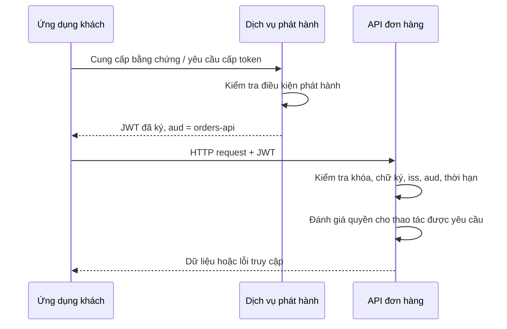

# JWT là gì và bài toán biểu diễn thông tin giữa các bên

## 1. Bối cảnh: khi một bên cần chuyển thông tin đáng tin cậy cho bên khác

Hãy hình dung một hệ thống có **dịch vụ danh tính**, **API đơn hàng** và **ứng dụng khách**. Người dùng đăng nhập với dịch vụ danh tính, sau đó ứng dụng khách gọi API đơn hàng. API cần biết:

- Yêu cầu đang gắn với chủ thể nào?
- Ai đưa ra khẳng định về chủ thể đó, và API có tin bên ấy không?
- Thông tin được phép dùng cho API nào, trong khoảng thời gian nào?
- Thông tin có bị sửa trong lúc chuyển qua ứng dụng khách hoặc mạng không?

Nếu chỉ gửi một đối tượng JSON như sau, API có thể đọc được nhưng **không có cơ sở để tin** nội dung:

```json
{
  "userId": "account-42",
  "role": "admin"
}
```

Bất kỳ bên nào kiểm soát yêu cầu cũng có thể thay `role` thành `admin`. Ngược lại, nếu mọi API đều phải gọi ngược về dịch vụ danh tính để hỏi từng thuộc tính trong mỗi yêu cầu, hệ thống sẽ phụ thuộc vào kết nối, độ trễ và khả năng sẵn sàng của dịch vụ đó.

**JSON Web Token (JWT)** cung cấp một cách **biểu diễn tập hợp các khẳng định (claims)** bằng JSON để chuyển giữa các bên, kèm cơ chế bảo vệ phù hợp như chữ ký số hoặc mã hóa. JWT đặc biệt hữu ích khi bên nhận cần kiểm tra một khẳng định đã được bên phát hành đưa ra mà không phải truy vấn bên phát hành ở mọi lần sử dụng.

Điểm cốt lõi: **JWT là định dạng token chứa claims; nó không tự định nghĩa quá trình đăng nhập, chính sách phân quyền hay giao thức trao đổi token.**

## 2. JWT là gì?

JWT được đặc tả trong [RFC 7519](https://www.rfc-editor.org/rfc/rfc7519). Một JWT mang theo một **JWT Claims Set** — đối tượng JSON chứa những thông tin mà bên phát hành muốn bên nhận xem xét. Ví dụ: mã định danh chủ thể, bên phát hành, bên nhận dự kiến, thời điểm hết hạn hoặc phạm vi quyền được cấp.

Trong thực tế, hai cách bảo vệ JWT thường gặp là:

| Cách biểu diễn | Cơ chế | Điều bên nhận có thể kiểm tra hoặc nhận được |
| --- | --- | --- |
| **JWT dưới dạng JWS** (JSON Web Signature) | Ký hoặc xác thực mật mã nội dung | Tính toàn vẹn và nguồn phát hành theo khóa được tin cậy; **payload vẫn đọc được** |
| **JWT dưới dạng JWE** (JSON Web Encryption) | Mã hóa nội dung | Tính bí mật của nội dung đối với bên không có khả năng giải mã; có thêm bảo vệ toàn vẹn của cơ chế mã hóa được chọn |

Một JWT có thể được lồng dạng ký rồi mã hóa khi cả hai thuộc tính đều cần thiết. Chuẩn JWT cũng mô tả dạng không bảo vệ bằng chữ ký (`alg: none`), nhưng **không nên chấp nhận dạng đó để đưa ra quyết định bảo mật**.

Trong các ví dụ dưới đây, “JWT” chủ yếu nói đến **JWT được ký dưới dạng JWS Compact Serialization** — dạng rất thường thấy trong HTTP API.

### Ba phần của JWT được ký

Một JWS dạng compact thường có hình thức:

```text
BASE64URL(header).BASE64URL(payload).BASE64URL(signature)
```

Ba đoạn được phân tách bằng dấu chấm (`.`):

1. **Header**: metadata phục vụ việc xử lý token, chẳng hạn thuật toán `alg`, kiểu `typ`, mã khóa `kid`.
2. **Payload**: tập hợp claims mô tả chủ thể và ngữ cảnh sử dụng.
3. **Signature**: kết quả ký hoặc xác thực mật mã trên hai đoạn được mã hóa phía trước theo thuật toán được chỉ định và chính sách đã cấu hình.

`Base64url` chỉ là cách biểu diễn dữ liệu dưới dạng ký tự phù hợp với URL; **nó không mã hóa bí mật nội dung**. Người cầm JWT dạng JWS có thể giải mã hai đoạn đầu để xem header và payload mà không cần khóa.

Ví dụ sau là **các thành phần JSON minh họa**, không phải một token đã được tạo chữ ký hợp lệ:

**Header**

```json
{
  "alg": "RS256",
  "typ": "JWT",
  "kid": "signing-key-01"
}
```

**Payload**

```json
{
  "iss": "https://identity.example.org",
  "sub": "account-42",
  "aud": "orders-api",
  "iat": 1893456000,
  "nbf": 1893456000,
  "exp": 1893456900,
  "scope": "orders:read"
}
```

Trong ví dụ này, bên phát hành khẳng định rằng token liên quan đến `account-42`, dành cho `orders-api`, có phạm vi `orders:read` và có cửa sổ hiệu lực dự kiến 15 phút. Các mốc thời gian minh họa là **Unix timestamp tính theo giây**. `RS256` chỉ là thuật toán được khai báo trong ví dụ; phía nhận chỉ chấp nhận thuật toán và khóa đã được cấu hình là hợp lệ.

Một **JWE dạng compact** có **năm phần**, không phải ba phần như JWS: protected header, encrypted key, initialization vector, ciphertext và authentication tag. Vì vậy, quy tắc “JWT luôn có ba phần” chỉ đúng với dạng JWS compact phổ biến, không đúng cho mọi JWT.

## 3. JWT giải quyết bài toán nào?

### 3.1. Chuẩn hóa cách nói về một chủ thể hoặc sự kiện

Các bên có thể thống nhất tên và ý nghĩa của claims như `iss`, `sub`, `aud`, `exp` mà không phải phát minh định dạng riêng cho từng kết nối. Bên phát hành vẫn có thể bổ sung claims dành riêng cho nghiệp vụ theo hợp đồng giữa các bên.

JWT giải quyết **cách biểu diễn và mang theo** các khẳng định; ý nghĩa cụ thể của claim nghiệp vụ vẫn cần được hai bên thỏa thuận. Chẳng hạn, `role: "manager"` không có ý nghĩa phân quyền chung cho mọi hệ thống.

### 3.2. Phát hiện việc sửa đổi thông tin trên đường truyền

Với JWS được cấu hình đúng, bên nhận xác minh chữ ký bằng khóa tương ứng với **bên phát hành đáng tin cậy**. Nếu payload bị sửa sau khi ký, phép xác minh sẽ thất bại. Nhờ đó, ứng dụng khách có thể **chuyển tiếp** token mà không được tự ý thay đổi claims.

Tuy vậy, **chữ ký hợp lệ không bảo đảm nội dung luôn đúng trong thực tế**. Nó chỉ cho biết dữ liệu được bảo vệ phù hợp với khóa xác minh. Bên nhận vẫn phải đánh giá bên phát hành có được tin cậy không, token còn hiệu lực không, token có dành cho mình không, và chính sách hiện tại có cho phép thao tác không.

### 3.3. Cho phép xác minh cục bộ trong một hệ thống phân tán

Ví dụ, dịch vụ danh tính ký JWT bằng khóa riêng; API đơn hàng đã cấu hình khóa công khai hợp lệ có thể kiểm tra chữ ký ngay tại API. Trong trường hợp này, API không nhất thiết phải gọi dịch vụ danh tính ở mỗi yêu cầu.

Khả năng đó có thể giảm số lần truy vấn mạng và giảm phụ thuộc vận hành, nhưng **không mặc nhiên tạo ra hệ thống hoàn toàn không trạng thái**. Thu hồi token trước hạn, cập nhật quyền tức thời, quản lý khóa, phát hiện phát lại hoặc giới hạn phiên có thể vẫn cần lưu trạng thái hay tra cứu tập trung.

### 3.4. Gắn một khẳng định với đúng ngữ cảnh sử dụng

JWT có thể chứa bên phát hành (`iss`), bên nhận dự kiến (`aud`) và thời hạn (`exp`). Chúng giúp tránh việc một token hợp lệ ở nơi này bị dùng nhầm tại nơi khác.

Ví dụ, JWT có `aud: "orders-api"` phải bị API thanh toán từ chối nếu API thanh toán yêu cầu audience khác, dù chữ ký vẫn hợp lệ. **Hợp lệ về chữ ký chưa đủ để được chấp nhận trong một ngữ cảnh.**

## 4. Các bên tham gia và luồng sử dụng điển hình

Ba vai trò cơ bản:

- **Issuer (bên phát hành)**: tạo claims và phát hành JWT; phải có cơ sở đáng tin cậy để đưa ra những khẳng định đó.
- **Holder / Client (bên giữ và chuyển token)**: nhận token, lưu giữ phù hợp và chuyển cho bên nhận khi cần. Bên giữ token không nhất thiết là chủ thể được mô tả trong `sub`.
- **Recipient / Verifier (bên nhận và xác minh)**: quyết định có tin issuer không; kiểm tra chữ ký hoặc giải mã theo cấu hình, đánh giá claims và áp dụng chính sách của mình.



Một cách gửi access token qua HTTP thường gặp là:

```http
GET /orders HTTP/1.1
Host: api.example.org
Authorization: Bearer <access-token>
```

Đây chỉ là **cách sử dụng có thể có**: JWT không bắt buộc phải được truyền trong header `Authorization`, và **không phải mọi bearer access token đều là JWT**. Giao thức cấp, truyền, làm mới token (ví dụ OAuth 2.0 hoặc OpenID Connect trong các trường hợp tương ứng) được định nghĩa riêng.

Trong mô hình *bearer*, bên nào có token hợp lệ thường có thể sử dụng nó trong phạm vi được cấp. Vì vậy, ngoài xác minh token, việc bảo vệ token khỏi bị đánh cắp là yêu cầu quan trọng.

## 5. Hiểu đúng ý nghĩa của các claims

Theo RFC 7519, có nhóm tên claim được đăng ký (*registered claims*). **Chuẩn không bắt buộc mọi JWT phải có tất cả các claim này**; bên nhận phải quy định rõ claim nào bắt buộc trong ngữ cảnh ứng dụng.

| Claim | Ý nghĩa | Điểm cần lưu ý khi sử dụng |
| --- | --- | --- |
| `iss` | Issuer: bên phát hành | So khớp với issuer tin cậy đã cấu hình, không chỉ đọc để hiển thị |
| `sub` | Subject: chủ thể được nhắc đến | Là định danh trong ngữ cảnh issuer; không mặc định là email hay tên đăng nhập |
| `aud` | Audience: bên nhận dự kiến | Bên nhận phải kiểm tra mình thuộc audience được cho phép; có thể là chuỗi hoặc mảng |
| `exp` | Expiration Time: mốc hết hạn | Không chấp nhận sau khi hết hạn; cần xử lý đồng hồ lệch trong giới hạn cho phép |
| `nbf` | Not Before: mốc bắt đầu hiệu lực | Không chấp nhận trước thời điểm này |
| `iat` | Issued At: thời điểm phát hành | Có thể dùng để đánh giá tuổi token; không thay thế `exp` |
| `jti` | JWT ID: mã định danh token | Hỗ trợ nhận diện token, chống phát lại hoặc thu hồi nếu hệ thống duy trì dữ liệu phù hợp |

`exp`, `nbf`, `iat` sử dụng kiểu **NumericDate**, thường là số giây tính từ Unix epoch, không phải chuỗi ngày tự do hay mili giây. Cách diễn giải cần theo chuẩn và hợp đồng ứng dụng.

Ngoài ra còn có **public claims** và **private claims**. Ví dụ:

- `scope: "orders:read"` là một quy ước có thể xuất hiện trong token truy cập, nhưng **không phải registered claim của JWT cốt lõi**.
- `department`, `tenant_id`, `roles` có thể là claims theo thỏa thuận riêng; định dạng, ý nghĩa và quyền tin cậy phải được quy định rõ.

Không thể kết luận một tài khoản được phép xóa đơn hàng chỉ vì JWT có claim `role`. API vẫn phải đối chiếu claim với chính sách, tài nguyên và thao tác cụ thể.

## 6. Điều gì khiến một JWT được chấp nhận?

Một lỗi tư duy phổ biến là: “Giải mã thấy JSON hợp lệ thì tin được”. **Giải mã, xác minh chữ ký và cấp quyền là ba công việc khác nhau.**

Ví dụ, để một API chấp nhận JWT **đã ký** làm access token, quá trình kiểm tra thường gồm:

1. **Định dạng và loại token**: parse có giới hạn, kiểm tra token đúng kiểu dự kiến; không dùng nhầm ID token hoặc loại JWT khác cho API.
2. **Issuer và khóa đáng tin cậy**: chỉ dùng tập issuer/khóa đã cấu hình hoặc được lấy theo cơ chế phân phối khóa đáng tin cậy. Trường `kid` chỉ gợi ý chọn khóa trong tập hợp đó, **không tự tạo ra sự tin cậy**.
3. **Thuật toán và chữ ký**: chỉ chấp nhận thuật toán phù hợp chính sách phía nhận; xác minh chữ ký với khóa tương ứng. Không mặc nhiên tin `alg` do token tự khai báo.
4. **Ngữ cảnh nhận**: so khớp `iss`, `aud` và các ràng buộc khác; token dành cho API A không mặc nhiên dùng được ở API B.
5. **Thời gian**: kiểm tra `exp`, `nbf` và những ràng buộc về `iat` nếu có; chỉ cho phép sai lệch đồng hồ nhỏ, được xác định rõ.
6. **Quy tắc ứng dụng**: kiểm tra claims bắt buộc, kiểu dữ liệu, phạm vi quyền, tình trạng tài khoản/tài nguyên và quy tắc thu hồi nếu có.

Đây là mô tả nguyên tắc; chi tiết phụ thuộc hồ sơ token và giao thức của từng hệ thống. Các thư viện JWT đã được kiểm chứng có thể thực hiện nhiều phép kiểm tra kỹ thuật, nhưng **cấu hình mức tin cậy và chính sách sử dụng token vẫn thuộc trách nhiệm của hệ thống**.

### Phân biệt bốn khái niệm

| Khái niệm | Câu hỏi được trả lời | JWT đóng vai trò gì? |
| --- | --- | --- |
| **Xác thực (authentication)** | Ai đang chứng minh danh tính, bằng cách nào? | Có thể mang kết quả xác thực đã được issuer khẳng định; không tự thực hiện bước đăng nhập |
| **Xác minh token (token validation)** | Token có đáng tin trong bối cảnh này không? | Chữ ký, issuer, audience, thời hạn và các ràng buộc được kiểm tra |
| **Ủy quyền (authorization)** | Chủ thể được thực hiện thao tác nào? | Claims có thể là đầu vào cho chính sách; không tự đưa ra toàn bộ quyết định |
| **Mã hóa (encryption)** | Ai đọc được nội dung? | JWT dạng JWE có thể bảo vệ tính bí mật; JWS thông thường thì không |

## 7. Ví dụ xuyên suốt: API đơn hàng và API thanh toán

Một tổ chức có dịch vụ phát hành token dùng chung và hai API: `orders-api` và `payments-api`.

**Bước 1 — Phát hành.** Sau khi kiểm tra điều kiện cấp quyền, issuer tạo JWT đã ký với `sub: "account-42"`, `aud: "orders-api"`, `scope: "orders:read"`, thời hạn ngắn.

**Bước 2 — Gọi API đơn hàng.** Ứng dụng khách gửi JWT đến `orders-api`. API kiểm tra issuer, chữ ký, thời hạn và audience, rồi chỉ cho phép các thao tác đọc đơn hàng phù hợp với chính sách và dữ liệu nghiệp vụ. API có thể xác minh JWT tại chỗ nếu đã có khóa đáng tin cậy.

**Bước 3 — Thử dùng cùng token tại API thanh toán.** `payments-api` từ chối token vì `aud` không dành cho mình. Việc token do cùng issuer ký **không** biến nó thành giấy phép dùng trên mọi API.

**Bước 4 — Quyền thay đổi trước khi token hết hạn.** Nếu tài khoản bị khóa hoặc quyền đọc đơn hàng bị gỡ, JWT đã phát hành có thể vẫn vượt qua các phép kiểm tra chữ ký và thời gian. Để phản ánh thay đổi ngay lập tức, hệ thống phải có biện pháp bổ sung như kiểm tra trạng thái, danh sách thu hồi, thay đổi khóa trong trường hợp phù hợp hoặc thiết kế thời gian sống ngắn.

Ví dụ này cho thấy giá trị chính của JWT là **mang các khẳng định có thể xác minh tới đúng bên nhận**; độ mới của trạng thái và chính sách nghiệp vụ là vấn đề khác.

## 8. JWT so với token định danh phiên hoặc token opaque

JWT không phải lời giải phù hợp cho mọi hệ thống. Một **opaque token** chỉ là giá trị tham chiếu mà bên nhận không tự diễn giải được; hệ thống phải tra cứu thông tin liên quan (hoặc dùng cơ chế introspection) khi cần.

| Tiêu chí | JWT đã ký chứa claims | Opaque token / mã phiên tham chiếu |
| --- | --- | --- |
| Thông tin trong token | Bên giữ thường đọc được claims | Token tự nó không bộc lộ nội dung nghiệp vụ |
| Kiểm tra nội dung | Có thể xác minh cục bộ nếu có khóa tin cậy | Thường cần truy vấn kho phiên/dịch vụ tra cứu |
| Dữ liệu quyền thay đổi | Claims có thể lỗi thời đến khi hết hạn hoặc được kiểm tra thêm | Có thể lấy trạng thái hiện tại từ nơi lưu trữ |
| Thu hồi trước hạn | Cần chiến lược bổ sung nếu muốn hiệu lực tức thì | Có thể vô hiệu hóa tham chiếu tại nơi tra cứu |
| Chi phí truyền | Token có nhiều claims thường dài hơn | Mã tham chiếu thường ngắn |
| Phụ thuộc vận hành | Cần vòng đời khóa và quy tắc kiểm tra chặt chẽ | Cần độ sẵn sàng của kho tra cứu hoặc dịch vụ xác minh |

JWT phù hợp khi cần một **tập claims có thể chuyển tiếp và xác minh giữa những bên đã thiết lập quan hệ tin cậy**. Opaque token hoặc phiên phía máy chủ có thể phù hợp hơn khi cần kiểm soát tập trung, thu hồi tức thì hoặc hạn chế lộ metadata. Hai kiểu cũng có thể cùng tồn tại trong một kiến trúc.

## 9. Những giới hạn và rủi ro cần hiểu từ đầu

### JWT được ký không che giấu dữ liệu

Đừng đưa mật khẩu, mã bí mật, dữ liệu cá nhân không cần thiết hoặc thông tin nhạy cảm vào payload chỉ vì token “đã ký”. Với JWS compact, bất kỳ ai nhận token đều có thể giải mã phần payload. Dùng JWE khi thực sự cần bảo mật nội dung giữa các bên hỗ trợ, đồng thời vẫn phải giảm lượng dữ liệu trong token.

### Chữ ký không ngăn token bị đánh cắp và dùng lại

Một access token kiểu bearer có thể bị dùng lại bởi bất kỳ ai chiếm được nó cho đến khi bị từ chối bởi chính sách, hết hạn hoặc thu hồi. Cần bảo vệ đường truyền bằng HTTPS/TLS, giảm phạm vi và thời gian sống, bảo vệ nơi lưu token và tránh ghi token nguyên văn vào log hoặc URL.

### Không phải token hợp lệ nào cũng đúng mục đích

Một JWT được phát hành để định danh người dùng (*ID token*) có thể có cấu trúc và chữ ký hợp lệ nhưng không tự nhiên trở thành access token cho API. Bên nhận phải kiểm tra **loại, issuer, audience và hợp đồng sử dụng** để tránh nhầm lẫn giữa các loại token.

### Token tự chứa không đồng nghĩa quyền luôn mới

Nếu cấp token có `roles` tại thời điểm T, việc đổi quyền ở T+1 không tự sửa được những token đã cấp. Thời hạn ngắn, kiểm tra trạng thái hiện tại, introspection hoặc danh sách thu hồi là các lựa chọn tùy yêu cầu nghiệp vụ và mức rủi ro.

### Quản lý khóa là một phần của quan hệ tin cậy

Các bên cần quy trình cấp phát, lưu giữ, luân chuyển và ngừng tin cậy khóa phù hợp. Khi dùng chữ ký bất đối xứng, issuer giữ **khóa riêng**; verifier chỉ cần **khóa công khai** để xác minh. Với MAC đối xứng như HS256, các bên có thể xác minh đều phải biết bí mật chung, nên không có cùng ranh giới tách biệt như chữ ký bất đối xứng.

Không nên suy ra khóa tin cậy từ URL hoặc metadata tùy ý trong token; chỉ sử dụng nguồn khóa được cấu hình và kiểm soát. Tham số `kid` là định danh lựa chọn khóa, không phải bằng chứng độc lập.

## 10. Checklist tư duy khi thiết kế trao đổi JWT

Trước khi chọn JWT làm cách biểu diễn thông tin giữa các bên, hãy trả lời:

1. **Ai phát hành?** Issuer nào được phép khẳng định điều gì, và bên nhận thiết lập tin cậy với issuer ra sao?
2. **Ai nhận?** Mỗi API kiểm tra `aud`, loại token và mục đích sử dụng thế nào?
3. **Tin điều gì?** Claims nào bắt buộc, ý nghĩa từng claim là gì, có cần đối chiếu trạng thái hiện tại không?
4. **Tin trong bao lâu?** Token sống bao lâu, có cơ chế thu hồi hay xử lý quyền thay đổi không?
5. **Ai có thể đọc hoặc sử dụng?** Dùng JWS hay JWE, bảo vệ bearer token ra sao, có đưa dữ liệu không cần thiết vào payload không?
6. **Kiểm tra bằng gì?** Chính sách thuật toán, nguồn khóa, luân chuyển khóa, kiểm tra chữ ký và xử lý thời gian được xác định thế nào?

**Kết luận:** JWT giải quyết bài toán **đóng gói và trao đổi các khẳng định theo định dạng chuẩn giữa những bên có quan hệ tin cậy**. Với chữ ký phù hợp, bên nhận có thể xác minh tính toàn vẹn và nguồn phát hành của claims; với mã hóa phù hợp, có thể bảo vệ tính bí mật. Nhưng JWT không tự thay thế xác thực danh tính, phân quyền, quản lý phiên hay cơ chế thu hồi.

## Tài liệu chuẩn để đọc tiếp

- [RFC 7519 — JSON Web Token (JWT)](https://www.rfc-editor.org/rfc/rfc7519): khái niệm và các registered claims.
- [RFC 7515 — JSON Web Signature (JWS)](https://www.rfc-editor.org/rfc/rfc7515): chữ ký/MAC và compact serialization.
- [RFC 7516 — JSON Web Encryption (JWE)](https://www.rfc-editor.org/rfc/rfc7516): mã hóa và compact serialization.
- [RFC 8725 — JSON Web Token Best Current Practices](https://www.rfc-editor.org/rfc/rfc8725): thực hành bảo mật, giới hạn thuật toán và chống nhầm lẫn ngữ cảnh token.
