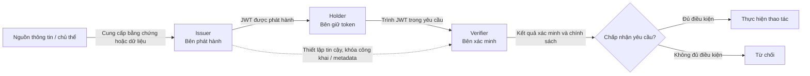
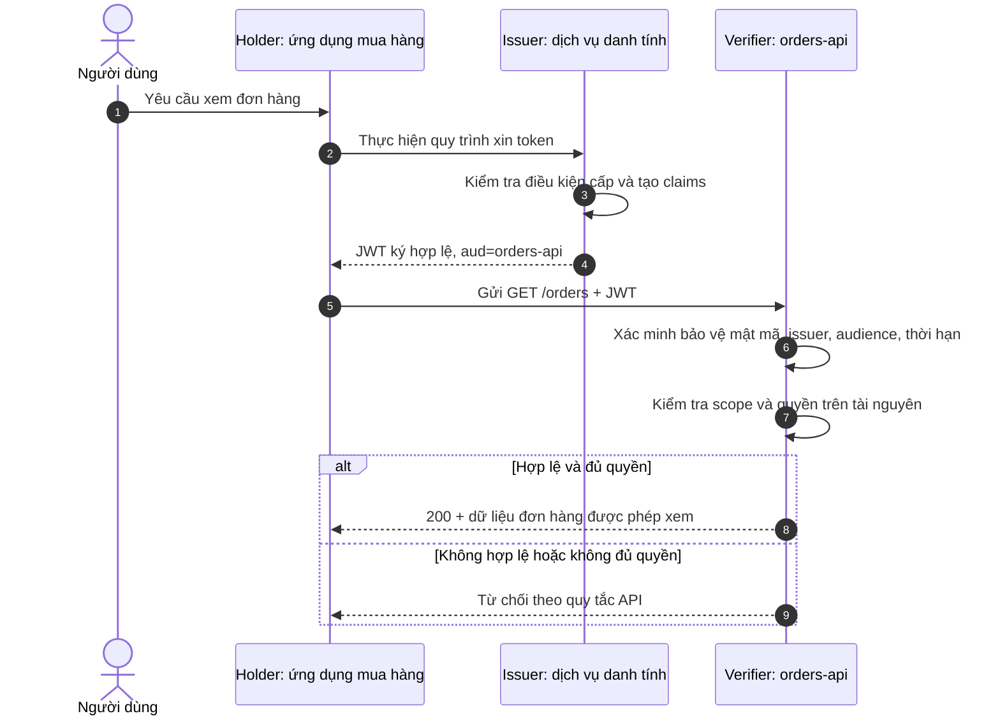

# Vai trò của bên phát hành, bên giữ token và bên xác minh

## 1. Vì sao phải phân biệt ba vai trò?

Trong hệ thống sử dụng **JSON Web Token (JWT)**, cùng một chuỗi token có thể đi qua nhiều thành phần nhưng mỗi thành phần có **quyền hạn, trách nhiệm và mức độ tin cậy khác nhau**. Chẳng hạn, dịch vụ danh tính phát hành token, ứng dụng khách giữ token và API đơn hàng kiểm tra token trước khi xử lý yêu cầu. Nếu không phân biệt các vai trò, hệ thống dễ mắc lỗi như cho phép ứng dụng khách tự khai quyền, chỉ giải mã token mà bỏ qua xác minh, hoặc chấp nhận token vốn được cấp cho API khác.

Ba vai trò cần hiểu là:

1. **Issuer — bên phát hành:** tạo các khẳng định (*claims*) và phát hành JWT theo chính sách.
2. **Holder — bên giữ token:** nhận, lưu giữ và trình token cho nơi sử dụng; thường là ứng dụng khách hoặc một dịch vụ gọi API khác.
3. **Verifier — bên xác minh:** tiếp nhận JWT, đánh giá độ tin cậy và tính hợp lệ của token trước khi dùng claims cho mục đích cụ thể.

Vai trò là **chức năng trong một tương tác**, không nhất thiết là ba máy chủ hay ba tổ chức độc lập. Một dịch vụ có thể vừa xác minh token đến vừa phát hành token mới cho một tương tác khác. Ngược lại, một issuer có thể cấp token cho nhiều holder và nhiều verifier.

Trong phạm vi **Security - JSON Web Token (JWT)**, bài này phân tích các quan hệ tin cậy giữa ba vai trò một cách độc lập với ngôn ngữ lập trình, nền tảng và framework.

## 2. Bức tranh tổng thể



Hai đường quan hệ cần tách biệt:

- **Đường truyền token:** issuer → holder → verifier. Holder có thể chuyển tiếp nội dung JWT mà không có quyền sửa các claims đã được ký.
- **Quan hệ tin cậy:** issuer ↔ verifier, được thiết lập bằng cấu hình về issuer, thuật toán, khóa, đối tượng nhận, loại token và quy tắc chấp nhận claims. Việc verifier *nhận được* JWT từ holder **không có nghĩa** verifier nên tin holder hoặc token ấy.

JWT thường chứa `iss` (*issuer*), `sub` (*subject*) và `aud` (*audience*). Ba claim này **không đồng nghĩa** ba vai trò:

| Khái niệm | Ý nghĩa | Ví dụ |
| --- | --- | --- |
| **Issuer** | Thực thể phát hành, đưa ra các khẳng định | `https://identity.example.org` |
| **Holder** | Thực thể đang sở hữu và trình token | Ứng dụng di động gọi API |
| **Verifier** | Thực thể kiểm tra token để quyết định sử dụng claims | API đơn hàng |
| **Subject (`sub`)** | Chủ thể mà các claims liên quan đến | `account-42` |
| **Audience (`aud`)** | Đối tượng sử dụng token được dự kiến | `orders-api` |

Holder có thể đại diện cho subject nhưng không mặc định là subject. Một dịch vụ trung gian có thể giữ token thay người dùng; một workload có thể giữ token được cấp cho chính workload đó. Audience xác định nơi token được sử dụng, còn verifier là thành phần cụ thể thực hiện kiểm tra; trong hệ thống phân tán có thể có nhiều instance verifier phục vụ cùng một audience.

## 3. Issuer: bên phát hành chịu trách nhiệm khẳng định điều gì?

### 3.1. Nguồn gốc của một JWT đáng tin cậy

Issuer là bên quyết định **có cấp token hay không**, token được cấp cho **ai**, nhằm **mục đích nào**, **trong bao lâu** và **mang theo những claims nào**. Tùy hệ thống, issuer có thể là dịch vụ danh tính, máy chủ ủy quyền, hệ thống chứng thực giữa các doanh nghiệp hoặc một dịch vụ nội bộ được giao trách nhiệm phát hành.

Quy trình phát hành điển hình:

1. Nhận yêu cầu cấp token hoặc tín hiệu từ một quy trình đáng tin cậy.
2. Kiểm tra điều kiện cấp: danh tính, thông tin xác thực, quyền truy cập hay kết quả đánh giá được ủy quyền, tùy giao thức.
3. Chọn claims phản ánh **đúng những gì issuer có thẩm quyền khẳng định**.
4. Ràng buộc token với issuer, đối tượng nhận, mục đích và thời hạn.
5. Ký JWT bằng khóa phù hợp, hoặc dùng JWE nếu trường hợp sử dụng yêu cầu mã hóa; có thể kết hợp ký và mã hóa.
6. Gửi token cho holder thông qua kênh được bảo vệ.

Ví dụ phần claims của một JWT dành cho API đơn hàng:

```json
{
  "iss": "https://identity.example.org",
  "sub": "account-42",
  "aud": "orders-api",
  "iat": 1893456000,
  "nbf": 1893456000,
  "exp": 1893456900,
  "scope": "orders:read"
}
```

Ở ví dụ này, `iat`, `nbf`, `exp` là các mốc **NumericDate tính bằng giây từ Unix epoch**; hiệu lực dự kiến là 15 phút. `scope` là một claim được sử dụng theo hợp đồng cấp quyền cụ thể, không phải claim đăng ký bắt buộc của tiêu chuẩn JWT.

Issuer đang khẳng định rằng token liên quan đến `account-42`, hướng đến `orders-api`, có phạm vi `orders:read` trong một cửa sổ thời gian. Issuer **không thể tự áp đặt** rằng mọi API khác phải chấp nhận hoặc thực thi claims ấy.

### 3.2. Trách nhiệm quan trọng của issuer

| Trách nhiệm | Vì sao cần? |
| --- | --- |
| **Phát hành có căn cứ** | Claims sai ngay từ nguồn vẫn có thể được ký hợp lệ; chữ ký không tự xác nhận tính đúng của dữ liệu nguồn |
| **Giới hạn audience và phạm vi** | Tránh cấp một token có quyền quá rộng hoặc có thể dùng ở nhiều nơi ngoài ý định |
| **Giới hạn thời gian** | Thu hẹp khoảng thời gian token bị đánh cắp hoặc quyền đã thay đổi vẫn có thể được sử dụng |
| **Bảo vệ khóa phát hành** | Nếu khóa ký bị lộ, kẻ tấn công có thể tạo token trông như do issuer phát hành |
| **Quản lý vòng đời khóa** | Verifier phải có cách nhận khóa hợp lệ, chuyển đổi khóa mới và ngừng tin khóa bị thu hồi |
| **Giảm dữ liệu nhạy cảm** | Payload của JWT dạng JWS được ký có thể đọc được bởi bên giữ token |
| **Xác định hợp đồng claims** | Verifier cần biết kiểu dữ liệu, ý nghĩa và giới hạn tin cậy của từng claim |

Khi issuer sử dụng **chữ ký bất đối xứng**, issuer giữ khóa riêng để ký, verifier nhận khóa công khai đáng tin cậy để xác minh. Với **MAC đối xứng** như HS256, bên ký và bên kiểm tra cùng dùng khóa bí mật; verifier nào nắm khóa này cũng có khả năng tạo MAC hợp lệ. Vì vậy, thiết kế cần cân nhắc ranh giới tin cậy và quyền giữ khóa.

Issuer không nên cấp thêm quyền chỉ vì client tự gửi một giá trị `role` hay `scope`. Những giá trị client yêu cầu phải được đối chiếu với chính sách cấp quyền.

### 3.3. Issuer không mặc nhiên là nơi chứng thực danh tính trực tiếp

Issuer có thể dựa vào quy trình xác thực trước đó, kết quả xác minh từ một nguồn danh tính khác hoặc một quan hệ tin cậy giữa các dịch vụ. Trong một số kiến trúc, một thành phần xác minh danh tính còn thành phần khác ký token. Điều quan trọng là issuer **chịu trách nhiệm về tính hợp lệ của khẳng định được phát hành** theo hợp đồng tin cậy, bất kể nội bộ có bao nhiêu bước.

## 4. Holder: bên giữ và trình token

### 4.1. Holder làm gì?

Holder là bên **nhận**, **lưu giữ**, **trình** hoặc trong một số trường hợp **chuyển tiếp** token. Holder có thể là ứng dụng trình duyệt, ứng dụng di động, dịch vụ trung gian, tác vụ tự động hoặc một dịch vụ gọi dịch vụ khác.

Ví dụ về yêu cầu HTTP mang token:

```http
GET /orders HTTP/1.1
Host: api.example.org
Authorization: Bearer <access-token>
```

Đây là cách truyền phổ biến cho bearer access token, **không phải cú pháp bắt buộc của JWT**. JWT có thể được vận chuyển bằng nhiều cơ chế phù hợp với giao thức. Ngược lại, nhiều bearer token không phải JWT.

Holder có thể **đọc** header và payload của JWT dạng JWS compact vì chúng được mã hóa bằng Base64url, nhưng holder **không được coi là nguồn sự thật** cho các claims. Nếu sửa payload sau khi token được ký, chữ ký sẽ không còn hợp lệ. Việc holder giải mã và hiển thị dữ liệu cũng không phải một bước xác minh bảo mật.

### 4.2. Holder và subject có thể khác nhau

Xét ba trường hợp:

| Trường hợp | Holder | Subject được nhắc đến |
| --- | --- | --- |
| Ứng dụng của người dùng gọi API | Ứng dụng khách đang giữ token | Tài khoản người dùng `account-42` |
| Dịch vụ thanh toán gọi dịch vụ đối soát bằng danh tính dịch vụ | Dịch vụ thanh toán | Có thể chính là danh tính của dịch vụ thanh toán |
| Dịch vụ trung gian chuyển một token đã nhận | Dịch vụ trung gian | Có thể vẫn là người dùng ban đầu hoặc một danh tính khác tùy thiết kế |

Không thể chỉ nhìn `sub` rồi kết luận **ai đang cầm token tại thời điểm yêu cầu**. Nếu hệ thống cần gắn token với một bên trình cụ thể, phải có cơ chế ràng buộc người gửi hoặc quy trình bổ sung. Claims đơn thuần không chứng minh quyền sở hữu khóa hay thiết bị.

### 4.3. Bảo vệ token là trách nhiệm của holder

Với **bearer token**, khả năng sử dụng token thường dựa trên việc **có token**. Người khác chiếm được token có thể thử phát lại token cho đến khi token bị từ chối. Do đó holder cần:

- Chỉ truyền token qua kênh bảo mật như HTTPS/TLS và đúng endpoint dự kiến.
- Chọn nơi lưu token phù hợp với môi trường và mô hình đe dọa; hạn chế mã độc hoặc mã không đáng tin đọc được.
- Tránh đưa token vào URL, log, báo lỗi công khai, hệ thống phân tích hoặc kênh chia sẻ không được bảo vệ.
- Sử dụng token trong phạm vi và thời hạn được cấp; xóa hoặc ngừng sử dụng token khi không còn cần.
- Không tùy ý chuyển token cho dịch vụ khác, đặc biệt khi audience khác hoặc mô hình ủy quyền không cho phép.

Một số hệ thống dùng **sender-constrained token**: token được gắn với một khóa hoặc kênh mà bên trình phải chứng minh mình kiểm soát, chẳng hạn những cơ chế xây dựng trên DPoP hoặc mutual TLS trong ngữ cảnh phù hợp. Khi ấy, việc chỉ sao chép chuỗi token có thể chưa đủ để sử dụng; verifier phải kiểm tra cả bằng chứng ràng buộc. Đây là thuộc tính của **giao thức/cơ chế bảo vệ bổ sung**, không phải hành vi mặc định của mọi JWT.

### 4.4. Holder không tự quyết định ủy quyền

Ứng dụng khách có thể sử dụng các claims để điều chỉnh giao diện, ví dụ ẩn một nút thao tác. Nhưng điều đó không thay thế **kiểm tra quyền phía API**. Holder có thể bị can thiệp, và mã phía ứng dụng khách không phải điểm kiểm soát cuối cùng đối với dữ liệu được bảo vệ.

## 5. Verifier: bên xác minh quyết định có chấp nhận JWT hay không

### 5.1. Nhận token không đồng nghĩa tin token

Verifier là bên nhận JWT cho một mục đích cụ thể và đánh giá liệu có thể sử dụng claims hay không. Đó có thể là API, cổng truy cập, dịch vụ kiểm tra thông điệp hoặc một thành phần xác minh trong hệ thống lớn.

Verifier phải phân biệt:

- **Giải mã/parse:** đọc và phân tích các phần của token.
- **Xác minh bảo vệ mật mã:** với JWS, kiểm tra chữ ký hoặc MAC; với JWE, giải mã và kiểm tra bảo vệ tính toàn vẹn theo thuật toán được sử dụng.
- **Thẩm định token:** kiểm tra issuer, audience, loại token, thời hạn, claims bắt buộc và các ràng buộc của giao thức.
- **Quyết định quyền:** đánh giá liệu yêu cầu cụ thể có được phép trong trạng thái nghiệp vụ hiện tại hay không.

Một token có chữ ký hợp lệ vẫn có thể bị từ chối do sai audience, hết hạn, loại token không đúng, quyền không đủ hoặc issuer không được tin.

### 5.2. Quy trình kiểm tra JWT được ký

Với trường hợp JWT dạng JWS dành cho một API, quy trình tham khảo là:

1. **Nhận và phân tích có giới hạn:** xác nhận cấu trúc, định dạng, kích thước và loại token phù hợp mục đích xử lý.
2. **Xác định chính sách tin cậy:** chỉ chấp nhận issuer và bộ khóa được cấu hình hoặc phân phối qua nguồn tin cậy. Trường `iss` trong token là **một khẳng định cần kiểm tra**, không phải chỉ thị cho phép lấy khóa tùy ý từ Internet.
3. **Chọn và xác minh khóa/thuật toán:** chỉ cho phép các thuật toán định trước, chọn khóa phù hợp từ tập khóa đáng tin cậy, rồi xác minh chữ ký/MAC. `alg` và `kid` do token mang đến không được tự thay đổi chính sách bảo mật.
4. **Kiểm tra ngữ cảnh:** token được phát hành bởi issuer mong đợi (`iss`), hướng tới đúng đối tượng nhận (`aud`), và có loại/mục đích dùng phù hợp; kiểm tra mọi ràng buộc khác của hồ sơ token.
5. **Kiểm tra thời gian:** `exp` chưa hết hạn, `nbf` đã có hiệu lực, cùng giới hạn hợp lý cho `iat` và độ lệch đồng hồ nếu hệ thống yêu cầu.
6. **Kiểm tra hợp đồng claims:** những claim bắt buộc phải tồn tại, đúng kiểu, đúng định dạng và có ý nghĩa theo quy ước nghiệp vụ.
7. **Áp dụng chính sách sử dụng:** kiểm tra quyền thao tác, tài nguyên, trạng thái tài khoản, ràng buộc người gửi hoặc trạng thái thu hồi khi có.

Không có một danh sách trường bắt buộc duy nhất cho **mọi** JWT. Yêu cầu cụ thể phụ thuộc vào giao thức, hồ sơ token và chính sách của verifier. Nếu một token không có `aud` trong khi verifier yêu cầu audience, token phải bị từ chối; việc thư viện có thể parse token không làm nó trở nên phù hợp.

### 5.3. Verifier phải có nguồn tin cậy độc lập với holder

Ví dụ: attacker tạo JWT với header `alg: "RS256"` và payload `iss: "https://trusted.example.org"`. Chỉ riêng việc token **tự khai** như thế không làm nó trở thành token do issuer đáng tin cậy phát hành. Verifier cần xác minh bằng khóa đã được liên kết với issuer ấy theo cơ chế tin cậy, đồng thời kiểm tra toàn bộ ràng buộc cần thiết.

Đặc biệt, verifier không nên:

- Chấp nhận `alg: none` để xác thực truy cập có bảo vệ.
- Cho token tự chỉ định URL khóa tùy ý rồi tải và tin ngay khóa đó.
- Tin một chữ ký hợp lệ nhưng bỏ qua `iss`, `aud` hay loại token.
- Cho một API dùng token của API khác chỉ vì cả hai có chung issuer.
- Xem `roles`, `scope` hoặc `sub` như giấy phép truy cập tuyệt đối, không đối chiếu chính sách thực tế.

Với JWE, giải mã thành công chỉ cho biết bên nhận có thể khôi phục nội dung được bảo vệ. Verifier vẫn phải kiểm tra các claims và nguồn phát hành theo yêu cầu của thiết kế; **tính bí mật của nội dung không tự chứng minh issuer là ai**.

## 6. Ví dụ xuyên suốt: từ phát hành đến kiểm tra quyền

Giả sử có các thành phần:

- **Issuer:** `https://identity.example.org`, cấp JWT đã ký cho API đơn hàng.
- **Holder:** ứng dụng mua hàng đang hoạt động thay mặt người dùng.
- **Verifier:** `orders-api`, xử lý yêu cầu đọc đơn hàng.
- **Subject:** tài khoản `account-42`.



Giả sử token mang các claims:

```json
{
  "iss": "https://identity.example.org",
  "sub": "account-42",
  "aud": "orders-api",
  "exp": 1893456900,
  "scope": "orders:read"
}
```

Trong một lần gọi hợp lệ, verifier có thể sử dụng `sub` để gắn yêu cầu với tài khoản và `scope` làm một đầu vào cho việc đánh giá quyền. Dù có `orders:read`, verifier vẫn có thể từ chối đọc một đơn hàng **không thuộc phạm vi người dùng được phép truy cập**. Token không thể tự quyết định quyền trên từng tài nguyên.

### Điều gì xảy ra khi một mắt xích sai?

| Tình huống | Bên liên quan | Xử lý phù hợp |
| --- | --- | --- |
| Holder sửa `scope` thành `orders:write` trên JWT đã ký | Holder/Verifier | Chữ ký không còn khớp, verifier từ chối |
| Token dành cho `orders-api` được gửi đến `payments-api` | Holder/Verifier | API thanh toán từ chối vì `aud` sai |
| Token đã hết hạn nhưng chữ ký vẫn hợp lệ | Verifier | Từ chối vì `exp` không đạt yêu cầu |
| Issuer ký claim quyền sai ngay từ đầu | Issuer | Chữ ký không sửa được sai sót nghiệp vụ; cần kiểm soát quy trình cấp và chính sách |
| Token bearer bị đánh cắp | Holder/Verifier | Bảo vệ nơi giữ token; hạn chế thời hạn, phạm vi; dùng thu hồi hoặc ràng buộc người gửi khi cần |
| Tài khoản bị khóa sau khi token được phát hành | Issuer/Verifier | Verifier cần kiểm tra trạng thái mới hoặc có cơ chế thu hồi nếu yêu cầu hiệu lực tức thời |

### Tình huống khác: giao tiếp giữa hai dịch vụ

Ở luồng dịch vụ gọi dịch vụ, subject có thể là **danh tính workload** chứ không phải người dùng. Ví dụ một dịch vụ báo cáo giữ token do issuer cấp cho chính nó để gọi `statistics-api`. API thống kê vẫn kiểm tra issuer, audience, thời hạn và quyền truy cập tương ứng.

Điều này cho thấy ba vai trò không phụ thuộc việc có người dùng đăng nhập hay không. Cần xác định rõ **bên nào được cấp quyền**, **bên nào trình token** và **bên nào chịu trách nhiệm kiểm tra**.

## 7. Những ranh giới tin cậy dễ nhầm lẫn

### 7.1. Holder không phải issuer

Việc nhận token hợp lệ **không cấp cho holder quyền tạo ra claims mới dưới danh nghĩa issuer**. Holder có thể yêu cầu cấp lại hoặc trao đổi token qua một giao thức cho phép, nhưng một token phát hành mới phải do bên có thẩm quyền tạo ra theo quy trình riêng.

Nếu một dịch vụ trung gian vừa giữ token đầu vào vừa phát hành token đầu ra thì ở **hai bước tương tác khác nhau**, dịch vụ đó thực hiện hai vai trò khác nhau. Đừng dùng một token đầu vào làm bằng chứng duy nhất để tự ý phát hành quyền rộng hơn.

### 7.2. Subject không phải bên phát hành

`sub` mô tả chủ thể mà token liên quan đến, còn `iss` mô tả nơi đưa ra khẳng định. Một người dùng không thể trở thành issuer được tin cậy chỉ bằng cách đặt `iss` thành tên của họ trong payload. Verifier phải xác định issuer có được phép phát biểu về subject thuộc phạm vi đó không.

Trong hệ thống nhiều tổ chức hoặc nhiều tenant, cùng một giá trị `sub` có thể xuất hiện dưới các issuer khác nhau. Để tránh gộp nhầm định danh, hệ thống thường phải xét **issuer cùng với subject** (và ngữ cảnh tenant nếu hợp đồng yêu cầu), thay vì chỉ dùng `sub` độc lập.

### 7.3. Một chữ ký hợp lệ không bằng một quyết định truy cập

Chữ ký bảo vệ **tính toàn vẹn và nguồn gốc theo khóa**. Quyền truy cập là quyết định của verifier hoặc thành phần chính sách liên quan. Ví dụ người có scope đọc báo cáo vẫn có thể bị từ chối truy cập báo cáo mật vì không thuộc nhóm được phép.

### 7.4. Verifier không nhất thiết phải liên hệ issuer trong mỗi yêu cầu

Nếu verifier có khóa và quy tắc đáng tin cậy, JWT đã ký có thể được kiểm tra cục bộ. Tuy nhiên, yêu cầu thu hồi ngay, phát hiện phát lại, giới hạn phiên hoặc lấy trạng thái quyền mới nhất có thể đòi hỏi một dịch vụ tra cứu, danh sách thu hồi hay cơ chế đồng bộ khác. Việc chọn kiểm tra cục bộ hay tham vấn nguồn tập trung phụ thuộc yêu cầu vận hành và độ mới của thông tin.

### 7.5. Nhiều verifier không nhất thiết dùng chung chính sách

Cùng một issuer có thể phát hành token cho nhiều API, nhưng từng verifier phải xác định:

- Issuer và bộ khóa nào được tin cậy?
- Token thuộc loại nào và dành cho audience nào?
- Claims nào cần có, ý nghĩa ra sao?
- Scope và quyền nào được ánh xạ tới các thao tác và tài nguyên?
- Thời gian sống, thu hồi và ràng buộc sender được xử lý thế nào?

Không nên triển khai giả định “cùng hệ thống thì token dùng ở đâu cũng được”.

## 8. Phân công trách nhiệm trong toàn bộ vòng đời token

| Giai đoạn | Issuer | Holder | Verifier |
| --- | --- | --- | --- |
| **Trước khi phát hành** | Kiểm tra điều kiện, xác định quyền và đối tượng nhận | Cung cấp yêu cầu/bằng chứng theo giao thức | Xác định chính sách chấp nhận token |
| **Khi tạo token** | Chọn claims, thời hạn, ký hoặc mã hóa phù hợp | Nhận token qua kênh an toàn | Chuẩn bị khóa và metadata đáng tin cậy |
| **Khi sử dụng** | Duy trì nguồn khóa / dịch vụ liên quan | Bảo vệ, trình token đúng nơi | Xác minh, thẩm định claims, quyết định quyền |
| **Khi hết hạn** | Có thể cấp token mới theo quy tắc riêng | Ngừng dùng token hết hạn, làm mới nếu được phép | Từ chối token hết hạn |
| **Khi quyền thay đổi** | Cập nhật chính sách cấp, triển khai thu hồi nếu có | Không mặc định được tiếp tục dùng quyền cũ | Kiểm tra trạng thái/thu hồi nếu hệ thống yêu cầu |
| **Khi khóa gặp sự cố** | Ngừng tin khóa bị lộ, thay khóa và điều phối xử lý | Nhận lại token nếu cần | Cập nhật tập khóa tin cậy, từ chối token không còn đáng tin |

Các bên cần thống nhất hợp đồng hoạt động, đặc biệt khi issuer và verifier thuộc **khác tổ chức**. Nếu không có thỏa thuận rõ về khóa, thuật toán, audience, claims và thu hồi thì việc JWT có cú pháp chuẩn vẫn không đủ để tạo ra liên thông an toàn.

## 9. Hướng dẫn phân tích thiết kế bằng câu hỏi

Khi gặp một sơ đồ có JWT, trước tiên hãy đặt các câu hỏi sau:

1. **Ai thực sự ký/phát hành token?** Thành phần nào có thẩm quyền và kiểm soát khóa? Có thể xác định issuer đáng tin cậy một cách độc lập không?
2. **Ai đang giữ token?** Ứng dụng người dùng, dịch vụ trung gian hay workload? Token là bearer hay có ràng buộc với người gửi?
3. **Token nói về ai?** `sub` đại diện cho người dùng, dịch vụ hay đối tượng khác? Holder có nhất thiết là subject không?
4. **Ai được dùng token?** `aud` và loại token là gì? Mỗi verifier có kiểm tra đúng ngữ cảnh của mình không?
5. **Bên nhận xác minh những gì?** Có kiểm tra chữ ký/thuật toán/khóa, issuer, thời gian, claims bắt buộc và yêu cầu cấp quyền không?
6. **Nếu token bị lộ hoặc quyền thay đổi thì sao?** Có cơ chế hạn chế phát lại, thời hạn ngắn, thu hồi hoặc kiểm tra trạng thái không?

### Bài tập tư duy

Một token được ký đúng bởi issuer A, chứa `sub: "employee-7"`, `aud: "inventory-api"` và `scope: "inventory:read"`. Một dịch vụ trung gian giữ token này rồi gửi đến `billing-api`.

**Phân tích:** A là issuer; dịch vụ trung gian là holder trong yêu cầu hiện tại; `billing-api` là verifier; `employee-7` là subject. Vì audience của token là `inventory-api`, `billing-api` phải từ chối dù chữ ký hợp lệ. Nếu muốn sử dụng quyền phù hợp cho `billing-api`, hệ thống cần một quy trình cấp hoặc trao đổi token được cho phép, với audience và claims phù hợp; không thể tự sửa payload.

## 10. Tổng kết

Mỗi vai trò trả lời một câu hỏi khác nhau:

- **Issuer:** “Ai có thẩm quyền đưa ra những khẳng định này và bảo vệ chúng bằng cơ chế nào?”
- **Holder:** “Ai đang giữ và trình token, và token được bảo vệ thế nào trên đường đi?”
- **Verifier:** “Tại sao token đáng tin **trong ngữ cảnh của tôi**, và yêu cầu cụ thể có được phép không?”

Thiết kế JWT an toàn cần cả **phát hành đúng**, **bảo vệ token khi nắm giữ** và **xác minh đúng ngữ cảnh**. Thiếu một trong ba mắt xích, chữ ký hoặc định dạng JSON tự nó không bảo đảm an toàn.

## Tài liệu chuẩn tham khảo

- [RFC 7519 — JSON Web Token (JWT)](https://www.rfc-editor.org/rfc/rfc7519): định nghĩa JWT và các claims như `iss`, `sub`, `aud`, `exp`.
- [RFC 7515 — JSON Web Signature (JWS)](https://www.rfc-editor.org/rfc/rfc7515): bảo vệ tính toàn vẹn và kiểm tra chữ ký/MAC.
- [RFC 7516 — JSON Web Encryption (JWE)](https://www.rfc-editor.org/rfc/rfc7516): định dạng bảo vệ tính bí mật của nội dung.
- [RFC 8725 — JWT Best Current Practices](https://www.rfc-editor.org/rfc/rfc8725): thực hành xác minh, tin cậy thuật toán và chống dùng nhầm token giữa các ngữ cảnh.
- [RFC 6750 — OAuth 2.0 Bearer Token Usage](https://www.rfc-editor.org/rfc/rfc6750): cách sử dụng bearer token trong giao thức OAuth 2.0, không giới hạn ở JWT.
