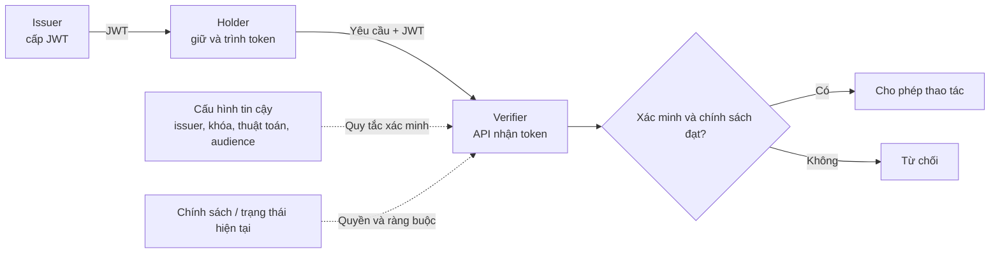
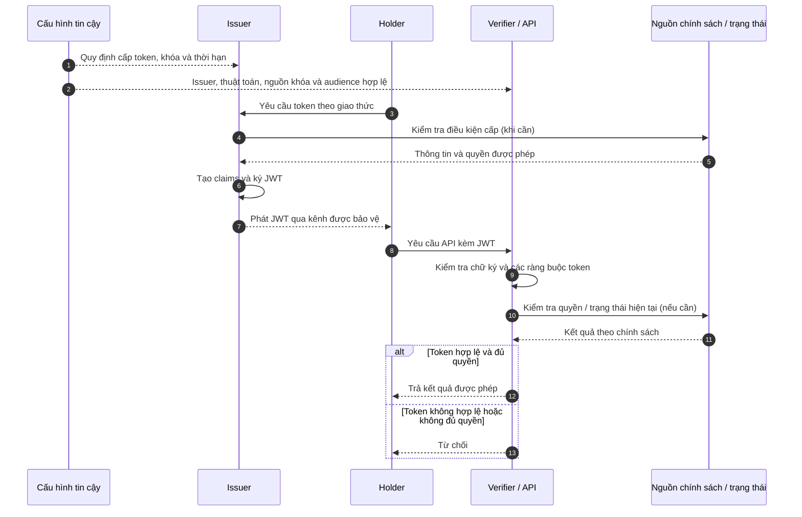
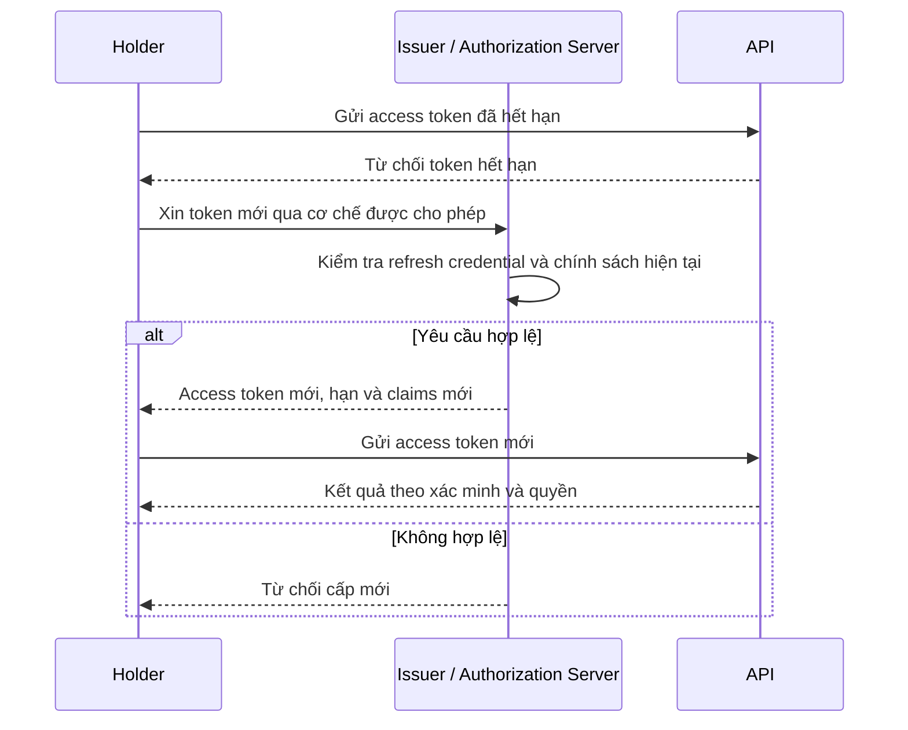
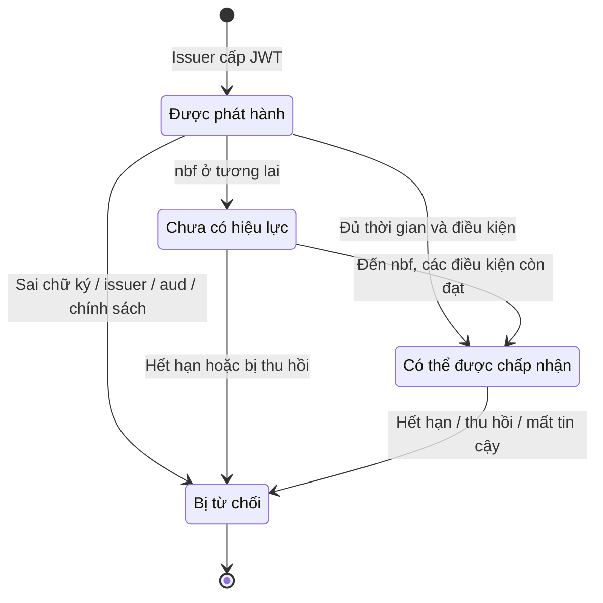

# Luồng tin cậy từ cấp phát đến sử dụng và hết hiệu lực

## 1. Bài toán: JWT được tin ở thời điểm nào, bởi ai và vì sao?

Một hệ thống phân tán có thể dùng **JSON Web Token (JWT)** để chuyển các khẳng định (*claims*) từ dịch vụ phát hành sang API, thông qua một ứng dụng khách. JWT có thể được ký để bảo vệ tính toàn vẹn và cho phép bên nhận xác minh nguồn phát hành theo khóa đáng tin cậy. Tuy nhiên, một token **không được tin chỉ vì có ba đoạn ngăn bởi dấu chấm, giải mã được JSON hay có chữ ký khớp với một khóa bất kỳ**.

Hãy xét tình huống:

- Một dịch vụ danh tính cấp JWT cho ứng dụng mua hàng.
- Ứng dụng chuyển token đến API đơn hàng để xem dữ liệu.
- API phải xác định token do **issuer được tin cậy** phát hành, **dành cho chính API**, **chưa hết hiệu lực** và **có đủ điều kiện** cho thao tác đang yêu cầu.
- Sau đó tài khoản có thể bị khóa, phạm vi quyền thay đổi, khóa ký bị luân chuyển, hoặc token đến hạn hết hiệu lực.

Để trả lời “API còn nên tin token này không?”, ta phải nhìn JWT như **một luồng tin cậy có vòng đời**, gồm cả các quyết định **trước khi cấp**, **trong khi token lưu chuyển**, **khi xác minh**, **khi sử dụng claims** và **khi quyền sử dụng kết thúc**.

> **Nguyên tắc xuyên suốt:** JWT mang theo một tập claims có thể được bảo vệ bằng cơ chế mật mã. Quyền tin và quyền sử dụng claims thuộc về **chính sách của bên nhận trong ngữ cảnh cụ thể**, không tự phát sinh từ bản thân chuỗi token.

Nội dung thuộc phạm vi **Security - JSON Web Token (JWT)**, tập trung vào nguyên lý bảo mật chung giữa các hệ thống, không phụ thuộc ngôn ngữ lập trình hay framework.

## 2. Những vai trò và ranh giới tin cậy

| Thành phần | Trách nhiệm trong vòng đời | Không được suy diễn |
| --- | --- | --- |
| **Issuer (bên phát hành)** | Kiểm tra điều kiện cấp, quyết định claims, thời hạn, audience và bảo vệ JWT bằng khóa phù hợp | Issuer không tự buộc mọi dịch vụ khác phải chấp nhận token |
| **Holder (bên giữ token)** | Nhận, lưu giữ an toàn và trình token đến nơi được phép | Holder có token không có nghĩa là holder có quyền sửa claims hoặc tự cấp quyền |
| **Verifier (bên xác minh)** | Xác minh bảo vệ mật mã, issuer, audience, thời gian, loại token và điều kiện sử dụng | Đọc được payload hoặc xác minh chữ ký đơn lẻ chưa đủ để cho phép truy cập |
| **Subject (chủ thể)** | Đối tượng mà các claims nói đến, ví dụ một tài khoản hoặc danh tính dịch vụ | Subject không nhất thiết là holder đang trình token |
| **Nguồn chính sách và trạng thái** | Xác định quyền hiện tại, tình trạng tài khoản, thu hồi và ràng buộc nghiệp vụ | Thông tin nằm trong JWT không tự cập nhật khi nguồn này thay đổi |

### Hai dòng thông tin khác nhau

**Đường đi của token** thường là `issuer → holder → verifier`; bên giữ chuyển token đến API. **Đường hình thành tin cậy** là quy trình mà verifier đã cấu hình issuer, thuật toán, khóa, audience và quy tắc xác minh được phép từ trước.



Điều quan trọng là **verifier không được lấy quyết định tin cậy hoàn toàn từ dữ liệu do chính token tự khai báo**. Claim `iss` hoặc header `kid` có thể hỗ trợ định tuyến đến một tập cấu hình/khóa đã được phê duyệt, nhưng không thể tự cấp quyền tin cậy cho nguồn khóa hoặc thuật toán tùy ý.

## 3. Toàn cảnh vòng đời một JWT

Vòng đời có thể chia thành bảy chặng:

1. **Thiết lập tin cậy:** xác định issuer, khóa, thuật toán, đối tượng nhận, loại token và chính sách chấp nhận.
2. **Cấp phát:** issuer xác thực hoặc đánh giá điều kiện cấp, tạo claims, ký hoặc mã hóa token theo mục đích.
3. **Bàn giao và bảo quản:** token đến holder qua kênh an toàn và được lưu với mức bảo vệ phù hợp.
4. **Trình token:** holder gửi token trong một yêu cầu đến dịch vụ dự kiến.
5. **Xác minh:** verifier kiểm tra định dạng, bảo vệ mật mã, nguồn phát hành, audience, thời gian và các ràng buộc.
6. **Sử dụng:** verifier kết hợp claims đã được chấp nhận với chính sách và trạng thái để quyết định thao tác.
7. **Kết thúc hiệu lực:** token hết hạn, chưa đến thời điểm được dùng, bị thu hồi, không còn được chính sách chấp nhận hoặc không còn đạt điều kiện tin cậy.



Sơ đồ mô tả trách nhiệm logic, **không bắt buộc phải gọi đến nguồn chính sách trong mọi yêu cầu**. Một số hệ thống xác minh JWT và áp dụng chính sách cục bộ; những hệ thống yêu cầu thu hồi tức thì hoặc dữ liệu quyền mới nhất có thể cần truy vấn hoặc đồng bộ thêm trạng thái.

## 4. Chặng 1 — Thiết lập tin cậy trước khi cấp phát

Một chữ ký chỉ có ý nghĩa khi verifier biết **khóa xác minh thuộc về issuer nào**, thuật toán nào được chấp nhận và token nào được phép dùng. Vì thế, cấu hình tin cậy phải có trước, hoặc được hình thành qua một cơ chế phân phối metadata/khóa đã xác thực.

Các bên cần thống nhất:

| Hạng mục | Câu hỏi thiết kế | Rủi ro nếu bỏ qua |
| --- | --- | --- |
| **Issuer tin cậy** | Bên nhận cho phép issuer nào? | Kẻ tấn công tự dựng issuer nhưng vẫn được tiếp nhận |
| **Khóa xác minh** | Khóa được lấy từ nguồn nào, thuộc issuer nào, luân chuyển ra sao? | Xác minh bằng khóa do token hoặc attacker tùy ý cung cấp |
| **Thuật toán** | Thuật toán nào được phép cho từng issuer/loại token? | Lỗi nhầm lẫn thuật toán hoặc chấp nhận chế độ không bảo vệ |
| **Audience** | Dịch vụ nào được dùng token? | Token của API này được chấp nhận ở API khác |
| **Loại và mục đích token** | Access token, ID token hay loại thông điệp nào? | Dùng sai loại token cho một thao tác |
| **Thời hạn và độ lệch đồng hồ** | Token tối đa sống bao lâu, chấp nhận lệch giờ ở mức nào? | Token tồn tại quá lâu hoặc bị chấp nhận sai thời gian |
| **Hợp đồng claims** | Claim nào bắt buộc, định dạng và ý nghĩa ra sao? | Diễn giải sai danh tính, quyền hoặc ngữ cảnh |
| **Thu hồi và sự cố** | Ai thông báo khóa lộ, tài khoản khóa, quyền bị gỡ? | Tiếp tục tin token trong khi điều kiện thực tế đã thay đổi |

Ví dụ, API đơn hàng chỉ tin JWT access token được issuer `https://identity.example.org` phát hành, có audience `orders-api`, và được bảo vệ bằng thuật toán nằm trong danh sách cho phép của API. Việc token tự đặt `iss` thành issuer này **không đủ**; nó còn phải xác minh được bằng khóa được liên kết tin cậy với issuer ấy.

**JWS và JWE không đồng nghĩa:** JWT dạng **JWS** cung cấp cơ chế chữ ký hoặc MAC để kiểm tra tính toàn vẹn và nguồn gốc theo khóa; phần payload của JWS compact thông thường vẫn đọc được. JWT dạng **JWE** dùng mã hóa để bảo vệ bí mật nội dung và tính toàn vẹn của dữ liệu mã hóa. Một hệ thống có thể dùng cấu trúc lồng nhau nếu cần cả xác minh nguồn phát hành và bí mật nội dung.

## 5. Chặng 2 — Cấp phát: từ điều kiện tin cậy thành claims

### 5.1. Cấp token là một quyết định bảo mật

Issuer không nên ký nguyên trạng những gì holder yêu cầu. Trước khi cấp, issuer phải xác định căn cứ cho danh tính hoặc quyền, kiểm tra phạm vi mà holder được yêu cầu, gắn token với đúng audience và thời hạn.

Một quy trình logic:

1. Nhận yêu cầu hoặc kết quả từ cơ chế cấp token được hỗ trợ.
2. Xác minh bằng chứng và điều kiện phát hành theo chính sách hiện hành.
3. Xác định chủ thể `sub`, issuer `iss`, bên nhận `aud`, quyền/phạm vi được phép và thời hạn.
4. Giảm claims xuống mức cần thiết; tránh đặt bí mật hoặc dữ liệu nhạy cảm không cần thiết vào payload.
5. Chọn khóa và thuật toán theo cấu hình; tạo JWT được bảo vệ.
6. Chuyển token cho holder qua kênh an toàn và ghi nhận sự kiện phát hành khi chính sách vận hành yêu cầu.

Ví dụ payload của một JWT dùng để đọc đơn hàng:

```json
{
  "iss": "https://identity.example.org",
  "sub": "account-42",
  "aud": "orders-api",
  "iat": 1893456000,
  "nbf": 1893456000,
  "exp": 1893456900,
  "jti": "token-7f31",
  "scope": "orders:read"
}
```

Các giá trị thời gian là **NumericDate**, biểu diễn số giây theo Unix epoch; ở đây khoảng từ lúc phát hành đến hết hạn là **900 giây (15 phút)**. `jti` là định danh token có thể hỗ trợ nhận diện hoặc cơ chế chống phát lại/thu hồi nếu hệ thống thiết kế thêm nơi lưu trạng thái. `scope` là claim theo hồ sơ token hoặc hợp đồng giao thức, **không phải registered claim bắt buộc của JWT cốt lõi**.

Nếu issuer dùng JWS compact, token thường có ba đoạn:

```text
BASE64URL(protected-header).BASE64URL(payload).BASE64URL(signature)
```

Chữ ký được tính trên cách biểu diễn được tiêu chuẩn JWS quy định, không chỉ trên đối tượng JSON đã được parse. Người nhận phải dùng cơ chế xác minh JWS đúng chuẩn. Việc giải mã Base64url **không phải** xác minh chữ ký và **không che giấu** nội dung.

### 5.2. Ý nghĩa của các mốc thời gian

| Claim | Vai trò trong vòng đời | Nguyên tắc |
| --- | --- | --- |
| `iat` | Thời điểm phát hành | Hỗ trợ tính tuổi token và ràng buộc bổ sung; không tự tạo hạn dùng |
| `nbf` | Thời điểm sớm nhất token được chấp nhận | Trước mốc này, verifier không được chấp nhận token |
| `exp` | Thời điểm hết hạn | Tại hoặc sau mốc này, verifier không được chấp nhận token; có thể áp dụng khoảng lệch đồng hồ nhỏ theo chính sách |
| `jti` | Định danh phân biệt token | Tự thân `jti` không làm token trở thành dùng một lần hoặc có khả năng thu hồi |

Theo RFC 7519, `exp`, `nbf` và `iat` là claims **tùy chọn ở mức tiêu chuẩn lõi**. Một API bảo mật có thể, và thường nên, yêu cầu `exp` cùng các ràng buộc riêng trong hợp đồng sử dụng. Việc chấp nhận token thiếu `exp` không được quyết định tùy tiện chỉ vì thư viện cho phép parse.

### 5.3. Phát hành đúng không bảo đảm claims đúng mãi

Giả sử tại thời điểm cấp, tài khoản có quyền `orders:read`. Sau 5 phút, quản trị viên thu hồi quyền. JWT đã ký trước đó **không tự biến đổi**; chữ ký và `exp` có thể vẫn hợp lệ trong 10 phút còn lại.

Issuer cần xác định thời hạn và cơ chế phản ánh thay đổi quyền dựa trên yêu cầu hệ thống. Verifier phải hiểu rằng **claims mô tả một khẳng định tại thời điểm cấp**, không nhất thiết phản ánh trạng thái mới nhất trong mọi thời điểm.

## 6. Chặng 3 — Bàn giao, lưu giữ và trình token

Holder nhận JWT từ issuer và dùng trong phạm vi được cấp. Quá trình vận chuyển là một phần của luồng tin cậy vì JWT bị đánh cắp có thể bị trình lại, đặc biệt khi đó là **bearer token**.

Một cách phổ biến để trình access token trong HTTP:

```http
GET /orders HTTP/1.1
Host: api.example.org
Authorization: Bearer <access-token>
```

Đây là cách sử dụng **bearer access token** trong một số giao thức, không phải định nghĩa bắt buộc của JWT; không phải mọi bearer token đều là JWT, và không phải JWT nào cũng là access token.

Holder cần:

- Dùng **HTTPS/TLS** và chỉ gửi token đến đúng endpoint dự kiến; không chủ động chuyển cho dịch vụ có audience khác.
- Hạn chế quyền đọc token bằng cơ chế lưu trữ phù hợp với nền tảng, tuổi thọ của token và mô hình đe dọa.
- Tránh để token xuất hiện trong URL, log, thông báo lỗi, dữ liệu phân tích và các kênh không được bảo vệ.
- Không suy luận rằng tự giải mã payload nghĩa là token đã được xác thực.
- Không tự sửa claims của JWT đã ký; mọi thay đổi đòi hỏi quy trình cấp lại hoặc trao đổi token được cho phép.
- Ngừng sử dụng token sau khi hết hạn, bị thu hồi hoặc sau khi phiên/ngữ cảnh sử dụng kết thúc theo chính sách.

**Bearer token:** người nào có được token thường có thể trình token. **Sender-constrained token:** một số giao thức ràng buộc token với khóa hoặc kênh của bên trình, ví dụ DPoP hoặc mutual TLS trong bối cảnh thích hợp. Khi đó verifier phải kiểm tra cả bằng chứng ràng buộc. Đây là cơ chế bổ sung của giao thức, **không phải thuộc tính mặc định của JWT**.

Giảm thời hạn và bảo vệ nơi lưu giúp hạn chế rủi ro, nhưng không thay thế việc kiểm tra quyền và trạng thái ở verifier khi cần.

## 7. Chặng 4 — Verifier xác minh JWT như thế nào?

Trong ví dụ access token **được ký dưới dạng JWS**, verifier thực hiện các bước sau. Thứ tự chi tiết có thể khác theo thư viện và hồ sơ token, nhưng **mọi điều kiện áp dụng đều phải đạt trước khi chấp nhận**:

1. **Kiểm tra cấu trúc và giới hạn đầu vào.** Chỉ chấp nhận định dạng và loại token được hỗ trợ; giới hạn kích thước, độ phức tạp và lỗi parse.
2. **Xác định issuer theo tập cấu hình đáng tin cậy.** `iss` từ token chỉ được dùng để đối chiếu hoặc chọn cấu hình đã được cho phép; nó không tự động làm mọi nguồn khóa trở nên đáng tin.
3. **Áp đặt thuật toán được chấp nhận.** Không để token tự đổi sang `alg: none`, chuyển kiểu khóa hoặc chọn thuật toán ngoài chính sách.
4. **Chọn khóa trong tập khóa đáng tin cậy và xác minh chữ ký/MAC.** `kid` có thể hỗ trợ tìm khóa nhưng không được dùng để tải hoặc tin một khóa tùy ý.
5. **Kiểm tra ngữ cảnh token.** Đối chiếu `iss`, `aud`, mục đích và loại token; token được cấp cho API A không hợp lệ đối với API B nếu không có quy tắc cấp/trao đổi tương ứng.
6. **Kiểm tra thời gian.** Kiểm tra `nbf`, `exp`, và `iat`/tuổi token theo yêu cầu. Sai lệch đồng hồ chỉ được phép trong khoảng nhỏ, có giới hạn rõ ràng.
7. **Kiểm tra hợp đồng claims.** Đảm bảo claims bắt buộc có mặt, đúng kiểu, đúng giá trị và không mâu thuẫn với hợp đồng.
8. **Đánh giá quyền và trạng thái thực tế.** Kiểm tra thao tác, tài nguyên, tình trạng chủ thể, ràng buộc người gửi và thu hồi nếu áp dụng.

Luồng quyết định ở mức khái niệm:

```text
nhận yêu cầu + JWT
  ├─ sai định dạng/loại token?                       → TỪ CHỐI
  ├─ issuer hoặc khóa không nằm trong cấu hình tin?  → TỪ CHỐI
  ├─ thuật toán không được phép/chữ ký không hợp lệ?  → TỪ CHỐI
  ├─ sai audience/mục đích?                          → TỪ CHỐI
  ├─ chưa đến hạn dùng hoặc đã hết hạn?              → TỪ CHỐI
  ├─ thiếu claims bắt buộc/sai hợp đồng?             → TỪ CHỐI
  ├─ bị thu hồi/thiếu quyền trên tài nguyên?         → TỪ CHỐI
  └─ mọi điều kiện đạt                              → CHO PHÉP
```

Trong thực tế, một số điều kiện có thể được kiểm tra song song hoặc bởi các thành phần khác nhau. Mô hình này nhấn mạnh **mặc định từ chối** nếu không đủ bằng chứng để chấp nhận.

### Tính toàn vẹn, tính bí mật và tính hợp lệ là ba khái niệm khác nhau

| Thuộc tính | Cơ chế / kiểm tra | Điều không được kết luận |
| --- | --- | --- |
| **Toàn vẹn và nguồn gốc theo khóa** | Xác minh JWS với khóa được tin cậy | Claims hiện tại, đúng về nghiệp vụ hoặc đủ quyền |
| **Bí mật nội dung** | Mã hóa JWE và kiểm tra bảo vệ dữ liệu mã hóa | Nội dung do một issuer cụ thể phát hành nếu không có bảo đảm nguồn gốc phù hợp |
| **Phù hợp ngữ cảnh** | Kiểm tra issuer, audience, loại token, thời gian và hồ sơ token | Người giữ token chắc chắn là subject |
| **Quyền trên thao tác** | Chính sách ủy quyền, dữ liệu tài nguyên và trạng thái hiện tại | Chữ ký hợp lệ đồng nghĩa được truy cập mọi tài nguyên |

Với JWT là JWE, verifier phải xử lý giải mã và kiểm tra ràng buộc theo cấu trúc JWE, sau đó còn phải quyết định cách tin cậy nội dung theo yêu cầu giao thức. Không áp dụng máy móc quy tắc “JWT luôn ba phần”: **JWS compact thường ba phần; JWE compact có năm phần**.

## 8. Chặng 5 — Sử dụng claims để quyết định truy cập

Sau khi token vượt qua các kiểm tra cần thiết, API có thể sử dụng claims làm **đầu vào đáng tin có giới hạn** cho quyết định ủy quyền.

Ví dụ, JWT dành cho `orders-api` chứa:

```json
{
  "iss": "https://identity.example.org",
  "sub": "account-42",
  "aud": "orders-api",
  "exp": 1893456900,
  "scope": "orders:read"
}
```

API nhận yêu cầu `GET /orders/987`. Việc có `scope: "orders:read"` chỉ có thể là **một điều kiện**. API còn phải xác định tài khoản `account-42` có quyền xem **đơn hàng 987** hay không, ví dụ theo quyền sở hữu, tổ chức hoặc quy tắc nghiệp vụ.

Hai yêu cầu với cùng một JWT có thể đưa đến hai quyết định khác nhau:

| Yêu cầu | Xác minh JWT | Kiểm tra nghiệp vụ | Kết quả |
| --- | --- | --- | --- |
| Xem đơn hàng của chính tài khoản | Đạt | Được phép | Có thể chấp nhận |
| Xem đơn hàng thuộc tài khoản khác | Đạt | Không được phép | Từ chối |
| Ghi thay đổi đơn hàng khi token chỉ có `orders:read` | Đạt | Không đủ phạm vi | Từ chối |
| Dùng token đơn hàng tại API thanh toán | Sai `aud` | Không đến bước cấp quyền | Từ chối |

**Xác thực danh tính**, **xác minh token** và **ủy quyền truy cập** là các bước khái niệm khác nhau. JWT có thể mang thông tin liên quan đến một bước xác thực trước đó, nhưng không tự thực hiện đăng nhập, không thay thế hoàn toàn chính sách truy cập và không tự cấp quyền chỉ vì holder hiển thị một claim.

## 9. Chặng 6 — Hết hiệu lực: thời gian, thu hồi và thay đổi tin cậy

Một JWT có thể **không còn được chấp nhận** vì nhiều lý do, ngay cả khi chuỗi token không bị sửa. Cần phân biệt các trường hợp:

### 9.1. Hết hạn theo `exp`

Theo RFC 7519, nếu thời điểm hiện tại **không còn trước** `exp` thì verifier không được chấp nhận token, trừ khoảng leeway nhỏ được quy định để xử lý lệch đồng hồ. Token hết hạn không được sử dụng tiếp chỉ vì holder vẫn còn giữ nó.

```text
Ví dụ một token có hiệu lực dự kiến trong 15 phút

T0                     T0 + 15 phút
|----------------------------|
iat, nbf                      exp
^                             ^
Có thể được chấp nhận         Hết hạn theo thời gian
(nếu mọi kiểm tra khác đạt)   (bị từ chối)
```

`exp` **không tự xóa token khỏi thiết bị**. Bên giữ có thể vẫn thấy chuỗi token, nhưng verifier phải từ chối khi token không còn đạt điều kiện thời gian.

### 9.2. Chưa có hiệu lực theo `nbf`

Một token có `nbf` trong tương lai chưa được phép dùng trước mốc đó. Đây là trạng thái **chưa có hiệu lực**, không phải “đã hết hạn”. Nếu `nbf` vượt quá `exp`, token không có khoảng thời gian sử dụng hợp lệ theo các kiểm tra thời gian thông thường.

### 9.3. Thu hồi trước hạn

Thu hồi (*revocation*) là quyết định không còn chấp nhận token **trước khi `exp` đến**, ví dụ khi người dùng đăng xuất toàn bộ thiết bị, tài khoản bị khóa hoặc phát hiện token bị lộ.

JWT được ký không có cơ chế thu hồi tức thì chung nằm sẵn trong chuỗi. Hệ thống có thể áp dụng một hoặc kết hợp nhiều cách:

| Cơ chế | Cách hoạt động | Đánh đổi |
| --- | --- | --- |
| **Access token sống ngắn** | Giảm thời gian token cũ còn dùng được | Không bảo đảm thu hồi tức thì trong khoảng còn hạn |
| **Danh sách thu hồi / denylist theo `jti` hoặc dấu vết token** | Verifier tra cứu token bị chặn | Cần lưu trữ, đồng bộ, dọn dữ liệu và đảm bảo sẵn sàng |
| **Kiểm tra trạng thái phiên/tài khoản/quyền** | Verifier xét trạng thái mới nhất khi cần | Tăng phụ thuộc và chi phí tra cứu; cần chính sách khi nguồn trạng thái không sẵn sàng |
| **Introspection hoặc xác minh tập trung** | Bên nhận hỏi dịch vụ có thẩm quyền về token theo giao thức phù hợp | Giảm tính độc lập của kiểm tra cục bộ; cần quản lý độ trễ và khả dụng |
| **Đổi khóa hoặc ngừng tin khóa ký** | Verifier không còn chấp nhận chữ ký từ khóa bị loại | Có thể làm vô hiệu nhiều token cùng được ký bằng khóa đó; chủ yếu là biện pháp sự cố hoặc vòng đời khóa |

**Đăng xuất ở holder chỉ xóa token tại nơi holder kiểm soát**; nếu token bearer đã bị sao chép, việc xóa cục bộ không tự khiến bản sao mất hiệu lực ở mọi verifier. Cần chính sách thu hồi hoặc cơ chế giảm rủi ro tương ứng.

### 9.4. Quyền hoặc trạng thái nghiệp vụ thay đổi

Trong khi JWT chưa hết hạn, quyền trong hệ thống có thể đã thay đổi. Ví dụ:

- `10:00`: issuer cấp token `orders:read`, hết hạn `10:15`.
- `10:05`: quyền đọc đơn hàng bị thu hồi.
- `10:06`: holder trình JWT cũ với chữ ký và thời hạn vẫn hợp lệ.

Nếu verifier **chỉ tin claim quyền đã cấp và không kiểm tra tình trạng cập nhật**, yêu cầu có thể được tiếp tục chấp nhận cho đến `10:15`. Nếu yêu cầu nghiệp vụ là chặn ngay lúc `10:05`, hệ thống phải có cơ chế để verifier nhận biết thay đổi đó. Thời gian sống ngắn chỉ làm **ngắn cửa sổ rủi ro**, không khiến claims tự cập nhật.

### 9.5. Khóa ký bị thu hồi hoặc luân chuyển

Issuer thường luân chuyển khóa theo quy trình có kiểm soát:

1. Cung cấp khóa xác minh mới qua nguồn đáng tin cậy.
2. Bắt đầu ký token mới bằng khóa mới.
3. Trong khoảng chuyển tiếp, verifier có thể vẫn cần xác minh các token hợp lệ đã ký bằng khóa cũ.
4. Ngừng tin khóa cũ khi hết cửa sổ dự kiến hoặc sớm hơn khi có sự cố bảo mật.

**Luân chuyển khóa thông thường** không nhất thiết khiến mọi token cũ vô hiệu ngay. **Khóa bị lộ** là tình huống khác: phải đánh giá phạm vi ảnh hưởng, dừng phát hành bằng khóa bị lộ và điều phối verifier ngừng tin khóa ấy theo mức độ khẩn cấp.

Một `kid` trong header chỉ là **gợi ý chọn khóa**, không chứng minh khóa thuộc issuer hay còn đáng tin. Verifier phải chọn trong tập khóa đã thiết lập tin cậy.

### 9.6. Token không còn đúng ngữ cảnh sử dụng

Token chưa hết `exp` vẫn bị từ chối nếu:

- Được gửi đến API không nằm trong `aud`.
- Verifier thay đổi chính sách và không còn tin issuer, thuật toán hoặc loại token ấy.
- Các claims bắt buộc không còn đáp ứng hợp đồng được áp dụng.
- Token cần bằng chứng ràng buộc với bên gửi nhưng holder không chứng minh được.

Vì vậy, **“hết hiệu lực” trong thực tế rộng hơn “đã qua `exp`”**.

## 10. Làm mới token và tiếp tục phiên: vòng đời mới, quyết định mới

Trong một số hệ thống, sau khi access token hết hạn, ứng dụng có thể xin access token mới thông qua cơ chế **refresh token** hoặc quy trình cấp phát lại. Đây là chức năng của **giao thức và chính sách quản lý phiên**, không phải khả năng mặc định của JWT.



Các điểm cần nhớ:

- Access token và refresh token **có mục đích khác nhau**. Refresh token không nhất thiết là JWT, và thông thường không dùng refresh token để gọi API tài nguyên.
- JWT mới mang **thời hạn, mã định danh và claims mới** theo chính sách lúc cấp; không phải “gia hạn chữ ký” trên token cũ.
- Issuer có thể từ chối cấp mới nếu phiên bị đóng, tài khoản bị khóa hoặc refresh credential không hợp lệ.
- Refresh token thường cần được bảo vệ nghiêm ngặt vì có thể được dùng để lấy thêm access token; cơ chế xoay vòng và phát hiện sử dụng lại có thể phù hợp tùy mô hình.

## 11. Mô hình trạng thái theo vòng đời

Có thể diễn đạt vòng đời thành một mô hình trạng thái giúp phân tích sự kiện:



Sơ đồ chỉ là **mô hình khái niệm**. JWT không mang một trường trạng thái sống liên tục. Trên thực tế, verifier **đánh giá lại tại từng lần sử dụng**. Đặc biệt, “có thể được chấp nhận” không có nghĩa chắc chắn được cấp quyền với mọi tài nguyên; quyết định còn phụ thuộc yêu cầu và bối cảnh mới.

Trong một hệ thống thiếu cơ chế thu hồi/trạng thái cập nhật, token có thể tiếp tục vượt qua các kiểm tra cục bộ sau khi tài khoản bị khóa. Đây là giới hạn của thiết kế cần giải quyết ở tầng chính sách, không phải một bước tự động của JWT.

## 12. Các tình huống mất tin cậy và cách phản ứng

| Tình huống | Dấu hiệu | Mắt xích cần xử lý |
| --- | --- | --- |
| Token bị chỉnh sửa payload sau khi ký | Chữ ký/MAC không hợp lệ | Verifier từ chối; holder không được sửa token |
| Token do issuer không được tin cậy ký | `iss` hoặc khóa không đạt cấu hình | Verifier từ chối ngay cả khi chữ ký khớp với một khóa khác |
| Token từ dịch vụ A được dùng ở dịch vụ B | `aud` không phù hợp | Verifier B từ chối; issuer cấp đúng audience nếu được phép |
| Token còn hạn nhưng subject không còn quyền | Claims cũ khác chính sách mới | Verifier tra cứu hoặc nhận cập nhật trạng thái nếu yêu cầu tức thì |
| Token bị lộ trên thiết bị người dùng | Holder không còn kiểm soát độc quyền | Bảo vệ/làm sạch nơi lưu; thu hồi và giảm phạm vi/tuổi token theo mô hình |
| Khóa ký bị lộ | Có nguy cơ xuất hiện token giả hợp lệ | Issuer thay khóa; verifier ngừng tin khóa bị lộ; xử lý phiên/token liên quan |
| Hệ thống phân phối khóa tạm thời không truy cập được | Không lấy được khóa cần thiết | Chỉ dùng khóa đã cache còn được chính sách tin cậy cho phép; không tin khóa tùy ý |
| Đồng hồ ở verifier lệch quá mức | Token bị nhận sai `nbf` hoặc `exp` | Đồng bộ thời gian; cấu hình leeway nhỏ, có giới hạn |
| Access token hết hạn | `exp` đã tới | Verifier từ chối; holder xin token mới theo giao thức nếu được phép |

### Vì sao “fail closed” quan trọng?

Nếu verifier không xác minh được một điều kiện bắt buộc — ví dụ không có khóa tin cậy, nguồn thu hồi bắt buộc không truy cập được, hoặc không kiểm tra được bằng chứng sender-constrained — cách xử lý an toàn mặc định là **không cấp quyền**. Hệ thống cần quy định rõ hành vi khi dịch vụ phụ trợ gặp sự cố, thay vì âm thầm bỏ qua bước kiểm tra.

Điều này không đồng nghĩa phải gọi mạng trong mọi yêu cầu; có thể thiết kế cache khóa công khai, dữ liệu chính sách hoặc cơ chế tra cứu phù hợp. Nhưng cache phải có giới hạn và nguồn gốc đáng tin cậy.

## 13. Ví dụ đối chiếu: ba yêu cầu, cùng một JWT

Giả sử JWT được phát hành lúc `10:00`, `nbf = 10:00`, `exp = 10:15`, audience `orders-api`, scope `orders:read`, và issuer đã được API tin cậy.

| Thời điểm/yêu cầu | Trạng thái token ở verifier | Kết luận |
| --- | --- | --- |
| **10:02**, `GET /orders/123`, đúng audience và đủ quyền sở hữu | Chữ ký, thời gian, issuer, audience đều đạt; chính sách tài nguyên cho phép | Chấp nhận |
| **10:06**, cùng JWT gửi `payments-api` | Chữ ký và thời gian có thể vẫn đạt, nhưng audience không khớp | Từ chối |
| **10:16**, `GET /orders/123` tại `orders-api` | Token đã tới `exp` | Từ chối |

Một biến thể: quyền bị rút tại `10:04`, truy cập lúc `10:05`. Nếu cần chặn ngay, `orders-api` phải có cơ chế biết quyền đã bị thu hồi **trước khi JWT tự hết hạn**. Token không thể tự truyền thông tin về sự kiện mới xảy ra sau khi được cấp.

## 14. Checklist thiết kế và vận hành

Trước khi cho một JWT đi từ phát hành đến sử dụng, nhóm thiết kế nên trả lời:

1. **Phát hành:** Issuer chứng minh điều gì và lấy căn cứ ở đâu? Có giới hạn claims, phạm vi, audience và TTL không?
2. **Tin cậy:** Verifier biết issuer, nguồn khóa, thuật toán và loại token được cho phép bằng cách nào?
3. **Vận chuyển:** Holder lưu và trình token ra sao? Có bảo vệ TLS, tránh lộ log và hạn chế phát lại không?
4. **Thẩm định:** Verifier có kiểm tra chữ ký/MAC, `iss`, `aud`, `exp`, `nbf`, claims bắt buộc và chính sách về `iat` không?
5. **Ủy quyền:** Claims có được dùng cùng chính sách theo thao tác và tài nguyên, thay vì coi token hợp lệ là đủ quyền không?
6. **Thu hồi:** Nếu token bị lộ, tài khoản bị khóa hoặc quyền thay đổi, bao lâu verifier biết điều đó?
7. **Vòng đời khóa:** Có kế hoạch công bố, luân chuyển, ngừng tin khóa cũ và xử lý khóa bị lộ không?
8. **Tiếp tục phiên:** Khi access token hết hạn, việc cấp mới dựa trên điều kiện nào? Refresh credential được bảo vệ và thu hồi ra sao?
9. **Sự cố:** Khi thiếu khóa, đồng hồ sai hoặc dịch vụ trạng thái không có sẵn, verifier có chính sách từ chối rõ ràng không?
10. **Giám sát:** Có ghi nhận lỗi xác minh và các sự kiện bất thường ở mức cần thiết mà không đưa token nguyên văn vào log không?

## 15. Kết luận

**Tin cậy trong JWT là quá trình được thiết lập, kiểm tra và có thể chấm dứt theo thời gian.** Issuer chỉ nên phát hành claims có căn cứ; holder phải bảo vệ token khi lưu giữ và truyền; verifier phải dựa vào khóa và chính sách đã tin cậy để kiểm tra token, rồi đánh giá quyền trong ngữ cảnh yêu cầu.

**Hết hạn** theo `exp` là một cơ chế quan trọng nhưng không giải quyết mọi trường hợp: **thu hồi trước hạn, quyền thay đổi, khóa bị lộ và audience không đúng** đều có thể khiến token phải bị từ chối. JWT giúp chuyển claims đã được bảo vệ giữa các bên; độ mới của thông tin, ủy quyền và quản lý phiên vẫn cần được thiết kế rõ ràng.

## Tài liệu chuẩn để đọc tiếp

- [RFC 7519 — JSON Web Token (JWT)](https://www.rfc-editor.org/rfc/rfc7519): claims, thời gian hiệu lực và cách biểu diễn JWT.
- [RFC 7515 — JSON Web Signature (JWS)](https://www.rfc-editor.org/rfc/rfc7515): xác minh chữ ký/MAC, protected header và dạng compact.
- [RFC 7516 — JSON Web Encryption (JWE)](https://www.rfc-editor.org/rfc/rfc7516): mã hóa và bảo vệ dữ liệu.
- [RFC 8725 — JSON Web Token Best Current Practices](https://www.rfc-editor.org/rfc/rfc8725): thực hành bảo mật trong xác minh, khóa và chống nhầm ngữ cảnh token.
- [RFC 6750 — OAuth 2.0 Bearer Token Usage](https://www.rfc-editor.org/rfc/rfc6750): truyền bearer token và các rủi ro liên quan.
- [RFC 7009 — OAuth 2.0 Token Revocation](https://www.rfc-editor.org/rfc/rfc7009): endpoint thu hồi token trong những hệ thống sử dụng OAuth 2.0.
- [RFC 7662 — OAuth 2.0 Token Introspection](https://www.rfc-editor.org/rfc/rfc7662): cơ chế hỏi trạng thái token trong những hệ thống hỗ trợ.
