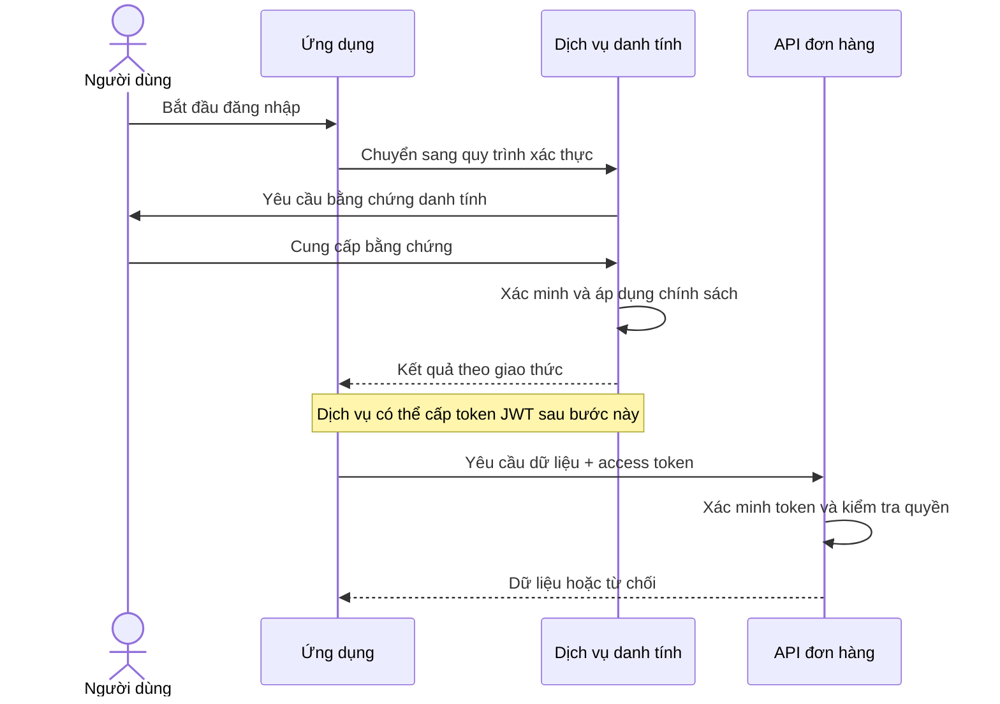

# JWT là định dạng dữ liệu, không phải giao thức xác thực

## 1. Vì sao cần phân biệt định dạng token và giao thức xác thực?

Khi thấy một hệ thống gửi chuỗi có dạng ba đoạn ngăn bởi dấu chấm, nhiều người lập tức kết luận: “Hệ thống đang dùng JWT để đăng nhập”. Kết luận này thường quá vội. Chuỗi ấy có thể là một **JWT**, nhưng chỉ nhìn định dạng không thể biết người dùng đã đăng nhập bằng cách nào, ai đã xác minh danh tính, token được cấp theo quy trình nào, API nào được phép dùng token, hay phiên sẽ kết thúc ra sao.

Hãy hình dung ứng dụng mua hàng gọi API đơn hàng:

- Người dùng có thể đã đăng nhập qua một quy trình xác thực.
- Một dịch vụ có thẩm quyền cấp token sau khi đánh giá điều kiện.
- Ứng dụng nhận token và gửi đến API.
- API kiểm tra token rồi quyết định có cho phép thao tác hay không.

Trong luồng đó, JWT có thể là **định dạng biểu diễn dữ liệu của token**. Quy trình đăng nhập, cấp token, chuyển token, xác minh và quản lý phiên được quy định bởi những giao thức, chính sách và thành phần khác.

Phân biệt đúng giúp tránh các giả định nguy hiểm:

- Parse được JWT không có nghĩa người dùng đã được xác thực.
- Chữ ký JWT hợp lệ không tự chứng minh rằng quy trình đăng nhập ban đầu an toàn.
- JWT không tự quy định cách trình duyệt chuyển hướng đăng nhập, trao đổi mã cấp quyền, làm mới token hoặc đăng xuất.
- Có JWT không đồng nghĩa hệ thống đang dùng OAuth 2.0 hay OpenID Connect.
- Không phải mọi access token đều là JWT; access token cũng có thể là chuỗi opaque.

**JWT là định dạng token dựa trên JSON và các cơ chế bảo vệ mật mã. JWT không phải giao thức xác thực, không phải quy trình đăng nhập và cũng không phải toàn bộ hệ thống quản lý danh tính.**

Đây là bài thuộc phạm vi **Security - JSON Web Token (JWT)** theo hướng bảo mật tổng quát, độc lập với ngôn ngữ lập trình và framework.

## 2. Định dạng dữ liệu là gì?

Một **định dạng dữ liệu (data format)** mô tả cách tổ chức và biểu diễn thông tin để các bên có thể tạo, truyền, đọc và diễn giải dữ liệu theo cùng quy tắc. Nó trả lời các câu hỏi như:

- Dữ liệu có những thành phần nào?
- Trường dữ liệu được đặt tên và biểu diễn ra sao?
- Dữ liệu được mã hóa thành chuỗi byte hoặc ký tự như thế nào?
- Có cơ chế nào bảo vệ tính toàn vẹn hoặc tính bí mật của dữ liệu không?

Ví dụ:

| Định dạng | Mục đích chính |
| --- | --- |
| JSON | Biểu diễn dữ liệu có cấu trúc dưới dạng văn bản |
| XML | Biểu diễn dữ liệu có cấu trúc bằng phần tử và thuộc tính |
| CSV | Biểu diễn dữ liệu dạng bảng theo hàng và cột |
| JWT | Biểu diễn một tập claims JSON dưới dạng token có thể được bảo vệ bằng JWS hoặc JWE |

Một định dạng có thể được sử dụng trong nhiều giao thức khác nhau. JSON có thể xuất hiện trong API, cấu hình, thông điệp hàng đợi hoặc tệp dữ liệu; bản thân JSON không quyết định ai gửi trước, ai phải xác thực, hay thông điệp nào được phép gửi tiếp theo.

Tương tự, JWT có thể xuất hiện trong nhiều bối cảnh. JWT không tự định nghĩa:

- Ai được phép phát hành token.
- Bên giữ token lấy token bằng cách nào.
- Bên nhận phải gọi endpoint nào để xác minh.
- Người dùng đăng nhập bằng mật khẩu, khóa bảo mật hay phương thức nào.
- Ứng dụng phải xử lý chuyển hướng, trạng thái phiên và đăng xuất ra sao.
- Khi quyền thay đổi thì token đang tồn tại bị thu hồi thế nào.

Những câu hỏi đó thuộc về **giao thức, hồ sơ sử dụng token, chính sách và kiến trúc của hệ thống**.

## 3. JWT thực sự định nghĩa điều gì?

JWT được đặc tả trong [RFC 7519 — JSON Web Token](https://www.rfc-editor.org/rfc/rfc7519). Nó định nghĩa cách biểu diễn một **JWT Claims Set** — tập hợp các khẳng định được tổ chức thành đối tượng JSON — và cách đóng gói tập claims đó trong một cấu trúc được bảo vệ.

Ví dụ một tập claims:

```json
{
  "iss": "https://identity.example.org",
  "sub": "account-42",
  "aud": "orders-api",
  "iat": 1893456000,
  "exp": 1893456900,
  "scope": "orders:read"
}
```

Các trường trong ví dụ:

- `iss`: bên phát hành được khẳng định.
- `sub`: chủ thể mà token đề cập.
- `aud`: bên nhận dự kiến.
- `iat`: thời điểm phát hành.
- `exp`: thời điểm hết hạn.
- `scope`: một claim theo quy ước của hồ sơ token hoặc ứng dụng; không phải registered claim bắt buộc của JWT cốt lõi.

Các thời gian `iat` và `exp` trong JWT dùng kiểu **NumericDate**, thường được biểu diễn bằng số giây tính từ Unix epoch. JWT định nghĩa ý nghĩa chung của một số claims đăng ký, nhưng không bắt buộc mọi JWT phải có toàn bộ chúng. Giao thức hoặc hợp đồng của ứng dụng quyết định claim nào bắt buộc trong một ngữ cảnh cụ thể.

### Ba phần của JWT dạng JWS compact

Một JWT được bảo vệ bằng JWS ở dạng compact thường có cấu trúc:

```text
BASE64URL(protected-header).BASE64URL(payload).BASE64URL(signature)
```

Ví dụ header:

```json
{
  "alg": "RS256",
  "typ": "JWT",
  "kid": "key-2026-01"
}
```

Ba phần có vai trò:

1. **Protected Header:** mô tả thông tin xử lý mật mã như thuật toán và metadata cần thiết.
2. **Payload:** chứa JWT Claims Set.
3. **Signature:** giá trị chữ ký hoặc mã xác thực thông điệp (MAC) được tạo theo JWS.

Base64url là cách biểu diễn dữ liệu, **không phải mã hóa bí mật**. Người có JWT dạng JWS thường có thể đọc header và payload. JWS bảo vệ tính toàn vẹn và nguồn gốc theo khóa; nó không tự che giấu claims.

### JWT có thể dùng JWE

JWT cũng có thể được bảo vệ bằng **JSON Web Encryption (JWE)** khi cần tính bí mật của nội dung. JWE compact thường có năm phần:

```text
BASE64URL(protected-header).
BASE64URL(encrypted-key).
BASE64URL(initialization-vector).
BASE64URL(ciphertext).
BASE64URL(authentication-tag)
```

JWE bảo vệ nội dung theo thuật toán mã hóa được chọn. Nếu hệ thống cần cả xác minh nguồn phát hành lẫn bí mật nội dung, có thể sử dụng cấu trúc JWT lồng nhau theo chuẩn. Dù là JWS hay JWE, JWT vẫn chỉ cung cấp **cách biểu diễn và bảo vệ dữ liệu token**; nó không định nghĩa toàn bộ quy trình xác thực người dùng.

## 4. Giao thức là gì?

Một **giao thức (protocol)** là tập hợp quy tắc quy định cách các bên tương tác và trao đổi thông điệp để đạt một mục đích. Giao thức thường xác định:

- Những bên nào tham gia và vai trò của họ.
- Bên nào được gửi thông điệp nào, trong điều kiện nào.
- Thứ tự thông điệp và các bước chuyển trạng thái.
- Cách nhận diện, xác thực hoặc chứng minh quyền của các bên.
- Cách xử lý phản hồi, lỗi, thời hạn, trạng thái và các trường hợp ngoại lệ.
- Cách bảo vệ thông điệp và cách các bên kiểm tra kết quả.

Ví dụ, một giao thức đăng nhập có thể quy định:

1. Ứng dụng chuyển người dùng đến một dịch vụ danh tính.
2. Dịch vụ danh tính yêu cầu người dùng chứng minh danh tính.
3. Dịch vụ kiểm tra bằng chứng và áp dụng chính sách xác thực.
4. Dịch vụ trả kết quả theo một thông điệp hoặc quy trình được chuẩn hóa.
5. Ứng dụng xử lý kết quả, tạo phiên hoặc sử dụng token theo giao thức.

Giao thức xác định **cách tương tác**. Định dạng thông điệp xác định **cách biểu diễn dữ liệu bên trong thông điệp**. Một giao thức có thể sử dụng JWT, JSON thông thường, XML, chuỗi opaque hoặc nhiều định dạng khác.

### Bảng phân biệt

| Khía cạnh | Định dạng JWT | Giao thức xác thực / ủy quyền |
| --- | --- | --- |
| Câu hỏi chính | Dữ liệu token được biểu diễn thế nào? | Các bên tương tác và trao đổi bằng chứng/kết quả ra sao? |
| Thành phần | Header, claims, chữ ký hoặc dữ liệu mã hóa | Vai trò, thông điệp, endpoint, bước xử lý, trạng thái và quy tắc |
| Thứ tự tương tác | Không định nghĩa luồng đăng nhập | Có thể định nghĩa trình tự thông điệp |
| Xác minh danh tính người dùng | Không tự thực hiện | Có thể quy định cách xác thực hoặc sử dụng kết quả xác thực |
| Cấp token | Không định nghĩa quy trình cấp | Có thể quy định cách và điều kiện cấp token |
| Phiên và đăng xuất | Không tự quản lý | Có thể quy định hoặc phối hợp với cơ chế quản lý phiên |
| Ví dụ | JWT, JWS, JWE | OpenID Connect, OAuth 2.0 trong phạm vi của chúng, SAML 2.0 |

Lưu ý: OAuth 2.0 chủ yếu là **framework ủy quyền**, không phải giao thức xác thực người dùng. OpenID Connect bổ sung lớp định danh/xác thực trên OAuth 2.0. SAML 2.0 định nghĩa một framework assertion và các giao thức trao đổi liên quan. Các chuẩn có phạm vi khác nhau; không nên gọi tất cả đơn giản là “giao thức đăng nhập”.

## 5. JWT không thực hiện đăng nhập

Đăng nhập (*login*) là một quá trình mà hệ thống thu thập và đánh giá bằng chứng để xác định người dùng hoặc chủ thể. Tùy thiết kế, bằng chứng có thể là:

- Mật khẩu hoặc cụm mật khẩu.
- Mã dùng một lần.
- Khóa bảo mật hoặc thông tin xác thực mật mã.
- Chứng thư số hoặc danh tính của workload.
- Kết quả xác thực từ một nhà cung cấp danh tính được tin cậy.

JWT không quy định cách thu thập hay xác minh các bằng chứng trên. JWT cũng không cung cấp giao diện đăng nhập, challenge, redirect, cookie phiên hay cơ chế chống giả mạo yêu cầu đăng nhập.

Một dịch vụ có thể **sau khi xác thực thành công** tạo JWT để ghi lại một số khẳng định và cấp token cho ứng dụng. Trong tình huống này:

- Quá trình xác thực xảy ra ở một bước hoặc thành phần khác.
- Chính sách cấp token quyết định claims nào được đưa vào JWT.
- JWT mang kết quả/khẳng định được phát hành.
- Bên nhận xác minh token theo hợp đồng và chính sách của mình.

Sự xuất hiện của JWT sau khi đăng nhập không có nghĩa JWT là giao thức đã thực hiện đăng nhập.

### Ví dụ minh họa

Giả sử một ứng dụng dùng dịch vụ danh tính:



Sơ đồ chỉ mô tả một kiến trúc điển hình, không phải luồng bắt buộc của JWT. Cách chuyển hướng, loại thông điệp, cách cấp token và cách tạo phiên phụ thuộc giao thức được lựa chọn.

## 6. JWT không tự xác thực người cầm token

Đây là một nhầm lẫn quan trọng. Nếu verifier xác minh được chữ ký JWT, verifier có thể kết luận rằng dữ liệu được bảo vệ phù hợp với khóa đã sử dụng và nguồn phát hành được liên kết với khóa đó theo cấu hình tin cậy. Nhưng điều này **không tự chứng minh người đang gửi yêu cầu chính là subject trong token**.

Ví dụ:

- JWT có `sub: "account-42"`.
- Issuer đã ký token hợp lệ.
- Một kẻ tấn công sao chép được token bearer từ thiết bị của người dùng.
- Kẻ tấn công gửi token đến API.

Nếu API chỉ yêu cầu một bearer token hợp lệ, kẻ tấn công có thể sử dụng token cho đến khi token hết hạn, bị thu hồi hoặc bị từ chối bởi một điều kiện khác. Chữ ký vẫn có thể hợp lệ dù người gửi không phải chủ tài khoản.

Vì vậy cần phân biệt:

| Khái niệm | Điều được chứng minh / quyết định |
| --- | --- |
| **Xác thực danh tính (authentication)** | Một chủ thể đã chứng minh danh tính theo cơ chế được chấp nhận |
| **Xác minh JWT (token validation)** | Token đáp ứng các quy tắc mật mã và ngữ cảnh mà verifier yêu cầu |
| **Xác minh người gửi (sender verification)** | Bên trình token chứng minh được quyền kiểm soát khóa hoặc kênh gắn với token, nếu cơ chế yêu cầu |
| **Ủy quyền (authorization)** | Chủ thể hoặc bên gửi được phép thực hiện thao tác nào trên tài nguyên nào |

Một số cơ chế sender-constrained token có thể ràng buộc token với khóa của bên trình, chẳng hạn DPoP hoặc mutual TLS trong các ngữ cảnh phù hợp. Khi đó verifier kiểm tra cả bằng chứng ràng buộc. Đây là cơ chế giao thức bổ sung; **không phải thuộc tính mặc định của JWT**.

## 7. JWT có thể được dùng trong giao thức nào?

JWT là một định dạng có thể được sử dụng trong các kiến trúc và giao thức khác nhau. Tuy nhiên, mỗi giao thức quy định mục đích và cách diễn giải token riêng.

### 7.1. OAuth 2.0 và access token

OAuth 2.0 là framework ủy quyền cho phép một client nhận quyền truy cập tài nguyên thông qua các vai trò và luồng được định nghĩa. Access token là thông tin xác thực đại diện cho quyền truy cập được cấp. **OAuth 2.0 không bắt buộc access token phải là JWT.**

Access token có thể là:

- **Opaque token:** chuỗi tham chiếu không tự bộc lộ claims; resource server có thể cần tra cứu hoặc introspection để biết trạng thái và quyền.
- **JWT access token:** token mang claims theo hồ sơ sử dụng được thỏa thuận; resource server có thể xác minh cục bộ nếu có cấu hình và khóa tin cậy.

Nếu access token là JWT, định dạng JWT không thay thế các quy tắc OAuth 2.0 về client, authorization server, resource server, scope, grant, redirect, consent hoặc token endpoint.

### 7.2. OpenID Connect và ID token

OpenID Connect (OIDC) là lớp định danh xây dựng trên OAuth 2.0. OIDC sử dụng **ID token** để truyền các khẳng định về kết quả xác thực và chủ thể đến client theo quy tắc của OIDC. ID token được biểu diễn dưới dạng JWT và có các yêu cầu kiểm tra riêng, chẳng hạn issuer, audience, chữ ký, thời gian và những tham số liên quan đến yêu cầu xác thực.

Điều này không có nghĩa mọi JWT đều là ID token. ID token có mục đích dành cho client để diễn giải kết quả xác thực theo OIDC; access token có mục đích cho phép truy cập tài nguyên. Không được lấy một token bất kỳ rồi sử dụng thay cho loại còn lại.

### 7.3. SAML và các định dạng assertion khác

SAML 2.0 sử dụng assertion thường được biểu diễn bằng XML và định nghĩa các cơ chế trao đổi, xác thực và federation. Điều này minh họa rằng một hệ thống xác thực liên tổ chức **không cần phải dùng JWT**. Có thể dùng định dạng assertion khác nếu giao thức và hệ sinh thái của các bên quy định.

### 7.4. Token nội bộ giữa các dịch vụ

Một hệ thống cũng có thể tự định nghĩa hợp đồng tin cậy giữa các dịch vụ: issuer phát hành JWT cho một audience cụ thể; dịch vụ nhận xác minh chữ ký, claims và quyền. Đây là kiến trúc sử dụng JWT, nhưng không tự động trở thành OAuth 2.0 hoặc OIDC nếu không triển khai các quy tắc của các chuẩn đó.

## 8. Access token, ID token và JWT: không phải ba từ đồng nghĩa

Các khái niệm này nằm ở những lớp khác nhau:

| Thuật ngữ | Thuộc lớp nào? | Mô tả |
| --- | --- | --- |
| **JWT** | Định dạng token | Cách biểu diễn một tập claims được bảo vệ theo JWS/JWE |
| **Access token** | Vai trò/loại credential trong giao thức ủy quyền | Đại diện cho quyền truy cập tài nguyên được cấp |
| **ID token** | Loại token trong OpenID Connect | Truyền thông tin xác thực và claims về chủ thể đến client theo OIDC |
| **Refresh token** | Credential trong quy trình cấp lại token | Được dùng với authorization server để yêu cầu access token mới theo chính sách |
| **Bearer token** | Cách sử dụng token theo mô hình bearer | Bên có token có thể trình token; cần bảo vệ chống lộ và phát lại |

Một access token có thể là JWT hoặc opaque. Một ID token theo OIDC là JWT. Refresh token có thể là chuỗi opaque hoặc dạng khác theo hệ thống; không nên giả định nó là JWT. Bearer mô tả cách sử dụng credential, không mô tả cấu trúc dữ liệu bên trong.

## 9. Những gì JWT không định nghĩa

Để tránh gán nhầm trách nhiệm cho JWT, hãy xem bảng sau:

| Câu hỏi | JWT có tự định nghĩa không? | Thành phần/quy tắc thường đảm nhiệm |
| --- | --- | --- |
| Người dùng nhập mật khẩu ở đâu? | Không | Ứng dụng và giao thức/quy trình xác thực |
| Làm sao chứng minh danh tính? | Không | Cơ chế xác thực và chính sách danh tính |
| Ai được phép cấp token? | Không | Quan hệ tin cậy, giao thức cấp phát và cấu hình issuer |
| Token được xin bằng endpoint nào? | Không | Giao thức cấp token, ví dụ OAuth 2.0 |
| Trình duyệt chuyển hướng ra sao? | Không | Giao thức và ứng dụng client |
| Client gửi token bằng cách nào? | Không | Quy tắc vận chuyển/sử dụng token, ví dụ Bearer Token Usage |
| API xác minh khóa nào? | Không tự chọn nguồn tin cậy | Cấu hình issuer, phân phối khóa và chính sách xác minh |
| Người dùng được truy cập dữ liệu nào? | Không | Chính sách ủy quyền và quy tắc nghiệp vụ |
| Đăng xuất làm gì với phiên? | Không | Quản lý phiên, giao thức đăng xuất và cơ chế thu hồi |
| Làm mới token bằng cách nào? | Không | Giao thức và chính sách refresh/cấp lại |
| Thu hồi token trước hạn ra sao? | Không có cơ chế tức thì chung | Danh sách thu hồi, introspection hoặc thiết kế trạng thái |
| Chống token bị đánh cắp và phát lại thế nào? | Không tự giải quyết | TLS, lưu trữ an toàn, thời hạn ngắn, sender constraint và kiểm soát bổ sung |

JWT có thể mang claims hữu ích cho những quy trình này, nhưng **mang thông tin về một hoạt động không có nghĩa định nghĩa hoạt động đó**.

## 10. Ví dụ so sánh hai thiết kế

### Thiết kế A: JWT được dùng như một định dạng token

Một tổ chức đã có dịch vụ danh tính và quy trình cấp quyền. Dịch vụ này phát JWT sau khi các điều kiện được đáp ứng. API nhận token, xác minh issuer, khóa, audience, thời hạn và quyền theo hợp đồng.

Trong thiết kế này, JWT là định dạng biểu diễn claims. Giao thức cấp token, cách client xin token, quản lý phiên và quy tắc truy cập do các thành phần khác đảm nhiệm.

### Thiết kế B: chỉ tạo JWT rồi coi đó là đăng nhập

Một ứng dụng tự tạo payload:

```json
{
  "sub": "account-42",
  "role": "admin",
  "exp": 1999999999
}
```

Sau đó ứng dụng Base64url payload và gửi cho API. API chỉ giải mã JSON, thấy `role: "admin"` rồi cho phép truy cập.

Thiết kế này **không tạo ra một quy trình xác thực an toàn**. Payload không được bảo vệ bằng cơ chế mật mã được xác minh; bên gửi có thể sửa claims. Ngay cả khi ứng dụng ký token, API vẫn phải biết khóa thuộc về issuer đáng tin cậy, kiểm tra chữ ký, audience, thời gian, loại token và chính sách quyền. Việc tạo một chuỗi trông giống JWT không chứng minh bất cứ danh tính hay quyền nào.

### Đặt hai thiết kế cạnh nhau

| Tiêu chí | Thiết kế A | Thiết kế B |
| --- | --- | --- |
| Nguồn claims | Issuer có thẩm quyền và quy trình cấp rõ ràng | Payload tự tạo hoặc không có nguồn tin cậy |
| Bảo vệ token | Có cơ chế JWS/JWE và khóa được quản lý | Chỉ giải mã Base64url hoặc ký không được kiểm chứng |
| Bên nhận | Có chính sách xác minh | Tin nội dung có thể bị sửa |
| Ngữ cảnh sử dụng | Có issuer, audience, loại token và hợp đồng claims | Không ràng buộc hoặc ràng buộc không được kiểm tra |
| Xác thực/ủy quyền | Được xử lý bởi giao thức và chính sách riêng | Bị nhầm thành việc đọc một trường JSON |

## 11. Cách phân tích một hệ thống có JWT

Khi đọc tài liệu kiến trúc hoặc sơ đồ tích hợp, hãy tách câu hỏi thành bốn lớp:

1. **Định dạng:** Token có phải JWT không? Là JWS hay JWE? Claims nào được mang? Có claim riêng nào cần hợp đồng giải thích?
2. **Giao thức:** Client xin token bằng quy trình nào? Ai là authorization server hoặc identity provider? Có dùng OAuth 2.0, OIDC hay giao thức khác không?
3. **Tin cậy và xác minh:** Verifier tin issuer nào, lấy khóa từ đâu, kiểm tra thuật toán, audience, loại token và thời gian ra sao?
4. **Chính sách và vòng đời:** Token cho phép thao tác nào? Trạng thái quyền thay đổi được phản ánh thế nào? Refresh, thu hồi, đăng xuất và hết hạn được xử lý ra sao?

Một cách diễn đạt chính xác trong tài liệu thiết kế là:

> “Hệ thống sử dụng JWT làm định dạng access token. Client nhận token qua quy trình cấp quyền đã xác định. Resource server xác minh token theo issuer, khóa, audience và chính sách được cấu hình.”

Câu này phân tách rõ **định dạng**, **quy trình cấp**, **bên nhận** và **quy tắc xác minh**.

Tránh diễn đạt mơ hồ như “JWT xử lý đăng nhập”, “JWT là OAuth” hoặc “API đăng nhập bằng JWT” nếu chưa mô tả cụ thể giao thức và thành phần thực hiện các bước đó.

## 12. Kết luận

JWT là một **định dạng dữ liệu token** được chuẩn hóa để biểu diễn claims và bảo vệ chúng bằng JWS hoặc JWE. Nó không tự xác thực người dùng, không định nghĩa luồng đăng nhập, không quy định quy trình cấp token, không quản lý phiên và không tự quyết định quyền truy cập.

Một hệ thống có thể dùng JWT bên trong OAuth 2.0, OpenID Connect hoặc một kiến trúc dịch vụ riêng. Giao thức xác định cách các bên tương tác; JWT cung cấp một cách biểu diễn dữ liệu token mà giao thức hoặc hợp đồng ứng dụng lựa chọn. Hiểu đúng ranh giới này giúp thiết kế, đánh giá và vận hành hệ thống xác thực/ủy quyền an toàn hơn.

## Tài liệu chuẩn để đọc tiếp

- [RFC 7519 — JSON Web Token (JWT)](https://www.rfc-editor.org/rfc/rfc7519): định nghĩa định dạng JWT và claims.
- [RFC 7515 — JSON Web Signature (JWS)](https://www.rfc-editor.org/rfc/rfc7515): cơ chế bảo vệ tính toàn vẹn/chữ ký và dạng biểu diễn JWS.
- [RFC 7516 — JSON Web Encryption (JWE)](https://www.rfc-editor.org/rfc/rfc7516): định dạng mã hóa nội dung.
- [RFC 8725 — JSON Web Token Best Current Practices](https://www.rfc-editor.org/rfc/rfc8725): các thực hành bảo mật khi sử dụng JWT.
- [RFC 6749 — The OAuth 2.0 Authorization Framework](https://www.rfc-editor.org/rfc/rfc6749): framework ủy quyền và các vai trò/luồng cấp quyền.
- [RFC 6750 — OAuth 2.0 Bearer Token Usage](https://www.rfc-editor.org/rfc/rfc6750): cách sử dụng bearer access token.
- [OpenID Connect Core 1.0](https://openid.net/specs/openid-connect-core-1_0.html): lớp định danh trên OAuth 2.0 và quy tắc ID token.
- [RFC 7009 — OAuth 2.0 Token Revocation](https://www.rfc-editor.org/rfc/rfc7009): cơ chế thu hồi token trong OAuth 2.0.
