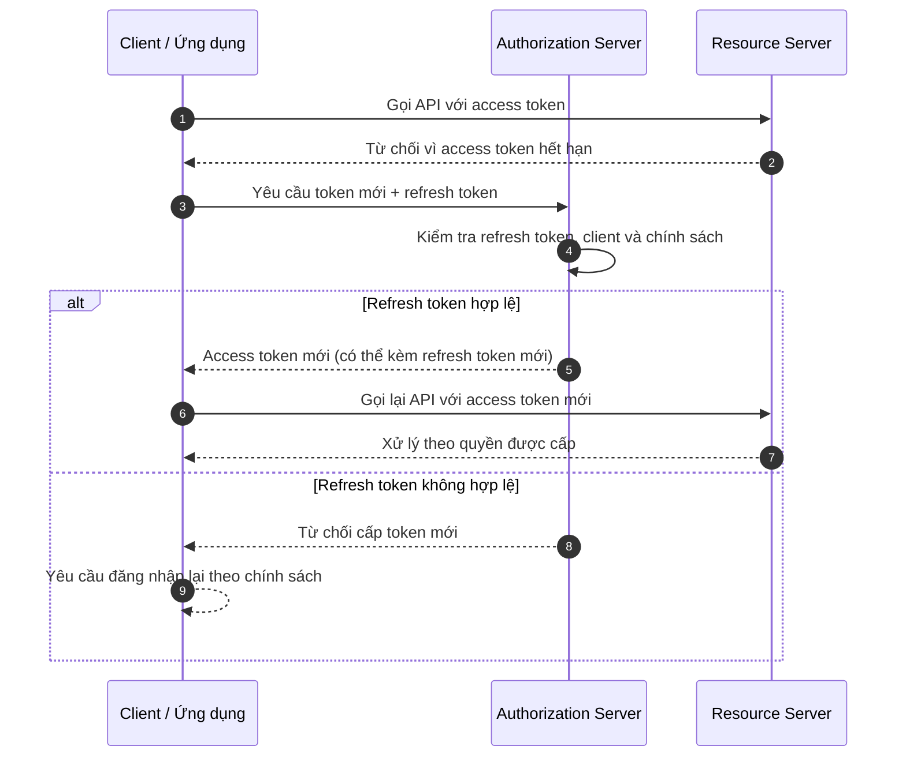
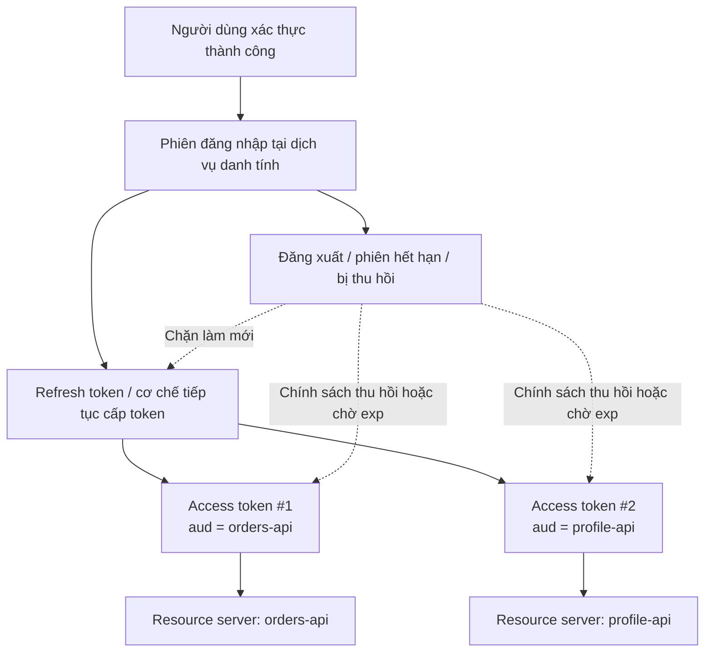

# Phân biệt JWT, token truy cập, token làm mới và phiên đăng nhập

## 1. Bốn khái niệm thường bị gọi chung là “token”

Trong một ứng dụng có đăng nhập, ta thường gặp các thuật ngữ **JWT**, **access token**, **refresh token** và **login session**. Chúng có liên quan nhưng không cùng một lớp khái niệm:

- **JWT** là một định dạng biểu diễn claims trong token, có thể được bảo vệ bằng chữ ký hoặc mã hóa.
- **Access token (token truy cập)** là credential được dùng để yêu cầu truy cập tài nguyên trong phạm vi được cấp. Nó có thể là JWT hoặc chuỗi opaque.
- **Refresh token (token làm mới)** là credential được dùng trong quy trình cấp token để yêu cầu access token mới theo chính sách. Nó thường được giữ kín và không gửi đến API tài nguyên.
- **Login session (phiên đăng nhập)** là trạng thái hoặc khoảng thời gian mà hệ thống duy trì một tương tác đã được xác thực cho người dùng/chủ thể. Phiên có thể được quản lý phía máy chủ hoặc dựa trên credential phía client.

Nhầm lẫn giữa chúng dẫn đến thiết kế sai: coi JWT là một phiên đăng nhập, dùng refresh token để gọi API, nghĩ rằng access token hết hạn đồng nghĩa người dùng phải đăng nhập lại, hoặc cho rằng xóa cookie tại trình duyệt sẽ thu hồi mọi token đã phát hành.

**Cần xác định mỗi thành phần trả lời câu hỏi nào:** JWT nói về *cách biểu diễn dữ liệu*; access token nói về *quyền truy cập được trình bày*; refresh token nói về *khả năng xin credential mới*; session nói về *trạng thái tương tác đã xác thực và vòng đời của nó*.

Bài này thuộc phạm vi **Security - JSON Web Token (JWT)** theo hướng bảo mật tổng quát, độc lập với ngôn ngữ lập trình và framework.

## 2. Bảng phân biệt nhanh

| Tiêu chí | JWT | Access token | Refresh token | Login session |
| --- | --- | --- | --- | --- |
| Bản chất | Định dạng token dựa trên claims JSON | Credential để truy cập tài nguyên | Credential để xin access token mới | Trạng thái/quan hệ tương tác đã xác thực |
| Trả lời câu hỏi | Dữ liệu token được biểu diễn thế nào? | Được phép gọi tài nguyên nào? | Có thể yêu cầu cấp token mới không? | Người dùng còn trong phiên đã đăng nhập không? |
| Có thể là JWT? | Bản thân nó là JWT | Có | Có thể, nhưng thường opaque | Có thể dùng JWT làm phương tiện biểu diễn, nhưng session không đồng nghĩa JWT |
| Bên thường nhận | Thành phần hiểu và xác minh JWT | API/resource server | Authorization server hoặc dịch vụ cấp token | Ứng dụng, máy chủ phiên hoặc dịch vụ danh tính |
| Mục đích | Mang claims và bảo vệ dữ liệu | Trình quyền truy cập được cấp | Tiếp tục quy trình cấp access token | Duy trì trạng thái đăng nhập qua nhiều yêu cầu |
| Thời hạn | Theo claims/chính sách của token | Thường ngắn | Thường dài hơn access token nhưng chịu chính sách riêng | Có idle timeout, absolute timeout và điều kiện kết thúc riêng |
| Thu hồi | Cần cơ chế bổ sung hoặc ngừng tin khóa/chính sách | Có thể hết hạn, bị thu hồi hoặc bị từ chối | Có thể bị thu hồi, xoay vòng hoặc vô hiệu hóa | Có thể kết thúc hoặc thu hồi trạng thái phiên |

Các đặc điểm như thời hạn, cách lưu, cơ chế thu hồi và hình thức token phụ thuộc giao thức cũng như chính sách hệ thống. Bảng trên mô tả các cách dùng phổ biến, không phải yêu cầu bắt buộc cho mọi sản phẩm.

## 3. JWT là định dạng, không phải vai trò sử dụng

JWT được đặc tả trong [RFC 7519](https://www.rfc-editor.org/rfc/rfc7519). Một JWT mang một tập claims được biểu diễn bằng JSON. JWT thường được bảo vệ theo một trong các cách:

- **JWS:** chữ ký hoặc MAC bảo vệ tính toàn vẹn và nguồn gốc theo khóa. Với JWS compact, header và payload được Base64url nên người cầm token có thể đọc được; Base64url không phải mã hóa bí mật.
- **JWE:** mã hóa nội dung để bảo vệ tính bí mật và tính toàn vẹn theo cơ chế được chọn.

Một JWT dạng JWS compact thường có ba phần:

```text
BASE64URL(protected-header).BASE64URL(payload).BASE64URL(signature)
```

Ví dụ payload minh họa:

```json
{
  "iss": "https://identity.example.org",
  "sub": "account-42",
  "aud": "orders-api",
  "iat": 1893456000,
  "exp": 1893456900,
  "scope": "orders:read"
}
```

Trong ví dụ:

- `iss` là bên phát hành.
- `sub` là chủ thể được nhắc đến.
- `aud` là bên nhận dự kiến.
- `iat` và `exp` là thời điểm phát hành và hết hạn theo kiểu NumericDate, tính bằng giây từ Unix epoch.
- `scope` là claim theo quy ước/hồ sơ sử dụng; không phải registered claim bắt buộc của JWT cốt lõi.

Điểm quan trọng là **JWT không tự cho biết token đang đóng vai trò gì**. Một JWT có thể được dùng làm access token, ID token trong OpenID Connect, assertion giữa các dịch vụ hoặc một loại thông điệp khác theo hợp đồng. Bên nhận phải biết loại token và mục đích sử dụng dự kiến, sau đó kiểm tra đúng quy tắc.

Ngược lại, một access token có thể là chuỗi opaque không có cấu trúc JWT. Do đó:

```text
JWT != Access Token
Access Token có thể là JWT hoặc opaque token
Refresh Token có thể là JWT hoặc opaque credential
Login Session != JWT
```

## 4. Access token: credential để truy cập tài nguyên

### 4.1. Access token dùng để làm gì?

Access token đại diện cho quyền truy cập đã được cấp trong một phạm vi và ngữ cảnh nhất định. Client trình access token đến **resource server/API** khi muốn thực hiện thao tác được cho phép.

Ví dụ một yêu cầu HTTP dùng bearer access token:

```http
GET /orders HTTP/1.1
Host: api.example.org
Authorization: Bearer <access-token>
```

Đây là cách truyền phổ biến theo mô hình bearer token. Một bên có được bearer token có thể trình nó, vì vậy access token cần được bảo vệ như một credential. Không phải mọi access token đều dùng đúng header này; cách vận chuyển phụ thuộc giao thức và hồ sơ sử dụng.

### 4.2. Access token không nhất thiết là JWT

Có hai dạng phổ biến:

| Dạng | Đặc điểm | Cách resource server kiểm tra |
| --- | --- | --- |
| **JWT access token** | Mang claims như issuer, subject, audience, thời hạn và scope; có thể xác minh cục bộ | Kiểm tra chữ ký/thuật toán/khóa, issuer, audience, thời gian, loại token và chính sách |
| **Opaque access token** | Chuỗi tham chiếu không tự bộc lộ claims | Tra cứu trạng thái/quyền qua cơ chế được hệ thống hỗ trợ, ví dụ token introspection hoặc kho dữ liệu nội bộ |

JWT có thể giảm nhu cầu gọi dịch vụ trung tâm trong mỗi yêu cầu nếu resource server đã có khóa và chính sách tin cậy. Opaque token có thể giúp kiểm soát tập trung và phản ánh trạng thái mới nhanh hơn thông qua tra cứu. Mỗi lựa chọn có đánh đổi về khả năng sẵn sàng, độ trễ, thu hồi và quản lý khóa.

### 4.3. Access token nên giới hạn quyền và audience

Access token chỉ nên cấp quyền cần thiết cho mục đích cụ thể:

- **Audience:** token dành cho API hoặc resource server nào.
- **Scope/permission:** thao tác hoặc phạm vi tài nguyên được phép.
- **Thời hạn:** khoảng thời gian token có thể được chấp nhận.
- **Subject/client:** token đại diện cho người dùng, ứng dụng hay workload nào theo giao thức.

Ví dụ token có `aud: "orders-api"` và `scope: "orders:read"` không mặc nhiên được dùng ở `payments-api` hoặc thực hiện thao tác ghi đơn hàng. Resource server phải kiểm tra audience, scope và chính sách trên tài nguyên cụ thể.

**Access token hợp lệ không đồng nghĩa mọi yêu cầu đều được phép.** API vẫn cần đánh giá quyền trên hành động và tài nguyên mà client đang yêu cầu.

## 5. Refresh token: credential để xin access token mới

### 5.1. Refresh token giải quyết vấn đề gì?

Access token thường có thời hạn ngắn nhằm giới hạn thiệt hại nếu bị lộ và giảm thời gian quyền cũ còn hiệu lực. Nếu cứ mỗi lần access token hết hạn người dùng phải nhập lại thông tin xác thực, trải nghiệm sẽ kém thuận tiện.

Refresh token cho phép client yêu cầu authorization server cấp access token mới **mà không phải lặp lại toàn bộ quy trình đăng nhập**, miễn là refresh token và phiên/chính sách liên quan vẫn hợp lệ.

Refresh token thường:

- Chỉ được gửi đến authorization server hoặc endpoint cấp token được chỉ định.
- Không được gửi đến resource server để gọi API nghiệp vụ.
- Có thời hạn và chính sách thu hồi riêng.
- Được bảo vệ nghiêm ngặt vì có thể dùng để xin nhiều access token mới.
- Có thể được xoay vòng (rotation), thay refresh token cũ bằng refresh token mới sau mỗi lần sử dụng.

### 5.2. Luồng làm mới access token



Sơ đồ mô tả ý tưởng chung. Cách gửi refresh token, xác thực client, xoay vòng và phản hồi lỗi phải theo giao thức cấp token cụ thể. Trong OAuth 2.0, refresh token được gửi đến authorization server tại token endpoint theo quy tắc của giao thức; resource server không dùng refresh token để truy cập tài nguyên.

### 5.3. Refresh token không phải “access token sống lâu”

Hai credential có mục đích khác nhau:

| | Access token | Refresh token |
| --- | --- | --- |
| Được trình cho | Resource server/API | Authorization server |
| Mục đích | Truy cập tài nguyên | Xin access token mới |
| Quyền thể hiện | Phạm vi truy cập được cấp | Khả năng tiếp tục quy trình cấp token |
| Thời hạn | Thường ngắn | Thường dài hơn, nhưng có giới hạn và chính sách riêng |
| Khi bị lộ | Kẻ khác có thể dùng quyền truy cập trong giới hạn token | Kẻ khác có thể xin access token mới, nên rủi ro thường lớn hơn và kéo dài hơn |

Refresh token không nên được gửi cùng mọi API request. Nếu một API tài nguyên nhận refresh token và coi nó như access token, đó là lỗi phân tách trách nhiệm.

### 5.4. Rotation và phát hiện sử dụng lại

Với **refresh token rotation**, sau khi client sử dụng refresh token hiện tại thành công, authorization server cấp refresh token mới và vô hiệu hóa token cũ. Nếu token cũ bị sử dụng lại, hệ thống có thể coi đó là dấu hiệu token đã bị sao chép và áp dụng biện pháp bảo vệ, ví dụ thu hồi cả nhóm token liên quan hoặc kết thúc phiên.

Rotation cần được triển khai theo một quy tắc rõ ràng:

1. Mỗi lần làm mới, server xác định refresh token còn hợp lệ và thuộc phiên/client nào.
2. Server cấp access token mới và refresh token kế tiếp (nếu dùng rotation).
3. Token refresh cũ bị vô hiệu hóa theo chính sách.
4. Server lưu quan hệ giữa các lần cấp để nhận biết việc tái sử dụng token cũ.
5. Khi phát hiện reuse, server áp dụng hành động ứng phó đã định nghĩa.

Rotation không tự có chỉ vì refresh token được biểu diễn dưới dạng JWT. Đây là cơ chế quản lý vòng đời và trạng thái ở tầng cấp token.

## 6. Login session: trạng thái đăng nhập qua nhiều yêu cầu

### 6.1. Phiên đăng nhập là gì?

HTTP về cơ bản không tự duy trì trạng thái đăng nhập giữa các yêu cầu độc lập. Sau khi xác thực thành công, hệ thống cần một cách nhận biết các yêu cầu tiếp theo thuộc cùng một phiên hoặc cùng một ngữ cảnh đã xác thực. **Login session** là khái niệm mô tả trạng thái tương tác đó.

Một phiên đăng nhập có thể chứa hoặc tham chiếu đến:

- Định danh người dùng/chủ thể.
- Thời điểm đăng nhập và phương thức xác thực.
- Trạng thái xác thực nhiều yếu tố hoặc mức độ bảo đảm.
- Thời điểm hoạt động gần nhất.
- Thời điểm hết hạn tuyệt đối.
- Thiết bị/client hoặc ngữ cảnh phiên.
- Trạng thái bị khóa, kết thúc hoặc cần xác thực lại.
- Liên kết đến access token, refresh token hoặc các credential đã cấp.

Phiên đăng nhập thường có **vòng đời riêng**. Người dùng có thể vẫn còn phiên tại dịch vụ danh tính trong khi access token của API đã hết hạn. Ngược lại, access token có thể chưa hết hạn theo `exp` nhưng phiên đã bị kết thúc hoặc trạng thái tài khoản đã thay đổi; hệ thống cần cơ chế để resource server biết điều đó nếu yêu cầu bảo mật đòi hỏi.

### 6.2. Session ID và cookie phiên

Một thiết kế stateful phổ biến:

1. Người dùng đăng nhập thành công.
2. Máy chủ tạo một bản ghi phiên và sinh một session ID ngẫu nhiên, khó đoán.
3. Trình duyệt lưu session ID trong cookie.
4. Mỗi yêu cầu tiếp theo gửi cookie; máy chủ tra cứu session ID để tìm trạng thái phiên.
5. Khi đăng xuất hoặc phiên hết hạn, máy chủ vô hiệu hóa bản ghi phiên.

Ví dụ header cookie:

```http
Set-Cookie: session_id=<opaque-random-value>; Secure; HttpOnly; SameSite=Lax; Path=/
```

Cookie trên mang một **định danh tham chiếu**, không nhất thiết chứa toàn bộ dữ liệu phiên. Máy chủ dùng định danh này để tra cứu trạng thái. Các thuộc tính:

- `Secure`: chỉ gửi cookie qua kênh bảo mật phù hợp (HTTPS).
- `HttpOnly`: hạn chế việc truy cập cookie từ mã phía client.
- `SameSite`: kiểm soát một phần việc gửi cookie trong ngữ cảnh site khác, giúp giảm một số rủi ro CSRF.
- `Path` và các thuộc tính liên quan: giới hạn phạm vi gửi cookie.

Các thuộc tính này cần được chọn theo kiến trúc và yêu cầu ứng dụng. Cookie tự nó không chứng minh một phiên còn hợp lệ; máy chủ vẫn phải kiểm tra trạng thái và chính sách.

### 6.3. Phiên stateful và phiên dựa trên token

| Đặc điểm | Phiên stateful phía máy chủ | Credential tự chứa như JWT |
| --- | --- | --- |
| Trạng thái chính | Lưu tại máy chủ/kho phiên | Một phần claims nằm trong token |
| Mỗi yêu cầu | Thường tra cứu session ID | Có thể xác minh cục bộ nếu token có chữ ký và khóa tin cậy |
| Thu hồi tức thì | Có thể vô hiệu hóa bản ghi phiên tập trung | Cần cơ chế bổ sung, danh sách chặn, kiểm tra trạng thái hoặc thiết kế khác |
| Thông tin mới nhất | Có thể đọc trạng thái mới tại kho phiên | Claims có thể cũ cho đến khi token hết hạn hoặc bị kiểm tra bổ sung |
| Vận hành | Cần kho phiên sẵn sàng và chia sẻ giữa các instance | Cần quản lý khóa, thời hạn, chính sách và có thể vẫn cần trạng thái thu hồi |

Không nên gọi một kiến trúc là “stateless hoàn toàn” chỉ vì dùng JWT. Nếu hệ thống cần danh sách thu hồi, trạng thái phiên, quản lý refresh token hoặc kiểm tra quyền mới nhất, nó vẫn có trạng thái ở những thành phần đó.

## 7. Một phiên đăng nhập có thể liên quan đến nhiều token

Một phiên đăng nhập không nhất thiết tương ứng với đúng một JWT hoặc một access token. Sau khi xác thực, hệ thống có thể:

- Duy trì phiên tại dịch vụ danh tính.
- Cấp access token cho một hoặc nhiều resource server theo audience và quyền phù hợp.
- Cấp refresh token để tiếp tục xin access token.
- Cấp lại access token nhiều lần trong suốt phiên.
- Kết thúc phiên, thu hồi refresh token và áp dụng chính sách cho các access token còn hiệu lực.



Sơ đồ thể hiện quan hệ có thể có, không khẳng định mọi hệ thống đều cấp nhiều token hoặc lưu refresh token giống nhau. Điểm cần nhớ: **phiên là trạng thái rộng hơn một access token đơn lẻ**. Một phiên có thể tạo ra nhiều access token ở các thời điểm khác nhau.

## 8. Thời hạn của phiên và token không nhất thiết giống nhau

Một hệ thống có thể áp dụng nhiều mốc thời gian:

| Thời hạn | Áp dụng cho | Ý nghĩa |
| --- | --- | --- |
| **Access token lifetime** | Access token | Khoảng thời gian API có thể chấp nhận token nếu các kiểm tra khác đạt |
| **Refresh token lifetime** | Refresh token | Khoảng thời gian credential còn có thể được dùng để xin token mới, nếu chưa bị thu hồi |
| **Idle session timeout** | Phiên đăng nhập | Kết thúc phiên nếu không có hoạt động trong khoảng thời gian quy định |
| **Absolute session timeout** | Phiên đăng nhập | Giới hạn tổng thời gian sống của phiên, kể cả khi người dùng hoạt động liên tục |
| **Reauthentication interval** | Quy trình xác thực | Yêu cầu người dùng xác thực lại sau một khoảng thời gian hoặc trước thao tác nhạy cảm |

Ví dụ minh họa:

- Phiên đăng nhập có thời hạn tuyệt đối 8 giờ.
- Phiên kết thúc nếu không hoạt động trong 30 phút.
- Access token sống 10 phút.
- Refresh token có thể được dùng trong thời gian phiên còn hợp lệ, chịu thêm chính sách riêng.

Trong 8 giờ đó, client có thể nhận nhiều access token khác nhau. Khi một access token hết hạn, client có thể xin token mới bằng refresh token. Điều này **không nhất thiết tạo một phiên đăng nhập mới** và cũng không nhất thiết yêu cầu người dùng nhập lại thông tin xác thực.

Nếu phiên bị kết thúc tại giờ thứ 2, authorization server cần từ chối các yêu cầu làm mới tiếp theo theo chính sách. Access token đã phát hành có thể vẫn vượt qua xác minh chữ ký cục bộ cho đến khi hết hạn, trừ khi resource server có cơ chế nhận biết việc thu hồi hoặc kết thúc phiên.

## 9. Đăng xuất, thu hồi và hết hạn: ba hành động khác nhau

Các hành động sau có phạm vi khác nhau:

| Hành động | Điều gì xảy ra? | Điều gì chưa chắc xảy ra? |
| --- | --- | --- |
| **Xóa cookie/local credential** | Client không còn gửi credential đang lưu tại vị trí đó | Không tự thu hồi bản sao token đã bị đánh cắp hoặc token ở thiết bị khác |
| **Kết thúc phiên** | Trạng thái phiên bị vô hiệu hóa tại nơi quản lý phiên | Không tự làm mọi access token tự chứa mất hiệu lực nếu resource server không kiểm tra trạng thái |
| **Thu hồi refresh token** | Credential không còn dùng được để xin access token mới | Không nhất thiết vô hiệu hóa access token đã cấp trước đó |
| **Thu hồi access token** | Token bị đánh dấu không còn được chấp nhận qua cơ chế thu hồi được hỗ trợ | Không có cơ chế tức thì chung chỉ nhờ JWT; verifier phải kiểm tra trạng thái |
| **Hết hạn token** | Token không còn được chấp nhận sau `exp` theo chính sách thời gian | Không tự xóa token khỏi thiết bị hay kết thúc toàn bộ phiên |
| **Đăng xuất tại identity provider** | Phiên tại dịch vụ danh tính có thể được kết thúc | Không mặc nhiên đăng xuất mọi ứng dụng hoặc thu hồi mọi credential nếu chưa có cơ chế phối hợp |

### Ví dụ khi người dùng đăng xuất

Giả sử người dùng có:

- Một phiên đăng nhập tại dịch vụ danh tính.
- Một refresh token đang lưu ở client.
- Một access token JWT còn hiệu lực 7 phút.

Khi người dùng bấm “Đăng xuất”, hệ thống có thể:

1. Xóa cookie/credential phía client.
2. Gọi quy trình logout hoặc kết thúc phiên tại dịch vụ danh tính.
3. Thu hồi refresh token hoặc nhóm token liên quan.
4. Nếu cần chặn access token ngay, cập nhật trạng thái thu hồi và bảo đảm resource server kiểm tra trạng thái ấy; nếu không, token có thể còn được chấp nhận đến `exp`.

Vì vậy, giao diện báo “đã đăng xuất” không tự chứng minh mọi bản sao access token ở mọi nơi đã mất hiệu lực. Kiến trúc cần xác định rõ phạm vi đăng xuất: local app, phiên tại identity provider, một thiết bị, tất cả thiết bị hay toàn bộ credential.

## 10. Các rủi ro và nguyên tắc bảo vệ

### 10.1. Access token bị lộ

Nếu access token là bearer credential, kẻ tấn công có thể trình token trong thời gian token còn được chấp nhận. Biện pháp giảm thiểu:

- Dùng HTTPS/TLS.
- Giới hạn audience, scope và thời hạn.
- Không ghi token nguyên văn vào log hoặc đưa token vào URL.
- Bảo vệ nơi lưu token theo mô hình đe dọa.
- Cân nhắc sender-constrained token khi cần ràng buộc token với bên trình.

### 10.2. Refresh token bị lộ

Refresh token thường có khả năng tạo ra access token mới, vì vậy có thể có giá trị cao hơn access token đơn lẻ. Cần:

- Chỉ gửi refresh token đến authorization server đúng theo giao thức.
- Lưu giữ với mức bảo vệ cao.
- Áp dụng rotation và phát hiện reuse nếu phù hợp.
- Ràng buộc với client/phiên khi giao thức và kiến trúc hỗ trợ.
- Thu hồi khi phát hiện xâm phạm hoặc khi phiên kết thúc.

### 10.3. Session fixation và chiếm đoạt phiên

Nếu attacker có thể khiến nạn nhân sử dụng một session ID do attacker biết trước, rồi nạn nhân đăng nhập, attacker có thể thử dùng lại session ID đó. Một biện pháp quan trọng là **tạo session ID mới sau khi xác thực hoặc sau khi nâng mức quyền**, đồng thời vô hiệu hóa định danh phiên cũ theo chính sách.

Đối với cookie phiên, cần chọn thuộc tính Secure, HttpOnly, SameSite và phạm vi cookie hợp lý; kết hợp biện pháp chống CSRF khi mô hình gửi cookie tự động có rủi ro. XSS vẫn có thể thực hiện hành động thay người dùng ngay cả khi cookie được đặt HttpOnly, vì vậy cần bảo vệ ứng dụng khỏi mã độc.

### 10.4. Nhầm ID token với access token

Trong OpenID Connect, **ID token** truyền thông tin xác thực đến client theo quy tắc OIDC. **Access token** được dùng để truy cập resource server. Cả hai có thể được biểu diễn bằng JWT, nhưng audience và mục đích khác nhau. Resource server không được mặc định chấp nhận ID token như access token.

### 10.5. Cho rằng JWT tự giải quyết thu hồi

JWT dạng tự chứa có thể được xác minh cục bộ, nhưng điều đó khiến thông tin trong token không tự cập nhật khi phiên hoặc quyền thay đổi. Nếu cần thu hồi trước hạn, hệ thống phải có cơ chế trạng thái bổ sung, ví dụ denylist, introspection, kiểm tra phiên hoặc thời hạn access token ngắn kết hợp với yêu cầu rủi ro phù hợp.

## 11. Cách lựa chọn mô hình cho một hệ thống

Không có một mô hình duy nhất phù hợp mọi trường hợp. Có thể bắt đầu bằng các câu hỏi:

| Nhu cầu | Hướng thiết kế có thể cân nhắc |
| --- | --- |
| Cần kiểm soát phiên và đăng xuất tức thì | Phiên stateful phía máy chủ hoặc cơ chế kiểm tra trạng thái tập trung |
| Nhiều API cần xác minh claims cục bộ | JWT access token với issuer, audience, khóa và chính sách được cấu hình rõ |
| Muốn thu hồi token tập trung | Opaque access token hoặc JWT kết hợp introspection/denylist |
| Muốn giảm việc đăng nhập lại khi access token hết hạn | Refresh token với thời hạn, rotation và thu hồi rõ ràng |
| Ứng dụng web dùng cookie phiên | Session ID ngẫu nhiên, cookie được bảo vệ, quản lý CSRF và vòng đời phiên |
| Cần giảm khả năng token bị sao chép rồi dùng lại | Sender-constrained token và cơ chế xác minh bằng chứng tương ứng |

Một hệ thống thực tế có thể kết hợp nhiều lựa chọn: phiên stateful tại identity provider, refresh token được quản lý tập trung, access token JWT thời hạn ngắn cho nhiều API, và cookie an toàn ở ứng dụng web. Điều quan trọng là định nghĩa rõ **ai quản lý trạng thái nào, credential nào được gửi đến đâu, và điều kiện nào khiến quyền sử dụng kết thúc**.

## 12. Bài tập phân biệt khái niệm

Một ứng dụng có các hành vi:

1. Người dùng đăng nhập thành công và ứng dụng nhận một cookie `session_id`.
2. Ứng dụng dùng một access token để gọi `orders-api`.
3. Access token hết hạn sau 10 phút.
4. Ứng dụng gửi refresh token đến authorization server và nhận access token mới.
5. Người dùng đăng xuất; server kết thúc phiên và vô hiệu hóa refresh token.

Hãy phân loại:

| Thành phần/sự kiện | Khái niệm |
| --- | --- |
| Chuỗi token có header, claims và chữ ký | JWT (nếu token được định dạng theo RFC 7519/JWS) |
| Credential được gửi đến `orders-api` | Access token |
| Credential được gửi đến authorization server để xin token mới | Refresh token |
| Trạng thái đăng nhập được duy trì sau khi xác thực | Login session |
| Cookie chứa định danh ngẫu nhiên tham chiếu đến bản ghi phiên | Session cookie/session ID |
| Thời điểm access token không còn được chấp nhận | Access token expiration |
| Sự kiện server chấm dứt trạng thái phiên | Session termination |
| Việc vô hiệu hóa refresh credential | Refresh token revocation |

Nếu access token mới cũng là JWT, việc nó là JWT không làm nó trở thành refresh token. **Định dạng và chức năng credential là hai trục phân loại độc lập.**

## 13. Kết luận

JWT, access token, refresh token và login session có liên quan nhưng không thể thay thế tên gọi cho nhau:

- **JWT** mô tả định dạng biểu diễn claims và cơ chế bảo vệ token.
- **Access token** cho phép client trình quyền truy cập tới resource server trong phạm vi được cấp.
- **Refresh token** cho phép client yêu cầu access token mới qua quy trình cấp token nếu credential và chính sách còn hợp lệ.
- **Login session** duy trì trạng thái tương tác đã xác thực và có vòng đời riêng.

Một access token có thể là JWT hoặc opaque. Một refresh token có thể dùng định dạng khác và thường được giữ kín. Một phiên có thể tồn tại qua nhiều lần cấp access token. Đăng xuất, thu hồi và hết hạn cũng có phạm vi khác nhau.

Thiết kế bảo mật tốt bắt đầu từ việc phân định đúng từng credential, nơi được phép gửi, bên chịu trách nhiệm xác minh, cách lưu giữ và điều kiện kết thúc hiệu lực.

## Tài liệu chuẩn để đọc tiếp

- [RFC 7519 — JSON Web Token (JWT)](https://www.rfc-editor.org/rfc/rfc7519): định dạng JWT và registered claims.
- [RFC 7515 — JSON Web Signature (JWS)](https://www.rfc-editor.org/rfc/rfc7515): chữ ký và bảo vệ tính toàn vẹn.
- [RFC 7516 — JSON Web Encryption (JWE)](https://www.rfc-editor.org/rfc/rfc7516): mã hóa nội dung JWT.
- [RFC 6749 — The OAuth 2.0 Authorization Framework](https://www.rfc-editor.org/rfc/rfc6749): access token, refresh token và quy trình cấp quyền.
- [RFC 6750 — OAuth 2.0 Bearer Token Usage](https://www.rfc-editor.org/rfc/rfc6750): cách sử dụng bearer access token.
- [RFC 7009 — OAuth 2.0 Token Revocation](https://www.rfc-editor.org/rfc/rfc7009): thu hồi access token và refresh token trong OAuth 2.0.
- [RFC 7662 — OAuth 2.0 Token Introspection](https://www.rfc-editor.org/rfc/rfc7662): kiểm tra trạng thái token qua authorization server.
- [OpenID Connect Core 1.0](https://openid.net/specs/openid-connect-core-1_0.html): ID token và lớp định danh trên OAuth 2.0.
