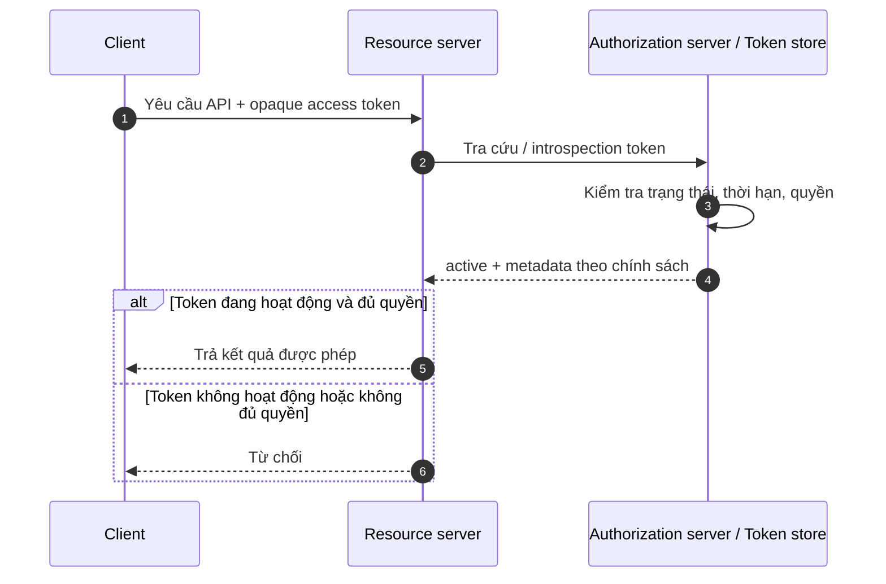
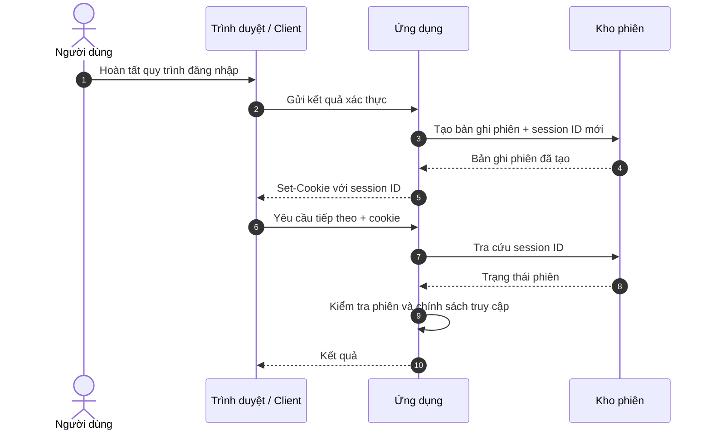

# Phân biệt JWT với token tham chiếu và mã định danh phiên

## 1. Ba giá trị có thể trông giống nhau nhưng mang ý nghĩa khác nhau

Khi một client gửi một chuỗi đến máy chủ để chứng minh quyền sử dụng, chuỗi đó có thể là:

- **JWT (JSON Web Token):** token mang một tập claims được biểu diễn theo định dạng chuẩn; bên nhận có thể xác minh chữ ký hoặc giải mã theo cơ chế được cấu hình.
- **Reference token / opaque token (token tham chiếu):** một giá trị khó đoán, không tự bộc lộ thông tin nghiệp vụ; máy chủ dùng nó làm khóa tra cứu trạng thái hoặc quyền được lưu ở nơi khác.
- **Session identifier / session ID (mã định danh phiên):** một giá trị dùng để nhận diện phiên đăng nhập hoặc phiên tương tác đã được máy chủ tạo và quản lý.

Cả ba có thể được truyền dưới dạng chuỗi ký tự và có thể được gửi qua HTTP. Vì thế, nhìn một chuỗi như `eyJ...` hoặc một chuỗi ngẫu nhiên không đủ để biết nó là loại nào. **Cần xác định vai trò và cách bên nhận xử lý giá trị đó.**

Một điểm dễ nhầm: token tham chiếu và session ID thường đều là giá trị opaque dùng để tra cứu dữ liệu phía máy chủ. Chúng có thể có hình thức kỹ thuật tương tự, thậm chí cùng được lưu trong cookie hoặc header. Nhưng **token tham chiếu thường đại diện cho một credential/quyền truy cập**, còn **session ID nhận diện một trạng thái phiên**. Hai khái niệm có thể được kết hợp trong một kiến trúc nhưng không nên tự động coi là đồng nghĩa.

Nội dung thuộc phạm vi **Security - JSON Web Token (JWT)** theo hướng bảo mật tổng quát, độc lập với ngôn ngữ lập trình và framework.

## 2. Phân biệt theo bản chất

| Tiêu chí | JWT | Reference / opaque token | Session identifier |
| --- | --- | --- | --- |
| Bản chất | Định dạng token chứa claims | Giá trị tham chiếu đến trạng thái/credential phía máy chủ | Định danh của một phiên |
| Nội dung tự mô tả | Thường có claims có thể đọc sau khi giải mã (nếu là JWS) | Không mang claims có thể tự diễn giải theo hợp đồng; cần tra cứu | Bản thân ID không nhất thiết chứa thông tin phiên |
| Cách kiểm tra | Xác minh chữ ký/MAC hoặc giải mã, rồi kiểm tra claims và chính sách | Tra cứu kho dữ liệu hoặc gọi dịch vụ introspection theo thiết kế | Tra cứu bản ghi phiên và kiểm tra trạng thái, thời hạn, chủ thể |
| Trạng thái chính | Có thể được mang trong claims; hệ thống vẫn có thể giữ trạng thái bổ sung | Thường nằm phía máy chủ | Nằm trong kho phiên hoặc dịch vụ quản lý phiên |
| Thu hồi | Không có cơ chế thu hồi tức thì chung nằm trong chuỗi JWT; cần thiết kế bổ sung | Có thể vô hiệu hóa tham chiếu ở máy chủ | Có thể kết thúc/vô hiệu hóa bản ghi phiên |
| Dữ liệu lộ ra | Payload JWS thường đọc được; JWE có thể mã hóa | Giá trị không tự tiết lộ claims, nhưng vẫn là credential nhạy cảm | ID không nên chứa dữ liệu cá nhân; bản ghi phiên được giữ phía máy chủ |
| Cách dùng thường gặp | Access token tự chứa, ID token trong OIDC, assertion | Opaque access token hoặc credential tham chiếu | Cookie phiên của ứng dụng web |

Không phải mọi JWT đều là access token; không phải mọi access token đều là JWT; và không phải mọi session ID đều là access token. Các khái niệm này thuộc những lớp khác nhau: **JWT nói về định dạng**, **reference token nói về cách tra cứu**, **session ID nói về đối tượng trạng thái được nhận diện**.

## 3. JWT: token tự chứa các claims được bảo vệ

JWT được đặc tả trong [RFC 7519](https://www.rfc-editor.org/rfc/rfc7519). Một JWT mang một tập claims JSON, chẳng hạn:

```json
{
  "iss": "https://identity.example.org",
  "sub": "account-42",
  "aud": "orders-api",
  "iat": 1893456000,
  "exp": 1893456900,
  "scope": "orders:read"
}
```

Trong ví dụ:

- `iss` xác định issuer được khẳng định.
- `sub` là chủ thể mà token đề cập.
- `aud` xác định bên nhận dự kiến.
- `iat` và `exp` là thời điểm phát hành và hết hạn theo NumericDate, thường tính bằng giây từ Unix epoch.
- `scope` là claim theo quy ước/hồ sơ sử dụng, không phải registered claim bắt buộc của JWT cốt lõi.

### 3.1. Cách bên nhận kiểm tra

JWT dạng JWS compact thường có ba phần:

```text
BASE64URL(protected-header).BASE64URL(payload).BASE64URL(signature)
```

Bên nhận có thể đọc header và payload sau khi giải mã Base64url, nhưng phải xác minh chữ ký/MAC bằng khóa thuộc nguồn tin cậy trước khi sử dụng claims. Base64url **không phải mã hóa bí mật**.

Quy trình kiểm tra điển hình:

1. Parse token theo định dạng được hỗ trợ và giới hạn kích thước đầu vào.
2. Xác định issuer và chính sách tin cậy đã cấu hình.
3. Chỉ chấp nhận thuật toán được cho phép; chọn khóa từ nguồn tin cậy.
4. Xác minh chữ ký/MAC hoặc giải mã JWE theo đúng chính sách.
5. Kiểm tra issuer, audience, loại token, thời gian và claims bắt buộc.
6. Áp dụng chính sách quyền trên thao tác và tài nguyên.

**Không được tin claims chỉ vì parse thành công.** Một JWT có chữ ký hợp lệ cũng chưa chắc được phép dùng ở API đang nhận nó.

### 3.2. Trạng thái trong JWT và trạng thái ngoài JWT

JWT thường được gọi là *self-contained* vì nó mang claims đủ để bên nhận đánh giá nhiều điều kiện mà không phải truy vấn kho dữ liệu trong mọi yêu cầu. Tuy nhiên, điều đó không đồng nghĩa hệ thống không có trạng thái:

- Issuer vẫn quản lý khóa và chính sách phát hành.
- Verifier có thể duy trì denylist hoặc trạng thái thu hồi.
- Hệ thống có thể kiểm tra trạng thái tài khoản hoặc phiên.
- Token có thể mang `jti` để hỗ trợ nhận diện, nhưng `jti` tự nó không tạo ra khả năng thu hồi.

Nếu quyền thay đổi sau khi JWT được phát hành, claims trong token không tự cập nhật. Nếu cần thu hồi ngay, hệ thống phải bổ sung một cơ chế để verifier biết token hoặc phiên đã bị vô hiệu hóa.

## 4. Reference token: giá trị tham chiếu đến trạng thái phía máy chủ

### 4.1. Bản chất của token tham chiếu

Reference token (thường gọi là **opaque token**) là một chuỗi được tạo đủ khó đoán để client trình cho máy chủ. Chuỗi này không tự mang một tập claims mà resource server có thể tin cậy chỉ bằng cách giải mã. Thay vào đó, nó đóng vai trò như **khóa tra cứu**:

```text
Client gửi reference token
          |
          v
Resource server / dịch vụ kiểm tra
          |
          v
Tra cứu token trong kho dữ liệu
          |
          v
Đọc trạng thái, chủ thể, audience, scope, thời hạn
          |
          v
Chấp nhận hoặc từ chối theo chính sách
```

Giá trị token có thể là một chuỗi ngẫu nhiên, không chứa user ID, scope hay thời gian hết hạn ở dạng đọc được. Máy chủ duy trì thông tin tương ứng trong cơ sở dữ liệu hoặc dịch vụ quản lý token.

### 4.2. Luồng kiểm tra reference access token



Trong OAuth 2.0, **Token Introspection** được chuẩn hóa trong [RFC 7662](https://www.rfc-editor.org/rfc/rfc7662). Resource server có thể hỏi authorization server về trạng thái của token qua endpoint introspection khi hệ thống hỗ trợ. RFC 7662 định nghĩa phản hồi có trường `active` và có thể có metadata như scope, client, subject, audience, issuer hoặc thời hạn tùy chính sách.

Không phải mọi reference token đều bắt buộc phải dùng RFC 7662. Một hệ thống nội bộ có thể tra cứu kho dữ liệu trực tiếp hoặc dùng giao thức riêng. Điều quan trọng là **bên nhận cần nguồn dữ liệu có thẩm quyền để biết token còn hoạt động và được phép dùng hay không**.

### 4.3. Ưu điểm và đánh đổi

| Ưu điểm | Đánh đổi |
| --- | --- |
| Có thể thu hồi tập trung bằng cách vô hiệu hóa bản ghi | Resource server cần truy cập kho dữ liệu hoặc dịch vụ kiểm tra |
| Quyền và trạng thái mới có thể được phản ánh nhanh qua tra cứu | Tăng độ trễ và phụ thuộc vào khả năng sẵn sàng của dịch vụ trạng thái |
| Chuỗi token không tự bộc lộ claims | Máy chủ phải bảo vệ kho token và metadata |
| Token thường ngắn hơn một JWT nhiều claims | Cần quản lý ánh xạ token đến chủ thể, audience, scope và thời hạn |
| Dễ áp dụng chính sách tập trung | Cache trạng thái có thể làm chậm việc nhận biết thu hồi nếu không thiết kế cẩn thận |

Opaque không có nghĩa là không nhạy cảm. Nếu token bị đánh cắp, kẻ tấn công vẫn có thể sử dụng nó theo quyền được cấp. Giá trị tham chiếu phải có entropy cao, được truyền qua kênh bảo mật và được bảo vệ khi lưu giữ.

## 5. Session identifier: mã định danh một phiên

### 5.1. Session ID nhận diện điều gì?

Session identifier (session ID) là giá trị dùng để máy chủ nhận ra **bản ghi phiên cụ thể** trong những yêu cầu tiếp theo. Sau khi người dùng xác thực thành công, máy chủ có thể tạo một phiên và sinh session ID ngẫu nhiên. Client giữ ID này, thường trong cookie, rồi gửi lại khi truy cập ứng dụng.

Ví dụ:

```http
Set-Cookie: session_id=<random-session-id>; Secure; HttpOnly; SameSite=Lax; Path=/
```

Cookie chỉ mang một định danh tham chiếu. Máy chủ tra cứu bản ghi phiên tương ứng, có thể chứa:

- Chủ thể hoặc tài khoản đã xác thực.
- Thời điểm tạo phiên và lần hoạt động gần nhất.
- Thời hạn nhàn rỗi (*idle timeout*) và thời hạn tuyệt đối.
- Mức độ xác thực hoặc trạng thái xác thực nhiều yếu tố.
- Client/thiết bị và các thuộc tính rủi ro theo chính sách.
- Trạng thái hoạt động, bị khóa hoặc đã kết thúc.
- Liên kết đến quyền hoặc credential liên quan nếu kiến trúc cần.

Session ID **không phải danh tính người dùng** và không nên chứa trực tiếp thông tin cá nhân hoặc quyền ở dạng dễ đọc. Nó là một giá trị bí mật có khả năng tham chiếu đến trạng thái phiên.

### 5.2. Luồng phiên phía máy chủ



Phiên có thể bị kết thúc bằng cách vô hiệu hóa bản ghi phía máy chủ. Từ thời điểm các thành phần kiểm tra trạng thái nhận biết thay đổi, session ID cũ không còn đại diện cho phiên hoạt động.

### 5.3. Session ID là credential nhạy cảm

Trong mô hình cookie phiên thông thường, ai có được session ID có thể thử mạo danh phiên tương ứng. Vì vậy:

- Sinh ID bằng nguồn ngẫu nhiên mật mã, có entropy đủ lớn và không thể đoán.
- Dùng HTTPS/TLS; đặt cookie phù hợp như `Secure`, `HttpOnly`, `SameSite`.
- Không đưa session ID vào URL, log hoặc thông điệp lỗi.
- Tạo ID mới sau đăng nhập và khi nâng quyền để chống session fixation.
- Hủy hoặc vô hiệu hóa phiên phía máy chủ khi đăng xuất, hết hạn hoặc phát hiện xâm phạm.
- Có biện pháp chống CSRF nếu trình duyệt tự động gửi cookie trong yêu cầu cross-site; `SameSite` hữu ích nhưng không phải lúc nào cũng là biện pháp duy nhất.

Session ID không tự chống được XSS hoặc CSRF. `HttpOnly` hạn chế việc đọc cookie từ script, nhưng mã độc chạy trong origin vẫn có thể thực hiện hành động thay người dùng. Các lớp bảo vệ ứng dụng vẫn cần thiết.

## 6. Reference token và session ID: giống ở hình thức, khác ở ngữ nghĩa

Đây là phần dễ nhầm nhất vì cả hai có thể là chuỗi ngẫu nhiên và đều cần tra cứu phía máy chủ.

| Câu hỏi | Reference token | Session ID |
| --- | --- | --- |
| Nó tham chiếu đến gì? | Một credential/token record và metadata quyền truy cập | Một bản ghi phiên đăng nhập/tương tác |
| Bên thường nhận | Resource server hoặc authorization server tùy quy trình | Ứng dụng hoặc dịch vụ quản lý phiên |
| Trạng thái được tra cứu | Token active/revoked, subject, client, scope, audience, expiry | Session active/ended, chủ thể, idle/absolute timeout, mức xác thực |
| Mục đích chính | Chứng minh client đang có credential được cấp để truy cập tài nguyên | Liên kết các yêu cầu với cùng một phiên đã xác thực |
| Thu hồi | Vô hiệu hóa token record hoặc thu hồi theo giao thức | Kết thúc/vô hiệu hóa session record |
| Phạm vi | Có thể dành cho một resource server hoặc nhiều audience theo chính sách | Thường gắn với ứng dụng, thiết bị hoặc phiên cụ thể |

### 6.1. Một session ID có thể được dùng như opaque credential không?

Về mặt kỹ thuật, session ID thường là một opaque value. Nếu máy chủ nhận nó và tra cứu trạng thái, nó có hình thức tương tự reference token. Tuy nhiên, ý nghĩa nghiệp vụ khác nhau:

- Nếu giá trị được dùng để khôi phục trạng thái đăng nhập của ứng dụng, nó đang đóng vai trò **session identifier**.
- Nếu giá trị được cấp như access credential để resource server tra cứu quyền truy cập, nó đang đóng vai trò **reference access token**.
- Một kiến trúc có thể liên kết token record với session record hoặc dùng một định danh chung, nhưng phải xác định rõ chính sách và phạm vi của từng vai trò.

Không nên mặc định một session cookie có thể được gửi đến mọi API như access token, hoặc một opaque access token có thể thay thế đầy đủ quy trình quản lý phiên của ứng dụng.

### 6.2. Vì sao không nên dùng một chuỗi cho mọi mục đích?

Nếu cùng một giá trị vừa là session ID, vừa là access token cho nhiều API, vừa là refresh credential, việc lộ một bản sao có thể mở rộng phạm vi thiệt hại. Các mục đích khác nhau thường cần:

- Audience và quyền khác nhau.
- Thời hạn và cơ chế thu hồi khác nhau.
- Nơi lưu và kênh truyền khác nhau.
- Chính sách rotation, kiểm tra trạng thái và giám sát khác nhau.

Tách credential theo mục đích giúp giới hạn quyền và thu hồi chính xác hơn. Nếu hệ thống cố ý hợp nhất, cần đánh giá rõ rủi ro và kiểm soát tương đương.

## 7. Cách ba mô hình hoạt động trong cùng một kiến trúc

Giả sử một tổ chức có trình duyệt web, dịch vụ danh tính và API đơn hàng. Có thể triển khai theo các mô hình khác nhau:

### Mô hình A — JWT access token

1. Người dùng đăng nhập qua dịch vụ danh tính.
2. Dịch vụ cấp JWT access token với `aud: "orders-api"`, scope phù hợp và `exp` ngắn.
3. Trình duyệt hoặc một thành phần client được phép giữ token.
4. API đơn hàng xác minh chữ ký bằng khóa tin cậy, kiểm tra issuer, audience, thời gian và quyền.
5. Nếu cần thu hồi trước hạn, hệ thống bổ sung trạng thái hoặc chính sách kiểm tra khác.

### Mô hình B — Opaque reference access token

1. Người dùng đăng nhập và được cấp một access token ngẫu nhiên.
2. Client gửi token đến API đơn hàng.
3. API tra cứu token hoặc gọi introspection.
4. Dịch vụ có thẩm quyền trả trạng thái active, audience, scope và thời hạn.
5. Khi token bị thu hồi, bản ghi bị vô hiệu hóa; các lần kiểm tra tiếp theo sẽ nhận trạng thái không hoạt động theo độ mới của dữ liệu/cache.

### Mô hình C — Session ID cho ứng dụng web

1. Người dùng đăng nhập vào ứng dụng.
2. Ứng dụng tạo session record và gửi session ID qua cookie an toàn.
3. Các yêu cầu tiếp theo mang cookie; ứng dụng tra cứu session record.
4. Khi hết idle timeout, absolute timeout hoặc đăng xuất, ứng dụng vô hiệu hóa phiên.
5. Nếu ứng dụng cần gọi API riêng, nó có thể sử dụng credential khác phù hợp với API thay vì tự động dùng session ID làm access token.

Ba mô hình không loại trừ lẫn nhau. Một ứng dụng có thể dùng session ID giữa trình duyệt và web app, rồi dùng access token riêng giữa backend và API. Access token đó có thể là JWT hoặc opaque tùy kiến trúc.

## 8. So sánh vận hành: trạng thái, thu hồi và độ sẵn sàng

| Khía cạnh | JWT tự chứa | Reference token | Session ID |
| --- | --- | --- | --- |
| Nguồn quyết định ban đầu | Claims đã được issuer bảo vệ | Token record trong kho/dịch vụ có thẩm quyền | Session record trong kho phiên |
| Xử lý mỗi yêu cầu | Có thể cục bộ sau khi xác minh | Thường cần tra cứu hoặc cache kết quả | Thường cần tra cứu hoặc cache trạng thái phiên |
| Phản ánh thay đổi quyền | Claims cũ có thể còn hiệu lực đến `exp` nếu không kiểm tra thêm | Có thể cập nhật trạng thái token/scope ở nơi lưu | Có thể cập nhật trạng thái phiên, nhưng quyền tài nguyên có thể vẫn cần kiểm tra riêng |
| Thu hồi trước hạn | Cần denylist, introspection, kiểm tra trạng thái hoặc chiến lược khác | Vô hiệu hóa bản ghi; hiệu lực phụ thuộc cache/đồng bộ | Kết thúc bản ghi phiên |
| Phụ thuộc mạng khi xác minh | Có thể thấp nếu khóa được cache và không cần tra cứu | Thường cao hơn do cần trạng thái trung tâm | Thường cần kho phiên sẵn sàng |
| Chi phí quản lý | Khóa, issuer, thuật toán, thời hạn và chính sách | Sinh token, lưu trữ, tra cứu, thu hồi và bảo vệ kho | Sinh ID, lưu trạng thái, timeout, rotation và bảo vệ cookie |
| Dữ liệu client giữ | Token có thể dài và chứa claims đọc được | Chuỗi tham chiếu thường ngắn | Session ID thường ngắn, không chứa trạng thái |

### Cache thay đổi mức độ tức thời của thu hồi

Ngay cả với reference token hoặc session ID, việc lưu trạng thái phía máy chủ không bảo đảm mọi nơi biết thay đổi tức thì. Nếu resource server cache kết quả introspection trong 5 phút, token vừa bị thu hồi có thể vẫn được chấp nhận trong thời gian cache còn hiệu lực. Cần chọn thời gian cache theo yêu cầu bảo mật và khả năng chịu tải.

Với JWT, cache khóa công khai cũng cần có chính sách cập nhật khi khóa bị ngừng tin cậy. Cache không được biến dữ liệu cũ hoặc nguồn chưa xác minh thành nguồn tin cậy.

## 9. Ví dụ lựa chọn theo nhu cầu

| Nhu cầu | Mô hình có thể phù hợp | Lý do |
| --- | --- | --- |
| Nhiều API cần xác minh claims cục bộ, giảm tra cứu tập trung | JWT access token | Có thể xác minh bằng khóa đã tin cậy và kiểm tra audience/claims |
| Cần thu hồi tập trung và phản ánh trạng thái token mới | Reference access token | Có bản ghi trạng thái có thể vô hiệu hóa và tra cứu |
| Web app cần duy trì trạng thái đăng nhập và đăng xuất tại máy chủ | Session ID | Phiên có bản ghi, timeout và khả năng kết thúc tập trung |
| Trình duyệt gọi web app, backend gọi nhiều API | Session ID ở ranh giới trình duyệt; access token riêng ở ranh giới dịch vụ | Tách credential theo mục đích và audience |
| Có yêu cầu offline verification nhưng vẫn cần thu hồi khẩn cấp | JWT kết hợp cơ chế kiểm tra trạng thái/denylist | Giữ khả năng xác minh cục bộ và bổ sung đường thu hồi |

Không có một lựa chọn luôn tốt hơn. Cần đánh giá số lượng resource server, yêu cầu thu hồi, độ sẵn sàng, độ trễ, độ nhạy cảm của dữ liệu, khả năng quản lý khóa và mô hình đe dọa.

## 10. Các lỗi thiết kế thường gặp

1. **Gọi mọi chuỗi credential là JWT:** opaque token và session ID không tự trở thành JWT chỉ vì được gửi trong header hoặc cookie.
2. **Cho rằng JWT luôn stateless:** hệ thống vẫn có thể cần trạng thái thu hồi, phiên, tài khoản và quyền.
3. **Cho rằng opaque token an toàn vì không đọc được:** token bị lộ vẫn có thể bị sử dụng như bearer credential.
4. **Dùng session ID làm access token cho mọi API:** session ID thường có phạm vi phiên ứng dụng; API cần credential và audience phù hợp.
5. **Dùng access token làm refresh token:** hai loại có mục đích, nơi nhận và chính sách khác nhau.
6. **Tin một session ID lâu dài:** cần rotation sau xác thực/nâng quyền, timeout và vô hiệu hóa khi kết thúc phiên.
7. **Cho rằng thu hồi ở máy chủ luôn có hiệu lực tức thì:** cache và đồng bộ có thể tạo cửa sổ chấp nhận token đã bị thu hồi.
8. **Đưa dữ liệu nhạy cảm vào JWT JWS:** payload có thể đọc được; chữ ký không phải mã hóa.
9. **Không kiểm tra audience và scope:** credential hợp lệ ở một API không mặc nhiên hợp lệ ở API khác hoặc cho thao tác khác.
10. **Chỉ xóa cookie khi đăng xuất:** nếu session hoặc refresh credential vẫn hoạt động ở phía máy chủ, cần xử lý trạng thái tương ứng.

## 11. Checklist khi phân tích một credential

Khi gặp một giá trị được gọi là “token” hoặc “session”, hãy hỏi:

1. Giá trị này là **định dạng JWT**, **reference credential** hay **session identifier**?
2. Nó đại diện cho quyền truy cập, trạng thái phiên hay chỉ là định danh một đối tượng?
3. Bên nhận xác minh bằng chữ ký/khóa hay tra cứu trạng thái ở đâu?
4. Credential dành cho audience, client, thiết bị hoặc dịch vụ nào?
5. Nó có thời hạn bao lâu và điều kiện nào khiến nó không còn hoạt động?
6. Thu hồi có hiệu lực qua cơ chế nào? Cache và đồng bộ tạo ra độ trễ bao lâu?
7. Nó được lưu và truyền qua cookie, header hay kênh nào? Có nguy cơ CSRF, XSS hoặc replay không?
8. Nó có bị dùng chung cho nhiều mục đích không? Có thể tách credential để giảm phạm vi thiệt hại không?

## 12. Kết luận

JWT, reference token và session ID có thể cùng là chuỗi ký tự được client gửi đến máy chủ, nhưng **chúng không cùng ý nghĩa**:

- **JWT** mang claims theo một định dạng chuẩn và có thể được bảo vệ bằng chữ ký/MAC hoặc mã hóa.
- **Reference token** là giá trị tham chiếu đến credential và trạng thái được quản lý phía máy chủ.
- **Session ID** nhận diện một phiên đăng nhập hoặc tương tác được quản lý phía máy chủ.

Reference token và session ID có thể cùng dùng cơ chế tra cứu, nhưng một bên thường đại diện cho quyền truy cập token, bên kia đại diện cho trạng thái phiên. Thiết kế an toàn cần xác định rõ mục đích, audience, nơi lưu, cách xác minh, vòng đời và cơ chế thu hồi của từng giá trị.

## Tài liệu chuẩn để đọc tiếp

- [RFC 7519 — JSON Web Token (JWT)](https://www.rfc-editor.org/rfc/rfc7519): định dạng JWT và claims.
- [RFC 7515 — JSON Web Signature (JWS)](https://www.rfc-editor.org/rfc/rfc7515): bảo vệ tính toàn vẹn và chữ ký.
- [RFC 7662 — OAuth 2.0 Token Introspection](https://www.rfc-editor.org/rfc/rfc7662): kiểm tra trạng thái token tại authorization server.
- [RFC 7009 — OAuth 2.0 Token Revocation](https://www.rfc-editor.org/rfc/rfc7009): thu hồi token trong OAuth 2.0.
- [RFC 6750 — OAuth 2.0 Bearer Token Usage](https://www.rfc-editor.org/rfc/rfc6750): cách sử dụng bearer access token và rủi ro.
- [RFC 6265 — HTTP State Management Mechanism](https://www.rfc-editor.org/rfc/rfc6265): cookie và cơ chế quản lý trạng thái HTTP.
- [OWASP Session Management Cheat Sheet](https://cheatsheetseries.owasp.org/cheatsheets/Session_Management_Cheat_Sheet.html): thực hành bảo vệ session ID và phiên đăng nhập.
