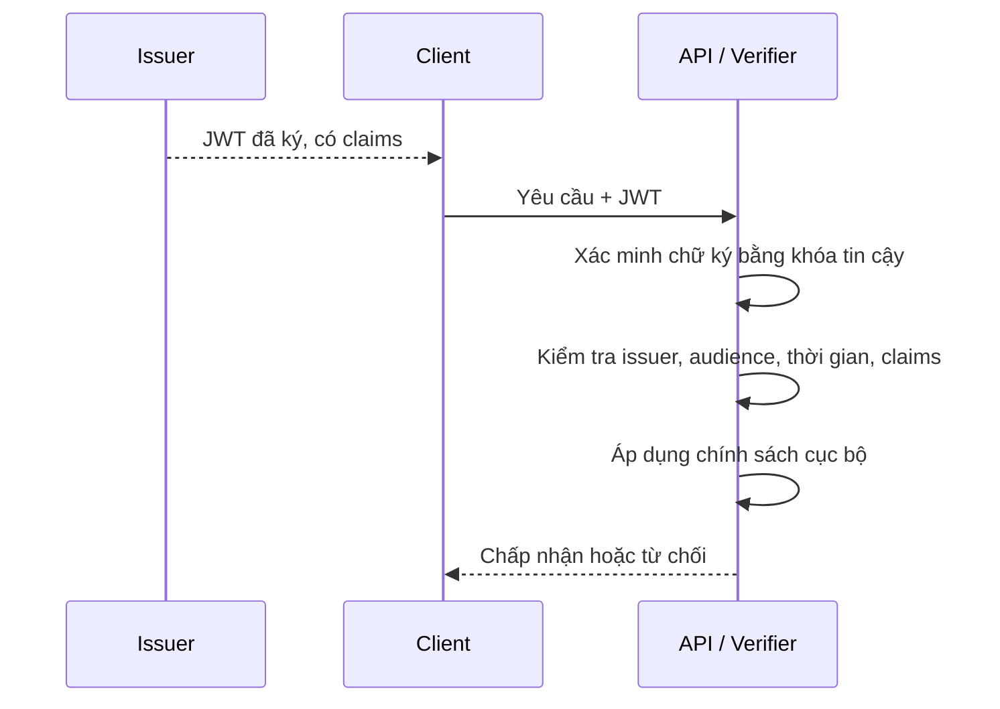
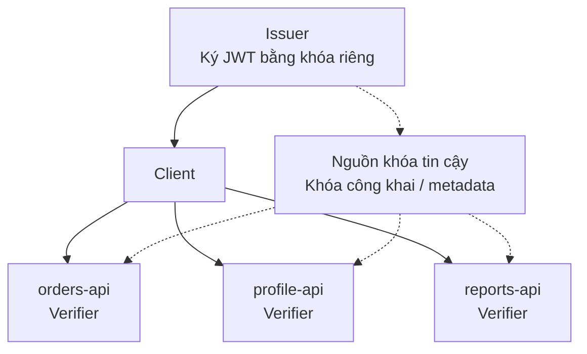
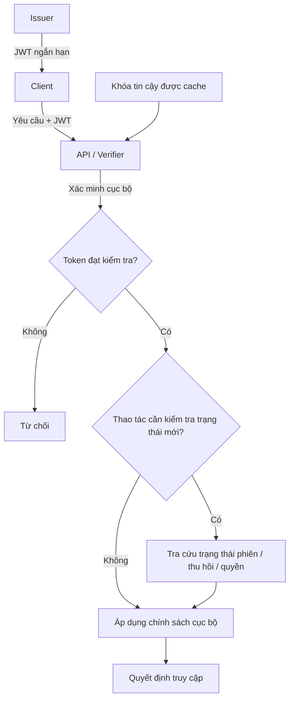

# Tính tự chứa và giới hạn của mô hình không lưu trạng thái

## 1. Vì sao JWT thường được gọi là “self-contained” và “stateless”?

Trong một hệ thống có nhiều API hoặc nhiều máy chủ xử lý yêu cầu, mỗi yêu cầu cần được gắn với một chủ thể và một tập quyền phù hợp. Một cách làm truyền thống là cấp **session ID** cho client; mỗi lần client gửi yêu cầu, máy chủ tra cứu bản ghi phiên để biết ai đang đăng nhập và phiên còn hoạt động hay không.

Một cách khác là dùng **JWT tự chứa (self-contained JWT)**. Token mang các claims cần thiết, được issuer bảo vệ bằng chữ ký/MAC hoặc mã hóa. Nếu verifier có sẵn khóa và chính sách tin cậy, nó có thể kiểm tra token ngay tại chỗ mà không phải tra cứu bản ghi phiên trung tâm ở mỗi yêu cầu.

Điều này thường được mô tả là xác minh *stateless* — không cần đọc trạng thái phiên chia sẻ cho từng yêu cầu. Tuy nhiên, hai khái niệm cần được phân biệt:

- **Self-contained** mô tả token mang theo thông tin/claims để bên nhận diễn giải sau khi xác minh.
- **Stateless validation** mô tả cách verifier kiểm tra token mà không phải tra cứu trạng thái phiên/token trong một kho trung tâm cho từng yêu cầu.

JWT có thể hỗ trợ xác minh không cần tra cứu phiên, nhưng **không biến toàn bộ hệ thống thành stateless**. Quản lý khóa, thu hồi token, trạng thái tài khoản, quyền thay đổi, chống phát lại, giới hạn tốc độ và dữ liệu nghiệp vụ vẫn có thể cần trạng thái.

Nội dung thuộc phạm vi **Security - JSON Web Token (JWT)** theo hướng bảo mật tổng quát, không phụ thuộc ngôn ngữ lập trình hay framework.

## 2. JWT tự chứa những gì?

JWT được định nghĩa trong [RFC 7519](https://www.rfc-editor.org/rfc/rfc7519) là một cách biểu diễn tập claims JSON dưới dạng token. Ví dụ payload:

```json
{
  "iss": "https://identity.example.org",
  "sub": "account-42",
  "aud": "orders-api",
  "iat": 1893456000,
  "nbf": 1893456000,
  "exp": 1893456900,
  "jti": "jwt-7f31",
  "scope": "orders:read"
}
```

Ý nghĩa các trường minh họa:

- `iss`: issuer — bên phát hành được khẳng định.
- `sub`: subject — chủ thể mà claims đề cập.
- `aud`: audience — bên nhận dự kiến.
- `iat`: thời điểm phát hành.
- `nbf`: thời điểm bắt đầu hiệu lực.
- `exp`: thời điểm hết hạn.
- `jti`: định danh của JWT.
- `scope`: claim theo hợp đồng ứng dụng hoặc hồ sơ token; không phải registered claim bắt buộc của JWT cốt lõi.

Các thời điểm `iat`, `nbf`, `exp` dùng kiểu **NumericDate**, thường được biểu diễn bằng số giây tính từ Unix epoch. Ví dụ trên có khoảng thời gian từ `iat` đến `exp` là 15 phút.

Với JWT dạng JWS compact, token thường có ba phần:

```text
BASE64URL(protected-header).BASE64URL(payload).BASE64URL(signature)
```

Chữ ký/MAC cho phép verifier kiểm tra tính toàn vẹn và nguồn gốc theo khóa đã được tin cậy. Base64url chỉ là cách biểu diễn dữ liệu, **không phải mã hóa bí mật**; payload JWS thường có thể đọc được bởi bất kỳ ai sở hữu token. JWE có thể bảo vệ tính bí mật của nội dung, nhưng không tự giải quyết những giới hạn về trạng thái và thu hồi được trình bày bên dưới.

### 2.1. Vì sao claims tự chứa giúp xác minh cục bộ?

Giả sử API đơn hàng đã có:

- Cấu hình issuer được tin cậy.
- Tập khóa xác minh phù hợp với issuer.
- Danh sách thuật toán được phép.
- Chính sách audience, thời gian và claims bắt buộc.
- Quy tắc ủy quyền đối với thao tác và tài nguyên.

Khi nhận JWT, API có thể xác minh chữ ký, kiểm tra `iss`, `aud`, `exp`, `nbf` và các claims cần thiết ngay tại API. Nếu tất cả điều kiện đạt, API có thể sử dụng claims như đầu vào cho quyết định truy cập mà không phải hỏi dịch vụ danh tính về bản ghi phiên ở mỗi lần gọi.



Luồng này loại bỏ một lần tra cứu phiên trung tâm **trong đường xử lý xác minh token**. Nó không loại bỏ việc API đọc dữ liệu đơn hàng, kiểm tra quyền trên tài nguyên hoặc ghi nhận hoạt động nghiệp vụ.

### 2.2. So sánh với session ID hoặc reference token

| Đặc điểm | JWT tự chứa | Session ID / reference token |
| --- | --- | --- |
| Thông tin cần để kiểm tra | Claims trong token, khóa và chính sách tin cậy | Giá trị tham chiếu và bản ghi trạng thái phía máy chủ |
| Mỗi yêu cầu | Có thể xác minh cục bộ | Thường cần tra cứu hoặc cache trạng thái |
| Cập nhật quyền | Claims đã phát hành có thể cũ | Bản ghi có thể cập nhật tại nguồn quản lý |
| Thu hồi trước hạn | Cần cơ chế bổ sung | Có thể vô hiệu hóa bản ghi tham chiếu |
| Phụ thuộc trung tâm | Có thể giảm trong đường xác minh | Thường phụ thuộc kho phiên/token hoặc dịch vụ introspection |
| Độ mới dữ liệu | Phụ thuộc thời điểm phát hành và kiểm tra bổ sung | Phụ thuộc dữ liệu tra cứu và chính sách cache |

JWT phù hợp khi cần chuyển claims có thể xác minh giữa nhiều bên đã thiết lập quan hệ tin cậy. Session ID hoặc reference token phù hợp khi hệ thống cần quản lý trạng thái tập trung và muốn các quyết định dựa trên bản ghi hiện tại. Có thể kết hợp hai cách trong cùng kiến trúc.

## 3. “Stateless” thực sự có nghĩa gì?

Một hệ thống được gọi là stateless trong ngữ cảnh xác minh JWT thường có nghĩa **verifier không cần truy vấn trạng thái phiên hoặc token dùng chung trong mọi yêu cầu**. Mỗi yêu cầu mang token; verifier xác minh token bằng thông tin tin cậy đã có và quyết định dựa trên claims cùng chính sách.

Nó không có nghĩa:

- Không có trạng thái ở bất kỳ thành phần nào.
- Không cần lưu hoặc phân phối khóa.
- Không cần biết tài khoản còn hoạt động hay không.
- Quyền trong token tự cập nhật khi quản trị viên đổi quyền.
- Token bị lộ có thể tự mất hiệu lực.
- Người dùng đăng xuất thì mọi token đã cấp tự động bị thu hồi.
- Không cần kho dữ liệu, cache, nhật ký, bộ đếm hoặc trạng thái nghiệp vụ.

### 3.1. Những trạng thái vẫn tồn tại

| Thành phần | Trạng thái có thể vẫn cần quản lý |
| --- | --- |
| Issuer | Khóa ký, lịch sử phát hành, phiên đăng nhập, refresh token, chính sách cấp quyền |
| Verifier | Khóa công khai đã cache, chính sách issuer/audience, denylist hoặc cache trạng thái nếu dùng |
| Quản lý danh tính | Trạng thái tài khoản, phương thức xác thực, khóa tài khoản, quyền hiện tại |
| API nghiệp vụ | Quyền trên từng tài nguyên, dữ liệu đơn hàng, giao dịch, giới hạn sử dụng |
| Vận hành | Nhật ký bảo mật, cảnh báo, rate limit, theo dõi sự kiện bất thường |

Do đó, phát biểu chính xác hơn là: **JWT có thể giúp xác minh token theo cách không cần tra cứu phiên tập trung ở mỗi yêu cầu**, chứ không phải “JWT làm cho toàn bộ hệ thống không có trạng thái”.

### 3.2. Stateless không đồng nghĩa không cần giao tiếp mạng

Verifier vẫn có thể cần:

- Lấy hoặc làm mới tập khóa công khai từ nguồn phân phối đáng tin cậy.
- Tra cứu trạng thái thu hồi khi yêu cầu nghiệp vụ cần hiệu lực tức thì.
- Kiểm tra tài khoản hoặc quyền hiện tại.
- Truy cập dữ liệu nghiệp vụ để xác định chủ thể có quyền trên tài nguyên hay không.

Khác biệt nằm ở chỗ **những lần tra cứu này không nhất thiết phải xảy ra trong mọi yêu cầu xác minh JWT**. Kiến trúc có thể lựa chọn cache, đồng bộ sự kiện hoặc kiểm tra tập trung tùy yêu cầu.

## 4. Lợi ích của xác minh JWT không cần tra cứu phiên trung tâm

### 4.1. Giảm phụ thuộc vào một dịch vụ trạng thái dùng chung

Khi mỗi API phải hỏi một dịch vụ phiên cho mọi yêu cầu, dịch vụ ấy có thể trở thành điểm phụ thuộc về khả năng sẵn sàng. Nếu JWT được xác minh cục bộ, API có thể tiếp tục xác minh token trong phạm vi khóa và chính sách đã cache, kể cả khi dịch vụ danh tính tạm thời không phục vụ yêu cầu tra cứu phiên.

Điều này chỉ đúng khi API vẫn có đủ thông tin tin cậy và **chính sách cho phép xử lý offline**. Nếu nguồn khóa đã hết thời hạn tin cậy, khóa bị thu hồi, hoặc hệ thống bắt buộc kiểm tra trạng thái hiện tại mà không thể làm được, API phải xử lý theo chính sách an toàn, thường là từ chối.

### 4.2. Hỗ trợ nhiều API và nhiều instance

Trong kiến trúc có nhiều API, mỗi verifier có thể kiểm tra JWT bằng khóa công khai và cấu hình chung. Không cần đồng bộ một bản ghi session giữa tất cả instance chỉ để xác minh chữ ký.

Ví dụ:



Mỗi API vẫn phải kiểm tra audience và chính sách riêng. Việc cùng tin một issuer không có nghĩa mọi API phải chấp nhận cùng một token.

### 4.3. Giảm độ trễ tra cứu trong đường xác minh

Nếu không phải gọi dịch vụ introspection hoặc kho phiên cho từng yêu cầu, hệ thống có thể giảm một lượt mạng và giảm tải lên dịch vụ trạng thái. Lợi ích thực tế phụ thuộc kích thước token, chi phí xác minh mật mã, số lần tra cứu bổ sung và cách quản lý khóa.

### 4.4. Tách issuer khỏi các API tiêu thụ token

Issuer có thể phát hành token và công bố khóa xác minh; các API tiêu thụ token có thể xác minh độc lập. Điều này hỗ trợ phân tách trách nhiệm giữa nơi phát hành danh tính/quyền và nơi cung cấp tài nguyên.

Tuy nhiên, việc phân tách chỉ an toàn khi các API thiết lập đúng quan hệ tin cậy, xác minh đúng audience, thuật toán, loại token và claims. **Chia sẻ khóa hoặc chia sẻ issuer không thay thế chính sách riêng cho từng API.**

## 5. Giới hạn 1 — Thu hồi token trước khi hết hạn

### 5.1. Vì sao JWT khó thu hồi tức thì nếu chỉ xác minh cục bộ?

Giả sử issuer phát hành JWT có thời hạn 30 phút. Sau 5 phút, người dùng báo token bị đánh cắp. Nếu verifier chỉ:

1. Xác minh chữ ký.
2. Kiểm tra issuer và audience.
3. Kiểm tra `exp`.

thì token vẫn có thể vượt qua những phép kiểm tra ấy trong 25 phút còn lại. Việc issuer biết token đã bị lộ **không tự truyền sự kiện đó vào JWT đã phát hành**.

JWT không có cơ chế thu hồi tức thì chung được nhúng sẵn trong chuỗi. Claim `jti` chỉ là định danh token; nó không tự tạo ra nơi lưu danh sách thu hồi hoặc khiến verifier biết một token đã bị vô hiệu hóa.

### 5.2. Các cách xử lý

| Cách làm | Cơ chế | Đánh đổi |
| --- | --- | --- |
| **Access token sống ngắn** | Giảm khoảng thời gian token cũ có thể được sử dụng | Không thu hồi ngay; token vẫn có thể dùng đến khi hết hạn |
| **Denylist theo `jti` hoặc dấu vết token** | Verifier kiểm tra token có nằm trong danh sách bị chặn không | Phải lưu trạng thái và tra cứu; cần đồng bộ giữa các verifier |
| **Introspection** | Hỏi authorization server về trạng thái hiện tại | Tăng phụ thuộc mạng, độ trễ và yêu cầu khả dụng |
| **Kiểm tra trạng thái phiên/tài khoản** | Đối chiếu với nguồn trạng thái có thẩm quyền | Không còn hoàn toàn offline; phải xác định tần suất và chính sách cache |
| **Ngừng tin khóa ký** | Từ chối token được ký bằng khóa bị loại | Có thể ảnh hưởng nhiều token hợp lệ cùng khóa; cần quản lý chuyển khóa |

Nếu dùng denylist, verifier phải có cách nhận biết token. Có thể dùng `jti` cùng issuer hoặc một định danh khác đã được thiết kế an toàn. **Chỉ thêm `jti` vào payload mà không có nơi lưu và kiểm tra danh sách thì không có tác dụng thu hồi.**

### 5.3. Chọn độ dài thời hạn theo rủi ro

Thời hạn ngắn giúp thu hẹp cửa sổ rủi ro nhưng làm tăng nhu cầu cấp mới token. Thời hạn dài giảm tần suất làm mới nhưng kéo dài thời gian token bị lộ có thể được dùng.

Không có một TTL phù hợp cho mọi hệ thống. Cần cân nhắc:

- Độ nhạy cảm của tài nguyên và thao tác.
- Khả năng bảo vệ nơi lưu token ở client.
- Yêu cầu thu hồi và tốc độ phản ánh thay đổi quyền.
- Khả năng sẵn sàng của issuer và quy trình làm mới.
- Rủi ro gián đoạn khi token hết hạn mà client không xin được token mới.

## 6. Giới hạn 2 — Claims có thể cũ so với trạng thái hiện tại

### 6.1. JWT là ảnh chụp tại thời điểm phát hành

Một claim quyền trong JWT phản ánh điều issuer đã đưa vào token lúc phát hành. Nó không tự thay đổi khi:

- Quản trị viên gỡ quyền của người dùng.
- Tài khoản bị khóa hoặc xóa.
- Người dùng rời khỏi tổ chức.
- Quan hệ sở hữu tài nguyên thay đổi.
- Một giao dịch hoặc trạng thái nghiệp vụ bị cập nhật.

Ví dụ:

| Thời điểm | Sự kiện | Điều JWT đang thể hiện |
| --- | --- | --- |
| 09:00 | Issuer cấp token có `scope: "orders:read"` | Claims phản ánh quyền tại thời điểm cấp |
| 09:05 | Quản trị viên gỡ quyền đọc đơn hàng | JWT cũ vẫn chứa `orders:read` |
| 09:06 | Client trình token cũ | Chữ ký và thời gian có thể vẫn hợp lệ |

Nếu API chỉ dựa vào claims đã ký, nó có thể tiếp tục cho phép yêu cầu đến khi token hết hạn. Nếu yêu cầu nghiệp vụ là quyền bị gỡ phải có hiệu lực ngay, API phải tham khảo trạng thái hiện tại hoặc một cơ chế đồng bộ phù hợp.

### 6.2. Phân biệt quyền tĩnh và quyền động

- **Quyền tương đối ổn định:** có thể phù hợp để đưa vào JWT thời hạn ngắn hoặc vừa phải, nếu chấp nhận một khoảng trễ khi quyền thay đổi.
- **Quyền thay đổi thường xuyên hoặc cần hiệu lực tức thì:** nên cân nhắc tra cứu chính sách/trạng thái tại thời điểm sử dụng, dùng token tham chiếu, hoặc kết hợp JWT với kiểm tra bổ sung.
- **Quyền theo tài nguyên cụ thể:** thường cần kiểm tra dữ liệu nghiệp vụ. Claim `orders:read` không tự chứng minh người dùng được xem mọi đơn hàng.

Một kiến trúc có thể đưa các quyền nền tảng vào JWT nhưng vẫn kiểm tra quan hệ sở hữu, trạng thái tài nguyên và điều kiện nghiệp vụ tại API.

## 7. Giới hạn 3 — Quản lý khóa và phân phối tin cậy

Xác minh JWT không cần tra cứu phiên vẫn cần verifier có khóa xác minh đáng tin cậy. Với chữ ký bất đối xứng, issuer giữ khóa riêng để ký và phân phối khóa công khai cho verifier. Các verifier có thể lấy tập khóa từ một nguồn đã được xác thực và cache theo chính sách.

### 7.1. Cache khóa có giới hạn tin cậy

Nếu verifier cache khóa công khai, nó cần biết:

- Cache lấy từ issuer/nguồn nào và được xác thực ra sao.
- Thời hạn cache và cách làm mới.
- Xử lý `kid` không tìm thấy như thế nào.
- Xử lý khóa mới khi issuer luân chuyển khóa ra sao.
- Cách ngừng tin khóa cũ hoặc khóa bị lộ.

Header `kid` chỉ là gợi ý chọn khóa. Verifier phải chọn trong tập khóa đã thiết lập tin cậy, không lấy khóa tùy ý từ URL hoặc dữ liệu do token điều khiển.

### 7.2. Luân chuyển khóa

Một quy trình luân chuyển thông thường có thể:

1. Công bố khóa công khai mới qua nguồn tin cậy.
2. Chờ verifier nhận hoặc cập nhật khóa mới theo quy trình.
3. Issuer bắt đầu ký token mới bằng khóa mới.
4. Duy trì khóa cũ trong khoảng cần thiết để xác minh token cũ còn hiệu lực.
5. Ngừng tin khóa cũ khi không còn cần, hoặc sớm hơn nếu có sự cố.

Nếu khóa riêng bị lộ, kẻ tấn công có thể tạo JWT có chữ ký trông hợp lệ. Khi đó chỉ dựa vào `exp` là chưa đủ; cần xử lý sự cố, ngừng tin khóa bị lộ, đánh giá token liên quan và cấp lại credential theo chính sách.

### 7.3. Nguồn khóa tạm thời không sẵn sàng

Một verifier có thể tiếp tục dùng khóa đã cache nếu chính sách cho phép và khóa còn trong thời gian tin cậy. Nếu gặp `kid` mới mà không thể lấy khóa, verifier không nên tự bỏ qua chữ ký hoặc tin một khóa chưa xác thực. Cách xử lý phụ thuộc chính sách khả dụng và bảo mật; mặc định an toàn là từ chối khi không có đủ bằng chứng.

## 8. Giới hạn 4 — Phát lại token và chiếm đoạt bearer credential

JWT có chữ ký hợp lệ không ngăn người khác sao chép token rồi gửi lại. Với **bearer token**, ai có được chuỗi token thường có thể sử dụng token trong phạm vi và thời hạn được cấp.

Các biện pháp giảm thiểu:

- Truyền token qua HTTPS/TLS.
- Không ghi token nguyên văn vào log, URL hoặc dữ liệu phân tích.
- Lưu token ở nơi phù hợp với mô hình đe dọa và hạn chế quyền truy cập.
- Dùng thời hạn ngắn và quyền tối thiểu.
- Cân nhắc sender-constrained token khi cần chứng minh bên trình kiểm soát khóa hoặc kênh liên quan.
- Với thao tác nhạy cảm, cân nhắc nonce, idempotency key hoặc cơ chế chống phát lại phù hợp với giao thức và nghiệp vụ.

Claim `jti` chỉ cung cấp một định danh. Nó không tự bảo đảm token chỉ dùng được một lần. Muốn chống phát lại theo `jti`, hệ thống phải lưu dấu đã sử dụng và kiểm tra nó, tức là đưa trạng thái trở lại luồng xử lý.

## 9. Giới hạn 5 — Kích thước token và chi phí truyền

Vì JWT mang claims, token có thể lớn khi chứa nhiều thuộc tính, danh sách quyền hoặc metadata. Token thường được gửi trong mỗi yêu cầu, nên kích thước có thể ảnh hưởng:

- Dung lượng header HTTP và giới hạn của proxy/gateway/server.
- Băng thông và chi phí truyền lặp lại.
- Bộ nhớ, log và hệ thống quan sát.
- Khả năng bị từ chối do giới hạn kích thước đầu vào.
- Nguy cơ vô tình đưa quá nhiều dữ liệu cá nhân vào nhiều thành phần trung gian.

Không nên biến JWT thành nơi lưu toàn bộ hồ sơ người dùng hoặc danh sách quyền quá lớn. Chỉ đưa claims cần thiết cho mục đích và audience cụ thể. Dữ liệu lớn hoặc thay đổi thường xuyên nên được truy vấn từ nguồn có thẩm quyền.

## 10. Giới hạn 6 — Quyền riêng tư và khả năng đọc claims

Với JWS compact, header và payload thường có thể được giải mã mà không cần khóa. Chữ ký bảo vệ tính toàn vẹn chứ không che giấu nội dung. Vì vậy:

- Không đưa mật khẩu, khóa bí mật hoặc credential khác vào payload.
- Hạn chế thông tin cá nhân và dữ liệu nghiệp vụ nhạy cảm.
- Không coi Base64url là mã hóa.
- Dùng JWE nếu thực sự cần bảo vệ tính bí mật nội dung và có mô hình quản lý khóa phù hợp.
- Dù dùng JWE, vẫn phải bảo vệ token khỏi bị đánh cắp và kiểm tra quyền sử dụng.

Token được mã hóa không tự trở thành token có thể thu hồi, không tự chứng minh người cầm token là subject và không tự đảm bảo claims còn mới.

## 11. Giới hạn 7 — Audience, phạm vi và nhầm lẫn giữa các loại token

Một JWT tự chứa claims không có nghĩa mọi API đều nên chấp nhận nó. Mỗi verifier phải kiểm tra:

- Issuer có nằm trong tập nguồn tin cậy không?
- Audience có bao gồm chính API nhận không?
- Token có đúng loại và đúng mục đích không?
- Thuật toán và khóa có đúng chính sách không?
- Claims bắt buộc, thời gian và scope có đạt không?

Một access token dành cho `orders-api` không tự nhiên dùng được ở `payments-api`. Một ID token dành cho client theo OpenID Connect cũng không mặc nhiên là access token cho resource server.

**Chữ ký hợp lệ chỉ là một điều kiện trong quá trình xác minh.** Không được bỏ qua audience, loại token và chính sách riêng chỉ vì các API cùng tin một issuer.

## 12. Kiến trúc lai: kết hợp JWT với trạng thái có kiểm soát

Trong nhiều hệ thống, lựa chọn thực tế không phải “hoàn toàn stateless” hoặc “mọi yêu cầu đều tra cứu trung tâm”. Có thể sử dụng JWT cho xác minh cục bộ và chỉ tra cứu trạng thái ở những điểm cần thiết.

Ví dụ một kiến trúc lai:



Một số chiến lược lai:

1. **JWT ngắn hạn + refresh token có trạng thái:** access token xác minh cục bộ; refresh token được quản lý và thu hồi tập trung.
2. **JWT + denylist:** xác minh chữ ký cục bộ, chỉ tra cứu danh sách chặn khi cần.
3. **JWT + introspection chọn lọc:** chỉ kiểm tra trạng thái trung tâm cho thao tác nhạy cảm hoặc token có rủi ro cao.
4. **JWT + kiểm tra quyền tài nguyên:** token xác nhận danh tính/phạm vi nền tảng; API vẫn kiểm tra quyền trên dữ liệu hiện tại.
5. **JWT + sự kiện thu hồi:** issuer phát sự kiện để verifier cập nhật cache hoặc danh sách chặn; cần thiết kế độ tin cậy, thứ tự và khả năng phục hồi khi mất sự kiện.

Mô hình lai cho phép cân bằng độ trễ, khả năng sẵn sàng và yêu cầu thu hồi. Nhưng nó đòi hỏi xác định rõ dữ liệu nào được cache, thời gian cache, cách đồng bộ và hành vi khi dịch vụ trạng thái không khả dụng.

## 13. Chọn JWT tự chứa hay mô hình tham chiếu?

| Nhu cầu / điều kiện | JWT tự chứa | Reference token / session lookup |
| --- | --- | --- |
| Nhiều API cần xác minh cục bộ | Phù hợp nếu chia sẻ quan hệ tin cậy và chính sách đúng | Cần cache hoặc dịch vụ tra cứu sẵn sàng |
| Cần thu hồi tức thì | Cần bổ sung denylist/introspection/trạng thái | Thuận lợi hơn nếu bản ghi được tra cứu trực tiếp và không có cache dài |
| Quyền thay đổi thường xuyên | Có nguy cơ claims cũ; cần kiểm tra bổ sung | Dễ phản ánh cập nhật qua nguồn trạng thái |
| Yêu cầu giảm phụ thuộc trung tâm | Có thể giảm tra cứu mỗi yêu cầu | Thường phụ thuộc kho token/phiên |
| Claims cần chuyển giữa nhiều bên tin cậy | JWT hỗ trợ đóng gói và xác minh | Cần quy trình tra cứu hoặc trao đổi metadata |
| Dữ liệu nhạy cảm không nên lộ ở client | JWS không che giấu; JWE có thêm quản lý khóa | Token tham chiếu ít tự bộc lộ dữ liệu hơn |
| Quyền theo từng tài nguyên thay đổi liên tục | Vẫn cần truy vấn dữ liệu/chính sách hiện tại | Có thể lấy trạng thái trung tâm, nhưng cũng cần kiểm tra tài nguyên |

Không nên chọn JWT chỉ vì nghe nói nó “nhanh hơn” hoặc “stateless”. Cần đo tải thực tế và xem phần nào đang tạo chi phí: xác minh mật mã, tra cứu phiên, lấy khóa, truy cập dữ liệu nghiệp vụ hay đồng bộ trạng thái. Tương tự, reference token không mặc nhiên tốt hơn nếu kho trạng thái trở thành điểm nghẽn hoặc điểm lỗi đơn.

## 14. Checklist thiết kế một hệ thống dùng JWT

Trước khi triển khai xác minh JWT không cần tra cứu phiên ở mỗi yêu cầu, hãy trả lời:

1. **Claims nào thực sự cần có?** Có thể bỏ bớt dữ liệu hoặc quyền ít dùng không?
2. **Ai phát hành và ai xác minh?** Quan hệ issuer, khóa, thuật toán và audience có được cấu hình rõ không?
3. **Token sống bao lâu?** TTL có phù hợp rủi ro và khả năng làm mới không?
4. **Quyền thay đổi được phản ánh thế nào?** Có chấp nhận claims cũ đến khi hết hạn không?
5. **Thu hồi trước hạn ra sao?** Có denylist, introspection, trạng thái phiên hoặc cơ chế sự kiện không?
6. **Khóa được luân chuyển và thu hồi thế nào?** Verifier cache trong bao lâu và xử lý khóa bị lộ ra sao?
7. **Token có thể bị phát lại không?** Nơi lưu, kênh truyền và cơ chế sender constraint có phù hợp không?
8. **Kích thước và quyền riêng tư?** Token có quá lớn hoặc chứa dữ liệu nhạy cảm không cần thiết không?
9. **API có kiểm tra quyền trên tài nguyên không?** Claims có đang bị coi là giấy phép truy cập tuyệt đối không?
10. **Khi không xác minh được thì sao?** Có chính sách fail closed hoặc quy tắc ngoại lệ được đánh giá rõ không?

## 15. Kết luận

JWT tự chứa claims và có thể hỗ trợ verifier xác minh token mà không cần tra cứu phiên trung tâm trong mọi yêu cầu. Đây là lợi ích quan trọng cho kiến trúc phân tán: giảm phụ thuộc vào dịch vụ trạng thái, hỗ trợ nhiều API xác minh độc lập và giảm một số lượt tra cứu trong đường xử lý.

Tuy nhiên, **stateless chỉ mô tả một phần cách xác minh**. JWT không tự giải quyết thu hồi trước hạn, quyền thay đổi, trạng thái tài khoản, luân chuyển khóa, phát lại token, dữ liệu nhạy cảm hoặc quyền trên từng tài nguyên. Những yêu cầu đó có thể khiến hệ thống cần trạng thái bổ sung hoặc một kiến trúc lai.

Thiết kế tốt là lựa chọn rõ ràng **thông tin nào có thể tin từ claims đã ký, thông tin nào phải kiểm tra mới, khi nào cần tra cứu trạng thái và hệ thống xử lý ra sao khi không thể xác minh**.

## Tài liệu chuẩn để đọc tiếp

- [RFC 7519 — JSON Web Token (JWT)](https://www.rfc-editor.org/rfc/rfc7519): định dạng JWT và registered claims.
- [RFC 7515 — JSON Web Signature (JWS)](https://www.rfc-editor.org/rfc/rfc7515): chữ ký và bảo vệ tính toàn vẹn.
- [RFC 7516 — JSON Web Encryption (JWE)](https://www.rfc-editor.org/rfc/rfc7516): mã hóa nội dung JWT.
- [RFC 8725 — JSON Web Token Best Current Practices](https://www.rfc-editor.org/rfc/rfc8725): thực hành bảo mật khi sử dụng JWT.
- [RFC 7662 — OAuth 2.0 Token Introspection](https://www.rfc-editor.org/rfc/rfc7662): tra cứu trạng thái token.
- [RFC 7009 — OAuth 2.0 Token Revocation](https://www.rfc-editor.org/rfc/rfc7009): thu hồi token trong OAuth 2.0.
- [RFC 6750 — OAuth 2.0 Bearer Token Usage](https://www.rfc-editor.org/rfc/rfc6750): sử dụng bearer token và các rủi ro.
