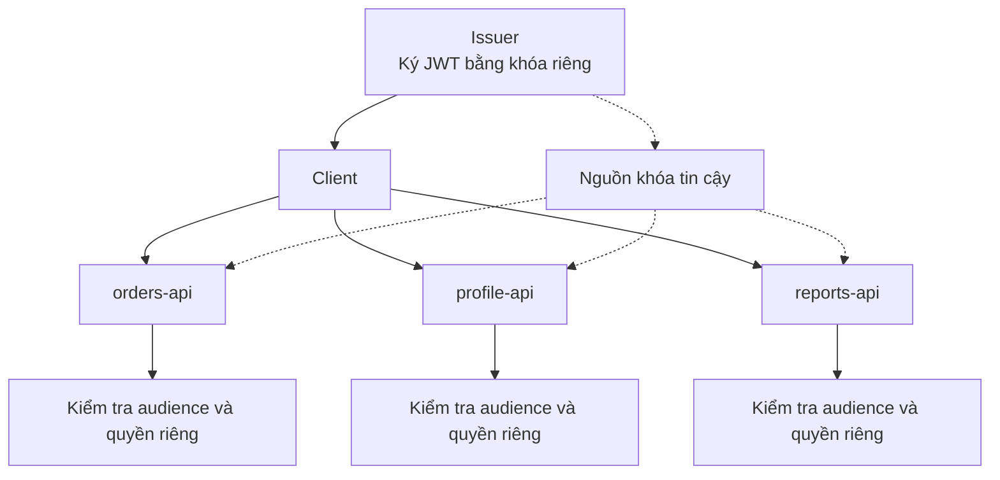
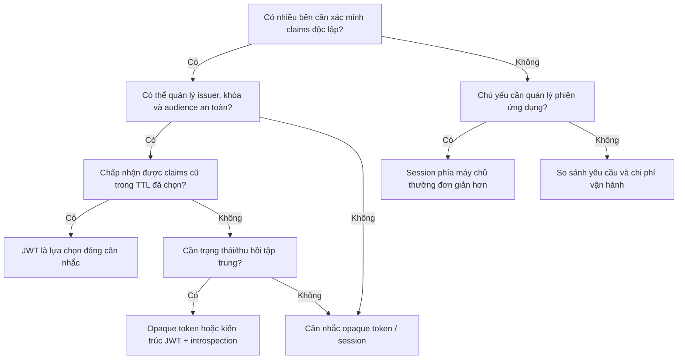
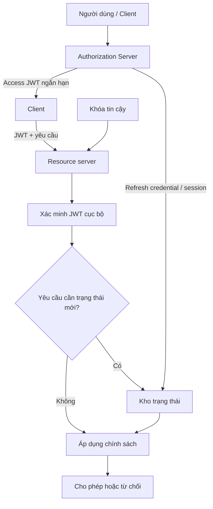

# Khi nên và không nên sử dụng JWT

## 1. JWT không phải lựa chọn mặc định cho mọi hệ thống

JSON Web Token (JWT) là một định dạng chuẩn để biểu diễn các claims và bảo vệ chúng bằng cơ chế mật mã phù hợp. JWT có thể giúp nhiều bên xác minh thông tin mà không cần truy vấn một kho phiên dùng chung trong mọi yêu cầu. Nhưng lợi ích đó đi kèm chi phí: quản lý khóa, giới hạn thời hạn, xử lý claims cũ, thiết kế thu hồi và bảo vệ token khi lưu giữ.

Vì vậy, câu hỏi thiết kế không nên chỉ là **“JWT có phổ biến không?”** mà là:

- Hệ thống có thực sự cần mang claims giữa nhiều bên không?
- Bên nhận có thể xác minh token độc lập bằng khóa và chính sách đáng tin cậy không?
- Hệ thống có chấp nhận được việc claims đã phát hành có thể cũ cho đến khi token hết hạn không?
- Có cần thu hồi phiên hoặc quyền ngay lập tức không?
- Chi phí vận hành khóa và chính sách có phù hợp với năng lực của tổ chức không?
- Một session ID hoặc opaque token có giải quyết nhu cầu đơn giản và an toàn hơn không?

**JWT phù hợp khi lợi ích của token tự chứa và khả năng xác minh phân tán đáng giá hơn chi phí quản lý vòng đời và trạng thái.** Nếu hệ thống cần kiểm soát tập trung, thay đổi quyền tức thời hoặc quản lý phiên đơn giản, session phía máy chủ hay opaque token có thể là lựa chọn phù hợp hơn.

Bài viết thuộc phạm vi **Security - JSON Web Token (JWT)** tổng quát, không phụ thuộc ngôn ngữ lập trình hay framework.

## 2. Bắt đầu từ nhu cầu, không bắt đầu từ định dạng

Trước khi chọn JWT, hãy xác định điều hệ thống cần giải quyết.

| Nhu cầu | Câu hỏi cần trả lời |
| --- | --- |
| Chuyển claims giữa các bên | Có nhiều dịch vụ/tổ chức cần nhận cùng một khẳng định theo định dạng thống nhất không? |
| Xác minh phân tán | Bên nhận có thể tự xác minh chữ ký bằng khóa tin cậy không? |
| Giảm tra cứu trung tâm | Có lợi ích rõ ràng khi không hỏi kho phiên/token ở mỗi yêu cầu không? |
| Thu hồi nhanh | Khi token bị lộ hoặc quyền bị gỡ, hệ thống cần chặn trong bao lâu? |
| Quyền thay đổi thường xuyên | Claims có phản ánh được trạng thái hiện tại trong suốt thời gian token sống không? |
| Bảo vệ dữ liệu | Payload có chứa dữ liệu nhạy cảm cần giữ bí mật không? |
| Vận hành khóa | Tổ chức có thể phân phối, luân chuyển và thu hồi khóa an toàn không? |
| Quản lý phiên | Ứng dụng cần logout tập trung, idle timeout, absolute timeout hoặc quản lý từng thiết bị không? |

Nếu nhu cầu chính là duy trì một phiên đăng nhập cho một ứng dụng web, việc đưa JWT vào có thể không đem lại lợi ích đáng kể. Nếu nhiều resource server cần xác minh cùng một issuer mà không gọi về dịch vụ trung tâm trong mỗi yêu cầu, JWT có thể đáng cân nhắc.

## 3. Khi nào nên sử dụng JWT?

### 3.1. Nhiều dịch vụ cần xác minh claims độc lập

JWT có ích khi nhiều API hoặc dịch vụ cần nhận cùng loại claims và có thể xác minh chúng bằng khóa công khai đã được thiết lập tin cậy.

Ví dụ một tổ chức có:

- Dịch vụ danh tính phát hành token.
- API đơn hàng, hồ sơ và báo cáo là các resource server độc lập.
- Mỗi API có chính sách audience, scope và quyền trên tài nguyên riêng.

Issuer ký JWT; mỗi API có thể xác minh chữ ký và claims tại chỗ nếu đã có khóa tin cậy. Điều này giảm phụ thuộc vào một dịch vụ introspection hoặc kho phiên trong đường xác minh thường xuyên.



Điều kiện quan trọng: mỗi API phải xác minh audience và chính sách của mình. Cùng tin một issuer không có nghĩa token được dùng ở mọi API.

### 3.2. Cần xác minh offline hoặc giảm số lần gọi dịch vụ trung tâm

Nếu verifier có khóa xác minh và cấu hình tin cậy đã được cập nhật, nó có thể xác minh JWS cục bộ mà không phải gọi issuer cho mỗi yêu cầu. Điều này hữu ích khi:

- Có nhiều instance hoặc nhiều vùng triển khai.
- Kết nối đến dịch vụ phát hành không luôn sẵn sàng.
- Độ trễ tra cứu trạng thái trung tâm ảnh hưởng đáng kể đến yêu cầu.
- Hệ thống chấp nhận một khoảng thời gian token có thể còn hiệu lực sau khi quyền thay đổi, hoặc đã có cơ chế bổ sung để xử lý việc đó.

Offline verification không đồng nghĩa bỏ qua quản lý khóa hoặc trạng thái. Verifier vẫn cần biết khóa nào còn được tin cậy và có thể cần tra cứu quyền, trạng thái tài khoản hoặc thu hồi cho các thao tác nhạy cảm.

### 3.3. Cần định dạng claims chuẩn để liên thông giữa các tổ chức

Trong môi trường liên tổ chức, các bên cần thống nhất cách biểu diễn issuer, subject, audience, thời gian và các claims mở rộng. JWT, cùng JWS/JWE và hồ sơ sử dụng tương ứng, cung cấp cấu trúc chuẩn để trao đổi.

Ví dụ một nhà cung cấp danh tính phát hành JWT cho dịch vụ của đối tác. Bên nhận có thể xác minh token theo issuer, khóa, audience và hợp đồng claims đã thỏa thuận.

Tuy nhiên, JWT **không tự tạo ra quan hệ tin cậy**. Các tổ chức vẫn phải thống nhất:

- Issuer nào được phép phát hành?
- Khóa được phân phối qua kênh nào?
- Thuật toán nào được chấp nhận?
- Claim nào bắt buộc và ý nghĩa chính xác là gì?
- Token được dùng cho audience và mục đích nào?
- Khi khóa bị lộ hoặc quyền bị thu hồi thì phối hợp xử lý ra sao?

### 3.4. Cần access token tự chứa với thời hạn ngắn

JWT có thể phù hợp làm access token khi resource server cần xác minh issuer, subject, audience, scope và thời hạn cục bộ. Thời hạn ngắn giúp giảm khoảng thời gian token bị lộ hoặc claims cũ có thể được sử dụng.

Ví dụ:

```json
{
  "iss": "https://identity.example.org",
  "sub": "account-42",
  "aud": "orders-api",
  "iat": 1893456000,
  "exp": 1893456900,
  "scope": "orders:read"
}
```

Đây là payload minh họa, không phải token đã ký. `iat` và `exp` dùng NumericDate tính bằng giây từ Unix epoch; khoảng cách giữa hai mốc trong ví dụ là 15 phút. `scope` là claim theo hợp đồng sử dụng, không phải registered claim bắt buộc của JWT cốt lõi.

Token chỉ nên mang các quyền cần thiết. Resource server vẫn phải kiểm tra quyền trên tài nguyên và thao tác thực tế.

### 3.5. Cần trao đổi assertion hoặc thông điệp có thể xác minh

JWT có thể dùng để mang một tập claims được issuer ký trong các luồng trao đổi giữa dịch vụ, workload hoặc tổ chức. Nếu bên nhận cần kiểm tra rằng nội dung không bị thay đổi và được phát hành bởi một bên đã tin cậy, JWS có thể là cơ chế phù hợp.

Trước khi dùng JWT như một assertion, cần xác định rõ loại token, audience, thời hạn, cách chống phát lại và quy tắc xác minh. Không phải cứ có chữ ký là thông điệp tự phù hợp cho mọi mục đích.

## 4. Khi nào không nên chọn JWT làm giải pháp chính?

### 4.1. Ứng dụng chỉ cần một phiên đăng nhập đơn giản

Nếu một ứng dụng web chủ yếu cần duy trì trạng thái đăng nhập của người dùng, session ID ngẫu nhiên và kho phiên phía máy chủ có thể là lựa chọn trực tiếp hơn.

Máy chủ có thể:

- Tạo phiên sau khi xác thực thành công.
- Gửi session ID qua cookie được bảo vệ.
- Tra cứu trạng thái phiên ở mỗi yêu cầu.
- Kết thúc phiên ngay khi người dùng đăng xuất hoặc quản trị viên thu hồi.
- Áp dụng idle timeout và absolute timeout.

Trong trường hợp này, JWT có thể thêm công việc quản lý khóa, thời hạn và thu hồi mà không đem lại lợi ích phân tán cần thiết.

### 4.2. Cần thu hồi quyền hoặc token gần như tức thì

JWT tự chứa đã phát hành không tự cập nhật khi:

- Tài khoản bị khóa.
- Người dùng bị gỡ khỏi tổ chức.
- Quyền truy cập bị thu hồi.
- Token bị báo lộ.
- Phiên đăng nhập bị kết thúc.

Nếu verifier chỉ kiểm tra chữ ký và `exp`, JWT vẫn có thể được chấp nhận đến khi hết hạn. Để thu hồi trước hạn, hệ thống phải bổ sung denylist, introspection, kiểm tra trạng thái phiên/tài khoản hoặc cơ chế phân phối sự kiện thu hồi.

Nếu mọi yêu cầu đều phải tra cứu trạng thái trung tâm để biết token còn active hay không, lợi ích xác minh không cần trạng thái của JWT có thể giảm đáng kể. Khi ấy opaque reference token hoặc session phía máy chủ có thể đơn giản và dễ kiểm soát hơn.

### 4.3. Quyền thay đổi thường xuyên hoặc phụ thuộc dữ liệu hiện tại

JWT chứa claims tại thời điểm phát hành. Nếu quyền thay đổi liên tục, token có thể mang thông tin cũ trong phần đời còn lại.

Ví dụ:

- 10:00: issuer cấp JWT có `scope: "inventory:write"`.
- 10:03: quản trị viên gỡ quyền ghi kho.
- 10:04: client trình JWT cũ.

Nếu verifier chỉ kiểm tra chữ ký và thời gian, token vẫn có thể đạt kiểm tra. Nếu hệ thống yêu cầu thay đổi quyền có hiệu lực ngay, cần tra cứu chính sách hiện tại hoặc dùng credential có trạng thái tập trung.

Tương tự, quyền xem một tài nguyên cụ thể thường phụ thuộc dữ liệu nghiệp vụ hiện tại. Claim `orders:read` không chứng minh người dùng có quyền xem mọi đơn hàng. Dù dùng JWT, API vẫn phải kiểm tra quyền trên từng tài nguyên khi cần.

### 4.4. Claims lớn, thay đổi thường xuyên hoặc quá nhạy cảm

JWT mang claims trong token nên kích thước tăng khi thêm nhiều thuộc tính, danh sách quyền hoặc metadata. Token thường được gửi lặp lại trong nhiều yêu cầu, làm tăng dung lượng header, băng thông, bộ nhớ và chi phí xử lý.

Với JWS, payload thường đọc được sau khi giải mã Base64url. Không đưa mật khẩu, khóa bí mật, dữ liệu cá nhân không cần thiết hoặc thông tin nghiệp vụ nhạy cảm vào payload chỉ vì token có chữ ký.

JWE có thể mã hóa nội dung, nhưng đi kèm quản lý khóa và chi phí giải mã. Nếu dữ liệu lớn hoặc thay đổi thường xuyên, tham chiếu đến dữ liệu phía máy chủ có thể phù hợp hơn.

### 4.5. Tổ chức chưa có khả năng quản lý khóa an toàn

JWT có chữ ký yêu cầu quản lý khóa và chính sách xác minh nghiêm ngặt. Cần có quy trình:

- Sinh và lưu khóa an toàn.
- Phân phối khóa xác minh qua nguồn tin cậy.
- Luân chuyển khóa có giai đoạn chuyển tiếp.
- Ngừng tin khóa cũ hoặc khóa bị lộ.
- Giới hạn thuật toán được chấp nhận.
- Xử lý `kid` không tìm thấy hoặc metadata khóa không sẵn sàng.

Nếu tổ chức chưa thể quản lý các yêu cầu này, triển khai JWT một cách tùy tiện có thể tạo ra rủi ro lớn hơn so với mô hình session/opaque token được quản lý tập trung.

### 4.6. Muốn “stateless hoàn toàn” nhưng vẫn cần trạng thái cho mọi thứ

Nếu hệ thống vẫn phải tra cứu trạng thái phiên, danh sách thu hồi, quyền hiện tại, trạng thái tài khoản và dữ liệu tài nguyên trong mọi yêu cầu, việc chọn JWT không loại bỏ được phần lớn phụ thuộc trạng thái.

Điều này không có nghĩa JWT luôn sai; nó có thể vẫn mang claims hữu ích. Nhưng không nên chọn JWT chỉ vì kỳ vọng nó tự làm kiến trúc không trạng thái.

## 5. Bảng quyết định: JWT, opaque token hay session?

| Tiêu chí chính | JWT tự chứa | Opaque/reference token | Session phía máy chủ |
| --- | --- | --- | --- |
| Nhiều API cần xác minh cục bộ | Phù hợp nếu thiết lập đúng issuer/khóa/audience | Cần tra cứu hoặc cache trạng thái | Thường cần chia sẻ kho phiên hoặc dịch vụ xác minh |
| Thu hồi tập trung, nhanh | Cần cơ chế bổ sung | Phù hợp với bản ghi có thể vô hiệu hóa | Phù hợp với việc kết thúc session record |
| Claims/permission thay đổi liên tục | Cần tra cứu bổ sung hoặc TTL ngắn | Dễ phản ánh qua trạng thái tra cứu | Có thể đọc trạng thái phiên, nhưng quyền tài nguyên vẫn cần kiểm tra |
| Ứng dụng web đơn lẻ, cần logout rõ ràng | Có thể phức tạp hơn nhu cầu | Có thể dùng nhưng không nhất thiết cần | Thường phù hợp |
| Liên thông giữa nhiều bên | Hữu ích với hợp đồng claims và khóa tin cậy | Cần dịch vụ tra cứu được chia sẻ | Ít phù hợp nếu không có cơ chế liên thông phiên |
| Không muốn lộ claims cho client | JWS không che giấu; JWE cần thêm quản lý khóa | Token không tự bộc lộ metadata | Session ID chỉ là định danh ngẫu nhiên |
| Giảm phụ thuộc dịch vụ trung tâm mỗi yêu cầu | Có thể đạt được | Thường không, trừ khi cache | Thường không |
| Cần quản lý idle timeout/phiên theo thiết bị | Cần trạng thái bổ sung | Có thể liên kết với trạng thái phiên | Hỗ trợ tự nhiên |

Không có cột nào tốt nhất trong mọi tình huống. Chọn theo yêu cầu thu hồi, độ mới của quyền, số lượng dịch vụ, khả năng quản lý khóa, độ trễ, khả năng sẵn sàng và mức độ nhạy cảm của dữ liệu.

## 6. Những câu hỏi giúp quyết định nhanh

Có thể dùng chuỗi câu hỏi sau trong buổi thiết kế:



Các câu hỏi này là hướng dẫn định hướng, không thay thế phân tích threat model hoặc yêu cầu giao thức cụ thể.

## 7. Kiến trúc lai: khi cần cả xác minh phân tán và thu hồi tập trung

Trong thực tế, lựa chọn không nhất thiết là JWT hoặc trạng thái máy chủ. Một kiến trúc lai có thể tận dụng ưu điểm của cả hai:

1. Access token JWT có thời hạn ngắn để resource server xác minh cục bộ.
2. Refresh token hoặc phiên đăng nhập được quản lý tập trung.
3. Các thao tác nhạy cảm kiểm tra trạng thái thu hồi hoặc quyền hiện tại.
4. Sự kiện thu hồi được phân phối đến verifier để cập nhật cache/denylist.
5. API vẫn kiểm tra quyền trên tài nguyên và dữ liệu nghiệp vụ.



Mô hình lai cần định nghĩa rõ:

- Khi nào verifier bắt buộc tra cứu trạng thái?
- Cache trạng thái được giữ bao lâu?
- Nếu dịch vụ trạng thái không sẵn sàng thì từ chối hay có ngoại lệ nào?
- Sự kiện thu hồi được xác thực, phát lại và phục hồi ra sao?
- Khóa cũ được giữ trong thời gian chuyển tiếp nào?

Nếu các câu hỏi này chưa được trả lời, mô hình lai có thể tạo ra sự phức tạp mà không đạt được mức bảo mật mong muốn.

## 8. Ví dụ lựa chọn theo ba bối cảnh

### Bối cảnh A — Nền tảng nhiều API và nhiều vùng triển khai

Một nền tảng có hàng chục API ở nhiều vùng. Các API cần xác minh claims của cùng một issuer; mỗi API có audience và scope riêng. Quyền nền tảng ít thay đổi trong thời hạn token, còn các thao tác nhạy cảm có kiểm tra bổ sung.

**JWT access token ngắn hạn** có thể phù hợp vì:

- Mỗi API có thể xác minh chữ ký bằng khóa tin cậy.
- Không cần tra cứu phiên trung tâm cho mọi yêu cầu.
- Claims có thể được trao đổi theo hợp đồng thống nhất.
- TTL ngắn giúp giới hạn cửa sổ claims cũ.

Vẫn phải có quy trình phân phối/luân chuyển khóa, thu hồi khi sự cố và kiểm tra quyền trên tài nguyên.

### Bối cảnh B — Ứng dụng quản trị nội bộ cần khóa quyền ngay

Một ứng dụng quản trị có ít API, nhưng khi nhân viên nghỉ việc hoặc tài khoản bị khóa, mọi yêu cầu tiếp theo phải bị chặn ngay. Phiên có idle timeout ngắn và quản trị viên cần đăng xuất một thiết bị cụ thể.

**Session phía máy chủ hoặc opaque reference token** có thể phù hợp hơn vì:

- Trạng thái phiên/credential được quản lý tập trung.
- Có thể vô hiệu hóa bản ghi khi tài khoản hoặc phiên bị khóa.
- Có thể theo dõi phiên theo thiết bị.
- Không cần phát hành và phân phối khóa chỉ để duy trì một phiên ứng dụng.

Nếu dùng JWT, hệ thống vẫn phải bổ sung cơ chế trạng thái để đạt yêu cầu thu hồi tức thì; lợi ích stateless có thể nhỏ.

### Bối cảnh C — Ứng dụng web dùng phiên và backend gọi nhiều API

Trình duyệt cần một phiên đăng nhập được quản lý tập trung, còn backend cần gọi nhiều API với quyền khác nhau.

Có thể dùng **session cookie** giữa trình duyệt và ứng dụng web, rồi backend sử dụng access token riêng cho từng API. Access token có thể là JWT hoặc opaque tùy yêu cầu phân tán và thu hồi.

Cách này tách credential theo ranh giới:

- Session ID dành cho phiên của ứng dụng web.
- Access token dành cho resource server cụ thể.
- Refresh credential dành cho quy trình xin token mới.

Không cần dùng một JWT duy nhất cho mọi mục đích.

## 9. Những chi phí phải tính khi chọn JWT

JWT không chỉ có chi phí tạo và xác minh chữ ký. Một hệ thống vận hành JWT cần dự trù:

| Nhóm chi phí | Công việc |
| --- | --- |
| Thiết kế claims | Quy ước tên, kiểu, ý nghĩa, audience và phiên bản hợp đồng |
| Quản lý khóa | Sinh, lưu, phân phối, luân chuyển và thu hồi khóa |
| Xác minh | Cấu hình thuật toán, issuer, audience, thời gian, loại token và claims bắt buộc |
| Vòng đời | TTL, refresh, thu hồi trước hạn và xử lý claims cũ |
| Bảo vệ client | Lưu token, TLS, tránh lộ log/URL, hạn chế replay |
| Vận hành | Giám sát lỗi xác minh, cập nhật khóa, ứng phó khi khóa bị lộ |
| Liên thông | Thống nhất hồ sơ token, xử lý khác biệt giữa các bên |
| Hiệu năng | Kích thước token, chi phí mật mã, cache và tra cứu bổ sung |

Nếu tổ chức không có quy trình quản lý khóa và thu hồi, JWT có thể trở thành một credential tồn tại lâu, khó vô hiệu hóa và dễ bị sử dụng sai audience.

## 10. Các nguyên tắc bảo mật dù chọn mô hình nào

JWT, opaque token hay session ID đều là credential nhạy cảm. Các nguyên tắc sau vẫn cần:

1. **Bảo vệ đường truyền:** dùng HTTPS/TLS và xác định đúng endpoint nhận credential.
2. **Quyền tối thiểu:** chỉ cấp scope, audience và thời hạn cần thiết.
3. **Bảo vệ nơi lưu:** hạn chế khả năng đọc/đánh cắp token hoặc session ID.
4. **Không ghi credential vào log:** che hoặc loại bỏ token, cookie và secret khỏi dữ liệu quan sát.
5. **Xác minh theo ngữ cảnh:** kiểm tra issuer, audience, loại token, thời gian và chính sách.
6. **Có kế hoạch thu hồi:** biết cách xử lý khi token, phiên hoặc khóa bị xâm phạm.
7. **Chống phát lại:** cân nhắc sender constraint, nonce hoặc biện pháp nghiệp vụ phù hợp.
8. **Không nhầm xác minh với ủy quyền:** credential hợp lệ không đồng nghĩa được truy cập mọi tài nguyên.

Với JWT dạng JWS, payload thường đọc được; không đưa bí mật vào đó. Nếu cần bảo mật nội dung, cân nhắc JWE nhưng vẫn phải quản lý khóa và vòng đời token.

## 11. Checklist quyết định cuối cùng

Trước khi chốt JWT, hãy có câu trả lời cho các câu hỏi:

- [ ] Có nhu cầu thực tế về claims tự chứa hoặc xác minh giữa nhiều bên không?
- [ ] Có issuer và quan hệ tin cậy rõ ràng không?
- [ ] Verifier có thể quản lý khóa, thuật toán và audience an toàn không?
- [ ] Có chấp nhận khoảng thời gian claims cũ theo TTL không?
- [ ] Nếu cần thu hồi trước hạn, cơ chế cụ thể là gì?
- [ ] Có cần quản lý phiên, logout tức thì, idle timeout hoặc theo dõi từng thiết bị không?
- [ ] Payload có tránh dữ liệu nhạy cảm và giữ kích thước hợp lý không?
- [ ] API có kiểm tra quyền trên tài nguyên hiện tại không?
- [ ] Chi phí vận hành JWT có thấp hơn lợi ích nó đem lại không?
- [ ] Opaque token hoặc session phía máy chủ có đáp ứng yêu cầu đơn giản hơn không?

Nếu chưa trả lời được câu hỏi về issuer, khóa, audience, TTL và thu hồi, chưa nên đưa JWT vào luồng bảo mật quan trọng.

## 12. Kết luận

Nên sử dụng JWT khi hệ thống cần trao đổi claims theo định dạng chuẩn, có nhiều bên xác minh độc lập, muốn giảm tra cứu trạng thái trong đường xử lý và có khả năng quản lý khóa cũng như vòng đời token an toàn.

Không nên chọn JWT chỉ vì nó phổ biến hoặc vì kỳ vọng “stateless hoàn toàn”. Với ứng dụng chủ yếu cần quản lý phiên, yêu cầu thu hồi tức thì, quyền thay đổi liên tục hoặc dữ liệu token lớn/nhạy cảm, session phía máy chủ hay opaque token có thể phù hợp hơn. Kiến trúc lai cũng là lựa chọn thực tế khi cần cả xác minh phân tán và trạng thái tập trung.

**Lựa chọn đúng là mô hình đáp ứng yêu cầu bảo mật và vận hành với độ phức tạp có thể kiểm soát — không phải định dạng được dùng nhiều nhất.**

## Tài liệu chuẩn để đọc tiếp

- [RFC 7519 — JSON Web Token (JWT)](https://www.rfc-editor.org/rfc/rfc7519): định dạng JWT và claims.
- [RFC 7515 — JSON Web Signature (JWS)](https://www.rfc-editor.org/rfc/rfc7515): chữ ký và bảo vệ tính toàn vẹn.
- [RFC 7516 — JSON Web Encryption (JWE)](https://www.rfc-editor.org/rfc/rfc7516): mã hóa nội dung JWT.
- [RFC 8725 — JSON Web Token Best Current Practices](https://www.rfc-editor.org/rfc/rfc8725): khuyến nghị bảo mật khi sử dụng JWT.
- [RFC 6749 — The OAuth 2.0 Authorization Framework](https://www.rfc-editor.org/rfc/rfc6749): framework ủy quyền và access/refresh token.
- [RFC 6750 — OAuth 2.0 Bearer Token Usage](https://www.rfc-editor.org/rfc/rfc6750): cách sử dụng bearer token.
- [RFC 7662 — OAuth 2.0 Token Introspection](https://www.rfc-editor.org/rfc/rfc7662): tra cứu trạng thái token.
- [RFC 7009 — OAuth 2.0 Token Revocation](https://www.rfc-editor.org/rfc/rfc7009): thu hồi token.
