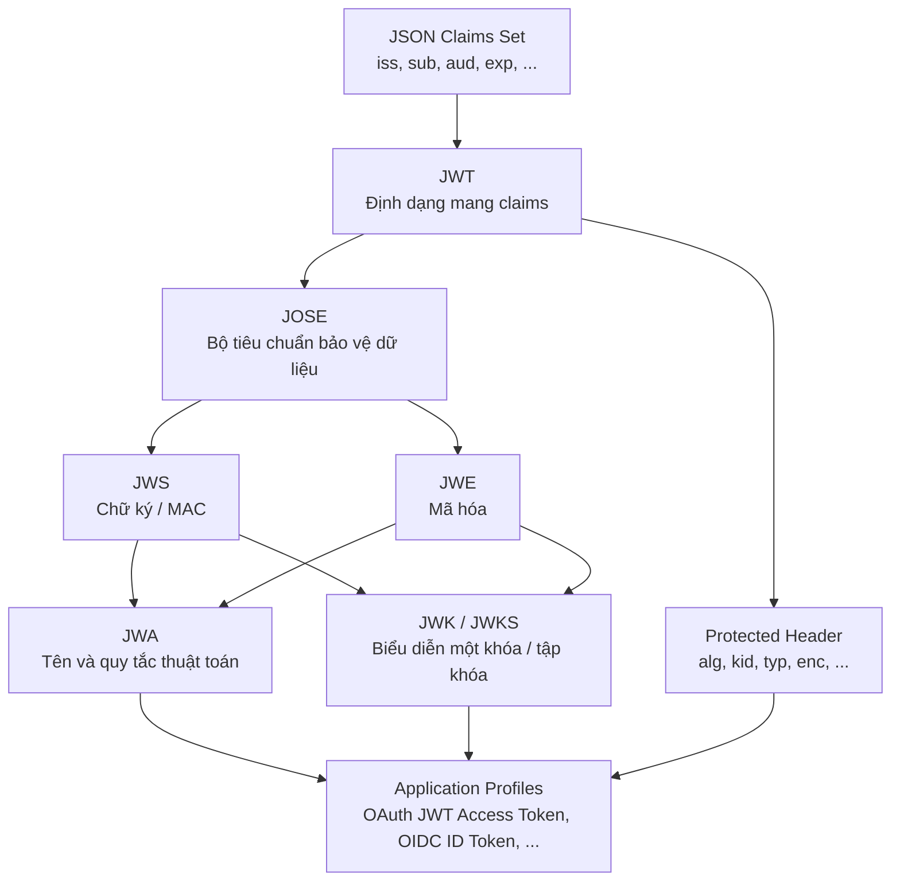
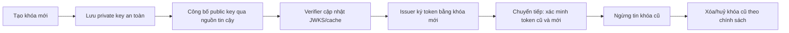

# Bản đồ JWT, JOSE, khóa, claims và các hồ sơ ứng dụng

## 1. Vì sao cần một bản đồ khái niệm?

Khi tìm hiểu JSON Web Token (JWT), ta thường gặp hàng loạt thuật ngữ: JSON, JOSE, JWS, JWE, JWK, JWKS, JWA, claims, header, issuer, audience, signing key, encryption key, access token và ID token. Các thuật ngữ này liên quan chặt chẽ nhưng không cùng một lớp. Nếu xem chúng như những tên gọi khác nhau của “JWT”, rất dễ nhầm giữa **định dạng dữ liệu**, **cơ chế mật mã**, **biểu diễn khóa** và **quy tắc sử dụng token trong một giao thức**.

Bài này xây dựng bản đồ theo các lớp:

1. **JSON và Claims Set:** dữ liệu JWT muốn mang.
2. **JOSE:** bộ tiêu chuẩn bảo vệ và biểu diễn dữ liệu bằng chữ ký hoặc mã hóa.
3. **JWS/JWE:** cách bảo vệ nội dung token.
4. **JWA:** tên và quy tắc thuật toán mật mã.
5. **JWK/JWKS:** cách biểu diễn một khóa hoặc tập khóa.
6. **JWT Header và Claims:** metadata xử lý token và các khẳng định bên trong.
7. **Key lifecycle:** cách tạo, phân phối, sử dụng, luân chuyển và ngừng tin khóa.
8. **Application profiles:** quy tắc cụ thể khi JWT được dùng làm một loại credential trong OAuth 2.0, OpenID Connect hoặc hệ thống riêng.

**JWT là định dạng mang claims; JOSE cung cấp các cấu trúc mật mã; khóa và thuật toán quyết định cách bảo vệ; hồ sơ ứng dụng quyết định token được dùng và xác minh ra sao trong một ngữ cảnh cụ thể.**

Nội dung thuộc phạm vi **Security - JSON Web Token (JWT)** tổng quát, độc lập với ngôn ngữ lập trình và framework.

## 2. Bản đồ tổng thể



Sơ đồ thể hiện mối quan hệ khái niệm, không phải một chuỗi bắt buộc mà mọi token đều phải đi qua. Một JWT có thể được bảo vệ bằng JWS hoặc JWE; các cấu trúc và thuật toán cụ thể được lựa chọn theo hồ sơ sử dụng. Một số ứng dụng còn dùng JWT lồng nhau để kết hợp ký và mã hóa.

### 2.1. Bảng thuật ngữ nhanh

| Thuật ngữ | Tên đầy đủ | Vai trò |
| --- | --- | --- |
| **JSON** | Định dạng biểu diễn dữ liệu dạng đối tượng | Cách biểu diễn dữ liệu có cấu trúc |
| **JWT** | JSON Web Token | Định dạng token mang claims |
| **JOSE** | JSON Object Signing and Encryption | Nhóm tiêu chuẩn về ký, mã hóa và biểu diễn khóa |
| **JWS** | JSON Web Signature | Cấu trúc bảo vệ tính toàn vẹn bằng chữ ký hoặc MAC |
| **JWE** | JSON Web Encryption | Cấu trúc mã hóa nội dung |
| **JWA** | JSON Web Algorithms | Đăng ký tên và tham số thuật toán dùng trong JOSE |
| **JWK** | JSON Web Key | Biểu diễn một khóa dưới dạng JSON |
| **JWKS** | JSON Web Key Set | Tập hợp các JWK |
| **Claims Set** | Tập hợp claims | Đối tượng JSON chứa các khẳng định trong JWT |
| **Application profile** | Hồ sơ ứng dụng | Quy tắc cụ thể hóa cách dùng và xác minh token trong một giao thức |

## 3. Lớp dữ liệu: JSON và JWT Claims Set

### 3.1. Claims là các khẳng định

Một *claim* là một khẳng định về một chủ thể hoặc ngữ cảnh. Ví dụ:

```json
{
  "iss": "https://identity.example.org",
  "sub": "account-42",
  "aud": "orders-api",
  "iat": 1893456000,
  "exp": 1893456900,
  "scope": "orders:read"
}
```

Đây là **JWT Claims Set** ở dạng JSON minh họa, chưa phải token đã được ký hay mã hóa. Nó có thể được đọc như dữ liệu, nhưng chỉ trở thành dữ liệu có thể tin cậy sau khi verifier thực hiện các bước bảo vệ mật mã và kiểm tra ngữ cảnh cần thiết.

### 3.2. Ba nhóm claims

RFC 7519 phân biệt các nhóm chính:

| Nhóm | Đặc điểm | Ví dụ |
| --- | --- | --- |
| **Registered Claim Names** | Tên claim đã được đăng ký trong tiêu chuẩn | `iss`, `sub`, `aud`, `exp`, `nbf`, `iat`, `jti` |
| **Public Claim Names** | Tên claim được định nghĩa công khai, cần tránh va chạm tên | URI hoặc tên có không gian tên được quản lý |
| **Private Claim Names** | Tên claim được các bên thống nhất riêng | `tenant_id`, `department`, `account_type` theo hợp đồng ứng dụng |

Registered không có nghĩa là mọi claim đều bắt buộc xuất hiện trong mọi JWT. Hồ sơ ứng dụng có thể quy định một số claim là bắt buộc và đặt ra điều kiện cụ thể hơn.

### 3.3. Các registered claims thường gặp

| Claim | Ý nghĩa | Kiểu/điểm cần nhớ |
| --- | --- | --- |
| `iss` | Issuer | Chuỗi định danh bên phát hành; verifier phải đối chiếu nguồn tin cậy |
| `sub` | Subject | Chuỗi định danh chủ thể trong ngữ cảnh issuer |
| `aud` | Audience | Một chuỗi hoặc mảng chuỗi xác định bên nhận dự kiến |
| `exp` | Expiration Time | NumericDate; sau thời điểm hết hạn token không được chấp nhận |
| `nbf` | Not Before | NumericDate; trước thời điểm này token chưa có hiệu lực |
| `iat` | Issued At | NumericDate; thời điểm phát hành |
| `jti` | JWT ID | Chuỗi định danh token; có thể hỗ trợ nhận diện hoặc chống phát lại khi có trạng thái bổ sung |

NumericDate thường được biểu diễn bằng số giây tính từ Unix epoch. Không nhầm nó với chuỗi ngày tự do hoặc số mili giây. `jti` tự nó không tạo ra cơ chế thu hồi hay bảo đảm token chỉ được dùng một lần.

### 3.4. Claim theo hồ sơ không đồng nghĩa claim cốt lõi của JWT

Các hồ sơ ứng dụng có thể định nghĩa thêm claims. Ví dụ, OpenID Connect sử dụng những claim như `nonce`, `auth_time`, `acr`, `amr`, `azp` trong những ngữ cảnh tương ứng. Một hồ sơ access token có thể yêu cầu `client_id`, `scope`, `jti` hoặc claim khác theo đặc tả.

Không nên thấy một claim trong token rồi mặc định nó có cùng ý nghĩa trong mọi giao thức. **Tên claim và ý nghĩa của nó phải được đọc theo tiêu chuẩn hoặc hợp đồng ứng dụng đang áp dụng.**

## 4. Lớp JOSE: các cơ chế bảo vệ dữ liệu

JOSE là nhóm tiêu chuẩn gồm các cấu trúc và quy tắc để ký, mã hóa và biểu diễn khóa. Các thành phần cốt lõi thường gặp là:

- JWS — JSON Web Signature.
- JWE — JSON Web Encryption.
- JWK — JSON Web Key.
- JWA — JSON Web Algorithms.

JWT sử dụng các cấu trúc JOSE để bảo vệ claims. Tuy nhiên, **không phải mọi JWS hay JWE đều là JWT**: JWS có thể bảo vệ một payload bất kỳ, JWE có thể mã hóa dữ liệu bất kỳ. JWT là loại token có payload là JWT Claims Set theo quy tắc của RFC 7519.

### 4.1. JWS: bảo vệ tính toàn vẹn bằng chữ ký hoặc MAC

JWS biểu diễn nội dung được bảo vệ bằng chữ ký số hoặc mã xác thực thông điệp (MAC). Dạng compact thường có ba phần:

```text
BASE64URL(protected-header).BASE64URL(payload).BASE64URL(signature)
```

Trong đó:

1. **Protected Header:** các tham số JOSE được bảo vệ cùng nội dung ký.
2. **Payload:** dữ liệu, trong trường hợp JWT là Claims Set.
3. **Signature:** chữ ký hoặc MAC tính trên JWS Signing Input theo quy tắc chuẩn.

JWS giúp verifier kiểm tra nội dung có bị sửa đổi và có phù hợp với khóa xác minh hay không. Với chữ ký bất đối xứng, verifier có thể dùng khóa công khai trong khi chỉ issuer giữ khóa riêng. Với MAC đối xứng, các bên cùng nắm bí mật có thể tạo MAC hợp lệ; vì thế MAC không cung cấp cùng ranh giới phân biệt bên phát hành như chữ ký bất đối xứng.

**JWS không che giấu payload.** Base64url không phải mã hóa bí mật. Không đặt mật khẩu, khóa bí mật hoặc dữ liệu nhạy cảm không cần thiết vào JWT JWS.

### 4.2. JWE: bảo vệ tính bí mật của nội dung

JWE mã hóa nội dung theo cơ chế được chọn. Dạng compact có năm phần:

```text
BASE64URL(protected-header).
BASE64URL(encrypted-key).
BASE64URL(initialization-vector).
BASE64URL(ciphertext).
BASE64URL(authentication-tag)
```

Các thành phần thường biểu diễn:

- Protected Header: thuật toán quản lý khóa và thuật toán mã hóa nội dung.
- Encrypted Key: khóa mã hóa nội dung đã được bảo vệ theo phương thức quản lý khóa.
- Initialization Vector: giá trị khởi tạo của thuật toán mã hóa khi cần.
- Ciphertext: nội dung đã mã hóa.
- Authentication Tag: dữ liệu xác thực của cơ chế mã hóa có xác thực.

JWE bảo vệ tính bí mật và tính toàn vẹn của ciphertext theo thuật toán được chọn. Tuy nhiên, **giải mã thành công không tự chứng minh danh tính issuer** trong mọi mô hình. Nếu cần xác minh nguồn phát hành, cần cơ chế xác thực nguồn gốc phù hợp, chẳng hạn JWT lồng nhau với lớp JWS bên trong JWE theo thiết kế được hỗ trợ.

### 4.3. JWT ký, JWT mã hóa và JWT lồng nhau

| Cách biểu diễn | Cơ chế | Nội dung có đọc được không? | Thuộc tính chính |
| --- | --- | --- | --- |
| JWT dạng JWS | Chữ ký/MAC | Payload thường đọc được | Toàn vẹn và nguồn gốc theo khóa |
| JWT dạng JWE | Mã hóa | Chỉ bên có khả năng giải mã đọc được | Bí mật nội dung và bảo vệ tính toàn vẹn theo thuật toán |
| Nested JWT | Kết hợp các cấu trúc JOSE, ví dụ ký rồi mã hóa | Tùy lớp bảo vệ | Có thể kết hợp xác minh nguồn gốc và bí mật nội dung |

Một JWT có thể được biểu diễn dưới dạng JWS hoặc JWE; cấu trúc lồng nhau cũng được hỗ trợ. Không phải mọi ứng dụng đều cần mã hóa. Chọn cơ chế dựa trên yêu cầu bảo mật và hồ sơ token, không chỉ dựa trên việc payload có chứa thông tin định danh.

## 5. JWA: tên và quy tắc thuật toán

JWA chuẩn hóa tên thuật toán và cách dùng chúng trong JOSE. Có thể phân loại một số thuật toán thường gặp như sau:

| Nhóm | Ví dụ tên | Vai trò |
| --- | --- | --- |
| HMAC | `HS256`, `HS384`, `HS512` | Tạo/kiểm tra MAC với bí mật chung |
| RSA signature | `RS256`, `PS256` | Chữ ký dựa trên khóa RSA |
| ECDSA | `ES256`, `ES384`, `ES512` | Chữ ký dựa trên đường cong elliptic |
| Edwards-curve signature | `EdDSA` | Chữ ký dựa trên thuật toán EdDSA |
| Key management trong JWE | `RSA-OAEP`, `ECDH-ES`, `A256KW`, `dir` | Quản lý hoặc thiết lập khóa mã hóa nội dung |
| Content encryption trong JWE | `A128GCM`, `A256GCM`, `A128CBC-HS256` | Mã hóa và bảo vệ nội dung JWE |

Danh sách trên chỉ là ví dụ, không phải danh sách cho phép đầy đủ hay khuyến nghị cho mọi hệ thống. Việc hỗ trợ và mức an toàn của thuật toán phụ thuộc hồ sơ, thư viện, kích thước khóa và khuyến nghị bảo mật hiện hành.

### 5.1. `alg` và `enc` khác nhau

- Trong JWS, `alg` xác định thuật toán chữ ký hoặc MAC.
- Trong JWE, `alg` xác định thuật toán quản lý khóa; `enc` xác định thuật toán mã hóa nội dung.

Vì thế, header JWE có thể có cả `alg` và `enc`. Không nên diễn giải `alg` trong JWE như thể nó luôn là thuật toán chữ ký.

### 5.2. Verifier phải áp đặt chính sách thuật toán

Header do token mang đến là dữ liệu đầu vào, không phải chính sách bảo mật. Verifier phải:

- Chỉ cho phép các thuật toán đã được cấu hình cho issuer và loại token.
- Không chấp nhận thuật toán không bảo vệ như `none` cho quyết định truy cập có bảo vệ.
- Không tự chuyển đổi giữa thuật toán bất đối xứng và MAC đối xứng theo cách làm thay đổi ý nghĩa của khóa.
- Xác minh chữ ký bằng đúng loại khóa và đúng nguồn tin cậy.
- Từ chối token khi không thể xác định hoặc xác minh thuật toán theo chính sách.

Các khuyến nghị này được nhấn mạnh trong [RFC 8725 — JSON Web Token Best Current Practices](https://www.rfc-editor.org/rfc/rfc8725).

## 6. JWK và JWKS: biểu diễn và phân phối khóa

### 6.1. JWK là gì?

JWK (JSON Web Key) là cách biểu diễn một khóa mật mã dưới dạng JSON. Các thuộc tính có thể gặp:

| Thuộc tính | Ý nghĩa |
| --- | --- |
| `kty` | Loại khóa, ví dụ `RSA`, `EC`, `OKP` hoặc `oct` |
| `use` | Mục đích sử dụng khóa, ví dụ `sig` hoặc `enc` |
| `key_ops` | Các thao tác được phép với khóa |
| `alg` | Thuật toán dự kiến dùng với khóa |
| `kid` | Định danh khóa |
| `crv` | Tên đường cong trong một số loại khóa |
| `n`, `e` | Các tham số công khai của khóa RSA |
| `x`, `y` | Tọa độ công khai của khóa EC |
| `d` | Thành phần riêng tư trong các loại khóa có tham số này |
| `k` | Giá trị khóa đối xứng |

Ví dụ một JWK RSA **chỉ chứa tham số công khai**:

```json
{
  "kty": "RSA",
  "use": "sig",
  "alg": "RS256",
  "kid": "signing-key-2026-01",
  "n": "<base64url-modulus>",
  "e": "AQAB"
}
```

Các giá trị trong ví dụ là chỗ giữ chỗ, không phải một khóa có thể sử dụng. Một JWK chứa tham số riêng tư hoặc khóa đối xứng bí mật phải được bảo vệ như secret. **Không công bố JWK có private parameter hoặc symmetric secret trong JWKS công khai.**

### 6.2. JWKS là gì?

JWKS (JSON Web Key Set) là một đối tượng JSON chứa mảng các JWK, thường có cấu trúc:

```json
{
  "keys": [
    {
      "kty": "RSA",
      "use": "sig",
      "alg": "RS256",
      "kid": "signing-key-2026-01",
      "n": "<base64url-modulus>",
      "e": "AQAB"
    }
  ]
}
```

Issuer có thể công bố JWKS qua một endpoint metadata được các verifier tin cậy. Verifier lấy tập khóa, chọn khóa phù hợp và xác minh token. JWKS công khai thường chứa khóa công khai để xác minh chữ ký; bí mật ký phải ở nơi kiểm soát của issuer.

### 6.3. `kid` chỉ là định danh chọn khóa

JWT header có thể chứa:

```json
{
  "alg": "RS256",
  "kid": "signing-key-2026-01",
  "typ": "JWT"
}
```

`kid` giúp verifier chọn một khóa trong tập khóa đã được tin cậy. Nó không chứng minh khóa thuộc issuer, không chứng minh khóa còn hợp lệ và không cho phép verifier tải khóa từ một địa chỉ tùy ý. Nếu không tìm thấy khóa phù hợp, verifier phải xử lý theo chính sách, thường là từ chối token cho đến khi có thể xác minh an toàn.

### 6.4. Key metadata không thay thế quản lý khóa

Các trường `use`, `key_ops`, `alg` và `kid` giúp mô tả cách khóa được sử dụng. Nhưng việc ghi `use: "sig"` không làm khóa trở nên đáng tin; nguồn phân phối và quyền kiểm soát khóa mới tạo nên quan hệ tin cậy. Verifier phải liên kết khóa với issuer thông qua một kênh/cấu hình đã xác thực.

## 7. JWT Header: metadata xử lý token

Protected Header chứa tham số JOSE ảnh hưởng cách xử lý token. Một số trường thường gặp:

| Header parameter | Ý nghĩa | Lưu ý |
| --- | --- | --- |
| `alg` | Thuật toán JWS hoặc thuật toán quản lý khóa JWE | Bên nhận phải áp đặt allowlist theo chính sách |
| `enc` | Thuật toán mã hóa nội dung JWE | Chỉ dùng trong ngữ cảnh JWE |
| `kid` | Định danh khóa | Chỉ là gợi ý chọn khóa trong tập tin cậy |
| `typ` | Loại nội dung/token | Có thể hỗ trợ phân biệt hồ sơ token; phải kiểm tra theo quy tắc ứng dụng |
| `cty` | Loại nội dung được chứa | Có thể dùng để chỉ ra nội dung lồng nhau, ví dụ JWT bên trong |
| `crit` | Danh sách tham số mở rộng quan trọng | Nếu không hiểu tham số bắt buộc được liệt kê, bên nhận phải từ chối |
| `jku`, `x5u` | Tham chiếu đến URL chứa khóa/JWK hoặc chứng thư | Không tự động tải và tin URL do token cung cấp |
| `jwk`, `x5c` | Khóa hoặc chuỗi chứng thư được nhúng | Vẫn phải xác minh quan hệ tin cậy, không tin chỉ vì được nhúng |

Không phải header parameter nào cũng được phép trong mọi hồ sơ. Các hồ sơ ứng dụng có thể giới hạn tập header được phép hoặc yêu cầu một giá trị cụ thể.

### 7.1. Header là dữ liệu đầu vào, kể cả khi có chữ ký

Verifier thường phải đọc header trước khi xác minh để biết cách chọn khóa hoặc thuật toán. Nhưng ở thời điểm parse, header chưa được chứng minh là đáng tin. Do đó:

- Chỉ dùng `kid` để chọn khóa trong nguồn khóa đã cấu hình.
- Không tải `jku` hoặc `x5u` tùy ý rồi tin nội dung.
- Không cho token quyết định thuật toán ngoài allowlist.
- Xử lý rõ các tham số mở rộng trong `crit`.
- Sau khi xác minh, tiếp tục kiểm tra claims và hồ sơ token.

## 8. Vòng đời khóa: từ tạo đến ngừng tin cậy

JWT ký hoặc mã hóa an toàn phụ thuộc vào việc quản lý khóa. Quy trình thường bao gồm:

1. **Tạo khóa:** chọn loại khóa và kích thước phù hợp thuật toán/hồ sơ.
2. **Lưu khóa:** bảo vệ private key hoặc secret bằng kho bí mật/HSM hoặc cơ chế tương đương; giới hạn quyền truy cập.
3. **Công bố khóa xác minh:** phân phối khóa công khai qua metadata/JWKS hoặc kênh tin cậy khác.
4. **Sử dụng:** issuer ký token bằng khóa được phép; verifier xác minh bằng khóa tương ứng.
5. **Luân chuyển:** thêm khóa mới, cập nhật verifier, chuyển sang ký bằng khóa mới và duy trì khóa cũ trong khoảng chuyển tiếp cần thiết.
6. **Ngừng tin:** loại khóa cũ khi hết thời gian cần thiết hoặc ngay khi có sự cố.
7. **Ứng phó sự cố:** nếu private key bị lộ, ngừng ký bằng khóa đó, thông báo verifier, ngừng tin khóa bị lộ và đánh giá token đã phát hành.



Không nên xóa khóa cũ ngay khi issuer bắt đầu ký bằng khóa mới nếu vẫn còn token hợp lệ đã ký bằng khóa cũ. Ngược lại, khi khóa cũ bị lộ, ưu tiên xử lý sự cố có thể yêu cầu ngừng tin ngay, dù điều đó khiến token cũ hợp lệ về mặt thời gian bị từ chối.

### 8.1. Chữ ký bất đối xứng và MAC đối xứng

| Đặc điểm | Chữ ký bất đối xứng | MAC đối xứng |
| --- | --- | --- |
| Khóa tạo token | Private key của issuer | Secret dùng chung |
| Khóa xác minh | Public key tương ứng | Cùng secret |
| Ai có thể xác minh? | Các bên có public key tin cậy | Các bên biết secret |
| Ai có thể tạo token hợp lệ? | Bên nắm private key | Mọi bên nắm secret |
| Phân tách issuer/verifier | Thuận lợi hơn khi nhiều verifier | Khó tách quyền vì verifier cũng có khả năng tạo MAC |

Khi có nhiều resource server độc lập, chữ ký bất đối xứng thường giúp issuer giữ riêng quyền ký, còn verifier chỉ cần public key. Với MAC, mọi verifier có secret đều có khả năng tạo MAC hợp lệ; cần cân nhắc ranh giới tin cậy trước khi chọn.

## 9. Application profiles: quy tắc sử dụng JWT trong từng giao thức

JWT cốt lõi mô tả định dạng claims, nhưng không đủ để một API biết mọi điều kiện cần kiểm tra. **Application profile** hoặc đặc tả giao thức bổ sung các quy tắc cụ thể: loại token, claims bắt buộc, audience, thuật toán, header và cách xác minh.

### 9.1. OAuth 2.0 JWT Access Token Profile

[RFC 9068](https://www.rfc-editor.org/rfc/rfc9068) định nghĩa hồ sơ JWT cho access token trong OAuth 2.0. Hồ sơ này cụ thể hóa cách biểu diễn access token bằng JWT và yêu cầu resource server kiểm tra các thuộc tính theo quy tắc của hồ sơ.

Ví dụ các khái niệm có thể gặp:

- Access token được phát hành bởi authorization server.
- Token có audience là resource server dự kiến.
- Claims như issuer, subject/client, thời gian và phạm vi được xử lý theo hồ sơ.
- Resource server xác minh chữ ký và các ràng buộc bắt buộc.
- Token được dùng như access credential, không phải ID token cho client.

Không phải mọi JWT access token đều mặc nhiên tuân thủ RFC 9068. Cần kiểm tra hồ sơ được issuer và resource server thống nhất sử dụng.

### 9.2. OpenID Connect ID Token

OpenID Connect Core 1.0 sử dụng ID token để truyền thông tin xác thực và claims về người dùng đến client. ID token được biểu diễn dưới dạng JWT và có các yêu cầu xác minh riêng, ví dụ:

- Kiểm tra chữ ký theo khóa và thuật toán được tin cậy.
- Đối chiếu `iss` và `aud` với nhà cung cấp và client dự kiến.
- Kiểm tra `exp`, `iat` và các điều kiện thời gian.
- Kiểm tra `nonce` khi yêu cầu xác thực có sử dụng nonce.
- Xử lý các claim và quy tắc bổ sung theo OIDC.

ID token và access token có mục đích khác nhau. Resource server không được mặc định dùng ID token như access token chỉ vì cả hai đều có thể là JWT.

### 9.3. Hồ sơ riêng của một tổ chức

Một tổ chức có thể định nghĩa hồ sơ token nội bộ, nhưng cần mô tả rõ:

- Issuer và audience được phép.
- Loại token và mục đích sử dụng.
- Claims bắt buộc, kiểu dữ liệu và ý nghĩa.
- Thuật toán và khóa được chấp nhận.
- Header parameter được phép.
- Thời hạn, leeway và chính sách thu hồi.
- Cách phân biệt token với các loại JWT khác.
- Quy tắc xử lý khi có claim/header không hỗ trợ.

Không nên chỉ viết “dùng JWT” trong tài liệu tích hợp. Cần chỉ ra **hồ sơ JWT cụ thể** để các bên hiểu và xác minh cùng một cách.

## 10. Cách đọc một JWT theo từng lớp

Khi nhận một token, có thể phân tích theo trình tự sau:

| Lớp | Câu hỏi | Ví dụ |
| --- | --- | --- |
| Hình thức | Token là JWS compact hay JWE compact? | Ba phần hoặc năm phần |
| Header | Thuật toán và metadata nào được khai báo? | `alg`, `enc`, `kid`, `typ` |
| Key | Khóa nào có thể xác minh/giải mã? Nguồn khóa có đáng tin không? | JWK/JWKS, key lifecycle |
| Payload | Claims nào được mang? | `iss`, `sub`, `aud`, `exp`, scope |
| JOSE | Nội dung được ký/MAC hay mã hóa? | JWS/JWE |
| Profile | Token thuộc loại/hồ sơ nào? | JWT access token profile, OIDC ID token |
| Policy | Token có được chấp nhận trong yêu cầu cụ thể không? | Audience, thời gian, quyền, trạng thái |

Lưu ý: đọc được header và payload chỉ là bước parse. **Chỉ sau khi xác minh bảo vệ mật mã và áp dụng hồ sơ/chính sách phù hợp mới có thể sử dụng claims cho quyết định bảo mật.**

## 11. Các nhầm lẫn cần tránh

1. **JWT và JOSE là một:** JWT là định dạng claims; JOSE là nhóm tiêu chuẩn bảo vệ và biểu diễn khóa.
2. **JWS luôn là JWT:** JWS có thể bảo vệ payload bất kỳ; JWT chỉ là một loại nội dung claims.
3. **JWE chứng minh issuer:** giải mã được không tự chứng minh bên phát hành; cần cơ chế xác thực nguồn gốc theo thiết kế.
4. **JWA là khóa:** JWA định nghĩa tên/quy tắc thuật toán; JWK biểu diễn khóa.
5. **JWK và JWKS là cùng một thứ:** JWK là một khóa; JWKS là tập khóa.
6. **`kid` chứng minh khóa đáng tin:** nó chỉ là định danh/gợi ý chọn khóa trong nguồn đã tin.
7. **`alg` do token chọn nên verifier phải làm theo:** verifier áp đặt allowlist và chính sách riêng.
8. **Claims đăng ký đều bắt buộc:** JWT cốt lõi không bắt buộc mọi registered claim; hồ sơ ứng dụng có thể đặt yêu cầu.
9. **JWT access token và OIDC ID token thay thế nhau:** hai loại có mục đích, audience và quy tắc xác minh khác nhau.
10. **Có chữ ký là đủ:** vẫn phải kiểm tra issuer, audience, thời gian, loại token, claims và quyền.

## 12. Checklist khi thiết kế hồ sơ JWT

- [ ] Đã xác định JWT được biểu diễn bằng JWS, JWE hay cấu trúc lồng nhau?
- [ ] Đã xác định loại token và application profile cụ thể chưa?
- [ ] Đã liệt kê claims bắt buộc, kiểu dữ liệu và ý nghĩa của chúng chưa?
- [ ] Đã xác định issuer, subject, audience và thời hạn chưa?
- [ ] Đã chọn thuật toán từ chính sách cho phép và có lý do rõ ràng chưa?
- [ ] Đã phân biệt khóa ký, khóa xác minh, khóa mã hóa và khóa giải mã chưa?
- [ ] Đã có quy trình tạo, lưu, phân phối, luân chuyển và thu hồi khóa chưa?
- [ ] Verifier có bỏ qua nguồn khóa/URL tùy ý do token cung cấp không?
- [ ] Đã quy định cách xử lý `kid` không tìm thấy và tham số `crit` không hỗ trợ chưa?
- [ ] Đã quy định kiểm tra audience, loại token, thời gian và quyền chưa?
- [ ] Đã có cách xử lý token bị lộ, khóa bị lộ và thu hồi trước hạn chưa?
- [ ] Đã tránh đưa bí mật hoặc dữ liệu nhạy cảm không cần thiết vào payload chưa?

## 13. Kết luận

JWT nằm trong một hệ sinh thái tiêu chuẩn có nhiều lớp. **Claims** mô tả các khẳng định; **JWT** đóng gói chúng; **JOSE** cung cấp cấu trúc ký và mã hóa; **JWS/JWE** là các cách bảo vệ; **JWA** xác định thuật toán; **JWK/JWKS** biểu diễn và phân phối khóa; **application profile** quy định token được dùng và xác minh trong ngữ cảnh cụ thể.

Khi thiết kế hoặc phân tích một hệ thống JWT, hãy luôn hỏi: dữ liệu nào được mang, cơ chế nào bảo vệ, khóa nào được tin cậy, thuật toán nào được phép và hồ sơ ứng dụng yêu cầu gì. Phân lớp đúng giúp tránh nhầm lẫn giữa parse, xác minh mật mã và quyết định cấp quyền.

## Tài liệu chuẩn để đọc tiếp

- [RFC 7519 — JSON Web Token (JWT)](https://www.rfc-editor.org/rfc/rfc7519): Claims Set và định dạng JWT.
- [RFC 7515 — JSON Web Signature (JWS)](https://www.rfc-editor.org/rfc/rfc7515): cấu trúc chữ ký/MAC.
- [RFC 7516 — JSON Web Encryption (JWE)](https://www.rfc-editor.org/rfc/rfc7516): cấu trúc mã hóa.
- [RFC 7517 — JSON Web Key (JWK)](https://www.rfc-editor.org/rfc/rfc7517): biểu diễn khóa và JWKS.
- [RFC 7518 — JSON Web Algorithms (JWA)](https://www.rfc-editor.org/rfc/rfc7518): thuật toán JOSE.
- [RFC 8725 — JSON Web Token Best Current Practices](https://www.rfc-editor.org/rfc/rfc8725): thực hành bảo mật JWT.
- [RFC 9068 — JWT Profile for OAuth 2.0 Access Tokens](https://www.rfc-editor.org/rfc/rfc9068): hồ sơ JWT access token.
- [OpenID Connect Core 1.0](https://openid.net/specs/openid-connect-core-1_0.html): ID token và quy tắc xác minh.
