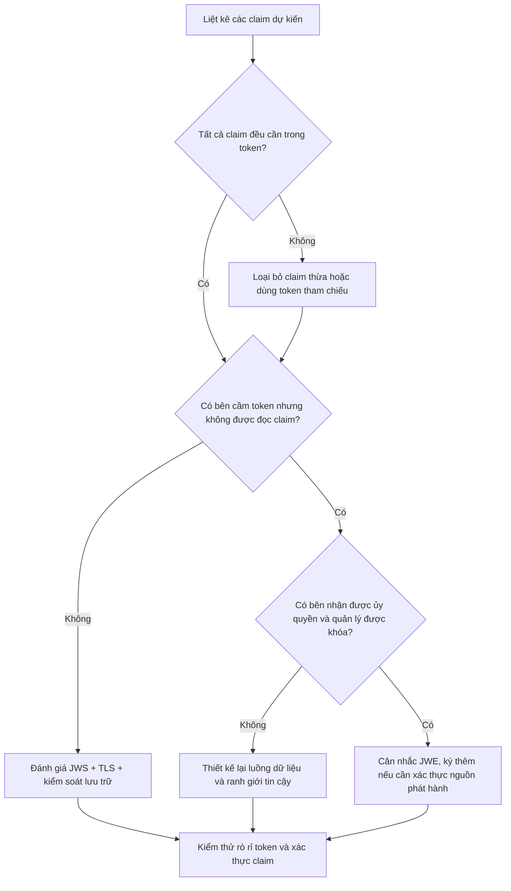

# Khi nào payload JWT cần được bảo vệ bí mật

## 1. Vì sao câu hỏi này quan trọng?

JWT (JSON Web Token) thường được dùng để chuyển các **claim** — những thông tin như định danh chủ thể, bên phát hành, đối tượng nhận, thời hạn và quyền được cấp. Tuy nhiên, **JWT được ký không đồng nghĩa với JWT được mã hóa**.

Một JWT ở dạng JWS Compact Serialization thường gồm ba phần:

```text
BASE64URL(header).BASE64URL(payload).BASE64URL(signature)
```

Hai phần đầu chỉ được **mã hóa biểu diễn bằng Base64url**, nên bất kỳ ai có token đều có thể giải mã cách biểu diễn để đọc header và payload. Chữ ký số giúp người nhận phát hiện việc sửa nội dung trái phép và xác minh nguồn ký khi dùng khóa đáng tin cậy; chữ ký **không che giấu các claim**.

Ví dụ, payload dưới đây có thể bị đọc từ một JWS mà không cần biết khóa ký:

```json
{
  "iss": "https://identity.example",
  "sub": "user-42",
  "aud": "orders-api",
  "scope": "orders:read",
  "email": "person@example.net",
  "exp": 1893456000
}
```

Giả sử token này được gửi qua HTTPS, người quan sát đường truyền bên ngoài thường không đọc được token khi TLS còn bảo vệ kết nối. Nhưng sau khi token đến ứng dụng, cổng API, hệ thống log, dịch vụ giám sát hoặc bất kỳ bên nào được chuyển tiếp token, các bên đó vẫn có thể đọc payload JWS nếu có bản token. **TLS bảo vệ dữ liệu trên kết nối; JWE bảo vệ nội dung token đối với các bên không giữ khóa giải mã**, kể cả khi token đã rời khỏi kết nối TLS ban đầu.

Trong chủ đề *Mã hóa JWE* thuộc phạm vi bảo mật JWT nói chung, câu hỏi cần trả lời là: **Claim nào thật sự cần có trong token, ai có khả năng nhìn thấy token, và liệu bên đó có được phép đọc claim hay không?**

## 2. Phân biệt tính toàn vẹn, tính bí mật và khả năng sử dụng token

| Cơ chế | Bảo vệ chính | Không tự giải quyết |
| --- | --- | --- |
| **JWS** (JWT được ký) | Tính toàn vẹn, xác thực nguồn ký dựa trên khóa tin cậy | Người có token vẫn đọc được payload; token bị đánh cắp vẫn có thể bị dùng lại |
| **JWE** (JWT được mã hóa) | Tính bí mật của plaintext và tính toàn vẹn của ciphertext khi dùng cơ chế mã hóa xác thực phù hợp | Không tự chứng minh danh tính bên phát hành theo cách chữ ký JWS thực hiện; không chống dùng lại token bị đánh cắp |
| **TLS/HTTPS** | Bảo mật dữ liệu khi truyền giữa các điểm kết thúc TLS | Không bảo vệ payload sau khi TLS bị kết thúc, khi token bị lưu hoặc được chuyển tiếp |
| **Giảm thiểu claim / token tham chiếu** | Giảm lượng dữ liệu có thể bị lộ nếu token bị xem hoặc lưu | Không thay thế kiểm tra quyền, thời hạn, đối tượng nhận và quản lý phiên |

Hai dạng Compact Serialization cũng có đặc điểm khác nhau:

```text
JWS:  protected-header.payload.signature           (3 phần)
JWE:  protected-header.encrypted-key.iv.ciphertext.tag (5 phần)
```

Không nên dựa **chỉ** vào số phần để quyết định token có đáng tin hay không: bộ xử lý phải áp dụng đúng loại token, thuật toán, khóa, chính sách và các bước xác thực được phép.

> **Điểm mấu chốt:** Một access token kiểu bearer là thông tin cần bảo vệ khỏi bị đánh cắp **dù payload có bí mật hay không**. Mã hóa payload bằng JWE giải quyết nguy cơ *lộ nội dung claim*; nó không biến bearer token bị đánh cắp thành vô dụng.

## 3. Khi nào nên cân nhắc JWE cho payload JWT?

### 3.1. Payload chứa thông tin mà người cầm token không được phép đọc

Nếu token buộc phải mang dữ liệu cá nhân, tài chính, nghiệp vụ mật hoặc chi tiết phân quyền nhạy cảm, cần đánh giá hậu quả khi dữ liệu xuất hiện trong log, bản sao yêu cầu, công cụ phân tích, bộ nhớ phía client hoặc bên trung gian.

Ví dụ, một bên trung gian chỉ có nhiệm vụ chuyển tiếp token tới dịch vụ xử lý cuối cùng. Nếu bên trung gian không được phép đọc claim về giao dịch, nhưng có thể tiếp cận chuỗi token, JWE cho phép **mã hóa nội dung dành riêng cho bên nhận có khóa giải mã**.

Tuy vậy, trước khi chọn JWE phải hỏi: *Có nhất thiết đưa dữ liệu này vào JWT không?* Nếu chỉ cần một mã tham chiếu để tra cứu dữ liệu qua kênh được kiểm soát, cách đó thường giảm rủi ro và giảm gánh nặng quản lý khóa hơn.

### 3.2. Token đi qua nhiều thành phần với mức độ tin cậy khác nhau

Một token có thể được chuyển qua ứng dụng client, API gateway, hàng đợi sự kiện, dịch vụ trung gian hoặc hạ tầng của đối tác. Mỗi nơi đi qua là một điểm có thể đọc JWS nếu token được ghi nhận hoặc chuyển tiếp.

Khi các trung gian **cần chuyển token nhưng không cần biết toàn bộ claim**, và có một bên nhận cuối rõ ràng, JWE giúp giới hạn bên nào có thể giải mã payload. Điều này chỉ có ý nghĩa nếu khóa giải mã thực sự nằm trong phạm vi của bên nhận được ủy quyền.

### 3.3. Bảo vệ nội dung vượt quá ranh giới TLS

TLS có thể kết thúc tại load balancer hoặc gateway trước khi lưu lượng được xử lý tiếp. Ngoài ra, hệ thống có thể lưu token trong bản ghi sự kiện hoặc bản chụp phục vụ chẩn đoán. Trong các luồng mà **cần duy trì tính bí mật của claim sau điểm kết thúc TLS**, mã hóa ở mức đối tượng bằng JWE có thể bổ sung một lớp bảo vệ.

JWE không miễn trừ trách nhiệm hạn chế log: hệ thống có khóa giải mã vẫn đọc được claim và có thể vô tình ghi chúng ra log. Cần kiểm soát cả các điểm sau giải mã.

### 3.4. Yêu cầu hợp đồng, kiến trúc hoặc phân loại dữ liệu

Một hệ thống có thể quy định rằng claim thuộc một mức phân loại nhất định chỉ được đọc bởi dịch vụ đích, hoặc đối tác tích hợp chỉ được nhận một tập thông tin giới hạn. Khi không thể bỏ claim và các ranh giới tin cậy yêu cầu bảo mật nội dung, JWE có thể là một biện pháp kỹ thuật phù hợp. Quyết định vẫn cần dựa trên mô hình đe dọa, khả năng quản lý khóa và quy tắc bảo vệ dữ liệu thực tế; **không nên mặc định mọi JWT đều cần JWE**.

## 4. Những trường hợp thường không cần mã hóa payload

| Tình huống | Hướng xử lý thường hợp lý | Lý do |
| --- | --- | --- |
| Access token chỉ có `iss`, `sub`, `aud`, `exp`, `scope` cần thiết; client và các bên nhận được phép biết các claim đó | **JWS + HTTPS**, claim tối thiểu, xác thực chặt chẽ | Mục tiêu chính là kiểm tra nguồn phát hành và quyền; mã hóa payload không tạo thêm giá trị bí mật rõ ràng |
| Muốn ngăn người khác sửa `role` hay `scope` | **JWS và kiểm tra chữ ký** | Đây là bài toán toàn vẹn, không phải bí mật |
| Muốn ngăn kẻ lấy cắp bearer token gọi API | **HTTPS, lưu trữ an toàn, tuổi thọ ngắn, cơ chế ràng buộc người gửi khi phù hợp** | JWE vẫn có thể bị phát lại nguyên chuỗi ciphertext bởi người lấy cắp |
| Muốn để ít thông tin cá nhân xuất hiện trên client | **Bỏ claim không cần thiết; sử dụng mã tham chiếu và truy vấn có phân quyền** | Không phát tán dữ liệu thường tốt hơn phát tán dữ liệu đã mã hóa |
| Bên nhận cần đọc tất cả claim, đường đi được kiểm soát và không có yêu cầu bí mật sau TLS | **JWS + HTTPS** có thể đủ | JWE có thêm chi phí xử lý, kích thước và quản lý khóa |

Đặc biệt, **không đưa mật khẩu, khóa riêng, khóa API, refresh token của hệ thống khác hoặc bí mật có giá trị lâu dài vào JWT** chỉ với lý do “sẽ mã hóa bằng JWE”. Các dữ liệu này nên được giữ trong kho bí mật hoặc dịch vụ quản lý phù hợp; khả năng lộ khóa giải mã và rò rỉ sau giải mã vẫn tồn tại.

## 5. Quy trình quyết định: giảm dữ liệu trước, mã hóa khi thật sự cần



Có thể thực hiện quy trình này bằng bốn câu hỏi cụ thể:

1. **Dữ liệu:** Token chứa chính xác những claim nào? Nếu lộ từng claim thì gây ra hậu quả gì?
2. **Bên nhìn thấy:** Ai có thể lấy token ở client, gateway, log, bản sao lưu và các dịch vụ trung gian? Ai thực sự cần đọc payload?
3. **Phương án thay thế:** Có thể bỏ thông tin, thay bằng định danh không nhạy cảm, dùng token tham chiếu (opaque token) hoặc truy vấn dữ liệu khi cần không?
4. **Vận hành:** Bên phát hành có thể mã hóa cho đúng bên nhận, phân phối/luân chuyển khóa và bảo vệ dữ liệu sau giải mã hay không?

Chỉ sau khi trả lời các câu hỏi này mới chọn định dạng JWT phù hợp.

## 6. Các tình huống thực tế

### Tình huống A — API nội bộ với claim tối thiểu

Token chứa `sub`, `iss`, `aud`, `exp`, `scope` để API đọc đơn hàng kiểm tra quyền. Các claim không chứa thông tin nghiệp vụ mật và các bên được phép xử lý token đều có thể biết chúng.

**Lựa chọn:** JWS qua HTTPS thường là đủ, với điều kiện API kiểm tra chữ ký, `iss`, `aud`, thời hạn và quyền. Không cần chọn JWE chỉ vì token có tên JWT.

### Tình huống B — Định danh người dùng chứa thông tin cá nhân

Đội phát triển dự định đưa địa chỉ, số điện thoại, ngày sinh và lịch sử giao dịch vào access token để ứng dụng khỏi gọi API tra cứu.

**Lựa chọn ưu tiên:** Không đưa các thông tin đó vào token nếu không trực tiếp cần cho quyết định truy cập. Giữ chúng trong dịch vụ dữ liệu được phân quyền. Nếu có yêu cầu rõ ràng phải chuyển một số claim qua JWT và người cầm token/trung gian không được đọc, đánh giá JWE cho bên nhận được chỉ định. JWE không loại bỏ trách nhiệm bảo vệ dữ liệu ở nơi giải mã.

### Tình huống C — Gateway chỉ chuyển tiếp claim mật

Dịch vụ phát hành cấp token cho dịch vụ thanh toán. Gateway cần định tuyến nhưng không cần xem những chi tiết giao dịch chứa trong payload.

**Lựa chọn:** Có thể dùng JWE mã hóa cho dịch vụ thanh toán. Gateway không có khóa giải mã sẽ không đọc được plaintext. Nếu gateway đồng thời cần kiểm tra quyền dựa trên claim bên trong JWE, thiết kế phải cung cấp cách kiểm tra quyền đáng tin cậy khác; không thể mặc nhiên yêu cầu gateway vừa không có khóa vừa đọc được claim đã mã hóa.

### Tình huống D — Token bị sao chép từ log

Một kẻ tấn công lấy được chuỗi bearer token từ bản ghi hệ thống. Nếu token là JWE, kẻ đó có thể không đọc được claim nhưng **vẫn có thể gửi nguyên token tới API** nếu API chấp nhận bearer token đó và token còn hiệu lực.

**Lựa chọn:** Chặn ghi log token, giới hạn quyền truy cập log, bảo vệ token khi lưu/truyền, giới hạn thời hạn và dùng cơ chế chống phát lại hoặc token ràng buộc người gửi khi phù hợp. JWE chỉ bổ sung bảo vệ bí mật nội dung, không thay thế các biện pháp này.

## 7. Nếu chọn JWE, cần thiết kế những gì?

### 7.1. Tách hai vai trò: ký và mã hóa

Trong JOSE, header JWE thường nêu:

- `alg`: thuật toán quản lý hoặc thỏa thuận khóa dùng để bảo vệ khóa mã hóa nội dung, chẳng hạn `RSA-OAEP-256` hoặc `ECDH-ES`.
- `enc`: thuật toán mã hóa nội dung, chẳng hạn `A256GCM`.
- `kid`: gợi ý định danh khóa để bên nhận chọn đúng khóa; **không tự nó là bằng chứng khóa đáng tin**.
- `cty`: có thể là `JWT` khi plaintext là một JWT lồng bên trong.

Ví dụ về **protected header** của JWE lồng JWS:

```json
{
  "alg": "RSA-OAEP-256",
  "enc": "A256GCM",
  "kid": "recipient-key-01",
  "cty": "JWT"
}
```

**Header JWE vẫn được nhìn thấy** trong Compact Serialization; chỉ nội dung được mã hóa mới được che giấu. Vì thế, không đặt bí mật vào header, kể cả các trường mở rộng.

### 7.2. Khi cần cả nguồn phát hành đáng tin và bí mật: ký rồi mã hóa

Nếu bên nhận phải xác thực ai phát hành JWT **và** cần che giấu claim khỏi các trung gian, một mẫu thường dùng là **nested JWT: tạo JWS trước, sau đó bọc JWS trong JWE**.

```text
Claims
  │
  ├─ Ký bằng khóa của bên phát hành ──> JWS
  │                                      │
  │                         Mã hóa cho bên nhận
  │                                      ▼
  └────────────────────────────────────> JWE
                                         │
                    Bên nhận giải mã JWE
                                         ▼
                              Kiểm tra chữ ký JWS
                                         ▼
                           Kiểm tra claim và cấp quyền
```

Ví dụ mã giả độc lập ngôn ngữ (tên hàm chỉ minh họa, không phải API của một thư viện cụ thể):

```text
claims = {
    iss: "https://identity.example",
    sub: "user-42",
    aud: "billing-api",
    exp: unixNow() + 300,
    scope: "invoice:read"
}

signedJwt = JWS.sign(
    claims,
    issuerSigningPrivateKey,
    allowedAlgorithm = "ES256"
)

encryptedJwt = JWE.encrypt(
    plaintext = signedJwt,
    recipientPublicKey = billingServiceEncryptionPublicKey,
    keyManagementAlgorithm = "RSA-OAEP-256",
    contentEncryptionAlgorithm = "A256GCM",
    contentType = "JWT"
)

// Ở dịch vụ nhận:
signedJwt = JWE.decryptAndAuthenticate(
    encryptedJwt,
    recipientDecryptionPrivateKey,
    acceptedKeyManagementAlgorithms = ["RSA-OAEP-256"],
    acceptedContentEncryptionAlgorithms = ["A256GCM"]
)

claims = JWS.verifySignature(
    signedJwt,
    trustedIssuerVerificationPublicKey,
    acceptedSigningAlgorithms = ["ES256"]
)

validateIssuerAudienceTimeAndPermissions(claims)
```

JWE có kiểm tra toàn vẹn bản mã, nhưng điều đó **không mặc nhiên tương đương** việc xác thực danh tính bên phát hành theo chữ ký JWS. Nếu ứng dụng yêu cầu xác thực nguồn gốc, phải áp dụng biện pháp xác thực phù hợp, chẳng hạn chữ ký của bên phát hành. Việc giải mã thành công cũng không thay thế kiểm tra `iss`, `aud`, `exp`, `nbf` (nếu có), hay các điều kiện phân quyền.

### 7.3. Quản lý khóa và điểm giải mã

Trước khi phát hành JWE, cần xác định rõ:

1. **Ai là bên nhận được phép giải mã?** Chỉ họ nên giữ khóa giải mã; không phân phối rộng khóa riêng hoặc khóa đối xứng cho mọi dịch vụ trung gian.
2. **Khóa đến từ đâu?** Sử dụng hạ tầng quản lý khóa đáng tin cậy, phân tách khóa ký và khóa giải mã, hỗ trợ thay khóa và thu hồi khi có sự cố.
3. **Thuật toán nào được chấp nhận?** Cấu hình danh sách thuật toán được phép ở cả bên phát hành và bên nhận; không để header token tùy ý quyết định cơ chế tin cậy hay nguồn lấy khóa.
4. **Plaintext được xử lý thế nào sau giải mã?** Tránh log claim mật, giới hạn bộ phận được truy cập và bảo vệ bộ nhớ/lưu trữ theo mức độ nhạy cảm.
5. **Các lớp xử lý có hiểu đúng loại token không?** Bên nhận phải phân biệt và xác thực đúng token JWS/JWE và các token lồng nhau; không chấp nhận nội dung chưa qua toàn bộ các bước bắt buộc.

JWE thường dài hơn JWS, nên cũng cần đánh giá giới hạn kích thước của cookie, HTTP header, gateway và hệ thống truyền nhận. Không tự xây dựng thuật toán mật mã hoặc tự ghép các thao tác để thay thế thư viện JOSE được duy trì và cấu hình an toàn.

## 8. Những hiểu lầm và rủi ro dễ bỏ sót

| Nhận định | Đánh giá đúng |
| --- | --- |
| “Payload JWS có Base64url nên đã bí mật.” | Sai. Có thể giải mã để xem nội dung mà không có khóa. |
| “Có HTTPS thì JWE luôn vô ích.” | Sai. HTTPS bảo vệ kết nối, trong khi JWE có thể giữ bí mật claim trước những trung gian hoặc nơi lưu token không được phép giải mã. |
| “Cứ có thông tin cá nhân là phải dùng JWE.” | Chưa đủ. Trước hết cần xem thông tin ấy có thực sự phải nằm trong JWT không, bên nào nhận và phạm vi bảo vệ cụ thể. |
| “Mã hóa JWE cũng chứng minh issuer đã phát hành token.” | Không mặc nhiên. Nếu cần xác thực nguồn phát hành, phải thiết kế kiểm chứng nguồn, ví dụ nested JWS trong JWE. |
| “Token JWE bị đánh cắp cũng không dùng lại được.” | Sai. Bên tấn công có thể thử phát lại chính chuỗi JWE như bearer token. |
| “Mọi dữ liệu của JWT đã bí mật.” | Sai. Protected header và một số đặc điểm bên ngoài như kích thước token vẫn quan sát được; plaintext hiện ra tại bên nhận hợp lệ. |

Ngoài ra, nên thận trọng khi nén nội dung có bí mật trước khi mã hóa. Nếu kẻ tấn công có thể tác động đến một phần plaintext và quan sát kích thước đầu ra, mức thay đổi độ dài có thể tạo ra kênh rò rỉ thông tin. Không bật nén JWE chỉ để rút ngắn token khi chưa phân tích rủi ro này.

## 9. Checklist trước khi quyết định bảo vệ payload bằng JWE

- [ ] Đã liệt kê tất cả claim và xóa những claim không cần cho mục đích của token.
- [ ] Đã đánh giá ảnh hưởng nếu từng claim bị đọc bởi client, trung gian hoặc người có quyền xem log.
- [ ] Đã xác định rõ bên nào cần đọc plaintext và bên nào chỉ cần vận chuyển token.
- [ ] Đã cân nhắc token tham chiếu, truy vấn dữ liệu có phân quyền hoặc tách luồng thông tin.
- [ ] Nếu dùng JWE, đã chọn thuật toán và khóa theo danh sách cho phép, xác định bên nhận có quyền giải mã.
- [ ] Nếu cần xác minh bên phát hành, đã có cơ chế xác thực nguồn phù hợp, chẳng hạn JWS được kiểm chứng bên trong JWE.
- [ ] Sau giải mã, đã kiểm tra chữ ký nếu có, `iss`, `aud`, thời hạn, loại token và quyền theo đúng ngữ cảnh.
- [ ] Đã kiểm soát ghi log, lưu trữ, vòng đời, kích thước token và nguy cơ sử dụng lại token bị đánh cắp.

**Kết luận:** Hãy dùng JWE khi payload JWT **thật sự cần tồn tại trong token** nhưng **phải được giữ bí mật trước một số bên có thể tiếp cận chuỗi token**. Với claim tối thiểu không cần che giấu, JWS kết hợp TLS và kiểm tra xác thực đầy đủ thường phù hợp hơn. Mọi quyết định phải bắt đầu từ nhu cầu bảo vệ dữ liệu và ranh giới tin cậy của hệ thống.

### Tài liệu tiêu chuẩn để tra cứu thêm

- [RFC 7519 — JSON Web Token (JWT)](https://www.rfc-editor.org/rfc/rfc7519)
- [RFC 7515 — JSON Web Signature (JWS)](https://www.rfc-editor.org/rfc/rfc7515)
- [RFC 7516 — JSON Web Encryption (JWE)](https://www.rfc-editor.org/rfc/rfc7516)
- [RFC 7518 — JSON Web Algorithms (JWA)](https://www.rfc-editor.org/rfc/rfc7518)
- [RFC 8725 — JSON Web Token Best Current Practices](https://www.rfc-editor.org/rfc/rfc8725)
