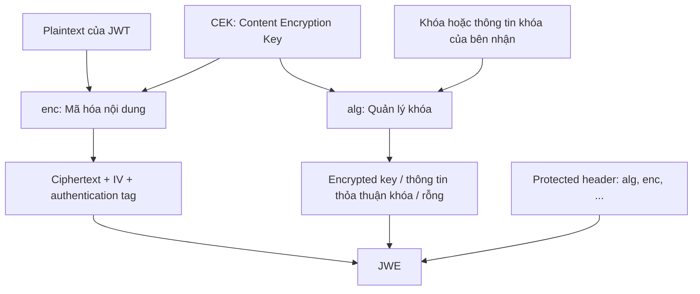
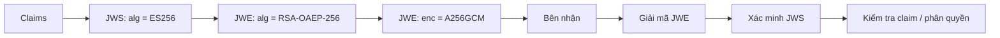

# Phân biệt `alg` quản lý khóa với `enc` mã hóa nội dung trong JWE

## 1. Hai tham số trả lời hai câu hỏi khác nhau

Trong chuẩn **JSON Web Encryption (JWE)** của hệ sinh thái **JSON Web Token (JWT)**, hai tham số `alg` và `enc` thường xuất hiện cạnh nhau trong JOSE Header nhưng **không cùng chức năng**:

- **`alg` — Key Management Algorithm:** Bên phát hành và bên nhận thiết lập, tạo ra, thỏa thuận hoặc bảo vệ **khóa mã hóa nội dung** bằng cách nào?
- **`enc` — Content Encryption Algorithm:** Nội dung thật sự của token được **mã hóa và kiểm tra tính toàn vẹn** bằng thuật toán nào?

Khóa mã hóa nội dung được gọi là **CEK (Content Encryption Key)**. Đây là khái niệm kết nối hai tham số: `alg` quyết định cách bên nhận có được CEK hợp lệ, còn `enc` dùng CEK đó để mã hóa hoặc giải mã payload.

Một protected header JWE điển hình:

```json
{
  "alg": "RSA-OAEP-256",
  "enc": "A256GCM",
  "kid": "billing-enc-key-01"
}
```

Đọc đúng: dùng **RSA-OAEP-256 để mã hóa/bảo vệ CEK cho bên nhận**; dùng **AES-256-GCM để mã hóa nội dung bằng CEK**. Không có nghĩa toàn bộ payload được đưa trực tiếp vào phép toán RSA.

> **Quy tắc nhớ:** `alg` bảo vệ hoặc thiết lập **khóa dùng cho nội dung**; `enc` bảo vệ **chính nội dung**. Trong JWS, tên trường `alg` lại được dùng để chỉ thuật toán **chữ ký/MAC**, nên phải xác định rõ đang xử lý JWE hay JWS.

Tài liệu này thuộc phần **Mã hóa JWE** của học phần *Security - JSON Web Token (JWT)* (`SECURITY_TOKEN_SECURITY_JWT`). Các nguyên tắc áp dụng cho giao thức JWT/JOSE nói chung, độc lập với ngôn ngữ lập trình, nền tảng máy chủ và framework.

## 2. CEK là gì và nằm ở đâu trong quy trình?

CEK là khóa đối xứng mà thuật toán `enc` sử dụng. Trong một JWE, quy trình về mặt khái niệm là:

1. Xác định thuật toán mã hóa nội dung `enc` và độ dài CEK tương ứng.
2. Tạo CEK ngẫu nhiên đủ mạnh **hoặc** nhận/suy ra CEK bằng phương thức quản lý khóa `alg`.
3. Nếu `alg` thuộc kiểu bảo vệ khóa, mã hóa (wrap/encrypt) CEK cho bên nhận; nếu `alg` dùng khóa trực tiếp hoặc thỏa thuận khóa trực tiếp, trường encrypted key có thể rỗng.
4. Sử dụng CEK và các tham số mã hóa cần thiết để mã hóa plaintext thành ciphertext và tạo authentication tag.
5. Bên nhận xử lý `alg` để lấy đúng CEK, rồi dùng `enc` để giải mã **và xác minh tính toàn vẹn** trước khi sử dụng plaintext.



Sơ đồ minh họa luồng vai trò; không phải thuật toán triển khai. Với phương thức thỏa thuận hoặc dùng khóa trực tiếp, CEK có thể **được suy ra/nhận từ `alg`**, thay vì sinh trước rồi chuyển vào `alg`.

### Cách tách trách nhiệm

| Thuộc tính | `alg` | `enc` |
| --- | --- | --- |
| Đối tượng tác động | CEK, khóa dùng để bảo vệ CEK (KEK), hoặc quá trình thỏa thuận khóa | Plaintext/ciphertext của nội dung |
| Mục tiêu chính | Làm cho **bên nhận có quyền** nhận được CEK | Giữ bí mật và phát hiện thay đổi trái phép của nội dung |
| Một số giá trị | `RSA-OAEP-256`, `A256KW`, `ECDH-ES`, `ECDH-ES+A256KW`, `dir` | `A128GCM`, `A256GCM`, `A128CBC-HS256` |
| Phụ thuộc vào | Loại khóa, khóa của bên nhận, cơ chế chia sẻ/thỏa thuận khóa | Độ dài CEK, IV/nonce, tag, thuật toán mã hóa |
| Sai lầm thường gặp | Tưởng đây là thuật toán trực tiếp mã hóa payload | Tưởng đây là thuật toán trao đổi hoặc vận chuyển CEK |

**KEK (Key Encryption Key)** là khóa dùng để *bảo vệ CEK* trong các phương thức key wrapping. KEK và CEK có chức năng khác nhau; trong các phương thức `dir` hoặc `ECDH-ES` trực tiếp, không nhất thiết tồn tại một KEK tách biệt.

## 3. Những nhóm `alg` phổ biến

Tên `alg` không phải lúc nào cũng đồng nghĩa với “mã hóa CEK”. Chuẩn JWE hỗ trợ nhiều mô hình quản lý khóa.

| `alg` minh họa | Cách bên nhận có CEK | Phần `encrypted_key` trong JWE Compact |
| --- | --- | --- |
| `RSA-OAEP-256` | Bên phát hành mã hóa CEK bằng khóa công khai RSA của bên nhận; bên nhận giải mã CEK bằng khóa riêng | Có dữ liệu |
| `A256KW` | CEK được wrap bằng **KEK đối xứng 256 bit** dùng thuật toán AES Key Wrap | Có dữ liệu |
| `A256GCMKW` | CEK được wrap bằng AES-GCM, với IV và tag của bước wrap được truyền theo header tương ứng | Có dữ liệu |
| `ECDH-ES+A256KW` | Các bên dùng ECDH để suy ra **KEK**, rồi dùng AES Key Wrap bảo vệ CEK | Có dữ liệu |
| `ECDH-ES` | Các bên dùng ECDH và KDF để **suy ra trực tiếp CEK** | **Rỗng** |
| `dir` | Khóa đối xứng được cấu hình sẵn được **dùng trực tiếp làm CEK** | **Rỗng** |
| `PBES2-HS256+A128KW` | Suy ra KEK từ mật khẩu bằng PBES2, rồi wrap CEK bằng AES Key Wrap; cần kiểm soát mật khẩu và tham số KDF | Có dữ liệu |

### 3.1. Key encryption / key wrapping

Với `RSA-OAEP-256`, `A256KW` hoặc một phương thức wrap tương tự:

- Chọn `enc` và tạo CEK đủ độ dài theo `enc`.
- Dùng `alg` và khóa bảo vệ thích hợp để tạo **encrypted key**.
- Dùng chính CEK đó để mã hóa plaintext bằng `enc`.
- Khi nhận, giải mã/unwrap encrypted key trước, rồi mới giải mã nội dung.

Ví dụ: `alg = A256KW` và `enc = A128GCM` dùng **KEK 256 bit** để wrap **CEK 128 bit**. Hai giá trị “256” và “128” không mâu thuẫn vì nói đến hai khóa phục vụ hai phép toán khác nhau.

### 3.2. Direct key agreement

Với `alg = ECDH-ES`, bên phát hành và bên nhận dùng một cơ chế thỏa thuận khóa dựa trên elliptic curve và KDF để có **cùng CEK**, không cần vận chuyển encrypted key riêng. Một số tham số liên quan, như public key tạm thời `epk`, nằm trong JOSE Header theo quy định của thuật toán.

Nếu chuyển thành `ECDH-ES+A256KW`, ECDH trước hết tạo **KEK** rồi KEK wrap một CEK riêng; vì vậy trường encrypted key **không rỗng**. Sự khác biệt nằm ở **cách quản lý CEK**, không nằm ở thuật toán `enc`.

### 3.3. Direct encryption

Với `alg = dir`, hai đầu đã có khóa đối xứng thích hợp và **khóa này chính là CEK**, nên không có bước wrap CEK và không có encrypted key. Trường `enc` vẫn bắt buộc vì cần biết dùng CEK đó để mã hóa nội dung theo cách nào.

Ví dụ, `dir` kết hợp `A256GCM` yêu cầu khóa đối xứng dùng trực tiếp có độ dài **256 bit**. Cơ chế phân phối và bảo vệ khóa chia sẻ nằm ngoài bản thân JWE; người cầm được khóa này có thể giải mã và cũng có thể tạo bản mã mới hợp lệ.

## 4. `enc`: thuật toán trực tiếp bảo vệ payload

Trong JWE, `enc` định nghĩa phương thức **authenticated content encryption**. Có thể dùng thuật toán AEAD như AES-GCM hoặc tổ hợp mã hóa + MAC theo chuẩn JWA. Khi giải mã, hệ thống phải kiểm tra thành công authentication tag trước khi chấp nhận plaintext.

| `enc` minh họa | Cách bảo vệ nội dung | Độ dài CEK |
| --- | --- | --- |
| `A128GCM` | AES-GCM với khóa 128 bit | 128 bit |
| `A192GCM` | AES-GCM với khóa 192 bit | 192 bit |
| `A256GCM` | AES-GCM với khóa 256 bit | 256 bit |
| `A128CBC-HS256` | AES-128-CBC kết hợp HMAC-SHA-256 theo cách ghép trong JWA | **256 bit** (chia thành các phần MAC và mã hóa) |
| `A256CBC-HS512` | AES-256-CBC kết hợp HMAC-SHA-512 theo JWA | **512 bit** (chia thành các phần MAC và mã hóa) |

Ví dụ `A256GCM`:

- CEK: 256 bit.
- IV/nonce trong JWE AES-GCM: 96 bit (12 byte).
- Authentication tag: 128 bit (16 byte).
- Đầu ra gồm ciphertext và tag, được dùng cùng protected header trong quá trình xác thực theo cấu trúc JWE.

**IV/nonce không phải CEK** và không phải trường `encrypted_key`. Khi dùng AES-GCM, **không được tái sử dụng IV với cùng một CEK** vì có thể phá vỡ tính an toàn của cả mã hóa và xác thực. Dùng bộ sinh ngẫu nhiên an toàn/cơ chế tạo IV đúng theo thư viện JOSE và chính sách thuật toán.

Chú ý: hậu tố số trong tên thuật toán **không luôn diễn tả cùng một thuộc tính**. Trong `RSA-OAEP-256`, “256” liên quan đến hàm băm SHA-256 của OAEP; trong `A256GCM`, “256” là kích thước khóa AES; trong `A128CBC-HS256`, CEK tổng thể dài 256 bit. Không thể kiểm tra tương thích khóa chỉ bằng việc so các con số trong tên thuật toán.

## 5. Hai thuật toán kết hợp tạo ra JWE Compact ra sao?

**JWE Compact Serialization** luôn có năm thành phần, ngăn cách bằng dấu chấm:

```text
BASE64URL(protected-header)
.BASE64URL(encrypted-key)
.BASE64URL(iv)
.BASE64URL(ciphertext)
.BASE64URL(authentication-tag)
```

Trong thực tế, chuỗi nằm **trên một dòng**:

```text
protected-header.encrypted-key.iv.ciphertext.tag
```

Ý nghĩa:

| Vị trí | Thành phần | Chủ yếu liên quan đến |
| --- | --- | --- |
| 1 | Protected header: chứa `alg`, `enc`, có thể có `kid`, `epk`, ... | Cả `alg` và `enc` |
| 2 | Encrypted key: CEK được mã hóa/wrap, **hoặc chuỗi rỗng** với một số `alg` | `alg` |
| 3 | IV/nonce của phép mã hóa nội dung | `enc` |
| 4 | Ciphertext của plaintext | `enc` |
| 5 | Authentication tag của phép mã hóa nội dung | `enc` |

Trong Compact Serialization, header ở vị trí 1 là **protected header**, được xác thực cùng ciphertext theo cơ chế JWE. Header có thể được **đọc** bởi người có token; JWE không mã hóa header.

Riêng trường `encrypted_key` rỗng là **hợp lệ** khi `alg = dir` hoặc `alg = ECDH-ES` trực tiếp. Vì vậy, JWE với `dir` thường có **hai dấu chấm liền nhau** giữa protected header và IV:

```text
protected-header..iv.ciphertext.tag
```

Không được kết luận token hỏng chỉ vì trường thứ hai rỗng. Cần đọc `alg` và xác minh cấu trúc theo đúng thuật toán đã cho phép.

### Ví dụ A — Mã hóa CEK bằng RSA, mã hóa payload bằng AES-GCM

Protected header:

```json
{
  "alg": "RSA-OAEP-256",
  "enc": "A256GCM",
  "kid": "recipient-rsa-2026-01"
}
```

Quá trình minh họa:

```text
[Plaintext JWT]
     |
     | 1. Tạo CEK ngẫu nhiên 256 bit
     | 2. AES-256-GCM(CEK, IV, plaintext, AAD)
     v
[Ciphertext + authentication tag]
     
[CEK] -- RSA-OAEP-256 với public key bên nhận --> [Encrypted key]

Bên nhận:
    RSA private key -> giải mã encrypted key -> CEK
    CEK + IV + tag + AAD -> AES-GCM xác thực và giải mã -> plaintext
```

RSA bảo vệ **CEK**, AES-GCM bảo vệ **payload**. Khóa RSA không phải khóa AES-GCM.

### Ví dụ B — Dùng trực tiếp một khóa đối xứng

Protected header:

```json
{
  "alg": "dir",
  "enc": "A256GCM",
  "kid": "shared-key-v3"
}
```

Cả hai đầu đã có khóa đối xứng 256 bit được phân phối an toàn:

```text
sharedKey256 = CEK
AES-256-GCM(CEK, IV, plaintext, AAD) -> ciphertext + tag
encrypted_key = ""  // Không có CEK được wrap riêng
```

Ở đây `dir` không có nghĩa “không mã hóa payload”; việc mã hóa vẫn diễn ra thông qua `enc = A256GCM`. Trong vận hành cần đảm bảo khóa chia sẻ được giới hạn đúng các bên, có vòng đời hợp lý và không dùng lại IV với cùng khóa.

### Ví dụ C — Thỏa thuận khóa ECDH trực tiếp

Protected header mô tả nguyên tắc; giá trị public key tạm thời dưới đây chỉ là **minh họa dạng cấu trúc** và không phải khóa hợp lệ để thực thi:

```json
{
  "alg": "ECDH-ES",
  "enc": "A128GCM",
  "epk": {
    "kty": "EC",
    "crv": "P-256",
    "x": "<base64url-public-coordinate-x>",
    "y": "<base64url-public-coordinate-y>"
  }
}
```

Bên phát hành dùng khóa ECDH tạm thời và khóa công khai của bên nhận để cùng bên nhận suy ra CEK 128 bit thông qua quy trình KDF phù hợp; `encrypted_key` rỗng. Không gửi khóa riêng ECDH qua token.

Nếu thay `alg` bằng `ECDH-ES+A256KW`, quy trình sẽ suy ra **KEK 256 bit** từ ECDH, sau đó dùng KEK để wrap một CEK phù hợp với `enc`. Phần encrypted key khi ấy có dữ liệu.

## 6. Chọn `alg` và `enc` dựa trên điều gì?

### 6.1. Chọn `alg` theo ranh giới quản lý khóa

Cần xác định:

- **Ai được giải mã token?** Một dịch vụ nhận có public/private key riêng, hay nhiều dịch vụ cùng nắm một khóa đối xứng?
- **Có sẵn vật liệu khóa nào?** RSA, ECDH, KEK đối xứng, hay khóa CEK dùng trực tiếp?
- **Bên gửi có nên biết khóa riêng/khóa giải mã không?** Với mã hóa cho một bên nhận dùng public key, bên gửi không cần biết private key của bên nhận.
- **Có yêu cầu nhiều bên nhận không?** JWE JSON Serialization có thể biểu diễn nhiều recipient, dùng một ciphertext nhưng cung cấp phần quản lý khóa riêng cho từng recipient. Cần thiết kế và kiểm tra khả năng hỗ trợ của từng `alg`.

Ví dụ, khi gửi token cho một dịch vụ chỉ dịch vụ đó được giải mã, nhóm thuật toán quản lý khóa bằng public key có thể thuận lợi trong phân phối khóa. Khi hai dịch vụ đã chia sẻ một khóa đối xứng an toàn, có thể cân nhắc `dir` hoặc key wrapping tùy mô hình vận hành. Sự lựa chọn không thể chỉ dựa vào tên thuật toán trông “mạnh” hơn.

### 6.2. Chọn `enc` theo mức bảo vệ và khả năng tương thích

Cần đánh giá:

- Bên phát hành và nhận hỗ trợ cùng thuật toán nội dung và độ dài CEK hay không.
- Phương pháp tạo IV/nonce và kiểm soát không tái sử dụng có đúng yêu cầu thuật toán hay không.
- Chi phí xử lý, kích thước token và chính sách mật mã của hệ thống.
- Thư viện JOSE có thực hiện giải mã **kèm xác thực tag** đúng cách hay không.

**AES-GCM** là một lựa chọn thường gặp khi thư viện và nền tảng hỗ trợ đúng cách. Với các tổ hợp CBC-HMAC, phải dùng đầy đủ cấu trúc được định nghĩa trong JWA; không tự ghép AES-CBC và HMAC bằng mã tự viết.

### 6.3. Một số cặp cấu hình minh họa

| `alg` | `enc` | Ý nghĩa chính |
| --- | --- | --- |
| `RSA-OAEP-256` | `A256GCM` | Mã hóa CEK bằng public key RSA; nội dung dùng AES-256-GCM |
| `A256KW` | `A128GCM` | KEK AES 256 bit wrap CEK AES-GCM 128 bit |
| `ECDH-ES` | `A256GCM` | ECDH/KDF tạo trực tiếp CEK 256 bit |
| `ECDH-ES+A256KW` | `A128GCM` | ECDH tạo KEK 256 bit; KEK wrap CEK 128 bit |
| `dir` | `A256GCM` | Khóa đối xứng chia sẻ trực tiếp làm CEK 256 bit |

Các cặp trên là **ví dụ về vai trò và tương thích khóa**, không phải danh sách cho phép mặc định. Hệ thống phải quyết định danh sách thuật toán được duyệt theo chính sách bảo mật, quy định hiện hành và năng lực của các bên.

## 7. Khác biệt giữa `alg` của JWE và `alg` của JWS

**Cùng tên trường `alg`, khác đối tượng mật mã.**

| Định dạng JOSE | Ví dụ header | Chức năng `alg` |
| --- | --- | --- |
| **JWS** | `{"alg":"ES256","typ":"JWT"}` | Chỉ thuật toán ký/xác minh chữ ký của payload |
| **JWE** | `{"alg":"RSA-OAEP-256","enc":"A256GCM"}` | Chỉ thuật toán quản lý CEK; `enc` chỉ thuật toán mã hóa nội dung |

Một JWT vừa cần xác thực nguồn phát hành vừa cần bí mật nội dung thường sử dụng **nested JWT**, ví dụ ký JWS trước rồi mã hóa JWS bằng JWE:



Đọc chính xác: `ES256` ký claim; `RSA-OAEP-256` bảo vệ CEK; `A256GCM` mã hóa JWS đã được ký.

JWE cung cấp tính bí mật và xác thực tính toàn vẹn của dữ liệu mã hóa. **Việc giải mã JWE thành công không tự chứng minh ai đã phát hành claim** theo cách chữ ký JWS được xác minh với khóa của issuer. Nếu nghiệp vụ yêu cầu xác thực người phát hành, cần thêm cơ chế thích hợp. Sau giải mã và xác minh chữ ký (nếu có), vẫn phải kiểm tra `iss`, `aud`, `exp`, `nbf`, phạm vi quyền và ngữ cảnh sử dụng.

## 8. Các lỗi cấu hình và tấn công thường liên quan đến hai trường này

| Lỗi hoặc hiểu nhầm | Tác động | Biện pháp |
| --- | --- | --- |
| Coi `alg` của JWE là thuật toán mã hóa payload | Dùng sai khóa hoặc hiểu sai mô hình bảo vệ | Phân tách quy trình quản lý CEK và mã hóa nội dung |
| Tin rằng `RSA-OAEP-256` bảo vệ plaintext trực tiếp | Thiết kế sai luồng dữ liệu và kích thước đầu vào | Để thư viện JOSE bảo vệ CEK bằng RSA, mã hóa payload bằng `enc` |
| Cho phép token tùy ý quyết định `alg`/`enc` | Có thể chấp nhận cấu hình ngoài chính sách hoặc gây algorithm confusion | Cấu hình danh sách thuật toán được phép, ràng buộc vào đúng khóa và ngữ cảnh |
| Dùng `kid` hoặc URL từ header để tự động lấy khóa tùy ý | Có nguy cơ dùng khóa không đáng tin hoặc truy cập nguồn ngoài ý muốn | Chọn khóa từ kho đã tin cậy, giới hạn định danh và nguồn khóa |
| Chấp nhận plaintext trước khi xác minh authentication tag | Dữ liệu chưa xác thực có thể bị đưa vào xử lý | Dùng giải mã có xác thực; chỉ xử lý plaintext sau khi kiểm tra thành công |
| Tái sử dụng IV/nonce AES-GCM với cùng CEK | Có thể phá vỡ tính bí mật và toàn vẹn | Thực thi chiến lược IV đúng chuẩn và kiểm soát không tái sử dụng |
| Dùng `dir` nhưng phân phối rộng CEK chia sẻ | Tăng số hệ thống có thể giải mã và tạo JWE | Giới hạn phạm vi khóa, quản lý vòng đời và tách môi trường |
| Xem mã hóa như thay thế chữ ký hoặc kiểm tra claim | Có thể tin dữ liệu từ nguồn không mong muốn hoặc chấp nhận token sai đối tượng | Xác thực nguồn khi cần; kiểm tra issuer, audience, thời hạn và quyền |

**Một số nguyên tắc cần giữ cố định:**

1. Dùng thư viện JOSE đáng tin cậy; không tự triển khai key wrapping, AEAD hay cấu trúc tag.
2. Bên nhận phải **chủ động cấu hình** thuật toán `alg`, `enc` và tập khóa được phép thay vì tin mù quáng vào header.
3. Phải ràng buộc mục đích sử dụng khóa với thuật toán và ngữ cảnh; không dùng lẫn khóa ký, khóa quản lý CEK và CEK chỉ vì cùng có thể biểu diễn thành byte.
4. Từ chối token khi thuật toán, khóa, cấu trúc, tag hoặc quy tắc claim không hợp lệ. Không tự “fallback” sang thuật toán yếu hơn.
5. Header JWE **không bí mật**. Không đặt mật khẩu, private key hoặc dữ liệu nhạy cảm vào `kid`, `epk` hay phần mở rộng header.
6. `RSA1_5` và các cấu hình cũ, yếu hoặc không đáp ứng chính sách an toàn hiện tại không nên được sử dụng cho thiết kế mới. Chọn thuật toán theo tiêu chuẩn và hướng dẫn an toàn đã được tổ chức chấp thuận.

## 9. Ví dụ mã giả độc lập ngôn ngữ

Mã dưới đây giải thích ý tưởng; tên hàm và đối số không đại diện cho API cụ thể:

```text
// BÊN PHÁT HÀNH
claims = {
    "iss": "https://issuer.example",
    "sub": "user-42",
    "aud": "billing-api",
    "exp": unixNow() + 300
}

jwe = JOSE.encrypt(
    plaintext = serialize(claims),
    recipientKey = billingServicePublicKey,
    keyManagementAlgorithm = "RSA-OAEP-256", // alg
    contentEncryptionAlgorithm = "A256GCM",  // enc
    keyId = "billing-enc-key-01"
)

// BÊN NHẬN
plaintext = JOSE.decryptAndAuthenticate(
    token = jwe,
    trustedRecipientPrivateKey = billingServicePrivateKey,
    allowedKeyManagementAlgorithms = ["RSA-OAEP-256"],
    allowedContentEncryptionAlgorithms = ["A256GCM"]
)

claims = parseClaims(plaintext)
validateIssuerAudienceExpiryAndAuthorization(claims)
```

Một thư viện JOSE phù hợp sẽ thực hiện các bước như tạo CEK, tạo IV, mã hóa payload, quản lý `encrypted_key`, xây dựng AAD và kiểm tra authentication tag. Người tích hợp vẫn phải cấu hình đúng khóa, danh sách thuật toán và điều kiện kiểm tra token.

Cũng cần nhớ: mã hóa JWE **không ngăn được hành vi phát lại** khi kẻ tấn công lấy được toàn bộ bearer token còn hiệu lực. Bảo vệ token khỏi bị đánh cắp, giới hạn thời hạn, kiểm soát log và dùng token ràng buộc người gửi khi phù hợp là các biện pháp độc lập.

## 10. Câu hỏi tự kiểm tra

1. Với `{"alg":"RSA-OAEP-256","enc":"A256GCM"}`, thuật toán nào mã hóa payload? **`A256GCM`**; RSA-OAEP-256 bảo vệ CEK.
2. Vì sao `{"alg":"dir","enc":"A256GCM"}` có thể có thành phần `encrypted_key` rỗng? **Vì khóa đối xứng đã dùng trực tiếp làm CEK**; không có CEK riêng cần wrap.
3. `A256KW` và `A128GCM` có xung đột độ dài không? **Không**; KEK dài 256 bit, CEK dùng AES-GCM dài 128 bit.
4. Khác nhau giữa `ECDH-ES` và `ECDH-ES+A256KW`? **Trực tiếp suy ra CEK** so với **suy ra KEK để wrap CEK**.
5. Có phải thay `enc` từ `A128GCM` sang `A256GCM` mà giữ nguyên mọi thứ sẽ luôn thành công? **Không**; phải có CEK đúng độ dài và cả bên gửi/nhận hỗ trợ, cho phép cùng thuật toán.
6. JWE giải mã thành công đã đủ chứng minh JWT do issuer hợp lệ ký chưa? **Chưa**; nếu cần xác thực nguồn phát hành, phải xác minh chữ ký hoặc cơ chế xác thực nguồn tương ứng.

## 11. Checklist thiết kế

- [ ] Đã xác định rõ ai giữ khóa để nhận hoặc suy ra CEK và ai được phép giải mã.
- [ ] Đã chọn `alg` theo mô hình phân phối, thỏa thuận hoặc bảo vệ khóa phù hợp.
- [ ] Đã chọn `enc` theo yêu cầu mã hóa nội dung và độ dài CEK tương ứng.
- [ ] Đã phân biệt CEK, KEK, IV/nonce, encrypted key, ciphertext và authentication tag.
- [ ] Đã kiểm soát thuật toán và khóa theo danh sách cho phép ở bên nhận.
- [ ] Đã bảo đảm giải mã phải xác thực tag thành công trước khi dùng plaintext.
- [ ] Đã đáp ứng yêu cầu IV/nonce, quản lý khóa và thay khóa.
- [ ] Nếu cần xác thực nguồn phát hành, đã có bước kiểm tra chữ ký hoặc cơ chế tương đương.
- [ ] Đã kiểm tra issuer, audience, thời hạn, quyền và các ràng buộc nghiệp vụ sau giải mã.

**Kết luận:** Trong JWE, `alg` định nghĩa **cách quản lý CEK**, còn `enc` định nghĩa **cách dùng CEK để mã hóa và xác thực nội dung**. Một thiết kế đúng phải lựa chọn và kiểm tra **cả hai** tham số, đồng thời giữ ranh giới rõ ràng giữa quản lý khóa, bảo vệ payload và xác thực nguồn phát hành.

### Tài liệu tiêu chuẩn

- [RFC 7516 — JSON Web Encryption (JWE)](https://www.rfc-editor.org/rfc/rfc7516)
- [RFC 7518 — JSON Web Algorithms (JWA)](https://www.rfc-editor.org/rfc/rfc7518)
- [RFC 7515 — JSON Web Signature (JWS)](https://www.rfc-editor.org/rfc/rfc7515)
- [RFC 7519 — JSON Web Token (JWT)](https://www.rfc-editor.org/rfc/rfc7519)
- [RFC 8725 — JSON Web Token Best Current Practices](https://www.rfc-editor.org/rfc/rfc8725)
