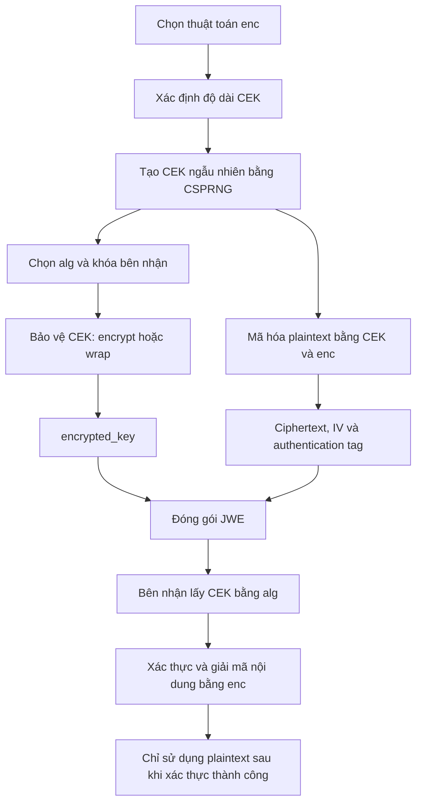
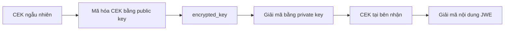
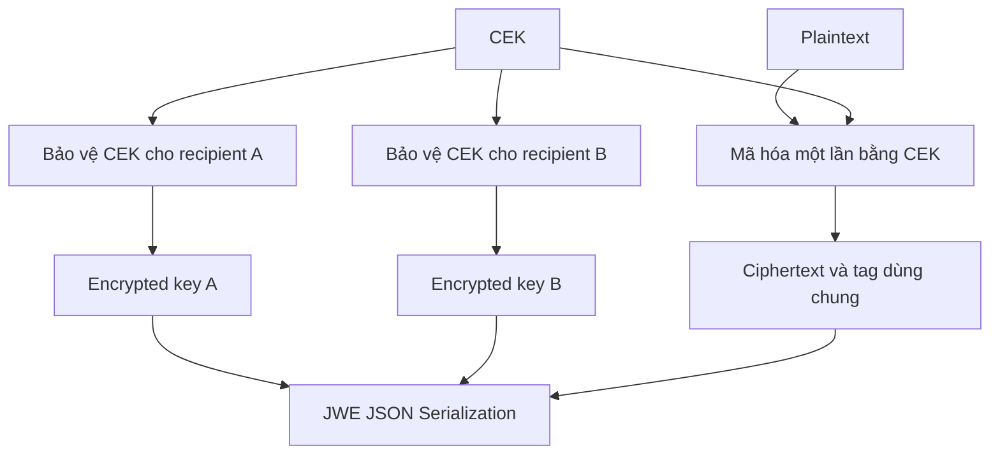

# Khóa mã hóa nội dung và cơ chế bảo vệ khóa đó

## 1. CEK là trung tâm của một JWE

Trong JSON Web Encryption (JWE), **CEK (Content Encryption Key)** là khóa mà thuật toán mã hóa nội dung `enc` sử dụng để biến plaintext thành ciphertext và tạo dữ liệu xác thực toàn vẹn. CEK là vật liệu khóa trực tiếp bảo vệ nội dung JWT hoặc dữ liệu được đặt trong JWE.

Một JWE thường có hai lớp công việc mật mã:

- **Bảo vệ khóa:** làm cho bên nhận được ủy quyền có thể lấy được CEK. Việc này được điều khiển bởi tham số `alg`.
- **Bảo vệ nội dung:** dùng CEK để mã hóa và xác thực plaintext. Việc này được điều khiển bởi tham số `enc`.

CEK không được gửi nguyên dạng trong JWE. Với các thuật toán quản lý khóa kiểu wrapping hoặc public-key encryption, JWE mang một dạng CEK đã được bảo vệ trong thành phần `encrypted_key`. Với một số cơ chế trực tiếp, thành phần này rỗng vì hai bên đã có hoặc có thể suy ra CEK theo cách khác.

Bài học này thuộc phần **Mã hóa JWE** của học phần **Security - JSON Web Token (JWT)** (`SECURITY_TOKEN_SECURITY_JWT`). Nội dung tập trung vào vòng đời của CEK và cách bảo vệ khóa trong chuẩn JOSE nói chung, không phụ thuộc ngôn ngữ lập trình hay framework.

## 2. Vòng đời của CEK

Một luồng JWE điển hình với thuật toán quản lý khóa kiểu wrapping có thể mô tả như sau:



Trình tự cụ thể phụ thuộc `alg`. Với `dir` hoặc `ECDH-ES` trực tiếp, CEK không nhất thiết được tạo trước rồi mới wrap: khóa chia sẻ hoặc khóa được suy ra có thể chính là CEK.

### Các bước cần hiểu rõ

1. **Chọn `enc` trước khi tạo CEK.** Độ dài và cấu trúc CEK phụ thuộc thuật toán mã hóa nội dung.
2. **Tạo CEK đủ mạnh.** Với các cơ chế dùng CEK ngẫu nhiên, khóa phải được tạo từ bộ sinh số ngẫu nhiên mật mã an toàn (CSPRNG), không dùng timestamp, UUID thông thường, số ngẫu nhiên của ứng dụng hoặc giá trị có thể dự đoán.
3. **Bảo vệ CEK theo `alg`.** Có thể mã hóa CEK bằng public key của bên nhận, wrap bằng KEK đối xứng, hoặc suy ra khóa bằng ECDH. Cũng có thể dùng khóa chia sẻ trực tiếp theo `dir`.
4. **Mã hóa nội dung theo `enc`.** Dùng CEK cùng IV/nonce và các tham số theo yêu cầu của thuật toán.
5. **Đóng gói JWE.** Đưa protected header, encrypted key, IV, ciphertext và authentication tag vào cấu trúc JWE phù hợp.
6. **Giải mã tại bên nhận.** Lấy CEK bằng `alg`, sau đó xác thực và giải mã nội dung bằng `enc`. Chỉ chuyển plaintext sang bước nghiệp vụ sau khi xác thực thành công.
7. **Quản lý CEK sau sử dụng.** Giảm thời gian tồn tại trong bộ nhớ, không ghi log, không lưu bản rõ lâu hơn cần thiết và xử lý an toàn khi tác vụ kết thúc.

Trong thiết kế dùng key wrapping, **mỗi JWE thường có CEK ngẫu nhiên riêng**. Nhờ vậy, việc lộ một CEK giới hạn ảnh hưởng vào thông điệp được mã hóa bằng CEK đó. Dùng lại một CEK cho nhiều thông điệp làm tăng phạm vi ảnh hưởng khi khóa bị lộ và tạo thêm yêu cầu kiểm soát IV/nonce.

## 3. Độ dài và cấu trúc CEK phụ thuộc vào `enc`

Không được tự chọn độ dài CEK tùy ý. Thuật toán `enc` quy định chính xác kích thước và cách diễn giải khóa.

| Thuật toán `enc` | Độ dài CEK | Ghi chú |
| --- | ---: | --- |
| `A128GCM` | 128 bit (16 byte) | AES-GCM với khóa AES 128 bit |
| `A192GCM` | 192 bit (24 byte) | AES-GCM với khóa AES 192 bit |
| `A256GCM` | 256 bit (32 byte) | AES-GCM với khóa AES 256 bit |
| `A128CBC-HS256` | 256 bit (32 byte) | Chia thành khóa MAC 128 bit và khóa AES-CBC 128 bit |
| `A192CBC-HS384` | 384 bit (48 byte) | Chia thành khóa MAC 192 bit và khóa AES-CBC 192 bit |
| `A256CBC-HS512` | 512 bit (64 byte) | Chia thành khóa MAC 256 bit và khóa AES-CBC 256 bit |

Với các thuật toán CBC-HMAC, CEK là một chuỗi khóa kết hợp theo quy định của JWA: nửa đầu dành cho MAC, nửa sau dành cho mã hóa AES-CBC. Không được lấy nguyên CEK làm một khóa AES duy nhất hoặc tự đảo thứ tự các phần.

Ví dụ:

- `A256GCM` cần CEK 32 byte.
- `A128CBC-HS256` cũng cần CEK tổng cộng 32 byte, nhưng cách phân chia thành khóa MAC và khóa AES khác hẳn.
- Hai thuật toán có cùng tổng số byte CEK không có nghĩa là có thể dùng thay thế khóa cho nhau. Mỗi CEK phải được tạo và sử dụng đúng với thuật toán đã định.

Các tên thuật toán chứa con số không luôn biểu thị cùng một thông số. Hãy dựa vào đặc tả JWA để xác định độ dài CEK, khóa phụ, IV và tag.

## 4. Các cách để bên nhận có được CEK

### 4.1. Mã hóa CEK bằng khóa công khai của bên nhận

Với các thuật toán như `RSA-OAEP-256`:

1. Bên phát hành tạo CEK ngẫu nhiên theo yêu cầu của `enc`.
2. Bên phát hành dùng **khóa công khai** của bên nhận để mã hóa CEK.
3. Kết quả được đặt trong `encrypted_key`.
4. Bên nhận dùng **khóa riêng** tương ứng để khôi phục CEK.
5. Bên nhận dùng CEK để xác thực và giải mã nội dung.



Ưu điểm là bên gửi chỉ cần khóa công khai, không cần giữ khóa riêng giải mã của bên nhận. Tuy nhiên, **bất kỳ ai có khóa công khai đều có thể tạo một JWE mã hóa gửi tới bên nhận**. Việc giải mã thành công vì thế không chứng minh rằng token do một issuer cụ thể phát hành. Nếu cần xác thực nguồn phát hành, phải kiểm tra chữ ký JWS hoặc cơ chế xác thực nguồn thích hợp.

### 4.2. Wrap CEK bằng một khóa đối xứng (KEK)

**KEK (Key Encryption Key)** là khóa dùng để bảo vệ một khóa khác. Trong JWE, các thuật toán như `A128KW`, `A192KW` và `A256KW` dùng AES Key Wrap để wrap CEK.

Quy trình:

1. Hai bên đã có KEK được phân phối qua một kênh tin cậy.
2. Bên phát hành tạo CEK ngẫu nhiên.
3. Bên phát hành dùng KEK để wrap CEK thành encrypted key.
4. Bên nhận dùng cùng KEK để unwrap và lấy lại CEK.
5. CEK được dùng cho `enc`.

```text
CEK ngẫu nhiên
     |
     | AES Key Wrap với KEK
     v
encrypted_key
     |
     | AES Key Unwrap với cùng KEK
     v
CEK được khôi phục
```

KEK và CEK có nhiệm vụ riêng:

| Thuộc tính | CEK | KEK |
| --- | --- | --- |
| Vai trò | Mã hóa nội dung JWE | Bảo vệ CEK |
| Được dùng bởi | `enc` | Thuật toán quản lý khóa `alg` |
| Phạm vi sử dụng nên có | Thường giới hạn theo từng JWE khi dùng wrapping | Có thể bảo vệ nhiều CEK trong phạm vi được quản lý |
| Khi bị lộ | Có thể giải mã nội dung dùng CEK đó | Có thể unwrap các CEK được bảo vệ bằng KEK đó |
| Cần bảo vệ | Có, đặc biệt trong bộ nhớ và log | Có, thường cần lưu trong KMS/HSM hoặc kho bí mật được kiểm soát |

Không được nhầm **AES Key Wrap** với AES-GCM dùng để mã hóa nội dung. Key Wrap chỉ bảo vệ CEK; `enc` vẫn thực hiện việc mã hóa payload.

### 4.3. Thỏa thuận khóa ECDH để suy ra CEK hoặc KEK

Với `ECDH-ES`, hai bên dùng Elliptic Curve Diffie-Hellman kết hợp KDF theo quy định để suy ra vật liệu khóa chung.

Có hai dạng:

- **`ECDH-ES` trực tiếp:** KDF tạo CEK dùng trực tiếp cho `enc`. Không có encrypted key riêng.
- **`ECDH-ES+A256KW`** (hoặc biến thể AES Key Wrap khác): ECDH/KDF tạo KEK, sau đó KEK wrap một CEK ngẫu nhiên riêng. Khi đó encrypted key có dữ liệu.

Thông tin public key tạm thời của bên gửi có thể được biểu diễn bằng tham số `epk` trong JOSE Header. Khóa riêng ECDH không được đưa vào token.

Không được tự lấy kết quả ECDH thô làm khóa AES tùy ý. Quy trình phải dùng KDF và các thông tin ngữ cảnh theo JWA, bao gồm các tham số cần thiết như AlgorithmID và thông tin bên gửi/bên nhận khi được sử dụng.

**Lưu ý về forward secrecy:** `ECDH-ES` trong JWE với khóa công khai dài hạn của bên nhận không tự động cung cấp forward secrecy. Nếu kẻ tấn công lưu các token cũ và sau đó lấy được khóa riêng dài hạn của bên nhận, họ có thể có khả năng suy ra khóa phiên của các token đã lưu. Không nên xem việc dùng ECDH-ES là bảo đảm rằng dữ liệu lịch sử không thể bị giải mã sau khi khóa bên nhận bị xâm phạm.

### 4.4. Dùng trực tiếp khóa chia sẻ với `dir`

Với `alg = dir`, khóa đối xứng đã chia sẻ giữa hai bên được dùng trực tiếp làm CEK. Không có bước wrap CEK và thành phần `encrypted_key` rỗng.

Ví dụ, `dir` kết hợp `A256GCM` đòi hỏi khóa đối xứng 256 bit dùng làm CEK. Cả hai bên phải bảo vệ cùng khóa đó.

Đây là một mô hình đơn giản nhưng có hệ quả vận hành quan trọng:

- Bên nào giữ khóa đều có thể giải mã nội dung.
- Nếu khóa bị lộ, mọi JWE còn có thể giải mã bằng khóa đó đều có nguy cơ.
- Khi dùng AES-GCM, IV/nonce phải duy nhất với cùng một CEK. Nếu dùng một khóa `dir` lâu dài cho nhiều token, hệ thống phải kiểm soát tính duy nhất này trên toàn bộ các lần mã hóa bằng khóa đó.
- Thay khóa có thể yêu cầu cập nhật đồng bộ các bên gửi và nhận.

`dir` phù hợp khi mô hình chia sẻ khóa được quản lý chặt chẽ và có cơ chế tạo, phân phối, thay thế khóa rõ ràng. Không nên chọn chỉ vì cấu hình có ít bước hơn.

### 4.5. Suy ra KEK từ mật khẩu

Các thuật toán thuộc họ `PBES2` dùng password-based key derivation để suy ra KEK, sau đó dùng KEK để wrap CEK. Trong JWE, header có các tham số như `p2s` (salt input) và `p2c` (số vòng lặp).

Mật khẩu con người thường có entropy thấp hơn khóa ngẫu nhiên. Vì vậy, nếu dùng phương thức này:

- Mật khẩu phải có độ mạnh phù hợp và không được đặt trong token.
- Cần kiểm tra chính sách KDF, salt và số vòng lặp theo yêu cầu thuật toán và năng lực hệ thống.
- Tránh dùng một mật khẩu chung cho nhiều người nhận hoặc nhiều môi trường.
- Cân nhắc nguy cơ dò mật khẩu ngoại tuyến nếu kẻ tấn công lấy được JWE.

PBES2 không biến một mật khẩu yếu thành bí mật mạnh. Nếu hệ thống có thể dùng khóa ngẫu nhiên được quản lý qua KMS/HSM, đó thường là lựa chọn vận hành tốt hơn.

## 5. Chọn mô hình bảo vệ CEK theo kiến trúc

| Mô hình | Khi nào cân nhắc | Điểm cần quản lý |
| --- | --- | --- |
| RSA-OAEP | Bên gửi mã hóa cho một bên nhận có cặp khóa public/private | Bảo vệ private key, định danh key version, thu hồi và thay khóa |
| AES Key Wrap | Các bên đã có KEK đối xứng được phân phối an toàn | Phân phối KEK, giới hạn quyền unwrap, rotation |
| ECDH-ES trực tiếp | Muốn suy ra CEK từ thỏa thuận khóa theo chuẩn | Quản lý khóa ECDH, curve, KDF và tham số header |
| ECDH-ES + AES Key Wrap | Muốn suy ra KEK rồi bảo vệ CEK riêng | Cả quản lý khóa ECDH và vòng đời KEK |
| dir | Mô hình hai bên chia sẻ khóa đối xứng và có kiểm soát chặt | Phạm vi chia sẻ, nonce uniqueness, rotation và số lượng bên giữ khóa |
| PBES2 | Trường hợp tích hợp dựa trên mật khẩu có lý do rõ ràng | Độ mạnh mật khẩu, salt, chi phí KDF và chống dò ngoại tuyến |

Không có mô hình nào phù hợp cho mọi hệ thống. Hãy bắt đầu từ số lượng bên nhận, ranh giới tin cậy, cách phân phối khóa, yêu cầu thay khóa và mức độ thiệt hại nếu khóa bị lộ.

## 6. Một CEK cho nhiều người nhận

JWE JSON Serialization hỗ trợ biểu diễn một nội dung mã hóa cho nhiều recipient. Mô hình thường gặp là:

1. Bên phát hành tạo **một CEK** để mã hóa plaintext một lần.
2. Với mỗi recipient, bên phát hành bảo vệ cùng CEK bằng khóa hoặc cơ chế quản lý khóa tương ứng.
3. Mỗi recipient có phần thông tin quản lý khóa riêng, bao gồm encrypted key khi thuật toán cần nó.
4. Mỗi bên nhận dùng khóa của mình để lấy cùng CEK và giải mã cùng ciphertext.



Điều này có nghĩa mọi recipient được cấu hình thành công đều có thể đọc **cùng một nội dung**. Nếu các bên có quyền xem dữ liệu khác nhau, nên tạo JWE riêng cho từng nhóm quyền hoặc thiết kế payload phù hợp; không dùng một JWE nhiều recipient để giả lập phân quyền ở mức từng claim.

Các phương thức direct như `dir` và `ECDH-ES` trực tiếp có giới hạn về số recipient: chúng tạo hoặc dùng CEK trực tiếp cho một bên nhận, nên không thể tùy tiện tái sử dụng cùng một ciphertext cho nhiều recipient có CEK khác nhau. Khi cần nhiều recipient, dùng mô hình key wrapping phù hợp hoặc tạo JWE riêng.

## 7. Quản lý CEK và KEK bằng KMS/HSM

Trong hệ thống thực tế, không nên để khóa nhạy cảm nằm trong mã nguồn, tệp cấu hình công khai, biến môi trường không được kiểm soát hoặc kho log. Có thể dùng **KMS (Key Management Service)** hoặc **HSM (Hardware Security Module)** để bảo vệ các khóa dài hạn.

Các mô hình triển khai phổ biến:

- **KMS giữ KEK:** ứng dụng yêu cầu KMS wrap/unwrap CEK bằng KEK. Ứng dụng chỉ nhận CEK bản rõ trong khoảng thời gian cần thiết để gọi thư viện JOSE mã hóa nội dung.
- **HSM giữ private key:** thao tác giải mã encrypted key bằng private key được thực hiện trong HSM, hạn chế việc xuất khóa riêng ra ngoài.
- **KMS sinh data key:** một số KMS có API tạo khóa dữ liệu và trả về cả khóa bản rõ lẫn bản được KMS bảo vệ. Khóa bản rõ dùng làm CEK trong thời gian ngắn; bản được KMS bảo vệ phục vụ lưu trữ hoặc khôi phục theo cơ chế của nhà cung cấp.

Cần phân biệt **envelope encryption của một nhà cung cấp** với **định dạng JWE chuẩn**. Một blob khóa đã mã hóa do KMS trả về không mặc nhiên là thành phần `encrypted_key` hợp lệ của JWE. Muốn tạo JWE có khả năng tương tác, phải dùng thuật toán `alg` và cách biểu diễn được JOSE/JWA định nghĩa; không tự gán tên thuật toán riêng hoặc nhét dữ liệu tùy ý vào trường chuẩn.

### Nguyên tắc vận hành với KMS/HSM

1. **Quyền tối thiểu:** chỉ dịch vụ cần tạo hoặc giải mã JWE mới có quyền gọi thao tác tương ứng.
2. **Tách môi trường:** khóa development, staging và production phải được phân tách.
3. **Tách mục đích:** không dùng cùng một khóa cho ký JWS, quản lý CEK và mã hóa nội dung nếu thiết kế không cho phép rõ ràng.
4. **Kiểm toán:** ghi nhận ai đã yêu cầu wrap/unwrap, thời điểm và key version; không ghi khóa bản rõ, CEK hoặc plaintext nhạy cảm.
5. **Giới hạn truy cập:** giới hạn mạng, danh tính workload, quyền quản trị và quyền xuất khóa.
6. **Khả năng khôi phục:** có quy trình backup hoặc phục hồi khóa phù hợp với loại khóa và chính sách; kiểm thử khôi phục trước khi có sự cố.
7. **Giám sát:** cảnh báo số lượng thao tác giải mã bất thường, truy cập ngoài vùng, lỗi xác thực và việc sử dụng key version đã ngừng.

## 8. Thay khóa, thu hồi và xử lý khóa bị lộ

Khóa không có vòng đời quản lý rõ ràng sẽ trở thành điểm yếu dài hạn. Một chính sách nên xác định ít nhất các trạng thái: tạo mới, đang hoạt động, chỉ dùng giải mã, hết hạn/ngừng phát hành, bị thu hồi và bị xâm phạm.

### 8.1. Rotation có kế hoạch

Một quy trình thay khóa thường gồm:

1. Tạo key version mới và đưa khóa mới vào kho tin cậy của bên nhận.
2. Cập nhật bên phát hành để dùng khóa mới cho JWE mới.
3. Giữ khóa cũ ở chế độ **chỉ giải mã** trong thời gian token cũ còn hợp lệ hoặc còn cần xử lý.
4. Theo dõi số lượng token còn dùng key version cũ.
5. Khi hết thời gian chuyển tiếp và hết nhu cầu giải mã dữ liệu cũ, ngừng hoặc hủy khóa cũ theo chính sách lưu trữ.

`kid` có thể giúp chọn key version, nhưng `kid` chỉ là định danh. Bộ phân giải khóa phải ánh xạ nó vào một kho khóa tin cậy đã cấu hình; không lấy một giá trị `kid` không tin cậy làm lý do để tải khóa tùy ý từ URL hoặc hệ thống bên ngoài.

### 8.2. Có thể thay KEK mà không mã hóa lại toàn bộ payload không?

Trong mô hình key wrapping, CEK bảo vệ payload, còn KEK bảo vệ CEK. Vì vậy, về nguyên tắc có thể:

1. Dùng KEK cũ unwrap CEK.
2. Dùng KEK mới wrap lại cùng CEK.
3. Cập nhật phần quản lý khóa của JWE.

Cách này có thể tránh phải mã hóa lại payload lớn. Tuy nhiên, không được sửa chuỗi JWE bằng thao tác thay thế văn bản đơn giản. Protected header tham gia vào quá trình xác thực nội dung (AAD); nếu header hoặc thông tin khóa được bảo vệ thay đổi, tag phải được xử lý lại đúng theo chuẩn. Cần dùng thư viện JOSE có hỗ trợ quy trình chuyển đổi tương ứng và kiểm thử khả năng tương thích.

Với JWE Compact, `kid` thường nằm trong protected header; thay nó làm thay đổi AAD và không thể chỉ thay encrypted key rồi giữ nguyên tag. Với JSON Serialization, vị trí header và từng recipient cũng phải tuân theo quy tắc bảo vệ của JOSE. Nếu không có công cụ và quy trình rewrap an toàn, phương án dễ kiểm soát hơn là phát hành JWE mới.

### 8.3. Khi khóa bị xâm phạm

Nếu nghi ngờ khóa giải mã hoặc KEK bị lộ:

- Ngừng dùng khóa đó để mã hóa JWE mới.
- Đánh giá những token và dữ liệu nào đã được bảo vệ bằng khóa bị ảnh hưởng.
- Thu hồi hoặc vô hiệu hóa key version theo khả năng của hệ thống.
- Thay khóa, cập nhật bên gửi/nhận và giới hạn việc chấp nhận token cũ.
- Nếu bearer token có thể đã bị lấy cắp, thu hồi phiên/token hoặc áp dụng biện pháp chống phát lại phù hợp; chỉ thay khóa mã hóa không nhất thiết vô hiệu hóa token đã được phát hành.
- Kiểm tra log truy cập KMS/HSM, thời điểm sử dụng khóa và các bản ghi có thể đã lộ CEK hoặc plaintext.
- Đánh giá việc phải mã hóa lại dữ liệu lưu trữ và thông báo cho các bên chịu ảnh hưởng theo quy trình tổ chức.

**Thu hồi khóa và thu hồi token là hai việc khác nhau.** Một token đã được giải mã hoặc một access token còn được API chấp nhận có thể tiếp tục có hiệu lực dù hệ thống đã thay khóa dùng để tạo JWE mới.

## 9. Các lỗi bảo vệ khóa thường gặp

| Lỗi | Hậu quả | Cách phòng tránh |
| --- | --- | --- |
| Tạo CEK bằng nguồn ngẫu nhiên không an toàn | Kẻ tấn công có thể đoán hoặc tái tạo khóa | Dùng CSPRNG hoặc thư viện JOSE/KMS được tin cậy |
| Dùng CEK sai độ dài với `enc` | Lỗi giải mã hoặc cấu hình không hợp lệ | Để thư viện kiểm tra độ dài theo JWA |
| Dùng KEK trực tiếp để mã hóa payload dù cấu hình yêu cầu CEK riêng | Nhầm vai trò khóa, không tuân thủ thuật toán | Phân biệt rõ CEK và KEK |
| Tái sử dụng IV với cùng CEK AES-GCM | Có thể làm lộ thông tin và phá vỡ xác thực | Bảo đảm IV duy nhất theo yêu cầu của AES-GCM |
| Dùng một khóa cho nhiều mục đích mật mã | Tăng nguy cơ cross-protocol và ảnh hưởng khi lộ khóa | Tách khóa theo mục đích, thuật toán và môi trường |
| Lưu CEK/KEK bản rõ trong log hoặc telemetry | Người đọc log có thể giải mã token | Redact dữ liệu nhạy cảm, giới hạn log và quyền truy cập |
| Phân phối KEK cho quá nhiều dịch vụ | Mở rộng phạm vi có thể unwrap CEK | Quyền tối thiểu và phân vùng khóa theo dịch vụ |
| Không giữ key version cũ trong thời gian chuyển tiếp | Token cũ không giải mã được | Kế hoạch rotation và thời hạn tương thích |
| Giữ khóa cũ vô thời hạn | Khóa bị lộ có thể tiếp tục giải mã dữ liệu lịch sử | Chính sách lưu trữ, thu hồi và hủy khóa |
| Tin rằng JWE đã xác thực issuer | Có thể chấp nhận token từ nguồn không mong muốn | Xác minh JWS hoặc cơ chế xác thực nguồn phù hợp |
| Tin rằng ECDH-ES mặc nhiên có forward secrecy | Đánh giá thấp rủi ro lộ khóa dài hạn | Đánh giá mô hình khóa và thời gian lưu token thực tế |

## 10. Ví dụ quy trình phát hành và nhận JWE

Đoạn mã giả sau mô tả cách sử dụng một thư viện JOSE. Tên hàm chỉ có tính minh họa, không phải API của một ngôn ngữ hoặc nhà cung cấp cụ thể.

```text
// BÊN PHÁT HÀNH
claims = {
    "iss": "https://issuer.example",
    "sub": "user-42",
    "aud": "billing-api",
    "exp": unixNow() + 300
}

// Thư viện tạo CEK theo yêu cầu của A256GCM,
// dùng public key của bên nhận để bảo vệ CEK.
jwe = JOSE.encrypt(
    plaintext = serialize(claims),
    recipientPublicKey = billingEncryptionPublicKey,
    alg = "RSA-OAEP-256",
    enc = "A256GCM",
    kid = "billing-key-v4"
)

// BÊN NHẬN
// Chọn private key từ kho khóa tin cậy theo chính sách đã cấu hình.
plaintext = JOSE.decryptAndAuthenticate(
    jwe = jwe,
    recipientPrivateKey = billingEncryptionPrivateKey,
    allowedAlgs = ["RSA-OAEP-256"],
    allowedEncs = ["A256GCM"]
)

// Chỉ sử dụng plaintext khi xác thực JWE thành công.
claims = parse(plaintext)
validateIssuerAudienceExpiryAndAuthorization(claims)
```

Trong ví dụ này, thư viện tạo CEK, bảo vệ CEK bằng RSA-OAEP-256, mã hóa nội dung bằng AES-256-GCM và kiểm tra tag khi giải mã. Ứng dụng không cần tự xây dựng các phép toán khóa.

Nếu cần xác thực issuer, ví dụ trên vẫn phải bổ sung bước kiểm tra chữ ký JWS hoặc cơ chế tương đương. JWE bảo vệ bí mật và toàn vẹn nội dung; nó không tự chứng minh ai đã phát hành claim.

## 11. Checklist thiết kế vòng đời khóa

- [ ] Đã xác định thuật toán `enc` và độ dài CEK chính xác.
- [ ] CEK được tạo bằng CSPRNG hoặc suy ra bằng cơ chế chuẩn được cấu hình đúng.
- [ ] Đã xác định rõ `alg` bảo vệ CEK bằng public key, KEK, ECDH, khóa trực tiếp hay KDF từ mật khẩu.
- [ ] CEK và KEK được tách vai trò, tách mục đích và giới hạn phạm vi sử dụng.
- [ ] Khóa dài hạn được lưu trong KMS/HSM hoặc kho bí mật có kiểm soát phù hợp.
- [ ] Không ghi CEK, KEK, private key hoặc plaintext nhạy cảm vào log.
- [ ] IV/nonce được tạo và quản lý đúng theo thuật toán; đặc biệt không tái sử dụng IV AES-GCM với cùng CEK.
- [ ] Bên nhận chỉ dùng khóa và thuật toán nằm trong danh sách tin cậy đã cấu hình.
- [ ] `kid` được ánh xạ vào kho khóa tin cậy, không được xem là bằng chứng xác thực khóa.
- [ ] Có quy trình rotation, thời gian tương thích với token cũ, thu hồi và xử lý sự cố.
- [ ] Đã đánh giá ảnh hưởng khi CEK, KEK hoặc khóa riêng dài hạn bị lộ.
- [ ] Nếu dùng nhiều recipient, đã hiểu mọi recipient thành công đều có thể đọc cùng payload.
- [ ] Đã xác minh nguồn phát hành riêng nếu nghiệp vụ yêu cầu chữ ký hoặc xác thực issuer.

**Kết luận:** CEK là khóa trực tiếp bảo vệ nội dung JWE; `alg` quyết định bên nhận lấy được CEK bằng cách nào. Một thiết kế an toàn phải kiểm soát cả cách tạo CEK, cách bảo vệ nó, phạm vi bên nhận, vòng đời khóa dài hạn và xử lý khi khóa bị lộ. Mật mã đúng thuật toán chỉ là một phần; quyền truy cập, rotation, lưu trữ và xác thực nguồn cũng quyết định mức an toàn thực tế.

### Tài liệu tiêu chuẩn

- [RFC 7516 — JSON Web Encryption (JWE)](https://www.rfc-editor.org/rfc/rfc7516)
- [RFC 7518 — JSON Web Algorithms (JWA)](https://www.rfc-editor.org/rfc/rfc7518)
- [RFC 7515 — JSON Web Signature (JWS)](https://www.rfc-editor.org/rfc/rfc7515)
- [RFC 7519 — JSON Web Token (JWT)](https://www.rfc-editor.org/rfc/rfc7519)
- [RFC 8725 — JSON Web Token Best Current Practices](https://www.rfc-editor.org/rfc/rfc8725)
