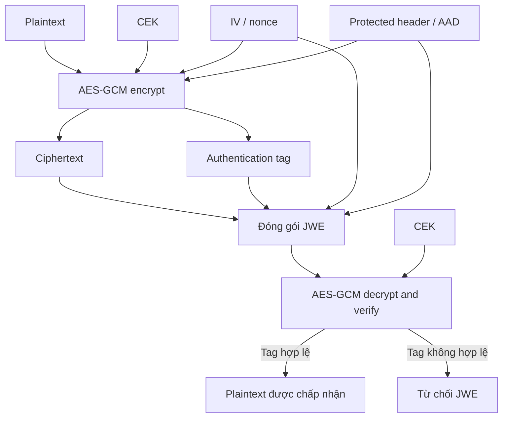
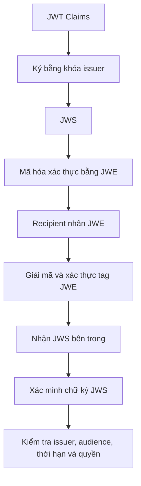

# Mã hóa xác thực và kiểm tra tính toàn vẹn của JWE

## 1. JWE bảo vệ nội dung bằng mã hóa xác thực

**JSON Web Encryption (JWE)** bảo vệ payload bằng mã hóa và cơ chế kiểm tra tính toàn vẹn. Bên nhận cần xác minh rằng dữ liệu mã hóa và những dữ liệu được đưa vào vùng xác thực không bị thay đổi trước khi sử dụng plaintext.

JWE sử dụng các thuật toán mã hóa nội dung được định nghĩa trong JOSE/JWA. Các lựa chọn phổ biến gồm:

- **AEAD (Authenticated Encryption with Associated Data)** như AES-GCM: mã hóa nội dung đồng thời tạo authentication tag để xác minh ciphertext và dữ liệu phụ trợ.
- **Tổ hợp AES-CBC và HMAC** như `A128CBC-HS256`: mã hóa bằng AES-CBC và tạo tag bằng HMAC theo cấu trúc được JWA quy định.

Một JWE Compact thường có dạng:

```text
BASE64URL(protected-header)
.BASE64URL(encrypted-key)
.BASE64URL(iv)
.BASE64URL(ciphertext)
.BASE64URL(authentication-tag)
```

Trong đó:

- **Protected header** chứa các tham số JOSE được bảo vệ toàn vẹn, bao gồm thuật toán mã hóa nội dung `enc`.
- **Encrypted key** mang CEK đã được bảo vệ theo `alg`, hoặc rỗng với cơ chế dùng/suy ra CEK trực tiếp.
- **IV/nonce** là tham số đầu vào của phép mã hóa nội dung.
- **Ciphertext** là nội dung đã mã hóa.
- **Authentication tag** là giá trị dùng để kiểm tra tính toàn vẹn và xác thực dữ liệu theo thuật toán.

Mã hóa xác thực có hai mục tiêu liên quan nhưng khác nhau:

1. **Bí mật (confidentiality):** người không có khóa không đọc được plaintext.
2. **Toàn vẹn và xác thực dữ liệu (integrity/authentication):** bên nhận phát hiện được thay đổi trái phép đối với ciphertext và dữ liệu phụ trợ được xác thực.

Từ “authentication” trong AEAD nói đến việc xác thực dữ liệu bằng khóa mật mã. Nó **không tự chứng minh danh tính người phát hành JWT**. Điểm khác biệt này rất quan trọng khi thiết kế hệ thống.

Bài học này thuộc phần **Mã hóa JWE** của học phần **Security - JSON Web Token (JWT)** (`SECURITY_TOKEN_SECURITY_JWT`). Các nguyên tắc dưới đây áp dụng cho chuẩn JWT/JOSE nói chung, không phụ thuộc Java, Spring Security hay một nền tảng cụ thể.

## 2. Authentication tag và Additional Authenticated Data (AAD)

### 2.1. Authentication tag là gì?

Khi mã hóa, thuật toán nội dung tạo ra ciphertext và một **authentication tag**. Khi giải mã, bên nhận dùng khóa và các tham số tương ứng để kiểm tra tag.

Nếu tag không hợp lệ, dữ liệu có thể đã bị sửa, khóa không đúng, IV/AAD không khớp hoặc token bị hỏng. Bên nhận phải từ chối JWE và không được chuyển plaintext chưa xác thực sang xử lý nghiệp vụ.

Tag không phải chữ ký số. Với AES-GCM, bất kỳ bên nào có CEK đều có thể tạo ciphertext và tag hợp lệ. Với một CEK được chia sẻ, các bên cùng giữ khóa có khả năng tạo dữ liệu được xác thực bằng khóa đó.

### 2.2. AAD là gì?

**AAD (Additional Authenticated Data)** là dữ liệu được đưa vào phép xác thực toàn vẹn nhưng **không được mã hóa**. Người quan sát có thể đọc AAD, nhưng nếu thay đổi AAD thì tag sẽ không còn hợp lệ.

Trong JWE Compact Serialization, AAD là chuỗi ASCII của phần protected header đã được mã hóa Base64url:

```text
AAD = ASCII(BASE64URL(UTF8(JWE Protected Header)))
```

Điều này có nghĩa protected header được gắn với authentication tag. Ví dụ header:

```json
{
  "alg": "RSA-OAEP-256",
  "enc": "A256GCM",
  "kid": "recipient-key-01",
  "cty": "JWT"
}
```

Protected header vẫn **đọc được** từ token; Base64url chỉ là mã hóa biểu diễn. Tuy nhiên, nếu ai đó thay đổi nội dung header, chuỗi AAD được tính lại sẽ khác và kiểm tra tag thất bại.

Với JWE JSON Serialization, cấu trúc còn có thể mang trường `aad` chứa AAD bổ sung. Khi trường này được dùng, AAD cho phép mã hóa nội dung được hình thành theo quy tắc của RFC 7516 từ phần protected header đã Base64url và giá trị AAD bổ sung đã Base64url, ngăn cách bằng dấu chấm:

```text
AAD = ASCII(BASE64URL(UTF8(Protected Header)))
      || "."
      || BASE64URL(JWE AAD)
```

AAD không bí mật. Không đặt mật khẩu, khóa riêng hoặc claim cần che giấu vào AAD hay header.

### 2.3. Những dữ liệu nào được bảo vệ?

Với mã hóa nội dung AEAD, tag gắn với ciphertext, IV/nonce và AAD theo quy định của thuật toán. Với AES-CBC-HMAC trong JWA, HMAC được tính trên AAD, IV, ciphertext và trường biểu diễn độ dài AAD.

| Thành phần | Có được mã hóa? | Được kiểm tra toàn vẹn bởi cơ chế nội dung? |
| --- | --- | --- |
| Plaintext | Có, trở thành ciphertext | Có, thông qua xác thực ciphertext |
| Ciphertext | Đã là dữ liệu mã hóa | Có |
| IV/nonce | Không | Có |
| Protected header / AAD | Không | Có |
| Authentication tag | Không; được truyền kèm token | Được bên nhận kiểm tra |
| Header không được bảo vệ trong JSON Serialization | Không | Không được tag bảo vệ trực tiếp |
| Encrypted key | Được bảo vệ theo cơ chế `alg` | Không phải một phần của AAD nội dung; xử lý theo thuật toán quản lý khóa |

Không nên diễn giải bảng này thành việc mọi thành phần của JWE đều được xác thực theo cùng một cách. Phép mã hóa nội dung xác thực AAD và dữ liệu nội dung theo `enc`; việc bảo vệ và khôi phục CEK thuộc trách nhiệm của `alg`. Một thay đổi ở encrypted key thường làm bước khôi phục CEK thất bại hoặc khiến CEK không thể xác minh tag, nhưng raw encrypted key không phải thành phần AAD của mã hóa nội dung.

## 3. AES-GCM: mã hóa xác thực AEAD

**AES-GCM** kết hợp AES với Galois/Counter Mode để cung cấp mã hóa và xác thực trong cùng một phép toán.

Trong JWE, các thuật toán nội dung AES-GCM phổ biến:

| Thuật toán | Độ dài CEK | IV/nonce | Authentication tag |
| --- | ---: | ---: | ---: |
| `A128GCM` | 128 bit (16 byte) | 96 bit (12 byte) | 128 bit (16 byte) |
| `A192GCM` | 192 bit (24 byte) | 96 bit (12 byte) | 128 bit (16 byte) |
| `A256GCM` | 256 bit (32 byte) | 96 bit (12 byte) | 128 bit (16 byte) |

### 3.1. Luồng mã hóa và giải mã



Ở phía nhận, thuật toán không chỉ giải mã ciphertext mà còn kiểm tra tag dựa trên CEK, IV và AAD. Chỉ khi kiểm tra thành công, kết quả plaintext mới được xem là hợp lệ.

### 3.2. IV/nonce phải duy nhất với cùng một CEK

Với AES-GCM, **không được tái sử dụng cùng IV/nonce với cùng CEK**. Việc lặp nonce có thể làm suy yếu nghiêm trọng tính bí mật và toàn vẹn, thậm chí cho phép suy ra thông tin về plaintext hoặc tạo dữ liệu giả mạo.

Các nguyên tắc:

- Dùng thư viện JOSE hoặc cơ chế tạo nonce được kiểm chứng.
- Với cấu hình JWE chuẩn thường dùng IV 96 bit; không tự thay đổi kích thước IV nếu thuật toán không cho phép.
- Nếu dùng `dir` hoặc một CEK tồn tại lâu dài, phải bảo đảm nonce không trùng trên toàn bộ các lần mã hóa dùng cùng khóa, kể cả khi nhiều máy chủ cùng phát hành token.
- Không dùng timestamp, bộ đếm cục bộ dễ bị reset hoặc giá trị có thể đoán làm nonce nếu thiết kế không chứng minh được tính duy nhất.
- Khi không thể bảo đảm nonce duy nhất, phải thiết kế lại vòng đời khóa hoặc cơ chế sinh nonce theo khuyến nghị mật mã phù hợp.

Nếu mỗi JWE có CEK ngẫu nhiên riêng, xác suất trùng nonce giữa các CEK khác nhau không gây cùng kiểu vi phạm như tái sử dụng nonce với cùng CEK. Dù vậy, vẫn phải dùng thư viện và quy trình sinh IV đúng chuẩn.

### 3.3. Tag sai phải làm giải mã thất bại

Một số thư viện có API trả về buffer plaintext trong lúc giải mã rồi mới xác minh tag khi kết thúc. Ứng dụng phải bảo đảm không sử dụng, gửi tiếp, ghi log hoặc phân tích plaintext đó trước khi thao tác xác thực hoàn tất.

Không được tự bỏ qua lỗi tag, thay tag bằng giá trị mặc định hoặc tiếp tục với plaintext “có vẻ hợp lý”. Một tag không hợp lệ đồng nghĩa JWE không được chấp nhận.

## 4. AES-CBC-HMAC: mã hóa và xác thực theo cấu trúc JWA

JWA cũng định nghĩa các thuật toán nội dung kết hợp **AES-CBC** và **HMAC-SHA-2**. Ví dụ:

- `A128CBC-HS256`
- `A192CBC-HS384`
- `A256CBC-HS512`

Khác AES-GCM, mô hình này dùng một CEK gồm hai phần:

- Phần đầu là **MAC_KEY**, dùng để tạo HMAC.
- Phần sau là **ENC_KEY**, dùng để mã hóa bằng AES-CBC.

| Thuật toán | Tổng độ dài CEK | MAC_KEY | ENC_KEY | Độ dài tag |
| --- | ---: | ---: | ---: | ---: |
| `A128CBC-HS256` | 256 bit | 128 bit | 128 bit | 128 bit |
| `A192CBC-HS384` | 384 bit | 192 bit | 192 bit | 192 bit |
| `A256CBC-HS512` | 512 bit | 256 bit | 256 bit | 256 bit |

### 4.1. Cách tính tag theo JWA

Với các thuật toán AES-CBC-HMAC-SHA2, quy trình khái quát:

1. Chia CEK thành `MAC_KEY` và `ENC_KEY` theo thứ tự được JWA quy định.
2. Mã hóa plaintext bằng AES-CBC với `ENC_KEY`, IV 128 bit và padding theo chuẩn.
3. Tạo AAD từ protected header (và AAD bổ sung nếu JWE JSON Serialization sử dụng).
4. Tạo `AL`, là biểu diễn 64 bit big-endian của độ dài AAD tính bằng bit.
5. Tính HMAC trên chuỗi ghép `AAD || IV || ciphertext || AL`.
6. Lấy các bit bên trái theo độ dài tag được định nghĩa cho thuật toán.

```text
MAC_INPUT = AAD || IV || CIPHERTEXT || AL
HMAC_VALUE = HMAC(SHA-2, MAC_KEY, MAC_INPUT)
AUTH_TAG = LEFTMOST_REQUIRED_BITS(HMAC_VALUE)
```

Khi giải mã, bên nhận phải tính lại tag và so sánh an toàn trước khi chấp nhận plaintext. Phải dùng triển khai JOSE đúng chuẩn; không tự ghép AES-CBC và HMAC theo thứ tự tùy ý.

### 4.2. Vì sao phải xác thực trước khi sử dụng plaintext?

AES-CBC tự nó chỉ cung cấp mã hóa, không xác thực dữ liệu. Nếu ứng dụng giải mã CBC trước khi kiểm tra MAC hoặc để lộ sự khác biệt giữa lỗi padding và lỗi MAC, kẻ tấn công có thể khai thác **padding oracle** hoặc các kênh lỗi để suy luận plaintext.

Với các thuật toán JWE AES-CBC-HMAC, phải tuân thủ quy trình xác thực được chuẩn định nghĩa. Triển khai nên kiểm tra MAC trước khi giải mã CBC và không tiết lộ chi tiết lỗi mật mã cho bên gửi. Thư viện JOSE tốt sẽ đóng gói quy trình này.

## 5. So sánh AES-GCM và AES-CBC-HMAC

| Tiêu chí | AES-GCM | AES-CBC-HMAC |
| --- | --- | --- |
| Mô hình | AEAD, mã hóa và xác thực trong cùng thuật toán | Kết hợp AES-CBC với HMAC theo JWA |
| CEK | Một khóa có độ dài theo AES | CEK chia thành MAC_KEY và ENC_KEY |
| IV | 96 bit trong các thuật toán JWE GCM | 128 bit |
| Tag | 128 bit | 128, 192 hoặc 256 bit tùy thuật toán |
| Rủi ro vận hành nổi bật | Không tái sử dụng nonce với cùng CEK | Thứ tự xác thực/giải mã, padding oracle và xử lý MAC |
| Cách triển khai | Dùng AEAD API có xác thực tag | Dùng đúng tổ hợp JWA, không tự xây dựng |

AES-GCM thường là lựa chọn đơn giản hơn khi các bên đều hỗ trợ và có thể quản lý nonce đúng cách. AES-CBC-HMAC vẫn là một bộ thuật toán chuẩn nhưng yêu cầu triển khai chính xác cả hai phần mã hóa và MAC.

Không chọn thuật toán chỉ vì độ dài tag hoặc tên có nhiều bit hơn. Cần xem xét chính sách mật mã, khả năng tương thích, thư viện và mô hình quản lý khóa.

## 6. Header được bảo vệ và header không được bảo vệ

JWE JSON Serialization có thể biểu diễn nhiều vùng header:

- **Protected Header:** được mã hóa Base64url và đưa vào AAD.
- **Shared Unprotected Header:** header chung nhưng không được đưa vào AAD.
- **Per-Recipient Unprotected Header:** thông tin riêng cho recipient, không được đưa vào AAD.

JWE Compact Serialization chỉ có protected header.

Protected header được xác thực bởi tag nhưng không được mã hóa. Ngược lại, các header không được bảo vệ trong JSON Serialization có thể bị thay đổi mà không làm tag nội dung thất bại. Do đó:

- Không dựa vào giá trị unprotected header để quyết định quyền, issuer, loại token hoặc chính sách bảo mật.
- Tuân thủ vị trí header được RFC 7516/JWA quy định cho từng tham số.
- Giới hạn thuật toán `alg` và `enc` bằng cấu hình tin cậy của ứng dụng; không để token tự mở rộng danh sách thuật toán được chấp nhận.
- `kid` chỉ là gợi ý chọn khóa. Ánh xạ `kid` vào kho khóa đã tin cậy, không tải khóa tùy ý từ nguồn do token chỉ định.
- Header và metadata cần được xác thực phải nằm trong vùng được bảo vệ theo đúng quy tắc của JOSE.

Ví dụ, nếu `cty` cho biết plaintext là một JWT lồng nhau, bên nhận phải dựa trên header được bảo vệ và chính sách định dạng đã cấu hình. Không dùng một giá trị `cty` không được xác thực làm cơ sở để chuyển token sang một bộ xử lý khác.

## 7. Điều gì xảy ra khi JWE bị sửa đổi?

Giả sử JWE sử dụng `A256GCM`. Các tình huống sau thường làm kiểm tra xác thực thất bại:

| Hành động của kẻ tấn công | Hệ quả dự kiến |
| --- | --- |
| Sửa ciphertext | Tag không còn hợp lệ |
| Sửa IV/nonce | Tag không còn hợp lệ |
| Sửa protected header, ví dụ `enc` hoặc `cty` | AAD thay đổi; tag không còn hợp lệ |
| Sửa AAD bổ sung trong JSON Serialization | AAD thay đổi; tag không còn hợp lệ |
| Sửa authentication tag | Kiểm tra tag thất bại |
| Thay encrypted key | Khôi phục CEK có thể thất bại hoặc tạo CEK không khớp; xác thực nội dung thất bại |
| Sửa unprotected header | Tag nội dung không nhất thiết phát hiện; ứng dụng không được tin giá trị đó như metadata đã xác thực |

Đây là lý do phải phân biệt **protected** và **unprotected**. Không phải mọi byte xuất hiện trong JSON JWE đều tự động được tag bảo vệ.

Khi tag sai, phản hồi bên ngoài nên là lỗi xác thực JWE chung, không tiết lộ chi tiết liệu lỗi do padding, tag, khóa hay cấu trúc nội bộ. Log nội bộ có thể ghi mã lỗi kỹ thuật đã được làm sạch, nhưng không ghi plaintext, CEK hoặc khóa bí mật.

## 8. Toàn vẹn JWE không đồng nghĩa xác thực danh tính issuer

Một nhầm lẫn phổ biến là: “JWE có authentication tag nên đã xác minh được bên phát hành JWT.” Điều này **không chính xác**.

Authentication tag chứng minh rằng nội dung phù hợp với khóa và tham số đã dùng để tạo tag. Nó không tự tạo bằng chứng chữ ký số gắn với một issuer cụ thể:

- Với `dir` hoặc khóa đối xứng, mọi bên giữ CEK đều có thể tạo JWE có tag hợp lệ.
- Với mã hóa cho public key của recipient, bất kỳ ai có public key đó cũng có thể tạo JWE gửi cho recipient.
- Một JWE hợp lệ vì vậy không mặc nhiên chứng minh rằng claim do một issuer đáng tin cậy phát hành.

Nếu hệ thống cần cả bí mật nội dung và xác thực nguồn phát hành, một mô hình phổ biến là **nested JWT: ký JWS trước, sau đó mã hóa JWS bằng JWE**.



Ví dụ protected header bên ngoài:

```json
{
  "alg": "RSA-OAEP-256",
  "enc": "A256GCM",
  "cty": "JWT"
}
```

`cty: "JWT"` chỉ ra plaintext của JWE là một JWT lồng bên trong. Bên nhận giải mã JWE, xác minh chữ ký JWS bằng khóa issuer đã tin cậy, rồi mới kiểm tra claim và quyền. Không được bỏ bước xác minh JWS chỉ vì tag JWE hợp lệ.

## 9. Toàn vẹn cũng không ngăn phát lại token

Một JWE hợp lệ có thể bị sao chép nguyên vẹn và gửi lại. Authentication tag phát hiện thay đổi dữ liệu, nhưng không biết một token đã được dùng trước đó hay chưa.

Để giảm nguy cơ replay, tùy loại luồng và yêu cầu nghiệp vụ có thể kết hợp:

- Thời hạn ngắn qua `exp` và kiểm tra `nbf` khi sử dụng.
- Định danh token như `jti` cùng cơ chế lưu trạng thái để phát hiện hoặc từ chối lần dùng lại.
- Nonce hoặc challenge gắn với một giao dịch cụ thể.
- Ràng buộc token với người gửi hoặc kênh xác thực khi giao thức hỗ trợ.
- Thu hồi phiên/token và giới hạn quyền truy cập khi phát hiện lộ token.

Không nên nhầm IV của AES-GCM với nonce chống replay của ứng dụng. IV phục vụ an toàn mật mã của phép mã hóa; nó không tự bảo đảm token chỉ được chấp nhận một lần.

## 10. Ví dụ mã giả xử lý JWE an toàn

Đoạn mã dưới đây minh họa cách dùng thư viện JOSE. Tên hàm chỉ có tính khái niệm, không đại diện API của một ngôn ngữ cụ thể.

```text
// BÊN NHẬN
try {
    // Thư viện tự thực hiện lấy CEK, xác thực tag và giải mã.
    // Chỉ trả plaintext khi xác thực thành công.
    plaintext = JOSE.decryptAndAuthenticate(
        jwe = receivedToken,
        recipientKey = trustedRecipientKey,
        allowedKeyManagementAlgorithms = ["RSA-OAEP-256"],
        allowedContentEncryptionAlgorithms = ["A256GCM"]
    )
} catch (InvalidJWE | AuthenticationFailed) {
    rejectRequestWithGenericAuthenticationError()
    stop
}

// Nếu plaintext là JWT lồng nhau:
innerJws = parseJWT(plaintext)
claims = JOSE.verifyJWS(
    token = innerJws,
    trustedIssuerKeys = configuredIssuerKeys,
    allowedAlgorithms = ["ES256"]
)

// Kiểm tra ngữ nghĩa và quyền sau khi xác minh chữ ký.
validateIssuerAudienceExpiryNotBeforeAndAuthorization(claims)
```

Các nguyên tắc cần giữ:

1. Dùng thư viện JOSE được duy trì và hỗ trợ đúng thuật toán.
2. Cấu hình danh sách `alg` và `enc` được phép từ phía ứng dụng.
3. Chỉ sử dụng plaintext sau khi thư viện xác minh tag thành công.
4. Nếu có JWS lồng nhau, xác minh chữ ký bằng khóa issuer đáng tin cậy.
5. Sau cùng kiểm tra issuer, audience, thời hạn, loại token và quyền.
6. Không ghi token đầy đủ, plaintext, CEK hoặc private key vào log.

## 11. Checklist kiểm tra tính toàn vẹn JWE

- [ ] Đã chọn thuật toán nội dung được hỗ trợ và cho phép rõ ràng.
- [ ] Bên nhận xác minh authentication tag trước khi sử dụng plaintext.
- [ ] Với AES-GCM, IV/nonce không bị tái sử dụng với cùng CEK.
- [ ] Protected header và AAD được xử lý chính xác theo JWE Serialization đang dùng.
- [ ] Không dùng unprotected header làm bằng chứng về issuer, quyền hoặc chính sách bảo mật.
- [ ] Encrypted key được xử lý đúng theo thuật toán `alg`; không tự sửa các thành phần JWE.
- [ ] Lỗi tag, khóa hoặc cấu trúc đều dẫn đến từ chối token; không có fallback bỏ qua xác thực.
- [ ] Với AES-CBC-HMAC, MAC được xác minh theo đúng JWA và tránh padding oracle.
- [ ] Nếu cần xác thực issuer, chữ ký JWS hoặc cơ chế xác thực nguồn tương đương được kiểm tra.
- [ ] Có biện pháp riêng cho replay, thu hồi và thời hạn token.
- [ ] Log và phản hồi lỗi không làm lộ plaintext hoặc chi tiết có thể hỗ trợ tấn công.

**Kết luận:** JWE dùng mã hóa xác thực để bảo vệ bí mật và phát hiện thay đổi đối với ciphertext cùng AAD. Bên nhận chỉ được dùng plaintext sau khi tag hợp lệ. Protected header được xác thực nhưng vẫn có thể đọc; unprotected header không được tag bảo vệ. Authentication tag không thay thế chữ ký xác thực issuer và cũng không ngăn phát lại token. Thiết kế an toàn cần kết hợp xác thực JWE, xác minh nguồn phát hành khi cần, kiểm tra claim và quản lý phiên phù hợp.

### Tài liệu tiêu chuẩn

- [RFC 7516 — JSON Web Encryption (JWE)](https://www.rfc-editor.org/rfc/rfc7516)
- [RFC 7518 — JSON Web Algorithms (JWA)](https://www.rfc-editor.org/rfc/rfc7518)
- [RFC 7515 — JSON Web Signature (JWS)](https://www.rfc-editor.org/rfc/rfc7515)
- [RFC 7519 — JSON Web Token (JWT)](https://www.rfc-editor.org/rfc/rfc7519)
- [RFC 8725 — JSON Web Token Best Current Practices](https://www.rfc-editor.org/rfc/rfc8725)
