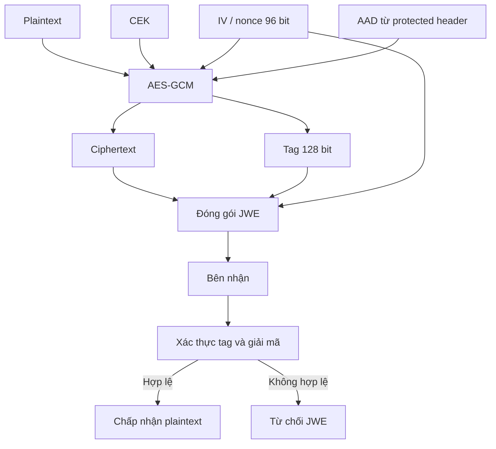

# IV, nonce và authentication tag trong quy trình mã hóa JWE

## 1. Ba thành phần giữ vai trò gì?

Trong JSON Web Encryption (JWE), **IV (Initialization Vector)**, **nonce** và **authentication tag** là những thành phần quan trọng của phép mã hóa nội dung. Chúng có liên hệ với nhau nhưng không phải cùng một thứ.

- **IV/nonce:** giá trị đầu vào cho thuật toán mã hóa nội dung. Nó giúp mỗi phép mã hóa có trạng thái/đầu vào riêng theo yêu cầu của thuật toán.
- **Ciphertext:** kết quả mã hóa plaintext bằng CEK và thuật toán `enc`.
- **Authentication tag:** giá trị xác thực được tạo cùng ciphertext. Bên nhận kiểm tra tag để phát hiện dữ liệu hoặc tham số xác thực bị thay đổi.

Trong JWE, trường `iv` mang giá trị IV/nonce ở dạng Base64url. Trường `tag` mang authentication tag cũng ở dạng Base64url. Cả hai đều được truyền cùng token và **không được mã hóa thành bí mật**; tính an toàn đến từ cách thuật toán sử dụng chúng cùng CEK.

Bài học này thuộc phần **Mã hóa JWE** của học phần **Security - JSON Web Token (JWT)** (`SECURITY_TOKEN_SECURITY_JWT`). Nội dung giải thích quy trình và yêu cầu mật mã theo chuẩn JOSE, áp dụng độc lập với ngôn ngữ lập trình và framework.

## 2. IV và nonce có phải là một không?

Trong tài liệu mật mã, hai từ này đôi khi được dùng gần nghĩa, nhưng không nên mặc định chúng có yêu cầu giống nhau:

- **IV** thường được dùng để chỉ giá trị khởi tạo cho một chế độ mã hóa, chẳng hạn CBC.
- **Nonce** là viết tắt của *number used once*, nhấn mạnh yêu cầu giá trị không được tái sử dụng trong phạm vi mà thuật toán quy định.
- Với AES-GCM, JWE gọi trường này là `iv`, trong khi tài liệu về AEAD thường gọi giá trị đó là nonce. Vì vậy, khi đọc JWE, có thể hiểu `iv` của GCM chính là nonce đầu vào cho GCM.
- Với AES-CBC, IV có yêu cầu riêng: phải được tạo ngẫu nhiên và khó dự đoán trước khi mã hóa.

**Không phải IV nào cũng có thể dùng lại, và không phải mọi thuật toán đều yêu cầu IV theo cùng một cách.** Phải đọc yêu cầu của thuật toán `enc` cụ thể.

IV/nonce thường không cần bí mật. Người nhận phải có giá trị này để giải mã và kiểm tra tag. Việc công khai IV không làm lộ CEK; nhưng dùng IV sai cách có thể phá vỡ bảo mật ngay cả khi CEK vẫn được giữ kín.

## 3. Vị trí của IV và tag trong JWE

JWE Compact Serialization có năm phần:

```text
BASE64URL(protected-header)
.BASE64URL(encrypted-key)
.BASE64URL(iv)
.BASE64URL(ciphertext)
.BASE64URL(authentication-tag)
```

| Vị trí | Trường | Chức năng |
| --- | --- | --- |
| 1 | Protected header | Chứa `alg`, `enc` và các tham số JOSE được bảo vệ |
| 2 | Encrypted key | Chứa CEK đã được bảo vệ hoặc rỗng theo `alg` |
| 3 | IV | IV/nonce đầu vào cho phép mã hóa nội dung |
| 4 | Ciphertext | Nội dung sau mã hóa |
| 5 | Authentication tag | Giá trị xác thực do thuật toán nội dung tạo ra |

Protected header sau khi Base64url được dùng làm AAD (Additional Authenticated Data). Vì vậy, tag không chỉ gắn với ciphertext mà còn bảo vệ các dữ liệu phụ trợ theo quy tắc của thuật toán.

Ví dụ hình dạng token (các chuỗi dưới đây chỉ là placeholder, không phải JWE hợp lệ):

```text
eyJhbGciOiJSU0EtT0FFUC0yNTYiLCJlbmMiOiJBMjU2R0NNIn0
.<encrypted-key>
.<iv>
.<ciphertext>
.<authentication-tag>
```

Trong JSON Serialization, các trường tương ứng là `iv`, `ciphertext` và `tag`. JWE JSON Serialization còn có thể chứa AAD bổ sung. Cấu trúc có thể khác Compact Serialization nhưng nguyên tắc bảo vệ toàn vẹn vẫn do chuẩn JWE/JWA xác định.

## 4. IV/nonce với AES-GCM

AES-GCM là một thuật toán AEAD (Authenticated Encryption with Associated Data). Nó vừa mã hóa nội dung, vừa tạo authentication tag để xác minh ciphertext và AAD.

Trong JWE, các thuật toán GCM có các thông số sau:

| Thuật toán `enc` | CEK | IV/nonce | Authentication tag |
| --- | ---: | ---: | ---: |
| `A128GCM` | 128 bit (16 byte) | 96 bit (12 byte) | 128 bit (16 byte) |
| `A192GCM` | 192 bit (24 byte) | 96 bit (12 byte) | 128 bit (16 byte) |
| `A256GCM` | 256 bit (32 byte) | 96 bit (12 byte) | 128 bit (16 byte) |

Với các thuật toán này, JWE yêu cầu IV có độ dài 96 bit và tag có độ dài 128 bit. Không tự ý rút ngắn tag hoặc thay đổi độ dài IV.

### 4.1. Yêu cầu quan trọng nhất: không tái sử dụng nonce với cùng CEK

**Một IV/nonce không được dùng lại với cùng một khóa AES-GCM.** Đây là yêu cầu cốt lõi.

Khi cùng CEK và cùng nonce được dùng để mã hóa hai thông điệp:

- Cơ chế tạo keystream của GCM có thể lặp lại, làm lộ quan hệ giữa các plaintext.
- Các quan hệ toán học trong quá trình tạo tag có thể bị khai thác.
- Kẻ tấn công có thể suy luận thông tin và trong một số điều kiện tạo ciphertext/tag giả mạo.
- Mức độ thiệt hại có thể nghiêm trọng dù CEK chưa bị lấy cắp.

Do đó, không được tái sử dụng IV chỉ vì token trước đó đã hết hạn hoặc đã bị xóa. Yêu cầu nonce uniqueness là yêu cầu ở cấp mật mã, không phụ thuộc việc ứng dụng còn chấp nhận token hay không.

### 4.2. Tạo nonce như thế nào?

Cách tạo IV phải bảo đảm tính duy nhất với cùng CEK. Trong nhiều triển khai JWE, IV 96 bit được tạo ngẫu nhiên bằng CSPRNG (Cryptographically Secure Pseudorandom Number Generator).

Một số nguyên tắc vận hành:

1. Dùng thư viện JOSE hoặc thư viện mật mã có triển khai GCM đã được kiểm chứng.
2. Không dùng timestamp, UUID thông thường, bộ đếm trong bộ nhớ dễ reset hoặc số ngẫu nhiên không mật mã.
3. Nếu cùng một CEK được dùng trên nhiều tiến trình/máy chủ, phải bảo đảm chiến lược IV không tạo trùng giữa các node.
4. Nếu dùng bộ đếm hoặc phân vùng nonce để bảo đảm uniqueness, cần xử lý đồng bộ, restart, backup/restore và failover; không được cấp lại dải nonce đã dùng.
5. Nếu không thể chứng minh uniqueness trong toàn bộ phạm vi dùng CEK, hãy thay đổi thiết kế để dùng CEK mới hoặc chiến lược nonce an toàn hơn.

Với IV ngẫu nhiên 96 bit, xác suất va chạm tăng theo số lần mã hóa dưới cùng một khóa. Xấp xỉ theo birthday bound, xác suất có ít nhất một va chạm sau `n` lần dùng cùng khóa tỷ lệ với `n(n-1)/2^97` khi `n` còn nhỏ so với không gian nonce. Đây là lý do không nên dùng một CEK lâu dài cho số lượng thông điệp không giới hạn và chỉ dựa vào xác suất ngẫu nhiên.

### 4.3. Vì sao CEK riêng cho từng JWE giúp ích?

Một thiết kế thường gặp là tạo CEK ngẫu nhiên mới cho từng JWE, sau đó bảo vệ CEK bằng `alg`. Khi mỗi thông điệp có CEK riêng, việc quản lý nonce được giới hạn trong phạm vi từng CEK; không cần duy trì một bộ đếm toàn cục cho tất cả token nếu không tái sử dụng CEK.

Tuy nhiên:

- Việc tạo CEK vẫn phải dùng nguồn ngẫu nhiên an toàn.
- Không được tái sử dụng cặp CEK/nonce.
- Với `dir`, khóa chia sẻ thường được dùng trực tiếp làm CEK và có thể tồn tại lâu dài, nên phải có chiến lược IV uniqueness xuyên suốt mọi lần mã hóa bằng khóa đó.
- Với các cơ chế ECDH-ES, việc tạo khóa tạm thời và suy ra CEK phải theo đúng JWA; không tự suy luận rằng chỉ cần thay trường IV là mọi khóa phiên đã độc lập.

## 5. IV với AES-CBC

JWE cũng định nghĩa các thuật toán nội dung AES-CBC-HMAC-SHA2:

- `A128CBC-HS256`
- `A192CBC-HS384`
- `A256CBC-HS512`

Với nhóm thuật toán này:

- IV có độ dài **128 bit (16 byte)**.
- IV phải được tạo ngẫu nhiên bằng nguồn ngẫu nhiên mật mã an toàn.
- IV được truyền trong trường `iv` và không cần giữ bí mật.
- IV tham gia vào phép tính HMAC, nên thay đổi IV sẽ khiến xác thực thất bại.

AES-CBC cần IV khó dự đoán trước khi mã hóa. Việc dùng lại IV trong CBC có thể làm lộ mẫu hoặc quan hệ giữa các khối plaintext khi cùng khóa được sử dụng. Do đó, hãy tạo IV mới bằng CSPRNG cho mỗi lần mã hóa theo đúng yêu cầu của thuật toán.

### So sánh yêu cầu IV

| Đặc điểm | AES-GCM | AES-CBC-HMAC |
| --- | --- | --- |
| Độ dài IV trong JWE | 96 bit | 128 bit |
| Yêu cầu nổi bật | Duy nhất với cùng CEK | Ngẫu nhiên, không thể dự đoán trước |
| IV có bí mật không? | Không | Không |
| IV được xác thực? | Có, qua AEAD tag | Có, qua HMAC |
| Hậu quả nếu dùng sai | Có thể phá vỡ nghiêm trọng bí mật và toàn vẹn | Có thể lộ mẫu plaintext và làm yếu bảo vệ |

Không áp dụng quy tắc của GCM cho CBC hoặc ngược lại. Ví dụ, một bộ đếm IV có thể là một cách thiết kế uniqueness cho GCM nếu được triển khai đúng, nhưng không đáp ứng yêu cầu IV ngẫu nhiên/khó dự đoán của AES-CBC.

## 6. Authentication tag được tạo và kiểm tra ra sao?

Authentication tag là bằng chứng mật mã để bên nhận kiểm tra rằng nội dung và dữ liệu phụ trợ không bị sửa đổi. Tag được tạo bằng khóa và các đầu vào theo thuật toán `enc`.

### 6.1. Với AES-GCM

Ở phía phát hành:

1. Chọn CEK có độ dài phù hợp.
2. Tạo IV 96 bit theo chiến lược nonce an toàn.
3. Tạo AAD từ protected header và AAD bổ sung nếu cấu trúc JWE sử dụng.
4. Chạy AES-GCM với CEK, IV, plaintext và AAD.
5. Nhận ciphertext và tag 128 bit.
6. Đóng gói IV, ciphertext và tag vào JWE.



### 6.2. Với AES-CBC-HMAC-SHA2

CEK của các thuật toán này được chia thành hai phần: khóa HMAC và khóa AES-CBC. Quy trình theo JWA:

1. Mã hóa plaintext bằng AES-CBC với ENC_KEY và IV 128 bit.
2. Xây dựng AAD từ protected header.
3. Tạo AL là độ dài AAD tính bằng bit, biểu diễn bằng số nguyên 64 bit big-endian.
4. Tính MAC trên chuỗi `AAD || IV || ciphertext || AL` bằng MAC_KEY.
5. Cắt lấy số bit bên trái theo độ dài tag quy định của thuật toán.

```text
MAC_INPUT = AAD || IV || CIPHERTEXT || AL
HMAC_VALUE = HMAC(SHA-2, MAC_KEY, MAC_INPUT)
TAG = LEFTMOST_REQUIRED_BITS(HMAC_VALUE)
```

| Thuật toán | CEK tổng | Độ dài tag |
| --- | ---: | ---: |
| `A128CBC-HS256` | 256 bit | 128 bit |
| `A192CBC-HS384` | 384 bit | 192 bit |
| `A256CBC-HS512` | 512 bit | 256 bit |

Không tự tạo tag bằng cách hash ciphertext đơn thuần. Phải dùng đúng HMAC, đúng phần khóa, đúng thứ tự dữ liệu và độ dài tag theo JWA.

## 7. Quy trình xác minh ở bên nhận

Bên nhận không được coi việc giải mã tạo ra một chuỗi plaintext là đủ. Phải xác minh tính toàn vẹn trước khi chấp nhận nội dung.

### 7.1. Quy trình tổng quát

1. Phân tích cấu trúc JWE theo serialization được chấp nhận.
2. Kiểm tra protected header và đối chiếu `alg`, `enc` với danh sách thuật toán được ứng dụng cho phép.
3. Chọn khóa tin cậy theo chính sách đã cấu hình; `kid` chỉ là định danh gợi ý, không phải bằng chứng tin cậy.
4. Dùng `alg` để lấy hoặc suy ra CEK.
5. Dùng `enc`, CEK, IV, ciphertext và AAD để xác minh tag và giải mã.
6. Chỉ sau khi xác minh thành công mới chuyển plaintext sang bước xử lý tiếp theo.
7. Nếu plaintext là JWT lồng nhau, tiếp tục xác minh chữ ký JWS và kiểm tra issuer, audience, thời hạn, loại token và quyền.

### 7.2. Không giải phóng plaintext trước khi tag hợp lệ

Một số API mật mã hỗ trợ giải mã theo luồng (streaming) và có thể trả ra các đoạn plaintext trước khi kiểm tra tag ở bước cuối. Nếu ứng dụng chuyển các đoạn này tới parser, cơ sở dữ liệu, log hoặc dịch vụ khác trước khi xác thực hoàn tất, kẻ tấn công có thể tác động đến dữ liệu chưa được xác thực.

Quy tắc an toàn:

- Giữ plaintext trong bộ đệm riêng trong suốt quá trình xác minh.
- Chỉ công bố hoặc xử lý plaintext khi API xác nhận tag hợp lệ.
- Nếu xác minh thất bại, hủy dữ liệu tạm và từ chối toàn bộ JWE.
- Không xử lý một phần plaintext rồi mới phát hiện tag sai.
- Với AES-CBC-HMAC, dùng thư viện tuân thủ quy trình xác thực MAC trước khi giải mã CBC để tránh padding oracle.

### 7.3. So sánh tag an toàn

Ứng dụng không nên tự viết phép so sánh tag thông thường. Dùng API thư viện thực hiện authenticated decryption hoặc constant-time comparison theo đúng chuẩn. Không chấp nhận tag thiếu, tag sai độ dài hoặc tag không khớp bằng cách tự động thay giá trị mặc định.

Thông báo cho client nên thống nhất, chẳng hạn “JWE không hợp lệ”. Không tiết lộ chi tiết nội bộ như sai padding, sai tag, sai khóa hay lỗi giải mã nếu những khác biệt đó có thể trở thành oracle cho kẻ tấn công.

## 8. Những thành phần nào được xác thực?

Với JWE Compact, protected header được dùng làm AAD. Với AES-GCM, AAD, IV, ciphertext và tag tham gia vào quá trình xác thực. Với AES-CBC-HMAC, AAD, IV, ciphertext và độ dài AAD tham gia vào HMAC.

| Thành phần | Có bí mật? | Có được xác thực bởi cơ chế nội dung? |
| --- | --- | --- |
| Protected header | Không | Có, thông qua AAD |
| IV | Không | Có |
| Ciphertext | Không phải plaintext | Có |
| Authentication tag | Không | Là giá trị được kiểm tra |
| AAD bổ sung (nếu dùng) | Không | Có, theo cấu trúc JSON Serialization |
| Unprotected header trong JWE JSON | Không | Không được tag nội dung bảo vệ trực tiếp |
| Encrypted key | Được bảo vệ bởi cơ chế `alg` | Được xử lý trong bước quản lý khóa, không phải AAD nội dung |

Protected header và AAD có thể đọc được; xác thực không có nghĩa là mã hóa. Ngược lại, unprotected header không được tag bảo vệ trực tiếp nên không được dùng như dữ liệu có nguồn gốc đã xác thực.

Encrypted key cũng có vai trò riêng: nó giúp khôi phục CEK. Nếu thay encrypted key, bước quản lý khóa có thể thất bại hoặc trả về CEK không khớp; khi đó bước xác minh nội dung sẽ thất bại. Không được nhầm encrypted key với IV hoặc tag.

## 9. IV, tag và replay attack: ba khái niệm khác nhau

IV/nonce của thuật toán mã hóa không phải nonce chống phát lại của ứng dụng.

| Giá trị | Mục đích | Phạm vi |
| --- | --- | --- |
| IV/nonce mật mã | Đảm bảo phép mã hóa có đầu vào phù hợp, ví dụ uniqueness của GCM | Mỗi CEK và các lần mã hóa dùng CEK đó |
| Authentication tag | Xác minh nội dung và AAD không bị sửa đổi | Một kết quả mã hóa JWE |
| Nonce/challenge chống replay | Gắn yêu cầu với một phiên hoặc giao dịch để phát hiện dùng lại | Luồng giao thức/nghiệp vụ |
| `jti` | Định danh token để ứng dụng có thể theo dõi hoặc thu hồi | Vòng đời token |

Kẻ tấn công có thể sao chép toàn bộ một JWE hợp lệ và gửi lại. Tag vẫn hợp lệ vì dữ liệu không bị sửa. Do đó, mã hóa xác thực **không tự ngăn replay**.

Tùy yêu cầu hệ thống, cần thêm thời hạn ngắn, kiểm tra `exp`/`nbf`, lưu trạng thái `jti`, nonce giao dịch hoặc cơ chế ràng buộc token với người gửi. Không dùng IV của AES-GCM như bằng chứng rằng một access token chỉ được sử dụng một lần.

## 10. Các lỗi phổ biến khi quản lý IV và tag

| Lỗi | Hậu quả | Cách phòng tránh |
| --- | --- | --- |
| Tái sử dụng nonce GCM với cùng CEK | Có thể phá vỡ bí mật và tính toàn vẹn | Thiết kế uniqueness trên toàn bộ phạm vi dùng CEK |
| Sinh IV bằng timestamp hoặc random không an toàn | Dễ đoán hoặc trùng | Dùng CSPRNG hoặc bộ cấp nonce đã được thiết kế và kiểm soát |
| Dùng IV 128 bit cho GCM JWE hoặc IV 96 bit cho CBC-HMAC | Không tuân thủ tham số thuật toán | Kiểm tra độ dài theo `enc` |
| Tự rút ngắn authentication tag | Giảm độ an toàn, không tương thích chuẩn | Chấp nhận độ dài tag chuẩn được thuật toán quy định |
| Bỏ qua lỗi tag | Chấp nhận dữ liệu bị sửa đổi | Từ chối JWE khi authenticated decryption thất bại |
| Xử lý plaintext streaming trước khi xác thực hoàn tất | Dữ liệu chưa xác thực lọt vào hệ thống | Buffer plaintext đến khi tag hợp lệ |
| So sánh tag bằng mã tự viết không constant-time | Có thể tạo kênh rò rỉ thời gian | Dùng API thư viện mật mã |
| Phân biệt lỗi padding và lỗi tag ra bên ngoài | Có thể tạo padding/authentication oracle | Trả lỗi chung, không lộ chi tiết mật mã |
| Nhầm IV mật mã với nonce chống replay | Token hợp lệ có thể được dùng lại | Thiết kế cơ chế chống replay riêng |
| Tin rằng tag xác minh danh tính issuer | Có thể chấp nhận token do bên giữ khóa tạo | Xác minh JWS hoặc cơ chế xác thực nguồn phù hợp |

## 11. Ví dụ mã giả xử lý IV và authentication tag

Đoạn mã sau chỉ mô tả luồng; tên hàm không phải API của thư viện cụ thể.

```text
// BÊN PHÁT HÀNH
cek = secureRandomBytes(requiredKeyLength("A256GCM"))
iv = secureRandomBytes(12) // 96 bit; phải duy nhất với CEK này
aad = base64url(utf8(protectedHeader))

(ciphertext, tag) = AES_GCM.encryptAndAuthenticate(
    key = cek,
    nonce = iv,
    plaintext = serialize(claims),
    associatedData = aad,
    tagLength = 16
)

jwe = serializeJWE(
    protectedHeader,
    encryptedKey = protectCEK(cek, recipientKey),
    iv,
    ciphertext,
    tag
)

// BÊN NHẬN
cek = recoverCEK(jwe.encryptedKey, recipientPrivateKey)

plaintext = AES_GCM.decryptAndVerify(
    key = cek,
    nonce = jwe.iv,
    ciphertext = jwe.ciphertext,
    associatedData = jwe.protectedHeaderBase64url,
    tag = jwe.tag
)

// Chỉ sử dụng plaintext nếu hàm xác thực thành công.
process(plaintext)
```

Trong thực tế nên để thư viện JOSE thực hiện toàn bộ quy trình JWE, gồm tạo CEK/IV, xây dựng AAD, mã hóa và xác thực tag. Ví dụ mã giả giúp hiểu trách nhiệm của từng thành phần, không khuyến khích tự xây dựng định dạng hoặc thuật toán mật mã.

## 12. Checklist kiểm tra IV, nonce và authentication tag

- [ ] Đã xác định đúng thuật toán `enc` và độ dài IV/nonce tương ứng.
- [ ] Với AES-GCM, IV là 96 bit và không bao giờ được tái sử dụng với cùng CEK.
- [ ] Với AES-CBC-HMAC, IV là 128 bit và được tạo ngẫu nhiên, khó dự đoán.
- [ ] IV/nonce được tạo bằng CSPRNG hoặc cơ chế cấp phát đã được chứng minh an toàn.
- [ ] Nếu CEK dùng chung nhiều lần hoặc nhiều máy chủ, uniqueness được bảo đảm trên toàn bộ phạm vi.
- [ ] Authentication tag có độ dài đúng theo thuật toán, không bị cắt ngắn hoặc bỏ qua.
- [ ] Protected header và AAD được đưa vào phép xác thực theo đúng JWE Serialization.
- [ ] Plaintext không được xử lý trước khi tag xác minh thành công.
- [ ] Với CBC-HMAC, MAC được xác minh theo đúng JWA trước khi chấp nhận plaintext.
- [ ] Lỗi tag/khóa/cấu trúc dẫn đến từ chối JWE và không làm lộ chi tiết mật mã.
- [ ] Có biện pháp chống replay riêng; không dùng IV mật mã thay thế nonce giao dịch.
- [ ] Không ghi CEK, plaintext hoặc token nhạy cảm vào log.

**Kết luận:** IV/nonce cung cấp đầu vào cần thiết cho phép mã hóa; authentication tag cho phép bên nhận xác minh dữ liệu và AAD. Yêu cầu cụ thể phụ thuộc thuật toán: AES-GCM yêu cầu nonce 96 bit duy nhất với cùng CEK, còn AES-CBC-HMAC dùng IV 128 bit ngẫu nhiên và xác thực IV cùng ciphertext qua HMAC. Bên nhận chỉ được sử dụng plaintext sau khi tag hợp lệ. Tag bảo vệ tính toàn vẹn nhưng không xác thực danh tính issuer và không tự ngăn phát lại token.

### Tài liệu tiêu chuẩn

- [RFC 7516 — JSON Web Encryption (JWE)](https://www.rfc-editor.org/rfc/rfc7516)
- [RFC 7518 — JSON Web Algorithms (JWA)](https://www.rfc-editor.org/rfc/rfc7518)
- [NIST SP 800-38D — Recommendation for Block Cipher Modes of Operation: GCM and GMAC](https://csrc.nist.gov/pubs/sp/800/38/d/final)
- [NIST SP 800-38A — Recommendation for Block Cipher Modes of Operation](https://csrc.nist.gov/pubs/sp/800/38/a/final)
- [RFC 8725 — JSON Web Token Best Current Practices](https://www.rfc-editor.org/rfc/rfc8725)
