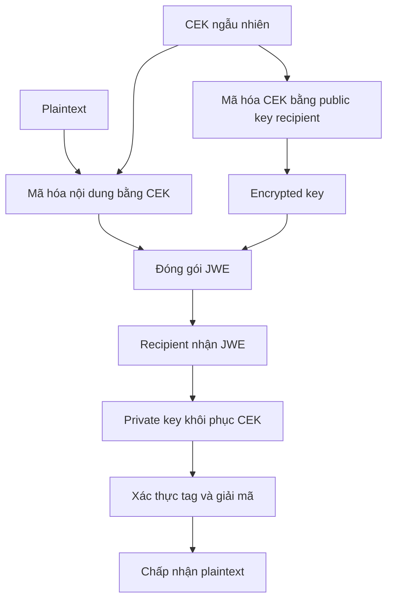
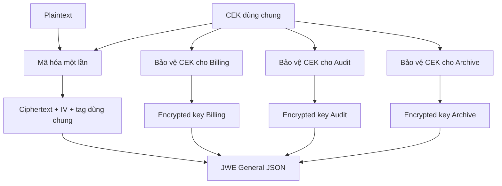

# Phân phối khóa cho một hoặc nhiều bên nhận

## 1. Phân phối CEK là bài toán trung tâm của JWE

Trong JSON Web Encryption (JWE), **CEK (Content Encryption Key)** là khóa trực tiếp được dùng để mã hóa nội dung theo thuật toán `enc`. Bên nhận cần lấy được đúng CEK để xác thực và giải mã ciphertext.

Tham số `alg` xác định cách CEK được chuyển giao, bảo vệ hoặc suy ra. Tùy mô hình, bên phát hành có thể:

- Mã hóa CEK bằng khóa công khai của bên nhận.
- Wrap CEK bằng một KEK đối xứng mà hai bên đã chia sẻ an toàn.
- Dùng ECDH và KDF để suy ra KEK rồi wrap CEK.
- Dùng trực tiếp khóa chia sẻ hoặc CEK được suy ra theo thuật toán quản lý khóa.

Với **một bên nhận**, JWE Compact Serialization thường đủ dùng. Với **nhiều bên nhận cùng cần đọc một nội dung**, JWE JSON General Serialization cho phép mã hóa nội dung một lần bằng một CEK, sau đó tạo phần khóa được bảo vệ riêng cho từng recipient.

Bài học này thuộc phần **Mã hóa JWE** của học phần **Security - JSON Web Token (JWT)** (`SECURITY_TOKEN_SECURITY_JWT`). Nội dung áp dụng cho chuẩn JWT/JOSE nói chung, độc lập với ngôn ngữ lập trình và framework.

## 2. Một bên nhận: phân phối CEK bằng khóa của recipient

### 2.1. Mã hóa CEK bằng public key

Một mô hình thường gặp là bên nhận có cặp khóa bất đối xứng:

- **Public key:** bên phát hành dùng để mã hóa CEK.
- **Private key:** chỉ bên nhận được ủy quyền giữ để giải mã CEK.

Ví dụ với `alg = RSA-OAEP-256` và `enc = A256GCM`:

1. Bên phát hành tạo CEK ngẫu nhiên 256 bit theo yêu cầu của A256GCM.
2. Bên phát hành tạo IV/nonce và mã hóa plaintext bằng CEK với AES-256-GCM.
3. Bên phát hành dùng public key RSA của recipient để bảo vệ CEK theo RSA-OAEP-256.
4. JWE mang protected header, encrypted key, IV, ciphertext và authentication tag.
5. Bên nhận dùng private key tương ứng để khôi phục CEK, rồi xác thực và giải mã nội dung.



Bên phát hành không cần biết private key của recipient. Điều này giúp giảm nhu cầu chia sẻ bí mật giải mã giữa nhiều hệ thống. Tuy nhiên, public key phải được xác thực nguồn gốc và gắn đúng với danh tính recipient; lấy nhầm public key của kẻ tấn công có thể khiến nội dung được mã hóa cho sai người.

### 2.2. Dùng KEK đối xứng

Nếu hai hệ thống đã có một KEK (Key Encryption Key) được phân phối qua kênh tin cậy, có thể dùng `A256KW` hoặc thuật toán wrap phù hợp:

- Bên phát hành tạo CEK riêng cho JWE.
- Dùng KEK của recipient để wrap CEK.
- Bên nhận dùng cùng KEK để unwrap CEK.
- CEK sau đó được dùng bởi `enc` để xác thực và giải mã nội dung.

Cách này thường phù hợp khi các dịch vụ đã có hạ tầng quản lý khóa đối xứng. Đổi lại, cả hai phía phải bảo vệ KEK, kiểm soát quyền truy cập và phối hợp rotation.

### 2.3. ECDH-ES với một recipient

Với `ECDH-ES` trực tiếp, bên phát hành và recipient dùng ECDH cùng KDF theo JWA để suy ra CEK. Với `ECDH-ES+A256KW`, ECDH/KDF tạo KEK rồi KEK wrap CEK riêng.

Khóa riêng không được gửi trong JWE. Các tham số public key cần thiết, chẳng hạn `epk`, được biểu diễn trong JOSE Header theo chuẩn. Không được tự dùng kết quả ECDH thô làm CEK hoặc KEK; phải dùng KDF và các tham số ngữ cảnh đúng theo JWA.

## 3. Một recipient và nhiều recipient khác nhau thế nào?

Một JWE Compact có đúng một phần encrypted key và chỉ biểu diễn một recipient. JWE JSON Serialization hỗ trợ một hoặc nhiều recipient.

| Định dạng | Cách biểu diễn | Số recipient |
| --- | --- | ---: |
| JWE Compact Serialization | Năm phần ngăn cách bằng dấu chấm | Một |
| JWE Flattened JSON Serialization | Các trường protected, header, encrypted_key, iv, ciphertext, tag trong một JSON object | Một |
| JWE General JSON Serialization | Có mảng `recipients`, mỗi phần tử có header và encrypted_key riêng | Một hoặc nhiều |

Với JSON Serialization:

- `protected` chứa protected header được mã hóa Base64url.
- `unprotected` có thể chứa header chung không được bảo vệ.
- Mỗi phần tử trong `recipients` biểu diễn một recipient, có thể mang `header` và `encrypted_key` riêng.
- `iv`, `ciphertext` và `tag` là các thành phần nội dung dùng chung.
- `aad` có thể mang AAD bổ sung theo RFC 7516.

Trong mô hình nhiều recipient, thông thường **một CEK được dùng để mã hóa nội dung một lần**. Sau đó, CEK đó được bảo vệ riêng cho từng recipient. Vì vậy, một JWE có thể có nhiều encrypted key nhưng chỉ có một ciphertext.

## 4. Nhiều recipient: một ciphertext, nhiều encrypted key

Giả sử một tổ chức cần gửi cùng một thông điệp mã hóa cho ba dịch vụ được phép đọc: Billing, Audit và Archive.

Luồng có thể là:

1. Bên phát hành tạo một CEK ngẫu nhiên.
2. Dùng CEK và thuật toán `enc` để mã hóa plaintext một lần, tạo ciphertext và tag.
3. Dùng khóa của Billing để bảo vệ CEK, tạo encrypted key thứ nhất.
4. Dùng khóa của Audit để bảo vệ cùng CEK, tạo encrypted key thứ hai.
5. Dùng khóa của Archive để bảo vệ cùng CEK, tạo encrypted key thứ ba.
6. Đưa ba recipient entries và nội dung mã hóa chung vào JWE General JSON Serialization.
7. Mỗi dịch vụ dùng khóa riêng của mình để khôi phục cùng CEK, rồi xác thực tag và giải mã cùng nội dung.



Mỗi recipient nhận cùng ciphertext nhưng có phần encrypted key được tạo theo khóa và thuật toán quản lý khóa tương ứng. Recipient không cần biết khóa của những recipient khác.

### 4.1. Ví dụ JWE General JSON Serialization

Ví dụ cấu trúc dưới đây dùng placeholder, không phải một JWE có thể giải mã thực tế:

```json
{
  "protected": "eyJlbmMiOiJBMjU2R0NNIn0",
  "recipients": [
    {
      "header": {
        "alg": "RSA-OAEP-256",
        "kid": "billing-recipient-key-v3"
      },
      "encrypted_key": "<encrypted-cek-for-billing>"
    },
    {
      "header": {
        "alg": "A256KW",
        "kid": "audit-kek-v5"
      },
      "encrypted_key": "<wrapped-cek-for-audit>"
    },
    {
      "header": {
        "alg": "ECDH-ES+A256KW",
        "kid": "archive-recipient-key-v2",
        "epk": {
          "kty": "EC",
          "crv": "P-256",
          "x": "<ephemeral-public-x>",
          "y": "<ephemeral-public-y>"
        }
      },
      "encrypted_key": "<wrapped-cek-for-archive>"
    }
  ],
  "iv": "<base64url-iv>",
  "ciphertext": "<base64url-ciphertext>",
  "tag": "<base64url-authentication-tag>"
}
```

Trong ví dụ:

- Protected header chỉ chứa `enc` vì tất cả recipient cùng dùng một thuật toán mã hóa nội dung.
- `alg` và `kid` được đặt trong header của từng recipient vì mỗi bên có thể dùng cơ chế quản lý khóa và khóa khác nhau.
- Recipient Archive dùng ECDH-ES+A256KW nên có thêm tham số `epk` theo yêu cầu của thuật toán.
- Ciphertext, IV và tag chỉ xuất hiện một lần, được dùng chung cho tất cả recipient.

Đây là cấu trúc minh họa về cách tổ chức trường. Trong triển khai, cần mã hóa Base64url đúng chuẩn, tạo các giá trị khóa hợp lệ và tuân thủ vị trí header được RFC 7516/JWA cho phép.

### 4.2. Bên nhận xử lý như thế nào?

Mỗi recipient cần:

1. Nhận diện recipient entry dành cho mình theo chính sách khóa đã cấu hình.
2. Kiểm tra thuật toán `alg` có nằm trong danh sách được phép không.
3. Chọn khóa tin cậy theo `kid` hoặc cơ chế ánh xạ đã cấu hình.
4. Dùng khóa đó để giải mã/unwrap encrypted key hoặc suy ra CEK theo `alg`.
5. Dùng CEK cùng `enc`, IV, ciphertext, tag và AAD để xác thực và giải mã.
6. Chỉ sử dụng plaintext khi kiểm tra xác thực thành công.

Một JWE General có thể chứa nhiều recipient entries; một recipient thường chỉ cần xử lý entry phù hợp với khóa của mình. Nếu không có khóa phù hợp hoặc tag không hợp lệ, phải từ chối JWE.

## 5. Chọn thuật toán quản lý khóa cho nhiều recipient

Với một ciphertext dùng chung, mỗi recipient cần có cách lấy **cùng một CEK**. Vì vậy, các thuật toán quản lý khóa phải hỗ trợ bảo vệ CEK hiện có cho từng recipient.

| Mô hình | Có phù hợp với nhiều recipient trong cùng JWE? | Cách hoạt động |
| --- | --- | --- |
| RSA-OAEP-256 | Có | Mã hóa cùng CEK riêng cho từng public key recipient |
| AES Key Wrap (`A128KW`, `A192KW`, `A256KW`) | Có | Dùng KEK riêng của từng recipient để wrap cùng CEK |
| ECDH-ES+A128KW / A192KW / A256KW | Có | Mỗi recipient thỏa thuận KEK rồi wrap cùng CEK |
| `dir` | Không phù hợp với mô hình nhiều recipient | Khóa chia sẻ được dùng trực tiếp làm CEK, không có CEK riêng để wrap cho từng bên |
| ECDH-ES trực tiếp | Không phù hợp với mô hình nhiều recipient | Mỗi thỏa thuận trực tiếp suy ra CEK; không thể dùng các CEK khác nhau cho cùng ciphertext |

Trong xử lý nhiều recipient theo JWE, các thuật toán trực tiếp `dir` và `ECDH-ES` không được dùng cho nhiều recipient trong cùng một JWE. Nếu cần nhiều recipient, hãy dùng phương thức có thể bảo vệ cùng CEK riêng cho từng bên, hoặc tạo một JWE riêng cho từng recipient.

Đừng nhầm việc mỗi recipient dùng thuật toán `alg` khác nhau với việc mỗi recipient có payload khác nhau. Trong một JWE General, nội dung được mã hóa là chung.

## 6. Phân phối và xác thực khóa của recipient

Khóa công khai không cần giữ bí mật, nhưng **phải xác thực được nó thực sự thuộc về recipient dự kiến**. Nếu bên phát hành mã hóa CEK cho public key do kẻ tấn công thay thế, JWE có thể hợp lệ về mặt mật mã nhưng chỉ kẻ tấn công giải mã được.

### 6.1. Các nguồn khóa thường gặp

- **JWKS endpoint được cấu hình tin cậy:** lấy public key theo quy trình discovery đã xác thực và ràng buộc với danh tính recipient.
- **Chứng thư số:** kiểm tra chuỗi chứng thư, thời hạn, mục đích sử dụng, chủ thể và chính sách tin cậy.
- **Kho khóa nội bộ hoặc KMS:** ánh xạ danh tính dịch vụ với key version và quyền sử dụng khóa.
- **Khóa chia sẻ đối xứng:** phân phối qua kênh quản lý bí mật an toàn, với quyền truy cập giới hạn.

Các trường như `kid`, `jku`, `x5u`, `jwk` hoặc `x5c` có thể xuất hiện trong JOSE Header. Không nên mặc định dữ liệu khóa hoặc URL lấy từ token là đáng tin:

- `kid` chỉ là định danh/gợi ý chọn khóa, không phải bằng chứng xác thực.
- Không tự động truy cập URL `jku` hoặc `x5u` do token không tin cậy cung cấp. Việc này có thể tạo SSRF hoặc khiến hệ thống tải khóa từ nguồn của kẻ tấn công.
- Nếu dùng JWKS URL, cấu hình trước nguồn được phép, xác thực kết nối, kiểm tra danh tính issuer/recipient và kiểm soát cache.
- Nếu dùng `jwk` hoặc `x5c` nhúng trong token, phải xác minh khóa/chứng thư theo trust anchor và chính sách đã cấu hình; không tin chỉ vì dữ liệu nằm trong header.

### 6.2. Tách khóa theo mục đích

Không dùng lẫn:

- Khóa riêng để ký JWS.
- Khóa riêng để giải mã JWE.
- KEK dùng để wrap CEK.
- CEK dùng để mã hóa nội dung.

Tách khóa theo mục đích, môi trường và recipient giúp giảm phạm vi ảnh hưởng khi một khóa bị lộ. Quyền unwrap hoặc giải mã nên được giới hạn theo danh tính workload và nguyên tắc quyền tối thiểu.

## 7. Quản lý vòng đời recipient

Phân phối khóa không kết thúc khi JWE được phát hành. Danh sách recipient và các khóa của họ có vòng đời riêng.

### 7.1. Thêm recipient

Trong mô hình một ciphertext dùng chung, muốn thêm recipient mới cần tạo một recipient entry có encrypted key bảo vệ cùng CEK cho bên đó. Việc này đòi hỏi bên thực hiện phải có quyền truy cập CEK hoặc có một dịch vụ quản lý khóa được phép thực hiện thao tác đó.

JWE JSON Serialization không đưa toàn bộ mảng recipients vào AAD của mã hóa nội dung. Vì vậy, tag nội dung không phải chữ ký xác thực danh sách recipient. Các header không được bảo vệ và recipient entries cần được xử lý theo đúng ranh giới tin cậy của hệ thống. Không dùng riêng authentication tag để chứng minh danh sách người nhận là do issuer phê duyệt.

Nếu chính sách yêu cầu xác minh ai được phép nhận nội dung, cần một cơ chế kiểm soát và xác thực metadata recipient riêng. Ví dụ có thể ký một envelope chứa danh sách recipient dự kiến và yêu cầu bên nhận kiểm tra danh tính của mình. Tuy nhiên, một recipient đã giải mã được CEK luôn có thể chia sẻ CEK hoặc plaintext ra ngoài; chữ ký metadata không thể ngăn một người nhận hợp lệ cố ý tiết lộ dữ liệu.

### 7.2. Xóa hoặc thu hồi recipient

Xóa một entry khỏi bản JSON không thu hồi được bản JWE mà recipient đã nhận trước đó. Họ có thể đã lưu encrypted key, CEK hoặc plaintext.

Để ngừng cấp quyền giải mã cho một recipient đối với **các nội dung phát hành trong tương lai**:

1. Loại recipient khỏi chính sách phát hành.
2. Phát hành JWE mới với CEK mới.
3. Chỉ bảo vệ CEK mới cho các recipient còn được phép.
4. Thu hồi hoặc ngừng dùng khóa recipient cũ nếu khóa đó bị xâm phạm hay không còn cần thiết.
5. Có cơ chế thu hồi token/phiên ở tầng ứng dụng nếu token cũ vẫn được chấp nhận.

Nếu muốn loại một recipient khỏi một nội dung đã phát hành, cần mã hóa lại nội dung bằng CEK mới và chỉ cấp CEK mới cho các recipient còn lại. Dù vậy, không thể thu hồi plaintext mà recipient cũ đã lưu hoặc sao chép.

### 7.3. Rotation khóa recipient

Một quy trình rotation thường gồm:

1. Đăng ký key version mới của recipient qua nguồn tin cậy.
2. Cập nhật bên phát hành để dùng public key/KEK mới cho JWE mới.
3. Giữ khóa cũ ở chế độ chỉ giải mã trong thời gian token cũ còn hợp lệ hoặc còn cần xử lý.
4. Theo dõi token còn phụ thuộc key version cũ.
5. Ngừng hoặc hủy khóa cũ theo chính sách lưu trữ và khả năng phục hồi.

Nếu private key của recipient bị lộ, cần đánh giá các JWE đã phát hành cho public key tương ứng. Kẻ tấn công có thể giải mã những bản JWE đã lưu nếu chúng được bảo vệ bằng khóa riêng bị lộ và CEK không có lớp bảo vệ bổ sung.

## 8. Một JWE nhiều recipient có giới hạn gì?

### 8.1. Mọi recipient thành công đều đọc cùng plaintext

Một JWE General dùng chung một ciphertext. Vì vậy, tất cả recipient có thể khôi phục CEK thành công đều có quyền đọc cùng nội dung.

Không dùng một JWE nhiều recipient để thể hiện các mức phân quyền khác nhau, chẳng hạn:

- Billing được đọc thông tin thanh toán.
- Audit chỉ được đọc metadata kiểm toán.
- Archive chỉ được đọc dữ liệu đã ẩn danh.

Nếu mỗi bên chỉ được phép đọc một tập dữ liệu khác nhau, hãy tạo payload và JWE riêng cho từng nhóm quyền hoặc cung cấp dữ liệu qua API có kiểm soát truy cập.

### 8.2. Thêm recipient không giống với xác thực issuer

Việc một recipient giải mã được JWE chứng minh họ có khóa phù hợp và nội dung vượt qua kiểm tra xác thực. Nó không tự chứng minh danh tính bên phát hành.

Nếu cần cả bí mật và xác thực nguồn, có thể ký JWS trước rồi mã hóa JWS trong JWE. Nếu cần bảo vệ cả chính sách recipient, cần ký hoặc xác thực envelope metadata riêng và kiểm tra theo danh tính recipient.

### 8.3. Nhiều recipient làm tăng phạm vi rủi ro

Mỗi recipient bổ sung làm tăng số khóa, điểm cuối, quyền truy cập và quy trình thu hồi cần quản lý. Một recipient có thể lưu CEK hoặc plaintext, nên dữ liệu không còn nằm hoàn toàn trong quyền kiểm soát của bên phát hành.

Hãy giới hạn danh sách recipient ở những bên thật sự cần đọc nội dung, kiểm tra định kỳ quyền và tránh đưa các hệ thống không cần thiết vào cùng một nhóm giải mã.

## 9. Khi nào nên tạo JWE riêng cho từng recipient?

| Nhu cầu | Lựa chọn thường phù hợp | Lý do |
| --- | --- | --- |
| Nhiều bên cần đọc cùng một nội dung, quyền truy cập tương đương | Một JWE General JSON với nhiều recipient | Một ciphertext, nhiều encrypted key |
| Mỗi bên chỉ được xem dữ liệu khác nhau | JWE riêng theo recipient hoặc nhóm quyền | Mỗi payload và CEK có thể độc lập |
| Muốn dùng JWE Compact cho từng bên | Một JWE Compact cho mỗi recipient | Compact biểu diễn một recipient |
| Cần cô lập sự cố khóa của từng recipient | JWE riêng hoặc phân vùng CEK phù hợp | Giảm phạm vi ảnh hưởng của một CEK |
| Recipient có vòng đời và thời hạn truy cập khác nhau | JWE riêng hoặc token tham chiếu có kiểm soát | Dễ phát hành, thu hồi và quản lý chính sách riêng |
| Nội dung lớn nhưng cùng nhóm recipient | Một JWE General có thể giảm việc mã hóa nội dung lặp lại | Nội dung chỉ mã hóa một lần; cần đánh giá độ phức tạp recipient |

Tạo JWE riêng có thể tăng kích thước và chi phí mã hóa, nhưng mang lại khả năng cô lập tốt hơn. Không có lựa chọn chung cho mọi trường hợp; hãy dựa vào ranh giới tin cậy và mức độ độc lập của quyền truy cập.

## 10. Ví dụ mã giả phát hành JWE cho nhiều recipient

Đoạn mã sau chỉ mô tả ý tưởng và trách nhiệm. Tên hàm không đại diện API của một thư viện cụ thể.

```text
// BÊN PHÁT HÀNH
recipients = [
    {
        id: "billing",
        key: trustedBillingPublicKey,
        alg: "RSA-OAEP-256"
    },
    {
        id: "audit",
        key: trustedAuditKEK,
        alg: "A256KW"
    },
    {
        id: "archive",
        key: trustedArchivePublicKey,
        alg: "ECDH-ES+A256KW"
    }
]

// Thư viện tạo một CEK và mã hóa plaintext một lần.
// Mỗi recipient có encrypted_key riêng bảo vệ cùng CEK.
jwe = JOSE.encryptForMultipleRecipients(
    plaintext = serialize(payload),
    recipients = recipients,
    contentEncryptionAlgorithm = "A256GCM",
    serialization = "general-json"
)

// BÊN NHẬN BILLING
entry = selectRecipientEntry(jwe, trustedBillingKeyId)

plaintext = JOSE.decryptAndAuthenticate(
    jwe = jwe,
    recipientEntry = entry,
    recipientKey = billingPrivateKey,
    allowedAlgs = ["RSA-OAEP-256"],
    allowedEncs = ["A256GCM"]
)

// Chỉ xử lý sau khi tag xác thực thành công.
process(plaintext)
```

Trong thực tế, thư viện JOSE chịu trách nhiệm tạo CEK, mã hóa nội dung, bảo vệ CEK cho từng recipient và xây dựng JSON Serialization. Ứng dụng phải cung cấp danh sách recipient đã được xác thực, khóa tin cậy và chính sách thuật toán được phép.

## 11. Checklist phân phối khóa

- [ ] Đã xác định một hay nhiều recipient cần đọc cùng nội dung.
- [ ] Nếu chỉ một recipient, đã chọn Compact hoặc Flattened JSON phù hợp.
- [ ] Nếu nhiều recipient, đã chọn JWE General JSON Serialization.
- [ ] Một CEK được dùng để mã hóa nội dung chung; mỗi recipient có cách bảo vệ CEK riêng.
- [ ] Không dùng `dir` hoặc `ECDH-ES` trực tiếp cho nhiều recipient trong cùng JWE.
- [ ] Public key và chứng thư của recipient được xác thực qua nguồn tin cậy.
- [ ] `kid`, `jku`, `x5u`, `jwk` và `x5c` không được mặc định xem là đáng tin chỉ vì chúng nằm trong header.
- [ ] Khóa ký, khóa giải mã, KEK và CEK được tách theo mục đích.
- [ ] Recipient chỉ được cấp quyền unwrap/giải mã khi thực sự cần.
- [ ] Đã đánh giá tác động khi thêm, xóa, thu hồi hoặc rotation recipient.
- [ ] Đã hiểu rằng mọi recipient thành công đều đọc cùng plaintext và có thể lưu hoặc chia sẻ nội dung.
- [ ] Nếu cần bảo vệ danh sách recipient, đã có cơ chế xác thực metadata riêng; không dựa riêng vào tag nội dung.
- [ ] Nếu quyền hoặc payload khác nhau giữa các bên, đã cân nhắc JWE riêng cho từng recipient/nhóm.
- [ ] Đã có chính sách cho token cũ, key version cũ và sự cố lộ private key/KEK/CEK.

**Kết luận:** JWE cho phép phân phối cùng một nội dung đến nhiều recipient bằng cách mã hóa payload một lần với một CEK, rồi bảo vệ CEK riêng cho từng bên trong General JSON Serialization. Cách này tiết kiệm công sức mã hóa nội dung nhưng mọi recipient thành công đều có thể đọc cùng plaintext. Việc xác thực khóa recipient, quản lý vòng đời, kiểm soát quyền và lựa chọn giữa một JWE nhiều recipient hay nhiều JWE riêng phải dựa trên ranh giới tin cậy thực tế.

### Tài liệu tiêu chuẩn

- [RFC 7516 — JSON Web Encryption (JWE)](https://www.rfc-editor.org/rfc/rfc7516)
- [RFC 7518 — JSON Web Algorithms (JWA)](https://www.rfc-editor.org/rfc/rfc7518)
- [RFC 7515 — JSON Web Signature (JWS)](https://www.rfc-editor.org/rfc/rfc7515)
- [RFC 7519 — JSON Web Token (JWT)](https://www.rfc-editor.org/rfc/rfc7519)
- [RFC 8725 — JSON Web Token Best Current Practices](https://www.rfc-editor.org/rfc/rfc8725)
