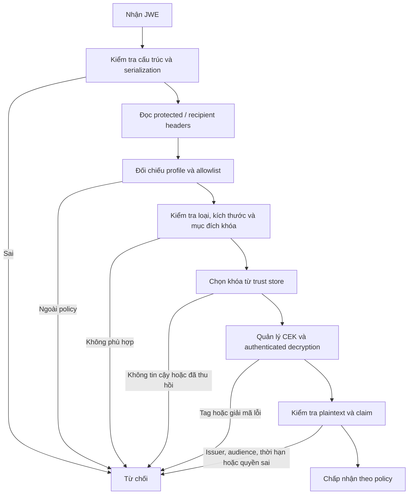

# Không chấp nhận cơ chế mã hóa yếu hoặc không phù hợp hồ sơ

## 1. Vì sao JWE cần chính sách từ chối rõ ràng?

JSON Web Encryption (JWE) hỗ trợ nhiều thuật toán quản lý khóa và mã hóa nội dung. Một số thuật toán được thiết kế cho hệ thống hiện đại; một số khác tồn tại chủ yếu để tương thích với triển khai cũ. Việc một thuật toán có tên trong tiêu chuẩn hoặc được thư viện hỗ trợ **không có nghĩa là hệ thống nên bật nó**.

Bên nhận phải kiểm tra token theo chính sách bảo mật đã được phê duyệt. Chính sách đó cần xác định:

- Các thuật toán quản lý khóa `alg` và mã hóa nội dung `enc` được phép.
- Những cặp thuật toán nào được chấp nhận trong từng profile tích hợp.
- Loại khóa, độ dài, curve, mục đích và trạng thái khóa.
- Những tham số bắt buộc, giới hạn tài nguyên và serialization được hỗ trợ.
- Những thuật toán hoặc cấu hình bị cấm, chỉ được dùng tạm thời, hoặc chỉ được giữ để giải mã dữ liệu cũ.

Một protected header JWE có thể khai báo `alg` và `enc`, nhưng đó là dữ liệu do bên tạo token cung cấp. Bên nhận phải đối chiếu với policy cục bộ, không để token tự lựa chọn mức bảo mật mà hệ thống sẽ chấp nhận.

Bài học này thuộc phần **Mã hóa JWE** của học phần **Security - JSON Web Token (JWT)** (`SECURITY_TOKEN_SECURITY_JWT`). Nội dung tập trung vào việc loại bỏ thuật toán yếu, cấu hình lỗi thời và tổ hợp không phù hợp trong chuẩn JOSE nói chung, không phụ thuộc Java hay framework.

## 2. Phân biệt thuật toán yếu, cấu hình yếu và cấu hình không tương thích

Không phải mọi lỗi đều có cùng nguyên nhân:

| Loại vấn đề | Ví dụ | Cách xử lý |
| --- | --- | --- |
| Thuật toán lỗi thời hoặc có rủi ro đã biết | `RSA1_5` trong JWE | Không dùng cho thiết kế mới; lập kế hoạch loại bỏ |
| Thuật toán được chuẩn định nghĩa nhưng profile không cho phép | Đối tác chỉ được dùng `RSA-OAEP-256` nhưng gửi `RSA-OAEP` | Từ chối theo profile |
| Khóa không đủ mạnh | RSA modulus quá ngắn, KEK sai độ dài | Từ chối khóa trước khi dùng |
| Sai mục đích khóa | Khóa chỉ dành cho ký lại được dùng để giải mã JWE | Từ chối do sai key usage |
| Tham số không hợp lệ hoặc vượt giới hạn | PBES2 có `p2c` quá lớn, header chứa critical parameter không hỗ trợ | Từ chối có kiểm soát |
| Thuật toán hợp lệ nhưng triển khai không an toàn | AES-GCM tái sử dụng nonce với cùng CEK | Sửa thiết kế nonce và vòng đời khóa |
| Không liên thông | Hai bên khác serialization, key type hoặc cách tạo AAD | Thống nhất profile và kiểm thử chéo |

Cần phân biệt **không an toàn** với **không được phép trong một hợp đồng cụ thể**. Ví dụ, `A128GCM` vẫn là thuật toán JWE chuẩn và có thể đáp ứng yêu cầu bảo mật; một tổ chức có thể chọn chỉ cho phép `A256GCM` theo policy nội bộ. Khi đó `A128GCM` bị từ chối vì profile không cho phép, không phải vì AES-128 mặc nhiên đã mất an toàn.

## 3. Những thuật toán và cấu hình cần đặc biệt thận trọng

### 3.1. RSA1_5: thuật toán quản lý khóa cũ

`RSA1_5` dùng RSAES-PKCS1-v1_5 để mã hóa CEK. Cơ chế này có lịch sử bị khai thác qua các dạng **padding oracle**: kẻ tấn công gửi nhiều ciphertext được sửa đổi và quan sát phản hồi để thu thập thông tin về quá trình giải mã.

Rủi ro tăng khi hệ thống:

- Phân biệt lỗi padding, lỗi khóa, lỗi tag hoặc các trạng thái giải mã ra bên ngoài.
- Có phản hồi hoặc thời gian xử lý khác nhau cho từng loại lỗi.
- Cho phép gửi số lượng lớn ciphertext tùy ý tới endpoint giải mã.
- Dùng cùng khóa RSA cho nhiều giao thức hoặc nhiều ngữ cảnh.

RFC 7518 đánh dấu `RSA1_5` là thuật toán đã bị deprecate và yêu cầu triển khai không sử dụng trừ khi không thể dùng thuật toán mới hơn. Với thiết kế mới, hãy chọn phương thức quản lý khóa hiện đại được policy phê duyệt, thường là `RSA-OAEP-256` nếu kiến trúc dùng RSA.

**Không bật `RSA1_5` chỉ để làm cho một đối tác cũ tiếp tục hoạt động.** Nếu buộc phải duy trì tương thích trong một hệ thống cũ, cần có ngoại lệ được quản trị, giới hạn đối tác và thời hạn kết thúc cụ thể; không để nó trở thành mặc định chung.

### 3.2. RSA-OAEP và RSA-OAEP-256 không giống nhau

JWA định nghĩa các biến thể:

- `RSA-OAEP` dùng OAEP với SHA-1 theo profile của RFC 7518.
- `RSA-OAEP-256` dùng OAEP với SHA-256.

Không được thay thế hai tên này cho nhau trong quá trình tích hợp. SHA-1 trong OAEP không giống với việc dùng SHA-1 làm chữ ký số, nhưng vẫn là lựa chọn cũ hơn. Với hệ thống mới, thường nên ưu tiên `RSA-OAEP-256` khi các bên hỗ trợ.

Việc nâng cấp không chỉ là đổi chuỗi `alg`. Bên gửi và nhận phải thống nhất lại profile, kiểm tra hỗ trợ thư viện, kiểm thử với khóa thật của môi trường thử nghiệm và có kế hoạch chuyển đổi key version.

### 3.3. AES-CBC-HMAC không tự động là thuật toán yếu

Các thuật toán `A128CBC-HS256`, `A192CBC-HS384` và `A256CBC-HS512` là các tổ hợp mã hóa nội dung được JWA định nghĩa. Chúng kết hợp AES-CBC với HMAC để cung cấp mã hóa và xác thực.

Rủi ro thường đến từ triển khai sai:

- Giải mã CBC trước khi xác minh MAC.
- Tiết lộ lỗi padding khác với lỗi xác thực.
- Tự cắt ngắn tag hoặc thay đổi thứ tự chia CEK.
- Dùng phép so sánh MAC không an toàn.
- Tự xây dựng thuật toán thay vì dùng thư viện JOSE đã được kiểm chứng.

Không cần tuyên bố mọi JWE CBC-HMAC đều yếu. Tuy nhiên, nếu profile mới có thể dùng AES-GCM và các bên hỗ trợ tốt, AES-GCM thường đơn giản hơn để triển khai đúng. Với hệ thống còn dùng CBC-HMAC, phải kiểm thử quy trình xác thực theo đúng JWA và chống padding oracle.

### 3.4. PBES2 và nguy cơ dò mật khẩu ngoại tuyến

Nhóm thuật toán `PBES2` dùng mật khẩu để suy ra KEK, rồi dùng KEK wrap CEK. Các tham số như `p2s` (salt input) và `p2c` (số vòng lặp) ảnh hưởng trực tiếp đến chi phí dẫn xuất khóa.

Mật khẩu do con người chọn thường có entropy thấp. Nếu kẻ tấn công có JWE, họ có thể thử đoán mật khẩu ngoại tuyến tùy theo cấu hình và thông tin có trong token. Vì vậy:

- Chỉ dùng PBES2 khi mô hình tích hợp thật sự cần dựa trên mật khẩu.
- Dùng mật khẩu có entropy cao, duy nhất cho đúng phạm vi.
- Kiểm tra salt và giới hạn `p2c` theo profile.
- Đặt **giới hạn trên** cho số vòng lặp để tránh token yêu cầu tính toán quá lớn gây DoS.
- Không dùng một giá trị `p2c` thấp chỉ để tăng tốc.
- Không để header tự do quyết định chi phí tính toán mà không qua policy.

Nếu có thể sử dụng khóa ngẫu nhiên được quản lý bằng KMS/HSM hoặc một cơ chế phân phối khóa phù hợp hơn, hãy cân nhắc phương án đó.

### 3.5. Compression trong JWE

JWE có tham số `zip` cho biết nội dung đã được nén trước khi mã hóa; RFC 7518 định nghĩa giá trị `DEF` cho DEFLATE. Tuy nhiên, nén dữ liệu chứa bí mật cùng dữ liệu có thể bị kẻ tấn công kiểm soát có thể tạo kênh rò rỉ qua kích thước ciphertext hoặc độ dài phản hồi.

RFC 8725 khuyến cáo tránh nén đầu vào trước khi mã hóa JWT. Với token chứa claim nhạy cảm, lựa chọn an toàn thường là **không dùng `zip`** trừ khi đã có phân tích rủi ro và biện pháp giảm thiểu cụ thể.

Bên nhận cũng nên giới hạn kích thước dữ liệu sau giải nén, tỷ lệ nén và tài nguyên xử lý để tránh các payload nén bất thường hoặc quá lớn.

## 4. Thuật toán chuẩn vẫn có thể không phù hợp với profile

Một thuật toán được RFC định nghĩa không tự động phù hợp với mọi hệ thống. Cần xem xét cả chính sách, khả năng khóa và mô hình vận hành.

### 4.1. Ví dụ về những lựa chọn cần giới hạn

| Cấu hình | Đánh giá | Hướng xử lý |
| --- | --- | --- |
| `RSA1_5` | Legacy, có rủi ro oracle đã biết | Loại khỏi profile mới; chỉ ngoại lệ có kiểm soát nếu không thể thay ngay |
| `RSA-OAEP` | Chuẩn JWA nhưng dùng SHA-1 trong OAEP | Chỉ giữ nếu profile/đối tác yêu cầu; ưu tiên biến thể SHA-256 cho thiết kế mới |
| `RSA-OAEP-256` | Phương án RSA-OAEP dùng SHA-256 | Kiểm tra kích thước RSA, nguồn và mục đích khóa |
| `A128GCM` | AEAD chuẩn, khóa AES 128 bit | Có thể phù hợp nếu policy cho phép và nonce được quản lý đúng |
| `A256GCM` | AEAD chuẩn, khóa AES 256 bit | Lựa chọn phổ biến; vẫn phải bảo đảm nonce uniqueness |
| AES-CBC-HMAC | Chuẩn JWA nhưng yêu cầu quy trình kết hợp chính xác | Chỉ dùng với thư viện đã kiểm chứng và xử lý MAC đúng |
| `dir` | Dùng khóa chia sẻ trực tiếp làm CEK | Chỉ dùng khi phạm vi chia sẻ và nonce được kiểm soát |
| PBES2 | Có thể phù hợp với tích hợp dựa trên mật khẩu | Giới hạn mật khẩu, salt, `p2c` và tài nguyên |
| `zip = DEF` | Có thể tạo kênh rò rỉ qua kích thước khi nén bí mật | Mặc định không nén payload JWT nhạy cảm |

### 4.2. Không nhầm độ dài khóa với toàn bộ mức an toàn

Một con số lớn hơn không tự động làm toàn bộ hệ thống an toàn hơn. Ví dụ:

- AES-256 không bù được việc tái sử dụng nonce GCM.
- RSA key dài không bù được việc private key bị lộ hoặc public key không được xác thực.
- HMAC tag dài không bù được việc ứng dụng chấp nhận plaintext trước khi kiểm tra tag.
- KEK mạnh không giúp ích nếu CEK hoặc plaintext bị ghi vào log.
- Thuật toán hiện đại không sửa được lỗi kiểm tra issuer, audience, thời hạn hoặc quyền.

Chọn kích thước khóa theo tiêu chuẩn, policy và vòng đời dữ liệu. Tránh tự đặt một kích thước riêng chỉ dựa trên cảm giác “càng lớn càng tốt”.

## 5. Kiểm tra key strength và key usage

Thuật toán phải phù hợp với khóa được cung cấp.

### 5.1. Kiểm tra loại và kích thước khóa

Ví dụ các điều kiện cần kiểm tra:

- RSA: modulus đủ lớn theo policy hiện hành; nhiều profile hiện dùng tối thiểu 2048 bit, nhưng yêu cầu cụ thể phụ thuộc tiêu chuẩn tổ chức và thời gian bảo vệ dữ liệu.
- AES Key Wrap: KEK phải có đúng độ dài mà thuật toán yêu cầu.
- AES-GCM: CEK phải là 128, 192 hoặc 256 bit tương ứng với `enc`.
- AES-CBC-HMAC: CEK phải có tổng độ dài và cách chia MAC/ENC đúng JWA.
- ECDH: curve và loại khóa phải nằm trong tập được profile hỗ trợ; khóa riêng phải hợp lệ và được bảo vệ.
- Direct encryption: khóa dùng làm CEK phải có đúng độ dài và phạm vi chia sẻ được kiểm soát.

Không tự sửa khóa sai kích thước bằng cách cắt ngắn, nối byte hoặc chuyển đổi định dạng tùy ý.

### 5.2. Kiểm tra mục đích sử dụng

Nếu khóa được biểu diễn bằng JWK, cần kiểm tra các thuộc tính khi có:

| Thuộc tính | Ý nghĩa | Điều cần xác minh |
| --- | --- | --- |
| `kty` | Loại khóa | Phù hợp với thuật toán quản lý khóa |
| `use` | Mục đích tổng quát | Không dùng khóa chỉ dành cho signature để giải mã |
| `key_ops` | Thao tác được phép | Phù hợp với encrypt/decrypt/wrap/unwrap/derive tương ứng |
| `alg` | Thuật toán gắn với khóa | Không mâu thuẫn với profile và policy |
| `kid` | Định danh khóa | Ánh xạ vào kho khóa tin cậy, không tự chứng minh nguồn gốc |
| `crv` | Curve của khóa EC/OKP | Nằm trong danh sách curve được hỗ trợ và phê duyệt |

Cần tách khóa ký JWS, khóa giải mã JWE, KEK và CEK theo mục đích. Không dùng cùng một khóa cho nhiều giao thức chỉ vì định dạng khóa cho phép.

## 6. Chống algorithm confusion và downgrade

### 6.1. Không tin header trước khi đối chiếu policy

Protected header sẽ được xác thực trong quá trình JWE authenticated decryption, nhưng trước khi xác thực thành công, nội dung header vẫn là đầu vào chưa đáng tin. Bên nhận phải kiểm tra cú pháp và đối chiếu thuật toán với policy trước khi gọi phép toán mật mã.

Một số nguyên tắc:

- Allowlist do ứng dụng cấu hình, không được tạo từ giá trị token gửi lên.
- Ràng buộc theo cặp `alg` + `enc` và ngữ cảnh issuer/recipient.
- Gắn loại khóa và key usage với profile đã duyệt.
- Không để `kid` chọn một thuật toán khác với policy của khóa.
- Từ chối critical parameter không hỗ trợ.
- Không tự động chuyển giữa JWE và JWS khi xử lý thất bại.

### 6.2. Không fallback sang thuật toán yếu hơn

Ví dụ hệ thống chỉ cho phép `RSA-OAEP-256 + A256GCM`. Khi nhận token dùng `RSA1_5` hoặc `RSA-OAEP`, phải từ chối theo profile.

Không triển khai kiểu:

```text
try RSA-OAEP-256 + A256GCM
if failed:
    try RSA-OAEP + A256GCM
if failed:
    try RSA1_5 + A128CBC-HS256
```

Fallback kiểu này có thể biến endpoint thành oracle, làm mờ chính sách và khiến kẻ tấn công ép hệ thống xuống cấu hình cũ. Nếu cần hỗ trợ profile cũ trong giai đoạn chuyển đổi, profile phải được xác định trước theo đối tác và thời hạn, không dựa vào việc thử nhiều thuật toán khi giải mã.

### 6.3. Phản hồi lỗi không được tiết lộ chi tiết giải mã

Bên ngoài nên nhận một lỗi chung khi JWE không hợp lệ. Không tiết lộ khác biệt giữa:

- Padding RSA không hợp lệ.
- Không tìm thấy khóa.
- Không giải mã được encrypted key.
- Tag sai.
- Padding CBC sai.
- Thuật toán không được hỗ trợ.

Khác biệt về nội dung phản hồi hoặc thời gian xử lý có thể tạo oracle. Log nội bộ vẫn có thể ghi mã lỗi đã làm sạch để vận hành, nhưng không ghi khóa, CEK, plaintext hoặc token nhạy cảm.

## 7. Quy trình từ chối JWE không phù hợp

Bên nhận nên có một quy trình thống nhất:



Các bước kiểm tra cú pháp, profile và key metadata cần diễn ra trước khi thực hiện thao tác mật mã tốn kém. Sau giải mã, vẫn phải kiểm tra nội dung và claim. Việc vượt qua một lớp không có nghĩa token đã được chấp nhận hoàn toàn.

## 8. Di chuyển khỏi thuật toán hoặc profile cũ

Loại bỏ thuật toán yếu khỏi hệ thống đang hoạt động cần kế hoạch để tránh làm gián đoạn đối tác.

### 8.1. Kiểm kê

Ghi nhận:

- Các issuer và recipient đang trao đổi JWE.
- `alg`, `enc`, serialization và header thực tế.
- Loại, kích thước, nguồn và key version.
- Số lượng token còn được phát hành hoặc chấp nhận theo từng profile.
- Các thư viện và phiên bản thư viện đang dùng.

Không lưu token hoặc plaintext nhạy cảm vào báo cáo kiểm kê. Có thể ghi metadata đã làm sạch như tên profile, thuật toán, thời điểm và trạng thái.

### 8.2. Lập profile đích

Chọn tổ hợp thuật toán mới phù hợp với:

- Chính sách mật mã hiện hành.
- Khả năng hỗ trợ của bên gửi và bên nhận.
- Loại khóa, kích thước khóa và KMS/HSM.
- Yêu cầu tương thích và thời gian bảo vệ dữ liệu.
- Khả năng kiểm thử và giám sát.

Ví dụ một profile mới có thể dùng `RSA-OAEP-256 + A256GCM`, nhưng đó chỉ là một ví dụ. Không nên sao chép profile này nếu hệ thống dùng ECDH hoặc KEK đối xứng phù hợp hơn.

### 8.3. Chuyển đổi theo giai đoạn

1. Triển khai khả năng **nhận** profile mới ở bên nhận.
2. Kiểm thử liên thông và các ca từ chối.
3. Cập nhật bên phát hành để tạo JWE mới theo profile đích.
4. Chỉ giữ profile cũ cho đối tác đã được phê duyệt và trong thời hạn chuyển tiếp.
5. Theo dõi tỷ lệ token theo profile và lỗi giải mã.
6. Ngừng phát hành theo profile cũ.
7. Khi không còn nhu cầu xử lý token cũ, loại profile cũ khỏi allowlist và ngừng key version tương ứng theo chính sách.

Không giữ ngoại lệ vô thời hạn. Mỗi ngoại lệ cần có người chịu trách nhiệm, phạm vi đối tác, biện pháp bù đắp và ngày hết hiệu lực.

### 8.4. Không thể “nâng cấp” một token cũ bằng cách sửa header

Đổi `alg` hoặc `enc` trong protected header không biến một JWE cũ thành JWE mới an toàn. Header tham gia vào AAD và authentication tag; thay đổi nó làm xác thực thất bại. Muốn thay thuật toán, cần giải mã bằng profile cũ được phép, kiểm tra tính hợp lệ của nội dung, rồi phát hành JWE mới theo profile đích. Nếu plaintext là nested JWS, vẫn phải xác minh chữ ký JWS theo chính sách trước khi tái mã hóa.

## 9. Kiểm thử các thuật toán bị từ chối

Kiểm thử bảo mật cần chứng minh hệ thống từ chối đúng, không chỉ chứng minh token hợp lệ có thể giải mã.

| Ca kiểm thử | Kết quả mong đợi |
| --- | --- |
| `alg` là `RSA1_5` | Từ chối nếu profile không cho phép |
| `alg` là `RSA-OAEP` trong profile chỉ cho SHA-256 | Từ chối |
| `enc` không nằm trong allowlist | Từ chối |
| Cặp `alg` + `enc` không được duyệt | Từ chối |
| RSA modulus thấp hơn policy | Từ chối |
| JWK có `use` hoặc `key_ops` xung đột | Từ chối |
| `kid` không có trong trust store | Từ chối |
| Khóa đã thu hồi hoặc hết hạn | Từ chối theo policy |
| PBES2 `p2c` vượt giới hạn | Từ chối trước khi chạy KDF |
| `zip` xuất hiện trong profile cấm compression | Từ chối |
| Critical parameter không hỗ trợ | Từ chối |
| Authentication tag bị thay đổi | Từ chối |
| Token chỉ có thể giải mã bằng fallback cũ | Từ chối |
| Nested JWS có chữ ký không hợp lệ | Từ chối |
| Issuer, audience hoặc thời hạn không hợp lệ | Từ chối |

Nên kiểm thử trên nhiều thư viện JOSE độc lập và dùng test vectors đã biết. Không dùng khóa production hoặc dữ liệu nhạy cảm trong bộ kiểm thử.

## 10. Ví dụ policy JWE

Đây là cấu hình minh họa cho một profile tích hợp; không phải schema chuẩn của JOSE:

```yaml
profile: partner-jwe-v2
serialization:
  accepted:
    - compact
key_management:
  allowed_algorithms:
    - RSA-OAEP-256
content_encryption:
  allowed_algorithms:
    - A256GCM
allowed_pairs:
  - alg: RSA-OAEP-256
    enc: A256GCM
recipient_key:
  type: RSA
  minimum_modulus_bits: 2048
  allowed_use: enc
compression:
  allowed: false
critical_parameters:
  reject_unknown: true
key_source:
  trust_store: configured-recipient-keys
failure:
  reject_unlisted_algorithms: true
  no_algorithm_fallback: true
  generic_external_error: true
migration:
  legacy_profiles:
    - id: partner-jwe-v1
      allowed_until: "2027-03-31"
      exception_owner: security-team
```

Policy thực tế cần có cơ chế quản lý phiên bản và ngày hết hạn ngoại lệ. Ví dụ ngày ở trên chỉ minh họa, không phải khuyến nghị thời gian chuyển đổi chung.

## 11. Checklist từ chối thuật toán yếu và cấu hình không phù hợp

- [ ] Allowlist `alg`, `enc` và cặp thuật toán do ứng dụng kiểm soát.
- [ ] `RSA1_5` không được bật cho profile mới.
- [ ] `RSA-OAEP` và `RSA-OAEP-256` được phân biệt rõ; không thay thế âm thầm.
- [ ] AES-GCM có CEK đúng độ dài và nonce uniqueness.
- [ ] CBC-HMAC chỉ được dùng khi triển khai xác thực theo đúng JWA và chống padding oracle.
- [ ] PBES2 có yêu cầu mật khẩu, salt và giới hạn `p2c` rõ ràng.
- [ ] Compression `zip` bị tắt cho JWT trừ khi có phân tích rủi ro và phê duyệt cụ thể.
- [ ] Loại, kích thước, curve và mục đích khóa được kiểm tra.
- [ ] Không có fallback tự động sang thuật toán yếu hơn.
- [ ] Lỗi bên ngoài không tiết lộ chi tiết giải mã hoặc padding.
- [ ] Có profile migration, ngoại lệ có thời hạn và lịch ngừng thuật toán cũ.
- [ ] Có test âm tính cho thuật toán, khóa, tag, compression và critical parameter không hợp lệ.
- [ ] Sau khi JWE giải mã, vẫn xác minh chữ ký JWS nếu cần xác thực nguồn phát hành và kiểm tra claim.

**Kết luận:** Một hệ thống JWE an toàn phải chủ động từ chối thuật toán lỗi thời, khóa không đủ mạnh và cấu hình nằm ngoài profile đã phê duyệt. `RSA1_5` cần được loại khỏi thiết kế mới; `RSA-OAEP` phải được phân biệt với biến thể SHA-256; CBC-HMAC và PBES2 cần giới hạn triển khai; compression cần được cân nhắc vì nguy cơ rò rỉ. Không fallback khi giải mã thất bại. Việc chuyển đổi thuật toán phải qua profile có phiên bản, kiểm thử liên thông và thời hạn loại bỏ rõ ràng.

### Tài liệu tiêu chuẩn

- [RFC 7518 — JSON Web Algorithms (JWA)](https://www.rfc-editor.org/rfc/rfc7518)
- [RFC 7516 — JSON Web Encryption (JWE)](https://www.rfc-editor.org/rfc/rfc7516)
- [RFC 8725 — JSON Web Token Best Current Practices](https://www.rfc-editor.org/rfc/rfc8725)
- [RFC 8017 — PKCS #1: RSA Cryptography Specifications Version 2.2](https://www.rfc-editor.org/rfc/rfc8017)
- [NIST SP 800-57 Part 1 — Recommendation for Key Management](https://csrc.nist.gov/pubs/sp/800/57/pt1/r5/final)
