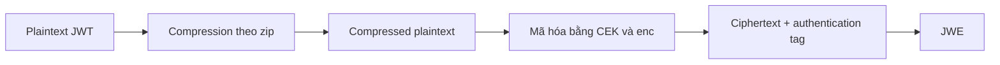
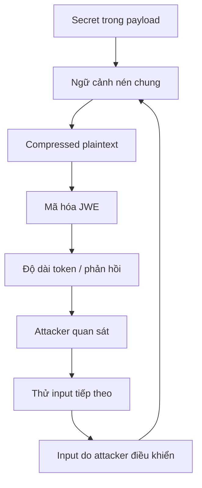
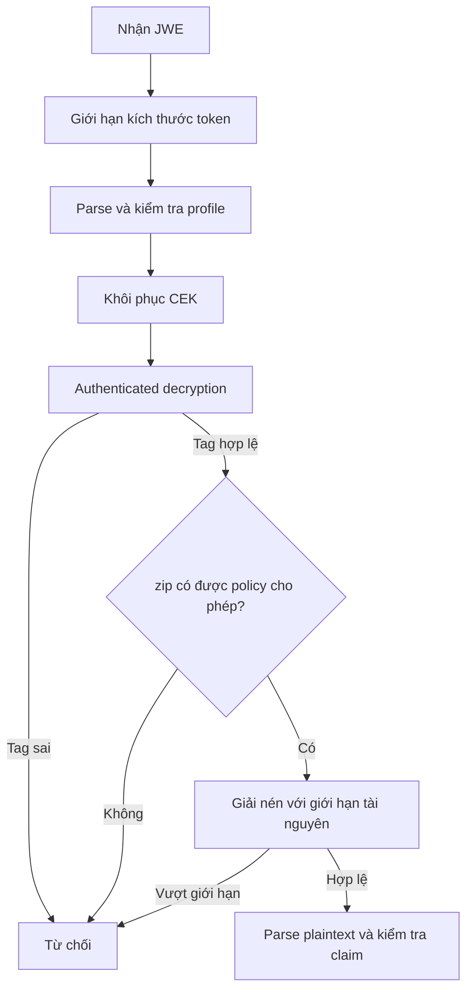

# Nén dữ liệu trước mã hóa và rủi ro rò rỉ qua độ dài

## 1. Nén trước mã hóa hoạt động như thế nào trong JWE?

**JSON Web Encryption (JWE)** có thể nén plaintext trước khi mã hóa. Tham số JOSE Header `zip` chỉ định thuật toán nén được áp dụng lên plaintext trước bước mã hóa nội dung.

Luồng xử lý tổng quát:



Trong JWE, RFC 7518 định nghĩa giá trị `DEF` cho DEFLATE. Ví dụ protected header:

```json
{
  "alg": "RSA-OAEP-256",
  "enc": "A256GCM",
  "zip": "DEF",
  "kid": "recipient-key-01"
}
```

Ý nghĩa:

- `alg` quản lý CEK.
- `enc` mã hóa nội dung.
- `zip` yêu cầu nén plaintext trước khi mã hóa.
- `kid` gợi ý định danh khóa theo kho khóa tin cậy.

Tham số `zip` phải nằm trong protected header để được bảo vệ toàn vẹn. Header vẫn có thể đọc được; Base64url không che giấu tên thuật toán nén. Nếu policy không cho phép nén, bên nhận phải từ chối JWE có `zip` thay vì âm thầm bỏ qua tham số.

**Điểm cần nhớ:** encryption che giấu nội dung nhưng không tự che giấu độ dài ciphertext. Nếu độ dài plaintext sau nén thay đổi theo dữ liệu bí mật, kích thước JWE có thể tiết lộ một phần thông tin.

Bài học này thuộc phần **Mã hóa JWE** của học phần **Security - JSON Web Token (JWT)** (`SECURITY_TOKEN_SECURITY_JWT`). Nội dung tập trung vào nén trước mã hóa, rò rỉ thông tin qua độ dài và cách thiết kế an toàn theo chuẩn JOSE, không phụ thuộc Java hoặc Spring Security.

## 2. Vì sao độ dài ciphertext vẫn có thể làm lộ thông tin?

Mã hóa bảo vệ nội dung nhưng đầu ra thường giữ mối quan hệ nhất định với kích thước đầu vào:

- Với AES-GCM, ciphertext có độ dài bằng plaintext đưa vào GCM; authentication tag được truyền riêng.
- Với AES-CBC-HMAC, ciphertext được đệm theo block AES, nên độ dài phản ánh gần đúng kích thước plaintext sau nén và quy tắc padding.
- JWE còn có header, encrypted key, IV, tag và Base64url overhead. Khi các phần này cố định hoặc gần như cố định, thay đổi độ dài ciphertext có thể làm tổng độ dài token thay đổi theo.

Khi bật nén, kích thước sau nén phụ thuộc vào mức độ lặp lại và cấu trúc của dữ liệu. Hai plaintext có cùng độ dài ban đầu vẫn có thể tạo ra kích thước sau nén khác nhau.

Ví dụ:

| Nội dung trước nén | Đặc điểm | Kết quả nén có thể xảy ra |
| --- | --- | --- |
| Chuỗi lặp lại nhiều lần | Có nhiều mẫu trùng nhau | Nén tốt, đầu ra ngắn |
| Dữ liệu ngẫu nhiên hoặc đã mã hóa | Ít mẫu lặp | Nén kém, đầu ra gần kích thước ban đầu hoặc lớn hơn |
| Văn bản có một đoạn trùng với secret | Mức nén thay đổi theo phần trùng | Độ dài có thể tiết lộ thông tin về mức độ khớp |

Kẻ quan sát không nhất thiết đọc được ciphertext. Chỉ cần đo được kích thước token hoặc phản hồi qua nhiều lần thử, họ có thể thu thập tín hiệu về dữ liệu đã nén.

## 3. Compression side-channel: khi secret và input do attacker kiểm soát cùng được nén

Rủi ro đáng chú ý xuất hiện khi **secret và dữ liệu do kẻ tấn công kiểm soát hoặc lựa chọn được đưa vào cùng một ngữ cảnh nén**.

Ví dụ, một hệ thống phát hành JWE chứa:

- Một claim bí mật như mã xác minh, API credential hoặc định danh riêng tư.
- Một trường phản chiếu giá trị do người dùng gửi lên, ví dụ nội dung tìm kiếm hoặc tham số truy vấn.
- Cả hai trường được nén cùng nhau trước khi mã hóa.

Kẻ tấn công có thể gửi nhiều giá trị thử khác nhau và quan sát độ dài JWE trả về. Nếu giá trị thử trùng với một phần của secret, bộ nén có thể tạo đầu ra ngắn hơn. Bằng cách thay đổi từng ký tự và so sánh kích thước qua nhiều lần thử, kẻ tấn công có thể suy luận dần nội dung bí mật.

Đây là nhóm rủi ro cùng nguyên lý với các compression side-channel như CRIME và BREACH: **sự tương quan giữa dữ liệu bí mật và dữ liệu do attacker lựa chọn làm thay đổi tỷ lệ nén, từ đó lộ tín hiệu qua kích thước đầu ra**.

### 3.1. Điều kiện để rủi ro có ý nghĩa

Thông thường cần nhiều điều kiện cùng xuất hiện:

1. Plaintext có chứa secret mà kẻ tấn công không được biết.
2. Kẻ tấn công có thể ảnh hưởng đến một phần dữ liệu được nén cùng secret.
3. Bộ nén có thể khai thác mẫu lặp hoặc phần trùng giữa hai vùng dữ liệu.
4. Kẻ tấn công có thể tạo nhiều lần thử với đầu vào thay đổi.
5. Kẻ tấn công quan sát được kích thước JWE, ciphertext hoặc phản hồi chứa JWE đủ chính xác.
6. Các lần thử có thể so sánh trong điều kiện tương đối ổn định, chẳng hạn cùng cấu trúc header, key management và nội dung cố định khác.

Không phải mọi JWE có nén đều tự động làm lộ secret. Rủi ro phụ thuộc vào cách dữ liệu được tạo, khả năng điều khiển input, khả năng quan sát độ dài và số lần thử. Tuy nhiên, nếu các điều kiện này tồn tại, mã hóa không loại bỏ được side-channel.

### 3.2. Ví dụ tình huống

Một dịch vụ phát hành token có payload:

```json
{
  "sub": "user-42",
  "verification_code": "Q7M4K9",
  "display_message": "Your verification code is Q7M4K9",
  "user_supplied_text": "<nội dung do người dùng nhập>"
}
```

Giả sử toàn bộ payload được nén bằng DEFLATE trước khi mã hóa JWE. Người dùng có thể thay đổi `user_supplied_text` và nhận được JWE mới. Nếu phản hồi hoặc token có thể quan sát được độ dài, họ có thể thử các chuỗi khác nhau để tìm chuỗi nào làm kích thước sau nén giảm.

Khi một chuỗi thử có phần trùng với secret hoặc với nội dung phản chiếu secret, bộ nén có thể mã hóa tham chiếu tới mẫu đã xuất hiện thay vì lặp lại toàn bộ chuỗi. Độ dài đầu ra giảm có thể trở thành tín hiệu về ký tự hoặc đoạn secret đang được đoán.



Đây là ví dụ minh họa cơ chế, không phải một khai thác có thể áp dụng cho mọi bộ nén hoặc mọi cấu trúc JWT. Mức độ rò rỉ phụ thuộc thuật toán nén, định dạng plaintext, thứ tự trường, cách phản chiếu dữ liệu và độ chính xác của phép đo.

## 4. Vì sao encryption không giải quyết được compression side-channel?

Encryption biến compressed plaintext thành ciphertext, nhưng kích thước đầu vào vẫn ảnh hưởng đến kích thước đầu ra.

```text
Plaintext chứa secret + attacker-controlled input
                     |
                     v
                Compression
                     |
                     v
            Compressed length
                     |
                     v
                 Encryption
                     |
                     v
              Ciphertext length
                     |
                     v
           Quan sát được từ bên ngoài
```

Kẻ tấn công không cần giải mã JWE. Họ chỉ so sánh độ dài của nhiều token hoặc phản hồi.

Với AES-GCM, thay đổi một byte của plaintext nén thường làm thay đổi một byte ciphertext tương ứng, trong khi tag vẫn có độ dài cố định. Với AES-CBC-HMAC, padding theo block có thể làm độ dài thay đổi theo nấc block, nhưng vẫn có thể cung cấp tín hiệu khi có đủ lần thử hoặc khi dữ liệu vượt qua ranh giới block.

Một số yếu tố khác cũng có thể làm nhiễu phép đo:

- Header thay đổi theo key version hoặc recipient.
- Encrypted key có độ dài khác nhau.
- Token được đóng gói hoặc truyền qua lớp giao thức có thêm framing.
- Padding ở tầng ứng dụng hoặc tầng vận chuyển.
- Nhiễu do nén HTTP ở lớp khác.

Không nên xem các yếu tố gây nhiễu này là biện pháp bảo vệ. Nếu thiết kế vẫn để secret và input của attacker chung ngữ cảnh nén, side-channel có thể còn tồn tại.

## 5. Khuyến nghị: tránh nén đầu vào trước khi mã hóa JWT

RFC 8725 (JSON Web Token Best Current Practices), mục 3.6, khuyến nghị **tránh nén đầu vào trước khi mã hóa JWT** vì có thể tạo side-channel làm lộ thông tin.

Đối với JWE chứa dữ liệu nhạy cảm, lựa chọn an toàn mặc định là:

- Không thêm tham số `zip`.
- Không nén payload trước khi đưa vào thư viện JWE.
- Bên nhận từ chối JWE có `zip` nếu profile quy định không hỗ trợ compression.
- Không dựa vào việc token đã mã hóa để kết luận độ dài không tiết lộ thông tin.
- Đưa claim nhạy cảm tối thiểu vào token; cân nhắc token tham chiếu nếu dữ liệu lớn hoặc cần bảo mật cao.

Ví dụ protected header không dùng compression:

```json
{
  "alg": "RSA-OAEP-256",
  "enc": "A256GCM",
  "kid": "recipient-key-01",
  "cty": "JWT"
}
```

Không có `zip` nghĩa là plaintext được đưa trực tiếp vào bước mã hóa nội dung, không có bước nén JWE được yêu cầu.

### 5.1. Khi nào có thể cân nhắc compression?

Chỉ cân nhắc nếu có nhu cầu thực tế và đã phân tích rủi ro. Ví dụ, payload lớn chứa dữ liệu không nhạy cảm, không có đầu vào do attacker kiểm soát được nén chung với secret và việc tiết lộ độ dài không ảnh hưởng đến an toàn.

Ngay cả khi đó, cần:

1. Xác định chính xác dữ liệu nào được nén.
2. Chứng minh secret không cùng compression context với input do attacker điều khiển.
3. Đánh giá khả năng quan sát độ dài và số lần thử.
4. Kiểm soát kích thước trước/sau nén và tài nguyên giải nén.
5. Thống nhất `zip` trong interoperability profile.
6. Kiểm thử side-channel và các ca từ chối.

Nếu không thể chứng minh các điều kiện trên, hãy tắt compression.

## 6. Các biện pháp giảm thiểu nếu không thể bỏ nén

Tắt nén là biện pháp đơn giản và mạnh nhất. Nếu một hệ thống cũ buộc phải duy trì nén, cần giảm thiểu nhiều lớp; không có một thủ thuật đơn lẻ nào bảo đảm loại bỏ mọi side-channel.

### 6.1. Không đặt secret và attacker-controlled input trong cùng compression context

Đây là biện pháp quan trọng nhất nếu vẫn giữ compression:

- Không phản chiếu input do người dùng gửi vào cùng payload với secret.
- Không đặt CSRF token, mã xác minh, credential hoặc session secret cạnh dữ liệu do attacker có thể lựa chọn.
- Tách dữ liệu nhạy cảm sang một thông điệp hoặc kênh riêng không dùng chung compression context.
- Nếu cần đưa thông tin người dùng vào payload, chỉ đưa sau khi đã đánh giá xem có thể tương quan với secret hay không.

Tách trường trong JSON nhưng vẫn nén toàn bộ JSON cùng lúc **không tạo ranh giới compression**. Bộ nén vẫn có thể tìm mẫu lặp xuyên qua các trường.

### 6.2. Giảm khả năng điều khiển và quan sát của attacker

Có thể giảm số lần thử và chất lượng tín hiệu bằng cách:

- Giới hạn tần suất phát hành token và số lần thử.
- Không phản hồi độ dài token nếu giao thức không cần hiển thị.
- Tránh endpoint cho phép lặp lại cùng một secret với input do người dùng tùy ý thay đổi.
- Không đưa ciphertext hoặc độ dài token vào kênh phân tích mà attacker có thể truy cập.

Rate limit và che giấu độ dài có thể làm khó khai thác nhưng không loại bỏ nguyên nhân gốc nếu compression context vẫn chứa secret và input điều khiển được.

### 6.3. Padding để giảm rò rỉ độ dài

Một hệ thống có thể thêm padding ở tầng ứng dụng sau khi nén và trước khi mã hóa, để plaintext đưa vào JWE được đệm đến các bucket kích thước cố định. Việc này có thể làm giảm độ chính xác của tín hiệu độ dài.

Tuy nhiên:

- JWE không định nghĩa một tham số padding tổng quát cho mọi payload; hai bên phải thống nhất framing ở tầng ứng dụng.
- Padding phải được xác thực cùng ciphertext và được loại bỏ sau khi JWE giải mã thành công.
- Padding theo bucket có thể vẫn để lộ khoảng kích thước.
- Padding không ngăn được mọi compression oracle nếu attacker có đủ lần thử hoặc có thể tạo thay đổi đủ lớn để vượt bucket.
- Không nên dùng padding như lý do để bật compression khi có thể tắt nén.

### 6.4. Không thay compression bằng một bước nén khác mà không đánh giá

Đổi DEFLATE sang thuật toán khác không tự động giải quyết side-channel. Nếu bộ nén mới vẫn khai thác mẫu lặp và độ dài đầu ra vẫn quan sát được, nguyên lý rò rỉ vẫn tồn tại.

Cũng không nên nén ciphertext: dữ liệu đã mã hóa có tính chất gần ngẫu nhiên, thường không nén được và có thể làm tăng kích thước.

## 7. Rủi ro tài nguyên: decompression bomb và payload quá lớn

Compression không chỉ tạo side-channel. Bên nhận còn phải giải nén dữ liệu và có thể gặp payload được nén có tỷ lệ mở rộng rất lớn.

**Decompression bomb** là dữ liệu nén nhỏ nhưng khi giải nén tạo ra lượng dữ liệu rất lớn, tiêu tốn bộ nhớ, CPU hoặc thời gian xử lý. Nếu hệ thống giải nén không giới hạn, một token có thể làm cạn tài nguyên.

Trong JWE, bên nhận phải xác thực và giải mã thành công trước khi giải nén plaintext. Tuy nhiên, điều đó không loại bỏ nguy cơ DoS: một JWE hợp lệ nhưng chứa compressed data rất lớn sau giải nén vẫn có thể tiêu tốn tài nguyên. Với mã hóa bằng public key của recipient, bất kỳ ai có public key cũng có thể tạo JWE hướng tới recipient; do đó, không thể chỉ dựa vào việc tag hợp lệ để coi payload là đáng tin về mặt tài nguyên.

### 7.1. Các giới hạn cần có

Nếu profile cho phép compression, bên nhận cần áp dụng ít nhất:

- **Giới hạn kích thước token đầu vào:** từ chối token vượt giới hạn trước khi parse sâu.
- **Giới hạn ciphertext và compressed plaintext:** tránh cấp phát bộ nhớ không giới hạn.
- **Giới hạn kích thước sau giải nén:** dừng khi vượt ngưỡng đã cấu hình.
- **Giới hạn tỷ lệ mở rộng:** từ chối payload có tỷ lệ nén bất thường theo policy.
- **Giới hạn CPU và thời gian:** áp dụng timeout hoặc quota cho quá trình giải nén.
- **Giải nén theo luồng có kiểm soát:** không ghi dữ liệu chưa được xác thực ra hệ thống khác; chỉ giải nén sau khi JWE authentication thành công.
- **Giới hạn độ sâu và cấu trúc nội dung:** kiểm tra JSON hoặc nested JWT sau giải nén để tránh parser tiêu tốn tài nguyên quá mức.

Các giới hạn phải được thực hiện ở phía nhận. Không tin kích thước khai báo hoặc metadata do token gửi lên nếu chưa kiểm tra thực tế.

### 7.2. Thứ tự xử lý an toàn



Không giải nén dữ liệu trước khi xác minh tag. Nếu tag không hợp lệ, phải từ chối JWE mà không chuyển compressed plaintext sang bộ giải nén.

## 8. Cấu hình profile cho JWE không dùng compression

Một profile có thể quy định rõ rằng `zip` không được phép:

```yaml
profile: jwt-jwe-no-compression-v1
serialization:
  accepted:
    - compact
key_management:
  allowed_algorithms:
    - RSA-OAEP-256
content_encryption:
  allowed_algorithms:
    - A256GCM
compression:
  allowed: false
  reject_zip_header: true
validation:
  verify_authentication_tag_before_plaintext_use: true
  check_issuer_audience_expiry: true
limits:
  max_token_bytes: 16384
  max_plaintext_bytes: 12288
failure:
  reject_unknown_critical_parameter: true
  no_algorithm_fallback: true
```

Đây là ví dụ profile nội bộ để minh họa, không phải schema chuẩn của RFC. Các giới hạn kích thước phải được điều chỉnh theo payload, giao thức và hạ tầng thực tế.

Bên nhận cần kiểm tra `zip` ngay trong bước policy:

- Nếu không có `zip`: tiếp tục theo profile không nén.
- Nếu có `zip`: từ chối theo policy.
- Không bỏ qua `zip` rồi coi compressed bytes là JSON/JWT bình thường.
- Không tự giải nén theo thuật toán mà token khai báo nếu thuật toán đó không nằm trong danh sách được phê duyệt.

## 9. Kiểm thử compression side-channel và giới hạn giải nén

Kiểm thử cần xác nhận cả hành vi hợp lệ lẫn việc từ chối đúng.

### 9.1. Kiểm thử side-channel

- So sánh kích thước JWE khi payload có và không có compression.
- Kiểm tra endpoint có cho attacker thay đổi input trong cùng payload với secret hay không.
- Dùng dữ liệu thử nghiệm giả lập, không dùng credential hoặc secret production.
- Thay đổi từng phần input và đo độ dài đầu ra qua nhiều lần để xác định có tín hiệu tương quan hay không.
- Kiểm tra các lớp proxy, HTTP compression, logging hoặc telemetry có làm lộ thêm độ dài hay không.

Không cần cố khai thác secret thật để đánh giá rủi ro. Có thể dùng một chuỗi canary giả và dữ liệu do tester điều khiển.

### 9.2. Kiểm thử giải nén

| Ca kiểm thử | Kết quả mong đợi |
| --- | --- |
| JWE không có `zip` trong profile no-compression | Xử lý bình thường |
| JWE có `zip` trong profile cấm nén | Từ chối |
| `zip` khai báo thuật toán không hỗ trợ | Từ chối |
| Tag JWE không hợp lệ | Từ chối trước khi giải nén |
| Compressed plaintext vượt kích thước tối đa sau giải nén | Dừng và từ chối |
| Tỷ lệ mở rộng vượt ngưỡng policy | Từ chối |
| Quá trình giải nén vượt thời gian/CPU quota | Dừng và từ chối |
| Plaintext sau giải nén không phải định dạng được profile cho phép | Từ chối |
| Input do attacker điều khiển được nén chung với secret | Thiết kế cần loại bỏ hoặc chứng minh không tạo side-channel |
| Token bị phát hành lặp lại với input thử khác nhau | Không để lộ tín hiệu độ dài có thể khai thác |

### 9.3. Kiểm thử liên thông

Nếu một đối tác vẫn yêu cầu `zip`, hai bên phải thống nhất:

- Thuật toán nén chính xác, chẳng hạn `DEF`.
- Vị trí protected header và cách xử lý `zip`.
- Thứ tự nén, mã hóa, giải mã và giải nén.
- Giới hạn kích thước trước/sau giải nén.
- Hành vi khi không hỗ trợ compression hoặc gặp payload quá lớn.

Không tự động bật compression chỉ vì thư viện JOSE có hỗ trợ nó.

## 10. Ví dụ mã giả xử lý JWE an toàn

Đoạn mã sau minh họa profile **không cho phép compression**. Tên hàm mang tính khái niệm, không phải API của một ngôn ngữ cụ thể.

```text
// BÊN NHẬN
if byteLength(receivedToken) > MAX_TOKEN_BYTES:
    reject()

jwe = JOSE.parse(receivedToken)

if jwe.protectedHeader contains "zip":
    reject()  // Profile này không chấp nhận compression.

if not allowedPair(
    jwe.protectedHeader.alg,
    jwe.protectedHeader.enc
):
    reject()

// Thư viện lấy CEK, xác thực tag và giải mã.
plaintext = JOSE.decryptAndAuthenticate(
    jwe,
    trustedRecipientKey,
    allowedAlgs = ["RSA-OAEP-256"],
    allowedEncs = ["A256GCM"]
)

// Chỉ parse plaintext sau authenticated decryption thành công.
if byteLength(plaintext) > MAX_PLAINTEXT_BYTES:
    reject()

claims = parseJWTOrJSON(plaintext)
validateIssuerAudienceExpiryAndAuthorization(claims)
```

Nếu một profile cũ bắt buộc dùng `zip`, phải xác thực và giải mã JWE thành công trước, sau đó giải nén trong môi trường có giới hạn kích thước, tỷ lệ mở rộng và thời gian. Không được dùng đoạn mã profile không nén này cho một profile cho phép compression mà không bổ sung bước giải nén được kiểm soát.

## 11. Checklist quyết định có nén JWE hay không

- [ ] Đã xác định payload có chứa secret, token, credential hoặc dữ liệu nhạy cảm không.
- [ ] Đã xác định attacker có thể điều khiển input nào được nén cùng secret không.
- [ ] Đã xác định attacker có thể quan sát kích thước token hoặc phản hồi và lặp lại yêu cầu không.
- [ ] Mặc định không dùng `zip` cho JWT/JWE chứa dữ liệu nhạy cảm.
- [ ] Nếu policy cấm nén, bên nhận từ chối JWE có `zip`.
- [ ] Nếu ngoại lệ cho phép nén, đã chứng minh secret không chia sẻ compression context với input do attacker điều khiển.
- [ ] Đã đánh giá rò rỉ qua độ dài ciphertext và các lớp truyền tải/log.
- [ ] Đã xem xét padding nếu cần giảm tín hiệu độ dài, nhưng không coi padding là giải pháp thay thế việc tắt nén.
- [ ] Chỉ giải nén sau khi JWE authentication tag hợp lệ.
- [ ] Có giới hạn token đầu vào, kích thước sau giải nén, tỷ lệ mở rộng, CPU và thời gian.
- [ ] Có kiểm thử compression side-channel bằng dữ liệu canary giả.
- [ ] Các bên đã thống nhất thuật toán `zip` và giới hạn tài nguyên nếu compression được cho phép.

**Kết luận:** Nén trước mã hóa có thể làm giảm kích thước JWE, nhưng cũng có thể tạo side-channel qua độ dài khi secret và input do attacker điều khiển được nén trong cùng ngữ cảnh. Encryption không che giấu sự thay đổi kích thước sau nén. RFC 8725 khuyến nghị tránh nén đầu vào trước khi mã hóa JWT. Với JWE chứa dữ liệu nhạy cảm, nên tắt `zip`; nếu hệ thống cũ buộc phải nén, cần tách compression context, giảm khả năng quan sát, kiểm soát giải nén và kiểm thử side-channel. Bên nhận chỉ giải nén sau khi xác thực JWE thành công và phải giới hạn tài nguyên để chống decompression bomb.

### Tài liệu tiêu chuẩn

- [RFC 7516 — JSON Web Encryption (JWE)](https://www.rfc-editor.org/rfc/rfc7516)
- [RFC 7518 — JSON Web Algorithms (JWA)](https://www.rfc-editor.org/rfc/rfc7518)
- [RFC 8725 — JSON Web Token Best Current Practices, Section 3.6](https://www.rfc-editor.org/rfc/rfc8725)
- [RFC 1951 — DEFLATE Compressed Data Format Specification](https://www.rfc-editor.org/rfc/rfc1951)
