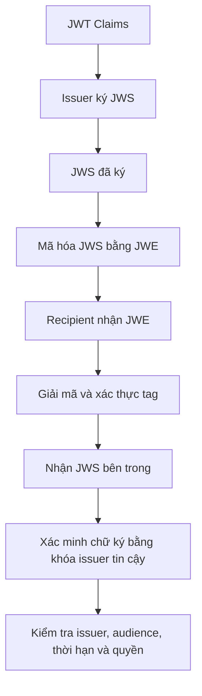

# Giới hạn bảo mật của JWE đối với metadata và bên nhận

## 1. JWE bảo vệ điều gì và không bảo vệ điều gì?

JSON Web Encryption (JWE) cung cấp cơ chế mã hóa nội dung và kiểm tra tính toàn vẹn theo thuật toán JOSE được chọn. Người không có khóa giải mã phù hợp không thể đọc plaintext; bên nhận có thể phát hiện nội dung hoặc dữ liệu xác thực bị thay đổi.

Tuy nhiên, không nên hiểu JWE là một lớp bảo vệ toàn diện cho mọi thành phần của token. JWE có các giới hạn quan trọng:

- **Header và metadata thường vẫn nhìn thấy được.** Protected header được xác thực nhưng không được mã hóa.
- **Không tự xác thực danh tính issuer.** Authentication tag không tương đương chữ ký số của bên phát hành.
- **Không tự chứng minh ai là recipient dự kiến.** Khả năng giải mã chứng minh bên nhận có khóa phù hợp, không chứng minh danh sách recipient đã được issuer phê duyệt.
- **Không ngăn replay.** Một JWE hợp lệ có thể bị sao chép và gửi lại.
- **Không thu hồi được plaintext đã giải mã.** Recipient hợp lệ có thể lưu hoặc chia sẻ nội dung.
- **Không tự cung cấp forward secrecy.** Việc lộ khóa dài hạn có thể làm lộ những JWE đã lưu trước đó.
- **Không bảo vệ endpoint sau giải mã.** Plaintext, CEK và khóa riêng vẫn cần được bảo vệ trong bộ nhớ, log và hệ thống lưu trữ.

Bài học này thuộc phần **Mã hóa JWE** của học phần **Security - JSON Web Token (JWT)** (`SECURITY_TOKEN_SECURITY_JWT`). Nội dung tập trung vào ranh giới bảo vệ của JWE, metadata và mô hình tin cậy recipient theo chuẩn JWT/JOSE nói chung, không phụ thuộc Java hoặc Spring Security.

## 2. Protected header được xác thực nhưng không được mã hóa

### 2.1. Header JWE vẫn có thể đọc được

Trong JWE Compact Serialization, token có năm phần:

```text
BASE64URL(protected-header)
.BASE64URL(encrypted-key)
.BASE64URL(iv)
.BASE64URL(ciphertext)
.BASE64URL(authentication-tag)
```

Phần đầu là protected header được mã hóa biểu diễn bằng Base64url. Base64url không phải mã hóa bí mật; bất kỳ ai có token đều có thể giải mã phần này để xem các tham số header.

Ví dụ:

```json
{
  "alg": "RSA-OAEP-256",
  "enc": "A256GCM",
  "kid": "billing-recipient-key-v4",
  "cty": "JWT"
}
```

Người quan sát có thể biết:

- Token dùng thuật toán quản lý khóa nào (`alg`).
- Thuật toán mã hóa nội dung nào (`enc`).
- Định danh khóa nào được gợi ý (`kid`).
- Nội dung bên trong có thể là một JWT (`cty`).

Payload có thể được mã hóa, nhưng các thông tin mô tả cách xử lý token vẫn lộ ra. Vì vậy, không đặt thông tin nhạy cảm như tên người dùng, email, mã khách hàng, tên nội bộ hoặc bí mật vào header.

### 2.2. Protected header có integrity, không có confidentiality

Trong JWE Compact, protected header được đưa vào Additional Authenticated Data (AAD) của phép mã hóa nội dung. Nếu ai đó sửa header, dữ liệu AAD thay đổi và kiểm tra authentication tag sẽ thất bại.

Cần phân biệt:

| Thuộc tính | Protected header |
| --- | --- |
| Có thể đọc từ token? | Có |
| Có được mã hóa để che giấu? | Không |
| Có được xác thực toàn vẹn bởi phép mã hóa nội dung? | Có |
| Có chứng minh issuer đã ký header? | Không |
| Có thể chứa dữ liệu bí mật? | Không nên |

**Integrity không đồng nghĩa với confidentiality.** Header có thể được bảo vệ khỏi thay đổi nhưng vẫn công khai cho người có token.

### 2.3. Header không được bảo vệ trong JSON Serialization

JWE JSON Serialization có thể có nhiều vùng header:

- `protected`: header được Base64url và đưa vào AAD.
- `unprotected`: header chung không được đưa vào AAD.
- `header` trong từng recipient: thông tin header riêng của recipient, không được bảo vệ bởi authentication tag của nội dung.

Ví dụ cấu trúc rút gọn:

```json
{
  "protected": "eyJlbmMiOiJBMjU2R0NNIn0",
  "unprotected": {
    "comment": "routing metadata"
  },
  "recipients": [
    {
      "header": {
        "alg": "RSA-OAEP-256",
        "kid": "recipient-A-key-v2"
      },
      "encrypted_key": "<encrypted-cek-A>"
    }
  ],
  "iv": "<iv>",
  "ciphertext": "<ciphertext>",
  "tag": "<tag>"
}
```

Các header không được bảo vệ có thể bị thay đổi mà không làm authentication tag nội dung thất bại. Vì vậy, không dùng unprotected header làm bằng chứng về issuer, danh tính recipient, quyền truy cập hoặc chính sách bảo mật.

Một số tham số có quy tắc bảo vệ cụ thể: `zip` MUST được integrity-protected và vì vậy chỉ được đặt trong protected header. Trong JWE JSON General Serialization, `alg` có thể nằm trong recipient unprotected header; khi đó authentication tag của nội dung không bảo vệ giá trị `alg` đó. `enc` và các tham số quyết định cách xử lý plaintext phải nhất quán giữa các recipient. Bên nhận cần áp dụng allowlist và profile cục bộ, không coi metadata unprotected là dữ liệu đã được xác thực.

## 3. Những metadata nào có thể bị lộ?

Ngay cả khi payload được mã hóa, một số metadata vẫn có thể tiết lộ kiến trúc, công nghệ hoặc quan hệ giữa các hệ thống.

| Metadata | Có thể tiết lộ điều gì? | Cách giảm rủi ro |
| --- | --- | --- |
| `alg` | Cơ chế quản lý khóa, ví dụ RSA, ECDH hoặc key wrapping | Chỉ chấp nhận profile cần thiết; không xem tên thuật toán là bí mật |
| `enc` | Thuật toán mã hóa nội dung và mức cấu hình | Dùng allowlist; tránh đưa dữ liệu nội bộ vào giá trị mở rộng |
| `kid` | Hệ thống khóa, môi trường hoặc phiên bản khóa | Dùng ID opaque, không chứa tên người, email hay mã nghiệp vụ |
| `epk` | Public key tạm thời và thông tin curve của ECDH | Chấp nhận rằng public key này cần công khai; bảo vệ private key tương ứng |
| `apu`, `apv` | Thông tin PartyU/PartyV trong thỏa thuận khóa | Không đặt dữ liệu nhận dạng nhạy cảm vào các trường này |
| `zip` | Token có dùng nén trước mã hóa hay không | Chỉ bật khi profile cho phép và đã đánh giá side-channel |
| `typ`, `cty` | Loại token hoặc loại nội dung bên trong | Dùng giá trị tổng quát; không mã hóa bí mật nghiệp vụ trong metadata |
| `iv`, `tag` | Tham số mật mã và kích thước tag | Các giá trị này không cần bí mật; phải xác minh đúng chuẩn |
| Kích thước ciphertext | Độ dài gần đúng của nội dung sau xử lý | Giảm dữ liệu nhạy cảm, tránh nén chung secret với input attacker |
| Số recipient và encrypted key | Số lượng hoặc nhóm bên nhận, loại khóa và độ dài encrypted key | Dùng serialization phù hợp; hạn chế recipient và tránh đưa danh tính nhạy cảm vào `kid` |

Không phải mọi metadata đều là lỗ hổng. Các trường như `alg`, `enc`, `iv` và `epk` cần thiết để bên nhận xử lý JWE. Mục tiêu là **không coi chúng là bí mật**, và không để chúng mang thông tin nghiệp vụ vượt quá mức cần thiết.

### 3.1. Độ dài token và traffic analysis

Kích thước token có thể tiết lộ thông tin về:

- Payload ngắn hay dài.
- Token có nhiều claim hoặc dữ liệu nhúng hay không.
- Có nhiều recipient hay không.
- Thuật toán quản lý khóa tạo encrypted key dài hay ngắn.
- Token có được nén trước khi mã hóa hay không.

Nếu người quan sát thấy token thay đổi kích thước theo loại giao dịch, họ có thể suy luận một số đặc điểm về hoạt động của hệ thống mà không cần giải mã nội dung.

JWE không tự che giấu kích thước ciphertext. Nếu độ dài là thông tin nhạy cảm trong mô hình đe dọa, cần đánh giá padding ở tầng ứng dụng, giảm claim hoặc thay đổi cách trao đổi dữ liệu. Padding có thể làm giảm tín hiệu nhưng không bảo đảm che giấu hoàn toàn mọi metadata.

## 4. JWE không tự xác thực danh tính issuer

### 4.1. Authentication tag xác thực dữ liệu bằng khóa

JWE dùng mã hóa xác thực để bảo vệ ciphertext và AAD. Tag hợp lệ cho biết dữ liệu phù hợp với khóa và tham số đã dùng để tạo tag.

Nhưng điều đó không tự chứng minh **ai đã tạo JWE**:

- Với `dir` hoặc KEK đối xứng, mọi bên giữ khóa có thể tạo một JWE có tag hợp lệ.
- Với RSA-OAEP hoặc mã hóa bằng public key recipient, bất kỳ ai có public key của recipient đều có thể tạo JWE gửi cho recipient.
- Người quan sát có thể xác minh nội dung không bị thay đổi kể từ khi được tạo bằng khóa tương ứng, nhưng không có bằng chứng chữ ký gắn với một issuer cụ thể.

JWE cung cấp confidentiality và integrity/authentication ở mức mã hóa nội dung; nó không tự cung cấp tính xác thực nguồn phát hành theo nghĩa chữ ký số.

### 4.2. Khi cần xác thực issuer, dùng chữ ký phù hợp

Một mô hình phổ biến là **nested JWT: ký JWS trước rồi mã hóa JWS bằng JWE**:



Bên nhận cần:

1. Giải mã và xác thực JWE thành công.
2. Xác minh chữ ký JWS bên trong bằng khóa issuer lấy từ nguồn tin cậy.
3. Kiểm tra `iss`, `aud`, `exp`, `nbf`, loại token và các claim theo ngữ cảnh.
4. Chỉ cấp quyền sau khi tất cả điều kiện cần thiết đạt.

Không được bỏ qua bước xác minh chữ ký JWS chỉ vì authentication tag JWE hợp lệ. Nếu không dùng nested JWS, cần một cơ chế xác thực nguồn khác phù hợp với giao thức và mô hình tin cậy.

## 5. JWE không tự chứng minh danh tính hoặc quyền của recipient

### 5.1. Mã hóa thành công cho public key không chứng minh người nhận đã được phê duyệt

Bên phát hành có thể mã hóa CEK cho public key của recipient. Tuy nhiên, điều này chỉ có ý nghĩa khi public key đã được xác thực và gắn với đúng danh tính bên nhận.

Nếu attacker thay thế public key trong quá trình discovery hoặc trao đổi khóa, bên phát hành có thể mã hóa JWE cho khóa của attacker. JWE vẫn có thể hợp lệ về mặt mật mã; chỉ có người giữ private key tương ứng mới giải mã được.

Do đó, trước khi dùng public key phải xác minh:

- Khóa thuộc đúng recipient hoặc tổ chức dự kiến.
- Khóa đến từ JWKS endpoint, chứng thư, trust store hoặc KMS đã được cấu hình tin cậy.
- Khóa còn hiệu lực, chưa bị thu hồi và có đúng mục đích sử dụng.
- `kid` được ánh xạ vào đúng key version trong kho tin cậy.
- Thuật toán, key type, key size và key usage phù hợp với profile.

Không tự động tải khóa từ URL `jku` hoặc `x5u` do token không tin cậy chỉ định. Không tin một JWK hoặc certificate nhúng trong header nếu chưa xác minh theo trust anchor và policy.

### 5.2. Khả năng giải mã không đồng nghĩa quyền nghiệp vụ

Một recipient có private key phù hợp có thể giải mã JWE, nhưng điều đó không có nghĩa người dùng hoặc dịch vụ đó được phép thực hiện mọi thao tác nghiệp vụ được mô tả trong payload.

Sau khi giải mã, ứng dụng vẫn phải kiểm tra:

- Danh tính chủ thể (`sub`) và issuer (`iss`).
- Đối tượng nhận (`aud`).
- Thời hạn (`exp`, `nbf`).
- Scope, role hoặc quyền theo chính sách.
- Tenant, giao dịch, tài nguyên và ngữ cảnh gọi.
- Trạng thái phiên hoặc token nếu hệ thống có cơ chế thu hồi.

Mã hóa bảo vệ nội dung khỏi người không có khóa; **authorization** quyết định chủ thể được phép làm gì.

## 6. Giới hạn của JWE nhiều recipient

### 6.1. Recipient entries không phải chữ ký xác thực danh sách người nhận

Trong JWE General JSON Serialization, một CEK có thể được bảo vệ riêng cho nhiều recipient trong khi ciphertext, IV và tag được dùng chung.

Các recipient headers và danh sách recipients không tự trở thành một danh sách được issuer ký. Authentication tag của nội dung không phải chữ ký số chứng minh rằng issuer đã phê duyệt từng recipient entry.

Một bên trung gian có thể tác động tới metadata không được bảo vệ, chẳng hạn xóa hoặc thay đổi recipient entry, gây từ chối dịch vụ hoặc làm sai lệch thông tin định tuyến. Việc thêm một recipient có khả năng giải mã vẫn cần có cách lấy CEK hợp lệ; nhưng bên nhận không nên dựa vào recipient list không được xác thực để kết luận ai là người gửi hoặc ai được issuer cho phép.

Nếu danh sách recipient là một phần của chính sách nghiệp vụ, hãy đưa thông tin recipient dự kiến vào nội dung được ký bởi issuer hoặc bảo vệ nó bằng một cơ chế xác thực envelope riêng. Recipient phải kiểm tra danh tính của mình với thông tin đã được xác thực.

### 6.2. Tất cả recipient hợp lệ đọc cùng plaintext

Trong một JWE General dùng chung ciphertext, mọi recipient khôi phục được CEK đều có thể giải mã cùng nội dung.

Vì vậy:

- Không dùng một JWE nhiều recipient để phân phối các tập claim có quyền khác nhau.
- Không thêm một dịch vụ vào danh sách chỉ vì dịch vụ đó có khả năng giải mã.
- Không giả định recipient sẽ giữ plaintext trong phạm vi hệ thống của mình.
- Không đưa secret vào payload nếu một trong các recipient không cần biết secret đó.

Nếu Billing chỉ cần dữ liệu thanh toán, Audit chỉ cần metadata kiểm toán và Archive chỉ cần bản đã ẩn danh, hãy tạo payload/JWE riêng theo nhóm quyền hoặc dùng API có kiểm soát truy cập.

### 6.3. Không thể thu hồi dữ liệu đã nhận

Xóa recipient entry khỏi một bản JWE mới không thu hồi được bản token mà recipient đã lưu trước đó. Một recipient hợp lệ có thể:

- Lưu ciphertext và encrypted key.
- Lưu CEK sau khi giải mã.
- Lưu plaintext.
- Chuyển tiếp token hoặc nội dung cho bên khác.

Việc thay khóa hoặc thu hồi key version có thể ngăn giải mã các bản JWE chưa được giải mã nếu khóa cũ không còn khả dụng, nhưng không thể xóa plaintext đã được sao chép. Đây là giới hạn căn bản của việc chia sẻ dữ liệu cho một bên nhận hợp lệ.

## 7. JWE không tự ngăn replay hoặc cung cấp forward secrecy

### 7.1. Replay

Một JWE hợp lệ có thể bị sao chép nguyên vẹn và gửi lại. Authentication tag vẫn hợp lệ vì token không bị thay đổi.

Cần cơ chế ở tầng ứng dụng hoặc giao thức:

- Giới hạn thời hạn token bằng `exp` và kiểm tra `nbf`.
- Dùng `jti` cùng kho trạng thái nếu cần phát hiện token đã dùng hoặc thu hồi.
- Gắn nonce/challenge với giao dịch và kiểm tra tính duy nhất.
- Ràng buộc token với người gửi khi giao thức hỗ trợ.
- Có quy trình thu hồi phiên/token và xử lý token bị lộ.

IV của AES-GCM là nonce mật mã; nó không phải nonce chống replay của ứng dụng.

### 7.2. Forward secrecy

JWE không tự bảo đảm forward secrecy. Trong nhiều mô hình phổ biến, bên nhận dùng khóa dài hạn để khôi phục CEK:

- Với RSA-OAEP, attacker lưu JWE rồi sau này lấy được private key RSA của recipient có thể giải mã encrypted key và khôi phục CEK.
- Với ECDH-ES dùng khóa dài hạn của recipient và ephemeral public key `epk` trong token, việc lộ private key dài hạn sau này có thể cho phép attacker tính lại khóa phiên từ những token đã lưu.
- Với KEK đối xứng dài hạn, việc lộ KEK có thể làm lộ CEK được wrap bằng khóa đó.

Vì vậy, cần giới hạn thời gian và phạm vi sử dụng khóa, bảo vệ private key/KEK trong KMS hoặc HSM, thay khóa theo chính sách và đánh giá rủi ro lưu trữ ciphertext lâu dài. Không quảng bá ECDH-ES trong JWE như một bảo đảm forward secrecy nếu mô hình khóa không thực sự cung cấp thuộc tính đó.

## 8. JWE không thay thế TLS và bảo vệ endpoint

JWE và TLS giải quyết các ranh giới bảo vệ khác nhau:

| Cơ chế | Bảo vệ | Giới hạn |
| --- | --- | --- |
| TLS/HTTPS | Dữ liệu trên kết nối giữa hai điểm kết thúc TLS | Không bảo vệ dữ liệu sau khi TLS kết thúc hoặc token được lưu ở dạng đọc được |
| JWE | Nội dung token ở dạng đối tượng, có thể giữ bí mật qua nhiều trung gian không có khóa | Không bảo vệ plaintext tại recipient hợp lệ hoặc endpoint bị xâm nhập |
| JWS | Toàn vẹn và xác thực nguồn ký khi khóa xác minh được tin cậy | Không che giấu payload |
| Kiểm soát truy cập | Quyết định chủ thể được phép đọc/thực hiện hành động | Không thay thế mã hóa và quản lý khóa |

Ví dụ, nếu TLS kết thúc tại API gateway và gateway chuyển tiếp một JWE còn nguyên vẹn tới dịch vụ cuối, gateway có thể không đọc payload nếu không giữ khóa giải mã. Nhưng nếu gateway giải mã JWE, plaintext đã xuất hiện tại gateway và phải được bảo vệ tại đó.

Sau khi giải mã, cần bảo vệ:

- Bộ nhớ tiến trình và bản sao plaintext.
- Log, tracing, error report và telemetry.
- Core dump, crash dump và bản sao lưu.
- Cache, hàng đợi và hệ thống lưu trữ.
- Khóa riêng, KEK và CEK trong bộ nhớ hoặc kho khóa.
- Quyền của người vận hành và workload có khả năng gọi thao tác giải mã.

Không ghi toàn bộ token, plaintext hoặc khóa vào log để tiện debug. Chỉ ghi metadata tối thiểu đã được làm sạch.

## 9. Các tình huống thực tế và hướng xử lý

| Tình huống | Giới hạn của JWE | Biện pháp cần bổ sung |
| --- | --- | --- |
| Người quan sát thấy `kid`, `alg`, `enc` | Header không được mã hóa | Dùng metadata tổng quát, `kid` opaque và không đặt thông tin cá nhân vào header |
| Attacker thay public key recipient trong quá trình discovery | JWE có thể được mã hóa cho khóa của attacker | Xác thực nguồn khóa, chứng thư/JWKS và binding recipient |
| JWE có tag hợp lệ nhưng không biết issuer | Tag không xác thực danh tính issuer | Nested JWS hoặc cơ chế xác thực nguồn phù hợp |
| Một recipient bị loại khỏi danh sách mới | Token cũ và plaintext đã lưu vẫn tồn tại | CEK mới cho nội dung mới, thu hồi token ở tầng ứng dụng và kiểm soát dữ liệu đã chia sẻ |
| JWE bị sao chép và gửi lại | Tag vẫn hợp lệ | `exp`, `jti`, challenge/nonce giao dịch và sender constraint |
| Private key recipient bị lộ | Token đã lưu có thể bị giải mã | Thu hồi/thay khóa, đánh giá dữ liệu lịch sử và hạn chế lưu ciphertext |
| Gateway giải mã JWE | Gateway nhìn thấy plaintext | Giới hạn quyền giải mã, bảo vệ log và bộ nhớ tại gateway |
| Token dài ngắn khác nhau | Có thể tiết lộ kích thước hoặc loại giao dịch | Giảm claim, đánh giá padding và tránh compression side-channel |
| Recipient cố ý chia sẻ nội dung | JWE không kiểm soát hành vi sau giải mã | Giới hạn dữ liệu được chia sẻ, hợp đồng và kiểm soát truy cập tại nguồn |

## 10. Ví dụ thiết kế một envelope có xác thực nguồn và recipient

Nếu hệ thống cần bí mật payload, xác thực issuer và kiểm tra recipient dự kiến, có thể thiết kế theo nguyên tắc:

1. Issuer tạo claims và thêm thông tin đối tượng nhận hoặc nhóm recipient theo hợp đồng.
2. Issuer ký nội dung bằng JWS.
3. Bên phát hành mã hóa JWS bằng JWE cho recipient được xác thực.
4. Recipient giải mã JWE và xác minh chữ ký JWS bằng khóa issuer tin cậy.
5. Recipient kiểm tra claim recipient/audience, thời hạn và quyền của chính mình.

```text
// ISSUER
signedJwt = JWS.sign(
    claims = {
        iss: "https://issuer.example",
        sub: "service-user-42",
        aud: "billing-api",
        exp: unixNow() + 300,
        recipient_group: "billing-processing"
    },
    issuerSigningKey = trustedIssuerSigningKey
)

jwe = JWE.encrypt(
    plaintext = signedJwt,
    recipientPublicKey = authenticatedBillingPublicKey,
    alg = "RSA-OAEP-256",
    enc = "A256GCM"
)

// RECIPIENT
innerJws = JWE.decryptAndAuthenticate(
    jwe,
    recipientPrivateKey,
    allowedAlgs = ["RSA-OAEP-256"],
    allowedEncs = ["A256GCM"]
)

claims = JWS.verify(
    innerJws,
    trustedIssuerVerificationKey,
    allowedAlgorithms = ["ES256"]
)

validateIssuerAudienceExpiryAndRecipientPolicy(claims)
```

Đây là mã giả minh họa, không phải API của thư viện cụ thể. Trong trường hợp JWE General có nhiều recipient, claim đã ký phải mô tả đúng nhóm recipient hoặc mục đích chia sẻ; không nên tuyên bố một danh sách recipient đã được xác thực nếu danh sách đó không nằm trong dữ liệu được ký.

Ngay cả với thiết kế này, recipient hợp lệ vẫn có thể sao chép plaintext sau khi giải mã. Chữ ký bảo vệ nguồn gốc và tính toàn vẹn của nội dung, không ngăn người nhận tiết lộ dữ liệu.

## 11. Checklist đánh giá giới hạn bảo mật JWE

- [ ] Đã xác định metadata nào lộ ra từ protected header, unprotected header, recipient entries và kích thước token.
- [ ] Không đặt dữ liệu bí mật hoặc thông tin nhận dạng nhạy cảm vào header, `kid`, `apu`, `apv` hay metadata mở rộng.
- [ ] Chỉ tin các tham số header được bảo vệ; không dùng unprotected header làm bằng chứng bảo mật.
- [ ] Allowlist `alg`, `enc` và profile được cấu hình độc lập với token.
- [ ] Public key recipient được xác thực và gắn với đúng danh tính bên nhận.
- [ ] Đã phân biệt xác thực tag JWE với xác thực chữ ký issuer.
- [ ] Nếu cần xác thực issuer, đã xác minh JWS hoặc cơ chế nguồn gốc tương đương.
- [ ] Nếu cần xác thực danh sách recipient, metadata recipient nằm trong nội dung được ký hoặc envelope có xác thực riêng.
- [ ] Đã hiểu mọi recipient thành công trong một JWE nhiều bên đều có thể đọc cùng plaintext.
- [ ] Đã có cơ chế replay detection, thu hồi token và kiểm tra thời hạn khi cần.
- [ ] Đã đánh giá ảnh hưởng khi private key hoặc KEK dài hạn bị lộ; không mặc định JWE có forward secrecy.
- [ ] Đã bảo vệ plaintext và khóa tại endpoint sau giải mã.
- [ ] TLS/HTTPS vẫn được sử dụng cho các kết nối theo yêu cầu của hệ thống.
- [ ] Đã kiểm soát log, tracing, cache, crash dump và backup để tránh lộ token hoặc plaintext.

**Kết luận:** JWE bảo vệ nội dung token bằng mã hóa xác thực, nhưng header và nhiều metadata vẫn có thể quan sát được; các header không được bảo vệ không thể dùng làm bằng chứng tin cậy. JWE không tự xác thực issuer, không chứng minh danh sách recipient được phê duyệt, không ngăn replay, không thu hồi plaintext đã chia sẻ và không mặc định cung cấp forward secrecy. Thiết kế an toàn cần xác thực khóa recipient, ký nội dung khi cần xác thực nguồn, kiểm tra claim và quyền, quản lý vòng đời khóa, đồng thời bảo vệ endpoint sau giải mã.

### Tài liệu tiêu chuẩn

- [RFC 7516 — JSON Web Encryption (JWE)](https://www.rfc-editor.org/rfc/rfc7516)
- [RFC 7518 — JSON Web Algorithms (JWA)](https://www.rfc-editor.org/rfc/rfc7518)
- [RFC 7515 — JSON Web Signature (JWS)](https://www.rfc-editor.org/rfc/rfc7515)
- [RFC 7519 — JSON Web Token (JWT)](https://www.rfc-editor.org/rfc/rfc7519)
- [RFC 8725 — JSON Web Token Best Current Practices](https://www.rfc-editor.org/rfc/rfc8725)
