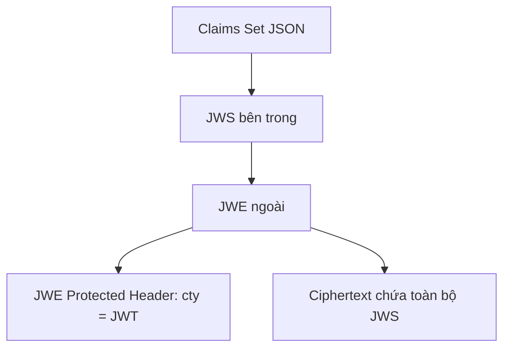
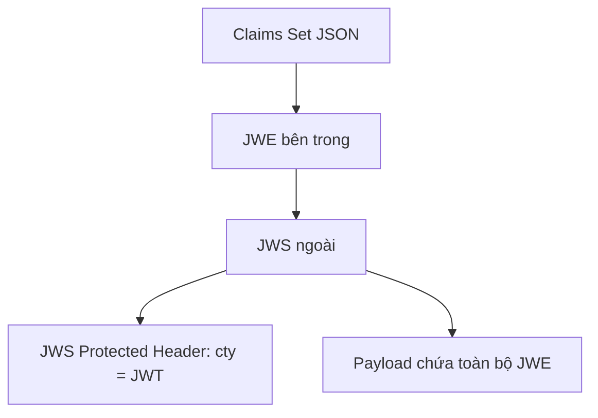
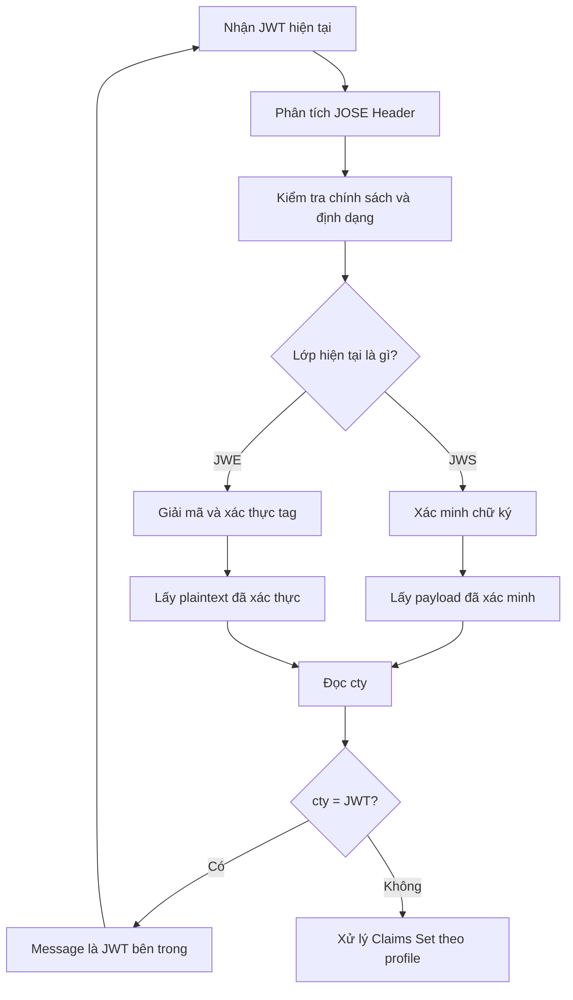

# Vai trò của cty khi chứa một JWT bên trong

> **Chương:** JWT lồng nhau  
> **Phạm vi:** Security – JSON Web Token (JWT), thuộc module SECURITY_TOKEN_SECURITY_JWT. Nội dung áp dụng cho các hệ thống sử dụng JWT/JOSE nói chung, không phụ thuộc ngôn ngữ lập trình hoặc framework.

## 1. cty là gì?

`cty` là viết tắt của **Content Type**, một tham số trong JOSE Header được JWT sử dụng để mô tả **cấu trúc nội dung bên trong JWT**.

Khi một JWT chứa một JWT khác do thao tác ký hoặc mã hóa lồng nhau, header của lớp đang bao bọc phải khai báo:

```json
{
  "cty": "JWT"
}
```

Theo [RFC 7519 §5.2](https://www.rfc-editor.org/rfc/rfc7519.html#section-5.2), khi sử dụng nested signing hoặc encryption, tham số `cty` **MUST** xuất hiện và giá trị phải là `JWT`. RFC khuyến nghị viết hoa `JWT` để tương thích với các triển khai hiện có. Tên media type không phân biệt chữ hoa/chữ thường, nhưng dùng cách viết chuẩn giúp tránh khác biệt không cần thiết.

Có thể hiểu đơn giản:

- **Không lồng JWT:** nội dung của JWS/JWE cuối cùng là Claims Set JSON; `cty` không được khuyến nghị sử dụng trong trường hợp thông thường.
- **Có lồng JWT:** payload của JWS hoặc plaintext của JWE là một JWT hoàn chỉnh khác; header của lớp bao bọc đặt `cty: "JWT"` để khai báo điều đó.

`cty` là **JOSE Header Parameter**, không phải một claim trong Claims Set. Nó mô tả cấu trúc của thông điệp để bên nhận biết cần tiếp tục xử lý một JWT bên trong.

## 2. Vì sao cần cty?

Một JWT có thể được biểu diễn bằng JWS hoặc JWE:

- JWS Compact Serialization có ba phần: protected header, payload và signature.
- JWE Compact Serialization có năm phần: protected header, encrypted key, IV, ciphertext và authentication tag.

Trong Nested JWT, payload JWS hoặc plaintext JWE có thể là chuỗi biểu diễn của một JWT khác. Nếu không có thông tin về cấu trúc này, bên nhận có thể diễn giải nội dung như Claims Set cuối cùng trong khi thực tế vẫn còn một lớp JWT cần xử lý.

`cty: "JWT"` giải quyết sự mơ hồ về cấu trúc bằng cách thông báo:

**Sau khi lớp hiện tại được xác minh hoặc giải mã thành công, nội dung thu được là một JWT khác. Hãy tiếp tục quy trình xử lý JWT với nội dung đó.**

Theo quy trình tạo JWT tại [RFC 7519 §7.1](https://www.rfc-editor.org/rfc/rfc7519.html#section-7.1), khi thực hiện thêm một thao tác ký hoặc mã hóa lồng nhau, bên tạo dùng JWS/JWE vừa tạo làm Message và quay lại bước tạo JOSE Header mới với `cty: "JWT"`.

## 3. cty nằm ở đâu trong Nested JWT?

Quy tắc thực hành là: **đặt `cty: "JWT"` trong JOSE Header của lớp JWT có payload hoặc plaintext là một JWT khác**.

Vị trí này thay đổi theo thứ tự ký và mã hóa.

### 3.1. Ký rồi mã hóa — JWE(JWS(claims))

Quy trình:

1. Tạo Claims Set.
2. Ký Claims Set thành JWS.
3. Mã hóa toàn bộ JWS thành JWE.

JWE ngoài chứa chuỗi JWS bên trong, vì vậy `cty: "JWT"` nằm trong protected header của **JWE ngoài**.



Ví dụ header JWE:

```json
{
  "alg": "RSA-OAEP-256",
  "enc": "A256GCM",
  "kid": "recipient-encryption-01",
  "cty": "JWT"
}
```

Sau khi recipient giải mã và xác thực JWE, plaintext thu được là JWS. Recipient tiếp tục xác minh JWS rồi mới đọc và kiểm tra Claims Set.

Header JWS bên trong không cần `cty: "JWT"` nếu payload của chính JWS đó là Claims Set JSON, không phải một JWT khác.

### 3.2. Mã hóa rồi ký — JWS(JWE(claims))

Quy trình:

1. Tạo Claims Set.
2. Mã hóa Claims Set thành JWE.
3. Ký toàn bộ chuỗi JWE thành JWS.

JWS ngoài chứa chuỗi JWE trong payload, vì vậy `cty: "JWT"` nằm trong protected header của **JWS ngoài**.



Ví dụ header JWS:

```json
{
  "alg": "ES256",
  "kid": "issuer-signing-01",
  "cty": "JWT"
}
```

Sau khi xác minh chữ ký JWS ngoài, recipient lấy payload là chuỗi JWE, giải mã và xác thực JWE rồi mới kiểm tra Claims Set.

Header JWE bên trong không cần `cty: "JWT"` nếu plaintext của JWE là Claims Set JSON.

### 3.3. Bảng ghi nhớ vị trí

| Cấu trúc | Lớp ngoài | Nội dung được bao bọc | Header mang `cty: "JWT"` |
|---|---|---|---|
| `JWE(JWS(claims))` | JWE | Một JWS hoàn chỉnh | JWE ngoài |
| `JWS(JWE(claims))` | JWS | Một JWE hoàn chỉnh | JWS ngoài |
| `JWE(JWS(JWE(claims)))` | JWE | Một JWS hoàn chỉnh | JWE ngoài và JWS ở giữa |
| JWT đơn lẻ `JWS(claims)` hoặc `JWE(claims)` | JWS hoặc JWE | Claims Set JSON | Không cần `cty` |

Với nhiều lớp lồng, mỗi lớp JWT đang **bao bọc một JWT khác** cần mô tả nội dung lồng bằng `cty: "JWT"`. Lớp trong cùng có Claims Set JSON làm payload/plaintext thì không cần `cty` cho một JWT bên trong nữa.

## 4. cty hoạt động cùng quy trình xác minh như thế nào?

`cty` không thay thế thao tác mật mã. Nó cho biết bên nhận cần xử lý cấu trúc tiếp theo sau khi lớp hiện tại được xác minh hoặc giải mã thành công.

[RFC 7519 §7.2](https://www.rfc-editor.org/rfc/rfc7519.html#section-7.2) mô tả quy trình xác thực theo cách đệ quy:

1. Phân tích JOSE Header và xác định cấu trúc JWS hoặc JWE.
2. Xác minh JWS hoặc xác thực/giải mã JWE theo quy tắc tương ứng.
3. Thu được Message từ payload JWS đã xác minh hoặc plaintext JWE đã xác thực.
4. Nếu header có `cty` bằng `JWT`, xem Message là một JWT khác và quay lại quy trình xác thực từ đầu.
5. Nếu không có `cty: "JWT"`, xử lý Message như nội dung cuối cùng theo định dạng JWT và profile ứng dụng.

Sơ đồ tổng quát:



**Thứ tự bảo mật rất quan trọng:** không được dùng payload hoặc plaintext chưa qua xác minh để cấp quyền, định tuyến nhạy cảm hoặc thực hiện hành động nghiệp vụ. Header có thể được đọc trước để chọn cấu hình từ allowlist, nhưng vẫn là dữ liệu chưa đáng tin cho tới khi lớp tương ứng được xác minh.

## 5. cty khác typ như thế nào?

Hai tham số đều nằm trong JOSE Header nhưng phục vụ hai mục đích khác nhau.

Theo RFC 7519 §5.1, `typ` mô tả media type của **toàn bộ JWT hiện tại** và là tham số tùy chọn. Nếu chỉ muốn báo rằng đối tượng hiện tại là JWT, RFC khuyến nghị giá trị `JWT`. Khi cần phân biệt các profile JWT cụ thể, RFC 8725 khuyến nghị explicit typing bằng một loại riêng, ví dụ `invoice-access+jwt`.

| Tiêu chí | `cty` — Content Type | `typ` — Type |
|---|---|---|
| Câu hỏi được trả lời | Nội dung được bao bọc là loại dữ liệu gì? | JWT hoàn chỉnh này thuộc loại nào? |
| Ý nghĩa trong Nested JWT | Chỉ ra payload/plaintext là một JWT khác. | Định danh profile hoặc loại JWT, ví dụ access token hay security event token. |
| Giá trị khi nesting | Bắt buộc là `JWT` theo RFC 7519. | Tùy profile; có thể dùng explicit type cụ thể. |
| Vai trò xử lý | Báo cho bên nhận tiếp tục xử lý một JWT lồng bên trong. | Giúp ứng dụng phân biệt các loại token và áp dụng quy tắc xác minh tương ứng. |
| Thay thế nhau được không? | Không. | Không. |

Ví dụ:

```json
{
  "alg": "ES256",
  "cty": "JWT",
  "typ": "invoice-access+jwt"
}
```

Trong ví dụ này:

- `cty: "JWT"` cho biết payload của lớp hiện tại là một JWT khác.
- `typ: "invoice-access+jwt"` cho biết loại token theo profile của ứng dụng.

Không được đặt `cty` thành `invoice-access+jwt` chỉ vì muốn mô tả loại access token. Theo quy tắc Nested JWT của RFC 7519, giá trị `cty` phải là `JWT`.

### 5.1. Vị trí typ khi dùng explicit typing

[RFC 8725 §3.11](https://www.rfc-editor.org/rfc/rfc8725.html#section-3.11) khuyến nghị explicit typing cho các loại JWT mới để giảm nguy cơ nhầm lẫn giữa các loại token.

Khi áp dụng explicit typing cho Nested JWT:

- Header `typ` mang giá trị kiểu cụ thể **MUST** xuất hiện trong JWT trong cùng, tức JWT có payload là Claims Set.
- Trong một số trường hợp, cùng giá trị `typ` có thể xuất hiện thêm ở JWT ngoài để định danh toàn bộ Nested JWT.
- RFC 8725 khuyến nghị dạng media type `application/example+jwt`; trong giá trị header `typ`, phần tiền tố `application/` được khuyến nghị lược bỏ, ví dụ `invoice-access+jwt`.
- `cty` vẫn có nhiệm vụ báo cấu trúc lồng và dùng giá trị `JWT`.

Ví dụ với `JWE(JWS(claims))`, nếu JWS là JWT trong cùng chứa Claims Set, explicit `typ` phải được đặt trong header JWS đó. JWE ngoài đặt `cty: "JWT"`; có thể lặp `typ` nếu profile muốn định danh cả cấu trúc bên ngoài.

## 6. cty có phải là bằng chứng tin cậy không?

**Không.** `cty` là một chỉ dấu cấu trúc, không phải chữ ký, MAC hay cơ chế mã hóa.

Một token có thể khai báo:

```json
{
  "cty": "JWT"
}
```

nhưng payload vẫn có thể không phải JWT hợp lệ. Bên nhận phải xác minh lớp ngoài, kiểm tra nội dung thu được đúng là một JWT và tiếp tục xác minh từng lớp.

Cần phân biệt ba việc:

1. **Nhận diện cấu trúc:** `cty` báo rằng nội dung bên trong là JWT.
2. **Xác thực mật mã:** JWS/JWE bảo vệ nội dung theo chữ ký, MAC hoặc mã hóa có xác thực.
3. **Xác thực ngữ nghĩa và ủy quyền:** ứng dụng kiểm tra issuer, audience, thời hạn, loại token và quyền.

Không được suy ra việc xác thực thành công chỉ từ `cty`. Cũng không được bỏ qua kiểm tra chữ ký hoặc authentication tag chỉ vì header đã khai báo đúng giá trị.

Trong JWT Compact Serialization, JOSE Header nằm ở phần đầu và có thể đọc được mà không cần giải mã payload. Với JWS, protected header được ràng buộc bởi chữ ký; với JWE, protected header được dùng làm Additional Authenticated Data và được kiểm tra thông qua xác thực JWE. Tuy vậy, trước khi xác minh lớp tương ứng, bên nhận vẫn phải xem header là dữ liệu đầu vào chưa đáng tin.

## 7. Cách xử lý cty an toàn

Một bộ xác minh nên định nghĩa trước profile mà endpoint chấp nhận, bao gồm cấu trúc lồng, thuật toán, khóa tin cậy, loại JWT và giới hạn tài nguyên.

### 7.1. Quy tắc kiểm tra

- Nếu endpoint yêu cầu Nested JWT, yêu cầu `cty: "JWT"` trên lớp bao bọc theo đúng cấu trúc dự kiến.
- Nếu endpoint chỉ chấp nhận JWT đơn, từ chối cấu trúc nesting không được khai báo trong profile.
- Kiểm tra định dạng JWS/JWE ở từng lớp; không chỉ đếm dấu chấm rồi kết luận token hợp lệ.
- Xác minh chữ ký JWS hoặc giải mã và xác thực JWE trước khi sử dụng nội dung của lớp đó.
- Nếu `cty` báo có JWT bên trong, nội dung sau xác minh phải parse được thành một JWT đúng định dạng.
- Tiếp tục xác minh các lớp bên trong cho đến khi đạt Claims Set cuối cùng.
- Áp dụng allowlist thuật toán độc lập với giá trị `alg` do token gửi lên.
- Giới hạn kích thước token, số lớp nesting và thời gian xử lý để tránh tiêu hao tài nguyên.
- Kiểm tra `typ`, issuer, audience, thời hạn và quyền theo profile của ứng dụng.

### 7.2. Mã giả xử lý lồng

Đây là mã giả minh họa luồng xử lý, không gắn với một thư viện cụ thể:

```text
function validate_jwt_layer(token, policy, depth):
    require(depth <= policy.max_nesting_depth)
    require(token.size <= policy.max_token_size)

    header = parse_jose_header(token)
    require_header_syntax_is_valid(header)
    require_allowed_parameters_and_algorithms(header, policy)

    if header.cty is present and header.cty != "JWT":
        reject("Unsupported content type")
    if policy.requires_nested_content and header.cty != "JWT":
        reject("Expected Nested JWT")

    if token_is_jws(token):
        message = verify_jws_and_get_payload(token, policy.trusted_signing_keys)
    else if token_is_jwe(token):
        message = decrypt_and_authenticate_jwe(token, policy.recipient_keys)
    else:
        reject("Unsupported JWT representation")

    if header.cty == "JWT":
        inner_jwt = parse_utf8_jwt_message(message)
        return validate_jwt_layer(inner_jwt, policy, depth + 1)

    claims = parse_claims_set(message)
    require_expected_inner_typ(header, claims, policy)
    require_valid_issuer_audience_and_time(claims, policy)
    require_authorized_claims(claims, policy)

    return claims
```

Trong triển khai thực tế, việc phân tích message cuối cùng phải tuân thủ đúng cách biểu diễn payload/plaintext của JWS/JWE theo chuẩn và profile đã chọn. Không dùng hàm parse JSON trực tiếp cho một message mà `cty` báo vẫn còn JWT lồng.

### 7.3. Xử lý các trường hợp bất thường

| Tình huống | Cách xử lý |
|---|---|
| Có `cty: "JWT"` nhưng payload/plaintext không phải JWT hợp lệ. | Từ chối token. |
| Endpoint yêu cầu nesting nhưng thiếu `cty`. | Từ chối do không đúng profile. |
| JWT đơn lẻ không lồng nhưng tự khai báo `cty: "JWT"`. | Từ chối nếu nội dung bên trong không phải JWT đúng định dạng. |
| JWT lồng thêm lớp ngoài giới hạn. | Từ chối khi vượt giới hạn nesting. |
| Lớp JWS có chữ ký sai. | Từ chối ngay, không tiếp tục dùng payload. |
| Lớp JWE giải mã được nhưng authentication tag sai. | Từ chối; không sử dụng plaintext. |
| Header có thuật toán hoặc tham số không được hỗ trợ. | Từ chối theo chính sách endpoint. |
| `cty` dùng giá trị khác `JWT` trong profile yêu cầu Nested JWT. | Từ chối; không tự đoán kiểu nội dung. |
| `cty` đúng nhưng `typ`, issuer hoặc audience sai. | Từ chối theo profile và chính sách ứng dụng. |

## 8. Các lỗi thường gặp

| Lỗi | Hậu quả | Cách khắc phục |
|---|---|---|
| Nhầm `cty` là tên loại access token. | Parser có thể không nhận diện đúng cấu trúc Nested JWT. | Dùng `cty: "JWT"`; dùng `typ` cho loại token cụ thể. |
| Đặt `cty` ở lớp trong cùng thay vì header của lớp bao bọc. | Lớp chứa JWT bên trong không thông báo đúng cấu trúc payload/plaintext. | Đặt `cty` ở JOSE Header của JWT bao bọc JWT khác. |
| Chỉ đặt `cty` ở một lớp khi có nhiều thao tác nesting. | Parser có thể dừng quá sớm hoặc diễn giải sai nội dung của một lớp. | Mỗi lần tạo một JWT mới bao bọc JWT trước đó, thêm `cty: "JWT"` vào JOSE Header mới. |
| Tin `cty` trước khi xác minh lớp ngoài. | Header giả mạo có thể dẫn đến xử lý sai hoặc tiêu hao tài nguyên. | Chỉ sử dụng chỉ dấu cấu trúc sau khi lớp tương ứng được xác minh; trước đó chỉ dùng để kiểm tra theo profile cố định. |
| Coi `cty` là bằng chứng nội dung bên trong hợp lệ. | Kẻ gửi có thể khai báo JWT nhưng gửi dữ liệu sai định dạng. | Parse và xác minh đầy đủ JWT bên trong. |
| Bỏ qua chữ ký hoặc tag JWE vì đã có `cty`. | Không còn bảo đảm toàn vẹn hoặc xác thực mật mã. | Xác minh tất cả các lớp mật mã theo RFC 8725 §3.3. |
| Nhầm `typ` và `cty`. | Áp dụng sai profile hoặc nhầm lẫn giữa loại token và cấu trúc. | Tách biệt mục đích và vị trí của từng header. |
| Cho phép nesting đệ quy không giới hạn. | Có thể bị khai thác để tiêu hao CPU, bộ nhớ hoặc stack. | Đặt giới hạn số lớp, kích thước và thời gian xử lý. |
| Chấp nhận mọi thuật toán chỉ vì `cty` hợp lệ. | Có thể phát sinh algorithm confusion. | Cố định allowlist thuật toán và ràng buộc khóa với mục đích sử dụng. |

## 9. Ví dụ tổng hợp

Giả sử một hệ thống phát hành JWT cho API hóa đơn. Claims chứa `sub`, `aud`, `exp` và `scope`.

**Trường hợp A — Sign-then-encrypt**

```text
Claims JSON
    ↓ ký
JWS(claims)
    ↓ mã hóa
JWE(JWS(claims))
```

Header JWE ngoài có `cty: "JWT"`, vì plaintext của JWE là một JWT khác (JWS). Sau khi giải mã JWE, recipient xử lý JWS bên trong.

**Trường hợp B — Encrypt-then-sign**

```text
Claims JSON
    ↓ mã hóa
JWE(claims)
    ↓ ký
JWS(JWE(claims))
```

Header JWS ngoài có `cty: "JWT"`, vì payload của JWS là một JWT khác (JWE). Sau khi xác minh chữ ký, recipient xử lý JWE bên trong.

Hai ví dụ cho thấy `cty` không gắn cố định với JWS hay JWE. Nó xuất hiện trong header của **lớp bao bọc**, bất kể lớp đó là JWS hay JWE.

## 10. Câu hỏi tự kiểm tra

1. `cty` là header parameter hay claim trong JWT?
2. Khi nào RFC 7519 yêu cầu có `cty`, và giá trị bắt buộc là gì?
3. Với `JWE(JWS(claims))`, `cty` nằm ở header nào? Vì sao?
4. Với `JWS(JWE(claims))`, `cty` nằm ở header nào? Vì sao?
5. Khi có ba lớp JWT lồng nhau, cần đặt `cty` ở những lớp nào?
6. `cty` khác `typ` ở điểm nào?
7. Vì sao parser không được tin `cty` trước khi xác minh lớp hiện tại?
8. Sau khi xác minh hoặc giải mã một lớp có `cty: "JWT"`, bước tiếp theo là gì?
9. Vì sao cần giới hạn độ sâu nesting ngay cả khi mỗi lớp đều có cấu trúc hợp lệ?

## 11. Tài liệu tham khảo

- [RFC 7519 – JSON Web Token (JWT)](https://www.rfc-editor.org/rfc/rfc7519.html): định nghĩa `cty` (§5.2), quy trình tạo Nested JWT (§7.1) và xác thực đệ quy (§7.2).
- [RFC 7515 – JSON Web Signature (JWS)](https://www.rfc-editor.org/rfc/rfc7515.html): JOSE Header và Content Type Header Parameter (§4.1.10).
- [RFC 7516 – JSON Web Encryption (JWE)](https://www.rfc-editor.org/rfc/rfc7516.html): JOSE Header và Content Type Header Parameter (§4.1.11).
- [RFC 8725 – JSON Web Token Best Current Practices](https://www.rfc-editor.org/rfc/rfc8725.html): xác minh tất cả thao tác mật mã (§3.3), explicit typing (§3.11) và quy tắc xác minh loại JWT tách biệt (§3.12).
