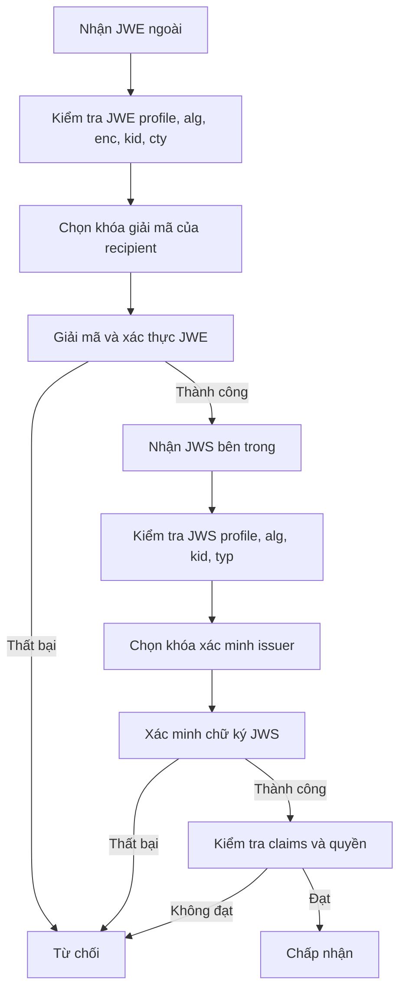
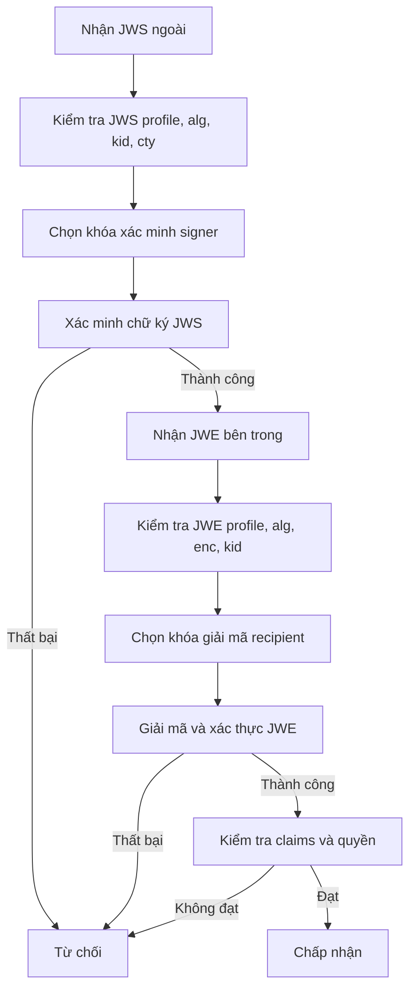

# Xác minh từng lớp bằng hợp đồng và khóa tương ứng

> **Chương:** JWT lồng nhau  
> **Phạm vi:** Security – JSON Web Token (JWT), thuộc module SECURITY_TOKEN_SECURITY_JWT. Nội dung áp dụng cho hệ thống dùng JWT/JOSE nói chung, độc lập với ngôn ngữ lập trình và framework.

## 1. Vì sao phải xác minh từng lớp riêng?

Nested JWT kết hợp nhiều cấu trúc JOSE, ví dụ JWS lồng trong JWE hoặc JWE lồng trong JWS. Mỗi lớp thực hiện một nhiệm vụ mật mã riêng và có header, thuật toán, khóa cùng điều kiện xác minh riêng.

**Xác minh một lớp thành công không đồng nghĩa toàn bộ Nested JWT hợp lệ.** Bên nhận phải kiểm tra mọi lớp theo đúng cấu trúc đã thỏa thuận, sử dụng đúng loại khóa và chính sách tương ứng với từng lớp.

Ví dụ:

- Với `JWE(JWS(claims))`, bên nhận phải giải mã và xác thực JWE ngoài, sau đó xác minh chữ ký JWS bên trong.
- Với `JWS(JWE(claims))`, bên nhận phải xác minh chữ ký JWS ngoài trước, sau đó giải mã và xác thực JWE bên trong.
- Với cấu trúc có nhiều lớp, tiếp tục theo thứ tự từ ngoài vào trong, đúng với hợp đồng của endpoint.

[RFC 8725 §3.3](https://www.rfc-editor.org/rfc/rfc8725.html#section-3.3) yêu cầu xác minh tất cả các thao tác mật mã được thực hiện trên JWT. Nếu bất kỳ thao tác nào thất bại, toàn bộ JWT phải bị từ chối.

## 2. Hợp đồng xác minh là gì?

**Hợp đồng xác minh (validation contract)** là tập quy tắc được các bên thống nhất và cấu hình trước để xác định một token được chấp nhận theo cấu trúc nào, thuật toán nào, khóa nào và điều kiện nào.

Hợp đồng cần xác định tối thiểu:

| Thành phần | Câu hỏi phải trả lời |
|---|---|
| **Cấu trúc lồng** | Endpoint nhận JWS đơn, JWE đơn, `JWE(JWS(...))`, `JWS(JWE(...))` hay một cấu trúc nhiều lớp cụ thể? |
| **Serialization** | JWT phải dùng JWS Compact Serialization hoặc JWE Compact Serialization theo định dạng JWT; từng lớp phải đúng dạng mà endpoint đã công bố. Nếu giao thức JOSE khác dùng JSON Serialization, không được tự xem nó là JWT Compact. |
| **Content type** | Lớp nào phải có `cty: "JWT"` vì payload/plaintext của nó là một JWT khác? |
| **Token type** | JWT trong cùng có `typ` nào? Có profile riêng cho từng loại token không? |
| **Thuật toán** | JWS cho phép những thuật toán ký/MAC nào? JWE cho phép thuật toán quản lý khóa (`alg`) và mã hóa nội dung (`enc`) nào? |
| **Khóa** | Ai sở hữu khóa ký, khóa xác minh, khóa mã hóa và khóa giải mã? Mỗi khóa được dùng cho mục đích nào? |
| **Danh tính** | Khóa ký tương ứng với issuer hoặc signer nào? Signer có được ủy quyền đại diện cho issuer không? |
| **Recipient** | Token được mã hóa cho bên nhận nào? `aud` có khớp với dịch vụ đang xử lý không? |
| **Claims** | Bắt buộc có claim nào? Kiểm tra `iss`, `sub`, `aud`, `exp`, `nbf`, `iat`, quyền và replay như thế nào? |
| **Giới hạn** | Kích thước tối đa, số lớp nesting, timeout và cách xử lý lỗi là gì? |

Hợp đồng là **chính sách phía nhận**, không phải nội dung do token tự quyết định. Token có thể khai báo `alg`, `enc`, `kid`, `cty` hoặc `typ`, nhưng các giá trị đó chỉ được chấp nhận khi phù hợp với chính sách đã cấu hình.

### 2.1. Ví dụ hợp đồng cho một API

Giả sử API hóa đơn chỉ nhận Nested JWT có cấu trúc:

`JWE(JWS(claims))`

Hợp đồng có thể quy định:

- Lớp ngoài phải là JWE Compact, dùng `alg = RSA-OAEP-256`, `enc = A256GCM` và `cty = JWT`.
- `kid` ở JWE ngoài chỉ được chọn khóa giải mã thuộc recipient của API.
- Lớp trong phải là JWS Compact, dùng `alg = ES256`.
- `kid` ở JWS trong chỉ được chọn khóa ký của issuer nằm trong trust store.
- Claims phải có issuer và audience được API chấp nhận, token còn hạn và scope cho phép đọc đúng hóa đơn.
- Từ chối JWS đơn lẻ, JWE đơn lẻ, cấu trúc lồng khác hoặc thuật toán ngoài allowlist.

Đây là ví dụ minh họa. Hệ thống thực tế phải lựa chọn thuật toán theo khả năng, chính sách mật mã và vòng đời khóa của mình.

## 3. Phân biệt loại khóa theo từng thao tác

Không có một khóa duy nhất đại diện cho mọi thao tác trong Nested JWT. Cần phân biệt khóa theo **vai trò và mục đích sử dụng**.

| Thao tác | Khóa phía tạo | Khóa phía nhận | Điều cần xác minh |
|---|---|---|---|
| JWS với chữ ký bất đối xứng | Khóa riêng ký của issuer/signer | Khóa công khai xác minh tương ứng | Khóa công khai phải được ràng buộc với signer tin cậy và thuật toán ký được phép. |
| JWS với MAC | Bí mật chia sẻ giữa các bên | Cùng bí mật chia sẻ | Xác thực bên nắm bí mật trong nhóm; không xác định duy nhất một bên tạo token. |
| JWE với mã hóa khóa công khai | Khóa công khai của recipient để mã hóa/bảo vệ CEK | Khóa riêng tương ứng của recipient | Khóa phải thuộc đúng recipient; giải mã thành công không chứng minh danh tính sender. |
| JWE với khóa đối xứng | Khóa bí mật theo cơ chế quản lý khóa | Khóa bí mật tương ứng | Khóa và quyền sử dụng phải giới hạn cho đúng bên/đúng mục đích. |

Một số điểm quan trọng:

- **Khóa ký và khóa giải mã có mục đích khác nhau.** Không dùng một khóa tùy tiện cho cả hai vai trò.
- **Khóa công khai xác minh chữ ký không phải khóa giải mã JWE.** Hai khóa có thể thuộc hai chủ thể khác nhau.
- **Khóa riêng ký** chứng minh quyền tạo chữ ký theo danh tính gắn với khóa; **khóa riêng giải mã** chỉ cho phép recipient đọc nội dung được mã hóa cho mình.
- Với MAC, nhiều bên cùng biết bí mật có thể tạo MAC hợp lệ. Không thể tuyên bố chữ ký MAC chứng minh duy nhất bên nào trong nhóm đã phát hành token.
- Mỗi khóa cần được gắn với thuật toán, loại thao tác, chủ thể sở hữu và thời gian hiệu lực cụ thể.

## 4. Ràng buộc khóa với signer, issuer và recipient

### 4.1. Khóa xác minh JWS phải gắn với signer tin cậy

Khi xác minh JWS, thành công về mặt toán học chỉ cho biết chữ ký khớp với khóa đã dùng. Để kết luận token đến từ issuer hoặc signer mong đợi, bên nhận cần một **quan hệ tin cậy khóa–danh tính** đã được thiết lập trước.

Ví dụ:

| Khóa trong trust store | Danh tính được gắn | Mục đích |
|---|---|---|
| `issuer-a-sign-2026` | `https://issuer-a.example.test` | Xác minh chữ ký ES256 của issuer A. |
| `issuer-b-sign-2026` | `https://issuer-b.example.test` | Xác minh chữ ký PS256 của issuer B. |
| `gateway-g-sign-2026` | `gateway-g` | Xác minh chữ ký của gateway G theo quyền được cấp. |

Bên nhận phải biết trước issuer hoặc signer nào được phép cho endpoint. `kid` chỉ là **gợi ý tra cứu khóa**, không phải bằng chứng danh tính. Không được lấy một khóa tùy ý chỉ vì token gửi lên có `kid` tương ứng.

Nếu claims `iss` chưa được xác minh, không được dùng nó làm căn cứ cuối cùng để tin khóa. Có thể dùng giá trị chưa xác minh để tìm một tập ứng viên trong danh sách issuer đã cho phép, nhưng sau khi xác minh chữ ký phải kiểm tra issuer trong claims khớp chính xác với danh tính được ràng buộc với khóa.

### 4.2. Khóa JWE phải gắn với recipient

JWE sử dụng cơ chế mã hóa khóa công khai thường được tạo bằng khóa công khai của recipient và giải mã bằng khóa riêng tương ứng.

Ví dụ:

- A muốn gửi nội dung riêng tư cho B.
- A lấy khóa công khai mã hóa của B từ nguồn tin cậy.
- A tạo JWE cho B.
- B dùng khóa riêng tương ứng để giải mã và xác thực nội dung.

Nếu B giải mã thành công, điều đó cho biết B có khóa phù hợp và dữ liệu vượt qua kiểm tra xác thực của JWE. Nó **không chứng minh A là người tạo JWE**. Bất kỳ ai có khóa công khai của B đều có thể tạo một JWE mới gửi cho B.

Vì vậy, nếu giao thức yêu cầu xác thực issuer, cần có JWS hoặc cơ chế xác thực nguồn gốc khác theo hợp đồng.

### 4.3. Signer trung gian không tự động là issuer

Giả sử A phát hành claims, E mã hóa chúng cho B, còn G ký chuỗi JWE trước khi chuyển tiếp.

Chữ ký của G xác thực rằng **G đã ký chính chuỗi JWE đó**. Nếu G chỉ chuyển tiếp hoặc ký dữ liệu mà không xác minh nguồn gốc, chữ ký của G không tự chứng minh claims bên trong được A phát hành.

Hợp đồng cần chỉ rõ:

- G có quyền ký với tư cách chính G hay được A ủy quyền đại diện?
- G có xác minh nguồn gốc claims trước khi ký không?
- B tin G là issuer của token hay chỉ là gateway xác nhận gói dữ liệu?
- Nếu B cần xác minh chữ ký gốc của A, chữ ký đó được giữ ở lớp nào hoặc được xác minh bằng cơ chế nào?

Không nhập nhằng danh tính của signer, issuer và recipient. Đây là các vai trò có thể thuộc về các tổ chức khác nhau.

## 5. Xác minh thuật toán ở từng lớp

JOSE Header chứa thông tin thuật toán, nhưng **token không được tự quyết định chính sách thuật toán của bên nhận**.

### 5.1. JWS: kiểm tra thuật toán ký/MAC

Đối với mỗi lớp JWS:

1. Đọc `alg` và `kid` như dữ liệu đầu vào chưa xác thực.
2. Kiểm tra `alg` có nằm trong allowlist của đúng profile không.
3. Chọn khóa từ trust store theo signer/issuer dự kiến, `kid`, thuật toán và mục đích.
4. Kiểm tra loại khóa và thuật toán có tương thích không.
5. Xác minh chữ ký/MAC trên đúng JWS Signing Input.
6. Chỉ sau khi xác minh thành công mới sử dụng payload làm dữ liệu đã được xác thực của lớp đó.

Nếu header có tham số `crit`, chỉ chấp nhận khi mọi tham số được liệt kê đều được triển khai và xử lý đúng theo profile; từ chối tham số critical không được hỗ trợ.

Không chấp nhận `alg = none` cho profile yêu cầu chữ ký. Không tự động chuyển từ chữ ký bất đối xứng sang MAC hoặc ngược lại. Không cho phép thuật toán yếu chỉ vì token khai báo thuật toán đó.

### 5.2. JWE: kiểm tra quản lý khóa và mã hóa nội dung

Mỗi lớp JWE có hai lựa chọn thuật toán quan trọng:

- **`alg`:** thuật toán quản lý hoặc trao đổi khóa dùng để thiết lập/bảo vệ Content Encryption Key (CEK).
- **`enc`:** thuật toán mã hóa nội dung, sử dụng CEK để mã hóa plaintext.

Bên nhận phải kiểm tra cả hai theo allowlist riêng của JWE. Sau đó chọn khóa phù hợp với recipient, kiểm tra tính tương thích của khóa với thuật toán, thực hiện giải mã và xác thực tính toàn vẹn (ví dụ authentication tag đối với chế độ AEAD).

**Giải mã không thành công hoặc xác thực tag thất bại phải làm toàn bộ lớp JWE thất bại.** Không sử dụng plaintext chưa xác thực.

### 5.3. Không dùng chung một allowlist cho mọi lớp

Một Nested JWT có thể chứa JWS và JWE, mỗi lớp có thuật toán và khóa khác nhau. Không nên có một cấu hình chung kiểu “mọi thuật toán được hỗ trợ đều được phép ở mọi nơi”.

Ví dụ hợp đồng:

| Lớp | Thuật toán được phép | Khóa hợp lệ |
|---|---|---|
| JWE ngoài | `alg = RSA-OAEP-256`, `enc = A256GCM` | Khóa giải mã thuộc recipient API. |
| JWS trong | `alg = ES256` | Khóa công khai xác minh thuộc issuer A. |
| JWS ngoài | `alg = PS256` | Khóa công khai xác minh thuộc gateway G. |
| JWE trong | `alg = RSA-OAEP-256`, `enc = A256GCM` | Khóa giải mã thuộc recipient cuối. |

Bảng trên chỉ là ví dụ. Mỗi endpoint phải có allowlist và ràng buộc khóa được cấu hình theo đúng giao thức.

## 6. Thứ tự xác minh theo hợp đồng lồng

Thứ tự xử lý được xác định bởi cấu trúc nesting. Hợp đồng phải mô tả trước cấu trúc được chấp nhận; không thử nhiều cách diễn giải cho đến khi có một cách chạy được.

### 6.1. JWE(JWS(claims)): giải mã lớp ngoài trước



Các khóa cần dùng:

1. **JWE ngoài:** khóa riêng giải mã của recipient.
2. **JWS trong:** khóa công khai xác minh của issuer/signer tin cậy.

`kid` của hai lớp có thể trùng chuỗi ký tự nhưng không có nghĩa chúng là cùng một khóa hoặc cùng một vai trò. Hợp đồng cần phân biệt ngữ cảnh lớp, loại thao tác và chủ thể sở hữu.

### 6.2. JWS(JWE(claims)): xác minh lớp ngoài trước



Các khóa cần dùng:

1. **JWS ngoài:** khóa công khai xác minh của signer.
2. **JWE trong:** khóa riêng giải mã của recipient.

Trong cấu trúc này, bên trung gian có khóa xác minh có thể xác minh JWS ngoài mà không cần giải mã JWE. Tuy nhiên, nếu signer là gateway khác issuer, recipient vẫn phải kiểm tra quan hệ ủy quyền hoặc nguồn gốc claims theo hợp đồng.

### 6.3. Nested JWT nhiều hơn hai lớp

Với cấu trúc ví dụ:

`JWE(JWS(JWE(claims)))`

bên nhận xử lý:

1. Xác thực và giải mã JWE ngoài.
2. Xác minh JWS ở giữa.
3. Xác thực và giải mã JWE trong.
4. Kiểm tra Claims Set cuối cùng.

Mỗi lớp có một hợp đồng riêng: loại JOSE, thuật toán, khóa, chủ thể tin cậy và điều kiện chấp nhận. Không dùng chung khóa chỉ vì các lớp nằm trong cùng một token.

## 7. Phân tách khóa và quản lý vòng đời

### 7.1. Phân tách mục đích khóa

Nên phân tách khóa theo:

- **Mục đích:** ký, xác minh, quản lý khóa JWE, giải mã JWE.
- **Chủ thể:** issuer, signer trung gian, recipient.
- **Môi trường:** production, staging, test.
- **Phạm vi:** tenant, tổ chức hoặc dịch vụ nếu mô hình tin cậy yêu cầu.

Không dùng lại cùng một cặp khóa cho ký và giải mã chỉ để giảm số lượng khóa. Tách mục đích giúp giới hạn tác động khi khóa bị lộ và giảm nhầm lẫn giữa các giao thức.

### 7.2. Xoay vòng khóa

Một hợp đồng vận hành cần xác định:

1. Ai có quyền phát hành khóa mới và phân phối khóa công khai.
2. Thời điểm bắt đầu ký bằng khóa mới.
3. Khoảng thời gian recipient chấp nhận đồng thời khóa cũ và khóa mới.
4. Thời hạn ngừng chấp nhận khóa cũ.
5. Cách xử lý token còn hiệu lực khi khóa bị thu hồi hoặc bị lộ.
6. Cách quản lý `kid` duy nhất trong phạm vi kho khóa tương ứng.

Khi xoay vòng:

- Issuer có thể ký token mới bằng khóa mới và giữ khóa công khai cũ trong thời gian token cũ còn được phép sử dụng.
- Recipient có thể cần giữ khóa giải mã cũ để xử lý JWE đã phát hành trước đó trong thời hạn được phép.
- Khi khóa bị xâm phạm, cần thu hồi theo chính sách và đánh giá token được ký/mã hóa trong khoảng thời gian ảnh hưởng.
- Không giữ khóa cũ vô thời hạn chỉ để token lịch sử luôn giải mã được.

### 7.3. kid chỉ là định danh tra cứu

`kid` giúp chọn một khóa trong kho khóa đã được tin cậy. Nó không phải bằng chứng về nguồn gốc khóa.

Quy tắc an toàn:

- Phân giải `kid` trong kho khóa hoặc cấu hình tin cậy của đúng issuer/recipient.
- Ràng buộc khóa với thuật toán và mục đích đã khai báo.
- Không tự tải JWK từ URL do token cung cấp nếu chưa có chính sách nguồn khóa tin cậy.
- Không chấp nhận khóa không rõ chủ sở hữu, không rõ thuật toán hoặc đã hết hiệu lực.
- Nếu có nhiều khóa cùng `kid` trong một phạm vi, phải từ chối hoặc xử lý theo quy tắc xác định rõ; không chọn tùy tiện.

## 8. Kiểm tra claims sau khi xác minh mật mã

Sau khi tất cả lớp mật mã đạt yêu cầu, bên nhận mới kiểm tra Claims Set cuối cùng.

| Claim/điều kiện | Kiểm tra |
|---|---|
| `iss` | Issuer có được tin cậy và có khớp với danh tính gắn với khóa ký hoặc quan hệ ủy quyền đã cấu hình không? |
| `sub` | Chủ thể có hợp lệ và thuộc phạm vi issuer không? |
| `aud` | Token có dành cho API/recipient hiện tại không? |
| `exp` | Token chưa hết hạn. |
| `nbf` | Token đã đến thời điểm được phép sử dụng. |
| `iat` | Thời điểm phát hành hợp lệ và phù hợp với giới hạn tuổi token. |
| `jti` | Nếu có yêu cầu chống phát lại, kiểm tra định danh và trạng thái sử dụng. |
| `scope` hoặc quyền tùy chỉnh | Chủ thể có quyền thực hiện hành động trên tài nguyên đang yêu cầu không? |
| `typ` | Kiểm tra giá trị trong JOSE Header của JWT trong cùng sau khi lớp đó đã được xác thực; `typ` là header parameter, không phải claim. |

Một token có chữ ký hợp lệ nhưng sai audience, hết hạn hoặc thiếu quyền vẫn phải bị từ chối. **Xác thực mật mã và ủy quyền là hai bước khác nhau.**

## 9. Các lỗi thường gặp

| Lỗi | Hậu quả | Cách xử lý |
|---|---|---|
| Chỉ xác minh lớp ngoài và bỏ qua lớp trong. | Một thao tác mật mã bắt buộc chưa được xác minh. | Xác minh tất cả lớp theo cấu trúc hợp đồng. |
| Dùng cùng một khóa cho ký và giải mã. | Nhầm mục đích, mở rộng phạm vi ảnh hưởng khi lộ khóa. | Phân tách khóa theo vai trò và thuật toán. |
| Tin `kid` như bằng chứng danh tính. | Có thể chọn nhầm khóa hoặc khóa do attacker kiểm soát. | Tra `kid` trong trust store đúng ngữ cảnh. |
| Dùng `iss` chưa xác minh để tin khóa. | Kẻ gửi có thể tự khai báo issuer và dẫn bên nhận đến khóa sai. | Chỉ tra trong tập issuer được phép, xác minh chữ ký rồi ràng buộc lại `iss`. |
| Chấp nhận thuật toán theo header mà không có allowlist. | Algorithm confusion hoặc downgrade. | Cấu hình allowlist độc lập cho từng lớp. |
| Nhầm khóa mã hóa của recipient với khóa ký của issuer. | Xác thực sai danh tính hoặc không thể giải mã đúng. | Phân biệt vai trò issuer/signer/recipient. |
| Coi JWE giải mã thành công là bằng chứng issuer. | Người có khóa công khai recipient có thể tạo JWE của riêng họ. | Yêu cầu JWS hoặc cơ chế xác thực nguồn gốc theo hợp đồng. |
| Bỏ qua authentication tag JWE. | Có thể sử dụng plaintext chưa được xác thực. | Chỉ sử dụng plaintext khi xác thực JWE hoàn tất. |
| Cho phép fallback sang cấu trúc JWT khác khi một lớp lỗi. | Kẻ tấn công có thể lợi dụng downgrade. | Từ chối ngay khi không khớp cấu trúc hợp đồng. |
| Chấp nhận khóa cũ không giới hạn. | Token giả mạo có thể được xác minh lâu dài nếu khóa cũ đã lộ. | Có lịch xoay vòng, thu hồi và thời hạn chấp nhận. |
| Không giới hạn số lớp hoặc kích thước token. | Có thể bị lạm dụng CPU/bộ nhớ. | Giới hạn nesting, kích thước, timeout và số lần tra khóa. |
| Coi chữ ký MAC là danh tính duy nhất. | Bất kỳ bên giữ shared secret đều có thể tạo MAC. | Dùng chữ ký bất đối xứng nếu cần xác định signer riêng biệt. |

## 10. Checklist kiểm thử theo từng lớp

| Ca kiểm thử | Kết quả mong đợi |
|---|---|
| Tất cả lớp đúng cấu trúc, thuật toán, khóa và claims. | Chấp nhận theo quyền được cấp. |
| JWE ngoài hợp lệ nhưng JWS trong có chữ ký sai. | Từ chối ở lớp JWS trong. |
| JWS ngoài hợp lệ nhưng JWE trong sai authentication tag. | Từ chối ở lớp JWE trong. |
| Một lớp dùng thuật toán ngoài allowlist. | Từ chối tại lớp đó. |
| `kid` không tồn tại trong trust store đúng vai trò. | Từ chối, không tải khóa tùy ý. |
| Khóa xác minh hợp lệ nhưng thuộc issuer khác với issuer được kỳ vọng. | Từ chối. |
| Khóa hợp lệ nhưng được cấu hình cho mục đích khác (ví dụ key dùng giải mã bị đưa vào xác minh chữ ký). | Từ chối. |
| Signer trung gian hợp lệ nhưng không được ủy quyền đại diện issuer. | Không chấp nhận claims với danh tính issuer đó. |
| Khóa đã hết hiệu lực hoặc bị thu hồi. | Từ chối theo chính sách vòng đời khóa. |
| Token đúng mật mã nhưng sai audience hoặc hết hạn. | Từ chối ở bước claims. |
| Một lớp lồng bị thiếu `cty: JWT` theo hợp đồng. | Từ chối do sai cấu trúc. |
| Token lồng quá độ sâu cho phép. | Từ chối trước khi tiêu hao thêm tài nguyên. |
| JWS/JWE đơn lẻ được gửi vào endpoint yêu cầu cấu trúc lồng cụ thể. | Từ chối; không fallback. |

## 11. Mã giả tổng quát: xác minh theo hợp đồng

Mã giả sau minh họa việc duyệt cấu trúc đã được cấu hình. Nó không tự phát hiện cấu trúc bất kỳ rồi thử mọi cách.

```text
function validate_nested_token(token, contract):
    require(token.size <= contract.max_token_size)

    current = token

    innermost_authenticated_header = null

    for layer in contract.layers_from_outer_to_inner:
        require(layer.depth <= contract.max_nesting_depth)

        header = parse_header_for_expected_serialization(current, layer.serialization)
        require_header_matches_layer_contract(header, layer)

        if layer.kind == "JWS":
            key = resolve_trusted_signing_key(
                expected_signer = layer.expected_signer,
                kid = header.kid,
                algorithm = layer.allowed_alg
            )
            current = verify_jws_and_get_payload(current, key)

        else if layer.kind == "JWE":
            key = resolve_recipient_decryption_key(
                expected_recipient = layer.expected_recipient,
                kid = header.kid,
                key_management_alg = layer.allowed_alg,
                content_encryption_alg = layer.allowed_enc
            )
            current = decrypt_and_authenticate_jwe(current, key)

        else:
            reject("Unsupported layer in contract")

        innermost_authenticated_header = header
        if layer.next_layer exists:
            require_equal(header.cty, "JWT")
        else:
            require_no_unexpected_nested_content_type(header.cty, layer)

    claims = parse_final_claims_set(current)
    require_trusted_issuer_and_signer_relationship(claims, contract)
    require_expected_audience(claims.aud, contract.expected_audience)
    require_valid_time_window(claims, contract.clock_skew)
    require_expected_token_type(innermost_authenticated_header.typ, contract.expected_typ)
    require_authorized_operation(claims, contract.request)

    return claims
```

Trong triển khai thực tế, `contract.layers_from_outer_to_inner` là cấu hình tin cậy của endpoint. Với lớp cuối cùng có Claims Set JSON, không yêu cầu thêm một JWT bên trong; quy tắc `cty` phải phản ánh chính xác việc lớp tiếp theo có tồn tại hay không. Các hàm trong mã giả đại diện cho thao tác cần thực hiện, không phải API của một thư viện cụ thể.

## 12. Câu hỏi tự kiểm tra

1. Vì sao xác minh một lớp thành công không đủ để chấp nhận Nested JWT?
2. Một validation contract cần quy định những thành phần nào?
3. `kid` có chứng minh khóa thuộc issuer được khai báo trong `iss` không?
4. Vì sao khóa ký và khóa giải mã phải được phân biệt theo mục đích?
5. Trong `JWE(JWS(claims))`, lớp nào dùng khóa riêng recipient và lớp nào dùng khóa công khai issuer?
6. Trong `JWS(JWE(claims))`, vì sao chữ ký ngoài không thay thế việc giải mã và xác thực JWE?
7. Nếu signer là gateway khác issuer, cần thêm điều kiện tin cậy nào?
8. Vì sao không nên tự tải khóa từ URL tùy ý do JOSE Header chỉ định?
9. Khi xoay vòng khóa, recipient cần xử lý token cũ và khóa bị thu hồi thế nào?
10. Vì sao phải kiểm tra audience, thời hạn và quyền sau khi các lớp mật mã đã hợp lệ?

## 13. Tài liệu tham khảo

- [RFC 7515 – JSON Web Signature (JWS)](https://www.rfc-editor.org/rfc/rfc7515.html): cấu trúc JWS, JOSE Header, xác minh chữ ký và tham số `kid`.
- [RFC 7516 – JSON Web Encryption (JWE)](https://www.rfc-editor.org/rfc/rfc7516.html): cấu trúc JWE, thuật toán quản lý khóa, mã hóa nội dung và xác thực thông điệp.
- [RFC 7517 – JSON Web Key (JWK)](https://www.rfc-editor.org/rfc/rfc7517.html): biểu diễn khóa, `kid`, `use`, `key_ops` và JWK Set.
- [RFC 7519 – JSON Web Token (JWT)](https://www.rfc-editor.org/rfc/rfc7519.html): Nested JWT, `cty`, quy trình tạo và xác minh các lớp lồng.
- [RFC 7518 – JSON Web Algorithms (JWA)](https://www.rfc-editor.org/rfc/rfc7518.html): thuật toán chữ ký, quản lý khóa và mã hóa nội dung.
- [RFC 8725 – JSON Web Token Best Current Practices](https://www.rfc-editor.org/rfc/rfc8725.html): kiểm tra tất cả thao tác mật mã (§3.3), kiểm tra issuer/audience, thuật toán, loại token và tránh nhầm lẫn giữa các JWT.
