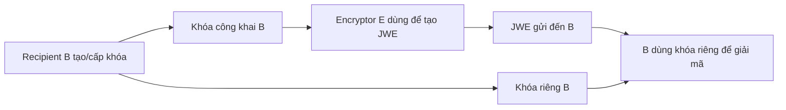
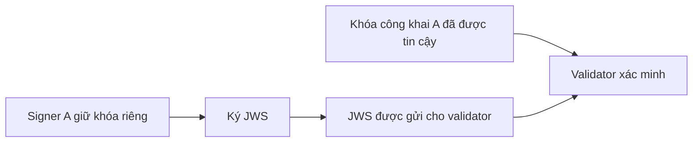
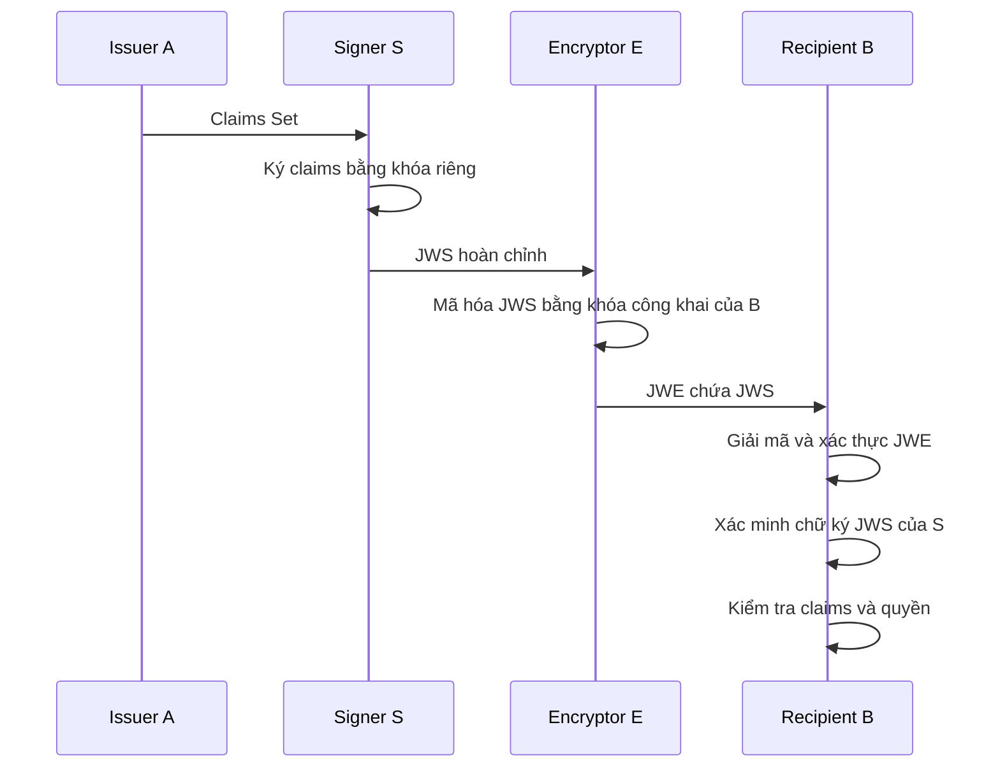
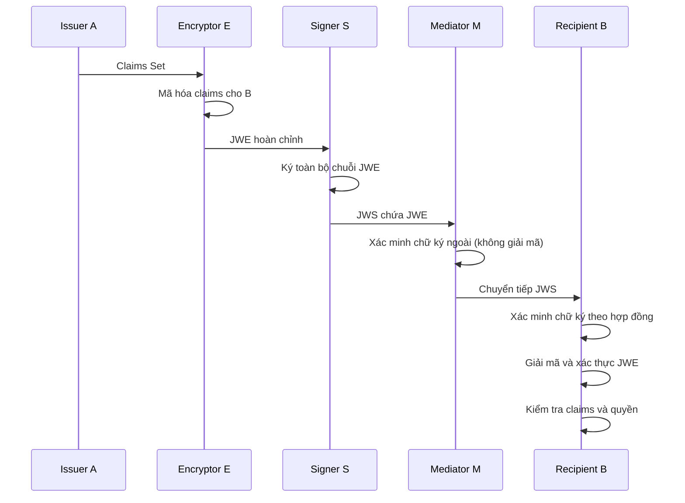

# Phân biệt bên ký, bên mã hóa và bên nhận

> **Chương:** JWT lồng nhau  
> **Phạm vi:** Security – JSON Web Token (JWT), thuộc module SECURITY_TOKEN_SECURITY_JWT. Nội dung áp dụng cho hệ thống sử dụng JWT/JOSE nói chung, không phụ thuộc ngôn ngữ lập trình hoặc framework.

## 1. Vì sao phải tách biệt các vai trò?

Trong Nested JWT, nhiều bên có thể tham gia tạo, bảo vệ, chuyển tiếp và xử lý token. Một bên có thể đồng thời giữ nhiều vai trò, nhưng **mỗi vai trò trả lời một câu hỏi bảo mật khác nhau**:

- **Issuer (bên phát hành claims):** Ai đưa ra các khẳng định trong Claims Set, ví dụ danh tính, audience hoặc quyền?
- **Signer (bên ký):** Ai đã tạo chữ ký hoặc MAC bảo vệ một JWS cụ thể?
- **Encryptor (bên mã hóa):** Ai thực hiện thao tác tạo JWE và bảo vệ nội dung cho recipient?
- **Recipient (bên nhận dự kiến):** Nội dung được mã hóa dành cho ai?
- **Decryptor (bên giải mã):** Ai thực sự nắm hoặc được phép sử dụng khóa để giải mã?
- **Validator (bên xác minh):** Ai kiểm tra các lớp mật mã, danh tính và claims?
- **Forwarder (bên chuyển tiếp):** Ai vận chuyển token giữa các hệ thống mà không nhất thiết đọc được nội dung?

Các vai trò có thể trùng nhau. Ví dụ, một identity provider có thể vừa là issuer vừa là signer; API có thể vừa là recipient vừa là validator. Một gateway có thể là signer của lớp ngoài nhưng không phải issuer của claims. Một dịch vụ mã hóa trung gian có thể tạo JWE cho API mà không phải là bên phát hành claims.

Nếu gộp tất cả thành khái niệm “bên gửi” hoặc “bên tạo token”, hệ thống dễ suy luận sai rằng giải mã thành công chứng minh danh tính người gửi, hoặc chữ ký của gateway chứng minh issuer gốc đã phát hành claims.

**Nguyên tắc:** Luôn xác định vai trò theo từng thao tác mật mã và từng lớp JOSE, sau đó mới xác định mối quan hệ tin cậy giữa các vai trò đó.

## 2. Định nghĩa và trách nhiệm của từng vai trò

### 2.1. Issuer — bên phát hành claims

Issuer là chủ thể chịu trách nhiệm về ý nghĩa và tính đúng đắn của các claims mà nó phát hành.

Ví dụ, issuer A tạo Claims Set:

```json
{
  "iss": "https://identity.example.test",
  "sub": "user-123",
  "aud": "billing-api",
  "iat": 1800000000,
  "exp": 1800000300,
  "scope": "invoice:read"
}
```

Trong ví dụ:

- `iss` định danh issuer theo profile đã thỏa thuận.
- `sub` xác định chủ thể mà token nói đến.
- `aud` chỉ ra bên nhận dự kiến.
- `scope` mô tả quyền được yêu cầu xem xét.

Issuer chịu trách nhiệm bảo đảm các claims phản ánh đúng quyết định và ngữ cảnh mà issuer có quyền khẳng định. Việc có chuỗi `iss` trong payload không tự chứng minh ai đã phát hành token; bên nhận cần xác thực bằng chữ ký hoặc một cơ chế tin cậy khác.

Issuer không nhất thiết là bên trực tiếp mã hóa JWE hoặc bên giữ khóa giải mã. Trong hệ thống nhiều dịch vụ, issuer có thể giao token cho một dịch vụ mã hóa hoặc gateway xử lý tiếp.

### 2.2. Signer — bên ký JWS

Signer là chủ thể thực hiện thao tác ký số hoặc tạo MAC trên JWS Signing Input.

Với chữ ký bất đối xứng:

- Signer dùng **khóa riêng ký**.
- Validator dùng **khóa công khai xác minh** tương ứng.
- Nếu khóa được bảo vệ và ràng buộc đúng với một danh tính tin cậy, chữ ký hợp lệ là bằng chứng rằng thông điệp được ký bởi bên nắm khóa riêng tương ứng (hoặc bởi hệ thống được phép sử dụng khóa đó).

Với MAC:

- Signer và validator cùng sở hữu một bí mật.
- Mọi bên có bí mật đều có thể tạo MAC hợp lệ.
- MAC xác thực dữ liệu trong nhóm chia sẻ khóa nhưng không xác định duy nhất thành viên nào đã tạo nó.

Signer có thể là issuer, gateway, broker hoặc dịch vụ khác được ủy quyền. Vì vậy, cần trả lời hai câu hỏi riêng:

1. Chữ ký này thuộc về khóa của signer nào?
2. Signer đó có quyền phát hành claims hoặc đại diện cho issuer trong ngữ cảnh này không?

Chữ ký hợp lệ chỉ trả lời câu hỏi thứ nhất khi quan hệ khóa–danh tính đã được xác lập. Câu hỏi thứ hai cần chính sách tin cậy/ủy quyền.

### 2.3. Encryptor — bên mã hóa JWE

Encryptor là chủ thể thực hiện thao tác tạo JWE: chọn phương thức quản lý khóa, thiết lập hoặc tạo CEK, mã hóa plaintext và tạo các thành phần JWE.

Trong ví dụ dùng mã hóa khóa công khai:

- Encryptor lấy **khóa công khai của recipient** từ nguồn tin cậy.
- Encryptor tạo hoặc thiết lập CEK theo thuật toán JWE.
- Encryptor mã hóa plaintext bằng thuật toán `enc`.
- Encryptor tạo encrypted key hoặc dữ liệu cần thiết theo thuật toán `alg`.

Encryptor biết plaintext trước khi mã hóa, hoặc được giao dữ liệu để mã hóa. Sau khi tạo JWE, encryptor không nhất thiết là bên có thể giải mã về sau.

Điểm quan trọng: **khóa công khai của recipient thường không bí mật**. Bất kỳ ai có khóa công khai đó và biết thuật toán phù hợp đều có thể tạo một JWE gửi cho recipient. Vì vậy, việc recipient giải mã được JWE không tự chứng minh encryptor là issuer hoặc signer được tin cậy.

### 2.4. Recipient — bên nhận dự kiến

Recipient là bên mà nội dung JWE được mã hóa dành cho.

Trong cơ chế mã hóa khóa công khai thông thường:

- Recipient sở hữu khóa riêng.
- Bên mã hóa dùng khóa công khai tương ứng.
- Recipient dùng khóa riêng để phục hồi CEK hoặc thiết lập CEK rồi giải mã nội dung.

Recipient được xác định bởi cấu hình khóa và hợp đồng giao tiếp. Một claim `aud` có thể ràng buộc token với một dịch vụ hoặc đối tượng nhận theo ngữ nghĩa ứng dụng, nhưng bản thân `aud` không phải cơ chế mã hóa.

Recipient không nhất thiết là signer hoặc issuer. Recipient có thể giải mã token do một bên khác tạo, sau đó xác minh chữ ký của issuer bằng khóa công khai được phân phối riêng.

### 2.5. Decryptor — bên thực hiện giải mã

Decryptor là thành phần thực tế sử dụng khóa giải mã hoặc dịch vụ khóa để phục hồi plaintext.

Trong mô hình đơn giản, decryptor chính là recipient. Trong hệ thống lớn, recipient có thể ủy quyền thao tác giải mã cho một HSM, KMS hoặc dịch vụ bảo mật chuyên trách.

Khi việc giải mã được ủy quyền:

- Phải xác định rõ thành phần nào được phép gửi yêu cầu giải mã.
- Phải giới hạn key usage và quyền truy cập.
- Cần quy định plaintext được trả về cho ai, tồn tại ở đâu và được xóa/log như thế nào.
- Việc decryptor có thể giải mã không đồng nghĩa nó được quyền sử dụng claims để ra quyết định nghiệp vụ.

### 2.6. Validator — bên xác minh token

Validator là thành phần kiểm tra Nested JWT theo hợp đồng đã cấu hình.

Validator có thể thực hiện một hoặc nhiều thao tác:

- Xác minh chữ ký JWS bằng khóa công khai tin cậy.
- Xác thực và giải mã JWE bằng khóa giải mã được phép.
- Kiểm tra cấu trúc lồng, `cty`, `typ`, thuật toán và `kid`.
- Kiểm tra quan hệ signer–issuer–recipient.
- Kiểm tra `iss`, `aud`, thời hạn, scope, tài nguyên và chính sách chống phát lại.

Validator có thể trùng với recipient, nhưng cũng có thể là một gateway kiểm tra chữ ký ngoài trước khi chuyển tiếp token. Nếu validator không giải mã JWE, nó không thể kiểm tra claims đang nằm trong ciphertext.

## 3. Phân biệt vai trò với khóa tương ứng

| Vai trò/thao tác | Khóa hoặc dữ liệu liên quan | Ý nghĩa |
|---|---|---|
| Issuer | Claims Set và danh tính issuer; có thể có khóa ký riêng | Chịu trách nhiệm về nội dung claims. Nếu tự ký, issuer cũng là signer. |
| Signer JWS bất đối xứng | Khóa riêng ký | Tạo chữ ký trên JWS Signing Input. |
| Validator JWS | Khóa công khai xác minh | Kiểm tra chữ ký và ràng buộc khóa với signer được tin cậy. |
| Signer/validator dùng MAC | Bí mật chia sẻ | Mọi thành viên có bí mật có thể tạo MAC hợp lệ. |
| Encryptor JWE | Khóa công khai recipient, CEK hoặc khóa/secret theo chế độ `alg` | Tạo ciphertext và các thành phần JWE. |
| Recipient/decryptor | Khóa riêng hoặc bí mật phù hợp với chế độ quản lý khóa | Phục hồi CEK/plaintext và xác thực nội dung JWE. |
| Forwarder | Chuỗi token; có thể có khóa xác minh nếu cần | Chuyển tiếp hoặc xác minh lớp mà nó được phép xử lý. |

### 3.1. Hướng sử dụng khóa trong mã hóa khóa công khai



Khóa công khai có thể được phân phối cho nhiều bên. Vì vậy, nó cho phép nhiều encryptor tạo JWE cho B. Khóa riêng được giữ bởi B hoặc thành phần giải mã được ủy quyền.

### 3.2. Hướng sử dụng khóa trong chữ ký bất đối xứng



Khác với mã hóa khóa công khai, signer cần giữ bí mật khóa riêng. Validator có thể công khai khóa xác minh mà không cho phép người khác tạo chữ ký tương ứng.

### 3.3. Hai chiều khóa không thể đánh đồng

| Câu hỏi | Chữ ký JWS | Mã hóa JWE |
|---|---|---|
| Ai dùng khóa riêng trong mô hình bất đối xứng? | Signer dùng khóa riêng để ký. | Recipient dùng khóa riêng để giải mã/thiết lập CEK. |
| Ai có thể giữ khóa công khai? | Validator có thể giữ khóa công khai để xác minh. | Encryptor có thể giữ khóa công khai recipient để mã hóa. |
| Mục tiêu chính | Xác thực nguồn ký và tính toàn vẹn thông điệp theo quan hệ khóa tin cậy. | Giữ bí mật nội dung đối với bên không có khóa giải mã. |
| Có chứng minh danh tính encryptor không? | Không áp dụng. | Không, chỉ riêng JWE với mã hóa khóa công khai không xác thực danh tính sender. |
| Có thể kiểm tra mà không cần khóa bí mật không? | Có thể xác minh chữ ký bất đối xứng bằng khóa công khai. | Không thể lấy plaintext nếu không có khả năng giải mã phù hợp. |

## 4. Các vai trò kết hợp như thế nào trong Nested JWT?

Hai cấu trúc phổ biến làm thay đổi vị trí của signer và encryptor.

### 4.1. Ký rồi mã hóa — JWE(JWS(claims))

Thứ tự tạo:

1. Issuer A tạo claims.
2. Signer S ký claims thành JWS.
3. Encryptor E mã hóa toàn bộ JWS thành JWE cho recipient B.
4. B nhận JWE, giải mã, rồi xác minh JWS.



Trong cấu trúc này:

- **Signer S** ký lớp trong; chữ ký của S bảo vệ claims.
- **Encryptor E** tạo lớp JWE ngoài; E bảo vệ tính bí mật của JWS đối với các bên không có khóa giải mã.
- **Recipient B** giải mã lớp ngoài.
- **Validator** xác minh chữ ký JWS bên trong và kiểm tra claims.

Nếu S là issuer A, chữ ký có thể xác thực nguồn phát hành claims theo quan hệ khóa–issuer. Nếu S khác A, cần cơ chế ủy quyền hoặc một chữ ký nguồn gốc khác theo hợp đồng.

E có thể trùng với S hoặc A. Nếu E là dịch vụ trung gian, E thường thấy JWS plaintext trước khi mã hóa; việc E mã hóa không tự làm E trở thành signer.

### 4.2. Mã hóa rồi ký — JWS(JWE(claims))

Thứ tự tạo:

1. Issuer A tạo claims.
2. Encryptor E mã hóa claims thành JWE cho recipient B.
3. Signer S ký toàn bộ chuỗi JWE thành JWS.
4. B hoặc một trung gian xác minh chữ ký JWS ngoài; B tiếp tục giải mã JWE.



Trong cấu trúc này:

- **Encryptor E** tạo JWE; E biết plaintext claims trong quá trình mã hóa.
- **Signer S** ký đối tượng JWE; chữ ký ngoài xác thực chính chuỗi JWE.
- **Mediator M** có thể xác minh chữ ký mà không cần khóa giải mã.
- **Recipient B** xác minh chữ ký theo hợp đồng, giải mã JWE và kiểm tra claims.

Nếu S khác A, chữ ký S không tự chứng minh A phát hành claims. Nó chỉ chứng minh S ký đúng ciphertext đó, trừ khi hợp đồng quy định S là bên có thẩm quyền xác nhận hoặc đại diện cho A.

### 4.3. Bảng đối chiếu vai trò theo cấu trúc

| Vai trò | JWE(JWS(claims)) | JWS(JWE(claims)) |
|---|---|---|
| Issuer | Tạo Claims Set; có thể cũng là signer. | Tạo Claims Set; có thể cũng là encryptor hoặc signer. |
| Signer | Ký JWS bên trong. | Ký JWS bên ngoài, tức toàn bộ JWE. |
| Encryptor | Mã hóa JWS thành JWE bên ngoài. | Mã hóa claims thành JWE bên trong. |
| Recipient | Giải mã JWE, sau đó xác minh JWS theo hợp đồng. | Xác minh JWS, sau đó giải mã JWE. |
| Mediator | Không thể xem JWS bên trong nếu không giải mã JWE. | Có thể xác minh JWS ngoài mà không cần giải mã JWE. |

## 5. Ai có thể đọc, tạo, xác minh và giải mã?

Các khả năng phụ thuộc vào khóa và vị trí lớp, không chỉ phụ thuộc tên vai trò.

| Hành động | Điều kiện | Điều không thể suy ra |
|---|---|---|
| Đọc claims plaintext | Có plaintext từ issuer/encryptor hoặc có khả năng giải mã JWE tương ứng. | Đọc được claims không có nghĩa được quyền sử dụng claims. |
| Tạo JWS bất đối xứng | Có khóa riêng ký hợp lệ. | Có khóa ký không tự cấp quyền phát hành mọi loại claims. |
| Xác minh JWS bất đối xứng | Có khóa công khai tương ứng và quan hệ tin cậy với signer. | Chữ ký đúng không chứng minh signer là issuer nếu hai vai trò khác nhau. |
| Tạo JWE cho recipient dùng khóa công khai | Có khóa công khai của recipient và hỗ trợ thuật toán tương ứng. | Tạo JWE không chứng minh danh tính sender. |
| Giải mã JWE | Có khóa riêng hoặc bí mật phù hợp với thuật toán quản lý khóa. | Giải mã thành công không xác thực issuer. |
| Xác minh JWS ngoài của JWS(JWE) | Có khóa xác minh của signer ngoài. | Không đọc được claims nếu không giải mã JWE trong. |
| Xác minh JWS trong của JWE(JWS) | Phải lấy được JWS sau khi giải mã JWE ngoài và có khóa xác minh signer. | Không thể xác minh lớp trong trước khi phục hồi JWS. |
| Ra quyết định authorization | Có token đã xác minh và ngữ cảnh yêu cầu; áp dụng chính sách quyền. | Không phải mọi recipient hoặc decryptor đều được phép cấp quyền nghiệp vụ. |

### 5.1. JWE không xác thực danh tính encryptor

Đây là điểm thường bị hiểu sai.

Giả sử B công khai khóa mã hóa cho các đối tác. A có thể tạo JWE gửi B, nhưng một bên C khác cũng có thể tạo JWE gửi B bằng cùng khóa công khai.

Khi B giải mã thành công và authentication tag hợp lệ, B biết ciphertext khớp với CEK được dùng trong quá trình tạo JWE. Điều này **không xác định duy nhất ai đã tạo JWE**. Với các chế độ mã hóa khóa công khai, sender có thể tự tạo CEK và bảo vệ CEK cho B.

Nếu cần xác thực sender, cần một chữ ký JWS hoặc một cơ chế xác thực nguồn gốc được quy định riêng. Không được suy ra danh tính encryptor từ `kid` của JWE hoặc từ việc tag hợp lệ.

### 5.2. JWS với MAC không xác định duy nhất signer

Tương tự, nếu JWS sử dụng MAC với một shared secret, mọi bên biết bí mật đều có thể tạo MAC hợp lệ.

Nếu hệ thống cần bằng chứng riêng biệt về bên ký, chữ ký bất đối xứng thường phù hợp hơn: signer giữ khóa riêng, validator dùng khóa công khai được gắn với danh tính signer.

## 6. Những tổ hợp vai trò thường gặp

| Tổ hợp | Mô tả | Điều cần lưu ý |
|---|---|---|
| Issuer = Signer = Encryptor | Một tổ chức phát hành claims, ký JWS và mã hóa thành JWE. | Bên nhận vẫn phải xác minh chữ ký, giải mã và kiểm tra audience/claims. |
| Issuer = Signer, Encryptor khác | Issuer ký claims; dịch vụ trung gian mã hóa JWS cho recipient. | Dịch vụ mã hóa không tự trở thành issuer hoặc signer. |
| Issuer = Encryptor, Signer khác | Issuer tạo JWE; gateway ký ciphertext. | Chữ ký gateway xác thực gateway; cần quy định quyền đại diện hoặc nguồn gốc issuer. |
| Signer = Recipient | Một bên nhận đồng thời ký một lớp phản hồi hoặc xác nhận. | Vai trò thay đổi theo từng thông điệp; không suy ra vai trò trong token khác. |
| Recipient = Validator = Decryptor | API nhận, xác minh và giải mã token. | Đây là mô hình thường gặp; cần phân quyền riêng giữa xử lý khóa và authorization. |
| Recipient khác Decryptor | Recipient ủy quyền giải mã cho HSM/KMS hoặc dịch vụ bảo mật. | Cần kiểm soát truy cập, ranh giới plaintext và quyền sử dụng khóa. |
| Forwarder chỉ chuyển tiếp | Proxy chuyển token nguyên vẹn mà không xác minh hoặc giải mã. | Không nên tuyên bố proxy đã xác thực nội dung hoặc issuer. |
| Mediator xác minh chữ ký ngoài | Gateway xác minh JWS(JWE) rồi chuyển tiếp JWE. | Gateway biết signer của ciphertext nhưng không biết claims plaintext nếu không giải mã. |

Các tổ hợp này không loại trừ nhau. Một hệ thống có thể có nhiều vai trò trong một tổ chức hoặc phân chia qua nhiều dịch vụ. Điều quan trọng là tài liệu hóa **vai trò của từng chủ thể đối với từng lớp token**.

## 7. Ràng buộc vai trò bằng hợp đồng và chính sách khóa

Trước khi triển khai, cần định nghĩa một bảng vai trò và khóa rõ ràng.

| Trường chính sách | Ví dụ |
|---|---|
| Issuer được phép | `https://identity.example.test` |
| Signer JWS trong | Issuer A; khóa `issuer-a-sign-2026`; ES256 |
| Encryptor JWE ngoài | Dịch vụ E; sử dụng khóa công khai của B; RSA-OAEP-256/A256GCM |
| Recipient JWE ngoài | `billing-api`; khóa giải mã `billing-api-enc-2026` |
| Validator | Billing API; xác minh JWS sau khi giải mã JWE |
| Audience được chấp nhận | `billing-api` |
| Token type | `billing-access+jwt` theo profile |
| Thời hạn tối đa | Ví dụ 5 phút, tùy chính sách |
| Quyền được cấp | `invoice:read` trên tài nguyên được phép |

Bảng phải được cấu hình ngoài token hoặc lấy từ nguồn cấu hình tin cậy. Không để token tự khai báo mình là issuer, signer hoặc recipient được phép.

### 7.1. Phân phối và bảo vệ khóa

- Phân phối khóa công khai xác minh qua trust store, JWKS endpoint hoặc cơ chế đã được xác thực.
- Phân phối khóa công khai mã hóa của recipient qua nguồn tin cậy và có kiểm soát thay đổi.
- Bảo vệ khóa riêng ký và khóa riêng giải mã; giới hạn người và dịch vụ có quyền sử dụng.
- Gắn `kid` với issuer/recipient, thuật toán, mục đích và thời hạn khóa.
- Xoay vòng và thu hồi khóa theo quy trình rõ ràng.
- Không ghi khóa riêng, shared secret, CEK hoặc plaintext nhạy cảm vào log.

### 7.2. Tách biệt quyền sử dụng khóa và quyền sử dụng dữ liệu

Một dịch vụ có thể được phép yêu cầu HSM giải mã nhưng không được phép xem hoặc lưu plaintext. Một API có thể xem claims nhưng chỉ được cấp quyền thực hiện các thao tác được scope cho phép.

Do đó cần tách:

1. **Quyền sử dụng khóa:** ai có thể ký, xác minh, mã hóa, giải mã?
2. **Quyền truy cập dữ liệu:** ai được phép đọc claims và plaintext?
3. **Quyền nghiệp vụ:** chủ thể trong claims có được thực hiện hành động cụ thể không?

Không gộp ba quyền này thành một quyền “được xử lý JWT”.

## 8. Quy trình kiểm tra theo vai trò

Khi một Nested JWT đến endpoint, validator nên thực hiện theo cấu trúc đã định nghĩa.

### Với JWE(JWS(claims))

1. Kiểm tra endpoint có yêu cầu JWE ngoài không.
2. Kiểm tra `alg`, `enc`, `kid`, `cty` theo hợp đồng JWE.
3. Chọn khóa giải mã của recipient được phép.
4. Giải mã và xác thực JWE hoàn chỉnh.
5. Nhận JWS trong; kiểm tra định dạng, `alg`, `kid`, `typ`.
6. Chọn khóa xác minh gắn với issuer/signer dự kiến.
7. Xác minh chữ ký JWS.
8. Kiểm tra quan hệ signer–issuer, claims, audience, thời hạn và quyền.

### Với JWS(JWE(claims))

1. Kiểm tra endpoint có yêu cầu JWS ngoài không.
2. Kiểm tra `alg`, `kid`, `cty` và loại token ngoài theo hợp đồng.
3. Chọn khóa xác minh gắn với signer ngoài.
4. Xác minh chữ ký JWS trước khi sử dụng payload.
5. Nhận JWE trong; kiểm tra `alg`, `enc`, `kid`, `typ`.
6. Chọn khóa giải mã thuộc recipient.
7. Giải mã và xác thực JWE hoàn chỉnh.
8. Kiểm tra issuer claims, signer–issuer relationship, audience, thời hạn và quyền.

Nếu một thao tác thất bại, từ chối toàn bộ token. Không fallback sang cấu trúc khác, không chấp nhận một lớp hợp lệ để bỏ qua lớp còn lại. Đây là nguyên tắc xác minh mọi thao tác mật mã của [RFC 8725 §3.3](https://www.rfc-editor.org/rfc/rfc8725.html#section-3.3).

## 9. Các lỗi thường gặp

| Lỗi | Hậu quả | Cách xử lý |
|---|---|---|
| Coi issuer, signer và encryptor là cùng một người. | Gán sai nguồn gốc claims hoặc quyền phát hành. | Mô tả từng vai trò theo từng lớp. |
| Cho rằng người mã hóa là người phát hành claims. | JWE không chứng minh danh tính sender. | Dùng JWS hoặc cơ chế nguồn gốc riêng. |
| Cho rằng người giải mã là recipient duy nhất. | Dịch vụ/HSM được ủy quyền cũng có thể thực hiện thao tác giải mã. | Quy định rõ recipient, decryptor và ranh giới dữ liệu. |
| Tin `iss` trước khi xác minh chữ ký. | Token có thể tự khai báo issuer giả. | Ràng buộc khóa với issuer tin cậy, rồi kiểm tra `iss`. |
| Dùng khóa của recipient để xác minh chữ ký issuer. | Nhầm mục đích khóa và danh tính. | Tách khóa theo vai trò, thuật toán và chủ thể. |
| Chấp nhận JWE tag hợp lệ như bằng chứng người gửi. | Bất kỳ bên có khóa công khai recipient có thể tạo JWE. | Xác minh JWS hoặc cơ chế xác thực sender riêng. |
| Dùng MAC rồi tuyên bố xác định duy nhất signer. | Mọi thành viên có shared secret đều có thể tạo MAC. | Dùng chữ ký bất đối xứng nếu cần định danh riêng signer. |
| Trung gian xác minh chữ ký ngoài rồi tự cấp quyền dựa trên claims mã hóa. | Trung gian chưa đọc hoặc xác minh claims. | Chỉ định tuyến theo metadata được phép; recipient giải mã và kiểm tra quyền. |
| Không giới hạn quyền truy cập HSM/KMS. | Dịch vụ khác có thể lạm dụng khả năng giải mã/ký. | Phân quyền theo key usage, workload identity và audit. |
| Cho phép plaintext tồn tại ở nhiều thành phần. | Mở rộng bề mặt lộ dữ liệu. | Giới hạn điểm giải mã và thời gian tồn tại plaintext. |

## 10. Checklist kiểm thử vai trò

| Trường hợp | Kết quả mong đợi |
|---|---|
| Signer trùng issuer và khóa được gắn đúng với issuer. | Có thể xác thực claims sau khi xác minh chữ ký và kiểm tra claims. |
| Signer là gateway khác issuer nhưng không được ủy quyền. | Không chấp nhận claims như thể do issuer đó phát hành. |
| JWE được mã hóa cho recipient bằng khóa công khai hợp lệ nhưng không có chữ ký tin cậy. | Không coi nguồn gốc sender là đã xác thực. |
| Recipient giải mã JWE thành công nhưng claims có `iss` không được tin cậy. | Từ chối. |
| Signer ký JWS ngoài của JWE nhưng payload JWE bị thay đổi sau khi ký. | Chữ ký JWS phải thất bại. |
| Mediator chỉ có khóa xác minh JWS ngoài của JWS(JWE). | Có thể xác minh signer, không thể đọc claims. |
| Mediator không có khóa giải mã của JWE(JWS). | Không thể xem JWS bên trong hoặc xác minh signer trong. |
| Shared secret MAC bị nhiều bên cùng nắm giữ. | Không tuyên bố xác định duy nhất bên tạo MAC. |
| HSM/KMS được ủy quyền giải mã nhưng workload không có quyền đọc plaintext. | Từ chối trả plaintext cho workload đó. |
| Khóa ký hoặc giải mã bị thu hồi. | Từ chối theo chính sách vòng đời khóa. |
| Token đúng mật mã nhưng sai audience, thời hạn hoặc scope. | Từ chối ở bước kiểm tra claims/authorization. |

## 11. Câu hỏi tự kiểm tra

1. Issuer và signer khác nhau ở điểm nào?
2. Vì sao encryptor có thể không phải issuer hoặc signer?
3. Trong JWE dùng khóa công khai của recipient, tại sao giải mã thành công không chứng minh ai đã tạo JWE?
4. Ai giữ khóa riêng trong JWS chữ ký bất đối xứng và ai giữ khóa riêng trong JWE mã hóa khóa công khai?
5. Với `JWE(JWS(claims))`, ai ký và ai mã hóa? Recipient xử lý hai lớp theo thứ tự nào?
6. Với `JWS(JWE(claims))`, bên trung gian có thể xác minh điều gì mà không cần giải mã?
7. Vì sao MAC không xác định duy nhất signer khi nhiều bên chia sẻ bí mật?
8. Nếu recipient ủy quyền giải mã cho HSM/KMS, cần quy định những ranh giới quyền nào?
9. Tại sao cần tách quyền sử dụng khóa, quyền truy cập dữ liệu và quyền nghiệp vụ?
10. Nếu signer là gateway khác issuer, điều kiện tin cậy nào cần được xác lập?

## 12. Tài liệu tham khảo

- [RFC 7515 – JSON Web Signature (JWS)](https://www.rfc-editor.org/rfc/rfc7515.html): tạo và xác minh chữ ký, JWS Compact Serialization và JOSE Header.
- [RFC 7516 – JSON Web Encryption (JWE)](https://www.rfc-editor.org/rfc/rfc7516.html): mã hóa, quản lý CEK, recipient và xác thực nội dung.
- [RFC 7517 – JSON Web Key (JWK)](https://www.rfc-editor.org/rfc/rfc7517.html): biểu diễn và phân phối khóa, `kid`, `use`, `key_ops`.
- [RFC 7518 – JSON Web Algorithms (JWA)](https://www.rfc-editor.org/rfc/rfc7518.html): thuật toán JWS, quản lý khóa JWE và mã hóa nội dung.
- [RFC 7519 – JSON Web Token (JWT)](https://www.rfc-editor.org/rfc/rfc7519.html): claims, issuer, audience và Nested JWT.
- [RFC 8725 – JSON Web Token Best Current Practices](https://www.rfc-editor.org/rfc/rfc8725.html): xác minh tất cả thao tác mật mã (§3.3), xác minh issuer/audience và phân tách quy tắc cho từng loại JWT.
