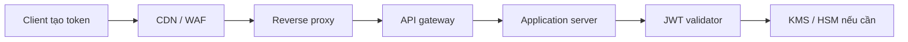
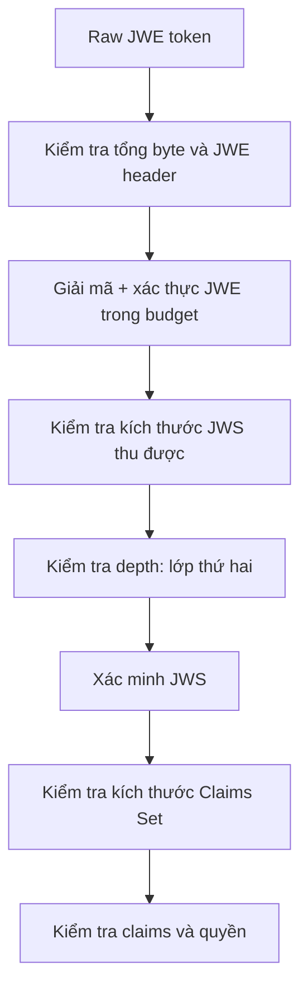
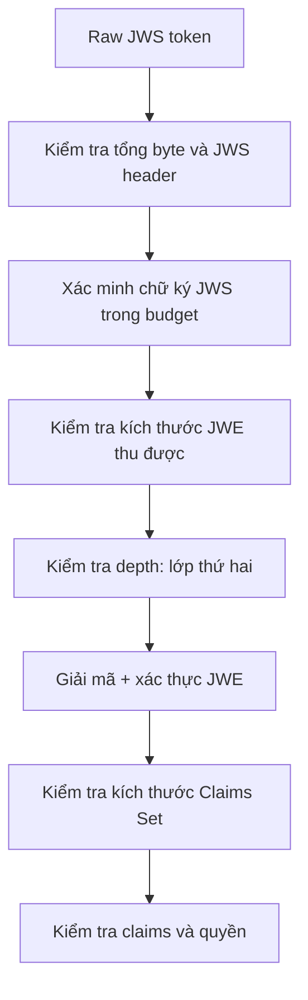

# Giới hạn số lớp lồng nhau và kích thước token

> **Chương:** JWT lồng nhau  
> **Phạm vi:** Security – JSON Web Token (JWT), thuộc module SECURITY_TOKEN_SECURITY_JWT. Nội dung áp dụng cho hệ thống sử dụng JWT/JOSE nói chung, không phụ thuộc ngôn ngữ lập trình hoặc framework.

## 1. Vì sao Nested JWT cần giới hạn?

Nested JWT cho phép đặt một JWT bên trong payload của JWS hoặc plaintext của JWE. Cấu trúc này hữu ích khi cần kết hợp ký và mã hóa, nhưng mỗi lớp bổ sung đều làm tăng lượng dữ liệu và công việc xử lý.

Một token có thể yêu cầu hệ thống:

- Phân tích thêm JOSE Header và cấu trúc serialization.
- Tra cứu thêm khóa và kiểm tra thêm thuật toán.
- Thực hiện thêm thao tác ký/xác minh hoặc giải mã/xác thực.
- Cấp phát thêm bộ nhớ cho payload, plaintext và dữ liệu trung gian.
- Tiếp tục xử lý các lớp JWT bên trong cho đến khi gặp Claims Set cuối cùng.

Nếu không giới hạn độ sâu, kích thước và tài nguyên, một đầu vào lớn hoặc có nhiều lớp lồng có thể khiến parser, thư viện mật mã, gateway hoặc dịch vụ xác minh tiêu tốn CPU, bộ nhớ và thời gian quá mức. Kẻ tấn công có thể gửi nhiều token như vậy để gây suy giảm dịch vụ.

Hai giới hạn cần được thiết kế cùng nhau:

1. **Maximum nesting depth:** số lớp JWS/JWE tối đa mà endpoint cho phép xử lý.
2. **Maximum token size:** số byte tối đa của token, cùng các giới hạn kích thước cho header, payload/plaintext và dữ liệu sau giải nén nếu có.

Giới hạn không chỉ là cấu hình tiện ích. Chúng là một phần của hợp đồng đầu vào và chính sách chống cạn kiệt tài nguyên.

## 2. RFC có quy định con số giới hạn chung không?

**Không có một con số byte hoặc số lớp nesting tối đa áp dụng cho mọi Nested JWT trong RFC 7519.** RFC 7519 định nghĩa JWT lồng nhau và cách tạo/xác minh; RFC 8725 yêu cầu xác minh mọi thao tác mật mã của JWT, gồm cả lớp ngoài và lớp trong. Việc đặt giới hạn cụ thể phụ thuộc vào profile và môi trường triển khai.

Vì vậy:

- Không nên nói rằng mọi JWT chỉ được lồng tối đa một, hai hoặc ba lớp theo một quy tắc chung của chuẩn.
- Không nên lấy một con số kích thước tùy ý rồi coi đó là giới hạn do RFC quy định.
- Mỗi endpoint phải xác định rõ cấu trúc nào được chấp nhận và đặt giới hạn đủ nhỏ để phù hợp với hạ tầng cùng ngân sách xử lý.
- Nếu một giao thức hoặc profile chuyên biệt quy định ngưỡng chặt hơn, phải tuân thủ ngưỡng đó.

Với một ứng dụng chỉ cần kết hợp đúng một chữ ký và một lớp mã hóa, hợp đồng thường chỉ cần **hai JOSE layers**. Đây là quyết định của profile ứng dụng, không phải giới hạn phổ quát của JWT.

## 3. Định nghĩa cách đếm độ sâu

Để tránh lỗi lệch một đơn vị, cần thống nhất cách đếm trước khi cấu hình.

Trong bài này, **một JOSE layer** là một đối tượng JWS hoặc JWE hoàn chỉnh biểu diễn một JWT.

- **Depth = 1:** JWT đơn lẻ, ví dụ `JWS(claims)` hoặc `JWE(claims)`.
- **Depth = 2:** một JWT được bọc trong một JWT khác, ví dụ `JWE(JWS(claims))` hoặc `JWS(JWE(claims))`.
- **Depth = 3:** có ba đối tượng JWS/JWE lồng nhau, ví dụ `JWE(JWS(JWE(claims)))`.

Depth được tính từ lớp ngoài cùng vào trong. Số lần chuyển từ một lớp sang JWT bên trong bằng số lớp trừ một.

| Cấu trúc | Số JOSE layers | Độ sâu theo quy ước |
|---|---:|---:|
| `JWS(claims)` | 1 | 1 |
| `JWE(claims)` | 1 | 1 |
| `JWE(JWS(claims))` | 2 | 2 |
| `JWS(JWE(claims))` | 2 | 2 |
| `JWE(JWS(JWE(claims)))` | 3 | 3 |
| `JWS(JWE(JWS(JWE(claims))))` | 4 | 4 |

### 3.1. Dựa vào cty để nhận diện lớp tiếp theo

Khi một JWT bao bọc một JWT khác, JOSE Header của lớp bao bọc phải có `cty: "JWT"`. Sau khi xác minh chữ ký JWS hoặc giải mã và xác thực JWE của lớp hiện tại, bên nhận kiểm tra nội dung thu được:

- Nếu `cty = "JWT"`, nội dung là một JWT khác và cần xử lý thêm một lớp.
- Nếu không có `cty: "JWT"`, nội dung là dữ liệu cuối cùng theo profile, thường là Claims Set JSON.
- Nếu header khai báo giá trị `cty` không được hỗ trợ hoặc cấu trúc không khớp hợp đồng, từ chối token.

Không được tin `cty` trước khi lớp hiện tại được xác thực. Header có thể được đọc sớm để kiểm tra định dạng và chọn cấu hình trong allowlist, nhưng vẫn là đầu vào chưa đáng tin.

### 3.2. Không đếm độ sâu bằng cách đếm dấu chấm

JWT Compact Serialization có dấu chấm phân cách các phần của JWS/JWE. Tuy nhiên, payload của JWS được base64url-encode, còn plaintext của JWE được mã hóa thành ciphertext. JWT bên trong không nhất thiết xuất hiện dưới dạng văn bản có thể đọc được ở token ngoài.

Do đó, không thể đếm dấu chấm trong chuỗi token để suy ra số lớp nesting. Phải xác minh và xử lý từng lớp theo cấu trúc được khai báo trong hợp đồng.

## 4. Kích thước token tăng như thế nào?

Nested JWT có thể lớn nhanh hơn dữ liệu Claims Set ban đầu vì mỗi lớp cần thêm header, chữ ký, thông tin quản lý khóa, IV, authentication tag hoặc dữ liệu serialization.

### 4.1. Base64url làm tăng kích thước

Với một chuỗi đầu vào có \(n\) byte, độ dài Base64url không padding xấp xỉ:

\[
L_{\text{b64url}}(n) = \left\lceil \frac{4n}{3} \right\rceil
\]

Nghĩa là dữ liệu sau Base64url thường lớn hơn dữ liệu byte ban đầu khoảng một phần ba, chưa tính các phần bổ sung khác.

JWS Compact có dạng:

```text
BASE64URL(protected_header).BASE64URL(payload).BASE64URL(signature)
```

Nếu payload là một JWT bên trong, toàn bộ chuỗi JWT đó lại được Base64url-encode thành payload của JWS ngoài.

JWE Compact có dạng:

```text
BASE64URL(protected_header).BASE64URL(encrypted_key).BASE64URL(iv).BASE64URL(ciphertext).BASE64URL(authentication_tag)
```

Ciphertext chứa nội dung được mã hóa. Với một số thuật toán AEAD như GCM, ciphertext có độ dài bằng plaintext và authentication tag được đặt ở phần riêng; các thuật toán khác có thể có overhead hoặc padding khác.

### 4.2. So sánh độ tăng theo từng cấu trúc

**Ký rồi mã hóa — `JWE(JWS(claims))`:**

1. Claims Set được serialize thành JSON UTF-8.
2. JWS tạo header và chữ ký, đồng thời Base64url-encode payload.
3. Toàn bộ chuỗi JWS trở thành plaintext của JWE.
4. JWE thêm header, encrypted key, IV và authentication tag; ciphertext tiếp tục được Base64url-encode.

**Mã hóa rồi ký — `JWS(JWE(claims))`:**

1. Claims Set được mã hóa thành JWE.
2. JWE thêm header, encrypted key, IV, ciphertext và authentication tag.
3. Toàn bộ chuỗi JWE trở thành payload của JWS.
4. JWS thêm header và chữ ký; payload JWE được Base64url-encode.

Vì vậy, mỗi lớp mới đều tạo overhead. Với nhiều lớp, phần dữ liệu đã được serialize ở lớp trong lại trở thành payload hoặc plaintext của lớp ngoài.

### 4.3. Ước lượng kích thước trước khi chọn giới hạn

Khi tính budget, cần xét:

- Kích thước Claims Set sau serialize UTF-8.
- Header JWS/JWE của từng lớp.
- Kích thước chữ ký hoặc MAC.
- Kích thước encrypted key/CEK theo thuật toán quản lý khóa.
- IV và authentication tag của JWE.
- Base64url expansion của từng phần.
- Overhead của transport như tên header, tiền tố `Bearer `, cookie hoặc envelope của giao thức.
- Overhead của các thành phần trung gian như API gateway, reverse proxy, WAF, message broker và storage.

Không dùng kích thước Claims Set làm đại diện cho kích thước Nested JWT cuối cùng. Cần đo token sau khi tạo đầy đủ tất cả các lớp bằng chính thuật toán và cấu hình được sử dụng ở production.

## 5. Các loại giới hạn nên có

Một giới hạn tổng cho chuỗi token là cần thiết, nhưng chưa đủ. Nên phân chia budget theo từng giai đoạn xử lý.

| Giới hạn | Đơn vị | Mục đích |
|---|---|---|
| **Raw token size** | Byte | Chặn đầu vào quá lớn ngay khi nhận, trước khi Base64url decode hoặc chạy mật mã. |
| **JOSE Header size** | Byte sau decode | Giới hạn dữ liệu header và số tham số cần phân tích. |
| **Encoded part size** | Byte/ký tự | Ngăn một phần riêng lẻ quá lớn dù tổng token vẫn nằm trong giới hạn. |
| **Decoded payload/plaintext size** | Byte | Giới hạn bộ nhớ cho nội dung thu được sau JWS/JWE. |
| **Maximum JOSE layers** | Số lớp | Ngăn nesting quá sâu và giới hạn số thao tác mật mã. |
| **Final Claims Set size** | Byte | Ngăn JSON claims quá lớn sau khi xử lý lớp cuối. |
| **Decompressed output size** | Byte | Giới hạn dữ liệu sau giải nén nếu profile cho phép nén. |
| **Processing time** | Millisecond/second | Giới hạn thời gian parse, tra khóa và thực hiện mật mã. |
| **Key lookup count** | Số lần | Hạn chế tra cứu khóa lặp lại hoặc phát sinh nhiều truy cập mạng. |
| **Concurrent validations** | Số tác vụ | Giới hạn lượng công việc xác minh chạy đồng thời. |

Các giới hạn này có thể khác nhau giữa endpoint. Ví dụ, một endpoint nhận access token đơn giản có thể có budget nhỏ hơn endpoint nhận một cấu trúc Nested JWT được thiết kế để trao đổi dữ liệu nghiệp vụ.

## 6. Chọn giới hạn theo toàn bộ đường truyền

Một token có thể đi qua nhiều thành phần trước khi tới nơi xác minh. Mỗi thành phần có giới hạn riêng.



Kích thước tối đa thực tế phải tương thích với **giới hạn nhỏ nhất trên đường đi**.

Ví dụ, nếu API gateway chỉ cho phép request header nhỏ hơn giới hạn của application server, token đặt trong `Authorization` header sẽ bị từ chối ở gateway trước khi ứng dụng có cơ hội xác minh. Ngược lại, nếu ứng dụng cho phép token rất lớn nhưng proxy không cho phép, cấu hình ứng dụng không có ý nghĩa đối với request thực tế.

### 6.1. Kiểm tra từng vị trí vận chuyển

Cần xác định token được truyền ở đâu:

- **HTTP Authorization header:** giới hạn kích thước header của CDN, proxy, gateway và server.
- **Cookie:** giới hạn cookie của client, trình duyệt, proxy và server; đồng thời xét tổng kích thước header Cookie.
- **HTTP request body:** giới hạn body của gateway và application server.
- **Message broker hoặc queue:** giới hạn message, envelope và tổng kích thước batch.
- **Database hoặc cache:** giới hạn kích thước trường, record và chi phí lưu trữ/replication.
- **URL hoặc query string:** có thể gặp giới hạn URL và rủi ro token xuất hiện trong log, history, analytics hoặc referrer; tránh đặt bearer token trong URL nếu không có lý do giao thức đặc biệt.

Không có một giới hạn HTTP duy nhất áp dụng cho mọi proxy, server hoặc client. Phải kiểm tra cấu hình thực tế của các thành phần trong hệ thống.

### 6.2. Đặt ngưỡng tổng

Một cách thực hành:

1. Xác định tất cả điểm truyền, lưu và xử lý token.
2. Thu thập giới hạn thực tế của mỗi điểm.
3. Chọn giới hạn token thấp hơn hoặc bằng giới hạn nhỏ nhất, có tính đến phần header/envelope.
4. Đặt giới hạn raw token ở ingress và áp dụng lại ở application.
5. Dành khoảng dự phòng cho thay đổi header, chữ ký, khóa và metadata trong tương lai.
6. Kiểm thử với token có kích thước sát ngưỡng qua toàn bộ đường truyền.

Không đặt ngưỡng chỉ dựa trên khả năng của một thư viện JWT. Hệ thống phải xử lý được token từ lúc nhận cho đến khi kết thúc xác minh.

## 7. Giới hạn tài nguyên theo từng lớp

### 7.1. Kiểm tra raw token trước khi decode

Trước khi Base64url decode, parse JSON hoặc gọi thư viện mật mã:

- Đo kích thước token theo byte.
- Từ chối nếu vượt giới hạn tổng.
- Kiểm tra ký tự thuộc bảng Base64url và dấu phân cách theo định dạng được chấp nhận.
- Giới hạn kích thước từng phần encoded.
- Không tạo bản sao chuỗi hoặc buffer lớn không cần thiết.

Đây là bước rẻ hơn nhiều so với giải mã, xác minh chữ ký hoặc thực hiện key agreement.

### 7.2. Giới hạn header và phần dữ liệu

Ở từng lớp:

- Giới hạn độ dài protected header sau decode.
- Giới hạn số lượng tham số header.
- Chỉ chấp nhận tham số và thuật toán theo profile.
- Giới hạn kích thước payload JWS hoặc ciphertext JWE.
- Giới hạn plaintext sau khi giải mã.
- Giới hạn kích thước Claims Set cuối cùng.
- Từ chối JSON có cấu trúc quá phức tạp hoặc vượt giới hạn parser nếu thư viện hỗ trợ cấu hình.

Header nhỏ nhưng chứa nhiều tham số, JSON lồng sâu hoặc giá trị bất thường vẫn có thể làm tăng chi phí parse. Vì vậy, giới hạn kích thước cần đi cùng giới hạn cấu trúc và chính sách tham số.

### 7.3. Giới hạn độ sâu trước khi xử lý lớp tiếp theo

Với quy ước depth tính số JOSE layers:

- Bắt đầu tại depth = 1 cho lớp ngoài.
- Xác minh hoặc giải mã lớp hiện tại.
- Nếu lớp đã xác thực khai báo `cty: "JWT"`, kiểm tra depth hiện tại đã đạt max chưa.
- Nếu đã đạt, từ chối thay vì parse và xử lý lớp tiếp theo.
- Nếu chưa đạt, tăng depth lên 1 và xử lý JWT bên trong theo hợp đồng.
- Dừng khi đạt Claims Set cuối cùng theo profile.

Ví dụ, endpoint cho phép tối đa hai lớp. Token `JWE(JWS(claims))` có depth 2 và có thể tiếp tục đến Claims Set. Token `JWE(JWS(JWE(claims)))` có depth 3 nên bị từ chối khi lớp thứ hai cho biết còn một JWT bên trong.

### 7.4. Giới hạn thời gian và công việc mật mã

Mỗi lớp có thể yêu cầu một thao tác mật mã. Các thuật toán quản lý khóa, chữ ký, giải mã và tra khóa có chi phí khác nhau.

Nên có:

- Timeout cho toàn bộ quá trình xác minh một token.
- Giới hạn số thao tác JWS/JWE tối đa theo depth.
- Giới hạn số lần tra khóa hoặc gọi dịch vụ khóa từ xa.
- Cache khóa công khai tin cậy có giới hạn và chính sách hết hạn rõ ràng.
- Rate limit theo client, tenant hoặc nguồn gửi phù hợp.
- Giới hạn số tác vụ xác minh đồng thời.
- Giới hạn thời gian chờ HSM/KMS và số request đến dịch vụ đó.

Không cho phép một token tự chỉ định URL tùy ý để hệ thống tải JWK hoặc chứng thư. Việc tra khóa phải đi qua nguồn tin cậy và allowlist được cấu hình sẵn.

## 8. Nén và giới hạn dữ liệu sau giải nén

JWE có thể sử dụng tham số `zip` để khai báo nén nội dung. Nén có thể làm token nhỏ hơn, nhưng cũng tạo rủi ro về rò rỉ độ dài và dữ liệu sau giải nén lớn hơn nhiều so với ciphertext.

[RFC 8725 §3.6](https://www.rfc-editor.org/rfc/rfc8725.html#section-3.6) khuyến nghị **không nén dữ liệu trước khi mã hóa**, vì dữ liệu nén có thể tiết lộ thông tin về plaintext.

Nếu một profile đặc biệt vẫn phải hỗ trợ nén:

1. Chỉ cho phép thuật toán nén được cấu hình rõ.
2. Không tự động chấp nhận mọi giá trị `zip` trong header.
3. Xác thực JWE thành công trước khi giải nén plaintext.
4. Giới hạn kích thước dữ liệu sau giải nén.
5. Giới hạn tỷ lệ mở rộng giữa đầu vào nén và đầu ra.
6. Giới hạn CPU, bộ nhớ và thời gian giải nén.
7. Từ chối dữ liệu nén hỏng, đầu ra vượt ngưỡng hoặc giải nén không kết thúc đúng hạn.

Không chỉ kiểm tra kích thước ciphertext. Một dữ liệu nhỏ có thể tạo ra plaintext sau giải nén rất lớn.

## 9. Thiết kế giới hạn cho hai kiểu Nested JWT

### 9.1. JWE(JWS(claims)) — ký rồi mã hóa



Các budget cần xét:

- Raw JWE ngoài.
- Protected header, encrypted key, IV, ciphertext và tag.
- Plaintext JWS sau khi xác thực JWE.
- JWS bên trong và payload claims sau xác minh.
- Tổng thời gian cho một thao tác giải mã và một thao tác xác minh.

Nếu plaintext JWE vượt giới hạn kích thước JWS bên trong, từ chối ngay cả khi JWE ngoài hợp lệ.

### 9.2. JWS(JWE(claims)) — mã hóa rồi ký



Các budget cần xét:

- Raw JWS ngoài.
- Protected header, payload và chữ ký.
- Payload JWE sau khi xác minh chữ ký.
- Protected header, encrypted key, IV, ciphertext và tag của JWE.
- Plaintext claims sau giải mã.
- Tổng thời gian cho một thao tác xác minh và một thao tác giải mã.

Với cấu trúc này, bên trung gian có thể xác minh chữ ký ngoài mà không giải mã. Tuy nhiên, bên nhận cuối vẫn phải giới hạn kích thước JWE và plaintext bên trong.

## 10. Ví dụ xác định policy

Giả sử API chỉ nhận một kiểu Nested JWT: `JWE(JWS(claims))`. Hợp đồng có thể biểu diễn như sau:

| Thuộc tính | Policy minh họa |
|---|---|
| Cấu trúc | Chỉ nhận JWE Compact chứa một JWS Compact. |
| Maximum JOSE layers | 2 |
| JWE ngoài | Chỉ thuật toán `alg` và `enc` nằm trong allowlist. |
| JWS trong | Chỉ thuật toán ký nằm trong allowlist. |
| cty | JWE ngoài phải có `cty: "JWT"`; JWS trong chứa Claims Set cuối cùng. |
| Raw token bytes | Ngưỡng do API chọn theo giới hạn nhỏ nhất trên đường truyền. |
| JWE plaintext bytes | Không vượt budget dành cho JWS trong. |
| JWS payload bytes | Không vượt budget dành cho Claims Set. |
| Processing timeout | Có deadline cho toàn bộ quá trình xác minh. |
| Key lookup | Chỉ tra trong kho khóa tin cậy; không tải URL tùy ý. |
| Compression | Không chấp nhận nếu profile không có yêu cầu cụ thể. |

Không điền một con số kích thước vào bảng nếu chưa kiểm tra giới hạn proxy, gateway, server, client và storage thực tế. Giá trị policy phải được đo, thử nghiệm và ghi nhận trong cấu hình vận hành.

### 10.1. Khi nào cần tăng giới hạn?

Chỉ tăng khi có yêu cầu nghiệp vụ rõ ràng, ví dụ thêm một claim hoặc một lớp ký/mã hóa đã được thiết kế trong giao thức.

Trước khi tăng, cần xác định:

- Thành phần nào đang từ chối token?
- Phần nào của token tăng kích thước?
- Có thể giảm claims, bỏ dữ liệu trùng lặp hoặc dùng reference token không?
- Có thực sự cần thêm một lớp nesting không?
- Mọi thành phần trung gian có hỗ trợ kích thước mới không?
- CPU, memory, latency và chi phí key service thay đổi thế nào?

Không tăng giới hạn tổng chỉ để làm một token lỗi có thể đi qua. Cần xác định nguyên nhân và đánh giá toàn bộ budget.

## 11. Mã giả kiểm tra depth và size

Mã giả sau dùng vòng lặp để duyệt từng lớp, tránh phụ thuộc vào đệ quy không giới hạn. Các con số nằm trong `policy`, không được lấy từ token.

```text
function validate_nested_jwt(raw_token, policy):
    require(byte_length(raw_token) <= policy.max_raw_token_bytes)

    current_token = raw_token
    depth = 1
    total_crypto_operations = 0

    while true:
        require(depth <= policy.max_jose_layers)
        require(deadline_not_exceeded())
        require(byte_length(current_token) <= policy.max_layer_token_bytes)

        parts = split_expected_compact_serialization(current_token)
        require_each_encoded_part_within_limit(parts, policy.max_encoded_part_bytes)
        layer = decode_bounded_jose_header(parts, policy.max_header_bytes)
        require_header_parameters_match_contract(layer.header, policy.layer_at(depth))

        if layer.kind == "JWS":
            require_allowed_jws_algorithm(layer.header.alg, policy.layer_at(depth))
            key = resolve_trusted_signing_key(layer.header.kid, policy.layer_at(depth))
            message = verify_jws_and_get_payload(
                layer,
                key,
                max_payload_bytes = policy.max_message_bytes
            )

        else if layer.kind == "JWE":
            require_allowed_jwe_alg_and_enc(layer.header, policy.layer_at(depth))
            key = resolve_recipient_decryption_key(layer.header.kid, policy.layer_at(depth))
            message = decrypt_and_authenticate_jwe(
                layer,
                key,
                max_plaintext_bytes = policy.max_message_bytes
            )

        else:
            reject("Unsupported JOSE layer")

        total_crypto_operations += 1
        require(total_crypto_operations <= policy.max_crypto_operations)
        require(byte_length(message) <= policy.max_message_bytes)

        # Chỉ sử dụng cty sau khi lớp hiện tại đã xác thực thành công.
        if layer.header.cty == "JWT":
            if depth == policy.max_jose_layers:
                reject("Maximum nesting depth exceeded")

            require(byte_length(message) <= policy.max_layer_token_bytes)
            current_token = parse_expected_inner_jwt(message)
            depth += 1
            continue

        if layer.header.cty is present:
            reject("Unexpected content type for this profile")

        require(byte_length(message) <= policy.max_claims_bytes)
        claims = parse_claims_set(message)
        require_valid_issuer_audience_and_time(claims, policy)
        require_authorized_claims(claims, policy)

        return claims
```

Đây là mã giả về policy, không phải API của một thư viện cụ thể. Triển khai thực tế phải kiểm tra chính xác serialization của từng lớp, xác thực đầy đủ chữ ký hoặc authentication tag và xử lý đúng `cty` theo hợp đồng.

Một số giới hạn phải được kiểm tra trước khi tạo buffer hoặc parse dữ liệu. Parser cần kiểm tra độ dài từng encoded part trước khi decode; thao tác xác minh/giải mã phải có giới hạn payload hoặc plaintext và không cấp phát vượt budget. Với JWE dùng authenticated encryption, không được đưa plaintext ra cho ứng dụng trước khi authentication tag được xác thực thành công. Nếu thư viện không hỗ trợ output cap hoặc bounded processing, cần dùng cơ chế bao quanh phù hợp hoặc chọn cách triển khai có kiểm soát bộ nhớ.

## 12. Các lỗi thường gặp

| Lỗi | Hậu quả | Cách khắc phục |
|---|---|---|
| Không giới hạn số lớp nesting. | Nhiều thao tác mật mã và parse có thể tiêu tốn CPU, memory hoặc stack. | Đặt `max_jose_layers` theo profile và từ chối lớp vượt ngưỡng. |
| Đếm depth bằng số dấu chấm. | Không nhận diện đúng lớp bên trong vì payload có thể được Base64url-encode hoặc mã hóa. | Xử lý theo hợp đồng và `cty` sau khi xác minh từng lớp. |
| Chỉ giới hạn kích thước Claims Set. | Token có thể đã quá lớn trước khi tới Claims Set do header, chữ ký, encrypted key và encoding. | Giới hạn raw token và từng phần/lớp. |
| Chỉ giới hạn token ở application. | Proxy hoặc gateway có thể đã buffer hoặc từ chối request trước đó. | Đồng bộ giới hạn ở ingress, proxy, gateway và application. |
| Chỉ giới hạn raw token, không giới hạn plaintext. | Nội dung giải mã hoặc giải nén có thể lớn hơn budget bộ nhớ. | Giới hạn decoded payload, plaintext và decompressed output. |
| Kiểm tra size sau khi Base64url decode. | Parser đã có thể cấp phát bộ nhớ lớn trước khi từ chối. | Kiểm tra raw bytes và encoded-part length trước decode. |
| Dùng đệ quy không giới hạn. | Có thể gây stack exhaustion hoặc lỗi do call depth. | Dùng vòng lặp có depth counter và giới hạn cứng. |
| Tự động giải nén dữ liệu. | Có nguy cơ decompression bomb hoặc rò rỉ thông tin về plaintext. | Tránh nén trước mã hóa; nếu phải hỗ trợ, giới hạn output và expansion ratio. |
| Cho phép token kích hoạt nhiều lần tra khóa từ xa. | Có thể gây SSRF, latency cao hoặc cạn tài nguyên dịch vụ khóa. | Chỉ tra trong trust store/JWKS endpoint đã cấu hình, cache và giới hạn số lần lookup. |
| Không đặt deadline cho crypto. | Một request có thể chiếm worker quá lâu. | Deadline, rate limit và giới hạn concurrency. |
| Tăng max size mà không thử toàn bộ đường truyền. | Request có thể vẫn bị chặn ở proxy, cookie hoặc broker. | Kiểm thử end-to-end với token sát ngưỡng. |
| Log toàn bộ token khi vượt ngưỡng. | Log có thể lưu bearer token và dữ liệu nhạy cảm. | Log kích thước, lớp lỗi và correlation ID; không log nguyên token. |

## 13. Ma trận kiểm thử giới hạn

| Trường hợp kiểm thử | Kết quả mong đợi |
|---|---|
| Token có kích thước nhỏ hơn giới hạn và đúng profile. | Tiếp tục xử lý. |
| Token có kích thước đúng bằng giới hạn. | Xử lý theo quy tắc biên đã công bố; kiểm thử nhất quán ở mọi tầng. |
| Token lớn hơn giới hạn một byte. | Từ chối trước decode hoặc crypto. |
| Protected header vượt giới hạn. | Từ chối trước khi xử lý mật mã lớp đó. |
| Một encoded part vượt giới hạn riêng. | Từ chối. |
| Plaintext sau giải mã vượt budget. | Từ chối, không chuyển dữ liệu cho parser/ứng dụng. |
| JWT có depth đúng bằng max. | Chấp nhận nếu cấu trúc kết thúc hợp lệ và mọi kiểm tra đạt. |
| JWT có depth max + 1. | Từ chối trước khi xử lý lớp vượt ngưỡng. |
| Header ở lớp max có `cty: "JWT"` báo còn lớp tiếp theo. | Từ chối vì vượt depth, không parse/verify lớp tiếp theo. |
| Token có `cty` sai hoặc cấu trúc không khớp profile. | Từ chối. |
| Nhiều lớp hợp lệ nhưng tổng crypto time vượt deadline. | Dừng và từ chối theo timeout policy. |
| Token yêu cầu key lookup lặp lại vượt budget. | Từ chối hoặc dừng theo lookup limit. |
| JWE nén có output vượt giới hạn giải nén. | Từ chối; không giữ output quá budget. |
| Token đi qua proxy có giới hạn nhỏ hơn application. | Bị từ chối ở ingress; cấu hình cần được đồng bộ. |
| Nhiều token lớn gửi đồng thời. | Rate/concurrency limit giữ dịch vụ trong budget. |

### 13.1. Kiểm thử boundary cho depth

Giả sử `max_jose_layers = 2`:

| Token | Depth thực tế | Kết quả |
|---|---:|---|
| `JWS(claims)` | 1 | Có thể chấp nhận nếu endpoint cho phép JWS đơn. |
| `JWE(claims)` | 1 | Có thể chấp nhận nếu endpoint cho phép JWE đơn. |
| `JWE(JWS(claims))` | 2 | Có thể chấp nhận nếu đúng profile. |
| `JWS(JWE(claims))` | 2 | Có thể chấp nhận nếu đúng profile. |
| `JWE(JWS(JWE(claims)))` | 3 | Từ chối. |

Nếu endpoint chỉ nhận đúng một cấu trúc, các JWT đơn lẻ vẫn bị từ chối dù depth thấp hơn max. **Max depth là giới hạn trên, không phải danh sách các cấu trúc được phép.**

## 14. Checklist thiết kế trước khi đưa vào production

- [ ] Đã định nghĩa cấu trúc JWS/JWE được phép cho từng endpoint.
- [ ] Đã thống nhất cách đếm depth theo số JOSE layers.
- [ ] Đã đặt max depth và từ chối lớp vượt ngưỡng.
- [ ] Đã đặt raw token byte limit trước decode.
- [ ] Đã đặt giới hạn header, encoded parts, payload/plaintext và Claims Set.
- [ ] Đã tính overhead Base64url, chữ ký, encrypted key, IV và authentication tag.
- [ ] Đã kiểm tra giới hạn ở CDN/WAF, proxy, gateway, server, broker và storage.
- [ ] Đã giới hạn CPU, memory, thời gian, key lookup và concurrency.
- [ ] Đã từ chối compression nếu không có nhu cầu; nếu có, giới hạn output sau giải nén.
- [ ] Đã xác minh tất cả thao tác mật mã ở mọi lớp.
- [ ] Đã có test cho đúng ngưỡng, vượt ngưỡng và max depth + 1.
- [ ] Đã bảo đảm log không lưu nguyên token hoặc plaintext nhạy cảm.

## 15. Câu hỏi tự kiểm tra

1. Vì sao không có một con số max nesting depth chung áp dụng cho mọi JWT?
2. Trong bài này, depth = 1 và depth = 2 được định nghĩa như thế nào?
3. Vì sao không thể đếm số lớp Nested JWT bằng cách đếm dấu chấm trong chuỗi Compact?
4. Base64url làm kích thước một phần dữ liệu tăng khoảng bao nhiêu?
5. Ngoài raw token size, cần giới hạn những dữ liệu nào sau decode hoặc decrypt?
6. Tại sao cần kiểm tra kích thước trước Base64url decode và parse JSON?
7. Nếu lớp ở depth tối đa có `cty: "JWT"`, validator phải làm gì?
8. Vì sao giới hạn ở application phải tương thích với proxy, gateway, cookie và broker?
9. Nén JWE có thể gây rủi ro nào và vì sao cần giới hạn output sau giải nén?
10. Vì sao max depth chỉ là giới hạn trên, không thay thế hợp đồng cấu trúc được phép?

## 16. Tài liệu tham khảo

- [RFC 7519 – JSON Web Token (JWT)](https://www.rfc-editor.org/rfc/rfc7519.html): định nghĩa Nested JWT, JWS/JWE Compact Serialization và quy trình tạo/xác minh JWT (§2, §3, §7).
- [RFC 7515 – JSON Web Signature (JWS)](https://www.rfc-editor.org/rfc/rfc7515.html): cấu trúc Compact Serialization, protected header và payload.
- [RFC 7516 – JSON Web Encryption (JWE)](https://www.rfc-editor.org/rfc/rfc7516.html): cấu trúc Compact Serialization, ciphertext, IV, encrypted key, authentication tag và tham số nén `zip`.
- [RFC 7518 – JSON Web Algorithms (JWA)](https://www.rfc-editor.org/rfc/rfc7518.html): thuật toán ký, quản lý khóa và mã hóa nội dung.
- [RFC 8725 – JSON Web Token Best Current Practices](https://www.rfc-editor.org/rfc/rfc8725.html): xác minh mọi thao tác mật mã ở các lớp Nested JWT (§3.3), tránh nén đầu vào trước mã hóa (§3.6), kiểm tra issuer/audience và chống nhầm lẫn loại JWT.
