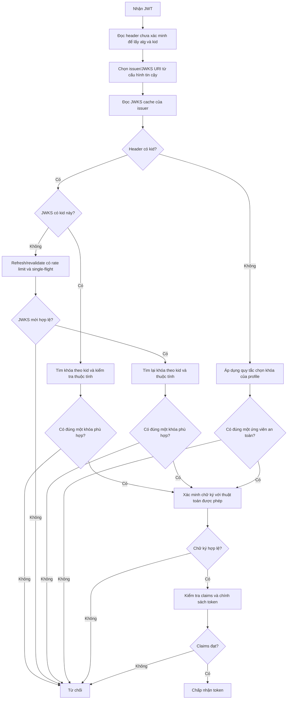

# Bộ nhớ đệm JWKS, thời gian sống và xử lý `kid` chưa biết

## 1. Vì sao verifier cần cache JWKS?

JSON Web Key Set (JWKS) là một đối tượng JSON chứa tập các JSON Web Key (JWK). Với JWT được ký bằng khóa bất đối xứng, bên xác minh thường lấy khóa công khai tương ứng từ JWKS do issuer công bố.

Nếu mỗi request mang JWT đều tải JWKS từ xa, hệ thống sẽ tạo thêm độ trễ, tăng lưu lượng mạng và phụ thuộc vào khả năng sẵn sàng của endpoint khóa. Vì vậy, verifier thường **lưu bộ JWKS đã tải trong bộ nhớ đệm** rồi tái sử dụng trong một khoảng thời gian.

Cache giúp:

- Giảm số lần gọi endpoint JWKS.
- Giảm độ trễ khi xác minh chữ ký.
- Cho phép xác minh token khi endpoint JWKS tạm thời không truy cập được, trong giới hạn chính sách cache.
- Giảm tải cho issuer và hạ tầng phân phối khóa.

Tuy nhiên, cache cũng tạo ra độ trễ giữa thời điểm issuer thay đổi tập khóa và thời điểm mọi verifier nhìn thấy thay đổi đó. Nếu cache quá lâu, verifier có thể chưa biết khóa mới hoặc tiếp tục tin khóa đã bị loại bỏ. Nếu cache quá ngắn, hệ thống có thể gọi endpoint liên tục và dễ bị ảnh hưởng bởi lỗi mạng.

Vì vậy, cache JWKS là một phần của chính sách tin cậy khóa và vòng đời khóa, không chỉ là tối ưu hiệu năng.

## 2. JWKS và `kid` phối hợp với nhau như thế nào?

Một JWK mô tả một khóa và các thuộc tính liên quan. Một JWKS chứa mảng `keys` gồm nhiều JWK. Ví dụ:

```json
{
  "keys": [
    {
      "kty": "RSA",
      "use": "sig",
      "kid": "rsa-signing-2026-01",
      "alg": "RS256",
      "n": "...",
      "e": "AQAB"
    },
    {
      "kty": "EC",
      "use": "sig",
      "kid": "ec-signing-2026-02",
      "alg": "ES256",
      "crv": "P-256",
      "x": "...",
      "y": "..."
    }
  ]
}
```

Trong ví dụ, JWKS công bố hai khóa công khai có mục đích ký/xác minh. `kid` (Key ID) giúp bên nhận đối chiếu khóa trong header JWT với JWK tương ứng.

Ví dụ JOSE header của một JWS:

```json
{
  "alg": "RS256",
  "kid": "rsa-signing-2026-01",
  "typ": "JWT"
}
```

Verifier dùng `kid` để tìm ứng viên trong JWKS đã lấy từ nguồn tin cậy, sau đó còn phải kiểm tra loại khóa, thuật toán được cho phép, mục đích sử dụng và chữ ký thực tế.

`kid` chỉ là **gợi ý định danh khóa**. Nó không phải khóa, không chứng minh chữ ký hợp lệ và không chỉ định một URL được tin cậy. Không được lấy một `kid` tùy ý làm tên miền, đường dẫn hoặc lệnh truy cập mạng.

## 3. Cache JWKS được xác định theo issuer và nguồn khóa tin cậy

Một hệ thống có thể tin cậy nhiều issuer. Mỗi issuer có thể công bố một JWKS URI và có tập khóa riêng. Vì thế, cache không nên chỉ dùng `kid` làm khóa tra cứu toàn cục.

Một khóa cache hợp lý có thể dựa trên:

```text
(trusted_issuer, trusted_jwks_uri)
```

Sau khi lấy được JWKS, việc chọn khóa được thực hiện trong tập khóa của issuer đó, thường theo `kid` cùng các thuộc tính khóa phù hợp.

Ví dụ:

| Issuer | `kid` | Cache namespace |
| --- | --- | --- |
| `https://issuer-a.example.test` | `signing-01` | `(issuer-a, jwks-uri-a)` |
| `https://issuer-b.example.test` | `signing-01` | `(issuer-b, jwks-uri-b)` |

Hai issuer có thể dùng cùng chuỗi `kid`; điều đó không khiến khóa của issuer này được dùng cho token của issuer kia.

### Nguồn JWKS phải được tin cậy từ cấu hình hoặc metadata đã xác minh

Verifier nên lấy `jwks_uri` từ cấu hình issuer đáng tin cậy hoặc metadata discovery được xác minh theo đúng giao thức. Không tự tải khóa từ `jku`, `x5u` hoặc URL khác do token chưa xác minh tùy ý đề xuất.

Nếu dùng metadata discovery, cần kiểm tra issuer trong metadata khớp chính xác với issuer cấu hình kỳ vọng và áp dụng chính sách HTTPS, redirect, hostname, DNS và mạng phù hợp. Điều này giúp ngăn token khiến verifier truy cập máy chủ nội bộ hoặc endpoint không được phép (SSRF).

## 4. Thời gian sống của cache JWKS đến từ đâu?

JWKS không có một trường thời gian sống chung bắt buộc bên trong đối tượng JWK Set. Thời gian cache thường được điều khiển bởi **HTTP caching headers** của response và chính sách cache tại verifier hoặc hạ tầng trung gian.

Các header thường gặp:

| Header | Vai trò |
| --- | --- |
| `Cache-Control: max-age=300` | Response có thể được dùng lại trong tối đa 300 giây tính theo quy tắc freshness của HTTP |
| `Cache-Control: no-cache` | Có thể lưu response nhưng phải revalidate với origin trước khi dùng lại |
| `Cache-Control: no-store` | Không được lưu response trong cache theo chỉ thị này |
| `Cache-Control: must-revalidate` | Khi response đã stale, cache phải revalidate trước khi dùng lại trong các điều kiện áp dụng |
| `Expires` | Thời điểm response hết freshness nếu không có chỉ thị ưu tiên hơn |
| `ETag` | Validator đại diện cho phiên bản response |
| `Age` | Tuổi hiện tại của response trong cache dùng chung; ảnh hưởng đến freshness còn lại |

Ví dụ response:

```http
HTTP/1.1 200 OK
Content-Type: application/jwk-set+json
Cache-Control: public, max-age=300
ETag: "jwks-version-42"
```

Trong ví dụ, cache có thể tái sử dụng response trong thời gian freshness được HTTP tính toán, tối đa 300 giây theo `max-age` và các header liên quan. Đây không phải cam kết rằng khóa chỉ có hiệu lực trong 300 giây; đó là thời gian response JWKS có thể được cache mà không cần revalidation.

### Phân biệt `no-cache` và `no-store`

- `no-cache` **không có nghĩa là không được lưu**. Cache có thể giữ response, nhưng phải xác minh lại với origin trước khi dùng response đó.
- `no-store` yêu cầu cache không lưu response.

Không nên nhầm hai chỉ thị này. Với JWKS, `no-cache` có thể vẫn giúp tiết kiệm dữ liệu nhờ revalidation bằng ETag và response `304 Not Modified`.

### `max-age` và `Expires`

Nếu response có `Cache-Control: max-age`, freshness thường được tính theo chỉ thị này thay vì chỉ dựa vào `Expires`. Khi thiết kế endpoint JWKS, nên công bố cache policy rõ ràng, nhất quán và phù hợp với tốc độ xoay vòng khóa.

Nếu không có cache directive rõ ràng, một số HTTP cache có thể áp dụng heuristic caching. Với khóa xác minh có ý nghĩa bảo mật, không nên để hành vi heuristic không được kiểm soát quyết định thời gian cache của mọi verifier; hãy định nghĩa chính sách rõ ở server hoặc client.

## 5. Freshness, TTL và thời điểm cần tải lại JWKS

**Freshness lifetime** là khoảng thời gian response còn được xem là mới theo HTTP caching. **TTL** thường được dùng trong triển khai để nói về thời gian một mục cache còn được giữ hoặc còn được phép sử dụng; cần xác định rõ đang nói đến thời gian lưu trữ hay thời gian freshness.

Ví dụ cache JWKS với `max-age=300`:

```text
t = 12:00:00  tải JWKS thành công
t = 12:00:00  response bắt đầu có freshness 300 giây
t = 12:04:59  response vẫn còn fresh (nếu không bị Age/metadata làm giảm)
t = 12:05:00  response đạt ranh giới hết freshness
t > 12:05:00  cần revalidate hoặc tải response mới trước khi dùng theo chính sách
```

Thời điểm chính xác còn phụ thuộc `Date`, `Age`, thời gian truyền, các cache trung gian và thuật toán tính current age trong HTTP. Không nên luôn lấy thời điểm nhận response rồi cộng nguyên `max-age` nếu response đã có `Age` lớn.

### Khi cache còn fresh

Verifier có thể sử dụng JWKS đã cache để tìm khóa, không cần tải lại mỗi request. Đây là trường hợp thông thường giúp giảm độ trễ và tải mạng.

### Khi cache đã stale

Verifier cần revalidate hoặc tải JWKS mới theo HTTP caching và chính sách ứng dụng. Nếu origin hỗ trợ validator như ETag, verifier có thể hỏi xem phiên bản đã thay đổi chưa mà không cần tải lại toàn bộ nội dung.

### Khi cache bị xóa hoặc verifier vừa khởi động

Verifier cần tải JWKS từ nguồn tin cậy trước khi xác minh token cần khóa công khai đó. Nếu không lấy được khóa cần thiết, không được tự chấp nhận chữ ký hoặc dùng một khóa không rõ nguồn gốc.

## 6. Revalidation bằng ETag và `304 Not Modified`

Để tránh tải toàn bộ JWKS khi tập khóa không đổi, endpoint có thể gửi `ETag`. Verifier lưu validator đó và gửi request có điều kiện:

```http
GET /.well-known/jwks.json HTTP/1.1
If-None-Match: "jwks-version-42"
```

Nếu JWKS không đổi, server có thể trả:

```http
HTTP/1.1 304 Not Modified
Cache-Control: public, max-age=300
ETag: "jwks-version-42"
```

Response `304` không mang lại một JWKS body mới. Cache tiếp tục dùng representation đã lưu và cập nhật metadata freshness theo quy tắc HTTP. Nếu nội dung đã thay đổi, server trả `200 OK` với JWKS mới và validator mới.

Một số lưu ý:

- ETag phải thay đổi khi representation JWKS thay đổi theo cách cần được cache nhận biết.
- Không giả định `304` đồng nghĩa khóa đã được cấp mới; nó chỉ cho biết representation được revalidate vẫn phù hợp.
- Cần xử lý đúng các header cache trong response revalidation.
- Nếu dùng nhiều cache trung gian, phải hiểu freshness và validator ở từng tầng.

Revalidation giúp giảm băng thông, nhưng không loại bỏ độ trễ phát hiện khóa mới trong thời gian cache còn fresh nếu verifier chưa có lý do làm mới sớm.

## 7. Chọn cache TTL: cân bằng giữa hiệu năng và độ trễ xoay vòng khóa

TTL dài và TTL ngắn tạo ra những đánh đổi khác nhau:

| Chính sách | Lợi ích | Đánh đổi |
| --- | --- | --- |
| TTL dài | Ít request đến JWKS endpoint, ít phụ thuộc mạng hơn | Khóa mới có thể được phát hiện chậm; khóa bị loại bỏ có thể còn trong cache lâu |
| TTL ngắn | Phát hiện thay đổi khóa nhanh hơn | Tăng request, độ trễ và khả năng bị ảnh hưởng khi endpoint lỗi |
| Revalidate thường xuyên bằng ETag | Phát hiện thay đổi mà có thể không cần tải lại body | Vẫn tạo request mạng và phụ thuộc endpoint |
| TTL theo HTTP headers cộng với refresh khi `kid` lạ | Tận dụng cache bình thường và có đường xử lý xoay vòng sớm | Cần rate limit, concurrency control và chính sách lỗi rõ ràng |

Không có một TTL cố định phù hợp cho mọi hệ thống. Khi chọn TTL, cần xem xét:

- Tần suất và quy trình xoay vòng khóa của issuer.
- Thời hạn tối đa của JWT được ký bằng từng khóa.
- Số lượng verifier, vùng triển khai và cache trung gian.
- Thời gian lan truyền thay đổi JWKS.
- Khả năng chủ động yêu cầu refresh hoặc purge cache.
- Mức rủi ro khi một khóa bị lộ hoặc bị thu hồi khẩn cấp.
- Độ sẵn sàng của endpoint JWKS và yêu cầu xác minh khi mất kết nối.

TTL phải là một phần của thiết kế key rotation. Không nên chọn TTL chỉ dựa trên hiệu năng mà không tính đến thời gian các verifier cần để nhìn thấy khóa mới hoặc ngừng tin khóa cũ.

## 8. Xử lý `kid` chưa biết (unknown `kid`)

Một **unknown `kid`** xảy ra khi header JWT chứa một giá trị `kid` nhưng JWKS hiện tại trong cache không có JWK phù hợp.

Nguyên nhân có thể gồm:

- Issuer vừa xoay vòng và bắt đầu ký bằng khóa mới.
- Cache của verifier chưa được cập nhật.
- Token đến từ issuer khác hoặc môi trường khác.
- Token có `kid` sai hoặc được tạo bởi kẻ tấn công.
- JWKS endpoint đang trả tập khóa không đúng hoặc cập nhật chưa lan truyền.
- Verifier đang dùng sai issuer/JWKS URI.

Không được kết luận ngay rằng mọi unknown `kid` đều là tấn công; nhưng cũng không được tin token hoặc tải khóa từ một URL do token tự khai báo. Cần thực hiện một quy trình refresh có kiểm soát.

### Quy trình xử lý khuyến nghị

1. Chọn issuer/JWKS URI từ cấu hình hoặc metadata tin cậy.
2. Kiểm tra cache của đúng issuer và tìm JWK phù hợp với `kid` cùng thuật toán/loại khóa được cho phép.
3. Nếu không tìm thấy, yêu cầu **một lần refresh hoặc revalidation có kiểm soát** để xử lý trường hợp issuer vừa xoay vòng khóa.
4. Nếu nhiều request cùng gặp một `kid` lạ, gộp chúng vào một lần refresh (*single-flight*) thay vì tạo nhiều request song song.
5. Sau khi nhận JWKS mới, xác thực cấu trúc và thay cache một cách nguyên tử.
6. Tìm lại khóa trong JWKS mới.
7. Nếu vẫn không có khóa phù hợp, từ chối token.
8. Áp dụng cooldown, rate limit hoặc negative cache ngắn cho miss để tránh mỗi request tiếp tục kích hoạt tải JWKS.

Luồng này cho phép phát hiện khóa mới sớm hơn TTL thông thường mà vẫn kiểm soát số lần gọi endpoint.

## 9. Vì sao không được refresh JWKS vô hạn khi gặp unknown `kid`?

Header JWT chưa được xác minh có thể do bất kỳ client nào tạo. Kẻ tấn công có thể gửi hàng nghìn token với các `kid` ngẫu nhiên khác nhau:

```text
kid = random-001
kid = random-002
kid = random-003
...
```

Nếu verifier tải JWKS cho mọi giá trị lạ, endpoint khóa có thể bị quá tải và verifier có thể bị buộc tạo lượng lớn kết nối ra ngoài. Đây là một dạng **resource exhaustion/DoS qua key refresh**.

Các biện pháp giảm thiểu:

- Giới hạn tần suất refresh theo issuer, không chỉ theo từng `kid`.
- Dùng single-flight để nhiều request đồng thời chia sẻ cùng một lần refresh.
- Đặt cooldown sau một lần refresh thất bại hoặc sau khi xác nhận `kid` không tồn tại.
- Có thể dùng negative cache ngắn cho cặp `(issuer, kid, alg)` sau một lần refresh thành công mà vẫn không tìm thấy khóa.
- Giới hạn kích thước header, độ dài `kid`, kích thước response JWKS và thời gian chờ mạng.
- Không để request của một issuer làm ảnh hưởng cache hoặc refresh budget của issuer khác.
- Theo dõi tỷ lệ unknown `kid` và refresh bất thường.

### Negative cache cần có thời hạn ngắn

Negative cache ghi nhận rằng một `kid` vừa được tìm kiếm nhưng không có trong JWKS mới nhất. Nó giúp ngăn cùng một `kid` lạ kích hoạt refresh liên tục.

Ví dụ:

```text
negativeCacheKey = (issuer, kid, alg)
negativeCacheTTL = short, bounded interval
```

Negative cache không được giữ quá lâu vì issuer có thể công bố khóa đó ngay sau lần refresh. Khi JWKS thay đổi thành công, cần xóa hoặc vô hiệu hóa các negative entry liên quan để khóa mới được nhận diện.

Không dùng negative cache như bằng chứng vĩnh viễn rằng một `kid` không hợp lệ. Đây chỉ là cơ chế điều tiết request, không thay thế lần xác minh khóa.

## 10. Chọn khóa sau khi refresh: `kid` chưa đủ

Ngay cả khi tìm thấy `kid` trong JWKS, verifier vẫn phải xác nhận JWK phù hợp với phép xác minh đang thực hiện.

Các thuộc tính thường cần kiểm tra:

| Thuộc tính | Cách sử dụng |
| --- | --- |
| `kid` | Đối chiếu định danh khóa theo chuỗi chính xác; không tự chuẩn hóa chữ hoa/chữ thường |
| `kty` | Phải tương thích với loại thuật toán và cấu trúc khóa được phép |
| `alg` | Nếu JWK có khai báo thuật toán, phải phù hợp với thuật toán được cấu hình và chính sách verifier |
| `use` | Nếu có, phải phù hợp mục đích ký (`sig`) khi xác minh chữ ký |
| `key_ops` | Nếu có, phải cho phép thao tác `verify` |
| `crv` | Với khóa EC/OKP, đường cong phải được hỗ trợ và phù hợp thuật toán |
| Material khóa | Các thành phần khóa phải hợp lệ về cấu trúc và kích thước theo thuật toán |

Nếu có nhiều JWK cùng `kid` và cùng thỏa điều kiện một cách không rõ ràng, verifier không nên tùy tiện chọn phần tử đầu tiên. Hãy yêu cầu tập khóa có định danh không mơ hồ hoặc từ chối theo chính sách.

Không cho phép token tự quyết định thuật toán chỉ qua header `alg`. Verifier phải dùng allowlist thuật toán được cấu hình trước, ràng buộc thuật toán với loại khóa và tránh fallback sang thuật toán yếu hoặc loại khóa không phù hợp.

## 11. Cập nhật cache an toàn và nguyên tử

Khi refresh JWKS, không nên xóa cache hiện tại ngay khi bắt đầu tải. Nếu request mạng thất bại hoặc response mới sai định dạng, verifier có thể mất tập khóa cuối cùng đã biết là hợp lệ.

Một quy trình an toàn hơn:

1. Tải response từ JWKS URI đã tin cậy với timeout và giới hạn kích thước.
2. Kiểm tra HTTP status, content type theo chính sách, cấu trúc JSON và mảng `keys`.
3. Kiểm tra các JWK, loại khóa, trường bắt buộc và các điều kiện an toàn.
4. Tạo một JWKS snapshot mới hoàn chỉnh.
5. Chỉ khi snapshot hợp lệ, thay thế cache hiện tại bằng thao tác nguyên tử.
6. Cập nhật ETag, freshness metadata và thời điểm refresh.
7. Xóa negative cache phù hợp sau khi JWKS mới được chấp nhận.

JWKS công khai dùng để xác minh chỉ nên chứa material khóa công khai phù hợp với mục đích công bố. Verifier cần từ chối hoặc không sử dụng JWK chứa material khóa riêng tư ngoài dự kiến, chẳng hạn `d` của RSA/EC/OKP hoặc `k` của khóa đối xứng. Không ghi material khóa nhạy cảm vào log khi parse response.

Nếu response mới không hợp lệ, giữ lại trạng thái last-known-good trong bộ nhớ để phục vụ chẩn đoán và áp dụng chính sách lỗi. Không coi một response lỗi hoặc rỗng bất thường là lệnh xóa toàn bộ khóa tin cậy nếu giao thức/quy trình quản trị không xác nhận điều đó.

### Chống thundering herd

Khi cache hết hạn, nhiều request có thể cùng lúc yêu cầu JWKS. Nếu mỗi request tạo một kết nối riêng, một endpoint có thể nhận một đợt tải lớn.

Các cách xử lý:

- Single-flight hoặc request coalescing: chỉ một tác vụ refresh cho mỗi issuer/cache key.
- Làm mới nền trước thời điểm hết freshness nếu có thể, trong khi tiếp tục dùng cache còn fresh.
- Jitter thời gian refresh để các node không đồng loạt gọi endpoint.
- Giới hạn số lần retry và dùng backoff khi endpoint lỗi.
- Giới hạn số lần refresh do unknown `kid`.

## 12. Dùng JWKS stale khi endpoint lỗi: đánh đổi cần được định nghĩa

Nếu JWKS cache đã stale và endpoint không truy cập được, verifier phải quyết định có tiếp tục dùng snapshot cũ hay từ chối xác minh.

| Lựa chọn | Lợi ích | Rủi ro |
| --- | --- | --- |
| Fail closed khi không thể revalidate theo chính sách | Tránh tiếp tục tin khóa có thể đã bị thu hồi | Endpoint JWKS lỗi có thể làm gián đoạn xác minh |
| Dùng last-known-good trong một khoảng stale tối đa được cấu hình | Tăng khả năng sẵn sàng khi sự cố mạng ngắn hạn | Có thể tiếp tục tin khóa đã bị loại bỏ hoặc bị xâm phạm |
| Dùng stale không giới hạn | Có thể tiếp tục xác minh khi endpoint lỗi kéo dài | Không kiểm soát được thời gian tin khóa cũ; rủi ro bảo mật cao |

Với dịch vụ nhạy cảm, mặc định nên thận trọng: không dùng khóa stale vô thời hạn. Việc dùng response stale còn phải tuân thủ HTTP cache directives; ví dụ `no-cache` yêu cầu revalidation trước khi reuse và `must-revalidate` không cho phép cache tự ý trả response stale. Chỉ áp dụng ngoại lệ khi có extension/chính sách stale-if-error phù hợp và được hỗ trợ rõ ràng. Nếu chấp nhận stale-on-error, cần giới hạn thời gian, ghi nhận trạng thái, cảnh báo và có cơ chế thu hồi khẩn cấp có thể vô hiệu hóa cache.

**Unknown `kid` không được giải quyết bằng cách dùng một khóa cũ bất kỳ.** Nếu refresh thất bại và cache không có khóa phù hợp, verifier phải từ chối token đó. Không được thử mọi khóa hoặc bỏ qua kiểm tra chữ ký để duy trì tính sẵn sàng.

## 13. JWKS cache và quy trình xoay vòng khóa bình thường

Xoay vòng khóa cần phối hợp thời điểm công bố khóa mới, thời điểm bắt đầu ký bằng khóa mới và thời điểm loại bỏ khóa cũ.

Một quy trình phổ biến:

1. Tạo cặp khóa mới và gán `kid` mới, không tái sử dụng ID đang dùng cho khóa khác.
2. Công bố khóa công khai mới trong JWKS, đồng thời tiếp tục công bố khóa cũ.
3. Chờ thời gian lan truyền và cache freshness tối đa dự kiến để verifier có cơ hội nhận khóa mới; hoặc dùng cơ chế refresh chủ động đã được kiểm soát.
4. Bắt đầu ký JWT mới bằng khóa mới và đặt `kid` mới trong header.
5. Tiếp tục giữ khóa công khai cũ trong JWKS cho đến khi mọi token được ký bằng khóa cũ không còn được chấp nhận, tính cả leeway và giới hạn thời gian của profile.
6. Loại khóa cũ khỏi JWKS sau giai đoạn chuyển tiếp.
7. Theo dõi unknown `kid`, lỗi xác minh và cache refresh trong suốt quá trình.

### Vì sao phải công bố khóa mới trước khi dùng?

Verifier có thể đang giữ JWKS còn fresh và chưa biết khóa mới. Nếu issuer bắt đầu ký bằng khóa mới trước khi verifier có cơ hội nhận khóa, token hợp lệ sẽ bị từ chối với unknown `kid`.

Nếu dựa vào chu kỳ refresh định kỳ, thời gian công bố trước nên ít nhất bao phủ freshness interval lớn nhất mà verifier được phép dùng, cộng thời gian lan truyền qua CDN/proxy và cooldown refresh có liên quan. Unknown-kid refresh giúp phát hiện sớm hơn nhưng không nên là cơ chế phân phối khóa duy nhất.

### Vì sao cần giữ khóa cũ?

JWT đã được ký bằng khóa cũ vẫn cần xác minh được cho đến khi token đó hết thời hạn chấp nhận. Nếu xóa khóa cũ quá sớm, verifier đã cập nhật JWKS có thể từ chối token còn hạn.

Thời gian giữ khóa cũ cần xét:

- Thời điểm cuối cùng issuer ký token bằng khóa cũ.
- Thời hạn tối đa của token được ký bằng khóa đó.
- Leeway tối đa mà verifier áp dụng.
- Clock skew và quy tắc profile liên quan.

Không giữ khóa cũ vô thời hạn nếu không có nhu cầu. Sau khi các token cũ không còn được chấp nhận, có thể loại khóa khỏi JWKS theo quy trình quản trị.

## 14. Xử lý khóa bị lộ hoặc cần thu hồi khẩn cấp

Xoay vòng bình thường khác với xử lý khóa riêng bị xâm phạm. Nếu private signing key bị lộ, kẻ tấn công có thể tạo token mới với chữ ký hợp lệ về mặt mật mã cho đến khi verifier ngừng tin public key tương ứng.

Chỉ xóa khóa khỏi JWKS chưa chắc làm mọi verifier ngừng tin ngay lập tức, vì nhiều verifier có thể còn cache bản cũ.

Quy trình ứng phó cần cân nhắc:

1. Dừng sử dụng private key bị xâm phạm để ký token mới.
2. Gỡ public key tương ứng khỏi JWKS và công bố phiên bản mới.
3. Kích hoạt purge/invalidation hoặc refresh chủ động trên các verifier và cache trung gian có thể kiểm soát.
4. Có thể duy trì danh sách `kid`/key fingerprint bị thu hồi để verifier từ chối ngay cả khi bản JWKS cũ còn trong cache.
5. Phát hành token mới bằng khóa thay thế và cập nhật cấu hình tin cậy.
6. Đánh giá token có thể đã được giả mạo trong khoảng thời gian nào; thu hồi token hoặc phiên liên quan theo chính sách.
7. Theo dõi mọi node để xác nhận khóa cũ đã bị loại khỏi đường xác minh.

Trong tình huống khẩn cấp, tính sẵn sàng có thể phải nhường cho việc ngừng tin khóa bị xâm phạm. Một cơ chế stale-on-error hoặc cache TTL quá dài có thể làm chậm việc vô hiệu hóa khóa, vì vậy cần có đường purge/deny-key độc lập với TTL bình thường.

## 15. Quy trình xử lý một JWT khi cache có và không có `kid`

Luồng dưới đây minh họa một verifier có issuer và JWKS URI được cấu hình tin cậy:



Sơ đồ là một chính sách tham khảo. Một số profile cho phép không có `kid`; khi đó verifier phải có quy tắc chọn khóa an toàn dựa trên loại khóa, thuật toán và các thuộc tính khác. Nếu không có ứng viên hoặc có nhiều ứng viên mơ hồ, từ chối thay vì chọn ngẫu nhiên. Chỉ refresh khi không tìm thấy ứng viên khóa phù hợp; không refresh lặp chỉ vì chữ ký của một token có khóa phù hợp bị sai.

## 16. Các lỗi thường gặp khi cache JWKS

| Lỗi | Hệ quả | Cách xử lý |
| --- | --- | --- |
| Không cache JWKS, tải mỗi request | Tăng độ trễ, tải endpoint và phụ thuộc mạng | Cache theo HTTP freshness và chính sách rõ ràng |
| Cache quá lâu mà không có đường refresh | Verifier không thấy khóa mới hoặc tiếp tục tin khóa cũ | Chọn TTL phù hợp và có refresh có kiểm soát |
| Dùng `kid` làm cache key toàn cục | Có thể dùng nhầm khóa giữa issuer | Namespace cache theo issuer/JWKS URI |
| Tải JWKS từ `jku` tùy ý trong JWT | Nguy cơ SSRF và tin khóa do token chỉ định | Dùng nguồn khóa được cấu hình/metadata tin cậy |
| Mỗi unknown `kid` đều tạo request mới | Có thể bị DoS qua refresh | Rate limit, single-flight, cooldown và negative cache |
| Không refresh khi `kid` mới xuất hiện | Token hợp lệ sau key rotation bị từ chối đến hết TTL | Thực hiện một lần revalidation có kiểm soát |
| Tin token sau khi thấy `kid` trong JWKS | Bỏ qua xác minh chữ ký và thuộc tính khóa | Xác minh mật mã và key constraints |
| Chọn phần tử đầu tiên khi nhiều JWK cùng khớp | Có thể xác minh bằng khóa không rõ ràng | Yêu cầu candidate duy nhất hoặc từ chối |
| Thay cache trước khi kiểm tra JWKS mới | Response lỗi có thể xóa tập khóa hợp lệ | Validate snapshot rồi swap nguyên tử |
| Dùng stale key vô thời hạn khi endpoint lỗi | Tiếp tục tin khóa đã bị thu hồi | Stale policy có giới hạn và cơ chế purge |
| Xóa khóa cũ ngay khi bắt đầu ký khóa mới | Token cũ còn hạn không xác minh được | Duy trì overlap theo lifetime và leeway |
| Dùng lại `kid` cho khóa khác | Cache và verifier có thể hiểu nhầm phiên bản khóa | Gán `kid` mới cho mỗi khóa mới |
| Không purge cache khi khóa bị lộ | Verifier tiếp tục tin khóa bị xâm phạm | Emergency invalidation và deny-key policy |
| Dùng `no-cache` như `no-store` | Hiểu sai hành vi cache và revalidation | Phân biệt chỉ thị HTTP |
| Bỏ qua `Age` khi tính freshness | Dùng response lâu hơn dự kiến | Tuân thủ thuật toán HTTP cache age/freshness |

## 17. Giám sát cache JWKS trong vận hành

Để phát hiện sớm sự cố xoay vòng khóa hoặc endpoint, nên theo dõi các chỉ số:

- Tỷ lệ cache hit/miss theo issuer.
- Thời điểm tải JWKS thành công gần nhất và tuổi snapshot hiện tại.
- Freshness còn lại, TTL cấu hình và trạng thái stale.
- Số lần refresh, revalidation `304`, response `200` và lỗi HTTP.
- Thời gian tải, parse và xác thực JWKS.
- Số lượng unknown `kid`, số lần refresh do unknown `kid` và số miss sau refresh.
- Số lần refresh bị gộp bởi single-flight hoặc bị chặn bởi rate limit.
- Số verifier còn giữ key ID đã bị thu hồi.
- Số lần dùng last-known-good/stale snapshot nếu chính sách cho phép.

Log cần đủ thông tin để xác định issuer, `kid`, cache version và lý do từ chối, nhưng không ghi toàn bộ JWT bearer, chữ ký hoặc dữ liệu bí mật. `kid` và issuer vẫn cần được giới hạn/kiểm soát độ dài để tránh log injection hoặc log flooding.

Khi có sự cố, cần phân biệt:

- Unknown `kid` do xoay vòng hợp lệ nhưng cache chưa cập nhật.
- Unknown `kid` do token sai issuer hoặc token giả.
- JWKS endpoint lỗi hoặc metadata không hợp lệ.
- JWK có `kid` nhưng không tương thích thuật toán/loại khóa.
- Chữ ký sai dù đã tìm được khóa.

Mỗi nguyên nhân cần mã lỗi và hành vi vận hành riêng để tránh refresh lặp hoặc vô tình nới chính sách xác minh.

## 18. Kịch bản kiểm thử cache và unknown `kid`

Nên kiểm thử các trường hợp sau:

| Trường hợp | Kỳ vọng | Mục tiêu |
| --- | --- | --- |
| Cache còn fresh và có khóa phù hợp | Dùng cache, không gọi endpoint | Cache hit |
| Cache stale | Revalidate hoặc tải mới theo HTTP policy | TTL/freshness |
| Response có ETag và JWKS không đổi | Gửi `If-None-Match`, xử lý `304` và cập nhật freshness | Conditional request |
| JWKS thay đổi và ETag đổi | Nhận `200` với snapshot mới | Phát hiện key rotation |
| `Cache-Control: no-cache` | Revalidate trước khi dùng lại | No-cache semantics |
| `Cache-Control: no-store` | Không lưu response | No-store semantics |
| Response có `Age` lớn | Tính freshness còn lại đúng, không cộng lại nguyên max-age | Shared cache age |
| Unknown `kid` trong cache fresh | Thực hiện refresh sớm có kiểm soát | Phát hiện khóa mới |
| Unknown `kid` xuất hiện đồng thời trên nhiều request | Chỉ một refresh cho cache key trong khoảng single-flight | Chống thundering herd |
| Unknown `kid` vẫn không có sau refresh thành công | Từ chối token và áp dụng cooldown/negative cache | Unknown key |
| Nhiều `kid` ngẫu nhiên liên tục | Refresh bị giới hạn theo issuer | Chống DoS |
| JWKS endpoint timeout khi `kid` lạ | Từ chối token; không dùng khóa bất kỳ | Không có khóa xác minh |
| JWKS mới sai JSON hoặc thiếu `keys` | Không thay last-known-good snapshot | Atomic cache update |
| Có hai JWK cùng `kid` và cùng phù hợp | Từ chối vì lựa chọn mơ hồ theo chính sách | Candidate ambiguity |
| JWK có `kid` đúng nhưng `kty`/`alg` không phù hợp | Từ chối | Key constraints |
| Token dùng khóa mới trước khi verifier nhận JWKS | Từ chối hoặc refresh theo chính sách; rotation test phải phát hiện khoảng phân phối thiếu | Prepublication overlap |
| Khóa cũ bị gỡ trong khi token cũ còn hạn | Token cũ vẫn xác minh được trong giai đoạn overlap | Retention |
| Khóa bị lộ và cache đã được purge | Token ký bằng khóa bị thu hồi bị từ chối | Emergency revocation |
| Một issuer có `kid` trùng issuer khác | Không dùng chéo khóa | Issuer namespace |
| Verifier vừa khởi động và cache rỗng | Tải JWKS từ URI tin cậy trước khi xác minh | Cold start |
| Endpoint lỗi và cache stale | Hành vi đúng stale policy đã cấu hình; không stale vô hạn | Availability/security tradeoff |

Kiểm thử tích hợp nên chạy qua nhiều verifier/node và cache trung gian để xác nhận mọi nơi cùng nhận phiên bản JWKS và cùng xử lý unknown `kid`.

## 19. Nguyên tắc cần ghi nhớ

1. JWKS cache giúp giảm tải và độ trễ nhưng tạo ra độ trễ nhận biết thay đổi khóa.
2. Namespace cache theo issuer và nguồn JWKS tin cậy; không dùng `kid` toàn cục.
3. Cache freshness thường được điều khiển bởi HTTP headers như `Cache-Control`, `Expires`, `ETag` và `Age`.
4. Phân biệt `no-cache` (phải revalidate trước khi dùng lại) với `no-store` (không lưu response).
5. Dùng ETag/`If-None-Match` để revalidate và xử lý `304 Not Modified` đúng quy tắc HTTP.
6. Khi gặp unknown `kid`, có thể refresh sớm một lần nhưng phải có single-flight, rate limit, cooldown và negative cache ngắn.
7. Sau refresh vẫn không tìm được khóa phù hợp thì từ chối token; không fallback sang khóa không rõ nguồn.
8. Chỉ chọn khóa phù hợp với `kid`, `kty`, `alg`, `use`, `key_ops` và chính sách thuật toán.
9. Validate JWKS mới trước khi thay cache; giữ last-known-good chỉ theo stale policy có giới hạn.
10. Công bố khóa mới trước khi ký bằng khóa mới và giữ khóa cũ đến khi token cũ hết cửa sổ chấp nhận.
11. Khóa bị lộ cần quy trình emergency invalidation/purge; xóa khỏi JWKS không tự xóa bản cache ở verifier.
12. Theo dõi cache age, refresh, unknown `kid`, lỗi endpoint và trạng thái thu hồi trong vận hành.

### Tài liệu chuẩn tham khảo

- [RFC 7517 — JSON Web Key (JWK), mục 5](https://www.rfc-editor.org/rfc/rfc7517#section-5): định dạng JWK Set và thuộc tính khóa.
- [RFC 7515 — JSON Web Signature (JWS), mục 4.1.4](https://www.rfc-editor.org/rfc/rfc7515#section-4.1.4): JOSE header parameter `kid`.
- [RFC 9111 — HTTP Caching](https://www.rfc-editor.org/rfc/rfc9111): freshness, validation, cache directives và HTTP cache behavior.
- [RFC 8725 — JSON Web Token Best Current Practices](https://www.rfc-editor.org/rfc/rfc8725): lựa chọn thuật toán/khóa và xác minh JWT an toàn.
- [OpenID Connect Discovery 1.0](https://openid.net/specs/openid-connect-discovery-1_0.html): metadata issuer và `jwks_uri`.
- [RFC 8414 — OAuth 2.0 Authorization Server Metadata](https://www.rfc-editor.org/rfc/rfc8414): metadata authorization server và endpoint JWKS.

**Kết luận:** Cache JWKS cần cân bằng freshness, khả năng sẵn sàng và tốc độ xoay vòng khóa. Khi gặp `kid` chưa biết, verifier nên refresh có kiểm soát từ nguồn JWKS tin cậy, xác thực snapshot mới, giới hạn request lặp và từ chối nếu vẫn không có khóa phù hợp. Quy trình cache, overlap khóa cũ/mới và purge khẩn cấp phải được thiết kế cùng nhau để vừa xác minh ổn định vừa ngừng tin khóa đúng lúc.
