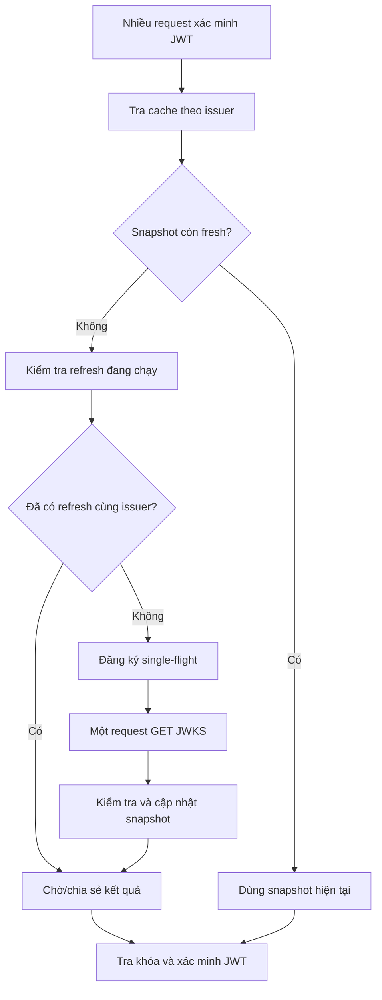
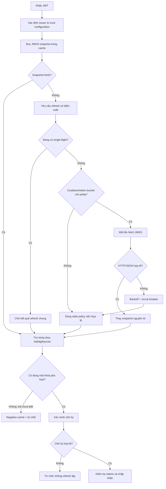

# Giới hạn tần suất tải lại khóa và chống bão yêu cầu

## 1. Vì sao cần kiểm soát việc tải lại JWKS?

Trong module **SECURITY_TOKEN_SECURITY_JWT — Security - JSON Web Token (JWT)**, bên xác minh thường dùng **JSON Web Key Set (JWKS)** để lấy các khóa công khai phục vụ kiểm tra chữ ký JWT. JWKS là một tập các JWK được công bố bởi issuer hoặc nguồn khóa đã được cấu hình tin cậy.

Nếu hệ thống tải JWKS cho từng request, hoặc tải lại mỗi khi gặp một `kid` chưa biết, một lượng request JWT lớn có thể biến thành lượng request HTTP rất lớn tới dịch vụ phát hành. Điều này gây:

- **Request amplification:** một request xác minh token kéo theo một hoặc nhiều request lấy khóa.
- **Thundering herd:** nhiều request cùng phát hiện cache hết hạn và đồng loạt tải cùng một JWKS.
- **Unknown-kid flood:** kẻ tấn công gửi token có `kid` ngẫu nhiên để kích hoạt refresh liên tục.
- **Upstream overload:** issuer/JWKS endpoint bị quá tải, chậm hoặc trả lỗi.
- **Availability failure:** dịch vụ xác minh không lấy được khóa mới và có thể từ chối cả token hợp lệ.
- **Stale-key risk:** dùng khóa cũ quá lâu có thể chấp nhận chữ ký từ khóa đã bị thu hồi hoặc xóa.

Vì vậy, tải lại JWKS là một hoạt động có chi phí và cần chính sách rõ ràng. Hệ thống phải cân bằng giữa độ mới của khóa, khả năng chống chịu khi upstream lỗi và giới hạn tải.

## 2. Mô hình cache JWKS

Thay vì truy cập JWKS endpoint trên mọi request, bên xác minh nên duy trì một bản cache khóa theo issuer hoặc theo nguồn khóa tin cậy.

Một bản cache có thể lưu:

| Dữ liệu | Mục đích |
| --- | --- |
| Issuer / trust domain | Phân vùng cache theo đúng bên phát hành |
| JWKS URI đã cấu hình | Xác định nguồn khóa tin cậy |
| JWK Set hiện tại | Tập khóa công khai đã tải và kiểm tra |
| Thời điểm tải thành công | Tính tuổi dữ liệu và thời điểm cần refresh |
| `Cache-Control` / `max-age` | Xác định thời gian freshness theo HTTP |
| `ETag` | Gửi conditional request để kiểm tra bản JWKS có thay đổi không |
| `Last-Modified` | Hỗ trợ conditional request theo thời gian sửa đổi |
| Thời điểm refresh tiếp theo | Áp dụng TTL, cooldown và jitter |
| Trạng thái lỗi/backoff | Tránh retry liên tục khi upstream gặp sự cố |
| Negative-cache entries | Ghi nhớ tạm thời `kid` không tồn tại để giảm lookup/refresh lặp |

**Cache phải được phân vùng theo issuer hoặc trust domain.** Không dùng một tập khóa chung cho nhiều issuer nếu không có cấu hình ràng buộc rõ ràng. Không chọn JWKS URI tùy ý từ JWT chưa xác minh; `iss` hoặc `kid` trong token chỉ là dữ liệu đầu vào chưa tin cậy. Nếu cần dùng `iss` để tìm cấu hình, chỉ ánh xạ tới danh sách issuer được cho phép và kiểm tra issuer chính xác sau khi xác minh.

### 2.1. Lưu cả tập JWKS, không chỉ một khóa theo kid

JWKS là một snapshot gồm nhiều JWK. Cache nên lưu tập khóa đã xác thực theo issuer, sau đó chọn khóa cho từng token bằng các thuộc tính phù hợp:

- `kid`: định danh khóa, so khớp chính xác theo quy ước của nguồn phát hành.
- `kty`: loại khóa.
- `alg`: thuật toán được chỉ định cho khóa, nếu có.
- `use`: mục đích sử dụng, ví dụ `sig`.
- `key_ops`: thao tác được phép, ví dụ `verify`.

Không chỉ kiểm tra `kid` rồi chấp nhận bất kỳ khóa nào. Nếu nhiều khóa cùng khớp mà không thể phân biệt an toàn theo profile, phải từ chối trường hợp mơ hồ thay vì chọn ngẫu nhiên.

Các trường `alg`, `use` và `key_ops` trong JWK là tùy chọn theo định dạng. Nếu có, chúng phải tương thích với mục đích xác minh và chính sách của bên nhận. Nếu vắng mặt, xử lý theo profile đã cấu hình; không được mặc nhiên coi mọi khóa là phù hợp, cũng không nên viết bộ chọn khóa giả định các trường này luôn tồn tại.

### 2.2. Kiểm tra snapshot trước khi thay cache

Khi tải JWKS mới, cần kiểm tra cấu trúc JSON, kích thước, số lượng khóa, loại khóa và các trường cần thiết. Với JWKS công khai dùng xác minh chữ ký, không được chấp nhận khóa chứa material riêng tư. Chỉ thay cache sau khi toàn bộ snapshot đã được parse và kiểm tra thành công.

Việc cập nhật nên **thay snapshot một cách nguyên tử**: người đọc thấy toàn bộ phiên bản cũ hoặc toàn bộ phiên bản mới, không thấy trạng thái nửa cũ nửa mới. Không tự động trộn tất cả khóa cũ vào tập mới vô thời hạn, vì điều đó có thể giữ lại khóa đã bị issuer loại bỏ.

## 3. Khi nào nên tải lại JWKS?

Một hệ thống có thể có nhiều tín hiệu refresh, nhưng phải hợp nhất chúng dưới cùng một chính sách giới hạn.

| Tín hiệu | Hành động gợi ý |
| --- | --- |
| Cache hết hạn theo freshness policy | Bắt đầu một refresh cho issuer |
| Gặp `kid` chưa có trong snapshot còn mới | Có thể yêu cầu một refresh có kiểm soát, sau đó tra cứu lại |
| Gặp `kid` mới sau khi issuer xoay vòng khóa | Refresh theo cooldown hoặc theo lịch đã cấu hình |
| Nhận thông báo xoay vòng/thu hồi từ kênh quản trị tin cậy | Có thể yêu cầu refresh hoặc invalidation có kiểm soát |
| Chữ ký sai dù `kid` và khóa đã tồn tại | Từ chối token; không refresh chỉ vì chữ ký sai |
| Upstream lỗi hoặc trả `429`/`5xx` | Áp dụng backoff, giới hạn retry và chính sách stale |
| Mỗi request đến, bất kể cache còn mới hay không | **Không** tải JWKS lại |

Điểm quan trọng là **chữ ký sai không phải tín hiệu cần tải lại khóa**. Nếu `kid` đã ánh xạ tới khóa phù hợp nhưng chữ ký không xác minh được, token phải bị từ chối. Tải lại JWKS mỗi lần chữ ký sai sẽ tạo một đường khuếch đại request dễ bị khai thác.

### 3.1. Refresh theo TTL

Mỗi snapshot có thời gian freshness. Khi còn fresh, sử dụng snapshot để xác minh. Khi hết hạn, một request có thể khởi tạo refresh; các request đồng thời nên chờ cùng kết quả hoặc sử dụng snapshot cũ theo chính sách stale được định nghĩa.

Không nên để từng request tự quyết định tải lại chỉ vì chúng cùng nhìn thấy một thời điểm hết hạn. Cần cơ chế đồng bộ theo issuer.

### 3.2. Refresh do kid chưa biết

Issuer có thể xoay vòng khóa và bắt đầu ký bằng một `kid` mới trước khi cache bên nhận hết TTL. Vì vậy, unknown `kid` có thể là dấu hiệu một khóa mới vừa được công bố.

Luồng hợp lý:

1. Tra cứu `kid` trong snapshot hiện tại.
2. Nếu không có khóa phù hợp, kiểm tra negative cache và thời điểm refresh gần nhất của issuer.
3. Nếu refresh được phép, khởi tạo hoặc tham gia một refresh chung.
4. Sau refresh, tra cứu lại đúng `kid` và các thuộc tính khóa.
5. Nếu vẫn không có khóa phù hợp, từ chối token.

Unknown `kid` chỉ là **lý do để cân nhắc refresh**, không phải bằng chứng token hợp lệ và không phải quyền yêu cầu một lần tải JWKS riêng cho mỗi request.

## 4. Single-flight: gom nhiều refresh thành một

**Single-flight** (request coalescing) là cơ chế đảm bảo chỉ có một thao tác refresh đang chạy cho cùng một khóa cache, thường là issuer/JWKS URI. Các request khác cần refresh cùng issuer sẽ chờ hoặc nhận kết quả của thao tác đang chạy.

Ví dụ, 500 request cùng lúc phát hiện cache hết hạn:

```text
Không có single-flight:
500 request -> 500 lần GET JWKS

Có single-flight:
500 request -> 1 lần GET JWKS
             -> kết quả được chia sẻ cho 500 request
```

Sơ đồ:



Single-flight nên được phân vùng theo issuer hoặc cache key đầy đủ, không dùng một khóa toàn cục khiến refresh của issuer này chặn issuer khác.

### 4.1. Single-flight trong một tiến trình và nhiều tiến trình

Single-flight trong một tiến trình chỉ gom request thuộc tiến trình đó. Nếu hệ thống có 20 replica, khi cache cùng hết hạn có thể vẫn xuất hiện tối đa 20 lần refresh, mỗi replica một lần.

Các cách giảm tải ở quy mô nhiều replica:

- Dùng shared cache có kiểm soát để các replica cùng đọc snapshot.
- Dùng distributed lease/lock theo issuer khi cần chỉ một replica refresh.
- Phân tán thời điểm refresh bằng jitter để các replica không cùng hết hạn.
- Dùng egress rate limit hoặc gateway cache để giới hạn tổng request tới JWKS endpoint.
- Chấp nhận một số refresh song song có giới hạn nếu distributed coordination phức tạp hơn lợi ích thu được.

Distributed lock cần có thời hạn, xử lý chủ sở hữu chết và fencing/version phù hợp. Không giữ lock vô hạn nếu một replica bị treo.

## 5. Cooldown, rate limit và token bucket

Single-flight chỉ ngăn các request **đồng thời** trùng lặp. Nó không ngăn các đợt refresh liên tiếp cách nhau rất ngắn, ví dụ mỗi giây có một `kid` ngẫu nhiên mới. Vì vậy cần thêm giới hạn tần suất.

### 5.1. Minimum refresh interval / cooldown

Mỗi issuer có thể có một khoảng thời gian tối thiểu giữa hai lần refresh do unknown `kid` kích hoạt. Nếu vừa refresh xong, một `kid` khác xuất hiện trong cooldown thì không tạo request mới.

Ví dụ:

```text
Issuer A:
  last_refresh = 12:00:00
  minimum_refresh_interval = policy-defined

  12:00:01: kid unknown -> không tạo refresh mới
  12:00:02: kid unknown -> không tạo refresh mới
  12:00:03: kid unknown -> không tạo refresh mới
```

Khoảng cooldown cần được cấu hình theo tốc độ xoay vòng khóa và yêu cầu cập nhật. Nếu quá dài, bên nhận có thể chậm nhận khóa mới; nếu quá ngắn, hệ thống vẫn dễ bị unknown-kid flood.

### 5.2. Token bucket theo issuer

Token bucket cho phép một số lượng refresh nhất định trong một khoảng thời gian:

- Bucket có dung lượng tối đa (burst capacity).
- Token được nạp lại theo tốc độ cố định.
- Mỗi lần refresh cần tiêu thụ một token.
- Nếu bucket hết, refresh bị hoãn hoặc từ chối cho tới khi có token mới.

Nên có giới hạn riêng theo issuer và một giới hạn tổng ở tầng egress. Giới hạn theo issuer ngăn một issuer bị spam; giới hạn tổng ngăn nhiều issuer cùng tạo tải vượt khả năng hệ thống.

### 5.3. Không chỉ dựa vào rate limit theo kid

Kẻ tấn công có thể gửi một `kid` khác nhau ở mỗi request. Nếu chỉ giới hạn mỗi `kid`, chúng vẫn tạo ra vô số cache key và refresh. Rate limit chính phải áp dụng ở **cấp issuer/JWKS endpoint**, không phải chỉ ở cấp `kid`.

## 6. Negative caching cho kid không tồn tại

**Negative cache** lưu tạm kết quả “không tìm thấy khóa phù hợp cho `kid` này”. Khi cùng `kid` xuất hiện lại trong thời gian ngắn, hệ thống có thể từ chối nhanh mà không lặp lại tra cứu hoặc refresh.

Ví dụ logic:

```text
lookup(issuer, kid):
    if negativeCache.contains(issuer, kid):
        reject as unknown key

    key = findEligibleKey(currentJwks[issuer], kid)
    if key exists:
        return key

    requestRefreshIfAllowed(issuer)
    key = findEligibleKey(updatedJwks[issuer], kid)

    if key exists:
        return key

    negativeCache.put(issuer, kid, shortBoundedTTL)
    reject as unknown key
```

### 6.1. Negative cache phải ngắn và có giới hạn

Một khóa mới có thể được công bố ngay sau lần tra cứu thất bại. Nếu negative cache quá lâu, token hợp lệ dùng khóa vừa xoay vòng sẽ bị từ chối trong thời gian dài.

Do đó:

- TTL negative cache phải ngắn và phù hợp với thời gian propagation của JWKS.
- Cache phải có giới hạn số lượng entry và chính sách eviction.
- Key phải được namespace theo issuer.
- Không lưu mọi chuỗi `kid` vô hạn; giới hạn độ dài và dạng dữ liệu.
- Sau khi snapshot JWKS được cập nhật thành công, cần loại bỏ negative entry tương ứng hoặc đảm bảo tra cứu lại snapshot mới trước khi từ chối.

### 6.2. Negative cache không thay thế cooldown

Negative cache theo cặp `(issuer, kid)` không chống được cuộc tấn công dùng `kid` ngẫu nhiên liên tục. Kẻ tấn công có thể tạo một entry mới ở mỗi request. Vì thế cần kết hợp:

- Single-flight để gom refresh đồng thời.
- Cooldown hoặc token bucket ở cấp issuer.
- Negative cache ngắn, có giới hạn dung lượng.
- Giới hạn tổng request tới JWKS endpoint.

## 7. HTTP caching và conditional request

JWKS thường được phân phối qua HTTP(S). Bên xác minh nên tận dụng cơ chế cache HTTP khi issuer cung cấp header phù hợp.

| Header / cơ chế | Ý nghĩa |
| --- | --- |
| `Cache-Control: max-age` | Thời gian response có thể được coi là fresh theo HTTP |
| `Cache-Control: no-cache` | Có thể lưu nhưng phải revalidate trước khi sử dụng theo quy tắc cache |
| `Cache-Control: no-store` | Không lưu response trong cache |
| `ETag` | Validator nhận diện phiên bản representation |
| `If-None-Match` | Gửi validator đã lưu để hỏi representation có thay đổi không |
| `Last-Modified` | Thời điểm representation được sửa đổi |
| `If-Modified-Since` | Conditional request dựa trên thời điểm sửa đổi |
| `304 Not Modified` | Representation không đổi; tiếp tục dùng snapshot đã lưu theo metadata freshness mới |

### 7.1. Refresh có điều kiện

Nếu cache có `ETag`, lần refresh tiếp theo có thể gửi:

```http
GET /.well-known/jwks.json HTTP/1.1
If-None-Match: "jwks-version-42"
```

Nếu JWKS chưa thay đổi, server có thể trả `304 Not Modified`. Bên xác minh giữ nguyên snapshot hiện có và cập nhật metadata cache theo response. Điều này giảm băng thông và chi phí parse so với tải lại toàn bộ JSON.

Nếu server trả `200 OK`, cần kiểm tra response mới rồi thay snapshot nguyên tử. Không dùng response lỗi hoặc JSON không hợp lệ để ghi đè cache tốt hiện tại.

### 7.2. TTL từ server và giới hạn cục bộ

Nên tôn trọng chính sách HTTP cache của nguồn khóa. Hệ thống cũng có thể áp dụng giới hạn freshness tối đa cục bộ theo yêu cầu bảo mật, miễn là không tự ý kéo dài freshness vượt quá chính sách nguồn phát hành.

Nếu response không cung cấp chỉ dẫn cache rõ ràng, profile có thể định nghĩa TTL mặc định và giới hạn tối đa. Nếu có `no-store`, không được lưu response như một cache thông thường. Nếu có `no-cache`, cần revalidate theo quy tắc HTTP trước khi coi bản lưu là fresh.

Không đặt TTL quá dài chỉ để giảm request: điều đó làm chậm khả năng nhận khóa mới hoặc phát hiện khóa đã bị loại bỏ. TTL quá ngắn lại làm tăng tải và độ nhạy với lỗi upstream.

## 8. Backoff, jitter và xử lý upstream lỗi

Khi JWKS endpoint lỗi, retry liên tục có thể làm tình hình tệ hơn. Dùng **exponential backoff** để tăng dần khoảng cách giữa các lần thử:

```text
delay = min(maxDelay, baseDelay * 2^attempt)
actualDelay = random(0, delay)  // full jitter
```

Jitter giúp nhiều replica không cùng retry tại một thời điểm. Cần giới hạn số lần retry, tổng thời gian chờ và số request đồng thời.

### 8.1. Tôn trọng Retry-After

Nếu upstream trả `429 Too Many Requests` hoặc response phù hợp khác kèm `Retry-After`, client nên tuân thủ thời điểm retry được chỉ định, kết hợp với giới hạn cục bộ. Không được bỏ qua `Retry-After` rồi tiếp tục refresh nhanh hơn.

### 8.2. Circuit breaker và concurrency limit

Khi upstream liên tục lỗi:

- **Circuit breaker** tạm ngừng request mới trong một khoảng thời gian sau ngưỡng lỗi.
- **Half-open probe** cho phép một số ít request kiểm tra upstream đã phục hồi chưa.
- **Concurrency limit** giới hạn số lần fetch JWKS đồng thời trên toàn hệ thống hoặc mỗi nguồn.
- **Retry budget** giới hạn tổng chi phí retry trong một khoảng thời gian.

Circuit breaker phải có trạng thái theo issuer/JWKS endpoint; lỗi của một issuer không nên chặn tất cả nguồn khóa khác.

### 8.3. Timeout và kích thước response

Đặt timeout kết nối và đọc response phù hợp. Giới hạn kích thước JSON, số JWK, độ dài `kid`, số lượng trường và loại khóa được xử lý. Không để một JWKS response bất thường làm tiêu thụ bộ nhớ hoặc CPU không giới hạn.

## 9. Dùng khóa cũ khi refresh thất bại: stale-key policy

Khi upstream tạm thời không truy cập được, hệ thống có thể đã có snapshot JWKS trước đó. Việc có tiếp tục dùng snapshot cũ hay không phải là một quyết định chính sách bảo mật.

| Trường hợp | Hướng xử lý |
| --- | --- |
| Snapshot còn fresh | Dùng khóa trong snapshot |
| Snapshot hết hạn, upstream tạm lỗi, `kid` đã có trong snapshot | Có thể dùng stale key trong giới hạn stale tối đa nếu profile cho phép |
| `kid` chưa từng thấy, upstream lỗi | Từ chối; không thể xác minh bằng khóa không có trong nguồn tin cậy |
| Khóa bị đánh dấu compromised/revoked | Ngừng dùng ngay theo chính sách thu hồi; không fallback sang stale |
| Vượt quá hard max-stale | Từ chối hoặc chuyển sang chế độ suy giảm đã được thiết kế rõ |

### 9.1. Chỉ stale cho khóa đã biết

Stale fallback chỉ có thể áp dụng cho khóa đã được tải và xác thực từ nguồn tin cậy trước đó. Không được dùng stale mode để đoán khóa cho `kid` mới hoặc chấp nhận token vì upstream đang lỗi.

### 9.2. Giới hạn tuổi stale

Profile nên định nghĩa:

- Tuổi tối đa của snapshot được phép dùng khi upstream lỗi.
- Loại lỗi nào được phép kích hoạt stale fallback.
- Có cho phép dùng stale với token có thời hạn dài hay không.
- Cách xử lý khi có tín hiệu thu hồi khóa khẩn cấp.
- Điều kiện dừng stale và phục hồi về snapshot mới.

Stale fallback cải thiện availability nhưng tăng cửa sổ chấp nhận khóa cũ. Với khóa bị lộ hoặc bị thu hồi, availability không được ưu tiên hơn chính sách từ chối khóa đã biết là không an toàn.

### 9.3. Không fallback khi chữ ký sai

Nếu một khóa đã biết nhưng chữ ký không hợp lệ, không thử dùng snapshot cũ hơn hoặc tải JWKS liên tục để tìm một khóa khác chỉ nhằm làm token qua được. Xác minh phải theo đúng issuer, `kid`, thuật toán và chính sách đã cấu hình.

## 10. Xoay vòng khóa và đồng bộ cache

Rate limit quá chặt có thể khiến khóa mới đến chậm; refresh quá thường xuyên lại tạo tải. Cần phối hợp cache policy với quy trình key rotation của issuer.

### 10.1. Xoay vòng bình thường

Một quy trình an toàn thường có các bước:

1. Tạo khóa mới và công bố public key trong JWKS.
2. Chờ thời gian propagation/cache hợp lý để các bên xác minh có thể nhận khóa mới.
3. Bắt đầu ký token bằng `kid` mới.
4. Duy trì public key cũ đủ lâu để xác minh token cũ còn hiệu lực, tính cả clock skew và thời gian cache.
5. Khi token cũ hết hạn và thời gian overlap kết thúc, loại bỏ khóa cũ khỏi JWKS.

Nếu issuer bắt đầu ký bằng khóa mới trước khi công bố hoặc trước khi bên nhận có cơ hội refresh, các token mới có thể bị từ chối tạm thời. Nếu xóa khóa cũ quá sớm, token cũ còn hiệu lực có thể không xác minh được.

### 10.2. Xoay vòng khẩn cấp

Khi khóa riêng bị lộ hoặc có dấu hiệu bị xâm phạm, không nên chờ TTL tự hết. Cần có quy trình invalidation/refresh khẩn cấp qua kênh quản trị tin cậy, rút ngắn thời gian cache theo chính sách và ngừng chấp nhận khóa bị ảnh hưởng.

Không được giữ stale key đã bị xác nhận compromised chỉ để duy trì availability. Hệ thống cần có cách phân phối sự kiện thu hồi hoặc cập nhật trust configuration nhanh hơn chu kỳ refresh thông thường.

### 10.3. Jitter thời điểm refresh

Nếu mọi replica khởi động cùng lúc và dùng cùng TTL, chúng có thể hết hạn cache gần như đồng thời. Có thể thêm jitter vào lịch refresh chủ động:

```text
scheduledRefresh = expiryTime - refreshLeadTime - random(0, jitterWindow)
```

Jitter nên chỉ làm phân tán thời điểm refresh trong giới hạn freshness policy. Không được làm một snapshot được xem là fresh lâu hơn thời hạn cho phép.

## 11. Quy trình tổng thể chống refresh storm

Sơ đồ sau kết hợp cache, single-flight, cooldown, negative cache và backoff:



### 11.1. Mã giả minh họa

```text
function resolveVerificationKey(tokenHeader, expectedIssuer):
    require expectedIssuer in configuredTrustedIssuers

    state = jwksCache.get(expectedIssuer)
    require state exists or refreshCanBeScheduled(expectedIssuer)

    if state is missing or state.isExpired:
        state = refreshSingleFlightWithRateLimit(expectedIssuer)
        if refresh failed:
            state = applyBoundedStalePolicy(expectedIssuer)

    candidates = selectKeys(
        state.jwks,
        kid = tokenHeader.kid,  // exact match when the token has a kid
        alg = tokenHeader.alg,
        kty = allowedKeyTypesFor(tokenHeader.alg),
        use = "sig" when JWK use is present,
        key_ops includes "verify" when JWK key_ops is present,
        JWK alg matches token alg when JWK alg is present
    )

    if candidates has exactly one eligible key:
        return candidates[0]

    if candidates is ambiguous:
        reject

    if tokenHeader.kid is present and
       negativeCache.has(expectedIssuer, tokenHeader.kid):
        reject

    if refreshAllowed(expectedIssuer):
        state = refreshSingleFlightWithRateLimit(expectedIssuer)
        candidates = selectKeys(state.jwks, tokenHeader)

    if candidates has exactly one eligible key:
        return candidates[0]

    if tokenHeader.kid is present:
        negativeCache.putBounded(expectedIssuer, tokenHeader.kid, shortTTL)
    reject as unknown key

function verifyJwt(token, expectedIssuer, expectedAudience):
    header = parseCompactJwsHeader(token)
    key = resolveVerificationKey(header, expectedIssuer)

    // A known key with an invalid signature is a verification failure.
    // Do not trigger another JWKS refresh for that same failure.
    require verifyJwsSignature(token, key)

    claims = parseClaims(token)
    require claims.iss == expectedIssuer
    require expectedAudience is allowed by claims.aud
    require temporalClaimsAreValid(claims)
    return claims
```

Đây là mã giả mô tả chính sách, không phải triển khai hoàn chỉnh. Trong thực tế, `refreshSingleFlightWithRateLimit` phải xử lý đồng thời, timeout, retry budget, `Retry-After`, ETag/304 và lỗi parse. Nếu refresh bị cooldown chặn, không được biến việc chặn refresh thành lý do chấp nhận một khóa không có trong snapshot.

## 12. Kiến trúc triển khai nhiều replica

Với một dịch vụ chạy nhiều instance, cần phân biệt:

| Lớp kiểm soát | Phạm vi | Tác dụng |
| --- | --- | --- |
| In-process cache | Một instance | Tránh parse và fetch lặp trong instance |
| In-process single-flight | Một instance/issuer | Gom request đồng thời trong instance |
| Shared JWKS cache | Cụm dịch vụ | Chia sẻ snapshot giữa các instance |
| Distributed lease | Cụm dịch vụ/issuer | Hạn chế nhiều instance cùng refresh |
| Egress rate limit | Toàn bộ cụm hoặc gateway | Giới hạn tổng request tới nguồn JWKS |
| Circuit breaker | Theo issuer/endpoint | Cô lập upstream đang lỗi |

Không phải hệ thống nào cũng cần distributed lock. Nếu số replica nhỏ, TTL có jitter và nguồn JWKS chịu được lượng refresh giới hạn, single-flight cục bộ có thể đủ. Khi triển khai shared cache hoặc distributed lease, cần xử lý quyền truy cập, tính nguyên tử, phiên bản snapshot và tình huống lease hết hạn trong lúc fetch.

Cache key nên bao gồm định danh trust domain/issuer và JWKS URI đã cấu hình. Tránh dùng một cache key chỉ dựa vào `kid`, vì hai issuer khác nhau có thể dùng cùng giá trị `kid`.

## 13. Quan sát và cảnh báo vận hành

Nên theo dõi các chỉ số:

| Metric | Ý nghĩa |
| --- | --- |
| JWKS refresh attempts | Số lần bắt đầu refresh |
| JWKS refresh success/failure | Tỷ lệ thành công và lỗi |
| JWKS cache age | Tuổi snapshot hiện tại |
| JWKS response status | Tỷ lệ `200`, `304`, `429`, `5xx` |
| Refresh coalesced waiters | Số request dùng chung một refresh |
| Refresh cooldown denials | Số refresh bị chặn do rate limit |
| Unknown-kid count | Số lần gặp `kid` không có khóa phù hợp |
| Negative-cache hit rate | Số lần từ chối nhờ negative cache |
| Backoff/circuit state | Tình trạng retry và upstream |
| Stale-key usage | Số lần dùng snapshot cũ theo chính sách |
| Key rotation propagation | Thời gian từ lúc khóa mới xuất hiện tới lúc được các instance nhận |

Không nên dùng raw token, raw `kid` hoặc dữ liệu nhạy cảm làm metric label. Một attacker có thể gửi vô số giá trị `kid` khác nhau và làm bùng nổ cardinality của hệ thống metrics. Nếu cần điều tra, dùng log có giới hạn, chuẩn hóa và không ghi token đầy đủ hoặc khóa bí mật.

### 13.1. Các dấu hiệu cần cảnh báo

- Refresh attempts tăng đột biến trong khi số lần key rotation không tăng.
- Unknown-kid rate tăng cao từ một nguồn hoặc trên nhiều issuer.
- Nhiều instance refresh cùng JWKS endpoint trong cùng một khoảng thời gian.
- Cache age vượt ngưỡng stale tối đa.
- Upstream liên tục trả `429`, `5xx` hoặc timeout.
- Tỷ lệ chữ ký hợp lệ giảm mạnh sau khi issuer xoay vòng khóa.
- Negative cache tăng nhanh bất thường, cho thấy có thể đang bị random-kid flood.

## 14. Kịch bản kiểm thử quan trọng

| Kịch bản | Kết quả mong đợi |
| --- | --- |
| Nhiều request cùng lúc khi cache hết hạn | Chỉ một refresh cho cùng issuer trong mỗi phạm vi single-flight |
| Nhiều request cùng `kid` chưa biết | Refresh được gom và giới hạn; sau đó từ chối nếu vẫn không có khóa |
| Mỗi request dùng một `kid` ngẫu nhiên | Cooldown/token bucket chặn refresh liên tục; negative cache không tăng vô hạn |
| `kid` đã biết nhưng chữ ký sai | Từ chối token, không tải lại JWKS chỉ vì chữ ký sai |
| JWKS trả `304` | Giữ snapshot hiện tại và cập nhật freshness metadata |
| JWKS trả `200` với khóa mới | Kiểm tra snapshot rồi thay cache nguyên tử |
| JWKS trả JSON sai hoặc có khóa không hợp lệ | Không ghi đè snapshot tốt hiện tại |
| Upstream trả `429` kèm `Retry-After` | Tuân thủ thời điểm retry, không tạo retry storm |
| Upstream lỗi tạm thời, token dùng khóa cũ đã biết | Áp dụng stale policy trong giới hạn cho phép |
| Token dùng `kid` mới nhưng upstream lỗi | Từ chối; không đoán khóa hoặc bỏ qua xác minh |
| Issuer thu hồi khóa khẩn cấp | Invalidate/refresh theo kênh tin cậy; không tiếp tục dùng stale key đã compromised |
| Nhiều issuer dùng cùng `kid` | Không dùng chéo cache hoặc khóa giữa issuer |
| Một replica refresh thành công | Các replica khác nhận snapshot mới theo cơ chế chia sẻ/đồng bộ |

## 15. Checklist thiết kế

- [ ] Cache JWKS theo issuer/trust domain và URI đã được cấu hình tin cậy.
- [ ] Không tải khóa từ URL tùy ý lấy trong JWT header hoặc claims.
- [ ] Lưu snapshot có TTL/freshness và giới hạn stale rõ ràng.
- [ ] Tận dụng `Cache-Control`, `ETag`, `If-None-Match`, `Last-Modified` và `304` khi phù hợp.
- [ ] Parse và kiểm tra snapshot đầy đủ trước khi thay cache nguyên tử.
- [ ] Dùng single-flight để gom refresh đồng thời theo issuer.
- [ ] Dùng cooldown hoặc token bucket để giới hạn refresh liên tiếp.
- [ ] Áp dụng giới hạn tổng ở tầng egress khi chạy nhiều replica.
- [ ] Negative cache `kid` không tồn tại với TTL ngắn, dung lượng giới hạn và namespace theo issuer.
- [ ] Không refresh JWKS chỉ vì chữ ký sai khi khóa đã được tìm thấy.
- [ ] Dùng exponential backoff, jitter, timeout, retry budget và tôn trọng `Retry-After`.
- [ ] Có circuit breaker/concurrency limit cho upstream lỗi.
- [ ] Chỉ dùng stale key đã biết trong giới hạn chính sách; không dùng stale với khóa bị thu hồi/compromised.
- [ ] Phối hợp TTL, refresh và overlap với quy trình key rotation.
- [ ] Theo dõi refresh rate, cache age, unknown-kid flood và stale-key usage.
- [ ] Không log token đầy đủ, khóa riêng hoặc tạo metrics cardinality vô hạn từ `kid`.

## 16. Câu hỏi tự kiểm tra

**Câu 1.** Vì sao không nên tải JWKS trên mỗi request JWT?

**Đáp án:** Vì mỗi request xác minh có thể khuếch đại thành request HTTP tới issuer, tăng độ trễ và làm quá tải upstream.

**Câu 2.** Single-flight giải quyết vấn đề gì?

**Đáp án:** Gom các refresh đồng thời cho cùng issuer thành một thao tác, chia sẻ kết quả cho các request đang chờ.

**Câu 3.** Single-flight có đủ để chống random-kid flood không?

**Đáp án:** Không. Nó chỉ gom request đồng thời; cần cooldown hoặc token bucket ở cấp issuer để chặn các refresh liên tiếp.

**Câu 4.** Vì sao negative cache theo `kid` cần giới hạn dung lượng?

**Đáp án:** Kẻ tấn công có thể tạo `kid` ngẫu nhiên liên tục, khiến cache tăng vô hạn nếu không có TTL và eviction.

**Câu 5.** Khi khóa đã được tìm thấy nhưng chữ ký sai, có nên refresh JWKS không?

**Đáp án:** Không. Đây là lỗi xác minh chữ ký; refresh lặp lại tạo đường khuếch đại request.

**Câu 6.** `ETag` và `304 Not Modified` giúp gì?

**Đáp án:** Cho phép kiểm tra representation JWKS có thay đổi mà không tải lại toàn bộ nội dung, giảm băng thông và chi phí xử lý.

**Câu 7.** Có thể dùng stale key khi upstream lỗi không?

**Đáp án:** Có thể với khóa đã biết, nếu profile cho phép và còn trong hard max-stale. Không dùng stale cho khóa mới chưa biết hoặc khóa đã bị xác nhận compromised.

**Câu 8.** Vì sao cần overlap khi xoay vòng khóa?

**Đáp án:** Để bên nhận có thời gian nhận public key mới trước khi issuer bắt đầu ký bằng nó, đồng thời giữ khóa cũ đủ lâu để xác minh token cũ còn hiệu lực.

## 17. Tài liệu chuẩn tham khảo

- [RFC 7517 — JSON Web Key (JWK)](https://www.rfc-editor.org/rfc/rfc7517): định nghĩa JWK, JWK Set và các tham số như `kid`, `use`, `key_ops`.
- [RFC 7515 — JSON Web Signature (JWS)](https://www.rfc-editor.org/rfc/rfc7515): protected header, `kid` và xác minh chữ ký JWS.
- [RFC 7519 — JSON Web Token (JWT)](https://www.rfc-editor.org/rfc/rfc7519): cấu trúc JWT và các claim cần kiểm tra.
- [RFC 8725 — JSON Web Token Best Current Practices](https://www.rfc-editor.org/rfc/rfc8725): thực hành an toàn khi xác minh JWT, lựa chọn thuật toán và quản lý khóa.
- [RFC 9110 — HTTP Semantics](https://www.rfc-editor.org/rfc/rfc9110): conditional request, validator và `Retry-After`.
- [RFC 9111 — HTTP Caching](https://www.rfc-editor.org/rfc/rfc9111): freshness, validation, `Cache-Control`, `ETag` và cache revalidation.
- [RFC 6585 — Additional HTTP Status Codes](https://www.rfc-editor.org/rfc/rfc6585): `429 Too Many Requests` và cách biểu thị giới hạn request.

**Ghi nhớ:** JWKS refresh phải được kiểm soát theo issuer. Cache giúp tránh tải lặp; single-flight gom refresh đồng thời; cooldown/token bucket chặn refresh liên tiếp; negative cache giảm tra cứu lặp nhưng phải ngắn và có giới hạn; HTTP validators giảm chi phí tải; backoff và stale policy kiểm soát sự cố upstream. Không refresh chỉ vì chữ ký sai, không chấp nhận khóa chưa tin cậy và không dùng stale key đã bị thu hồi.
