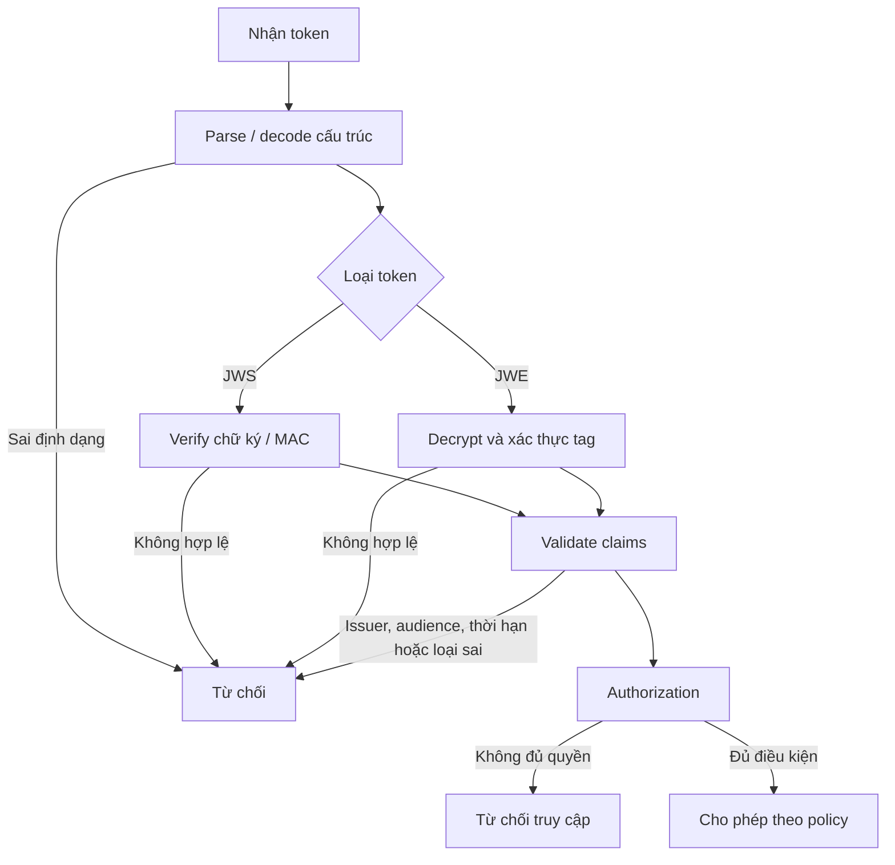
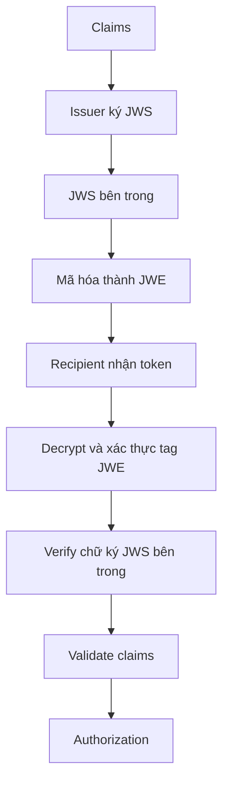

# Phân biệt thao tác decode với verify trong API thư viện

## 1. Vì sao phải phân biệt decode và verify?

Khi xử lý JSON Web Token (JWT), nhiều thư viện cung cấp các thao tác có tên như `decode`, `parse`, `verify` hoặc `decrypt`. Các tên này nghe gần nhau nhưng có thể thực hiện những công việc bảo mật rất khác nhau.

- **Decode/parse:** đọc cấu trúc token, giải mã Base64url và chuyển JSON thành dữ liệu để quan sát.
- **Verify:** kiểm tra chữ ký JWS bằng khóa xác minh và thuật toán được tin cậy.
- **Decrypt/authenticate:** giải mã JWE, đồng thời xác minh authentication tag theo thuật toán mã hóa nội dung.
- **Validate claims:** kiểm tra các claim như issuer, audience, thời hạn và các điều kiện nghiệp vụ.
- **Authorize:** quyết định chủ thể đã được xác thực có được phép thực hiện hành động hay truy cập tài nguyên hay không.

Một payload JWT có thể đọc được sau khi decode nhưng vẫn chưa được xác thực. Kẻ tấn công có thể tự tạo token, thay đổi claim, tính lại Base64url và gửi token đó tới hệ thống. Việc parse thành công chỉ chứng minh dữ liệu có cấu trúc mà thư viện đọc được; nó không chứng minh dữ liệu đến từ issuer đáng tin.

**Nguyên tắc quan trọng:** không dùng kết quả decode-only làm căn cứ xác thực người dùng, dịch vụ hoặc quyền truy cập. Chỉ sử dụng claims sau khi token đã vượt qua các bước xác minh mật mã và kiểm tra chính sách cần thiết.

Bài học này thuộc chương **Xác minh token** của học phần **Security - JSON Web Token (JWT)** (`SECURITY_TOKEN_SECURITY_JWT`). Nội dung áp dụng cho JWT/JOSE nói chung, không phụ thuộc ngôn ngữ lập trình hoặc framework.

## 2. Decode thực hiện những gì?

### 2.1. Đọc cấu trúc và Base64url

Một JWS Compact thường có ba phần:

```text
BASE64URL(protected-header)
.
BASE64URL(payload)
.
BASE64URL(signature)
```

Thao tác decode thường:

1. Tách token theo dấu chấm.
2. Giải mã Base64url của header.
3. Giải mã Base64url của payload.
4. Parse JSON thành cấu trúc dữ liệu.
5. Có thể trả về header, payload hoặc cả hai.

Các bước này không cần khóa bí mật. Bất kỳ ai có token đều có thể đọc header và payload của một JWS thông thường vì Base64url chỉ là encoding, không phải encryption.

Ví dụ payload:

```json
{
  "iss": "https://issuer.example",
  "sub": "user-42",
  "aud": "billing-api",
  "role": "admin",
  "exp": 1924992000
}
```

Sau decode, ứng dụng có thể nhìn thấy `role = admin`. Nhưng nếu chưa verify chữ ký, không có cơ sở để tin rằng issuer thực sự đã phát hành claim đó.

### 2.2. Decode không chứng minh tính toàn vẹn

Giả sử token ban đầu chứa:

```json
{
  "sub": "user-42",
  "role": "user"
}
```

Kẻ tấn công có thể tạo payload khác:

```json
{
  "sub": "user-42",
  "role": "admin"
}
```

Họ có thể Base64url-encode JSON mới và ghép thành một chuỗi có hình dạng JWT. Họ không cần tạo được chữ ký hợp lệ để khiến thao tác decode-only đọc được payload đó.

Nếu ứng dụng chỉ decode rồi tin claim, kẻ tấn công có thể tự khai báo danh tính, vai trò, audience hoặc thời hạn theo ý muốn.

### 2.3. Decode có thể thất bại vì lỗi cú pháp

Decode-only vẫn có thể kiểm tra các lỗi định dạng như:

- Token thiếu hoặc thừa phần.
- Base64url không hợp lệ.
- JSON bị lỗi cú pháp.
- Header hoặc payload không đúng kiểu dữ liệu mong đợi.
- Token vượt giới hạn kích thước.

Những kiểm tra này hữu ích cho parsing, nhưng **không thay thế verify**. Một token có JSON hợp lệ vẫn có thể có chữ ký giả, issuer sai hoặc đã hết hạn.

## 3. Verify thực hiện những gì?

### 3.1. Verify chữ ký JWS

JWS (JSON Web Signature) bảo vệ nội dung bằng chữ ký số hoặc MAC tùy thuật toán. Với JWS Compact, dữ liệu ký được tạo từ:

```text
BASE64URL(protected-header) + "." + BASE64URL(payload)
```

Bên xác minh dùng thuật toán và khóa phù hợp để kiểm tra chữ ký:

- Với thuật toán bất đối xứng như `RS256` hoặc `ES256`, issuer ký bằng private key và bên nhận xác minh bằng public key tương ứng.
- Với thuật toán MAC như `HS256`, các bên dùng chung secret key; mọi bên giữ khóa đều có khả năng tạo MAC hợp lệ.
- Nếu chữ ký không hợp lệ, token phải bị từ chối.

Verify thành công cho biết chữ ký/MAC khớp với dữ liệu và khóa được dùng trong phép kiểm tra. Nó không tự động có nghĩa mọi claim đều đúng với ngữ cảnh ứng dụng.

### 3.2. Verify phải gắn với policy tin cậy

Không nên để token tự quyết định thuật toán hoặc khóa được chấp nhận. Bên nhận cần cấu hình:

- Danh sách thuật toán JWS được phép.
- Nguồn khóa xác minh tin cậy.
- Issuer dự kiến và cách ánh xạ issuer với key set.
- Audience dự kiến.
- Quy tắc kiểm tra claim và loại token.
- Chính sách thời gian, clock skew và trạng thái thu hồi nếu có.

Header được parse trước khi chữ ký được xác minh, nên các giá trị như `alg` và `kid` ban đầu vẫn là dữ liệu chưa đáng tin. Có thể dùng chúng làm gợi ý tra cứu trong một trust store đã cấu hình, nhưng không được để chúng mở rộng nguồn khóa hoặc policy.

### 3.3. Verify không phải lúc nào cũng kiểm tra đầy đủ claims

Một số thư viện có thể kiểm tra `exp`, `nbf`, `iss` hoặc `aud` ngay trong cùng lời gọi verify. Thư viện khác chỉ xác minh chữ ký rồi trả payload cho ứng dụng tự kiểm tra.

Vì vậy, phải đọc hợp đồng API và cấu hình rõ các điều kiện cần thiết. Đừng suy luận rằng một hàm tên `verify` tự động kiểm tra mọi claim mà hệ thống cần.

## 4. Tên API không thống nhất giữa các thư viện

Đây là điểm dễ gây lỗi khi chuyển từ thư viện này sang thư viện khác. Tên hàm không phải một quy tắc chung của JWT.

| Tên thao tác thường gặp | Có thể thực hiện | Điều phải xác minh trong tài liệu thư viện |
| --- | --- | --- |
| `decode` | Chỉ parse và giải mã Base64url | Có xác minh chữ ký mặc định không? Có tùy chọn tắt verify không? |
| `parse` | Đọc cấu trúc token | Có kiểm tra chữ ký, tag hoặc claim nào không? |
| `verify` | Xác minh chữ ký JWS | Có kiểm tra issuer, audience, thời hạn và thuật toán không? |
| `validate` | Kiểm tra claims hoặc policy | Có xác minh chữ ký trước đó hay chỉ nhận payload đã parse? |
| `decrypt` | Giải mã JWE | Có xác thực authentication tag trước khi trả plaintext không? |
| `decodeAndVerify` | Parse và xác minh trong một thao tác | Những thuật toán, khóa và claim nào được cấu hình? |

Có thư viện đặt tên `decode` cho một thao tác vừa parse vừa xác minh chữ ký khi truyền khóa và cấu hình thích hợp. Cũng có thư viện dùng `decode` chỉ để đọc token mà không xác minh, còn `verify` mới là thao tác xác thực.

Tương tự, `verify` thường nói đến chữ ký JWS; JWE cần thao tác giải mã có xác thực (authenticated decryption). Một thư viện có thể gom các bước này vào một API tổng hợp, nhưng về mặt mật mã chúng vẫn là các công việc khác nhau.

**Không chọn API chỉ dựa trên tên hàm.** Trước khi tích hợp, cần xác nhận chính xác:

1. Hàm có xác minh chữ ký hay chỉ parse?
2. Hàm có chấp nhận thuật toán nào, và danh sách đó có được ứng dụng giới hạn không?
3. Khóa được lấy từ đâu và có ràng buộc với issuer/recipient không?
4. Claim nào được tự động kiểm tra?
5. Có hỗ trợ JWE không, và authentication tag được kiểm tra trước khi trả plaintext không?
6. Những tùy chọn nào có thể vô hiệu hóa kiểm tra bảo mật?

## 5. Phân biệt bốn lớp xử lý token

Nên tách rõ các lớp sau để tránh nhầm kết quả của một thao tác với kết quả của thao tác khác.

| Lớp | Câu hỏi cần trả lời | Ví dụ |
| --- | --- | --- |
| Parsing / decode | Token có cấu trúc đọc được không? | Tách compact parts, parse JSON |
| Cryptographic verification / authenticated decryption | Nội dung có khớp chữ ký hoặc authentication tag với khóa tin cậy không? | Verify JWS, decrypt-and-authenticate JWE |
| Claims validation | Token có đúng issuer, audience, thời hạn và loại token không? | Kiểm tra `iss`, `aud`, `exp`, `nbf` |
| Authorization | Chủ thể có được phép làm hành động này không? | Kiểm tra scope, role, tenant và quyền tài nguyên |



Sơ đồ mô tả luồng tổng quát. Một số thư viện gộp parsing, cryptographic verification và một phần claims validation vào cùng API. Dù API được gộp, ứng dụng vẫn phải hiểu từng điều kiện nào đã được kiểm tra và điều kiện nào còn thiếu.

## 6. Decode và verify đối với JWS

### 6.1. Luồng không an toàn: decode rồi tin payload

```text
// MÃ GIẢ KHÔNG AN TOÀN
payload = JWT.decode(token)
if payload.role == "admin":
    grantAdminAccess()
```

Vấn đề:

- Không kiểm tra chữ ký.
- Không xác minh issuer.
- Không kiểm tra audience.
- Có thể tin claim do attacker tự tạo.
- Có thể bỏ qua thời hạn hoặc loại token.

Chỉ nên dùng decode-only cho mục đích quan sát, chẩn đoán hoặc hiển thị dữ liệu chưa tin cậy; không dùng nó làm bước xác thực.

### 6.2. Luồng an toàn: verify với cấu hình tin cậy

```text
// MÃ GIẢ KHÁI NIỆM
verifiedClaims = JOSE.verifyJWS(
    token = receivedToken,
    trustedIssuerKeys = configuredIssuerKeySet,
    allowedAlgorithms = ["ES256"],
    expectedIssuer = "https://issuer.example",
    expectedAudience = "billing-api",
    validateExpiry = true,
    validateNotBefore = true
)

authorize(
    subject = verifiedClaims.sub,
    scopes = verifiedClaims.scope,
    resource = requestedResource
)
```

Đây là API minh họa, không phải chữ ký hàm của một thư viện cụ thể. Nếu thư viện chỉ verify chữ ký mà không kiểm tra claims, ứng dụng phải gọi bước claims validation riêng trước authorization.

### 6.3. Header vẫn là dữ liệu chưa tin cậy trước khi verify

Bên nhận thường phải đọc header để biết thuật toán hoặc `kid` nhằm chọn khóa. Nhưng header chưa được xác thực cho đến khi chữ ký được kiểm tra thành công.

Cách xử lý an toàn:

- Chọn issuer hoặc trust domain từ cấu hình endpoint, client hoặc ngữ cảnh đã xác thực.
- Chỉ tra cứu `kid` trong key set đã tin cậy của issuer đó.
- Kiểm tra `alg` nằm trong allowlist của profile.
- Không lấy `jku`/`x5u` tùy ý từ token để tải khóa.
- Không tin JWK nhúng trong header nếu chưa xác minh binding với trust anchor.
- Không cho token chọn một khóa hoặc thuật toán nằm ngoài policy.

`kid` là định danh hỗ trợ chọn khóa, không phải bằng chứng khóa thuộc issuer.

## 7. Decode và verify đối với JWE

### 7.1. JWE không dùng verify chữ ký giống JWS

JWE (JSON Web Encryption) mã hóa nội dung. Một JWE thường có năm phần trong Compact Serialization:

```text
protected.encrypted_key.iv.ciphertext.tag
```

Đối với JWE, quy trình tương ứng là:

1. Parse cấu trúc và protected header.
2. Đối chiếu `alg`, `enc` và recipient với policy.
3. Khôi phục hoặc suy ra CEK theo thuật toán quản lý khóa `alg`.
4. Giải mã nội dung và xác minh authentication tag theo `enc`.
5. Chỉ sử dụng plaintext sau khi authenticated decryption thành công.

Một thao tác parse/decode JWE không thể đọc payload nếu chưa có khóa giải mã phù hợp. Nhưng parse header thành công vẫn không chứng minh token hợp lệ.

### 7.2. Authentication tag không phải chữ ký issuer

Tag JWE xác thực dữ liệu theo khóa và tham số mã hóa. Với khóa đối xứng, mọi bên giữ khóa có thể tạo tag hợp lệ. Với public-key encryption cho recipient, bất kỳ ai có public key của recipient đều có thể tạo JWE mới gửi cho họ.

Do đó, **decrypt-and-authenticate thành công không tự chứng minh issuer đã phát hành payload**. Nếu cần xác thực nguồn phát hành, có thể dùng nested JWT: issuer ký JWS trước rồi JWE mã hóa JWS đó.

### 7.3. Luồng nested JWT



Thứ tự xử lý:

- Xác thực JWE và lấy plaintext.
- Xác minh chữ ký JWS bên trong bằng khóa issuer tin cậy.
- Kiểm tra issuer, audience, thời hạn, loại token và quyền.
- Chỉ sau đó mới quyết định truy cập.

Giá trị `cty: "JWT"` có thể chỉ ra nội dung là JWT lồng nhau, nhưng bản thân giá trị header không thay thế việc xác minh chữ ký JWS.

## 8. Claims validation là bước riêng cần cấu hình

Ngay cả khi chữ ký hợp lệ, token vẫn có thể không phù hợp với ứng dụng hiện tại.

| Claim | Cần kiểm tra điều gì? | Rủi ro nếu bỏ qua |
| --- | --- | --- |
| `iss` | Issuer có đúng nguồn được tin cậy không? | Chấp nhận token từ issuer khác |
| `aud` | Token có dành cho API/service hiện tại không? | Token hợp lệ ở hệ thống khác bị dùng sai nơi |
| `exp` | Token còn trong thời hạn không? | Chấp nhận token đã hết hạn |
| `nbf` | Token đã đến thời điểm được phép sử dụng chưa? | Chấp nhận token có hiệu lực trong tương lai |
| `iat` | Thời điểm phát hành có hợp lý theo policy không? | Khó phát hiện token quá cũ hoặc thời gian bất thường nếu policy cần |
| `sub` | Chủ thể có tồn tại và phù hợp ngữ cảnh không? | Gán danh tính sai hoặc không rõ nghĩa |
| `jti` | Có cần theo dõi, thu hồi hoặc chống replay không? | Không phát hiện token đã dùng lại nếu nghiệp vụ yêu cầu |
| `typ` | Token có đúng loại được endpoint chấp nhận không? | Nhầm access token, ID token hoặc loại JWT khác |

Một số điểm cần nhớ:

- `exp` và `nbf` thường được kiểm tra với đồng hồ hệ thống; chỉ cho phép clock skew trong giới hạn nhỏ đã cấu hình.
- `iat` không tự động có nghĩa token hết hạn. Nếu cần giới hạn tuổi tối đa, ứng dụng phải đặt policy rõ.
- `jti` chỉ là định danh. Muốn phát hiện replay hoặc thu hồi, cần cơ chế trạng thái hoặc danh sách thu hồi phù hợp.
- Không phải mọi JWT đều có cùng bộ claim. Profile của issuer và giao thức quyết định claim nào bắt buộc.
- Chữ ký hợp lệ không đồng nghĩa claims hợp lệ trong mọi ngữ cảnh.

## 9. Những tùy chọn nguy hiểm trong API thư viện

Nhiều thư viện cung cấp tùy chọn để hỗ trợ test, migration hoặc tương thích cũ. Nếu bật nhầm trong đường xử lý production, các tùy chọn đó có thể vô hiệu hóa xác minh.

| Tùy chọn hoặc cách dùng | Rủi ro | Hướng xử lý |
| --- | --- | --- |
| Tắt kiểm tra chữ ký (`verify_signature = false` hoặc tương đương) | Payload được tin dù không có chữ ký hợp lệ | Không dùng cho xác thực production |
| Cho phép `none` không có chữ ký | Token không có bảo vệ chữ ký | Từ chối trừ khi một giao thức chuyên biệt có profile rõ ràng và được phê duyệt |
| Không giới hạn thuật toán | Token có thể yêu cầu thuật toán ngoài policy | Cấu hình allowlist tĩnh |
| Dùng secret đối xứng ở nơi mong đợi public key | Có thể gây algorithm/key confusion | Ràng buộc key type và thuật toán |
| Tin `kid` để tải khóa từ nguồn tùy ý | Key substitution, SSRF hoặc tải key độc hại | Tra cứu trong trust store đã cấu hình |
| Bỏ kiểm tra `iss`/`aud` | Token của issuer hoặc đối tượng nhận khác có thể được chấp nhận | Cấu hình issuer và audience mong đợi |
| Bỏ kiểm tra `exp`/`nbf` | Token hết hạn hoặc chưa có hiệu lực vẫn được dùng | Bật kiểm tra thời gian theo policy |
| Decode-only trong middleware xác thực | Không xác minh nguồn và toàn vẹn | Dùng API verify/decrypt đúng loại token |
| Dùng hàm decrypt nhưng bỏ qua tag lỗi | Chấp nhận ciphertext bị sửa | Bắt buộc authenticated decryption thành công |

Không nên copy nguyên ví dụ từ tài liệu kiểm thử vào production nếu ví dụ đó tắt xác minh để đơn giản hóa.

## 10. Thiết kế một lớp xử lý token rõ ràng

Một API nội bộ tốt nên thể hiện rõ trạng thái tin cậy thay vì trả về một payload không phân biệt nguồn gốc.

Ví dụ về các kiểu kết quả khái niệm:

```text
UntrustedDecodedToken
    header
    payload

VerifiedJws
    verifiedHeader
    verifiedClaims
    issuerKeyId

AuthenticatedJwe
    protectedHeader
    authenticatedPlaintext

ValidatedToken
    verifiedOrAuthenticatedContent
    validatedIssuer
    validatedAudience
    validatedTimeWindow
    tokenType
```

Không nhất thiết phải dùng đúng các kiểu dữ liệu này. Ý tưởng là tránh truyền một payload vừa decode qua các thành phần ứng dụng rồi vô tình coi nó là claims đã xác thực.

### 10.1. Luồng xử lý tổng quát

```text
function authenticateIncomingToken(token, endpointPolicy):
    parsed = parseTokenStructure(token)

    if parsed.type == JWS:
        content = verifyJWS(
            token,
            trustedKeys = endpointPolicy.issuerKeys,
            allowedAlgorithms = endpointPolicy.allowedJwsAlgorithms
        )

    else if parsed.type == JWE:
        content = decryptAndAuthenticateJWE(
            token,
            trustedRecipientKeys = endpointPolicy.recipientKeys,
            allowedKeyManagementAlgorithms = endpointPolicy.allowedJweAlgs,
            allowedContentEncryptionAlgorithms = endpointPolicy.allowedJweEncs
        )

    else:
        reject()

    if content contains nested JWS:
        content = verifyInnerJWS(content, endpointPolicy)

    claims = validateClaims(
        content,
        expectedIssuer = endpointPolicy.issuer,
        expectedAudience = endpointPolicy.audience,
        timePolicy = endpointPolicy.timePolicy
    )

    return authorizeAccordingToApplicationPolicy(claims)
```

Đây là mã giả kiến trúc. Một triển khai thật phải xác định loại token theo endpoint/profile, xử lý nested JWT theo hợp đồng và không tự động thử JWS/JWE hoặc nhiều thuật toán cho đến khi một cách giải mã thành công.

## 11. Xử lý lỗi và logging

Các lỗi parsing, chữ ký, tag, claims và authorization cần được phân biệt trong nội bộ để chẩn đoán, nhưng không nên tiết lộ chi tiết nhạy cảm cho client.

| Nhóm lỗi | Ví dụ | Kết quả |
| --- | --- | --- |
| Parse/decode | Sai số phần, Base64url hoặc JSON | Từ chối token |
| Cryptographic verification | Chữ ký JWS sai hoặc thuật toán không được phép | Từ chối token |
| JWE authenticated decryption | Không khôi phục được CEK hoặc tag không hợp lệ | Từ chối token |
| Claims validation | Issuer, audience hoặc thời hạn sai | Từ chối token |
| Authorization | Chủ thể không đủ quyền | Từ chối hành động |

Nguyên tắc:

- Không trả plaintext hoặc claims chưa xác thực trong lỗi.
- Không ghi token đầy đủ, chữ ký, CEK, private key hoặc plaintext nhạy cảm vào log.
- Không tạo khác biệt phản hồi bên ngoài giữa các lỗi mật mã theo cách có thể trở thành oracle.
- Có thể ghi mã lỗi nội bộ, profile, issuer đã xác định từ cấu hình và key ID đã làm sạch.
- Không dùng dữ liệu từ decode-only làm dữ liệu kiểm toán có độ tin cậy cao.

## 12. Kiểm thử để chứng minh API được dùng đúng

Kiểm thử cần phân biệt rõ decode-only, verify và claims validation.

| Ca kiểm thử | Decode-only | Verify / authenticated decrypt |
| --- | --- | --- |
| Token hợp lệ | Có thể parse thành công | Phải xác minh thành công nếu đúng policy |
| Payload bị sửa nhưng cấu trúc hợp lệ | Vẫn có thể parse | Phải từ chối do chữ ký/tag sai |
| Chữ ký giả hoặc sai khóa | Có thể parse | Phải từ chối |
| `alg` ngoài allowlist | Có thể đọc header | Phải từ chối |
| Issuer không mong đợi | Có thể đọc claim `iss` | Claims validation phải từ chối |
| Audience không đúng | Có thể đọc claim `aud` | Claims validation phải từ chối |
| Token hết hạn | Có thể đọc claim `exp` | Claims validation phải từ chối |
| Token có `nbf` trong tương lai | Có thể đọc claim | Claims validation phải từ chối |
| JWE tag bị sửa | Có thể parse header/parts | Authenticated decryption phải từ chối |
| JWE chứa JWS lồng có chữ ký sai | Có thể parse sau khi giải mã ở môi trường test | Verify JWS bên trong phải từ chối |
| Token đúng chữ ký nhưng chủ thể không có quyền | Có thể đọc claims | Verify/claims có thể thành công; authorization phải từ chối |

Các test âm tính quan trọng:

1. Tạo token có payload sửa đổi nhưng giữ chữ ký cũ.
2. Tạo token có chữ ký bằng khóa không thuộc issuer tin cậy.
3. Thay `alg` sang thuật toán ngoài allowlist.
4. Dùng đúng chữ ký nhưng sai `iss` hoặc `aud`.
5. Dùng token hết hạn hoặc chưa tới `nbf`.
6. Sửa authentication tag của JWE.
7. Dùng nested JWE chứa JWS có chữ ký không hợp lệ.
8. Xác nhận đường decode-only không được middleware hoặc endpoint bảo vệ dùng để cấp quyền.

Nên kiểm thử với token giả lập và khóa thử nghiệm. Kiểm tra cả hành vi mặc định của thư viện và hành vi sau khi cấu hình các tùy chọn.

## 13. Checklist tích hợp API JWT

- [ ] Đã đọc tài liệu chính xác của phiên bản thư viện đang sử dụng.
- [ ] Đã xác định decode/parse chỉ đọc dữ liệu hay còn thực hiện xác minh.
- [ ] Đã xác định API verify kiểm tra chữ ký nào và có tự validate claims không.
- [ ] Với JWS, đã cấu hình khóa tin cậy và allowlist thuật toán.
- [ ] Với JWE, đã dùng authenticated decryption và không bỏ qua authentication tag.
- [ ] Không dùng kết quả decode-only để xác thực danh tính hoặc cấp quyền.
- [ ] Không tin header hoặc claims trước khi cryptographic verification thành công.
- [ ] Đã kiểm tra `iss`, `aud`, `exp`, `nbf`, loại token và các claim bắt buộc.
- [ ] Đã xử lý nested JWT theo đúng thứ tự decrypt rồi verify chữ ký bên trong.
- [ ] Không bật `none`, tắt verify hoặc dùng fallback thuật toán trong production.
- [ ] `kid` chỉ được ánh xạ vào nguồn khóa tin cậy đã cấu hình.
- [ ] Lỗi parse, verify, decrypt, claims và authorization được xử lý đúng.
- [ ] Có test âm tính cho payload sửa đổi, chữ ký sai, tag sai, issuer/audience sai và token hết hạn.
- [ ] Log không chứa token, plaintext hoặc khóa bí mật.

**Kết luận:** Decode chỉ giúp đọc cấu trúc và dữ liệu của token; nó không chứng minh token hợp lệ. Verify JWS kiểm tra chữ ký hoặc MAC, còn JWE phải được giải mã kèm xác thực authentication tag. Sau bước mật mã vẫn cần kiểm tra claims và authorization. Vì tên API khác nhau giữa các thư viện, hãy xác minh hành vi thực tế, cấu hình allowlist và khóa tin cậy, rồi kiểm thử cả trường hợp hợp lệ lẫn token giả mạo. Không bao giờ dùng kết quả decode-only làm căn cứ cấp quyền.

### Tài liệu tiêu chuẩn

- [RFC 7515 — JSON Web Signature (JWS)](https://www.rfc-editor.org/rfc/rfc7515)
- [RFC 7516 — JSON Web Encryption (JWE)](https://www.rfc-editor.org/rfc/rfc7516)
- [RFC 7519 — JSON Web Token (JWT)](https://www.rfc-editor.org/rfc/rfc7519)
- [RFC 8725 — JSON Web Token Best Current Practices](https://www.rfc-editor.org/rfc/rfc8725)
