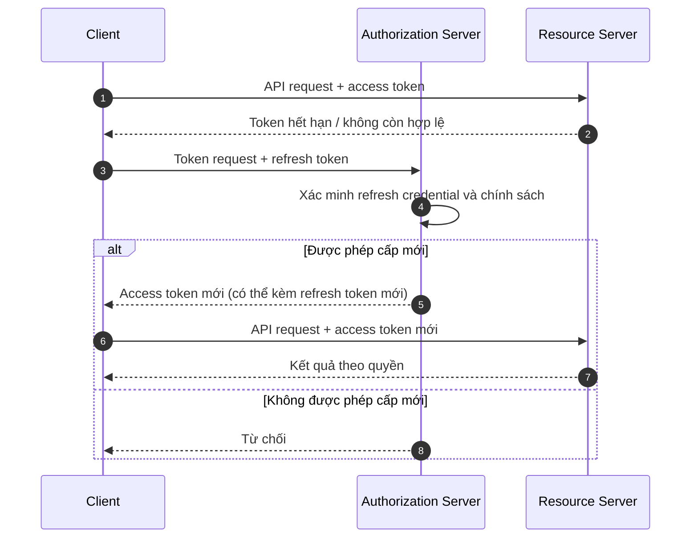
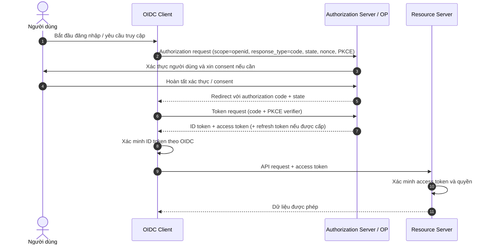

# Vai trò của JWT trong OAuth 2.0 và OpenID Connect

## 1. JWT xuất hiện ở đâu trong OAuth 2.0 và OpenID Connect?

Khi tìm hiểu OAuth 2.0 và OpenID Connect (OIDC), ta thường thấy nhiều token được nhắc đến cùng lúc: access token, refresh token, ID token, JWT, authorization code và client assertion. Chúng có liên quan nhưng không cùng chức năng.

Điểm cần nắm trước tiên:

- **OAuth 2.0** là framework ủy quyền. Nó định nghĩa vai trò, cách client yêu cầu quyền, cách authorization server cấp access token và cách client sử dụng token để truy cập tài nguyên. OAuth 2.0 không bắt buộc access token phải có định dạng JWT.
- **OpenID Connect** là lớp định danh/xác thực được xây dựng trên OAuth 2.0. OIDC sử dụng **ID token**, được biểu diễn dưới dạng JWT, để truyền các khẳng định về kết quả xác thực đến client.
- **JWT** là định dạng dữ liệu token mang claims. Nó có thể được sử dụng cho access token, ID token hoặc một số loại assertion theo hồ sơ cụ thể; bản thân JWT không định nghĩa toàn bộ giao thức OAuth hay OIDC.

Vì vậy, không nên đồng nhất:

```text
OAuth 2.0       != JWT
Access Token    != luôn luôn là JWT
OpenID Connect  != chỉ là JWT
ID Token        = JWT theo quy tắc của OIDC
```

Một hệ thống có thể triển khai OAuth 2.0 với access token opaque; một hệ thống khác có thể sử dụng JWT access token theo một profile như RFC 9068. Khi triển khai OIDC, client nhận ID token JWT để kiểm tra kết quả xác thực; access token đi kèm vẫn có thể là JWT hoặc opaque tùy thiết kế.

Bài này thuộc phạm vi **Security - JSON Web Token (JWT)** tổng quát, tập trung vào vai trò và ranh giới giữa định dạng token với các giao thức ủy quyền/định danh, không phụ thuộc ngôn ngữ lập trình hay framework.

## 2. OAuth 2.0: framework ủy quyền và các vai trò

OAuth 2.0 được đặc tả trong [RFC 6749](https://www.rfc-editor.org/rfc/rfc6749). Mục tiêu chính là cho phép một client nhận quyền truy cập tài nguyên được bảo vệ thông qua authorization server.

### 2.1. Bốn vai trò cốt lõi

| Vai trò | Trách nhiệm | Ví dụ |
| --- | --- | --- |
| **Resource Owner** | Chủ thể có quyền cấp quyền truy cập tài nguyên; thường là người dùng | Người sở hữu tài khoản và dữ liệu đơn hàng |
| **Client** | Ứng dụng yêu cầu quyền và sử dụng access token | Ứng dụng web hoặc ứng dụng di động |
| **Authorization Server (AS)** | Xử lý yêu cầu cấp quyền và phát hành token | Dịch vụ ủy quyền/danh tính |
| **Resource Server (RS)** | Lưu trữ tài nguyên được bảo vệ và chấp nhận/từ chối yêu cầu dựa trên access token | API đơn hàng |

Một client có thể thay mặt người dùng yêu cầu quyền truy cập. Authorization server quyết định cấp token theo quy trình và chính sách. Resource server kiểm tra access token rồi áp dụng chính sách đối với tài nguyên cụ thể.

### 2.2. OAuth 2.0 không chuẩn hóa một cách đăng nhập duy nhất

OAuth 2.0 quy định cách ủy quyền và trao đổi thông điệp, nhưng không định nghĩa một phương thức đăng nhập người dùng dùng chung cho mọi hệ thống. Authorization server có thể xác thực resource owner bằng mật khẩu, xác thực nhiều yếu tố, khóa bảo mật hoặc một cơ chế khác theo chính sách của mình.

Do đó:

- Access token cho biết client đang trình một quyền truy cập được cấp theo giao thức.
- Access token không tự chứng minh người dùng đã đăng nhập theo một phương thức cụ thể.
- OAuth 2.0 không tự cung cấp cho client một hợp đồng chuẩn để nhận diện người dùng cuối như OIDC.

OIDC bổ sung lớp định danh/xác thực mà OAuth 2.0 không cung cấp.

## 3. Access token trong OAuth 2.0: JWT hay opaque đều có thể

### 3.1. Access token đại diện cho quyền truy cập

Access token là credential mà client trình cho resource server để yêu cầu truy cập tài nguyên trong phạm vi được cấp. Nó thường gắn với các yếu tố như:

- Client đã được cấp quyền.
- Resource server hoặc audience được phép nhận token.
- Scope hoặc quyền được cấp.
- Thời hạn và trạng thái của token.
- Người dùng hoặc client mà token đại diện, tùy grant và profile.

OAuth 2.0 **không quy định một định dạng nội bộ duy nhất cho access token**. Resource server cần biết cách kiểm tra token theo thỏa thuận và cơ chế mà authorization server hỗ trợ.

### 3.2. Hai cách biểu diễn access token

| Loại access token | Cách hoạt động | Cách resource server kiểm tra |
| --- | --- | --- |
| **Opaque/reference token** | Chuỗi tham chiếu, không tự bộc lộ claims | Tra cứu trạng thái hoặc gọi endpoint introspection theo RFC 7662/kho dữ liệu được tin cậy |
| **JWT access token** | Mang claims trong token, thường được ký bằng JWS | Xác minh chữ ký với khóa tin cậy, kiểm tra issuer, audience, thời hạn, loại token và chính sách |

Opaque token có thể giúp authorization server kiểm soát trạng thái tập trung và thu hồi bản ghi. JWT access token có thể giúp resource server xác minh cục bộ, giảm tra cứu trung tâm trong mỗi yêu cầu. Cả hai đều có đánh đổi về độ trễ, khả năng sẵn sàng, quản lý khóa, cache và thu hồi.

### 3.3. JWT Profile for OAuth 2.0 Access Tokens

[RFC 9068](https://www.rfc-editor.org/rfc/rfc9068) định nghĩa một profile chuẩn cho **JWT access token trong OAuth 2.0**. Profile này cụ thể hóa cách tạo và xác minh access token dạng JWT, gồm các yêu cầu về header, claims và quy trình kiểm tra.

Một JWT access token tuân thủ RFC 9068 thường có header dạng:

```json
{
  "typ": "at+jwt",
  "alg": "RS256",
  "kid": "as-signing-key-01"
}
```

Payload minh họa:

```json
{
  "iss": "https://authorization.example.org",
  "sub": "account-42",
  "aud": "https://api.example.org/orders",
  "client_id": "shopping-app",
  "iat": 1893456000,
  "exp": 1893456900,
  "jti": "access-7f31",
  "scope": "orders:read"
}
```

Đây là các thành phần minh họa, không phải token đã ký. Với profile RFC 9068, các claims và cách kiểm tra phải đáp ứng đặc tả; không được coi payload tùy ý có `iss`, `sub` và `exp` là JWT access token tuân thủ profile.

Một số điểm cần lưu ý:

- `typ: "at+jwt"` giúp phân biệt JWT access token theo profile với các loại JWT khác.
- `iss` xác định authorization server phát hành.
- `aud` ràng buộc token với resource server dự kiến.
- `sub` xác định chủ thể mà token đại diện theo ngữ cảnh.
- `client_id` xác định client được cấp token.
- `iat`, `exp` biểu diễn thời điểm phát hành và hết hạn theo NumericDate.
- `jti` định danh token; muốn thu hồi hoặc chống phát lại theo ID cần cơ chế trạng thái bổ sung.
- `scope` biểu diễn phạm vi được cấp theo profile và chính sách.

Resource server phải xác minh chữ ký, issuer, audience, thời hạn, loại token và các điều kiện bắt buộc khác theo RFC 9068. Không chỉ parse payload rồi tin claims.

### 3.4. Sử dụng access token

Với bearer access token, client thường gửi token trong header:

```http
GET /orders HTTP/1.1
Host: api.example.org
Authorization: Bearer <access-token>
```

Quy tắc bearer token được mô tả trong [RFC 6750](https://www.rfc-editor.org/rfc/rfc6750). Bất kỳ bên nào chiếm được bearer token có thể thử sử dụng nó trong phạm vi được cấp, vì vậy token cần được bảo vệ qua HTTPS/TLS, lưu giữ an toàn, giới hạn scope/audience và thời hạn.

Không phải access token nào cũng là bearer token. Một số kiến trúc sử dụng token ràng buộc với bên trình, ví dụ DPoP hoặc mutual TLS theo profile phù hợp. Khi đó resource server phải kiểm tra thêm bằng chứng ràng buộc.

## 4. Refresh token trong OAuth 2.0

Refresh token là credential được client gửi đến authorization server để yêu cầu access token mới khi access token hiện tại hết hạn hoặc không còn phù hợp. Nó **không phải credential để gọi resource server**.

Một refresh token có thể là chuỗi opaque hoặc một định dạng khác theo thiết kế; OAuth 2.0 không bắt buộc refresh token phải là JWT. Nếu refresh token được biểu diễn bằng JWT, hệ thống vẫn phải áp dụng chính sách riêng về audience, mục đích, thu hồi và chống sử dụng lại.

### 4.1. Luồng refresh cơ bản



Refresh token thường có giá trị cao vì có thể dùng để xin thêm access token. Cần bảo vệ nó nghiêm ngặt, chỉ gửi đến authorization server, giới hạn phạm vi sử dụng và áp dụng rotation/phát hiện reuse khi chính sách yêu cầu. Việc access token hết hạn không nhất thiết đồng nghĩa người dùng phải đăng nhập lại nếu refresh credential và phiên vẫn hợp lệ.

## 5. OpenID Connect: lớp định danh trên OAuth 2.0

### 5.1. OIDC bổ sung điều gì?

OpenID Connect (OIDC) là một lớp định danh được xây dựng trên OAuth 2.0. OIDC chuẩn hóa cách client yêu cầu xác thực, nhận kết quả xác thực và diễn giải các claims về người dùng.

Một dấu hiệu quan trọng: client yêu cầu scope **`openid`**. Khi sử dụng OIDC, authorization server có thể trả về **ID token** chứa các khẳng định về quá trình xác thực và subject. ID token được biểu diễn dưới dạng JWT.

OIDC không biến mọi access token thành JWT và không làm access token trở thành ID token. OIDC phân biệt hai mục đích:

- **ID token:** dành cho client, mô tả kết quả xác thực và chủ thể.
- **Access token:** dành cho resource server, cho phép truy cập tài nguyên được bảo vệ.

### 5.2. ID token là JWT

Theo OpenID Connect Core 1.0, ID token là một cấu trúc JWT được ký bằng JWS và có thể được mã hóa bằng JWE theo các quy tắc của OIDC.

Ví dụ ID token payload minh họa:

```json
{
  "iss": "https://identity.example.org",
  "sub": "user-2481",
  "aud": "shopping-client",
  "exp": 1893456900,
  "iat": 1893456000,
  "auth_time": 1893455900,
  "nonce": "request-nonce-91"
}
```

Các claim quan trọng:

| Claim | Vai trò trong ID token |
| --- | --- |
| `iss` | Issuer OIDC đã phát hành token |
| `sub` | Định danh subject trong phạm vi issuer |
| `aud` | Client hoặc các client được token hướng đến; thường bao gồm client_id của bên yêu cầu |
| `exp` | Thời điểm ID token hết hạn |
| `iat` | Thời điểm ID token được phát hành |
| `auth_time` | Thời điểm người dùng được xác thực, khi được yêu cầu/trả về theo OIDC |
| `nonce` | Giá trị liên kết ID token với yêu cầu xác thực ban đầu khi client gửi nonce |
| `acr`, `amr` | Thông tin về mức độ hoặc phương thức xác thực, khi được cung cấp |
| `azp` | Authorized party; khi xuất hiện phải khớp client_id; nếu `aud` có nhiều giá trị, client cần kiểm tra `azp` theo quy tắc OIDC |

Không phải mọi claim đều bắt buộc trong mọi ID token. Client phải kiểm tra theo yêu cầu của OIDC Core và các tham số của yêu cầu xác thực.

### 5.3. ID token không phải access token

Đây là ranh giới rất quan trọng:

| Tiêu chí | ID token | Access token |
| --- | --- | --- |
| Mục đích | Truyền kết quả xác thực/claims về subject cho client | Truy cập resource server |
| Đối tượng nhận | OIDC client | Resource server/API |
| Audience | Thường là client_id | Resource server hoặc audience tài nguyên |
| Định dạng | JWT theo OIDC | Có thể là JWT hoặc opaque |
| Bên xác minh chính | Client OIDC | Resource server |
| Quy tắc | OIDC Core | OAuth 2.0 và profile access token được sử dụng |

Không gửi ID token đến API như thể nó là access token. Resource server phải yêu cầu access token phù hợp audience và quyền của API. Ngược lại, client không được dùng access token như bằng chứng xác thực người dùng thay cho ID token.

## 6. Luồng Authorization Code với OpenID Connect

Authorization Code Flow là luồng phổ biến cho ứng dụng web và ứng dụng native. Khi kết hợp OIDC, client yêu cầu scope `openid` và có thể nhận ID token cùng access token ở bước đổi authorization code.

### 6.1. Luồng khái niệm



Sơ đồ lược giản hóa các bước; endpoint, client authentication, PKCE, redirect URI và phản hồi phải tuân thủ OIDC/OAuth profile tương ứng.

### 6.2. Vai trò của các tham số bảo vệ luồng

| Tham số | Mục đích |
| --- | --- |
| `scope=openid` | Báo rằng client đang yêu cầu một luồng OpenID Connect |
| `response_type=code` | Yêu cầu authorization code |
| `state` | Liên kết phản hồi với yêu cầu ban đầu và giảm rủi ro CSRF/correlation |
| `nonce` | Liên kết ID token với yêu cầu xác thực, giúp client phát hiện token bị phát lại trong ngữ cảnh không phù hợp |
| PKCE `code_challenge` / `code_verifier` | Ràng buộc việc đổi authorization code với client đã khởi tạo yêu cầu |
| `redirect_uri` | Xác định endpoint được phép nhận authorization response |

`state`, `nonce` và PKCE giải quyết các vấn đề khác nhau; không nên coi chúng thay thế lẫn nhau. `state` không phải JWT claim bắt buộc. `nonce` có thể xuất hiện trong ID token khi được gửi trong yêu cầu và được yêu cầu theo OIDC.

### 6.3. Kết quả trả về có thể gồm nhiều loại credential

Trong luồng code OIDC, token response có thể chứa:

- **ID token:** JWT dành cho client để xác minh kết quả xác thực.
- **Access token:** credential dành cho resource server.
- **Refresh token:** có thể được cấp nếu đáp ứng điều kiện và chính sách; dùng để xin token mới tại authorization server.

Ba giá trị có thể cùng xuất hiện trong một phản hồi nhưng không có cùng audience hoặc mục đích. Client phải lưu giữ và sử dụng từng credential đúng nơi.

## 7. JWT đóng vai trò gì ở từng điểm trong kiến trúc?

| Vị trí | JWT có thể được dùng như thế nào? | Bên cần xác minh |
| --- | --- | --- |
| Authorization server → client | ID token trong OIDC; có thể là access token JWT nếu dùng profile phù hợp | Client xác minh ID token; access token được client bảo vệ và chuyển tiếp |
| Client → resource server | Access token JWT theo profile được hỗ trợ | Resource server |
| Client → authorization server | Refresh token nếu hệ thống chọn biểu diễn bằng JWT; không phải yêu cầu chung | Authorization server |
| Client authentication → token endpoint | JWT client assertion theo RFC 7523 trong profile hỗ trợ | Authorization server |
| JWT bearer authorization grant | JWT assertion được dùng làm authorization grant theo RFC 7523 trong trường hợp được hỗ trợ | Authorization server |

### 7.1. JWT client assertion là một vai trò khác

[RFC 7523](https://www.rfc-editor.org/rfc/rfc7523) định nghĩa profile sử dụng JWT trong OAuth 2.0 cho **client authentication** và **authorization grant**.

Trong client authentication, client có thể tạo một JWT assertion và gửi đến token endpoint để chứng minh danh tính client theo cơ chế đã đăng ký. Trong JWT bearer authorization grant, JWT assertion được gửi như một grant theo định danh chuẩn của RFC 7523.

Các assertion này **không phải access token và cũng không phải OIDC ID token**. Chúng là JWT được sử dụng trong một vai trò giao thức khác, có audience, thời hạn, issuer/subject và quy tắc xác minh riêng.

Không phải mọi hệ thống OAuth 2.0 đều dùng JWT client assertion hoặc JWT bearer grant. Chỉ sử dụng khi authorization server hỗ trợ và các bên đã cấu hình profile tương ứng.

## 8. Xác minh JWT access token tại Resource Server

Nếu authorization server phát hành JWT access token theo RFC 9068, resource server cần xác minh theo profile và chính sách đã thống nhất.

Các bước khái niệm:

1. **Xác định đúng loại token:** kiểm tra định dạng và `typ` theo profile, chẳng hạn `at+jwt` khi áp dụng RFC 9068.
2. **Xác định issuer tin cậy:** đối chiếu `iss` với authorization server đã cấu hình.
3. **Chọn khóa tin cậy:** dùng khóa công khai từ JWKS/metadata được xác thực; `kid` chỉ giúp chọn khóa trong tập đã tin.
4. **Áp đặt thuật toán:** chỉ chấp nhận thuật toán được chính sách cho phép; không để token tự quyết định.
5. **Xác minh chữ ký:** kiểm tra JWS bằng đúng khóa và thuật toán.
6. **Kiểm tra audience:** `aud` phải phù hợp resource server đang nhận.
7. **Kiểm tra thời gian:** xác minh `exp`, `nbf` nếu có và các ràng buộc tuổi token theo profile.
8. **Kiểm tra claims và quyền:** scope/permission phải phù hợp yêu cầu; kiểm tra thêm quyền trên tài nguyên cụ thể.
9. **Kiểm tra trạng thái bổ sung khi cần:** thu hồi, tài khoản, sender constraint hoặc các điều kiện nghiệp vụ.

Nếu token có chữ ký hợp lệ nhưng audience dành cho API khác, resource server phải từ chối. Nếu scope đủ nhưng chủ thể không có quyền trên tài nguyên cụ thể, API cũng phải từ chối.

## 9. Xác minh ID token tại OIDC Client

Client nhận ID token phải xác minh nó theo OIDC Core. Các bước chính thường gồm:

1. Lấy issuer và khóa từ cấu hình/metadata OIDC tin cậy.
2. Xác minh chữ ký theo thuật toán được chấp nhận.
3. Kiểm tra `iss` trùng issuer mong đợi.
4. Kiểm tra `aud` chứa client_id của client.
5. Kiểm tra `exp` và các ràng buộc thời gian; kiểm tra `iat` theo chính sách.
6. Nếu client gửi `nonce`, so khớp giá trị trong ID token với giá trị đã lưu cho yêu cầu xác thực.
7. Nếu `azp` xuất hiện, kiểm tra nó khớp client_id; khi `aud` có nhiều giá trị, kiểm tra `azp` theo yêu cầu của OIDC Core.
8. Kiểm tra các điều kiện bổ sung theo flow và yêu cầu, ví dụ `auth_time`, `at_hash` hoặc `c_hash` khi áp dụng.

Không nên chỉ giải mã payload để đọc `sub` rồi coi người dùng đã đăng nhập. Client chỉ được sử dụng claims sau khi xác minh ID token thành công và đối chiếu đúng yêu cầu xác thực.

## 10. Những nhầm lẫn phổ biến

| Nhầm lẫn | Cách hiểu đúng |
| --- | --- |
| OAuth 2.0 bắt buộc access token là JWT | OAuth 2.0 không quy định một định dạng access token duy nhất; có thể opaque hoặc JWT |
| Mọi JWT trong hệ thống OAuth đều là access token | JWT có thể là ID token, client assertion, bearer grant hoặc một loại token khác theo profile |
| ID token có thể gửi đến API như access token | ID token dành cho client; API cần access token đúng audience và quyền |
| Access token chứng minh người dùng đã đăng nhập | Access token đại diện cho quyền truy cập; OIDC ID token cung cấp khẳng định xác thực cho client |
| OIDC chỉ là một kiểu JWT | OIDC là lớp định danh trên OAuth 2.0; JWT là định dạng của ID token và có thể được dùng cho access token theo profile |
| Có `scope` nghĩa là được truy cập mọi tài nguyên | Scope là một đầu vào; resource server còn kiểm tra audience và quyền trên tài nguyên |
| JWT đã ký thì không cần thu hồi | JWT có thể cần denylist, introspection hoặc cơ chế trạng thái bổ sung |
| Refresh token gửi đến resource server | Refresh token được gửi đến authorization server để xin access token mới |
| `state`, `nonce` và PKCE là một cơ chế | Chúng giải quyết các rủi ro và ràng buộc khác nhau |
| JWT client assertion là access token | Assertion là credential cho client authentication hoặc authorization grant theo RFC 7523 |

## 11. Chọn đúng loại token theo mục đích

| Mục đích | Loại phù hợp | Bên nhận |
| --- | --- | --- |
| Truy cập API đơn hàng | Access token (JWT hoặc opaque) | Resource server |
| Client nhận kết quả xác thực người dùng theo OIDC | ID token JWT | OIDC client |
| Xin access token mới | Refresh token | Authorization server |
| Client chứng minh danh tính tại token endpoint bằng assertion | JWT client assertion theo RFC 7523 | Authorization server |
| Dùng JWT như một authorization grant | JWT bearer assertion theo RFC 7523 | Authorization server |

Đừng lựa chọn chỉ dựa vào tên hoặc hình thức token. Cần kiểm tra **profile, audience, issuer, mục đích và bên nhận**.

## 12. Checklist triển khai an toàn

### Đối với Authorization Server

- [ ] Đã xác định access token là opaque hay JWT và công bố rõ profile cho resource server.
- [ ] Nếu dùng JWT access token, đã xác định claims/header bắt buộc theo profile, ví dụ RFC 9068.
- [ ] Đã giới hạn audience, scope và thời hạn theo quyền cần thiết.
- [ ] Đã bảo vệ private signing key và có quy trình luân chuyển/thu hồi khóa.
- [ ] Đã có chính sách refresh token, rotation, reuse detection và revocation phù hợp.
- [ ] Nếu dùng OIDC, ID token đáp ứng yêu cầu về chữ ký, claims và audience.

### Đối với Client

- [ ] Phân biệt ID token, access token và refresh token.
- [ ] Chỉ dùng ID token để xử lý kết quả xác thực theo OIDC.
- [ ] Chỉ gửi access token đến resource server phù hợp.
- [ ] Chỉ gửi refresh token đến authorization server.
- [ ] Xác minh ID token theo OIDC, bao gồm issuer, audience, thời gian và nonce khi áp dụng.
- [ ] Dùng Authorization Code Flow với PKCE theo khuyến nghị cho client phù hợp.
- [ ] Bảo vệ token khi lưu, truyền và tránh ghi token nguyên văn vào log.

### Đối với Resource Server

- [ ] Chấp nhận đúng loại access token/profile.
- [ ] Xác minh chữ ký và thuật toán bằng khóa tin cậy.
- [ ] Kiểm tra issuer, audience, thời gian và claims bắt buộc.
- [ ] Không chấp nhận ID token thay cho access token.
- [ ] Kiểm tra scope/permission cùng quyền trên tài nguyên.
- [ ] Có cách xử lý thu hồi, sender constraint và sự cố khóa theo yêu cầu rủi ro.

## 13. Kết luận

JWT là một định dạng token có thể tham gia vào OAuth 2.0 và OpenID Connect, nhưng **vai trò của JWT phụ thuộc loại token và profile đang được sử dụng**.

- Trong OAuth 2.0, access token có thể là opaque hoặc JWT; RFC 9068 chuẩn hóa một profile JWT access token.
- Trong OIDC, ID token là JWT dành cho client để truyền các khẳng định về kết quả xác thực.
- Refresh token là credential dành cho authorization server để cấp access token mới; nó không mặc nhiên là JWT.
- JWT cũng có thể được dùng làm client assertion hoặc authorization grant theo RFC 7523, đây là vai trò khác với access token và ID token.

Khi triển khai, hãy xác định rõ **token nào được gửi cho ai, được phát hành theo profile nào, audience là gì và bên nhận phải xác minh những điều kiện nào**. Phân biệt đúng các vai trò này giúp tránh nhầm token và tạo ranh giới bảo mật rõ ràng giữa client, authorization server và resource server.

## Tài liệu chuẩn để đọc tiếp

- [RFC 6749 — The OAuth 2.0 Authorization Framework](https://www.rfc-editor.org/rfc/rfc6749): vai trò, authorization grant, access token và refresh token.
- [RFC 6750 — OAuth 2.0 Bearer Token Usage](https://www.rfc-editor.org/rfc/rfc6750): cách sử dụng bearer access token.
- [RFC 9068 — JWT Profile for OAuth 2.0 Access Tokens](https://www.rfc-editor.org/rfc/rfc9068): profile JWT access token và quy tắc xác minh.
- [RFC 7662 — OAuth 2.0 Token Introspection](https://www.rfc-editor.org/rfc/rfc7662): kiểm tra trạng thái opaque/reference token.
- [RFC 7009 — OAuth 2.0 Token Revocation](https://www.rfc-editor.org/rfc/rfc7009): thu hồi token.
- [RFC 7523 — JWT Profile for OAuth 2.0 Client Authentication and Authorization Grants](https://www.rfc-editor.org/rfc/rfc7523): JWT client assertion và JWT bearer authorization grant.
- [OpenID Connect Core 1.0](https://openid.net/specs/openid-connect-core-1_0.html): ID token, claims và xác minh theo OIDC.
- [RFC 8725 — JSON Web Token Best Current Practices](https://www.rfc-editor.org/rfc/rfc8725): thực hành bảo mật JWT.
